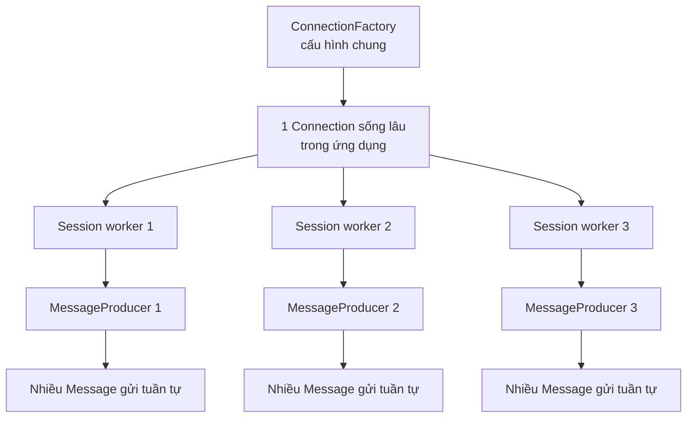
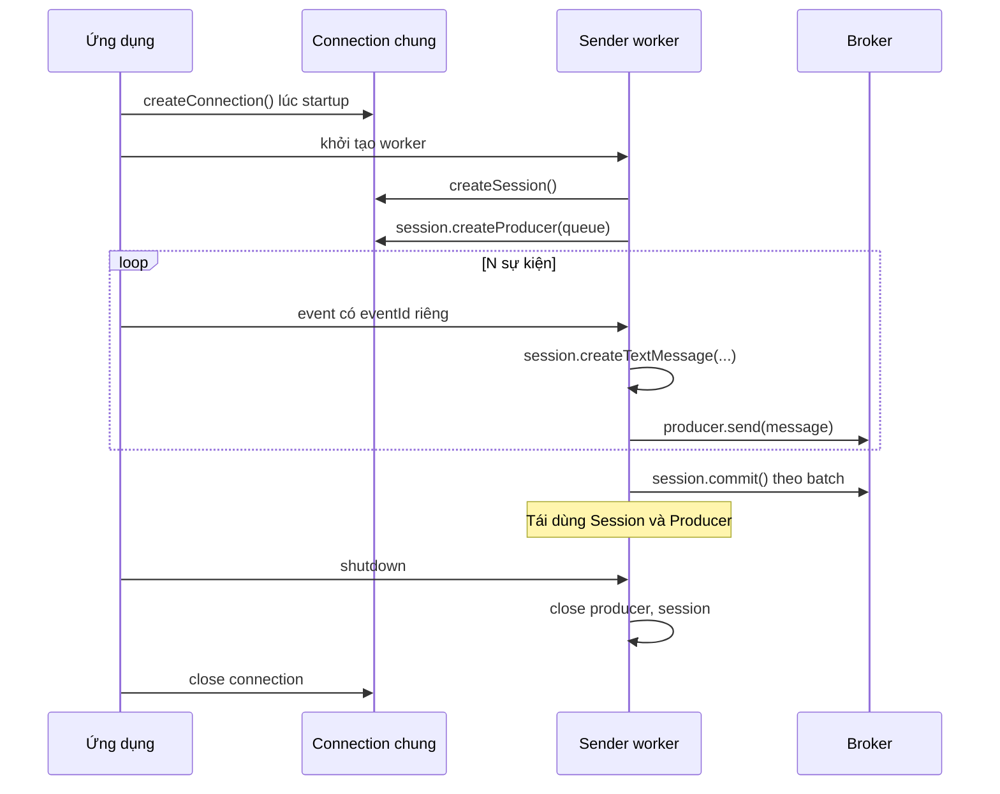
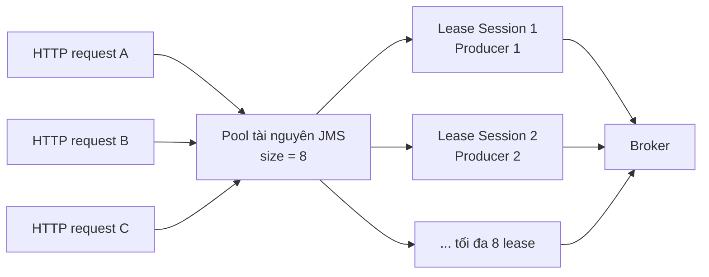

# Tái sử dụng connection, session và producer thay vì tạo theo từng bản tin

> **Chương:** Producer  
> **Phạm vi:** ActiveMQ Classic và ActiveMQ Artemis với ứng dụng Java/JMS. Bài này tập trung vào vòng đời tài nguyên phía producer, an toàn đa luồng, cache/pool có giới hạn và ảnh hưởng đến throughput/latency.

## 1. Vấn đề: mỗi `send()` lại thiết lập một bộ tài nguyên JMS

Giả sử dịch vụ đơn hàng gửi 5.000 sự kiện mỗi giây. Một cách viết tưởng đơn giản là thực hiện toàn bộ chu kỳ sau **cho từng sự kiện**:

```text
createConnection()
  -> createSession()
  -> createProducer()
  -> createTextMessage()
  -> send()
  -> close producer / session / connection
```

Cách này trộn **vòng đời kết nối** (lâu dài) với **vòng đời message** (ngắn). Kết quả thường là tốn tài nguyên, tạo nhiều kết nối TCP và phiên xác thực, tăng áp lực broker và độ trễ từng lần gửi. Khi tải tăng, tình huống này có thể tạo ra một vòng lặp bất lợi: gửi chậm → nhiều request cùng chờ → tạo thêm connection → broker quá tải hơn.

Cần tổ chức lại:



**Nguyên tắc:** Tái sử dụng `ConnectionFactory`, `Connection` và cặp `Session`–`MessageProducer` trong phạm vi phù hợp; **tạo Message mới cho từng sự kiện**. Đặc biệt, một `Session` là ngữ cảnh đơn luồng theo JMS, nên không lấy một session toàn cục để nhiều request đồng thời gọi `send()`.

## 2. Chi phí của mỗi tài nguyên khác nhau

| Tài nguyên | Chi phí/vai trò | Vòng đời phù hợp | Có nên chia sẻ cho nhiều thread? |
|---|---|---|---|
| `ConnectionFactory` | Giữ cấu hình client, endpoint, authentication, TLS, reconnect | Bean/singleton theo cấu hình broker | Thường dùng làm factory chung; xem bảo đảm của implementation |
| `Connection` | Quản lý kết nối logic tới broker, transport TCP/TLS, authentication, session liên quan | Tái sử dụng lâu dài theo instance ứng dụng, hoặc do pool quản lý | **Có thể** phục vụ nhiều session hoạt động trên các thread khác nhau |
| `Session` | Ngữ cảnh thứ tự JMS và transaction/acknowledgment, tạo Message/Producer | Một luồng xử lý tuần tự, hoặc thuê/hoàn trả có kiểm soát từ pool | **Không sử dụng đồng thời** từ nhiều thread |
| `MessageProducer` | Đối tượng gửi message, gắn với `Session` và destination mặc định | Tái sử dụng cùng session, thường cho cùng destination | Không dùng đồng thời qua nhiều thread khi session sở hữu không thread-safe |
| `Message` | Dữ liệu và metadata của một sự kiện | Tạo cho mỗi lần gửi | Không chia sẻ message mutable giữa các lần gửi đồng thời |

### 2.1. Vì sao connection nên sống lâu?

Tạo connection mới có thể phải thiết lập TCP, thương lượng protocol, xác thực và TLS, đăng ký tài nguyên với broker. Số connection lớn kéo theo socket, thread/event-loop, bộ nhớ, heartbeat và các giới hạn quản trị.

Một connection JMS có thể chứa **nhiều session**. Đây là đơn vị chia sẻ tự nhiên cho một ứng dụng producer có nhiều worker gửi song song. Không nên hiểu “một connection” là quy định bắt buộc cho mọi ứng dụng: một số kiến trúc hoặc pool cần nhiều connection để cách ly lỗi, tenant, transaction và giới hạn server. Mấu chốt là **số lượng có chủ đích và bị giới hạn**, không tỷ lệ tuyến tính với số message.

### 2.2. Vì sao session cần được tái sử dụng nhưng không chia sẻ đồng thời?

JMS `Session` là một **single-threaded context**. Thứ tự `send`, transaction và `commit/rollback` thuộc session đó. Nếu hai thread cùng dùng một session, các thao tác có thể xen kẽ trái với giả định của ứng dụng, ví dụ:

```text
Thread A: send(OrderA)
Thread B: send(OrderB)
Thread A: commit()
```

Trong một transacted session, commit của A có thể bao gồm cả thao tác từ B nếu dùng chung sai cách. Đây còn là **vi phạm quy tắc truy cập session JMS**, không phải một chiến lược batching hợp lệ.

Hai lựa chọn an toàn:

- **Thread confinement:** mỗi worker có `Session` và `MessageProducer` riêng; worker dùng lại chúng trong vòng đời của mình.
- **Pool có giới hạn:** một request mượn session/producer, dùng **độc quyền**, hoàn tất transaction rồi trả lại; pool bảo đảm không có hai borrower cùng sử dụng session.

Không nên coi `synchronized(session)` là thiết kế mặc định để “sửa” toàn bộ vấn đề: nó khiến đường gửi bị tuần tự hóa, vẫn khó quản lý transaction/lifecycle và dễ khóa không đúng chỗ.

### 2.3. Producer và Message có vòng đời khác nhau

`MessageProducer` có thể gửi nhiều `TextMessage`, `BytesMessage`… liên tiếp. Bạn không cần đóng producer sau từng `send`. Ngược lại, nên tạo **Message mới** theo event để tránh giữ sót body/property/header đã bị provider cập nhật qua một lần gửi trước, nhất là trong đường gửi bất đồng bộ.

Đối với destination cố định, `session.createProducer(queue)` là lựa chọn đơn giản. Nếu phải gửi nhiều destination động, JMS hỗ trợ **anonymous producer** được tạo bằng `session.createProducer(null)` rồi gọi `producer.send(destination, message)`; cần kiểm chứng khả năng hỗ trợ của client và cân nhắc cơ chế quản lý destination. Không xây một producer mới theo từng tên destination nếu có thể dùng an toàn cơ chế producer động.

## 3. Mô hình vòng đời cho dịch vụ có nhiều request

Một service producer nhận HTTP request liên tục không nên để mỗi request tạo connection/session/producer. Thay vào đó:

1. **Khởi động ứng dụng:** tạo cấu hình `ConnectionFactory`, thiết lập pool/cache hoặc khởi tạo connection lâu dài.
2. **Khởi tạo sender workers:** mỗi worker giữ một session và một producer; số worker bị giới hạn.
3. **Xử lý request:** chuyển event đến worker hoặc mượn một session độc quyền; tạo một `Message` mới, gọi `send`, commit theo chính sách.
4. **Xử lý lỗi:** phân loại lỗi rõ ràng trước khi retry; transaction commit không rõ kết quả cần đối soát thay vì gửi lại mù.
5. **Shutdown:** ngừng nhận công việc mới, xử lý nốt hàng đợi nội bộ theo thời hạn, đóng producer → session → connection, giải phóng pool.



Trong **ứng dụng chỉ publish**, không cần gọi `connection.start()` để bật cơ chế gửi; thao tác này chủ yếu điều khiển bắt đầu phân phối message đến consumer. Việc không gọi `start()` ở ví dụ producer-only là có chủ đích.

## 4. Ví dụ Java JMS: một connection, bốn sender worker

Ví dụ dùng **ActiveMQ Classic JMS client 5.x** (`javax.jms`/OpenWire) và có thể thử với ActiveMQ Classic hoặc Artemis bật **OpenWire acceptor**. Quy tắc tái sử dụng tài nguyên cũng áp dụng với Artemis Core JMS client, nhưng class connection factory và cơ chế reconnect được cấu hình riêng.

### 4.1. Dependency Maven

```xml
<dependency>
  <groupId>org.apache.activemq</groupId>
  <artifactId>activemq-client</artifactId>
  <version>5.18.5</version>
</dependency>
```

Phiên bản cố định chỉ dùng để minh họa; chọn phiên bản được dự án hỗ trợ và tương thích với Java runtime/broker. Ví dụ giả định queue `orders.commands` tồn tại hoặc broker cho phép tạo; không có consumer đang lấy message trong lúc kiểm tra.

### 4.2. Mã Java hoàn chỉnh

Tạo `ReusedProducerDemo.java`:

```java
import java.util.ArrayList;
import java.util.List;
import java.util.concurrent.ExecutorService;
import java.util.concurrent.Executors;
import java.util.concurrent.Future;
import java.util.concurrent.TimeUnit;

import javax.jms.Connection;
import javax.jms.DeliveryMode;
import javax.jms.JMSException;
import javax.jms.MessageProducer;
import javax.jms.Queue;
import javax.jms.Session;
import javax.jms.TextMessage;

import org.apache.activemq.ActiveMQConnectionFactory;

public final class ReusedProducerDemo {

    private static final int WORKERS = 4;
    private static final int TOTAL_MESSAGES = 100;
    private static final int BATCH_SIZE = 5;

    public static void main(String[] args) throws Exception {
        String brokerUrl = args.length > 0
                ? args[0]
                : "tcp://localhost:61616";

        ActiveMQConnectionFactory factory =
                new ActiveMQConnectionFactory(brokerUrl);
        String user = System.getenv("BROKER_USER");
        String password = System.getenv("BROKER_PASSWORD");

        // Một connection dùng chung cho các session riêng biệt.
        Connection connection =
                user != null && !user.isEmpty()
                        ? factory.createConnection(user, password)
                        : factory.createConnection();

        ExecutorService executor = Executors.newFixedThreadPool(WORKERS);
        try {
            List<Future<?>> tasks = new ArrayList<>();
            for (int workerId = 0; workerId < WORKERS; workerId++) {
                final int id = workerId;
                tasks.add(executor.submit(() -> publishOnWorker(
                        connection, id)));
            }

            // Kiểm tra mọi worker, không báo thành công sớm.
            for (Future<?> task : tasks) {
                task.get();
            }
            System.out.println("All 100 messages committed");
        } finally {
            executor.shutdown();
            if (!executor.awaitTermination(15, TimeUnit.SECONDS)) {
                executor.shutdownNow();
            }
            connection.close();
        }
    }

    private static void publishOnWorker(
            Connection connection, int workerId) {

        Session session = null;
        MessageProducer producer = null;
        try {
            // Mỗi worker SỞ HỮU một session riêng.
            session = connection.createSession(
                    true, Session.SESSION_TRANSACTED);
            Queue queue = session.createQueue("orders.commands");

            // Producer chỉ tạo MỘT LẦN cho worker này.
            producer = session.createProducer(queue);
            producer.setDeliveryMode(DeliveryMode.PERSISTENT);

            int pending = 0;
            for (int i = workerId; i < TOTAL_MESSAGES; i += WORKERS) {
                String eventId = "order-" + i;

                // Chỉ Message là đối tượng mới cho từng sự kiện.
                TextMessage message = session.createTextMessage(
                        "{\"eventId\":\"" + eventId + "\"}");
                message.setStringProperty("eventId", eventId);
                producer.send(message);
                pending++;

                if (pending == BATCH_SIZE) {
                    session.commit();
                    pending = 0;
                }
            }

            if (pending > 0) {
                session.commit();
            }
        } catch (JMSException failure) {
            // Rollback chỉ tác động transaction hiện tại.
            // Nếu commit bị lỗi mạng, outcome có thể không rõ.
            if (session != null) {
                try {
                    session.rollback();
                } catch (JMSException rollbackFailure) {
                    failure.addSuppressed(rollbackFailure);
                }
            }
            throw new RuntimeException(
                    "Producer worker " + workerId + " failed", failure);
        } finally {
            closeProducer(producer);
            closeSession(session);
        }
    }

    private static void closeProducer(MessageProducer producer) {
        if (producer == null) return;
        try {
            producer.close();
        } catch (JMSException error) {
            System.err.println("Producer close failed: " + error);
        }
    }

    private static void closeSession(Session session) {
        if (session == null) return;
        try {
            session.close();
        } catch (JMSException error) {
            System.err.println("Session close failed: " + error);
        }
    }
}
```

### 4.3. Vì sao ví dụ này an toàn hơn?

| Tài nguyên | Số lượng cho 100 message | Ai sở hữu? |
|---|---:|---|
| `ConnectionFactory` | 1 | Main thread/cấu hình |
| `Connection` | 1 | Toàn ứng dụng demo |
| `Session` | 4 | Một session duy nhất trên mỗi worker |
| `MessageProducer` | 4 | Một producer tương ứng với session của worker |
| `TextMessage` | 100 | Mỗi lần gửi tạo một object mới |
| `commit()` | 20 lần (5 mỗi worker) | Commit theo batch 5 message |

Mỗi worker xử lý 25 message (`i=workerId, workerId+4, ...`), có năm batch, tổng 100 message. Các session và producer **không bị dùng đồng thời từ hai thread**.

Cấu hình này cũng cho thấy **connection reuse** và **batch commit** là hai tối ưu khác nhau. Nếu chỉ muốn đo riêng lợi ích tái sử dụng resource, giữ cùng chính sách commit giữa phương án đối chứng và phương án tối ưu; đừng so “commit từng message” với “commit mỗi 5 message” rồi quy toàn bộ chênh lệch cho việc cache producer.

### 4.4. Kết quả thực hành cần quan sát

Chạy với broker thử nghiệm:

```bash
java -cp "target/classes:target/dependency/*" \
    ReusedProducerDemo "tcp://localhost:61616"
```

Cú pháp classpath trên dành cho môi trường Unix có dependency đã được copy vào `target/dependency`; trên Windows dùng dấu `;` phân cách classpath, hoặc dùng plugin chạy Java đã cấu hình trong dự án.

Kết quả mong đợi khi đủ quyền và broker hoạt động:

```text
All 100 messages committed
```

Đối chiếu queue `orders.commands` trên broker: nếu không có consumer, không expiry/purge và môi trường trống, queue có thể tồn 100 message sau khi các transaction commit. Theo dõi thêm số connection/session/producer trên broker hoặc JMX/console theo phiên bản; **không dùng số queue message làm cách chứng minh số session được tạo**.

### 4.5. Giới hạn của ví dụ

- Đây là chương trình **producer-only**; không cần `connection.start()`.
- Nếu một worker lỗi sau khi các worker khác đã commit, **có thể đã publish thành công một phần**. Không báo toàn bộ batch là atomic.
- Nếu broker mất kết nối ngay lúc `session.commit()`, kết quả commit có thể **không chắc chắn** dù client nhận exception. Retry cả batch mà không có idempotency có thể tạo duplicate.
- Việc chia work theo `i % WORKERS` không tạo thứ tự toàn cục giữa các worker; nếu cần thứ tự theo `orderId`, phải chọn partitioning và số worker/session phù hợp.
- Các tài nguyên được tạo trong worker rồi đóng sau khi worker hoàn thành. Đối với service chạy liên tục, worker sẽ giữ lại session/producer **qua nhiều request** và chỉ đóng lúc shutdown/rebuild.

## 5. Ứng dụng web: không cấp một session toàn cục cho mọi HTTP thread

Vấn đề dễ gặp ở web service:

```java
// KHÔNG LÀM: nhiều HTTP thread dùng chung một JMS Session.
private final Session sharedSession;
private final MessageProducer sharedProducer;

public void publish(Request request) throws JMSException {
    sharedProducer.send(sharedSession.createTextMessage(request.toJson()));
}
```

`Session` và producer liên kết session không được dùng đồng thời theo mô hình đó. Hai kiến trúc phù hợp hơn:

**A. Dedicated sender workers.** HTTP thread enqueue event vào một `BlockingQueue` có dung lượng giới hạn. Các sender workers lần lượt đọc và gửi, mỗi worker có session/producer riêng. Cách này giúp kiểm soát concurrency và backpressure, nhưng nếu HTTP response trả về **trước** khi broker nhận message thì ứng dụng cần xác định rõ cam kết với caller. Một queue trong RAM chưa phải durable outbox.

**B. Session/producer pool.** HTTP thread mượn một cặp session/producer **độc quyền**; gửi, hoàn tất transaction rồi trả về. Pool đặt giới hạn số tài nguyên đang dùng cùng lúc; khi hết pool, request đợi theo timeout hoặc bị từ chối có kiểm soát.



### 5.1. Quy tắc quan trọng với pool

1. Một session chỉ có **một borrower hoạt động** tại một thời điểm; trả session trong `finally`/try-with-resource của framework sau khi hoàn tất thao tác.
2. Trước khi trả session transacted, phải **commit hoặc rollback rõ ràng**. Không để transaction còn dở cho request sau.
3. Nếu session/producer lỗi nghiêm trọng, **loại khỏi pool và tạo lại**; không trả một session hỏng cho request khác.
4. Giới hạn pool cùng với số HTTP worker/producer task. Pool hết tài nguyên là một tín hiệu backpressure, không nên tạo tài nguyên vượt giới hạn vô thời hạn.
5. Pool chứa connection dùng chung vẫn có rủi ro lỗi chung khi connection mất; cần reconnect và khôi phục có kiểm thử.

Đừng dùng `ThreadLocal<Session>` vô hạn trong container có thread được tạo/hủy động mà không có quy trình dọn dẹp. Nó dễ làm session tồn tại lâu hơn dự kiến, khó giám sát số lượng và rò rỉ tài nguyên khi thay đổi thread pool.

## 6. Spring JMS: dùng cache đúng cách

Nếu ứng dụng dùng Spring, `JmsTemplate` giúp quản lý chu kỳ gửi và đóng tài nguyên theo một đơn vị thao tác; kết hợp `CachingConnectionFactory` có thể giảm tạo mới connection/session/producer.

**Ví dụ cho Spring Framework 5 + `javax.jms` và ActiveMQ Classic client 5.x** (không trộn trực tiếp với Spring 6 / `jakarta.jms`):

```java
import org.apache.activemq.ActiveMQConnectionFactory;
import org.springframework.context.annotation.Bean;
import org.springframework.context.annotation.Configuration;
import org.springframework.jms.connection.CachingConnectionFactory;
import org.springframework.jms.core.JmsTemplate;

@Configuration
public class JmsConfig {

    @Bean
    public ActiveMQConnectionFactory nativeFactory() {
        return new ActiveMQConnectionFactory("tcp://localhost:61616");
    }

    @Bean(destroyMethod = "destroy")
    public CachingConnectionFactory cachedConnectionFactory(
            ActiveMQConnectionFactory nativeFactory) {

        CachingConnectionFactory cache =
                new CachingConnectionFactory(nativeFactory);
        cache.setSessionCacheSize(8);
        cache.setCacheProducers(true);
        cache.setCacheConsumers(false); // Demo chỉ publish
        return cache;
    }

    @Bean
    public JmsTemplate jmsTemplate(
            CachingConnectionFactory cachedConnectionFactory) {
        return new JmsTemplate(cachedConnectionFactory);
    }
}
```

Producer sử dụng bean `JmsTemplate`:

```java
public void publishOrder(JmsTemplate jmsTemplate, String eventId) {
    jmsTemplate.send("orders.commands", session -> {
        TextMessage message =
                session.createTextMessage("{\"eventId\":\"" + eventId + "\"}");
        message.setStringProperty("eventId", eventId);
        return message;
    });
}
```

**Cơ chế quan trọng:** `JmsTemplate` mượn connection/session/producer từ factory, gọi gửi và đóng những handle nó sử dụng; `CachingConnectionFactory` giữ lại tài nguyên phù hợp để tái sử dụng. Một lần `jmsTemplate.send` trong ví dụ không tự có nghĩa gửi trong transaction; nếu yêu cầu transaction, phải cấu hình `JmsTemplate` và transaction manager phù hợp.

**Đừng hiểu `sessionCacheSize=8` là hard cap 8 session trên toàn ứng dụng.** Đây là kích thước **cache session theo acknowledgment mode**; khi nhiều thao tác đồng thời hơn lượng cache sẵn có, factory có thể tạo thêm session và không giữ hết chúng sau khi trả về. Nếu cần giới hạn concurrency cứng, sử dụng worker pool/semaphore hoặc JMS resource pool được quản trị với max size, bên cạnh cache.

Lưu ý khác:

- Producer caching có thể tăng số entry nếu ứng dụng gửi tới **vô số destination động**; cần xem lại chiến lược địa chỉ hoặc cơ chế cache.
- Spring Boot có thể đã cấu hình caching/pooling cho `ConnectionFactory`; kiểm tra bean thực tế trước khi bọc thêm một lớp cache.
- Spring 6 dùng `jakarta.jms`, cần client và dependencies phù hợp; không chỉ thay import.
- Khi sử dụng transaction hoặc consumer listener container, quy tắc session caching có thêm ràng buộc. Bài này chỉ xét producer.

## 7. Batching và reuse là hai quyết định độc lập

Giữ session/producer sống lâu không bắt buộc phải batch transaction. Ta có hai chiến lược:

| Chiến lược | Tác động | Rủi ro/giới hạn |
|---|---|---|
| **Reuse + commit từng message** | Giảm overhead tạo resource; ranh giới transaction nhỏ | Số commit nhiều, có thể tăng latency và I/O |
| **Reuse + commit theo batch** | Giảm số transaction/round-trip tùy provider; có thể tăng throughput | Batch lớn tăng độ trễ xác nhận, khả năng rollback nhiều message và phạm vi commit không rõ kết quả |
| **Tạo resource mỗi message** | Dễ nhìn mã nếu viết naive | Chi phí TCP/session/producer cao, áp lực connection; hiếm khi phù hợp luồng high-volume |
| **Cache/pool có giới hạn** | Dùng lại resource qua nhiều request, kiểm soát tải | Phải thiết kế reset transaction, invalidation, health/reconnect |

Với batch 5 message trong ví dụ, một `commit()` xác nhận cả năm lần gửi thuộc session transaction đó. Nếu transaction thất bại trước commit, cả năm có thể bị rollback; nếu client mất liên lạc đúng lúc commit, kết quả có thể **không rõ**. Kích thước batch phải được cân bằng với yêu cầu độ trễ và mức chấp nhận gửi trùng, không mặc định “batch càng lớn càng tốt”.

Các yếu tố khác cũng chi phối throughput: `DeliveryMode.PERSISTENT`, fsync/persistence, `send` đồng bộ/bất đồng bộ theo client, broker producer flow control, network RTT, số producer cùng lúc và kích thước payload. Không tự thay đổi delivery mode từ persistent sang non-persistent để thắng benchmark nếu yêu cầu nghiệp vụ cần độ bền.

## 8. Reconnect, recovery và tính đúng đắn khi mất broker

Tái sử dụng connection kéo dài tuổi thọ tài nguyên; vì thế **phải có chiến lược phát hiện và phục hồi connection lỗi**.

### 8.1. Hai trạng thái lỗi cần phân biệt

- **Lỗi chắc chắn trước khi broker chấp nhận message**: ví dụ không tạo được connection/session hoặc client chưa thể gửi. Có thể retry sau khi khôi phục kết nối theo policy của ứng dụng.
- **Lỗi khi send/commit đã khởi chạy nhưng outcome không rõ**: broker có thể đã nhận/commit trong khi client mất phản hồi. Retry mù có thể làm xuất hiện bản sao nghiệp vụ.

Ví dụ failover URI của **ActiveMQ Classic OpenWire client**:

```text
failover:(tcp://broker-a:61616,tcp://broker-b:61616)?randomize=false
```

URI trên minh họa lựa chọn endpoint cho Classic client, **không phải syntax cấu hình chung cho mọi Artemis Core/AMQP client**. Cơ chế reconnect, transaction replay và retry có khác biệt theo provider và version. Hãy kiểm thử bằng cách tắt broker ngay trước/đúng thời điểm commit rồi đối soát theo `eventId`, không chỉ kiểm tra ứng dụng tự nối lại được.

### 8.2. Khôi phục tài nguyên đúng phạm vi

Nếu connection bị đóng hoặc session bị invalid, ứng dụng/pool cần hủy producer và session cũ, tạo tài nguyên mới qua connection hợp lệ. Không giữ một producer cũ và chỉ thay biến connection bên ngoài: producer được tạo từ session đã gắn với connection cụ thể.

Để tránh gửi trùng tác dụng phụ, kết hợp:

- `eventId` ổn định qua retry;
- consumer idempotent với unique constraint/inbox;
- outbox khi producer phải đồng bộ với database transaction;
- metrics cho reconnect, send failures, commit unknown outcomes và số message được chấp nhận.

Việc tái sử dụng tài nguyên **chỉ là tối ưu vòng đời**; nó không tự cung cấp exactly-once delivery.

## 9. Đo hiệu quả tái sử dụng đúng cách

Một benchmark hữu ích cần **giữ cố định semantics**. Chẳng hạn, để đo chi phí tạo resource:

| Biến | Baseline | Phương án reuse |
|---|---|---|
| Message count | 50.000 | 50.000 |
| Payload, property | Giống nhau | Giống nhau |
| Delivery mode | Cùng persistent/non-persistent | Như baseline |
| Transaction commit | **Mỗi message một lần** | **Mỗi message một lần** |
| Connection/session/producer | Tạo/đóng từng lượt gửi | Dùng lại theo worker |
| Worker concurrency | Cùng số worker | Cùng số worker |
| Broker/persistence/HA | Giống nhau | Giống nhau |

Sau khi đo riêng resource reuse, mới chạy vòng thứ hai để đo tác động của batch size `1/5/20`. Nếu đồng thời thay batch, delivery mode và concurrency, sẽ khó biết đâu là nguyên nhân cải thiện.

Theo dõi các chỉ số:

- Throughput **messages/s** và latency gửi p50/p95/p99 tính từ trước send đến lúc ứng dụng nhận kết quả cam kết mong muốn.
- Số active **connections, sessions, producers** trên broker và số lần tạo/đóng chúng.
- CPU, heap/GC, socket count, threads và authentication/TLS handshakes của client/broker.
- Tần suất lỗi send/commit, reconnect, transaction rollback, duplicate event ID.
- Thời gian chờ mượn session từ pool, saturation và backlog request.
- Broker producer flow control, paging/đĩa, persistence I/O; khi broker đang backpressure thì reuse không làm tải vượt qua giới hạn an toàn.

**Không chạy benchmark bằng cách tạo hàng chục nghìn connection trên broker production.** Dùng môi trường kiểm thử, đặt giới hạn số request và quan sát broker resource quota.

## 10. Những lỗi triển khai thường gặp

| Hiện tượng | Nguyên nhân điển hình | Cách xử lý |
|---|---|---|
| Active connections tăng theo số message | Tạo connection mỗi `send`, không reuse hoặc leak | Tạo connection lâu dài/pool, đóng lúc shutdown |
| Session count tăng không kiểm soát | ThreadLocal không dọn, cache nhiều mode/destination hoặc quên close | Giới hạn worker/pool, quản lý lease và lifecycle |
| Gửi đồng thời thỉnh thoảng lỗi hoặc transaction sai | Dùng chung một `Session`/`MessageProducer` từ nhiều thread | Mỗi thread một session hoặc mượn độc quyền từ pool |
| Throughput không tăng dù reuse | Broker đang nghẽn disk, flow control, network hoặc downstream | Đo bottleneck thực tế, không chỉ tối ưu tạo object |
| Dùng Spring cache mà session vẫn sinh thêm | Cache chỉ giữ số lượng nhàn rỗi, không phải hard cap | Giới hạn concurrency bằng pool/semaphore |
| Sau failover producer không gửi được | Giữ producer/session tạo từ connection cũ bị hỏng | Hủy và tái tạo tài nguyên theo policy provider |
| Gửi trùng sau retry | Commit outcome không rõ, retry cùng event bằng ID mới | Event ID ổn định, idempotency/inbox/outbox |
| Request HTTP trả thành công nhưng message mất | Chỉ enqueue vào RAM hoặc chưa broker commit | Chốt rõ cam kết API; nếu cần dùng durable outbox/commit |
| Shutdown để lại transaction dở | Đóng connection khi worker còn gửi | Stop admission, drain có timeout, commit/rollback, rồi close |
| Tăng số producer làm broker nghẽn hơn | Pool quá lớn so với broker storage/network | Bounded concurrency, quan sát p99 và backpressure |

## 11. Bài thực hành và câu hỏi kiểm chứng

1. **Tính số tài nguyên:** Với 20 instance, mỗi instance bốn sender worker, mỗi worker có session/producer riêng và chia sẻ một connection. Tối đa có bao nhiêu connection, session và producer theo thiết kế này? Nếu mỗi message lại tạo connection, con số thay đổi thế nào khi tải tăng?
2. **Độc lập transaction:** Một worker A đang commit batch của mình, worker B đang gửi batch khác. Giải thích vì sao hai session riêng giúp tránh commit hộ message của nhau.
3. **So sánh hiệu năng:** Giữ 1.000 message, persistent và commit từng message. Đo ba lần warm-up + nhiều lần đo thực tế khi tái sử dụng session/prod so với tạo mới; báo cáo median/p95 và số connection phát sinh.
4. **Failure injection:** Dừng broker đúng lúc worker đang commit batch 5 message. Có thể kết luận batch chắc chắn chưa được gửi không? Thiết kế bước đối soát theo `eventId`.
5. **Spring cache:** `sessionCacheSize=8` có giới hạn tuyệt đối tám session đang hoạt động hay không? Nếu có 100 HTTP request gửi đồng thời, cần thêm cơ chế gì?
6. **Thiết kế API:** Nếu HTTP API trả `201 Created` ngay sau khi đưa sự kiện vào `BlockingQueue` trong RAM, đó là cam kết gì và rủi ro khi pod crash? Đề xuất một phương án bền vững hơn.

## 12. Tài liệu tham khảo

- [Jakarta Messaging Specification](https://jakarta.ee/specifications/messaging/) — semantics `Connection`, `Session`, `MessageProducer` và transaction.
- [JMS Session Javadoc (javax.jms)](https://docs.oracle.com/javaee/7/api/javax/jms/Session.html) — session là ngữ cảnh JMS đơn luồng và quy tắc sử dụng.
- [Spring Framework — JMS](https://docs.spring.io/spring-framework/reference/integration/jms/using.html) — `JmsTemplate`, `CachingConnectionFactory` và transaction resources.
- [ActiveMQ Artemis — Using JMS/Jakarta Messaging](https://artemis.apache.org/components/artemis/documentation/latest/using-jms.html) — client và kết nối.
- [ActiveMQ Artemis — Performance Tuning](https://artemis.apache.org/components/artemis/documentation/latest/perf-tuning.html) — đánh giá bottleneck throughput/persistence.
- [ActiveMQ Classic — Failover Transport](https://activemq.apache.org/components/classic/documentation/failover-transport-reference) — reconnect/failover của client OpenWire.

**Kết quả cần nhớ:** **Connection sống lâu, session và producer được tái sử dụng theo worker hoặc pool có giới hạn, Message tạo mới theo từng event.** Không chia sẻ `Session` đồng thời giữa các thread; đo riêng lợi ích reuse và batching; xử lý reconnect, commit không rõ kết quả và shutdown để tối ưu hiệu năng mà vẫn giữ đúng semantics nghiệp vụ.
