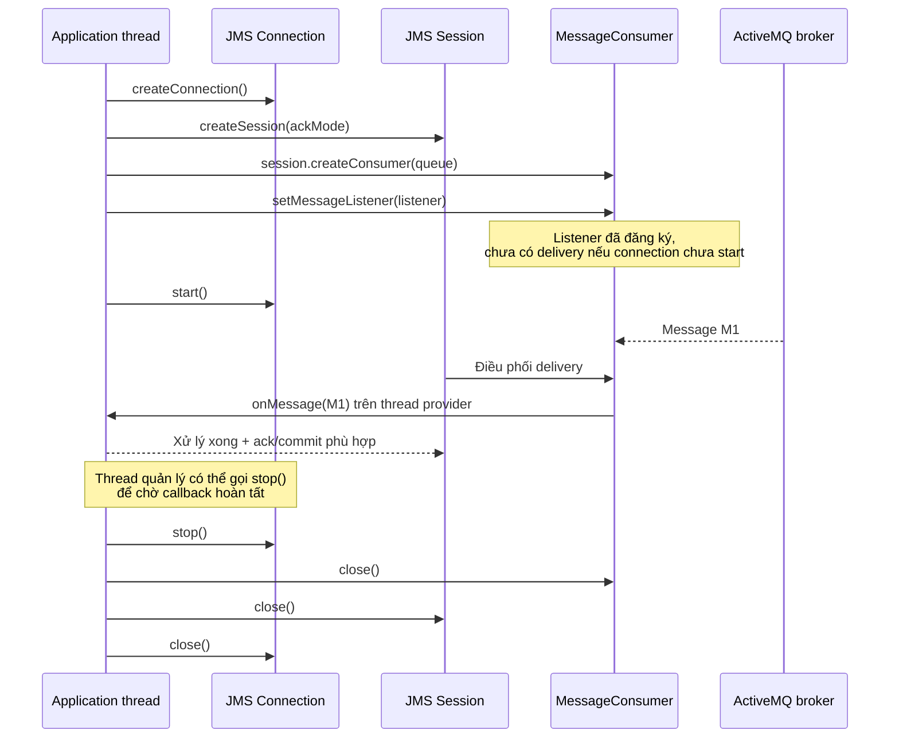
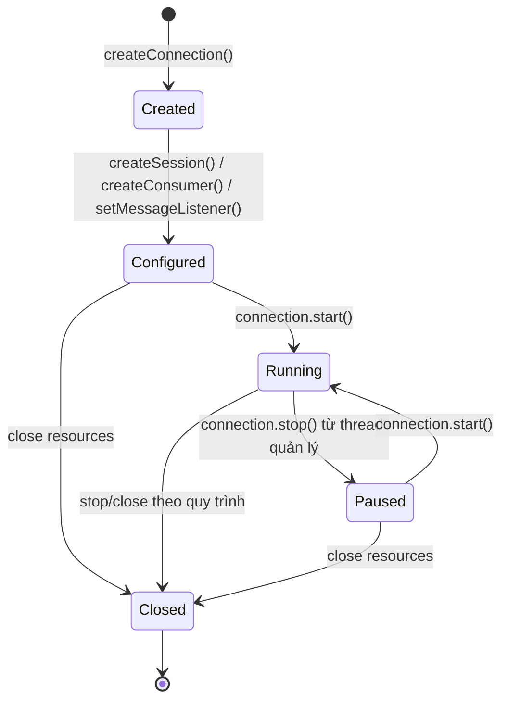
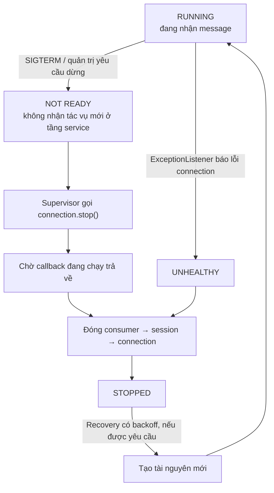

# Nhận bằng MessageListener và vòng đời consumer

> **Chương:** Consumer  
> **Phạm vi:** Lập trình Java/JMS trên Apache ActiveMQ Classic và ActiveMQ Artemis. Bài này đi sâu vào **consumer nhận bất đồng bộ**, cách provider gọi `MessageListener.onMessage()`, trạng thái của `Connection`/`Session`/`MessageConsumer` và cách dừng một consumer mà không vô tình xác nhận hoặc bỏ dở message.

Khi dùng `consumer.receive(timeout)`, thread ứng dụng chủ động chờ message. Khi dùng **`MessageListener`**, ứng dụng đăng ký một callback; JMS provider điều phối việc nhận và gọi `onMessage()` khi connection được phép phân phối. Đây là mô hình phù hợp cho dịch vụ xử lý liên tục, nhưng người viết handler phải hiểu **ai sở hữu thread, lúc nào delivery bắt đầu, và chuyện gì xảy ra khi worker dừng giữa một message**.

Một lỗi rất phổ biến là tạo consumer, đăng ký listener rồi cho `main()` kết thúc, khiến toàn bộ connection đóng trước khi có message. Lỗi khác là đóng connection ngay trong `onMessage()` hoặc chia một `Session` cho nhiều thread, dẫn đến kẹt callback và trạng thái acknowledgment khó xác định. Phần dưới tập trung giải quyết chính xác những tình huống này.

## 1. Mô hình dispatch khi dùng `MessageListener`



**Các vai trò trong sơ đồ:**

- `Connection` đại diện đường kết nối JMS tới broker; có trạng thái **started/stopped** đối với delivery.
- `Session` là ngữ cảnh nhận/gửi và acknowledgment hoặc transaction. JMS `Session` tuân theo mô hình **single-threaded context**; đừng dùng cùng một session để thao tác JMS đồng thời từ nhiều application thread.
- `MessageConsumer` gắn với một destination (và selector nếu có); nó có thể nhận bằng `receive()` hoặc callback `setMessageListener()`.
- `MessageListener` là code ứng dụng được gọi bởi luồng dispatch do provider quản lý. **Không** giả định `onMessage()` chạy trên thread gọi `connection.start()`.
- Broker giữ trạng thái message pending/in-flight, prefetch/credit và ack theo provider/config; việc callback được gọi không đồng nghĩa nghiệp vụ đã commit thành công.

Trong API JMS truyền thống:

```java
MessageConsumer consumer = session.createConsumer(queue);
consumer.setMessageListener(message -> {
    // Được gọi khi JMS provider dispatch một message tới consumer.
    handle(message);
});
connection.start(); // Cho phép delivery bắt đầu.
```

`handle(message)` ở đây là hàm nghiệp vụ giả định. **Đăng ký callback trước `start()`** là trình tự dễ kiểm soát: không có race giữa việc broker giao message và lúc ứng dụng hoàn tất cấu hình listener.

## 2. State machine: vòng đời connection và consumer

Không có một API `consumer.start()` độc lập trong JMS truyền thống. Việc delivery bắt đầu/tạm dừng được quản lý ở **`Connection`**; consumer phải được tạo trên session còn hiệu lực và được đóng khi không cần.



| Thao tác | Tác động chính | Điều **không** xảy ra |
|---|---|---|
| `session.createConsumer(queue)` | Tạo consumer thuộc session, đăng ký quan hệ nhận với broker/provider. | Không tự kích hoạt message delivery nếu connection chưa started. |
| `consumer.setMessageListener(listener)` | Chọn callback bất đồng bộ cho consumer. | Không tạo thread ứng dụng mới do bạn điều khiển; không thay thế `connection.start()`. |
| `connection.start()` | Cho phép provider bắt đầu hoặc tiếp tục giao message đến các consumer của connection. | Không có nghĩa hàng đợi đã có message hay handler đã xử lý thành công. |
| `connection.stop()` | Tạm dừng delivery đến connection; theo JMS, thao tác đồng bộ chờ các message listener đang được thực thi hoàn tất trước khi trả về. | Không xóa consumer/subscription, không commit message đang chờ, không đóng TCP connection. |
| `consumer.close()` | Đóng consumer, ngăn tiếp tục sử dụng đối tượng nhận này. | Không tự xóa queue thường hoặc durable subscription. |
| `session.close()` | Kết thúc session và những tài nguyên phụ thuộc. | Không phải cách “ack tất cả” an toàn cho công việc chưa hoàn tất. |
| `connection.close()` | Đóng connection và các session/consumer trực thuộc theo quy tắc provider; không thể `start()` lại connection đã đóng. | Không xóa các message persistent chưa được xác nhận theo đúng chính sách broker. |

`start()`/`stop()` có thể được dùng theo cặp để tạm dừng rồi chạy tiếp **khi connection vẫn còn mở**. Trong trạng thái stopped, producer vẫn có thể gửi bằng API thích hợp; điều bị tạm dừng là việc **delivery tới consumer** trên connection. Đừng hiểu `stop()` như một hình thức rollback, drain queue hoặc disconnect.

### 2.1. Timeline có và không có `connection.start()`

```text
T0  createConnection()
T1  createSession()
T2  createConsumer()
T3  setMessageListener(...)
T4  Producer gửi M1; broker có message phù hợp
T5  connection.start()  ---> callback onMessage(M1) có thể bắt đầu
T6  connection.stop()   ---> chờ callback đang chạy trả về, dừng delivery mới
T7  connection.start()  ---> tiếp tục giao message còn pending
T8  consumer/session/connection.close() từ thread quản lý
```

Ở thời điểm T4, có thể có message đã được broker chấp nhận, thậm chí được provider prefetch theo cấu hình, nhưng **callback ứng dụng không được thực thi trước khi connection started**. Vì vậy khi debug “producer gửi rồi mà listener im lặng”, hãy kiểm tra `start()` trước khi nghi queue routing hay selector.

### 2.2. Khi dừng đột ngột giữa callback

Giả sử handler đang ghi vào database thì process chết trước ack:

```text
Broker -> dispatch M1 -> onMessage(M1) -> database commit OK
                                         |
                                         +-- process crash, JMS ack chưa hoàn tất
Broker khôi phục/redeliver M1 -> consumer mới có thể nhận lại
```

Điều này khiến **idempotency theo khóa nghiệp vụ** trở thành điều kiện cần cho worker đáng tin cậy. Gọi `close()` không giải quyết khoảng bất định giữa side effect bên ngoài JMS và acknowledgment; cần thiết kế boundary hoặc lưu dấu idempotent.

## 3. Quy tắc thread: callback chạy ở đâu và có song song không?

JMS provider quyết định thread gọi `onMessage()`. Ứng dụng không được dựa vào tên thread, số thread hay thứ tự scheduling cụ thể. Trong phạm vi **một `Session`**, mô hình JMS bảo đảm delivery listener được tuần tự hóa theo ngữ cảnh session, nên không lập trình như thể mỗi message tự động có một worker thread riêng.

| Cách tổ chức | Hành vi nên dự kiến | Khi nào dùng |
|---|---|---|
| 1 connection, 1 session, 1 consumer | Một luồng xử lý callback theo session; đơn giản và dễ kiểm chứng ack/transaction. | Bắt đầu lab, handler không mất nhiều thời gian. |
| 1 connection, 1 session, **nhiều consumer** | Các callback chia cùng session; **không** nên coi đây là nhiều worker song song. | Khi cần nhiều destination nhưng muốn tuần tự hóa cùng ngữ cảnh. |
| 1 connection, **N session**, mỗi session 1 consumer | Có thể có nhiều delivery/handler chạy đồng thời vì mỗi session độc lập. | Scale trong cùng process, mỗi session có ack/transaction riêng. |
| N connection, mỗi connection có session/consumer riêng | Tách failure/flow-control hoặc áp giới hạn theo instance. | Các worker độc lập hoặc nhiều process/pod. |

**Không làm các thao tác sau:**

- Đưa chính đối tượng `Session` đang chạy listener sang thread pool rồi gọi `commit()`/`rollback()` từ nhiều task.
- Bắt đầu nhiều task async xử lý message nhưng **ack ngay trong callback** trước khi task hoàn tất; message được đánh dấu xong khi công việc thực sự vẫn đang chạy.
- Gọi `connection.stop()` hoặc `connection.close()` trực tiếp trong `onMessage()`. Các thao tác dừng/đóng phải chờ delivery callback hiện tại kết thúc nên có nguy cơ tự chờ chính callback đó, gây kẹt hoặc bị provider từ chối.
- Tạo không giới hạn `Session`/consumer để “thêm thread”; concurrency tăng đồng thời làm tăng in-flight, chiếm kết nối và tạo tải phụ thuộc phía sau.

Một handler chậm (ví dụ REST call đợi 60 giây) có thể làm **các delivery tiếp theo trên session đó** không được callback thực thi dù broker đang có hàng nghìn message. Phải đo thời gian xử lý và đặt timeout phía ứng dụng; không cho rằng tăng `prefetch` sẽ chữa được một callback bị blocking.

## 4. Acknowledgment trong asynchronous listener: thời điểm nào là đã xong?

Chế độ xác nhận quyết định khi nào broker có thể xem message được xử lý hoàn tất. Với `MessageListener`, điểm quan trọng là **callback kết thúc như thế nào** và **ai điều khiển transaction/ack**.

| Chế độ session | Ý nghĩa trong `onMessage()` | Lỗi cần tránh |
|---|---|---|
| `AUTO_ACKNOWLEDGE` | Với asynchronous consumer, provider thông thường tự ack khi `onMessage()` **trả về thành công** theo ngữ nghĩa JMS. | Bắt lỗi nghiệp vụ, chỉ log rồi return bình thường; ứng dụng có thể vô tình xác nhận message chưa xử lý. |
| `CLIENT_ACKNOWLEDGE` | Ứng dụng gọi `message.acknowledge()` **sau** khi công việc xử lý thành công. | Lệnh acknowledge theo JMS có thể xác nhận **mọi message đã được tiêu thụ trong cùng session** đến thời điểm gọi, không chỉ object hiện tại. |
| `DUPS_OK_ACKNOWLEDGE` | Provider có thể trì hoãn/đánh dấu ack theo lô; ưu tiên hiệu suất và cho phép tăng khả năng nhận trùng khi lỗi. | Chọn mode này cho nghiệp vụ không chịu được duplicate. |
| **Transacted session** | `session.commit()` xác nhận nhận/gửi JMS trong transaction; `session.rollback()` dẫn đến khả năng message được giao lại. | Tưởng `acknowledge()` điều khiển transacted session hoặc tưởng JMS commit tự commit database ngoài. |

### 4.1. Lỗi nuốt exception rồi tự xác nhận

```java
// Ví dụ MINH HỌA LỖI: asynchronous AUTO_ACKNOWLEDGE.
consumer.setMessageListener(message -> {
    try {
        callPaymentGateway(message);
    } catch (Exception failure) {
        System.err.println("Payment failed: " + failure);
        // Trả về bình thường: provider có thể xem delivery đã hoàn tất.
    }
});
```

`callPaymentGateway` là hàm nghiệp vụ giả định. Log lỗi **không gửi tín hiệu rollback tới broker**. Để kiểm soát redelivery rõ ràng, dùng acknowledgment mode/transaction phù hợp và tránh catch-all làm callback kết thúc như thành công.

### 4.2. Hai chiến lược kiểm soát kết thúc

**Chiến lược A – một session `CLIENT_ACKNOWLEDGE`, xử lý tuần tự:**

```java
consumer.setMessageListener(message -> {
    try {
        applyBusinessChange(message);
        message.acknowledge();  // Chỉ sau khi xử lý xong.
    } catch (JMSException | RuntimeException problem) {
        signalUnhealthy(problem);
        // Không acknowledge; supervisor đóng/recreate session.
        // Cần policy retry/DLQ để tránh poison message lặp vô hạn.
    }
});
```

Ví dụ chỉ minh họa quyết định ack và tín hiệu dừng; `applyBusinessChange`, `signalUnhealthy` do ứng dụng cung cấp. Không gọi `Session.recover()` từ một thread khác đang dùng chung session; điều phối việc phục hồi theo ownership của session và ngữ nghĩa JMS.

**Chiến lược B – transacted session:**

```java
Session session = connection.createSession(
        true, Session.SESSION_TRANSACTED);
MessageConsumer consumer = session.createConsumer(queue);
consumer.setMessageListener(message -> {
    try {
        applyBusinessChange(message);
        session.commit();           // JMS transaction thành công.
    } catch (RetryableBusinessException temporary) {
        try {
            session.rollback();     // Có thể redeliver theo broker policy.
        } catch (JMSException rollbackFailure) {
            signalUnhealthy(rollbackFailure);
        }
    } catch (JMSException jmsFailure) {
        // Commit/transport có thể đã đổi trạng thái trước khi lỗi trả về.
        signalUnhealthy(jmsFailure);
    }
});
```

Các method/type nghiệp vụ trong đoạn B là pseudocode Java để minh họa ranh giới transaction; ví dụ **đầy đủ có thể chạy** ở mục 7 dùng `CLIENT_ACKNOWLEDGE` cho vòng đời consumer. `Session.commit()` có thể ném `JMSException` sau khi broker đã commit nhưng phản hồi bị mất: trạng thái lúc đó **chưa xác định**, không được tự kết luận broker chưa làm gì. Xử lý redelivery và side effect cần idempotency.

### 4.3. Một session khác không thể ack thay

Khi tăng concurrency, mỗi session có transaction/acknowledgment scope riêng. Không gửi `Message` lấy từ session A sang một consumer ở session B rồi mong gọi `acknowledge()` ở B là hoạt động nhận của A được xác nhận. Nên gắn việc xử lý và xác nhận với cùng session/consumer ownership.

## 5. Thiết kế shutdown: dừng nhận trước, giải phóng sau

Một consumer service thường không kết thúc sau khi đăng ký listener. Thread chính cần duy trì vòng đời service và có cơ chế **tắt có kiểm soát**. Trình tự phù hợp với JMS standalone:

1. Nhận tín hiệu dừng từ người vận hành/container hoặc từ `ExceptionListener`; chuyển readiness thành **not ready**.
2. Từ **thread quản lý**, gọi `connection.stop()` để ngừng delivery mới và đợi các `onMessage()` đang chạy hoàn tất theo ngữ nghĩa JMS. Đặt timeout cho I/O nghiệp vụ để callback không treo vô hạn.
3. Đóng `MessageConsumer`, `Session`, cuối cùng `Connection`; ghi lại những lỗi cleanup mà không đánh dấu message “đã xử lý”.
4. Chỉ sau khi tài nguyên cũ được xử lý mới tạo connection/session/consumer mới nếu cần khởi động lại.



**Giới hạn:** `Connection.stop()` không phải “drain toàn bộ backlog ở broker”. Nó chỉ đợi các listener callback hiện đang thực thi, không đợi xử lý tất cả message còn pending. Nếu callback spawn một tác vụ khác rồi trả về trước khi tác vụ hoàn tất, `stop()` cũng **không biết** để đợi tác vụ đó. Cần theo dõi chính các `Future`/worker ngoài JMS nếu thiết kế cho phép offload.

**Không gọi `stop()` từ bên trong `onMessage()`** để tự tắt worker: đây là đường đi có nguy cơ deadlock do `stop()` cần chờ listener hiện tại trả về. Callback nên phát tín hiệu qua `CountDownLatch` hoặc hàng đợi điều khiển, để thread sở hữu lifecycle thực hiện shutdown.

### 5.1. `ExceptionListener` và lifecycle

`Connection.setExceptionListener(...)` báo một số lỗi connection nghiêm trọng được provider phát hiện **bất đồng bộ**. Callback này không nhận mọi lỗi nghiệp vụ hay mọi `JMSException` từ lời gọi đồng bộ. Một mẫu đơn giản:

```java
CountDownLatch stopSignal = new CountDownLatch(1);
connection.setExceptionListener(error -> {
    System.err.println("Connection error: " + error.getMessage());
    stopSignal.countDown();    // Không chạm vào Session tại đây.
});
```

Thread quản lý sẽ thức dậy, đánh dấu worker unhealthy và quyết định đóng/tạo lại tài nguyên. Nếu dùng failover transport của Classic hoặc cơ chế reconnect của Artemis client, cần phối hợp với **chính sách khôi phục của provider**, tránh tự tạo vòng reconnect mới mỗi khi nhận một callback mà chưa hiểu trạng thái connection. Kết quả của `send()`/`commit()` lúc kết nối lỗi cũng có thể chưa xác định; recovery không thay thế idempotency.

### 5.2. Shutdown của một durable topic subscriber

Nếu `MessageConsumer` đang đọc **durable subscription** của topic, `consumer.close()` chỉ kết thúc consumer đang hoạt động; subscription còn tồn tại để tiếp tục giữ backlog phù hợp theo chính sách. Lệnh hủy subscription là thao tác riêng (ví dụ `Session.unsubscribe(subscriptionName)` ở JMS classic API khi điều kiện cho phép). Không gọi `unsubscribe` trong luồng shutdown thông thường nếu muốn nhận lại message phát lúc consumer offline.

Ngược lại, một topic subscriber **non-durable** thường không có backlog dành riêng cho thời gian offline. Điều đó do loại subscription, **không phải** do thứ tự đóng consumer/session/connection.

## 6. Thực hành Java: producer và asynchronous consumer có vòng đời rõ ràng

Ví dụ chạy trên **Apache ActiveMQ Classic 5.x**, OpenWire tại `tcp://127.0.0.1:61616`. Mục tiêu là xem trọn vẹn:

```text
createConnection → createSession → createConsumer → setMessageListener
               → connection.start → onMessage → acknowledge
               → connection.stop → consumer/session/connection.close
```

Ứng dụng dùng một queue dành riêng cho lab `lab.consumer.lifecycle`, một consumer trên một session, `CLIENT_ACKNOWLEDGE` và một thread quản lý chờ tối đa 60 giây. Demo có hai mode: `listen` và `publish`. Không cần Spring để thấy rõ JMS API.

### 6.1. Maven

Tạo `pom.xml` trong một dự án Maven riêng:

```xml
<project xmlns="http://maven.apache.org/POM/4.0.0"
         xmlns:xsi="http://www.w3.org/2001/XMLSchema-instance"
         xsi:schemaLocation="http://maven.apache.org/POM/4.0.0
                             https://maven.apache.org/xsd/maven-4.0.0.xsd">
    <modelVersion>4.0.0</modelVersion>
    <groupId>lab.activemq</groupId>
    <artifactId>async-consumer-lifecycle</artifactId>
    <version>1.0-SNAPSHOT</version>

    <properties>
        <maven.compiler.release>11</maven.compiler.release>
        <project.build.sourceEncoding>UTF-8</project.build.sourceEncoding>
    </properties>

    <dependencies>
        <dependency>
            <groupId>org.apache.activemq</groupId>
            <artifactId>activemq-client</artifactId>
            <version>5.18.4</version>
        </dependency>
    </dependencies>

    <build>
        <plugins>
            <plugin>
                <groupId>org.apache.maven.plugins</groupId>
                <artifactId>maven-compiler-plugin</artifactId>
                <version>3.11.0</version>
            </plugin>
            <plugin>
                <groupId>org.codehaus.mojo</groupId>
                <artifactId>exec-maven-plugin</artifactId>
                <version>3.2.0</version>
            </plugin>
        </plugins>
    </build>
</project>
```

`5.18.4` là version minh họa cho Classic client dùng package `javax.jms`; không được coi đây là khẳng định phiên bản mới nhất. Khi dùng Artemis/Jakarta Messaging cần dependency và import khác, xem mục 9.

### 6.2. Mã nguồn đầy đủ

Tạo `src/main/java/lab/ConsumerLifecycleLab.java`:

```java
package lab;

import java.util.concurrent.CountDownLatch;
import java.util.concurrent.TimeUnit;
import java.util.concurrent.atomic.AtomicBoolean;
import javax.jms.Connection;
import javax.jms.DeliveryMode;
import javax.jms.JMSException;
import javax.jms.Message;
import javax.jms.MessageConsumer;
import javax.jms.MessageProducer;
import javax.jms.Queue;
import javax.jms.Session;
import javax.jms.TextMessage;
import org.apache.activemq.ActiveMQConnectionFactory;

public final class ConsumerLifecycleLab {
    private static final String QUEUE = "lab.consumer.lifecycle";

    private ConsumerLifecycleLab() {
    }

    public static void main(String[] args) throws Exception {
        if (args.length == 0) {
            throw new IllegalArgumentException(
                "Dùng: listen | publish [ORDER:101]");
        }
        String url = System.getenv("ACTIVEMQ_BROKER_URL");
        if (url == null || url.trim().isEmpty()) {
            url = "tcp://127.0.0.1:61616";
        }
        ActiveMQConnectionFactory factory =
                new ActiveMQConnectionFactory(url);

        switch (args[0]) {
            case "listen":
                listen(factory);
                break;
            case "publish":
                String value = args.length > 1 ? args[1] : "ORDER:101";
                publish(factory, value);
                break;
            default:
                throw new IllegalArgumentException("Mode không hợp lệ");
        }
    }

    private static Connection openConnection(
            ActiveMQConnectionFactory factory) throws JMSException {
        String user = System.getenv("ACTIVEMQ_USER");
        String password = System.getenv("ACTIVEMQ_PASSWORD");
        return user == null || user.trim().isEmpty()
                ? factory.createConnection()
                : factory.createConnection(user, password);
    }

    private static void publish(
            ActiveMQConnectionFactory factory, String payload)
            throws JMSException {
        Connection connection = openConnection(factory);
        Session session = null;
        MessageProducer producer = null;
        try {
            session = connection.createSession(
                    false, Session.AUTO_ACKNOWLEDGE);
            Queue queue = session.createQueue(QUEUE);
            producer = session.createProducer(queue);
            producer.setDeliveryMode(DeliveryMode.PERSISTENT);

            TextMessage message = session.createTextMessage(payload);
            message.setStringProperty("kind", "OrderCommand");
            producer.send(message);
            System.out.println("SENT: " + payload
                    + " | id=" + message.getJMSMessageID());
            // Không cần connection.start() chỉ để producer.send().
        } finally {
            closeQuietly(producer);
            closeQuietly(session);
            closeQuietly(connection);
        }
    }

    private static void listen(ActiveMQConnectionFactory factory)
            throws JMSException, InterruptedException {
        CountDownLatch stopSignal = new CountDownLatch(1);
        AtomicBoolean unhealthy = new AtomicBoolean(false);
        Connection connection = openConnection(factory);
        Session session = null;
        MessageConsumer consumer = null;
        try {
            connection.setExceptionListener(problem -> {
                System.err.println("ASYNC_CONNECTION_FAILURE: "
                        + problem.getMessage());
                unhealthy.set(true);
                stopSignal.countDown(); // Chỉ phát tín hiệu.
            });

            session = connection.createSession(
                    false, Session.CLIENT_ACKNOWLEDGE);
            Queue queue = session.createQueue(QUEUE);
            consumer = session.createConsumer(queue);

            consumer.setMessageListener(message -> {
                try {
                    if (!(message instanceof TextMessage)) {
                        throw new IllegalArgumentException(
                            "Chỉ hỗ trợ TextMessage trong lab");
                    }
                    String payload = ((TextMessage) message).getText();
                    if (payload == null || !payload.startsWith("ORDER:")) {
                        throw new IllegalArgumentException(
                            "Payload sai định dạng: " + payload);
                    }
                    // Mô phỏng nghiệp vụ đã hoàn tất tại đây.
                    System.out.println("HANDLED " + payload
                            + " | id=" + message.getJMSMessageID());

                    // Đặt sau xử lý thành công.
                    message.acknowledge();
                    System.out.println("ACKED " + payload);
                } catch (JMSException | RuntimeException problem) {
                    System.err.println("HANDLER_FAILURE: " + problem);
                    unhealthy.set(true);
                    stopSignal.countDown();
                    // Không ack và không tự đóng Connection ở callback.
                }
            });

            connection.start();
            System.out.println("LISTENER_READY; nhận tối đa 60 giây.");

            boolean stoppedByError =
                    stopSignal.await(60, TimeUnit.SECONDS);
            if (stoppedByError && unhealthy.get()) {
                System.err.println(
                    "UNHEALTHY; supervisor bắt đầu shutdown");
            } else {
                System.out.println(
                    "LISTEN_WINDOW_COMPLETE; dừng có kiểm soát");
            }
        } finally {
            // Thread hiện tại là thread quản lý; không gọi từ onMessage().
            try {
                connection.stop(); // Đợi callback đang thực thi trả về.
            } catch (JMSException problem) {
                System.err.println("STOP_FAILURE: "
                        + problem.getMessage());
            }
            closeQuietly(consumer);
            closeQuietly(session);
            closeQuietly(connection);
        }
    }

    private static void closeQuietly(MessageProducer item) {
        if (item != null) {
            try {
                item.close();
            } catch (JMSException e) {
                System.err.println("Producer close failed: " + e);
            }
        }
    }

    private static void closeQuietly(MessageConsumer item) {
        if (item != null) {
            try {
                item.close();
            } catch (JMSException e) {
                System.err.println("Consumer close failed: " + e);
            }
        }
    }

    private static void closeQuietly(Session item) {
        if (item != null) {
            try {
                item.close();
            } catch (JMSException e) {
                System.err.println("Session close failed: " + e);
            }
        }
    }

    private static void closeQuietly(Connection item) {
        if (item != null) {
            try {
                item.close();
            } catch (JMSException e) {
                System.err.println("Connection close failed: " + e);
            }
        }
    }
}
```

### 6.3. Phần nào trong ví dụ là cơ chế lifecycle?

**`listen` giữ thread quản lý sống bằng `CountDownLatch.await()`:** `setMessageListener()` chỉ đăng ký callback, không giữ JVM chạy vô hạn khi main kết thúc. Bài lab dùng cửa sổ 60 giây để dễ quan sát và tự đóng; service thật cần cơ chế stop signal từ container/process.

**`connection.start()` là cổng bật delivery:** trước đó listener đã được gắn. Producer có thể gửi message từ một process khác trước khi listener start; khi delivery được bật, message còn pending có thể được dispatch.

**`stopSignal` cho phép callback báo lỗi mà không đóng tài nguyên:** callback `ExceptionListener` hoặc `onMessage` chỉ đánh dấu unhealthy. Thread quản lý đi vào `finally`, gọi `stop()` và thực hiện cleanup theo ownership.

**`CLIENT_ACKNOWLEDGE` chỉ được gọi sau thành công:** nếu handler gặp lỗi trước ack, message còn có khả năng được giao lại sau khi session/connection kết thúc, phụ thuộc chính sách và tình trạng broker. Vì ví dụ có **một consumer trên một session và callback tuần tự**, phạm vi ack dễ quan sát. Trong ứng dụng có nhiều message/session, cần hiểu chính xác quy tắc ack cộng dồn của mode này.

**Dọn dẹp không làm biến mất lỗi:** mỗi lỗi từ `close()` được ghi nhận, nhưng không được lấy việc đóng connection làm bằng chứng message đã commit. Đây là chương trình lab; production cần đảm bảo handler không block quá lâu và phải phối hợp shutdown với container/SIGTERM.

## 7. Chạy lab và quan sát vòng đời

Mở một broker Classic standalone tại `tcp://127.0.0.1:61616` hoặc đặt biến `ACTIVEMQ_BROKER_URL` tương ứng. Khi broker có authentication, đặt `ACTIVEMQ_USER` và `ACTIVEMQ_PASSWORD` trên terminal lab. Không dùng queue chung của dịch vụ khác để thực hành và không purge dữ liệu không thuộc lab.

### 7.1. Bắt đầu nghe, rồi mới gửi message

**Terminal A**, từ thư mục Maven chứa `pom.xml`:

```bash
mvn -q compile exec:java "-Dexec.mainClass=lab.ConsumerLifecycleLab" "-Dexec.args=listen"
```

Đợi log:

```text
LISTENER_READY; nhận tối đa 60 giây.
```

**Terminal B** trong cửa sổ 60 giây:

```bash
mvn -q compile exec:java "-Dexec.mainClass=lab.ConsumerLifecycleLab" "-Dexec.args=publish ORDER:101"
mvn -q compile exec:java "-Dexec.mainClass=lab.ConsumerLifecycleLab" "-Dexec.args=publish ORDER:102"
```

Log terminal A có dạng:

```text
HANDLED ORDER:101 | id=ID:...
ACKED ORDER:101
HANDLED ORDER:102 | id=ID:...
ACKED ORDER:102
LISTEN_WINDOW_COMPLETE; dừng có kiểm soát
```

Hai lời gọi `onMessage()` được dispatch bất đồng bộ; thread chính vẫn đang ở `await()`. Sau 60 giây, thread chính gọi `connection.stop()`, đóng consumer/session/connection và chương trình kết thúc. Không cần đặt vòng `while(true) { receive(...) }` song song với listener.

**Giới hạn quan sát:** nếu hai process sender chạy quá chậm và cửa sổ nghe đã kết thúc, message vẫn có thể chờ trong queue theo persistence/policy. Chạy `listen` lần nữa để nhận backlog còn pending; điều này khác với subscription non-durable của topic.

### 7.2. Gửi trước rồi mới start listener

Trong khi không có `listen` nào chạy, gọi:

```bash
mvn -q compile exec:java "-Dexec.mainClass=lab.ConsumerLifecycleLab" "-Dexec.args=publish ORDER:103"
```

Sau đó mới chạy `listen`. Vì `lab.consumer.lifecycle` là **queue**, message còn pending có thể được giao khi connection bắt đầu delivery. Đây là phép kiểm chứng **consumer chưa online không đồng nghĩa message bị mất**, nhưng chỉ đúng trong giới hạn trạng thái broker, expiry, store và các consumer khác.

Nếu queue có consumer khác cùng nhận, không bảo đảm consumer mới chính là tiến trình nhận `ORDER:103`; các consumer của cùng queue **cạnh tranh** nhận message.

### 7.3. Tạo lỗi handler có kiểm soát

Trên queue lab không dùng chung, gọi:

```bash
mvn -q compile exec:java "-Dexec.mainClass=lab.ConsumerLifecycleLab" "-Dexec.args=publish BAD_PAYLOAD"
```

Trong `listen`, handler phát hiện sai định dạng, **không ack** và phát tín hiệu cho supervisor. Theo thiết kế demo, supervisor sẽ stop/close connection. Message có thể được giao lại ở lần chạy tiếp theo; việc này nhắc rằng **lỗi payload vĩnh viễn không nên retry vô hạn**. Trong hệ thống thật, cần nhánh quarantine/DLQ với điều kiện kết thúc rõ ràng. Sau thí nghiệm, quản lý riêng message lỗi trên queue lab, không xóa nhầm message của ứng dụng khác.

### 7.4. Tạm dừng rồi tiếp tục một connection đang sống

Trong một service có thread quản lý riêng, chuỗi lệnh minh họa là:

```java
// Thread supervisor, không phải thread onMessage().
connection.stop();
System.out.println("Delivery tạm dừng; consumer vẫn còn tồn tại.");

// Các producer khác có thể tiếp tục gửi vào queue ở broker.
// Chạy tiếp nếu chưa đóng connection:
connection.start();
System.out.println("Delivery được tiếp tục.");
```

Khác `close()`, gọi `stop()` không phá hủy consumer. Trong môi trường prefetch, provider có thể đã nhận/buffer một số message trước khi dừng; **không lấy số message “đang pending ở broker” làm bằng chứng chắc chắn không có message in-flight**. Quan sát cả delivering/in-flight và các callback đang thực thi khi đánh giá shutdown.

## 8. Tăng concurrency đúng cách

Một listener chạy chậm có thể giới hạn throughput dù queue còn nhiều message. Cách mở rộng chính xác là thêm **session/consumer độc lập**, không ép nhiều thread truy cập chung session. Ví dụ minh họa:

```java
// connection đã được tạo, nhưng chưa start.
int concurrency = 3;
Session[] sessions = new Session[concurrency];
MessageConsumer[] consumers = new MessageConsumer[concurrency];

for (int i = 0; i < concurrency; i++) {
    Session session = connection.createSession(
            false, Session.CLIENT_ACKNOWLEDGE);
    MessageConsumer consumer =
            session.createConsumer(session.createQueue("orders.work"));
    final int workerId = i;

    consumer.setMessageListener(message -> {
        try {
            processOrder(workerId, message);
            message.acknowledge(); // Trong session riêng của worker này.
        } catch (JMSException | RuntimeException failure) {
            reportWorkerFailure(workerId, failure);
            // Supervisor quyết định đóng/recreate session theo policy.
        }
    });
    sessions[i] = session;
    consumers[i] = consumer;
}

connection.start();
// Khi shutdown: từ thread quản lý, stop connection trước,
// đóng từng consumer/session rồi đóng connection.
```

`processOrder` và `reportWorkerFailure` là các hàm ứng dụng giả định; đoạn mã tập trung mô hình phân bổ **một session cho mỗi callback chain**. Trong production phải triển khai timeout, retry/quarantine, đếm in-flight và shutdown đầy đủ.

Với queue, ba consumer trên ba session thường **chia nhau các message**. Không được suy rằng mỗi message được cả ba worker xử lý. Nếu một message chưa ack và bị redeliver, worker khác có thể nhận lại nó. Thứ tự **hoàn thành nghiệp vụ** có thể khác thứ tự producer gửi vì các handler chạy song song.

### 8.1. Chọn số worker và prefetch

| Tham số | Tác động | Cảnh báo |
|---|---|---|
| **Số session/consumer** | Tăng số callback có thể làm việc đồng thời. | Cũng tăng số connection/session resource, DB/HTTP concurrency và in-flight. |
| **Prefetch/consumer credit** | Provider có thể giữ trước các message để giảm round-trip. | Có thể làm tải lệch giữa consumer, hoặc khiến số pending ở broker khác số message chưa được app xử lý. |
| **Thời gian xử lý callback** | Handler nhanh giúp nhận message tiếp theo trên session. | Blocking quá lâu làm shutdown chậm và giảm throughput. |
| **Ack/transaction boundary** | Quyết định khi nào message được xem là hoàn tất. | Ack trước khi side effect xong gây mất khả năng retry khi process chết. |
| **Message group / ordering policy** | Có thể hỗ trợ giữ luồng xử lý cho một khóa nếu broker hỗ trợ và cấu hình đúng. | Không mặc định tổng thứ tự còn nguyên khi scale nhiều consumer. |

Không tăng `prefetch` vô hạn để che việc callback blocking. Khi worker xử lý chậm, đặt giới hạn tài nguyên bên dưới (HTTP pool, DB connections) và đo backlog, latency, redelivery; mở rộng worker vừa đủ khả năng downstream.

### 8.2. Không trộn `receive()` và `setMessageListener()` của cùng consumer

Hai kiểu nhận là các mô hình khác nhau. Đừng vừa đăng ký listener cho `MessageConsumer`, vừa có thread khác gọi `consumer.receive()` trên cùng đối tượng. Điều này dẫn đến tranh chấp cách nhận và hành vi không portable. Nếu thật sự cần đồng bộ và bất đồng bộ trong cùng ứng dụng, dùng **consumer/session độc lập**, mỗi consumer chọn một chế độ và có ownership rõ ràng.

### 8.3. Queue consumer và topic subscriber khác gì khi đóng?

| Đối tượng listener | Khi `consumer.close()` | Khi tạo lại consumer |
|---|---|---|
| Queue consumer | Queue vẫn có thể giữ message chưa ack/pending theo policy. | Consumer khác có thể nhận message còn pending. |
| Non-durable topic subscriber | Subscription ngắn hạn chấm dứt; không có backlog riêng cho thời gian offline. | Consumer mới thường chỉ nhận các event phù hợp kể từ khi đăng ký/hoạt động. |
| Durable topic subscriber | Consumer đóng nhưng **durable subscription** vẫn tồn tại khi không bị unsubscribe. | Dùng lại đúng identity subscription để nhận backlog còn phù hợp. |

`MessageListener` chỉ là **cách nhận trong ứng dụng**; queue/topic và durable subscription mới xác định mô hình phân phối/backlog ở broker.

## 9. Áp dụng trên ActiveMQ Artemis

Ý nghĩa `MessageConsumer.setMessageListener()`, `Connection.start()/stop()` và các acknowledgment mode đến từ API JMS nên vẫn áp dụng trên **Artemis**. Tuy nhiên, không được đổi mỗi URL rồi dùng nhầm thư viện của ActiveMQ Classic. Với Artemis hiện đại dùng Jakarta Messaging:

| Thành phần | ActiveMQ Classic 5.x trong lab | Artemis Jakarta client |
|---|---|---|
| Package JMS | `javax.jms.*` | `jakarta.jms.*` |
| Connection factory | `org.apache.activemq.ActiveMQConnectionFactory` | `org.apache.activemq.artemis.jms.client.ActiveMQConnectionFactory` |
| Dependency minh họa | `activemq-client:5.18.4` | `artemis-jakarta-client:2.38.0` |
| Cách nhận | `consumer.setMessageListener(...)` | Cùng API `consumer.setMessageListener(...)` |
| Queue ở broker | Queue destination do Classic quản lý. | Queue binding trên address với routing type phù hợp, thường **ANYCAST** cho JMS queue. |
| Tối ưu giao nhận | Prefetch, redelivery policy theo Classic client/broker config. | Consumer credit/window, redelivery và DLQ theo Artemis client/broker config. |

Đây là các phiên bản ví dụ tương thích với cách viết API minh họa, không phải khẳng định phiên bản mới nhất. Chọn client/broker/JDK phù hợp với hệ thống thực tế.

### 9.1. Cấu hình queue trong Artemis

Để chắc chắn client không vô tình dùng một queue tự tạo sai kiểu, có thể khai báo trong phần `<addresses>` của **`<artemis-instance>/etc/broker.xml`**:

```xml
<address name="lab.consumer.lifecycle">
  <anycast>
    <queue name="lab.consumer.lifecycle" durable="true"/>
  </anycast>
</address>
```

Đây là **đoạn con**, không phải toàn bộ `broker.xml`. Phải dùng đúng instance và kiểm tra phần tử address/queue chưa được khai báo trùng. Tính năng auto-create address/queue và quyền truy cập phụ thuộc cấu hình broker. Việc một `MessageConsumer` được tạo ở phía Java không chứng minh queue server-side đã tồn tại và route đúng nếu broker không cho phép auto-create.

### 9.2. Đổi client mà giữ vòng đời tương đương

Thay dependency bằng:

```xml
<dependency>
    <groupId>org.apache.activemq</groupId>
    <artifactId>artemis-jakarta-client</artifactId>
    <version>2.38.0</version>
</dependency>
```

Ví dụ phần khởi tạo:

```java
import jakarta.jms.Connection;
import jakarta.jms.MessageConsumer;
import jakarta.jms.Queue;
import jakarta.jms.Session;
import org.apache.activemq.artemis.jms.client.ActiveMQConnectionFactory;

// Broker Artemis lab có acceptor JMS phù hợp trên endpoint này.
ActiveMQConnectionFactory factory =
        new ActiveMQConnectionFactory("tcp://127.0.0.1:61616");
Connection connection =
        factory.createConnection(
                System.getenv("ARTEMIS_USER"),
                System.getenv("ARTEMIS_PASSWORD"));

Session session = connection.createSession(
        false, Session.CLIENT_ACKNOWLEDGE);
Queue queue = session.createQueue("lab.consumer.lifecycle");
MessageConsumer consumer = session.createConsumer(queue);
consumer.setMessageListener(message -> {
    try {
        // Xử lý thành công, rồi ack trong phạm vi session này.
        System.out.println("Received: " + message.getJMSMessageID());
        message.acknowledge();
    } catch (jakarta.jms.JMSException failure) {
        // Báo cho supervisor, không đóng Connection trong callback.
        System.err.println("Handler JMS error: " + failure);
    }
});
connection.start();
// Giữ service sống ở thread quản lý; dừng và đóng từ thread quản lý.
```

Đoạn trên là **trích đoạn API** để đối chiếu, cần đặt trong method có `throws jakarta.jms.JMSException` và bổ sung shutdown/supervisor như bản Classic. Khi broker cho phép không xác thực, có thể dùng `factory.createConnection()`; nếu bật authentication, truyền thông tin hợp lệ. **Không trộn `javax.jms` với `jakarta.jms` trong cùng chương trình**.

Ở Artemis, một consumer async vẫn có thể thấy message thuộc queue do **ANYCAST** route. Nếu cùng address có nhiều queue hoặc cả `ANYCAST` và `MULTICAST`, phải kiểm tra message thực sự được route đến queue nào; listener không quyết định routing type. Khi `onMessage()` thất bại, redelivery/DLQ phụ thuộc `address-settings` và chính sách client/broker, không phụ thuộc việc bạn dùng callback hay `receive()`.

## 10. Chẩn đoán consumer listener không hoạt động

| Hiện tượng | Kiểm tra đầu tiên | Giải thích thường gặp |
|---|---|---|
| Đã `setMessageListener` nhưng không có callback | Đã `connection.start()` chưa? | Consumer đăng ký xong nhưng connection vẫn stopped. |
| Có log `LISTENER_READY` nhưng không nhận | Đúng queue, quyền consume, selector, có message phù hợp không? | Không phải mọi message gửi tới broker đều thuộc consumer này. |
| Một message chỉ được một trong nhiều consumer nhận | Các consumer cùng đọc một queue? | Competing consumers chia nhau message; không phải fan-out. |
| Callback chỉ xử lý một message rất lâu | Thread đang block trong handler/REST/DB? | Các delivery tiếp theo trên cùng session bị tuần tự hóa. |
| Consumer ngừng khi main kết thúc | Main đã đóng connection hoặc process kết thúc? | `setMessageListener` không tự giữ process sống. |
| Sau restart thấy xử lý trùng | Message đã xử lý side effect nhưng chưa ack/commit? | Redelivery là hành vi cần dự kiến và xử lý idempotent. |
| `stop()` dường như bị treo | Có callback đang chạy hoặc bị block? Có gọi stop bên trong callback không? | Stop cần đợi listener đang chạy; có nguy cơ deadlock nếu gọi sai thread. |
| Browser thấy message nhưng listener không nhận | Selector, routing, message có đang in-flight cho consumer khác không? | Browse và dispatch có trạng thái/điều kiện khác nhau. |
| Thêm 5 consumer nhưng throughput vẫn không tăng | Có dùng chung một `Session` hay downstream bị nghẽn? | Chia session độc lập; đo latency và tài nguyên. |
| Handler báo lỗi nhưng message “biến mất” | Mode `AUTO_ACKNOWLEDGE` và nhánh catch có return bình thường? | Provider có thể coi callback đã thành công. |
| Khi broker lỗi, callback không được gọi ngay | Timeout/network detection/failover config thế nào? | `ExceptionListener` không phải health probe tức thời cho mọi lỗi. |

### 10.1. Các metric theo vòng đời

Một consumer service nên ghi nhận các số liệu giúp giải thích trạng thái:

1. **Readiness / connection state:** đang running, stopped, unhealthy, reconnecting; thời điểm đổi trạng thái.
2. **Consumer/session count:** bao nhiêu session và consumer thực sự đang tồn tại.
3. **Active callback count và processing latency:** callback nào đang bận quá lâu, bao nhiêu message đã hoàn tất nghiệp vụ.
4. **Ack/commit success, rollback, redelivery, DLQ/quarantine:** phân biệt delivery khỏi hoàn tất.
5. **Queue pending, delivering/in-flight và age:** broker còn backlog hay provider đã dispatch cho consumer nhưng ứng dụng chưa xử lý?

Ví dụ **consumer count = 1** không có nghĩa xử lý tiến triển; callback có thể treo trong một HTTP call. **Pending count = 0** cũng chưa chắc mọi message đã xử lý xong nếu broker/provider đang giữ các message in-flight.

## 11. Bài tập thực hành và câu hỏi đánh giá

**Bài 1 — Sửa thiếu `start()`.** Một chương trình tạo connection, session, consumer, gắn listener rồi ngủ 30 giây, không gọi `connection.start()`. Producer gửi hai message nhưng callback không chạy. Hãy bổ sung `connection.start()` **sau khi đăng ký listener**, trước khi thread quản lý bắt đầu chờ, rồi thử lại. Queue có thể vẫn giữ message trong lúc connection stopped.

**Bài 2 — Xác nhận phạm vi của `CLIENT_ACKNOWLEDGE`.** Một session có hai consumer và nhận M1 rồi M2. Nếu M1 chưa xử lý xong nhưng ứng dụng gọi `M2.acknowledge()`, rủi ro là gì? **Đáp án:** JMS CLIENT_ACKNOWLEDGE có thể xác nhận toàn bộ message đã tiêu thụ trên session, kể cả M1. Cần thiết kế ranh giới session, xử lý tuần tự hoặc transaction phù hợp.

**Bài 3 — Shutdown đang có callback chậm.** Handler đang gọi REST API và bị block, thread quản lý gọi `connection.stop()`. Điều gì quyết định thời gian stop? **Đáp án:** Stop chờ callback đang chạy hoàn tất; timeout/cancellation của nghiệp vụ quyết định callback có trả về kịp không. Không gọi stop trực tiếp từ callback, không mong stop hủy ngay thao tác I/O đang block.

**Bài 4 — Tăng concurrency.** Một session có ba consumers nhưng throughput chưa tăng. Hãy chuyển sang ba session/consumer độc lập và đo active callbacks. **Đáp án kỳ vọng:** Provider có thể xử lý đồng thời các session; ranh giới ack/transaction tách biệt. Thứ tự xử lý hoàn tất có thể thay đổi nên vẫn cần idempotency.

**Bài 5 — Sai loại lỗi.** `onMessage()` gọi database và nhận lỗi validation của payload. Có nên đợi `ExceptionListener` để phục hồi không? **Đáp án:** Không. `ExceptionListener` liên quan đến lỗi connection bất đồng bộ; validation là lỗi nghiệp vụ trong handler. Phải có nhánh xử lý/rejection riêng.

**Bài 6 — Queue và durable topic khi shutdown.** Đóng listener trên một durable topic subscription rồi khởi động lại với cùng client ID/name. Có cần tạo subscription mới không? **Đáp án:** Có thể dùng lại durable subscription đã đăng ký; đóng consumer không đồng nghĩa unsubscribe. Nếu thay identity hoặc đã xóa subscription, backlog cũ không tự chuyển sang danh tính mới.

**Bài 7 — Giới hạn demo.** Gửi `BAD_PAYLOAD` vào queue lab, handler phát tín hiệu dừng và không ack. Chạy lại listener, message có thể đến lần nữa. **Giải pháp thiết kế:** phân biệt lỗi tạm thời với lỗi vĩnh viễn; dùng retry có giới hạn, DLQ/quarantine và xử lý thủ công. Không coi việc tự khởi động lại worker là cách sửa payload sai.

## 12. Ghi nhớ áp dụng

Với **`MessageListener`**, consumer nhận bất đồng bộ nhưng **vòng đời do ứng dụng quản lý**: tạo connection/session/consumer → gắn callback → `start()` → xử lý và ack/commit có chủ đích → `stop()` từ thread quản lý → đóng consumer/session/connection. Không gọi các thao tác dừng/đóng connection từ `onMessage()` và không chia `Session` cho các thread thực thi JMS đồng thời.

Muốn tăng throughput, tăng **số session/consumer độc lập** và đo khả năng của downstream. Muốn không mất hoặc xử lý trùng nghiệp vụ, cần acknowledgment/transaction phù hợp và idempotency. Khi chuyển giữa **ActiveMQ Classic** và **Artemis**, cùng mô hình callback/lifecycle của JMS vẫn hữu ích, nhưng phải đồng bộ dependency, namespace `javax.jms`/`jakarta.jms`, cấu hình queue/routing và chính sách redelivery của broker tương ứng.
