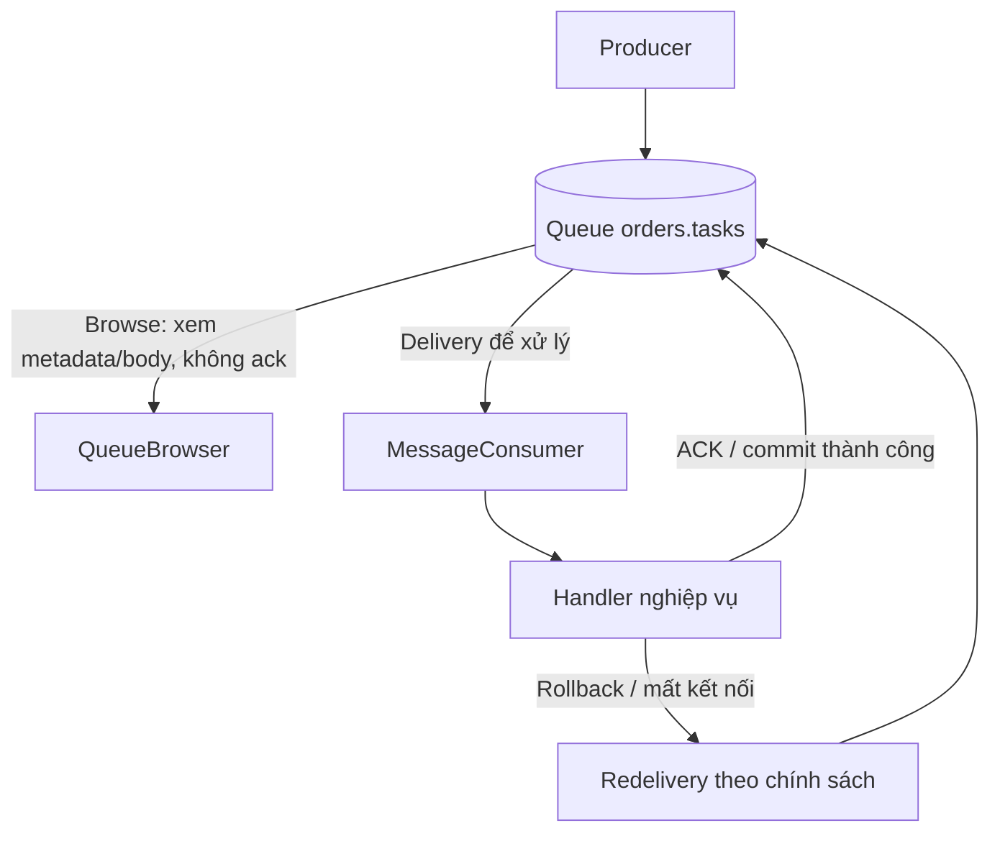

# QueueBrowser để quan sát queue mà không lấy thông điệp ra

> **Chương:** Consumer  
> **Phạm vi:** Java/JMS với Apache ActiveMQ Artemis và ActiveMQ Classic.  
> **Mục tiêu:** Dùng `QueueBrowser` để kiểm tra message đang chờ trong **queue** mà không tiêu thụ/ack chúng; hiểu giới hạn quan sát khi có consumer cạnh tranh và biết lúc nào nên chuyển sang công cụ quản trị broker.

## 1. Bài toán: cần nhìn message nhưng không được lấy việc của worker

Queue `orders.tasks` đang có backlog. Nhóm vận hành muốn kiểm tra có message nào thuộc `tenant=vn` và `eventType=OrderCreated`, nhìn `JMSMessageID`, business `eventId`, timestamp, kiểu payload, nhưng **không làm mất message khỏi hàng đợi**. Nếu mở một `MessageConsumer` và gọi `receive()` chỉ để xem thử, message có thể đã được acknowledge theo `AUTO_ACKNOWLEDGE` hoặc phải rollback để đưa về hàng đợi; cả hai đều gây tác động không cần thiết.

JMS cung cấp **`QueueBrowser`** cho trường hợp này:

```java
QueueBrowser browser = session.createBrowser(queue);
Enumeration<?> messages = browser.getEnumeration();

while (messages.hasMoreElements()) {
    Message message = (Message) messages.nextElement();
    System.out.println(message.getJMSMessageID());
}
browser.close();
```

`QueueBrowser` cung cấp một **enumeration để nhìn các message** theo khả năng của provider. Duyệt message bằng browser **không lấy message ra khỏi queue để xử lý và không tạo acknowledgment cho message ấy**. Một consumer thực sự vẫn có thể nhận message sau đó.

Phạm vi của hành vi này rất quan trọng:

- Browser **không khóa** queue, không giữ message đứng yên cho việc điều tra.
- Enumeration **không bảo đảm** là ảnh chụp nhất quán tại một thời điểm.
- Nếu worker khác đang nhận, ack, rollback hoặc message hết hạn, kết quả duyệt **có thể thay đổi trong lúc đọc**.
- Browser là công cụ **xem có chọn lọc**, không phải API đếm chính xác tức thời, export toàn bộ hay xử lý nghiệp vụ.

## 2. Cơ chế: browser khác consumer như thế nào?



Sơ đồ mô tả **hai luồng truy cập logic** vào một queue; mũi tên ACK biểu thị broker ghi nhận kết quả delivery, không có nghĩa ACK sinh message mới. Khi broker giao message cho `MessageConsumer`, nó chịu quy tắc acknowledgment/transaction. Với `QueueBrowser`, ứng dụng chỉ duyệt thông tin nhìn thấy, không chịu trách nhiệm ACK các bản message được xem.

| Khía cạnh | `QueueBrowser` | `MessageConsumer` |
| --- | --- | --- |
| Khởi tạo | `session.createBrowser(queue)` | `session.createConsumer(queue)` |
| Lấy dữ liệu | `getEnumeration()` → `Enumeration` | `receive()`, `receive(timeout)`, `MessageListener` |
| Message có được tiêu thụ bởi lời gọi này? | **Không** | **Có**: được giao cho consumer để xử lý |
| Có tự ACK do thao tác xem? | **Không** | Tùy acknowledgment mode/transaction |
| Lọc bằng JMS selector | Có: `createBrowser(queue, selector)` | Có: `createConsumer(queue, selector)` |
| Có thể dùng trên topic bằng API này? | **Không**: nhận `Queue` | Consumer hỗ trợ queue hoặc topic |
| Dùng để xây worker xử lý message? | Không | Có |
| Có phải ảnh chụp nhất quán của queue? | Không được chuẩn JMS bảo đảm | Không áp dụng; đây là luồng delivery |

Một browser có thể lấy về bản message chứa header, property và body theo JMS. Tuy nhiên trong môi trường production, việc **chỉ đọc metadata** thường an toàn và nhẹ hơn mở body lớn hoặc chứa thông tin nhạy cảm.

### 2.1. Các method chính

| Method | Công dụng | Điểm cần biết |
| --- | --- | --- |
| `Session.createBrowser(Queue)` | Tạo browser cho queue | Queue có thể phải tồn tại hoặc được auto-create theo broker |
| `Session.createBrowser(Queue, String)` | Tạo browser với JMS selector | Selector lọc header/property, không truy vấn JSON body |
| `QueueBrowser.getEnumeration()` | Lấy `Enumeration` của message có thể xem | Không mặc định là snapshot hoặc count tuyệt đối |
| `QueueBrowser.getQueue()` | Lấy đối tượng queue đang browse | Hữu ích kiểm tra đang xem đúng destination |
| `QueueBrowser.getMessageSelector()` | Đọc lại selector đã cấu hình | Có thể là `null` khi không dùng selector |
| `QueueBrowser.close()` | Giải phóng tài nguyên của browser | Không ack hoặc xóa message đã xem |

Ví dụ cốt lõi:

```java
Queue queue = session.createQueue("orders.tasks");

QueueBrowser browser = session.createBrowser(
        queue,
        "eventType = 'OrderCreated' AND region = 'VN'");

try {
    System.out.println("Queue: " + browser.getQueue().getQueueName());
    System.out.println("Selector: " + browser.getMessageSelector());

    Enumeration<?> enumeration = browser.getEnumeration();
    int displayed = 0;

    while (enumeration.hasMoreElements() && displayed < 20) {
        Message message = (Message) enumeration.nextElement();
        System.out.printf("id=%s, eventId=%s%n",
                message.getJMSMessageID(),
                message.getStringProperty("eventId"));
        displayed++;
    }
} finally {
    browser.close();
}
```

Ở đây giới hạn **20 message được hiển thị** chỉ giới hạn lượng dữ liệu ứng dụng xử lý, không phải bảo đảm bộ lọc broker không quét thêm hoặc `hasMoreElements()` luôn trả về ngay. Nếu cần phân trang, timeout tổng thể hay thống kê chính xác trên queue lớn, dùng API/console quản trị phù hợp thay vì tự xem `Enumeration` là một truy vấn database.

## 3. Điều gì được nhìn thấy khi queue đang thay đổi?

Giả sử lúc bắt đầu có bốn message:

```text
Thời điểm t0:       Queue = [M1, M2, M3, M4]
                    Browser mở enumeration
Thời điểm t1:       Worker A nhận M1; M2 hết hạn
Thời điểm t2:       Producer gửi M5
Thời điểm t3:       Browser tiếp tục nextElement()
```

Không có quy tắc JMS buộc enumeration phải trả **chính xác** `[M1, M2, M3, M4]` của `t0` hay `[M3, M4, M5]` của `t3`. Provider có thể thấy/không thấy những message thay đổi khi đang duyệt, tùy cơ chế dispatch, paging và thời điểm lấy dữ liệu.

Những điều cần nhớ:

1. **Browser không giữ khóa nghiệp vụ.** Worker khác tiếp tục xử lý khi ta đang xem.
2. Message **đã được giao cho consumer nhưng chưa ACK** có thể được hiển thị hoặc không, tùy cách broker/provider tổ chức hàng đợi và enumeration; không được dùng việc không nhìn thấy làm bằng chứng message đã hoàn tất.
3. Message mới đến sau khi gọi `getEnumeration()` có thể xuất hiện hoặc không. `hasMoreElements() == false` **không** có nghĩa queue vĩnh viễn trống.
4. Message expired, bị chuyển DLQ, bị một consumer khác ACK, hoặc đang redelivery làm kết quả biến động.
5. Queue có message theo priority, delivery time/scheduling hoặc nhóm message; thứ tự browser liệt kê **không phải cam kết thứ tự xử lý nghiệp vụ** trên nhiều consumer.

Vì vậy câu “tôi browse được 50 message” nên hiểu là **“tôi quan sát được 50 message trong lần duyệt này”**, không kết luận `messageCount = 50` của broker.

### 3.1. Liên quan tới prefetch và delivering

ActiveMQ Classic có cơ chế **prefetch**; Artemis có **consumer window/credit** và hàng đợi message **delivering/in-flight**. Broker có thể đã cấp message cho consumer trước khi code handler xử lý xong; browser không nhất thiết nhìn thấy toàn bộ message đang thuộc trạng thái ấy.

Khi chẩn đoán backlog, hãy đối chiếu:

- Số message **còn chờ** trên queue theo metric broker.
- Số message **đang giao/in-flight**, consumer count.
- Message **scheduled**, expired hoặc ở DLQ.
- Rate enqueue, rate dequeue/ack, tuổi message cũ nhất nếu broker cung cấp.

Một enumeration rỗng không chứng minh producer không gửi; message có thể đã nằm trong buffer của consumer, đã ACK, hết hạn hoặc không khớp selector.

## 4. Selector để xem đúng nhóm message

`QueueBrowser` hỗ trợ cùng ý tưởng **JMS message selector** như consumer:

```java
QueueBrowser browser = session.createBrowser(
        queue,
        "eventType = 'OrderCreated' AND region = 'VN' AND retryCount >= 2");
```

Selector lọc **JMS header và typed property** mà producer đã ghi. Nó **không** tìm kiếm trong body JSON:

```json
{
  "eventType": "OrderCreated",
  "region": "VN",
  "retryCount": 3
}
```

Chỉ có JSON body như trên chưa đủ để selector hoạt động. Producer cần đặt property:

```java
TextMessage message =
        session.createTextMessage("{\"eventType\":\"OrderCreated\"}");

message.setStringProperty("eventType", "OrderCreated");
message.setStringProperty("region", "VN");
message.setIntProperty("retryCount", 3);

producer.send(message);
```

Khi đó selector `retryCount >= 2` so sánh **kiểu số**, không cần parse JSON. Nếu producer dùng `setStringProperty("retryCount", "3")` thì so sánh số theo ví dụ trên không có contract tương đương; nên thống nhất kiểu property giữa các producer.

### 4.1. Một số mẫu selector hữu ích

| Nhu cầu | Selector | Lưu ý |
| --- | --- | --- |
| Xem một loại event | `eventType = 'OrderCreated'` | `eventType` phải là message property |
| Khoanh vùng tenant | `tenant = 'vn-retail'` | Không thay thế ACL của broker |
| Chỉ xem message có mức retry ≥ 2 | `retryCount >= 2` | Số retry do ứng dụng đặt khác delivery count của broker |
| Đọc message theo mức ưu tiên | `JMSPriority >= 7` | `JMSPriority` là header chuẩn |
| Xem message có property | `eventId IS NOT NULL` | Chỉ xét sự tồn tại/giá trị property, không đọc JSON |
| Kết hợp điều kiện | `eventType = 'OrderCreated' AND region = 'VN'` | Có thể dùng `OR`, `IN`, `LIKE` theo cú pháp selector |

JMS selector là tập con biểu thức SQL-92 với quy tắc **three-valued logic**. Property bị thiếu không mặc nhiên được so sánh như chuỗi rỗng: nhiều biểu thức trả `UNKNOWN` và không thỏa điều kiện. Cần thử riêng message không có property, property null (nếu được phép) và sai type.

**Không** dùng selector làm ranh giới bảo mật tenant. Người dùng có quyền browse queue rộng vẫn có thể thay selector để xem message khác. Quyền phải được giới hạn theo broker security/destination.

## 5. Thực hành: chứng minh browse không lấy message ra khỏi queue

Bài thử dùng **Artemis JMS client** nói **Core protocol** với broker Apache ActiveMQ Artemis. Chúng ta:

1. Tạo một `TemporaryQueue` chỉ tồn tại trong kết nối thử nghiệm, không đụng queue nghiệp vụ.
2. Gửi **ba** message có business `eventId` khác nhau.
3. Duyệt bằng `QueueBrowser` với selector, kỳ vọng thấy **hai** message.
4. Đóng browser, tạo **MessageConsumer không có selector**.
5. Nhận đủ **ba** message. Nếu browse thực sự lấy message ra, bước này sẽ thiếu message.

Bài lab không có worker cạnh tranh, không có publisher chạy đồng thời trong khi browse, nên các tập ID có thể kiểm tra chặt chẽ. Những điều kiện này **không áp dụng** cho queue đang hoạt động trong production.

### 5.1. Maven dependency

Ví dụ sử dụng Java 17 và Artemis **2.50.0** với `javax.jms`:

```xml
<properties>
    <maven.compiler.release>17</maven.compiler.release>
</properties>

<dependencies>
    <dependency>
        <groupId>org.apache.artemis</groupId>
        <artifactId>artemis-jms-client</artifactId>
        <version>2.50.0</version>
    </dependency>
</dependencies>
```

Từ Artemis 2.50.0, groupId Maven của Artemis chuyển sang `org.apache.artemis`; với release cũ hơn hãy đối chiếu dependency theo phiên bản. Ví dụ dùng `javax.jms`; nếu ứng dụng dùng `jakarta.jms` thì chọn Artemis `artemis-jakarta-client` tương ứng, đổi toàn bộ import. Với ActiveMQ Classic 5.x có thể dùng `org.apache.activemq:activemq-client` và `org.apache.activemq.ActiveMQConnectionFactory`; ý nghĩa `QueueBrowser` theo JMS vẫn như nhau, nhưng protocol/broker implementation khác.

Broker Artemis lab cần Core listener tại `tcp://localhost:61616`. Nếu bật authentication, cấp tài khoản bằng biến môi trường `ARTEMIS_USER`, `ARTEMIS_PASSWORD` và quyền create/browse/consume cần thiết trong lab. Không hard-code password vào source.

### 5.2. Mã Java hoàn chỉnh

```java
import javax.jms.Connection;
import javax.jms.JMSException;
import javax.jms.Message;
import javax.jms.MessageConsumer;
import javax.jms.MessageProducer;
import javax.jms.QueueBrowser;
import javax.jms.Session;
import javax.jms.TemporaryQueue;
import javax.jms.TextMessage;

import org.apache.activemq.artemis.jms.client.ActiveMQConnectionFactory;

import java.util.Enumeration;
import java.util.HashSet;
import java.util.Set;

public final class QueueBrowserProbe {
    private static final String SELECTOR =
            "eventType = 'OrderCreated' AND region = 'VN'";

    private static void require(boolean ok, String message) {
        if (!ok) throw new IllegalStateException(message);
    }

    private static void publish(Session session,
                                MessageProducer producer,
                                String eventId,
                                String region,
                                String eventType) throws JMSException {
        TextMessage message = session.createTextMessage(
                "{\"eventId\":\"" + eventId + "\"}");
        message.setStringProperty("eventId", eventId);
        message.setStringProperty("region", region);
        message.setStringProperty("eventType", eventType);
        producer.send(message);
    }

    public static void main(String[] args) throws Exception {
        String brokerUrl = args.length == 0
                ? "tcp://localhost:61616"
                : args[0];

        ActiveMQConnectionFactory factory =
                new ActiveMQConnectionFactory(brokerUrl);

        String user = System.getenv("ARTEMIS_USER");
        String password = System.getenv("ARTEMIS_PASSWORD");
        Connection connection = user == null
                ? factory.createConnection()
                : factory.createConnection(user, password);

        try {
            // Một Session được dùng tuần tự trên main thread.
            Session session = connection.createSession(
                    false, Session.AUTO_ACKNOWLEDGE);
            TemporaryQueue queue = session.createTemporaryQueue();
            MessageProducer producer = session.createProducer(queue);

            publish(session, producer,
                    "evt-vn-1", "VN", "OrderCreated");
            publish(session, producer,
                    "evt-us-1", "US", "OrderCreated");
            publish(session, producer,
                    "evt-vn-2", "VN", "OrderCreated");

            // Kết nối sẵn sàng cho bước nhận thực tế sau khi browse.
            connection.start();

            QueueBrowser browser =
                    session.createBrowser(queue, SELECTOR);

            Set<String> browsedIds = new HashSet<>();
            try {
                System.out.println(
                        "Browser selector: " + browser.getMessageSelector());

                Enumeration<?> enumeration = browser.getEnumeration();
                while (enumeration.hasMoreElements()) {
                    Message message = (Message) enumeration.nextElement();

                    String id = message.getStringProperty("eventId");
                    require(id != null, "Message thiếu eventId");
                    require(browsedIds.add(id),
                            "ID lặp trong lần browse: " + id);

                    System.out.printf(
                            "BROWSE: eventId=%s, JMSMessageID=%s%n",
                            id, message.getJMSMessageID());
                }
            } finally {
                browser.close();  // Chỉ đóng browser, không ACK message.
            }

            require(browsedIds.equals(
                    Set.of("evt-vn-1", "evt-vn-2")),
                    "Sai tập message nhìn thấy: " + browsedIds);

            // Dùng consumer thật, không selector, để chứng minh queue còn đủ.
            MessageConsumer consumer = session.createConsumer(queue);
            Set<String> consumedIds = new HashSet<>();

            try {
                for (int i = 0; i < 3; i++) {
                    Message received = consumer.receive(5_000);
                    require(received != null, "Thiếu message số " + (i + 1));

                    String id = received.getStringProperty("eventId");
                    require(consumedIds.add(id),
                            "Consumer nhận ID trùng: " + id);
                    System.out.println("CONSUME: " + id);
                }
            } finally {
                consumer.close();
            }

            require(consumedIds.equals(
                    Set.of("evt-vn-1", "evt-us-1", "evt-vn-2")),
                    "Message sau browse bị thiếu: " + consumedIds);

            System.out.println("PASS: browse 2, consume 3");
            producer.close();
        } finally {
            connection.close();  // Đóng session và xóa temporary queue.
        }
    }
}
```

Dữ liệu trong ví dụ là các ID cố định, nên không phụ thuộc thứ tự dispatch; dùng `Set` để so sánh tập. Producer gửi vào queue chỉ có một connection thử nghiệm và **chưa có consumer thật** trong lúc browse. Browser selector phải khớp `evt-vn-1` và `evt-vn-2`; consumer không selector phải nhận cả `evt-us-1`.

Kết quả kỳ vọng về mặt logic (thứ tự các dòng có thể thay đổi):

```text
Browser selector: eventType = 'OrderCreated' AND region = 'VN'
BROWSE: eventId=evt-vn-1, JMSMessageID=ID:...
BROWSE: eventId=evt-vn-2, JMSMessageID=ID:...
CONSUME: evt-vn-1
CONSUME: evt-us-1
CONSUME: evt-vn-2
PASS: browse 2, consume 3
```

**Giá trị kiểm chứng:** sau khi duyệt và `browser.close()`, ta vẫn đọc được cả ba message bằng consumer. Browser không thực hiện acknowledgment/commit để “xóa hộ” message. Khi consumer thực sự gọi `receive()` bằng `AUTO_ACKNOWLEDGE`, quá trình acknowledgment thuộc **consumer**, không thuộc browser.

**Giới hạn của lab:** `TemporaryQueue` tự bị xóa khi connection đóng, nên không phù hợp để kiểm thử persistence hoặc phục hồi qua restart. Không suy rộng việc enumeration cho đúng hai ID trong môi trường cô lập thành bảo đảm snapshot khi queue có producer/consumer chạy đồng thời.

## 6. Khi cần xem queue cố định trên broker Artemis

Để khảo sát queue cố định thay vì temporary queue, có thể cấu hình trước ANYCAST queue:

```xml
<!-- Fragment trong <addresses> của Artemis broker.xml -->
<address name="lab.inspect.orders">
    <anycast>
        <queue name="lab.inspect.orders" durable="true"/>
    </anycast>
</address>
```

Ứng dụng thay `TemporaryQueue` bằng:

```java
javax.jms.Queue queue = session.createQueue("lab.inspect.orders");
QueueBrowser browser = session.createBrowser(queue);
```

`session.createQueue(name)` trước hết tạo **đối tượng JMS Queue**; queue vật lý phải đã tồn tại hoặc được broker auto-create theo cấu hình và quyền. Mã này **không** là lời hứa rằng broker đã tạo queue bền vững.

Với Artemis, queue nằm dưới một **address** và routing type; dùng đúng queue name thực tế khi browse. Không lấy tên topic MULTICAST rồi tạo `Queue` cùng chuỗi và suy ra đang xem tất cả subscribers của topic. Mỗi subscription topic có thể gắn với queue riêng, và việc xem subscription cần xác định đúng queue/khả năng quản trị của broker.

### 6.1. Phân quyền browse trên Artemis

Artemis hỗ trợ các quyền liên quan tới destination như `browse`, `consume`, `send` và quyền tạo/xóa queue. Trong môi trường có RBAC, tài khoản quan sát chỉ nên có **quyền xem** đối với đúng queue cần kiểm tra, không cấp rộng quyền xử lý hoặc tạo/xóa queue nếu không cần.

Ví dụ fragment cấu hình minh họa:

```xml
<!-- Fragment trong <security-settings> của broker.xml -->
<security-setting match="lab.inspect.orders">
    <permission type="browse" roles="queue-auditors"/>
</security-setting>
```

Đây **không phải cấu hình security hoàn chỉnh**: nếu thay thế security setting hiện có mà bỏ các permission khác, producer/consumer nghiệp vụ có thể bị ảnh hưởng. Khi dùng thật, tích hợp permission này vào chính sách đang áp dụng cho address, tạo role/user tương ứng và xác minh trên **đúng phiên bản Artemis** rằng tài khoản browser đọc được nhưng không consume/xóa được message.

Đừng dùng username/password của service xử lý nghiệp vụ cho công cụ quan sát nếu muốn phân tách quyền. Khi có dữ liệu cá nhân, quyền browse body cần được kiểm soát như quyền đọc dữ liệu gốc.

## 7. Nên xem trường nào? Tránh vô tình lộ dữ liệu

Một browser hữu ích nhất khi chỉ in metadata cần để điều tra:

```java
Message m = (Message) enumeration.nextElement();

System.out.println("messageId = " + m.getJMSMessageID());
System.out.println("correlationId = " + m.getJMSCorrelationID());
System.out.println("businessEventId = " + m.getStringProperty("eventId"));
System.out.println("type = " + m.getJMSType());
System.out.println("timestamp = " + m.getJMSTimestamp());
System.out.println("priority = " + m.getJMSPriority());
System.out.println("redelivered = " + m.getJMSRedelivered());
```

| Trường | Câu hỏi nó giúp trả lời | Giới hạn |
| --- | --- | --- |
| `JMSMessageID` | Message nào ở mức provider? | Không thay thế business event ID để dedup xuyên retry |
| `JMSCorrelationID` | Gắn với request/trace nào? | Chỉ có nếu producer đặt phù hợp |
| `JMSTimestamp` | Provider ghi nhận thời điểm gửi nào? | Không đồng nghĩa thời điểm sự kiện nghiệp vụ xảy ra |
| `JMSExpiration` | Message còn hạn không? | Có thể thay đổi trong lúc browse; đừng dùng để giữ message |
| `JMSPriority` | Có mức ưu tiên khác thường không? | Không bảo đảm thứ tự tổng thể giữa các queue/consumer |
| `JMSRedelivered` | Có dấu hiệu message được giao lại không? | Không mô tả đầy đủ lịch sử retry |
| `JMSXDeliveryCount` nếu provider hỗ trợ | Gợi ý số lần delivery | Có thể không phản ánh chính xác lịch sử nghiệp vụ; cần hiểu provider |
| `eventId`/`tenant`/`eventType` | Xác minh contract ứng dụng | Phải được producer đặt dưới dạng property |

**Lưu ý:** Đọc `TextMessage.getText()` hoặc `BytesMessage` body có thể tiêu tốn bộ nhớ, network, gây log PII và kích hoạt tải dữ liệu lớn từ disk/paging. Mặc định chỉ xem header/property và giới hạn số message, thời gian truy cập, người được phép dùng. Nếu cần đọc body, che dữ liệu nhạy cảm, giới hạn kích thước và không ghi nguyên văn vào log tập trung.

### 7.1. Browser không sửa hay tái phát message

Mặc dù `Enumeration` trả về đối tượng `Message`, sửa property/header trên object **không phải** một lệnh cập nhật bản message đang lưu trong broker. Các message nhận từ broker thường ở trạng thái read-only theo JMS; cũng không có API “browse rồi commit để xóa bản đã xem”.

Muốn xử lý một message: dùng `MessageConsumer`; muốn chuyển queue hoặc reprocess message độc lập: áp dụng **cơ chế quản trị/move/replay** có kiểm soát của broker, không dựa vào `QueueBrowser` như API mutation.

## 8. Khi nào QueueBrowser không phù hợp?

### 8.1. Không dùng để đếm queue chính xác

Mẫu dễ mắc lỗi:

```java
int count = 0;
Enumeration<?> e = browser.getEnumeration();
while (e.hasMoreElements()) {
    e.nextElement();
    count++;
}
System.out.println("Queue depth = " + count);  // Không bảo đảm đúng.
```

Con số `count` chỉ là số phần tử mà lần enumeration trả về. Khi producer/consumer khác hoạt động, nó không thay thế broker queue-depth metric. Thậm chí một queue tưởng như trống có thể còn message inflight/đã prefetch, scheduled hoặc đang ở trạng thái khác.

Để giám sát queue depth, dùng Artemis Console/JMX/management API hoặc Classic JMX/console tương ứng; xem định nghĩa **message count**, **delivering count**, **scheduled count**, và phạm vi metric của từng sản phẩm/phiên bản.

### 8.2. Không dùng làm vòng polling để phát hiện việc mới

Không viết:

```java
while (true) {
    Enumeration<?> e = browser.getEnumeration();
    if (e.hasMoreElements()) {
        // Thấy message rồi làm nghiệp vụ...
    }
}
```

Đây không phải consumer đúng nghĩa, không có ACK, flow control/transaction phù hợp và dễ tạo polling tải cao. Nếu mục tiêu xử lý message, dùng `MessageConsumer.receive(timeout)` hoặc `MessageListener`; nếu cần chẩn đoán, thực hiện browse có điều kiện trong tác vụ ngắn được quản lý.

### 8.3. Không dùng để export toàn queue lớn

Browser có thể khiến broker phải đọc nhiều message từ journal/page store và chuyển payload qua mạng. Rủi ro khi queue lớn hoặc đang paging:

- Tăng I/O và network traffic, ảnh hưởng producer/consumer thật.
- Enumeration kéo dài, dữ liệu đang thay đổi nên bản export không nhất quán.
- Client giữ nhiều object `Message` và gây heap pressure/GC.
- Một số message lớn hoặc có body nhị phân nhạy cảm không phù hợp ghi log.
- Không có cam kết pagination/snapshot tiêu chuẩn JMS để tiếp tục lần quét theo một cursor bền vững.

Nếu cần xuất dữ liệu phục vụ backup, pháp chứng hoặc migration, chọn cơ chế **export/backup/management** do broker hỗ trợ, đảm bảo quyền và ảnh chụp phù hợp. QueueBrowser phục vụ **quan sát mẫu thông tin**, không phải giải pháp sao lưu.

### 8.4. Không browse topic bằng `QueueBrowser`

`QueueBrowser` chỉ nhận `Queue`. Một topic có thể có nhiều subscription và mỗi subscription có trạng thái lưu riêng; không tồn tại “một danh sách message của topic” theo nghĩa JMS QueueBrowser tiêu chuẩn. Muốn điều tra durable subscription trên Artemis, cần nhận diện queue subscription thực tế và dùng khả năng quản trị được cấp quyền; trên Classic cũng phải theo mô hình subscription/persistence cụ thể.

### 8.5. Không thay thế DLQ và redelivery policy

Xem được payload lỗi không đồng nghĩa đã sửa được lỗi. Một message poison cần handler phân loại lỗi, retry có giới hạn, DLQ/quarantine và khả năng reprocess được kiểm soát. Browser hữu ích để **xem dấu hiệu** trên queue/DLQ nhưng không tự di chuyển, ACK hoặc sửa message.

## 9. Quy trình điều tra một queue đang tăng backlog

Giả sử `orders.tasks` tăng từ 5.000 lên 80.000 message, nhưng nhóm consumer cho rằng không có lỗi.

1. **Đọc metric trước:** enqueue/dequeue/ack rate, consumer count, delivering/inflight, queue depth và age của message cũ nhất. Nếu queue đang thay đổi nhanh, ghi mốc thời gian của snapshot metrics.
2. **Dùng selector hẹp:** browse tối đa một số message thuộc `eventType`/`tenant` quan tâm, in `JMSMessageID` và `eventId`. Không yêu cầu đọc toàn bộ body ngay.
3. **Đối chiếu timestamp:** so `JMSTimestamp` (lúc provider gửi) với `occurredAt` nghiệp vụ (nếu được đặt làm property) để biết trễ từ nguồn hay trễ ở broker/consumer.
4. **Xác minh trạng thái:** có message gần hết hạn, redelivered, scheduled, đang gửi tới consumer khác hoặc ở DLQ không?
5. **Truy về handler:** dùng `eventId` liên kết log producer/consumer; không dùng JMSMessageID thay cho ID nghiệp vụ khi retry có thể tạo message mới.
6. **Dừng quan sát:** `browser.close()`, giải phóng tài nguyên; nếu cần xử lý hay chuyển message, dùng công cụ có quyền riêng và quy trình thao tác được ghi nhận.

Không đưa một QueueBrowser trực tiếp vào cron quét toàn bộ queue mỗi vài giây. Dùng metrics/JMX cho **quan sát thường xuyên**, browse có giới hạn khi cần **chẩn đoán chi tiết một nhóm message**.

## 10. So sánh ActiveMQ Classic và Artemis khi browse

Cả hai broker có JMS `QueueBrowser`, nhưng **triển khai bên trong khác nhau**:

| Điểm kiểm tra | ActiveMQ Classic | ActiveMQ Artemis |
| --- | --- | --- |
| API Java chuẩn | `javax.jms.Session.createBrowser` ở Classic 5.x; chọn API phù hợp Classic 6.x | `javax.jms` với `artemis-jms-client`; `jakarta.jms` với `artemis-jakarta-client` |
| Lớp factory điển hình | `org.apache.activemq.ActiveMQConnectionFactory` | `org.apache.activemq.artemis.jms.client.ActiveMQConnectionFactory` |
| Wire protocol native | OpenWire | Artemis Core |
| Cơ chế điều phối nội bộ | Dispatch/prefetch, store KahaDB/JDBC theo cấu hình | Address/queue, consumer window/credit, journal/paging |
| Khả năng quan sát quản trị | Classic Web Console/JMX (`QueueViewMBean`) | Artemis Console/JMX/management queue controls |
| Điều nên kiểm chứng | Browser nhìn thấy gì khi có prefetch/consumer và selector? | Browser nhìn thấy gì khi message đang delivering/paging và selector? |

Không dùng con số message đã browse để so benchmark độ sâu queue giữa hai sản phẩm. Mọi phép thử cần cùng tải và cần đối chiếu metric ở tầng broker.

Nếu ứng dụng chỉ cần API JMS thuần, có thể thay client/provider phù hợp phiên bản. Tuy vậy một phép thử browse đúng trên Classic **không chứng minh** hành vi timing, paging, ACL và thống kê sẽ y hệt Artemis.

## 11. Bảng kiểm thử chấp nhận

| Ca | Thiết lập | Kỳ vọng |
| --- | --- | --- |
| B1: browse không phá hủy | Gửi 3 message, browse 2 bằng selector, rồi consume tất cả | Browse thấy 2; consumer vẫn nhận đủ 3 |
| B2: selector bỏ qua body | Chỉ ghi `eventType` trong JSON body, không set property | Selector không khớp như kỳ vọng |
| B3: selector đúng kiểu | `retryCount` là integer property, query `>= 2` | Chỉ khớp message có thuộc tính hợp lệ |
| B4: nhiều browser | Hai browser xem cùng queue lab không có consumer | Không lấy message ra, không ACK; kết quả quan sát theo provider |
| B5: consumer cạnh tranh | Worker nhận/ACK trong khi browser đang duyệt | Enumeration có thể không nhất quán với thời điểm mở |
| B6: close browser | Đóng browser trước khi consume | Message vẫn nằm trong queue nếu chưa bị tiêu thụ |
| B7: queue sai quyền | User thiếu quyền browse | Broker từ chối theo chính sách, không cấp quyền tiêu thụ ngầm |
| B8: queue lớn | Bật paging/đổ tải giả lập | Giới hạn truy vấn, ghi nhận latency và ảnh hưởng I/O |
| B9: message expiring | Gửi message có TTL rất ngắn | Có thể không xuất hiện khi browse; không suy ra đã xử lý thành công |

**Chứng cứ PASS tốt nhất cho B1:** đối chiếu **tập business ID** đã gửi, đã nhìn thấy và đã consume; queue lab cô lập khỏi mọi worker khác. Trong production, không thể áp đặt tập kết quả cố định nếu traffic đang liên tục thay đổi.

### 11.1. Các lỗi thường gặp

| Dấu hiệu | Kiểm tra trước |
| --- | --- |
| `getEnumeration()` rỗng | Queue name, selector/property type, quyền browse, queue thực tế, inflight/prefetch, TTL |
| Browser thấy ít hơn console metric | Enumeration không phải snapshot; message đang delivering/scheduled/paged; metric có phạm vi khác |
| Bị từ chối truy cập | Artemis `browse` permission, authentication, quyền destination và auto-create policy |
| Browse được nhưng body đọc lỗi | Message type không phải `TextMessage`; body lớn/binary; client/protocol mapping |
| Browser quét quá chậm | Journal/paging, backlog lớn, selector rộng, băng thông broker/client |
| Browser không thể “xóa message đang lỗi” | Đó không phải chức năng của browser; dùng consumer hoặc management operation có quyền |
| Producer/consumer thực bị chậm khi audit | Quét quá nhiều message, payload lớn, disk/network/heap bị cạnh tranh |

## 12. Checklist khi đưa QueueBrowser vào công cụ nội bộ

- [ ] Chỉ dùng cho `Queue`, xác nhận tên **queue vật lý** chính xác trên broker.
- [ ] Ghi rõ browser chỉ đọc; không ACK/commit/delete message đã xem.
- [ ] Lựa chọn selector trên **JMS header/property**; không kỳ vọng lọc JSON body.
- [ ] Giới hạn số message hiển thị, dữ liệu được log và quyền đọc body.
- [ ] Không dùng enumeration làm queue count, snapshot/export hoặc message processing loop.
- [ ] Dùng role browse riêng ở broker; không cấp quyền consume/manage không cần thiết.
- [ ] Có `try/finally` để `browser.close()` và đóng connection theo lifecycle owner.
- [ ] Không dùng một `Session`/`JMSContext` từ nhiều thread đồng thời.
- [ ] Khi điều tra backlog, so sánh với broker metrics: waiting, delivering, scheduled, redelivery/DLQ.
- [ ] Kiểm thử với broker/client/version thực tế, nhất là prefetch, paging và traffic đồng thời.
- [ ] Nếu dùng queue nghiệp vụ, hiểu rằng worker khác vẫn có thể nhận/xóa message trong lúc browse.

## 13. Câu hỏi tự kiểm tra

1. Vì sao `QueueBrowser.getEnumeration()` không tương đương `MessageConsumer.receive()`?
2. Nếu browser thấy 100 message, có được báo “queue đang có chính xác 100 message” không?
3. Tại sao selector `eventType = 'OrderCreated'` không khớp khi eventType chỉ nằm trong JSON body?
4. Hai browser mở cùng một queue có “chia việc” như hai competing consumers không?
5. Sau `browser.close()`, message có bị ACK hoặc xóa không?
6. Vì sao có thể browser không nhìn thấy message vẫn đang xử lý trong consumer khác?
7. Khi queue có hàng triệu message và đang paging, dùng QueueBrowser để export toàn queue có rủi ro gì?
8. Khi muốn tách role chỉ xem trên Artemis, nên kiểm tra permission nào?
9. Có thể dùng QueueBrowser để xem trực tiếp mọi message trong topic `orders.events` không?

**Gợi ý:** (1) browse là quan sát, receive là delivery để xử lý; (2) không, không có snapshot nhất quán; (3) selector chỉ lọc header/property; (4) không; (5) không; (6) dispatch/prefetch/delivering và timing; (7) I/O, memory, kết quả không ổn định; (8) `browse`; (9) không theo JMS QueueBrowser API, phải xét subscription queue/management.

## 14. Tài liệu đối chiếu

- [Java EE 7 JMS API — `QueueBrowser`](https://docs.oracle.com/javaee/7/api/javax/jms/QueueBrowser.html): contract `getEnumeration()`, `getMessageSelector()`, `getQueue()` và `close()`.
- [Java EE 7 JMS API — `Session`](https://docs.oracle.com/javaee/7/api/javax/jms/Session.html): `createBrowser`, selectors và quản lý session.
- [Jakarta Messaging Specification](https://jakarta.ee/specifications/messaging/): quy tắc queue browsing, acknowledgment và đặc tả selector.
- [Apache ActiveMQ Artemis — Security](https://artemis.apache.org/components/artemis/documentation/latest/security.html): destination permissions, trong đó có quyền browse.
- [Apache ActiveMQ Artemis — Management](https://artemis.apache.org/components/artemis/documentation/latest/management.html): các phương tiện quan sát message count, consumer và queue ở tầng broker.
- [Apache ActiveMQ Artemis — Address Model](https://artemis.apache.org/components/artemis/documentation/latest/address-model.html): address/queue và routing type, giúp xác định đúng queue cần browse.

> **Ghi nhớ:** `QueueBrowser` giải quyết đúng một việc: **xem những message hiện quan sát được trong queue mà không tiêu thụ/ack chúng**. Enumeration **không phải ảnh chụp nhất quán**. Dùng selector và giới hạn phạm vi để kiểm tra từng nhóm message; dùng broker metrics/management cho số liệu vận hành, dùng `MessageConsumer` khi thật sự phải xử lý message.
