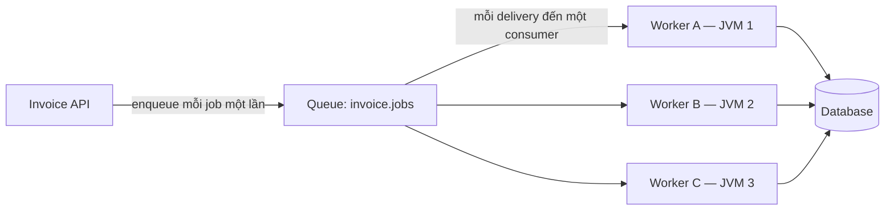
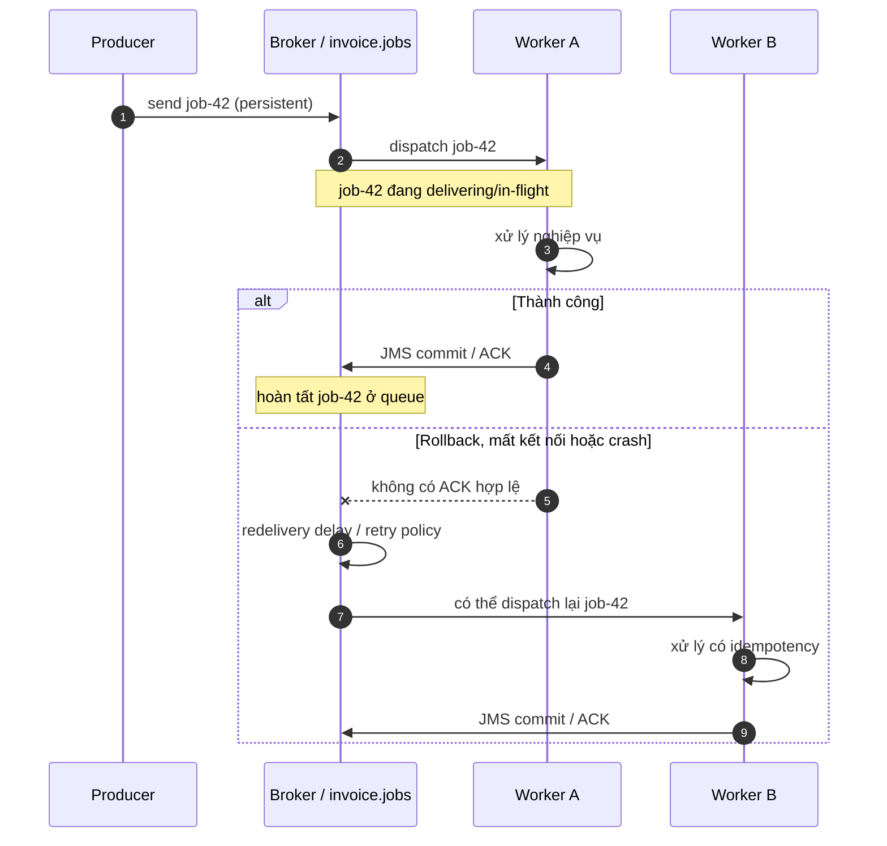

# Competing consumers và phân phối công việc giữa nhiều tiến trình

> **Chương:** Consumer  
> **Mô-đun:** `INTEGRATION_MESSAGING_MESSAGE_BROKER_ACTIVEMQ` — Apache ActiveMQ Classic và Artemis cho xử lý bất đồng bộ bằng queue/topic, Java/JMS, acknowledgment, transaction, redelivery và vận hành broker đáng tin cậy.  
> **Trọng tâm:** Nhiều **tiến trình JVM độc lập** cùng consume **một queue** để chia công việc; cách broker dispatch, ảnh hưởng của buffering/prefetch, cách xử lý worker chậm hoặc chết, thứ tự message, mở rộng năng lực và kiểm chứng bằng Java trên Artemis.

## 1. Tại sao cần competing consumers?

Giả sử ứng dụng thương mại điện tử tạo 600 tác vụ sinh hóa đơn mỗi phút. Mỗi tác vụ cần trung bình 0,5 giây CPU/I/O từ worker. Một worker xử lý tuần tự chỉ đạt khoảng 2 tác vụ/giây, thấp hơn tốc độ đến là 10 tác vụ/giây; backlog tăng dần.

Ta chạy nhiều **bản sao của cùng một worker** ở các JVM/container khác nhau, mỗi bản sao tạo consumer trên **cùng queue** `invoice.jobs`:



Với **queue** và các consumer đang tranh nhận (competing consumers), mỗi lần broker phân phát một message, **một consumer** được chọn để xử lý bản đó. Một job không được tự động phát đồng thời cho cả ba worker như topic pub/sub. **Tuy nhiên** message **có thể được giao lại** sau lỗi hoặc rollback; “mỗi lần chỉ một consumer xử lý” không đồng nghĩa “nghiệp vụ chắc chắn chạy đúng một lần”.

Điều có thể kỳ vọng:

- Nhiều worker có thể tăng throughput nếu tác vụ độc lập và hệ thống bên dưới (DB, API, disk) còn khả năng phục vụ.
- Một worker dừng thì broker có thể phân phát hoặc **phát lại message chưa ACK** cho worker khác theo cơ chế xử lý lỗi.
- Phân phối **không nhất thiết 50/50 hay round-robin chính xác**. Prefetch, consumer credits, tốc độ xử lý, thời điểm kết nối và trạng thái in-flight quyết định công việc thực tế.
- Thứ tự hoàn tất giữa các worker **không được bảo đảm** dù message được gửi vào cùng một queue theo một thứ tự.

Đây là **mô hình worker pool ở mức broker**, không phải “consumer group” với offset/partition như Kafka. JMS `Session`, queue dispatch và ACK là các đối tượng cần hiểu.

## 2. Cơ chế broker giao việc: ready → in-flight → ACK hoặc redelivery

Để hình dung một message `job-42`:



Các mốc kỹ thuật:

1. **Ready/pending:** Message đã được enqueue, nhưng chưa giao cho consumer. Với message persistent và broker storage cấu hình đúng, broker có cơ chế lưu bền thích hợp.
2. **Dispatch/delivering:** Broker chọn một consumer đủ điều kiện, cấp message cho nó. Message có thể đã được đẩy vào **buffer ở client**, dù code chưa gọi `receive()` xong. Vì thế “queue size giảm” không nhất thiết bằng “job đã xử lý”.
3. **Xử lý:** Worker thực hiện tác vụ và chỉ xác nhận JMS khi đạt ranh giới thành công theo thiết kế.
4. **ACK/commit:** Broker ghi nhận xác nhận hợp lệ và không cần giao tiếp message đó trong queue nữa.
5. **Rollback/recover/disconnect:** Message chưa được xác nhận có thể được đưa vào chu kỳ redelivery, tùy cấu hình retry và tính hợp lệ của session/connection.
6. **Poison message:** Nếu cùng message lỗi nhiều lần, broker có thể chuyển tới **DLQ** theo chính sách; worker khác không tự chữa được payload sai.

**Chú ý:** Broker có thể đánh dấu message là *delivering* khi nó mới nằm trong buffer của client. Vì vậy việc tất cả worker đều kết nối nhưng một worker rất chậm có thể tạo phân phối lệch ngay cả khi các worker khác còn rảnh.

## 3. Cùng queue và khác queue: sai topology dẫn đến fan-out

| Bố trí | Producer gửi một job | Worker A | Worker B | Kết quả |
| --- | --- | --- | --- | --- |
| **Một queue**, hai consumer | `invoice.jobs` | Consume `invoice.jobs` | Consume `invoice.jobs` | Cạnh tranh xử lý một bản của job |
| Hai queue độc lập được fan-out | Cả `invoice.jobs.a` và `invoice.jobs.b` | Consume A | Consume B | Mỗi queue có bản riêng, có thể xử lý hai lần nếu cùng thực hiện một side effect |
| Topic, hai subscription độc lập | `invoice.events` | Subscription A | Subscription B | Mỗi subscription đủ điều kiện nhận một bản |
| Topic có **shared subscription** | Topic + cùng shared subscription được hỗ trợ | Cùng subscription | Cùng subscription | Competing trong phạm vi subscription chung; không giống hai subscription độc lập |

**Artemis:** Mô hình tác vụ phổ biến là một **ANYCAST address** gắn **một queue**, và mọi worker consume queue đó. Nếu một address gắn nhiều queue anycast, routing từ address đến queue cũng là một quyết định của broker; nên chọn một queue rõ ràng cho pool nếu không có lý do phân vùng công việc.

**ActiveMQ Classic:** Mọi worker cùng subscribe một `Queue` có tên giống nhau; message broker sẽ dispatch trong phạm vi queue. **Không** tạo một queue riêng cho mỗi bản sao nếu mục tiêu là chia cùng một tập job.

Trong JMS, worker không phải khai báo consumer-group ID như Kafka. Một `ConnectionFactory` kết nối được broker, một `MessageConsumer` trỏ đúng queue và ACK đúng mode là đủ để tham gia nhóm tranh nhận.

## 4. Tại sao số message nhận được giữa các worker không bằng nhau?

### 4.1. Prefetch và buffer ở client

Các broker thường cố tăng throughput bằng việc **gửi trước** message tới consumer thay vì đợi mỗi lần worker gọi `receive()`:

```text
Broker invoice.jobs:  M1 M2 M3 M4 M5 M6

Worker A: buffer [M1 M2 M3 M4]  | xử lý M1 chậm
Worker B: buffer [M5 M6]        | xử lý M5 rất nhanh
```

Nếu A đang giữ M2–M4 trong client buffer, B có thể phải chờ dù còn “công việc chưa xử lý” trong hệ thống. Thứ tự và số lượng thực tế phụ thuộc **broker, client version, giới hạn window/prefetch và ACK**; sơ đồ là ví dụ khái niệm.

Đừng xem prefetch là một số job **đang được code xử lý song song**. Một Session tuần tự vẫn có thể **được cấp trước** nhiều message.

### 4.2. Tham số của ActiveMQ Classic và Artemis khác nhau

| Broker/client | Cơ chế thường điều khiển | Cấu hình minh họa | Đánh đổi |
| --- | --- | --- | --- |
| **Classic** với OpenWire client | `consumer.prefetchSize` / `ActiveMQPrefetchPolicy` | `queue://invoice.jobs?consumer.prefetchSize=1` trong cách đặt destination có hỗ trợ option; hoặc `new ActiveMQQueue("invoice.jobs?consumer.prefetchSize=1")` | Prefetch nhỏ hạn chế một consumer giữ nhiều message, nhưng tăng round-trip và giảm khả năng batch |
| **Artemis** với Artemis Core client | `consumerWindowSize` theo **byte credits/window** | `tcp://127.0.0.1:61616?consumerWindowSize=0` trong broker URL client | `0` vô hiệu hóa buffering sớm ở client, phù hợp thử độ công bằng khi mỗi worker xử lý tuần tự; có thể giảm throughput |

**Hai tham số không cùng đơn vị:** Classic `prefetchSize` là **số message**, trong khi Artemis `consumerWindowSize` xét theo **byte** ở chế độ window dương; `0` là cấu hình đặc biệt để không prebuffer. Không đặt “`consumerWindowSize=1`” rồi kỳ vọng bằng Classic prefetch một message.

Artemis có tùy chọn `consumerWindowSize=-1` cho phép client buffering không giới hạn theo chính sách này; điều đó dễ làm một consumer chiếm nhiều message và RAM, không phù hợp khi muốn phân phối các tác vụ xử lý chậm. Với message lớn hoặc nhiều consumer, cần cân bằng throughput, RAM và khả năng redispatch.

**Không có cam kết chia đều:** `consumerWindowSize=0` hoặc `prefetchSize=1` làm giảm giữ trước message, **không bắt buộc broker chọn A, B, A, B**. Worker nhanh có thể nhận nhiều hơn, điều này thường là mong muốn để sử dụng tốt năng lực.

### 4.3. Consumer chậm, consumer nhanh, thời điểm khởi động

Khi worker A mất 2 giây/job và B mất 0,1 giây/job, A có thể xử lý ít job hơn B. Nếu một worker kết nối trước và broker đã prefetch nhiều message, phân phối càng dễ lệch. Vì thế:

- Khi đo phân phối, khởi chạy worker **trước producer**, hoặc ghi rõ producer/worker start time.
- Dùng `eventId/jobId` duy nhất để xác định message nào thuộc lần kiểm thử.
- Đo **processed+ACK** theo worker, không chỉ số message đã dispatch.
- Kiểm tra cấu hình prefetch/window trước khi kết luận broker “không balance”.

## 5. Thứ tự công việc và điều gì bị mất khi scale ngang?

Giả sử producer gửi:

```text
Job 1: order-42 CREATED
Job 2: order-42 PAID
Job 3: order-42 SHIPPED
```

Với ba competing consumers, các job có thể được dispatch nhanh theo thứ tự nhưng thời gian xử lý khác nhau:

```text
Worker A: CREATED (xử lý 2 giây)
Worker B: PAID    (xử lý 0,1 giây)  -> xong trước CREATED
Worker C: SHIPPED (xử lý 0,2 giây)  -> xong tiếp
```

Một queue có **nhiều consumer** không bảo đảm **thứ tự hoàn thành nghiệp vụ toàn cục**. Ngay cả khi broker giao theo FIFO trong điều kiện cơ bản, message priority, redelivery, transaction, prefetch và nhiều producer đều có thể thay đổi thứ tự quan sát.

### 5.1. Khi phải giữ thứ tự theo một thực thể

Một số bài toán yêu cầu xử lý tuần tự **trong từng orderId**, nhưng vẫn muốn song song giữa các order khác nhau. ActiveMQ Classic và Artemis có hỗ trợ khái niệm **message groups** qua `JMSXGroupID` để gắn các message cùng nhóm vào một consumer trong những điều kiện nhất định.

```java
TextMessage message = session.createTextMessage(json);
message.setStringProperty("JMSXGroupID", orderId);
producer.send(message);
```

Điểm quan trọng:

- **Cùng `orderId`:** có thể duy trì affinity đến cùng consumer cho message group, giúp tránh worker A/B cùng xử lý song song job của cùng order.
- **Khác `orderId`:** các group có thể phân phối cho worker khác nhau, vẫn scale ngang.
- **Không tự giải quyết tranh chấp DB:** nếu dùng nhiều queue, consumer ngoài broker, redelivery/failover hoặc tác vụ bất đồng bộ sau ACK, thứ tự nghiệp vụ cần kiểm chứng độc lập.
- **Group quá lớn/hot key:** mọi job của một order (hoặc một khách hàng có lưu lượng cao) có thể tập trung vào một worker, tạo nút nghẽn.

Nếu yêu cầu **strict global ordering** của mọi job, competing consumers nhiều tiến trình thường không phải mô hình phù hợp; cân nhắc một consumer tuần tự hoặc chia partition/queue theo khóa có kiểm soát.

## 6. Ví dụ chạy được: nhiều JVM tranh nhận một queue trên Artemis

Ví dụ sử dụng **Java 17 + Jakarta Messaging + Apache ActiveMQ Artemis**. Một lệnh `seed 30` đưa 30 job vào queue; mở hai terminal khác nhau chạy `worker A 1200` và `worker B 150` để thấy worker có tốc độ khác nhau tranh nhận thông điệp. Mỗi lần gọi Maven `exec:java` từ **terminal riêng** tương ứng một JVM riêng, không chia sẻ bộ nhớ hoặc Session.

### 6.1. Broker Artemis: khai báo queue và retry policy

Broker đã chạy trong **tiến trình riêng**, cổng Artemis Core mặc định ví dụ `tcp://127.0.0.1:61616`. Tại `<ARTEMIS_INSTANCE>/etc/broker.xml`, thêm **hai address** trong phần `<addresses>` hiện có:

```xml
<addresses>
    <address name="invoice.jobs">
        <anycast>
            <queue name="invoice.jobs">
                <durable>true</durable>
            </queue>
        </anycast>
    </address>
    <address name="invoice.DLQ">
        <anycast>
            <queue name="invoice.DLQ">
                <durable>true</durable>
            </queue>
        </anycast>
    </address>
</addresses>
```

Đồng thời thêm vào phần `<address-settings>` hiện có (hoặc tạo section này nếu chưa có):

```xml
<address-settings>
    <address-setting match="invoice.jobs">
        <auto-create-addresses>false</auto-create-addresses>
        <auto-create-queues>false</auto-create-queues>
        <redelivery-delay>1500</redelivery-delay>
        <max-delivery-attempts>5</max-delivery-attempts>
        <dead-letter-address>invoice.DLQ</dead-letter-address>
    </address-setting>
</address-settings>
```

**Đây là các trích đoạn**, không chép thêm một phần `<addresses>` hoặc `<address-settings>` thứ hai trong cùng file. Nếu instance đã có queue/address hoặc rule tương ứng, cập nhật cấu hình hiện hữu sau khi kiểm tra để tránh trùng. Cần khởi động/nạp lại cấu hình theo quy trình của phiên bản broker và kiểm tra Console/management đã có đúng một queue `invoice.jobs` gắn ANYCAST address cùng tên.

Với demo này:

- Tất cả worker dùng **`invoice.jobs`**; không tạo `invoice.jobs.A`/`invoice.jobs.B`.
- `durable=true` giữ định nghĩa queue; producer cần `DeliveryMode.PERSISTENT` và broker cần bật persistence để lưu job qua restart theo bảo đảm phù hợp.
- Worker bị rollback sẽ có thể nhận lại sau **`redelivery-delay=1500` ms**; sau nhiều lần không xử lý thành công sẽ chuyển đến `invoice.DLQ` theo chính sách.
- Broker cần tài khoản có quyền SEND vào queue producer và CONSUME từ queue worker. Dùng credential từ biến môi trường, không nhúng mật khẩu vào mã.

### 6.2. Maven dependencies

Tạo dự án Maven Java 17, `pom.xml` như sau:

```xml
<project xmlns="http://maven.apache.org/POM/4.0.0"
         xmlns:xsi="http://www.w3.org/2001/XMLSchema-instance"
         xsi:schemaLocation="http://maven.apache.org/POM/4.0.0
                             https://maven.apache.org/xsd/maven-4.0.0.xsd">
    <modelVersion>4.0.0</modelVersion>
    <groupId>example.messaging</groupId>
    <artifactId>competing-consumers-demo</artifactId>
    <version>1.0.0</version>
    <properties>
        <maven.compiler.release>17</maven.compiler.release>
    </properties>
    <dependencies>
        <dependency>
            <groupId>org.apache.activemq</groupId>
            <artifactId>artemis-jakarta-client</artifactId>
            <version>2.38.0</version>
        </dependency>
    </dependencies>
    <build>
        <plugins>
            <plugin>
                <groupId>org.apache.maven.plugins</groupId>
                <artifactId>maven-compiler-plugin</artifactId>
                <version>3.13.0</version>
            </plugin>
            <plugin>
                <groupId>org.codehaus.mojo</groupId>
                <artifactId>exec-maven-plugin</artifactId>
                <version>3.5.0</version>
            </plugin>
        </plugins>
    </build>
</project>
```

`2.38.0` là một phiên bản **cố định cho ví dụ**, không hàm ý mới nhất. Giữ cùng thế hệ API `jakarta.jms` giữa code và thư viện Artemis. Broker/client cần được kiểm thử tương thích theo phiên bản thực tế.

### 6.3. Chương trình Java với chế độ `seed` và `worker`

Tạo `src/main/java/example/messaging/CompetingConsumersDemo.java`:

```java
package example.messaging;

import java.util.UUID;

import jakarta.jms.ConnectionFactory;
import jakarta.jms.DeliveryMode;
import jakarta.jms.JMSConsumer;
import jakarta.jms.JMSContext;
import jakarta.jms.JMSProducer;
import jakarta.jms.Message;
import jakarta.jms.Queue;
import jakarta.jms.TextMessage;

import org.apache.activemq.artemis.jms.client.ActiveMQConnectionFactory;

public final class CompetingConsumersDemo {
    private static final String QUEUE = "invoice.jobs";

    private CompetingConsumersDemo() {}

    public static void main(String[] args) throws Exception {
        if (args.length < 1) {
            throw new IllegalArgumentException(
                "Usage: seed <count> | worker <name> <delayMs> [fail-first]");
        }

        String brokerUrl = System.getenv().getOrDefault(
                "BROKER_URL",
                "tcp://127.0.0.1:61616?consumerWindowSize=0");
        String user = requireEnv("BROKER_USER");
        String password = requireEnv("BROKER_PASSWORD");
        ConnectionFactory factory = new ActiveMQConnectionFactory(brokerUrl);

        switch (args[0]) {
            case "seed" -> {
                if (args.length != 2) {
                    throw new IllegalArgumentException("Usage: seed <count>");
                }
                int count = Integer.parseInt(args[1]);
                if (count < 1 || count > 10_000) {
                    throw new IllegalArgumentException(
                            "count must be between 1 and 10000");
                }
                seed(factory, user, password, count);
            }
            case "worker" -> {
                if (args.length != 3 &&
                        !(args.length == 4 && "fail-first".equals(args[3]))) {
                    throw new IllegalArgumentException(
                            "Usage: worker <name> <delayMs> [fail-first]");
                }
                String workerId = args[1];
                long delayMs = Long.parseLong(args[2]);
                if (workerId.isBlank() || delayMs < 0 || delayMs > 60000) {
                    throw new IllegalArgumentException("Invalid worker args");
                }
                boolean failFirst = args.length == 4;
                worker(factory, user, password, workerId, delayMs, failFirst);
            }
            default -> throw new IllegalArgumentException(
                    "Unknown mode: " + args[0]);
        }
    }

    private static String requireEnv(String key) {
        String value = System.getenv(key);
        if (value == null || value.isBlank()) {
            throw new IllegalStateException("Missing environment: " + key);
        }
        return value;
    }

    private static void seed(ConnectionFactory factory, String user,
                             String password, int count) {
        try (JMSContext context = factory.createContext(
                user, password, JMSContext.SESSION_TRANSACTED)) {

            Queue destination = context.createQueue(QUEUE);
            JMSProducer producer = context.createProducer()
                    .setDeliveryMode(DeliveryMode.PERSISTENT);
            String batchId = UUID.randomUUID().toString();

            for (int i = 1; i <= count; i++) {
                String jobId = batchId + "-" + i;
                TextMessage message = context.createTextMessage(
                        "GenerateInvoice " + jobId);
                message.setStringProperty("jobId", jobId);
                producer.send(destination, message);
            }

            // Một giao dịch JMS chứa toàn bộ batch gửi.
            context.commit();
            System.out.printf("SEED COMMIT: count=%d batch=%s%n",
                    count, batchId);
        }
    }

    private static void worker(ConnectionFactory factory, String user,
                               String password, String workerId,
                               long delayMs, boolean failFirst) {
        try (JMSContext context = factory.createContext(
                user, password, JMSContext.SESSION_TRANSACTED)) {

            Queue destination = context.createQueue(QUEUE);
            JMSConsumer consumer = context.createConsumer(destination);

            System.out.printf("[%s] Ready, processing delay=%d ms%n",
                    workerId, delayMs);

            // Mỗi tiến trình sở hữu một Session/Connection riêng.
            // Ấn Ctrl+C trong terminal tương ứng để dừng worker.
            while (!Thread.currentThread().isInterrupted()) {
                Message message = consumer.receive(2000);
                if (message == null) {
                    continue;
                }

                try {
                    String jobId = message.getStringProperty("jobId");
                    boolean redelivered = message.getJMSRedelivered();
                    int deliveryCount =
                            message.propertyExists("JMSXDeliveryCount")
                            ? message.getIntProperty("JMSXDeliveryCount")
                            : -1;

                    // Mô phỏng xử lý mất thời gian. Thực tế cần ghi DB,
                    // gọi API và idempotency trước khi commit JMS.
                    Thread.sleep(delayMs);

                    if (failFirst && !redelivered) {
                        throw new IllegalStateException(
                                "Simulated transient failure");
                    }

                    context.commit(); // ACK delivery của worker này
                    System.out.printf(
                            "[%s] COMMIT job=%s redelivered=%s attempts=%d%n",
                            workerId, jobId, redelivered, deliveryCount);
                } catch (InterruptedException interrupted) {
                    context.rollback();
                    Thread.currentThread().interrupt();
                    break;
                } catch (Exception processingError) {
                    context.rollback();
                    System.err.printf("[%s] ROLLBACK: %s%n",
                            workerId, processingError.getMessage());
                }
            }
        }
    }
}
```

**Các quyết định trong ví dụ:**

- `consumerWindowSize=0` ở **client Artemis Core** hạn chế việc đẩy trước message cho client, dễ quan sát worker nhanh nhận thêm việc. Đây là một thiết lập đo lường, **không phải cam kết thuật toán chia đều**.
- `worker` là một vòng nhận **tuần tự** trong một JVM/Session. Hai terminal chạy hai tiến trình sẽ tạo hai consumer độc lập trên cùng queue.
- `JMSContext.SESSION_TRANSACTED` cho phép `context.commit()` xác nhận message sau khi xử lý; `rollback()` cho phép broker phát lại theo policy.
- `Thread.sleep(delayMs)` chỉ giả lập công việc, **không thực hiện ghi DB hay side effect thật**. Vì vậy demo an toàn để lặp lại khi học, còn sản phẩm thực tế cần mã xử lý idempotent.
- `fail-first` làm worker chủ động rollback message ở lần giao đầu tiên nếu `JMSRedelivered=false`. Khi lần giao lại có `JMSRedelivered=true`, worker cho phép xử lý thành công. Tùy redelivery delay, worker khác có thể được chọn nhận lại.
- `JMSXDeliveryCount` cho biết số lần giao theo provider/JMS; mã kiểm tra property trước khi đọc. Giá trị `-1` trong log nghĩa là provider chưa cung cấp property, không phải số lần giao hợp lệ.
- Bản ví dụ bắt `Exception` để mô phỏng lỗi nghiệp vụ rồi rollback. Trong ứng dụng thật cần **phân loại lỗi** (retryable/non-retryable), tránh vòng log vô hạn và đưa poison message đến DLQ đúng policy.

### 6.4. Chạy đồng thời ba terminal

Cấp `BROKER_USER` và `BROKER_PASSWORD` cho **từng terminal** hoặc qua môi trường runtime. Dùng tài khoản đã cấu hình trên broker, không sử dụng tài khoản/mật khẩu minh họa trong production.

**Terminal A — worker chậm**:

```bash
mvn -q compile exec:java \
  -Dexec.mainClass=example.messaging.CompetingConsumersDemo \
  -Dexec.args="worker A 1200"
```

**Terminal B — worker nhanh**:

```bash
mvn -q compile exec:java \
  -Dexec.mainClass=example.messaging.CompetingConsumersDemo \
  -Dexec.args="worker B 150"
```

**Terminal C — producer**:

```bash
mvn -q compile exec:java \
  -Dexec.mainClass=example.messaging.CompetingConsumersDemo \
  -Dexec.args="seed 30"
```

Đây là lệnh nhiều dòng cho shell POSIX (Linux/macOS). Trên Windows PowerShell, viết **mỗi lệnh trên một dòng** (hoặc dùng backtick của PowerShell để xuống dòng). Mỗi lệnh Maven `exec:java` khởi động Java main trong **JVM của phiên Maven riêng**, nên hai terminal worker là hai JVM khác nhau.

Quan sát log, ví dụ:

```text
[A] Ready, processing delay=1200 ms
[B] Ready, processing delay=150 ms
SEED COMMIT: count=30 batch=...
[B] COMMIT job=...-1 redelivered=false attempts=1
[B] COMMIT job=...-3 redelivered=false attempts=1
[A] COMMIT job=...-2 redelivered=false attempts=1
...
```

**Log chỉ là minh họa, không phải thứ tự cố định.** Thống kê số `COMMIT` theo A/B; tổng các jobId **duy nhất** được commit sẽ gần 30 khi batch được tiêu thụ hết, nếu không có lỗi, TTL, producer khác hoặc backlog cũ. Số job mỗi worker không nhất thiết bằng 15.

### 6.5. Thử nghiệm lỗi và redelivery giữa các tiến trình

Thử trong môi trường bài học với queue trống:

1. Chạy `worker A 3000` và một worker B cùng queue, sau đó `seed 5`. Dừng **worker A trước khi nó in `COMMIT`**; thông điệp chưa ACK có thể được broker giao lại cho B sau khi kết nối A bị đóng/mất và redelivery policy cho phép.
2. Chạy **chỉ một** worker với `worker A 100 fail-first`, rồi `seed 1`. Lần delivery đầu rollback, lần sau có thể thấy `redelivered=true`/delivery count tăng. Nếu còn consumer khác, broker có thể giao lần sau cho consumer đó.
3. Cố tình tạo lỗi không bao giờ xử lý được (ví dụ đổi logic demo để luôn throw trước commit) trong một **môi trường thử nghiệm cô lập**. Theo dõi `max-delivery-attempts=5` và queue `invoice.DLQ`; một job có thể đi tới DLQ sau khi hết số lần thử được cấu hình.

Khi dừng worker bằng `Ctrl+C`, Maven/JVM có thể đóng tài nguyên theo shutdown path; **đó là thử disconnect/rollback, không nhất thiết tương đương crash đột ngột**. Với bài thử crash thật, chỉ kết thúc đúng tiến trình worker đang thử nghiệm rồi quan sát broker, không dừng nhầm broker hoặc worker đang xử lý dữ liệu khác.

### 6.6. Kiểm chứng qua broker metrics

Trên Artemis Console/management, xem **queue `invoice.jobs`**:

| Chỉ số | Điều mong đợi | Diễn giải |
| --- | --- | --- |
| **Consumer Count** | 2 khi hai worker kết nối | Cả hai cùng đăng ký một queue |
| **Messages Added** | Tăng 30 khi `seed 30` commit | Tổng enqueue của lần test, cần trừ baseline |
| **Delivering Count** | Có thể >0 trong lúc xử lý | Message đã giao nhưng chưa ACK |
| **Message Count** | Giảm dần theo ACK/commit và state queue | Không đồng nhất đơn giản với số nghiệp vụ đã hoàn tất |
| **Messages Acknowledged** | Tăng khi worker commit | Phản ánh ACK broker ghi nhận |
| **Scheduled Count** | Có thể tăng khi redelivery có delay | Message chờ đến thời điểm phát lại |
| **DLQ message count** | 0 khi không lỗi; tăng sau poison messages | Message đã vượt chính sách xử lý lỗi |

Các tên metric và cách tổng hợp có thể khác giữa phiên bản broker và công cụ quản trị. **Nên đo delta của lần kiểm thử**: ghi chỉ số trước/sau và đối chiếu `jobId` trong log; queue đã có backlog sẽ làm tổng đếm khó kết luận.

## 7. Để nhiều worker không gây xử lý trùng: ACK, transaction và idempotency

Một worker xử lý thanh toán/hóa đơn thường ghi database. Một lỗi nguy hiểm:

```text
Worker A nhận job-42
    -> DB COMMIT tạo hóa đơn thành công
    -> JVM chết TRƯỚC JMS commit
Broker redeliver job-42 cho Worker B
    -> B tạo hóa đơn lần nữa nếu không chống trùng
```

**Session giao dịch JMS chỉ bao phủ những thao tác JMS trong Session ấy**; nó không tự gộp DB transaction và JMS ACK vào một giao dịch nguyên tử. Vì vậy nâng số worker làm xác suất gặp race/retry thực tế tăng, không làm thay đổi bản chất ngữ nghĩa.

### 7.1. Một cách xử lý idempotent bằng khóa nghiệp vụ

Mẫu PostgreSQL cho xử lý **cùng jobId một lần**:

```sql
CREATE TABLE processed_invoice_jobs (
    job_id       VARCHAR(128) PRIMARY KEY,
    processed_at TIMESTAMPTZ NOT NULL DEFAULT now()
);

CREATE TABLE invoices (
    invoice_id   VARCHAR(128) PRIMARY KEY,
    order_id     VARCHAR(128) NOT NULL UNIQUE
);
```

Mã nghiệp vụ của consumer cần thực hiện logic trong **một DB transaction**:

```sql
BEGIN;

-- Cùng jobId chỉ một DB transaction được ghi dấu.
INSERT INTO processed_invoice_jobs (job_id)
VALUES (:job_id)
ON CONFLICT (job_id) DO NOTHING
RETURNING job_id;

-- CHỈ NẾU INSERT ở trên thật sự trả về một dòng:
--   INSERT invoice / UPDATE trạng thái nghiệp vụ ở cùng DB transaction.
--   Đảm bảo UNIQUE cho khóa nghiệp vụ để chống hai jobId khác nhau
--   tạo cùng một hóa đơn cho một order.

COMMIT;
```

Sau khi DB commit thành công hoặc xác nhận job đã được xử lý trước đó, worker mới **`context.commit()` JMS**. Khi DB thất bại, rollback DB và `context.rollback()` JMS. Nếu JVM chết sau DB commit, bản phát lại thấy `job_id` đã tồn tại và có thể ACK mà không tạo hóa đơn lần hai.

**Không dựa vào một `ConcurrentHashMap` trong bộ nhớ để deduplicate:** Hai JVM không chia sẻ bộ nhớ, và JVM restart sẽ mất trạng thái. Cần một kho dữ liệu chung bền vững hoặc ràng buộc nghiệp vụ khác. Dùng `JMSMessageID` làm khóa cũng có rủi ro nếu producer retry tạo message mới với ID khác; ưu tiên **`jobId/eventId` ổn định từ nghiệp vụ**.

### 7.2. Điều gì xảy ra khi hai worker vô tình xử lý cùng job?

Bình thường broker không chủ động giao **cùng một delivery đang in-flight** cho hai consumer đồng thời trong cùng queue. Nhưng một worker có thể xử lý chậm, mạng đứt, broker nhận thấy connection mất và **redeliver** message tới worker khác, trong khi worker cũ vẫn còn đang chạy side effect bên ngoài broker.

Vì vậy tính chất “competing” **không phải distributed lock cho dữ liệu nghiệp vụ**. Nếu side effect yêu cầu loại trừ đồng thời mạnh, cần transaction/unique constraint, optimistic locking, idempotency key ở API đích hoặc cơ chế sở hữu công việc có fencing token; ACK của JMS không giải quyết hết race này.

### 7.3. Batch ACK và phạm vi transaction

Một transacted `JMSContext` có thể consume nhiều message trước `commit()`. Nếu rollback, **toàn bộ delivery chưa commit trong transaction đó** có thể được phát lại, và kết quả side effect ngoài JMS phải đủ an toàn khi chạy lại. Khi đang học cơ chế competing consumers, nên **một message/transaction** như ví dụ, sau đó mới thử batch để đo throughput.

Với `AUTO_ACKNOWLEDGE` và synchronous `receive()`, message có thể đã được ACK khi `receive()` trả về, **trước** khi code gọi DB. Điều đó giảm khả năng retry khi worker chết giữa receive và xử lý. Với công việc quan trọng nên chọn ACK sau xử lý (`CLIENT_ACKNOWLEDGE` theo phạm vi session, hoặc transacted Session) và thiết kế idempotency tương ứng.

## 8. Scaling: khi nào thêm worker có hiệu quả?

Ước lượng đơn giản:

```text
Tốc độ đến (λ) = 10 job/s
Một worker xử lý trung bình 0,5 s/job
Năng lực lý thuyết mỗi worker ≈ 1 / 0,5 = 2 job/s
N worker độc lập ≈ N × 2 job/s (chưa tính overhead)
```

Để backlog **không tiếp tục tăng**, cần thông lượng xử lý bền vững lớn hơn tốc độ đến trong thời gian đủ dài; thêm biên dự phòng cho burst và lỗi. Công thức chỉ là **ước lượng khi worker có tài nguyên độc lập**, chưa xét DB lock, network, consumer window, transaction commit, message size và producer flow control.

### 8.1. Những nút cổ chai không được chữa bằng thêm consumer

- **DB/API ngoài:** Mọi worker cùng ghi một bảng có khóa nóng hoặc gọi dịch vụ rate-limit, thêm worker có thể làm latency và lỗi tăng.
- **Broker/storage:** Disk journal đầy/chậm, queue backlog lớn hoặc flow control khiến producer/consumer không thể tăng tốc tùy ý.
- **Message group lớn:** `JMSXGroupID` dồn nhiều job quan trọng vào một consumer, thêm worker không giúp nhóm đó.
- **Tác vụ theo thứ tự:** Nếu phải serialize tất cả job, mục tiêu throughput cao và strict order toàn cục xung đột.
- **Prefetch/window quá lớn:** Job bị cấp trước vào worker chậm; giảm buffer có thể cân bằng lại, nhưng tăng số round-trip.
- **Thời gian startup/handshake:** Worker khởi động rồi thoát liên tục làm tốn kết nối và làm queue bị churn; nên chạy worker lâu dài với shutdown đúng.

### 8.2. Scale bằng queue depth hay age?

Chỉ scale theo **queue depth** có thể phản ứng muộn với job xử lý lâu hoặc bị nhiễu vì message đang delivering. Một bộ tín hiệu thực dụng:

- **Oldest message age / time in queue:** Mốc trễ mà người dùng thực sự cảm nhận.
- **Queue pending + delivering + scheduled:** Tránh đánh giá sai backlog do message đã nằm trong client buffer.
- **Input enqueue rate và ACK throughput:** Nếu đầu vào 500/s nhưng ACK chỉ 300/s, backlog tăng.
- **Worker CPU, memory, DB pool utilization và lỗi:** Bảo đảm thêm worker không làm kiệt resource chung.
- **Redelivery/DLQ rate:** Nếu queue tăng do poison message, chỉ scale worker không giải quyết nguyên nhân.

Nếu dùng autoscaling trên Kubernetes, worker scale out/in phải có **graceful shutdown**: dừng nhận message mới, cho tác vụ đang xử lý hoàn thành/commit trong thời gian cho phép, rồi đóng consumer/connection. Nếu bị kill giữa xử lý, broker sẽ phải redeliver và ứng dụng cần chịu được duplicate.

### 8.3. Worker pool không mặc nhiên là hệ thống phân tán có một leader

Mỗi worker độc lập cùng nghe queue. Không cần leader election cho mỗi job khi broker đã phân phối message, nhưng broker **không quản lý transaction của hệ thống ngoài JMS**. Nếu cần đảm bảo một thao tác chỉ thực hiện một lần giữa các hệ ngoài, dùng unique constraint/idempotency hoặc cơ chế phối hợp chuyên biệt. Đừng dùng “chỉ một consumer nhận một lúc” như bằng chứng không có race.

## 9. Classic so với Artemis khi tuning competing consumers

| Nội dung | ActiveMQ Classic | ActiveMQ Artemis |
| --- | --- | --- |
| Cách khai báo nhóm worker | Nhiều consumer cùng một `Queue` | Nhiều consumer cùng một queue (thường dưới ANYCAST address) |
| Cơ chế cấp trước chính | **Prefetch policy** theo số message | **Consumer flow control/window** theo byte credits |
| Cấu hình ví dụ cho việc chậm | `consumer.prefetchSize=1` (theo OpenWire destination) | `consumerWindowSize=0` (Artemis Core client URL) |
| Trạng thái in-flight | Dispatch/prefetch và ACK của queue | Delivering/consumer credits và ACK của queue |
| Retry/DLQ | RedeliveryPolicy phía client và broker DLQ policy, tùy cách cấu hình | `redelivery-delay`, `max-delivery-attempts`, `dead-letter-address` ở address settings |
| Message grouping | `JMSXGroupID` hỗ trợ affinity theo group | `JMSXGroupID` và cơ chế message grouping |
| Quan sát | JMX/Web Console: QueueSize, Enqueue/Dequeue, InFlight... | Artemis Console/management: ConsumerCount, MessagesAdded/Acknowledged, Delivering, Scheduled... |

**Đừng sao chép nguyên tham số giữa hai broker.** Artemis `consumerWindowSize` không tương đương tên/tham số của Classic `consumer.prefetchSize`. Cả hai đều nhằm hạn chế giữ nhiều message trong client trong những tình huống nhất định; cần kiểm chứng lại trên client/version/protocol đang dùng.

## 10. Sai lầm phổ biến và cách xác minh

| Hiện tượng | Nguyên nhân thường gặp | Kiểm tra và khắc phục |
| --- | --- | --- |
| Có hai worker nhưng cả hai đều nhận toàn bộ event | Hai queue/subscription khác nhau hoặc topic độc lập | Xem chính xác destination mà từng process consume; nếu muốn cạnh tranh, cùng một queue |
| Worker A nhận gần hết job, B rảnh | A kết nối sớm và prefetch/buffer nhiều; B nhận ít credits hoặc kết nối trễ | Xem window/prefetch, in-flight và start time; thử window nhỏ |
| Worker B nhanh nhưng backlog không giảm | A giữ nhiều message chưa ACK; DB bottleneck hoặc nhiều redelivery | Kiểm tra delivering, ACK rate, DB latency, retry policy |
| Queue pending bằng 0 nhưng vài job chưa xử lý | Message nằm trong client buffer/in-flight | Xem delivering/inflight, không chỉ pending |
| Job bị xử lý hai lần sau worker restart | DB commit xong trước JMS ACK; hoặc producer retry khi kết quả gửi không rõ | Dùng business `jobId`, DB unique constraint/inbox |
| Tăng số worker nhưng hiệu năng giảm | Tranh tài nguyên DB/API, khóa nóng, disk I/O | Đo throughput bền vững và resource ngoài broker |
| Job về sau xử lý xong trước job trước | Nhiều consumer, worker khác tốc độ, redelivery | Dùng grouping/partition theo key nếu cần thứ tự, hoặc chấp nhận eventual processing |
| Worker rollback liên tục một message | Poison payload, lỗi nghiệp vụ cố định | Phân loại lỗi, giới hạn retry và DLQ |
| Message không đến worker sau retry | Redelivery delay, queue selector, ACL hoặc đã sang DLQ | Kiểm tra scheduled/delivering/DLQ và log broker |
| Mỗi worker dùng chung một `JMSContext` từ nhiều thread | Session không an toàn để gọi đồng thời | Mỗi worker/thread có Session riêng hoặc listener container quản lý |

**Thứ tự điều tra hợp lý:** Kiểm tra topology queue → consumer count → in-flight/delivering → ACK throughput → prefetch/credits → lỗi DB/side effects → redelivery/DLQ. Đổi số worker trước khi hiểu các chỉ số trên có thể che lỗi.

## 11. Bài tập kiểm chứng

### Bài tập 1 — Nhiều tiến trình có chia đều 30 job?

Chạy `worker A 1000` và `worker B 100` trong hai terminal, sau đó `seed 30`. Ghi `jobId` của từng worker đã in `COMMIT`.

**Yêu cầu:** Tổng số jobId unique là bao nhiêu khi queue đã xử lý xong? Tại sao số job giữa A/B có thể rất lệch? Đổi `consumerWindowSize=0` thành window dương và so sánh phân phối, delivering count và thời gian hoàn tất.

**Hướng giải:** Tổng cần tương ứng 30 job unique trong thử nghiệm không lỗi; A/B không chia đều theo hợp đồng. Window/buffering, tốc độ xử lý và thời điểm kết nối ảnh hưởng cách job được cấp và ACK.

### Bài tập 2 — Kết thúc worker giữa lúc xử lý

Chạy A với delay 5 giây và B với delay 0,2 giây, gửi 10 job. Dừng A **trước commit** một job; theo dõi `jobId` của job đó và `JMSRedelivered` khi được giao lại.

**Yêu cầu:** Message có biến mất không? Có nhất thiết B sẽ nhận lại không? Nếu DB của A đã commit trước khi nó chết thì xử lý sao?

**Hướng giải:** Message chưa ACK hợp lệ cần được broker xử lý redelivery/recovery theo chính sách; consumer nhận lại có thể là B hoặc A sau khi tái kết nối. Side effect DB phải idempotent vì JMS ACK và DB commit là hai ranh giới khác nhau.

### Bài tập 3 — Tránh nhân đôi hóa đơn

Hai JVM cùng xử lý job cho `orderId=ORD-1001`. Producer có thể resend cùng event khi timeout.

**Yêu cầu:** Thiết kế khóa chống trùng ở DB theo `jobId` và `orderId`; chỉ ra vì sao in-memory set trong A không bảo vệ được B; giải thích ranh giới DB commit → JMS commit.

**Hướng giải:** Dùng unique `jobId` trong inbox/processed table và unique `orderId` ở bảng hóa đơn, cùng một DB transaction cho kiểm tra và side effect. ACK JMS sau DB commit; retry thấy job đã làm thì ACK không tạo thêm hóa đơn.

### Bài tập 4 — Nhiều nhóm nghiệp vụ có cần competing không?

Billing và Analytics đều phải nhận **mỗi** sự kiện `OrderCreated`, nhưng mỗi nhóm có 3 bản sao worker để scale.

**Yêu cầu:** Vẽ topology queue/topic để hai nhóm nhận độc lập nhưng ba worker bên trong mỗi nhóm **compete** với nhau.

**Hướng giải:** Dùng topic/multicast address với **hai subscription queues riêng** (một cho Billing, một cho Analytics); mỗi nhóm mở ba consumer trên **queue của chính nhóm**. Không cho cả sáu worker nghe chung một queue nếu cả Billing và Analytics đều phải xử lý từng sự kiện.

### Bài tập 5 — Trường hợp phải giữ thứ tự

Một đơn hàng có `Created → Paid → Shipped`. Nhiều worker xử lý sự kiện bất đồng bộ.

**Yêu cầu:** Giải thích vì sao completion order có thể sai; thử gắn `JMSXGroupID=orderId` và kiểm tra lợi ích/giới hạn; cho ví dụ khi nhóm hot key khiến scale kém.

**Hướng giải:** Các worker song song không có global completion order. Message grouping có thể giữ affinity theo group trong cùng queue, nhưng worker failover, redelivery, side effect ngoài JMS và khóa nóng vẫn phải được thiết kế riêng.

## 12. Tài liệu tham khảo chính thức

1. Apache ActiveMQ Classic — [What is the Prefetch Limit For?](https://activemq.apache.org/components/classic/documentation/what-is-the-prefetch-limit-for): số message được dispatch trước, tác động tới consumer chậm và cách chọn prefetch nhỏ.
2. Apache ActiveMQ Classic — [Message Groups](https://activemq.apache.org/components/classic/documentation/message-groups): `JMSXGroupID` và phân phối theo nhóm.
3. Apache ActiveMQ Artemis — [Consumer Flow Control](https://activemq.apache.org/components/artemis/documentation/latest/flow-control.html): consumer window/credits, client-side buffering và `consumerWindowSize`.
4. Apache ActiveMQ Artemis — [Address Model](https://activemq.apache.org/components/artemis/documentation/latest/address-model.html): ANYCAST/MULTICAST và queue.
5. Apache ActiveMQ Artemis — [Message Grouping](https://activemq.apache.org/components/artemis/documentation/latest/message-grouping.html): affinity, giới hạn khi nhiều consumer và grouping handler.
6. Apache ActiveMQ Artemis — [Message Redelivery and Undelivered Messages](https://activemq.apache.org/components/artemis/documentation/latest/undelivered-messages.html): retry, `redelivery-delay`, `max-delivery-attempts` và DLQ.
7. Jakarta Messaging — [Jakarta Messaging 3.1 Specification](https://jakarta.ee/specifications/messaging/3.1/): queue, Session transaction, ACK và redelivery.

> **Ghi nhớ:** Nhiều competing consumers trên **cùng queue** giúp phân phối công việc cho nhiều JVM và mở rộng throughput, nhưng broker có thể **buffer trước** message, phân phối lệch và redeliver sau lỗi. Chỉ ACK/commit JMS sau khi tác vụ thành công, dùng `jobId` bền vững để chống xử lý trùng, kiểm tra delivering/ACK/DLQ thay vì chỉ nhìn queue depth, và bảo vệ thứ tự theo khóa nghiệp vụ khi cần.
