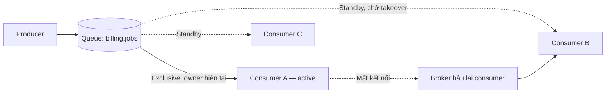
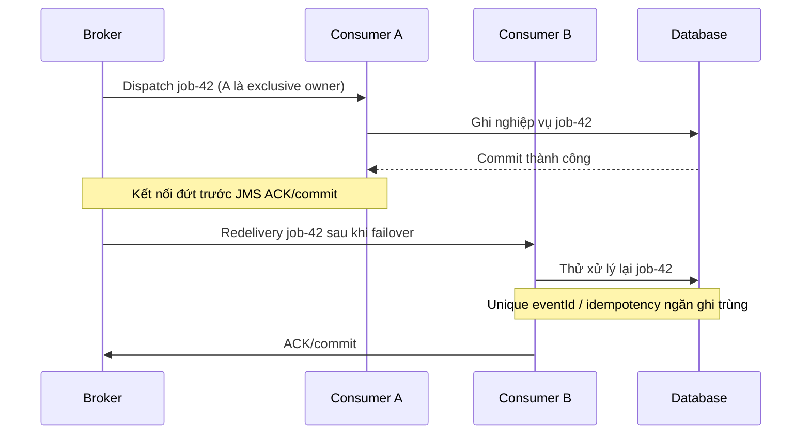

# Exclusive consumer, consumer priority và giới hạn theo broker

> **Chương:** Consumer  
> **Phạm vi:** Phân phối message trên **một queue** khi có nhiều consumer, tập trung vào **exclusive consumer**, **consumer priority**, failover và giới hạn của **Apache ActiveMQ Classic** so với **ActiveMQ Artemis**. Ví dụ Java dùng **ActiveMQ Classic 5.x / `javax.jms` / OpenWire**; cấu hình Artemis được tách riêng để tránh nhầm hai implementation.

## 1. Tình huống: cần một worker chính và một worker dự phòng

Giả sử dịch vụ xuất hóa đơn có ba phiên bản worker chạy sẵn. Đội vận hành muốn **worker A nhận công việc**, worker B chỉ tiếp quản khi A dừng. Với kiểu *competing consumers* thông thường, broker có thể chia các message cho nhiều worker. Có hai cách điều khiển phân phối thường gặp trong hệ sinh thái ActiveMQ:

- **Exclusive consumer:** tại một thời điểm, broker chọn một consumer đang hoạt động để **dispatch** message của queue theo quy tắc exclusive; các consumer khác đóng vai trò chờ tiếp quản.
- **Consumer priority:** broker **ưu tiên** consumer có mức ưu tiên cao khi dispatch; consumer mức thấp vẫn có thể nhận message trong một số điều kiện, nhất là khi consumer mức cao không có khả năng nhận thêm hoặc có message đã cấp phát sẵn.

Hai cách này phục vụ mục tiêu vận hành khác nhau. **Exclusive** phù hợp khi muốn một active consumer tại một thời điểm; **priority** phù hợp khi muốn ưu tiên nhóm worker chính, có khả năng sử dụng worker dự phòng khi nhóm chính không đáp ứng đủ.



**Giới hạn quan trọng:** một consumer là *active owner của dispatch* **không đồng nghĩa** nó giữ được một distributed lock an toàn trên database hoặc tài nguyên ngoài broker. Khi mạng lỗi, worker cũ có thể tiếp tục chạy tác vụ mà nó đã nhận, trong khi worker mới bắt đầu nhận những message được broker giao lại. Vì vậy vẫn cần idempotency, ràng buộc dữ liệu hoặc **fencing token** nếu thao tác bắt buộc chỉ có một chủ thể được phép ghi ở một thời điểm.

### Mục tiêu sau bài

1. Phân biệt **exclusive consumer** với **consumer priority**, **JMS message priority** và **message group**.
2. Dùng destination options của **ActiveMQ Classic** để tạo hai worker exclusive hoặc hai worker có priority khác nhau.
3. Giải thích vì sao prefetch, message in-flight, ACK/commit, lỗi mạng và failover làm kết quả quan sát khác kỳ vọng đơn giản.
4. Đọc cấu hình **exclusive queue của Artemis** mà không áp dụng nhầm cú pháp Classic.
5. Thiết kế phép thử takeover, đo độ trễ khôi phục, tránh xử lý trùng và nhận biết giới hạn của từng broker.

## 2. Bốn khái niệm dễ bị nhầm

| Cơ chế | Đối tượng được điều khiển | Tác dụng chủ yếu | Điều **không** được bảo đảm |
|---|---|---|---|
| **Exclusive consumer** | Consumer nào được nhận message từ **cùng một queue** | Tập trung dispatch vào một consumer chủ động; có standby | Không bảo đảm chỉ một tiến trình trong cả hệ thống được thực thi nghiệp vụ; không loại duplicate |
| **Consumer priority** | Thứ tự ưu tiên **giữa các consumer** | Dispatch ưu tiên consumer có priority cao | Không phải load balancer với tỉ lệ cố định; không phải active/standby tuyệt đối |
| **JMS message priority** | Độ ưu tiên **giữa các message** (JMS từ 0 đến 9) | Broker có thể chọn message ưu tiên cao trước | Không quyết định consumer nào được ưu tiên; không bảo đảm hoàn tất theo thứ tự |
| **Message group (`JMSXGroupID`)** | Tính gắn kết **các message cùng group** | Giữ affinity của một group với consumer, hỗ trợ xử lý theo khóa | Không biến cả queue thành exclusive; không tạo lock hoặc transaction giữa nhiều message |

Ví dụ có thể đặt:

```java
// Priority của MESSAGE: quy định trên producer, API JMS chuẩn.
producer.setPriority(8);

// Consumer priority của Classic: option RIÊNG của ActiveMQ Classic.
Queue preferredQueue = session.createQueue(
        "billing.jobs?consumer.priority=10");
```

Hai giá trị `8` và `10` không có cùng ý nghĩa. **JMS message priority** dùng miền 0–9, còn **Classic consumer priority** là thuộc tính bên phía consumer với phạm vi/cách xử lý do implementation quy định. Không ghép công thức “message priority + consumer priority” rồi cho rằng broker sẽ dispatch theo tổng đó.

### 2.1 “Một consumer” nói đến việc dispatch, không phải nghiệp vụ hoàn tất



Broker có thể chỉ dispatch một message cho **một consumer tại một thời điểm** nhưng nghiệp vụ vẫn bị chạy lại khi tình trạng ACK không chắc chắn. Nếu producer cũng retry, có thể xuất hiện thêm **hai bản message mang cùng eventId** nhưng khác JMSMessageID. Vì thế cần bảo vệ ở **business key**, không dựa vào exclusive như một cơ chế exactly-once.

## 3. ActiveMQ Classic: exclusive consumer được chọn thế nào?

### 3.1 Bật exclusive ở phía consumer

ActiveMQ Classic hỗ trợ **destination option** trên queue dùng bởi consumer:

```java
import javax.jms.MessageConsumer;
import javax.jms.Queue;
import javax.jms.Session;
import org.apache.activemq.command.ActiveMQQueue;

// Chỉ dùng option trên destination của consumer.
Queue queue = new ActiveMQQueue(
        "lab.exclusive.jobs?consumer.exclusive=true");
MessageConsumer consumer = session.createConsumer(queue);
```

Producer gửi đến **tên queue vật lý**, không gắn consumer option:

```java
Queue sendQueue = session.createQueue("lab.exclusive.jobs");
producer.send(sendQueue, message);
```

Khi nhiều consumer exclusive cùng đăng ký queue trên **cùng một broker Classic**, broker chọn consumer được ưu tiên ở vai trò active theo logic dispatch của nó; các exclusive consumer khác ở trạng thái dự phòng. Khi owner hiện tại ngừng kết nối hoặc được broker loại bỏ, broker có thể chọn consumer còn lại để tiếp tục nhận.

**Không nên suy ra** broker sẽ chuyển ngay mọi message hoặc chỉ cần thao tác stop là người dự phòng chắc chắn nhận tức thì. Việc phát hiện đứt kết nối, redelivery các message chưa ACK, prefetch và độ trễ vận chuyển đều ảnh hưởng đến quá trình takeover. Với message đã được xử lý ở DB nhưng ACK bị mất, consumer mới phải chịu được xử lý trùng.

### 3.2 Exclusive được thiết lập ở queue hay ở consumer?

Ở Classic, cơ chế **consumer-level option** cho phép chỉ những client được cấu hình mới yêu cầu hành vi exclusive. Trạng thái liên quan đến việc **ai đăng ký và ai được broker dispatch**, không phải một ràng buộc duy nhất tồn tại độc lập như khóa dữ liệu trên database.

Trong một queue đang được sử dụng, tránh cấu hình lẫn consumer exclusive và consumer thường tùy tiện: behavior cần được kiểm tra theo version và thời điểm kết nối/dispatch, đặc biệt khi đã có message **in-flight** trước lúc exclusive consumer xuất hiện. Để thiết kế active/standby có thể kiểm chứng, dùng một queue dành riêng, cho toàn bộ nhóm worker tuân **cùng chính sách exclusive** và triển khai thử nghiệm ngắt kết nối.

**Điều kiện phạm vi:** cơ chế này điều phối các consumer nhìn thấy **cùng một thực thể queue trên cùng broker**. Nếu triển khai network of brokers hoặc nhiều queue độc lập mang tên giống nhau, không được mặc định một consumer là owner toàn cục trên cả cluster. Phải phân tích topology, forwarding, HA và cách message đi qua mỗi broker.

### 3.3 Khi nào exclusive hữu ích?

- Xử lý một luồng tác vụ tuần tự không cần song song ở tầng consumer, nhưng cần **worker dự phòng** được kết nối sẵn.
- Hệ thống legacy khó xử lý concurrency đồng thời, muốn giảm khả năng tranh chấp khi vận hành.
- Giai đoạn di trú khi muốn thay đổi active worker mà không ngắt toàn bộ dịch vụ quá lâu.

**Không phải lựa chọn mặc định** cho workload lớn: exclusive làm giới hạn thông lượng bởi năng lực của một active consumer. Nếu cần throughput cao nhưng chỉ bắt buộc tuần tự **theo từng order/account**, hãy đánh giá **message grouping**, nhiều queue/partition hoặc version control thay vì buộc toàn bộ công việc đi qua một consumer.

## 4. ActiveMQ Classic: consumer priority là ưu tiên dispatch

### 4.1 Cấu hình priority

ActiveMQ Classic cho phép đặt priority trên destination của consumer:

```java
// Consumer chính có mức ưu tiên cao.
Queue high = new ActiveMQQueue(
        "lab.priority.jobs?consumer.priority=10");
MessageConsumer mainWorker = session.createConsumer(high);

// Consumer dự phòng có mức ưu tiên thấp.
Queue low = new ActiveMQQueue(
        "lab.priority.jobs?consumer.priority=-10");
MessageConsumer fallbackWorker = backupSession.createConsumer(low);
```

Hai đoạn `session` và `backupSession` là **hai JMS session độc lập**; trong ứng dụng thật, ưu tiên chạy mỗi worker trong process riêng để tránh rủi ro một process chết khiến cả main và backup cùng mất. Priority mặc định của một consumer Classic thường là **0** khi không chỉ định option. Dùng các giá trị thử nghiệm nhỏ như `10` và `-10`, không suy rằng số càng lớn sẽ tạo throughput càng cao hoặc cho phép không giới hạn.

**Hành vi mong muốn:** broker ưu tiên consumer có consumer priority cao; consumer thấp có thể nhận khi consumer cao không sẵn sàng/không thể nhận thêm. Tuy nhiên đây là **ưu tiên tương đối trong dispatch**, không phải bảo đảm một consumer thấp **không bao giờ** nhận message khi consumer cao còn kết nối.

### 4.2 Vì sao lower-priority vẫn có thể nhận?

Một số nguyên nhân điển hình:

1. **Thứ tự xuất hiện:** worker ưu tiên thấp đăng ký trước khi worker cao, nên đã nhận/prefetch message.
2. **Năng lực nhận của worker cao:** khi high-priority consumer bận, không đủ credit hoặc bộ đệm đã đầy, broker có thể cấp việc cho consumer khác tùy logic dispatch.
3. **Prefetch/in-flight:** message đã dispatch cho low-priority không tự “di chuyển” về high-priority chỉ vì high-priority vừa kết nối.
4. **ACK/transaction:** message đang chờ commit có thể được giao lại sau rollback/disconnect; giao lại và thứ tự hoàn tất không nhất thiết theo thứ tự ưu tiên ban đầu.
5. **Nhiều queue/broker:** “priority cao” chỉ có ý nghĩa trong phạm vi mà bộ dispatch đang so sánh các consumer thực sự cạnh tranh cùng queue.

**Starvation:** nếu high-priority luôn có khả năng nhận đủ workload, low-priority có thể chờ rất lâu không nhận message. Đây có thể là thiết kế active/backup có chủ đích, nhưng không phù hợp khi mục tiêu là phân phối công bằng cho hai nhóm worker.

### 4.3 Prefetch làm thay đổi quan sát

Trong Classic, **queue prefetch** quyết định số message broker có thể dispatch trước để client giữ trong buffer. Với prefetch cao, một worker chậm có thể giữ nhiều message chưa xử lý trong khi worker khác đang rảnh. Khi kiểm chứng priority hoặc exclusive, có thể đặt prefetch nhỏ để dễ phân tích:

```java
import org.apache.activemq.ActiveMQConnectionFactory;
import org.apache.activemq.ActiveMQPrefetchPolicy;

ActiveMQConnectionFactory factory = new ActiveMQConnectionFactory(url);
ActiveMQPrefetchPolicy prefetch = new ActiveMQPrefetchPolicy();
prefetch.setQueuePrefetch(1);
factory.setPrefetchPolicy(prefetch);
```

**Giảm prefetch về 1** thường làm hiện tượng giữ sẵn nhiều message dễ quan sát hơn; đây là cấu hình **của client factory Classic**, không phải giới hạn kích thước message hay cấu hình chung cho Artemis. Đánh đổi có thể là giảm throughput khi độ trễ mạng cao. Prefetch=1 **không** tạo đảm bảo round-robin, fairness hoặc exclusivity toàn cục.

## 5. Lab Java JMS trên Classic: đối chiếu exclusive và priority

Mục tiêu: chạy **hai process consumer** cùng một queue và quan sát khác biệt giữa hai chế độ. Dùng ActiveMQ Classic 5.x, JDK 17, Gradle 8.x, kết nối OpenWire ở `tcp://127.0.0.1:61616`. Tài khoản broker lấy từ biến môi trường nếu có. Thực hành dùng namespace **`javax.jms`** của Classic client 5.x; không áp dụng nguyên văn cho Artemis Jakarta client.

### 5.1 Tạo dự án Gradle

```text
classic-consumer-routing/
├── settings.gradle
├── build.gradle
└── src/main/java/lab/ConsumerRoutingLab.java
```

`settings.gradle`:

```groovy
rootProject.name = 'classic-consumer-routing'
```

`build.gradle`:

```groovy
plugins {
    id 'java'
    id 'application'
}

repositories {
    mavenCentral()
}

java {
    toolchain {
        languageVersion = JavaLanguageVersion.of(17)
    }
}

dependencies {
    implementation 'org.apache.activemq:activemq-client:5.18.3'
    runtimeOnly 'org.slf4j:slf4j-simple:1.7.36'
}

application {
    mainClass = 'lab.ConsumerRoutingLab'
}
```

**Lưu ý:** các version trong lab là mốc minh họa API, không khẳng định bản mới nhất hoặc đã phù hợp production. Để sử dụng thực tế phải rà soát tương thích và bản vá bảo mật của ActiveMQ Classic, Java, thư viện client và logging.

### 5.2 Mã Java đầy đủ

Tạo `src/main/java/lab/ConsumerRoutingLab.java`:

```java
package lab;

import java.util.Locale;
import javax.jms.Connection;
import javax.jms.DeliveryMode;
import javax.jms.JMSException;
import javax.jms.Message;
import javax.jms.MessageConsumer;
import javax.jms.MessageProducer;
import javax.jms.Queue;
import javax.jms.Session;
import javax.jms.TextMessage;
import org.apache.activemq.ActiveMQConnectionFactory;
import org.apache.activemq.ActiveMQPrefetchPolicy;
import org.apache.activemq.command.ActiveMQQueue;

public final class ConsumerRoutingLab {
    private static final String EXCLUSIVE_QUEUE = "lab.exclusive.jobs";
    private static final String PRIORITY_QUEUE = "lab.priority.jobs";

    private ConsumerRoutingLab() { }

    public static void main(String[] args) throws Exception {
        if (args.length < 3 || args.length > 4) {
            usage();
            return;
        }
        String operation = args[0].toLowerCase(Locale.ROOT);
        String strategy = args[1].toLowerCase(Locale.ROOT);
        if (!("send".equals(operation) || "work".equals(operation))
                || !("exclusive".equals(strategy)
                || "priority".equals(strategy))) {
            usage();
            return;
        }
        String queueName = "exclusive".equals(strategy)
                ? EXCLUSIVE_QUEUE : PRIORITY_QUEUE;

        String url = env("BROKER_URL", "tcp://127.0.0.1:61616");
        String user = System.getenv("BROKER_USER");
        String password = System.getenv("BROKER_PASSWORD");
        ActiveMQConnectionFactory factory =
                new ActiveMQConnectionFactory(url);

        // Prefetch thấp cho dễ nhìn khi thử hai consumer.
        ActiveMQPrefetchPolicy policy = new ActiveMQPrefetchPolicy();
        policy.setQueuePrefetch(1);
        factory.setPrefetchPolicy(policy);

        Connection connection = user == null || user.isBlank()
                ? factory.createConnection()
                : factory.createConnection(user, password);
        try {
            Session session = connection.createSession(
                    true, Session.SESSION_TRANSACTED);
            try {
                if ("send".equals(operation)) {
                    if (args.length != 3) {
                        usage();
                        return;
                    }
                    int count = Integer.parseInt(args[2]);
                    if (count < 1 || count > 1000) {
                        throw new IllegalArgumentException(
                                "count must be 1..1000");
                    }
                    Queue sendQueue = session.createQueue(queueName);
                    send(session, sendQueue, count);
                } else {
                    String workerId = args[2];
                    if (!workerId.matches("[A-Za-z0-9_-]{1,32}")) {
                        throw new IllegalArgumentException("Invalid workerId");
                    }
                    if ("exclusive".equals(strategy) && args.length != 3) {
                        usage();
                        return;
                    }
                    int priority = 0;
                    if ("priority".equals(strategy)) {
                        if (args.length != 4) {
                            usage();
                            return;
                        }
                        priority = Integer.parseInt(args[3]);
                        if (priority < -100 || priority > 100) {
                            throw new IllegalArgumentException(
                                    "lab priority must be -100..100");
                        }
                    }

                    String consumerOptions = "exclusive".equals(strategy)
                            ? "?consumer.exclusive=true"
                            : "?consumer.priority=" + priority;
                    Queue receiveQueue = new ActiveMQQueue(
                            queueName + consumerOptions);
                    connection.start();
                    work(session, receiveQueue, workerId);
                }
            } finally {
                session.close();
            }
        } finally {
            connection.close();
        }
    }

    private static void send(Session session, Queue queue, int count)
            throws JMSException {
        MessageProducer producer = session.createProducer(queue);
        try {
            producer.setDeliveryMode(DeliveryMode.PERSISTENT);
            for (int i = 1; i <= count; i++) {
                String jobId = String.format("job-%03d", i);
                TextMessage msg = session.createTextMessage(
                        "Generate invoice " + jobId);
                msg.setStringProperty("jobId", jobId);
                producer.send(msg);
            }
            session.commit();
            System.out.println("SENT " + count + " jobs");
        } finally {
            producer.close();
        }
    }

    private static void work(Session session, Queue queue, String workerId)
            throws Exception {
        MessageConsumer consumer = session.createConsumer(queue);
        long processingMs = Long.parseLong(env("LAB_PROCESS_MS", "1000"));
        if (processingMs < 0 || processingMs > 60000) {
            throw new IllegalArgumentException(
                    "LAB_PROCESS_MS must be 0..60000");
        }
        System.out.println(workerId + " listening on " + queue);
        try {
            while (true) {
                Message msg = consumer.receive(5000);
                if (msg == null) {
                    continue;
                }
                String jobId = msg.getStringProperty("jobId");
                try {
                    System.out.println(workerId + " PROCESSING " + jobId
                            + " redelivered=" + msg.getJMSRedelivered());
                    // Thay bằng nghiệp vụ có idempotency trong ứng dụng thật.
                    Thread.sleep(processingMs);
                    session.commit();
                    System.out.println(workerId + " COMMITTED " + jobId);
                } catch (InterruptedException e) {
                    session.rollback();
                    Thread.currentThread().interrupt();
                    return;
                } catch (Exception e) {
                    session.rollback();
                    System.err.println(workerId + " FAILED " + jobId
                            + ": " + e.getMessage());
                }
            }
        } finally {
            consumer.close();
        }
    }

    private static String env(String name, String fallback) {
        String value = System.getenv(name);
        return value == null || value.isBlank() ? fallback : value;
    }

    private static void usage() {
        System.out.println("Usage:");
        System.out.println(" send exclusive <count>");
        System.out.println(" work exclusive <workerId>");
        System.out.println(" send priority <count>");
        System.out.println(" work priority <workerId> <consumerPriority>");
    }
}
```

Mỗi lệnh `work` chạy một JVM riêng, giữ một `Session` và một consumer. `SESSION_TRANSACTED` yêu cầu commit **sau xử lý** để message được xác nhận. Trong ví dụ, việc xử lý chỉ là `Thread.sleep`: log `COMMITTED` chứng minh JMS transaction đã commit theo API, **không chứng minh** hóa đơn đã được ghi an toàn vào database. Producer tạo queue **không có consumer option**, còn hai chiến lược dùng **hai queue riêng** để tránh thử nghiệm trước làm nhiễu dữ liệu.

### 5.3 Biên dịch và khởi chạy

Đứng ở thư mục dự án rồi tạo Gradle Wrapper khi cần:

```bash
gradle wrapper --gradle-version 8.10.2
gradle installDist
```

Trên Windows PowerShell có thể dùng `.\gradlew.bat installDist`, Linux/macOS dùng `./gradlew installDist` sau khi wrapper đã tạo. `installDist` sinh script chạy ứng dụng cùng dependency, giúp chạy hai JVM độc lập mà không phải khởi tạo nhiều Gradle daemon trong lúc thử.

**Linux/macOS — thí nghiệm exclusive (ba terminal):**

```bash
# Terminal A: consumer A
./build/install/classic-consumer-routing/bin/classic-consumer-routing work exclusive A

# Terminal B: consumer B
./build/install/classic-consumer-routing/bin/classic-consumer-routing work exclusive B

# Terminal C: producer (sau khi hai worker kết nối)
./build/install/classic-consumer-routing/bin/classic-consumer-routing send exclusive 12
```

**Windows PowerShell — các lệnh tương ứng:**

```powershell
# Terminal A
.\build\install\classic-consumer-routing\bin\classic-consumer-routing.bat work exclusive A
# Terminal B
.\build\install\classic-consumer-routing\bin\classic-consumer-routing.bat work exclusive B
# Terminal C
.\build\install\classic-consumer-routing\bin\classic-consumer-routing.bat send exclusive 12
```

Một kết quả **có thể** quan sát:

```text
Terminal A: A PROCESSING job-001 ...; A COMMITTED job-001; ...
Terminal B: B listening on lab.exclusive.jobs?consumer.exclusive=true
```

Trong điều kiện hai consumer đều exclusive trên **một broker**, chỉ một consumer thường được chọn nhận các message mới; consumer còn lại có thể chờ. A/B nào trở thành active phụ thuộc lịch kết nối/dispatch và cơ chế broker, không phải vì chuỗi workerId có thứ tự alphabet. Dùng queue thử nghiệm trống hoặc tên mới để tránh message in-flight từ lần chạy trước.

**Thí nghiệm takeover:** khi consumer active in `PROCESSING` và chưa commit, dừng đúng process đó để mô phỏng mất kết nối; quan sát worker standby nhận tiếp các message mới và khả năng redelivery của message còn in-flight. Đợi broker phát hiện mất kết nối, không suy ra failover tức thời. Không thực hiện thao tác này trên queue production.

### 5.4 Thí nghiệm consumer priority

**Linux/macOS:**

```bash
# Terminal A: worker ưu tiên cao
./build/install/classic-consumer-routing/bin/classic-consumer-routing work priority PRIMARY 10

# Terminal B: worker ưu tiên thấp
./build/install/classic-consumer-routing/bin/classic-consumer-routing work priority BACKUP -10

# Terminal C
./build/install/classic-consumer-routing/bin/classic-consumer-routing send priority 30
```

**Windows PowerShell:**

```powershell
.\build\install\classic-consumer-routing\bin\classic-consumer-routing.bat work priority PRIMARY 10
.\build\install\classic-consumer-routing\bin\classic-consumer-routing.bat work priority BACKUP -10
.\build\install\classic-consumer-routing\bin\classic-consumer-routing.bat send priority 30
```

Kỳ vọng: consumer `PRIMARY` được ưu tiên trong dispatch, nhưng không được lập quy tắc “30/30 job phải thuộc PRIMARY”. Thử thêm bằng cách tăng `LAB_PROCESS_MS` cho PRIMARY từ 1.000 lên 5.000 và giữ BACKUP nhanh, sau đó gửi một lô mới trên queue trống: mức độ nhận message của BACKUP có thể thay đổi tùy khả năng nhận của PRIMARY, prefetch và cách broker xử lý ưu tiên.

Để đặt biến môi trường **cho riêng terminal**:

```powershell
# PowerShell, đặt trước khi chạy một worker
$env:LAB_PROCESS_MS = "5000"
```

```bash
# Bash/Zsh
export LAB_PROCESS_MS=5000
```

**Lưu ý phép thử:** khi gửi một lô lớn, queue có backlog đủ để quan sát; nếu gửi từng message cách nhau lâu, output có thể khác. Cần xem **broker statistics** (queue size, consumer count, dispatched/in-flight, dequeue count) kết hợp log `PROCESSING`/`COMMITTED`, thay vì kết luận chỉ từ một log.

## 6. Artemis: exclusive queue là thuộc tính của queue

**Artemis không dùng cùng một cơ chế cấu hình như Classic.** Trong Artemis, một queue có thể được khai báo **exclusive**. Với một queue exclusive, broker chọn một consumer để dispatch từ queue đó; những consumer khác chờ thay thế khi consumer đang sở hữu bị ngắt/không còn được chọn. Đây là cách diễn đạt **queue-level** đặc trưng của Artemis.

Ví dụ đoạn cấu hình **`broker.xml`**:

```xml
<!-- Bổ sung vào <addresses> đang có, không tạo trùng address/queue. -->
<address name="lab.artemis.exclusive">
    <anycast>
        <queue name="lab.artemis.exclusive"
               durable="true"
               exclusive="true"/>
    </anycast>
</address>
```

Với Artemis, đừng hiểu đây là “bật exclusive cho toàn bộ address”: một address có thể có nhiều queue gắn vào, và exclusive là **thuộc tính của queue cụ thể**. Một topic/subscription có nhiều subscription queues sẽ không bị biến thành “chỉ một subscriber toàn bộ topic” chỉ vì một queue ở dưới được đặt exclusive.

Một phần cấu hình **address settings** ở các phiên bản Artemis hỗ trợ default queue attributes có thể đặt mặc định cho queue mới; tuy nhiên, cách thiết lập chính xác (XML schema, auto-create và management API) phải xác nhận với phiên bản đang dùng. **Không áp** option `consumer.exclusive=true` của Classic vào Artemis JMS rồi giả định tương đương. Đối với broker đã chạy, kiểm tra queue bằng management console/API để xác nhận cờ exclusive **thực sự đã được áp dụng**; chỉ thay XML nhưng không reload/restart chưa chắc có hiệu lực.

### 6.1 Consumer priority trên Artemis: cùng ý tưởng, cấu hình khác

Artemis cũng có khái niệm **consumer priority** để ưu tiên việc dispatch đến consumer phù hợp. Nhưng **cách khai báo thuộc tính** khác theo protocol và client (Core/JMS/AMQP...), cùng phiên bản client/broker. Classic destination option `consumer.priority=10` là cơ chế **ActiveMQ Classic**, **không phải tùy chọn JMS chuẩn và không được coi là cấu hình portable** cho Artemis.

Trước khi đưa consumer priority vào Artemis production, cần kiểm chứng trên đúng protocol:

1. Client tạo consumer với thuộc tính priority được **Artemis client/protocol version** hỗ trợ; xác nhận broker thực sự nhận được giá trị.
2. Xem thông tin consumer/queue tại management API/console, tránh suy từ việc client chạy không báo lỗi.
3. Tạo consumer priority cao và thấp trên **cùng một physical queue**; gửi message sau khi cả hai đã đăng ký.
4. Thử khi consumer cao xử lý nhanh/chậm, disconnect, và queue có backlog; ghi lại dispatch/in-flight và ACK.
5. Kiểm tra tương tác với **exclusive queue**, consumer window/credits và HA trước khi dùng phối hợp.

**Không thể suy ra** rằng một consumer Artemis sẽ hỗ trợ đúng cùng option string `consumer.priority` hoặc priority range của Classic; nếu công nghệ yêu cầu chuyển broker, hãy **viết integration test đối với broker đích** và thay đổi cấu hình theo tài liệu phiên bản đang vận hành.

### 6.2 Bảng so sánh phạm vi cấu hình

| Khía cạnh | ActiveMQ Classic | ActiveMQ Artemis |
|---|---|---|
| Exclusive | Thường bật qua option `consumer.exclusive=true` trên destination consumer Classic | **Exclusive queue**, ví dụ `<queue exclusive="true">` trong `broker.xml` |
| Priority | Option consumer `consumer.priority=10` của Classic | Cơ chế consumer priority có API/protocol-specific configuration; kiểm chứng với client/version |
| Dispatch buffer | **Prefetch** của ActiveMQ Classic client | **Consumer window/credits** và cơ chế flow control của Artemis |
| Queue model | Classic JMS Queue destination | Artemis **address + ANYCAST queue** |
| Failover | Phụ thuộc client transport, broker topology, destination state | Phụ thuộc HA topology, session reconnect và queue state |
| Portability | Client options không nằm trong JMS standard | Exclusive queue/priority không thể tự suy từ cấu hình Classic |

## 7. Failover, thứ tự và ranh giới bảo đảm

### 7.1 Failover có thể giữ nguyên message nhưng không giữ nguyên owner

Một phiên làm việc cụ thể:

```text
t0: A là active consumer; B đang standby.
t1: Broker giao job-007 cho A.
t2: A cập nhật database rồi mất kết nối trước ACK.
t3: Broker xác định A không còn khả dụng, chọn B.
t4: Broker giao lại job-007 cho B.
t5: B tra processed_jobs theo job-007 và bỏ qua side effect đã commit.
t6: B ACK/commit JMS để hoàn tất xử lý.
```

Các mốc `t2..t4` có thể không tức thời, nhất là khi TCP half-open, broker failover hoặc network partition. **Exclusive consumer không fencing tiến trình A ở database**: A có thể tiếp tục chạy dù broker đã chuyển quyền nhận message sang B. Nếu cần bảo đảm chỉ owner hiện tại được ghi, hãy dùng **lease + fencing token được database/storage kiểm tra**, hoặc giao dịch/unique constraint tương ứng yêu cầu nghiệp vụ.

### 7.2 Không hứa FIFO toàn cục chỉ bằng exclusive

Exclusive giúp hạn chế số consumer nhận message mới từ cùng queue, có thể **giảm** việc xử lý không đúng thứ tự so với nhiều competing consumers. Nhưng:

- Một producer khác có thể gửi message chen vào; broker không tạo tổng thứ tự nghiệp vụ xuyên mọi producer một cách tự động.
- Message priority, scheduled delivery, expiration, selector, rollback/redelivery và prefetch có thể ảnh hưởng thứ tự nhìn thấy.
- Khi active consumer chết, redelivered message có thể trở lại trong khi các message khác đã được xử lý hoặc dispatch.
- Nếu worker tự đưa việc nhận được vào thread pool xử lý song song, **thứ tự hoàn tất** vẫn có thể đảo.

Nếu yêu cầu là **tuần tự theo customer/order** nhưng có nhiều khách hàng độc lập, hãy cân nhắc `JMSXGroupID` hoặc phân vùng queue theo khóa, kết hợp kiểm tra sequence/version ở storage. Một exclusive consumer cho toàn queue có thể là nút cổ chai không cần thiết.

### 7.3 ACK và transaction quyết định nơi có thể duplicate

| Chế độ | Điều ứng dụng kiểm soát | Hạn chế liên quan failover |
|---|---|---|
| `AUTO_ACKNOWLEDGE` | JMS provider ACK theo ngữ nghĩa receive/listener. | Receive thành công chưa đồng nghĩa DB commit; lỗi sau đó có thể gây mất tác vụ nghiệp vụ. |
| `CLIENT_ACKNOWLEDGE` | Ứng dụng gọi `message.acknowledge()`. | ACK có thể bao gồm nhiều message đã nhận trên cùng session; cần cân nhắc khi xử lý độc lập. |
| `SESSION_TRANSACTED` | `session.commit()`/`rollback()` xác nhận hay cho phép giao lại các message trong transaction JMS. | Không tự bao gồm transaction DB; thất bại giữa hai commit vẫn có thể tạo duplicate. |

Đối với quy trình có side effect, thiết kế thực dụng thường là **at-least-once + idempotency**: lưu `jobId/eventId` vào bảng unique key trong cùng transaction với thay đổi nghiệp vụ, rồi ACK/commit JMS sau khi dữ liệu đã an toàn. Nếu JMS commit thất bại, lần giao lại chỉ cần nhận diện message đã xử lý và xác nhận lại.

## 8. Giới hạn khi có nhiều broker, network và client protocol

### 8.1 Classic network of brokers không tự tạo global exclusive owner

Giả sử có hai broker A và B nối bằng **network connector**, cùng có destination queue tên `billing.jobs`. Một consumer exclusive nối broker A, consumer khác nối broker B. **Không thể dựa trên tên queue giống nhau để khẳng định chỉ một active consumer toàn hệ thống.** Broker, network subscriptions, forwarding, demand routing và failover có thể khiến message/consumer được nhìn thấy ở các phạm vi khác nhau.

Đây là giới hạn kiến trúc cần kiểm chứng theo topology:

| Mục tiêu | Điều phải kiểm chứng |
|---|---|
| Chỉ một consumer active trên một queue | Các consumer thực sự đăng ký **cùng queue vật lý** của cùng broker đang điều phối |
| Có active/backup khi broker chết | Broker HA/failover transport có chuyển lại subscription/state không; duplicate/in-flight được xử lý thế nào |
| Không xử lý trùng trên hai site | Storage-level idempotency/fencing, không chỉ consumer option |
| Duy trì thứ tự theo entity | Grouping/version tại application; network dispatch có thể thay đổi thứ tự |

**Artemis HA cluster** cũng cần phân tích phạm vi queue, replication/shared store, message redistribution và chính sách exclusive theo queue. Hai queue khác nhau trên hai node **không tự hợp thành một global exclusive queue** chỉ vì cùng tên logic.

### 8.2 JMS API không tiêu chuẩn hóa exclusive/consumer priority

Trong `javax.jms` hoặc `jakarta.jms`, `MessageConsumer` không có method chuẩn `setExclusive(true)` hay `setPriority(...)` để yêu cầu broker lựa chọn owner. Các option trình bày trong bài thuộc ActiveMQ implementation; client dùng AMQP, STOMP, MQTT hoặc bridge có thể không hỗ trợ, có cú pháp khác hoặc có semantics khác.

Trước khi chuyển consumer từ Classic sang Artemis hoặc từ JMS sang giao thức khác, kiểm tra:

1. Cách thiết lập **queue/address routing**.
2. Cách khai báo **exclusive** và **priority** qua protocol/client đó.
3. Prefetch/credit/window, reconnect, redelivery và ACK.
4. Broker xử lý khi hai consumer cùng đăng ký, khi consumer active crash và khi broker restart.
5. Tên metric/log/management API để chứng minh ai đang active và số message in-flight.

### 8.3 Exclusive không phải một công cụ phân quyền

Kể cả khi một worker đang exclusive, broker vẫn cần:

- **Authentication/authorization:** worker chỉ có quyền consume đúng queue và producer chỉ được send nơi cho phép.
- **TLS/secret management:** tránh chia sẻ credential giữa tất cả worker hoặc đặt mật khẩu trong URI/log.
- **Rate/size/backlog limits:** exclusive có thể tạo backlog lớn nếu active worker chậm.
- **Alert và DLQ:** poison message làm exclusive worker rollback liên tục có thể chặn cả luồng.

Quyền truy cập destination và quyền ghi database là **hai cơ chế bảo mật khác nhau**. Consumer priority cũng không cấp thêm quyền read/consume; một client priority thấp nhưng được cấp quyền vẫn phải được kiểm soát theo ACL.

## 9. Quan sát và kiểm thử có thể lặp lại

### 9.1 Chỉ số nên thu thập

| Chỉ số | Ý nghĩa trong bài |
|---|---|
| `consumerCount` | Có bao nhiêu consumer đăng ký trên queue; **không có nghĩa tất cả đang được dispatch** |
| `enqueueCount` / `dequeueCount` | Lượng message vào và được hoàn tất theo ngữ nghĩa broker |
| `queueSize` | Backlog chờ; tăng liên tục báo active consumer thiếu năng lực hoặc kẹt |
| `dispatch/inflight` | Số message đã được giao nhưng chưa ACK, đặc biệt khi takeover |
| `redeliveryCount` / DLQ | Phát hiện message giao lại, lỗi nghiệp vụ hoặc cấu hình retry không phù hợp |
| Thời gian **detect failure → takeover → first ACK** | Đo độ trễ khôi phục thực, không chỉ thời gian log worker dự phòng bắt đầu |
| Mức phân phối theo worker | Kiểm chứng exclusive (một active) và priority (ưu tiên nhưng không tuyệt đối) |

Tên metric có thể khác giữa Classic, Artemis, JMX, web console và exporter. Nên gắn `jobId`, worker ID, timestamp, `JMSRedelivered` vào log, đồng thời giới hạn log payload chứa PII.

### 9.2 Ma trận thử nghiệm

| Test | Thiết lập | Kỳ vọng/điều cần quan sát |
|---|---|---|
| E1 | 2 consumer Classic đều `exclusive=true`, cả hai online rồi mới gửi | Phần lớn/tất cả message mới được một active consumer nhận trong điều kiện bình thường |
| E2 | Dừng consumer exclusive active **trước commit** | Standby nhận việc sau khi broker phát hiện lỗi; message in-flight có thể redeliver |
| E3 | Active xử lý chậm nhưng vẫn online | Standby thường không tự chia việc chỉ vì active xử lý chậm; backlog có thể tăng |
| P1 | Consumer priority `10` và `-10`, cùng queue | High được ưu tiên dispatch, kết quả không nhất thiết 100% high |
| P2 | Low đã nhận sẵn message rồi high mới kết nối | Message in-flight của low không tự bị chuyển hết về high |
| P3 | High bận/chậm, low sẵn sàng | Quan sát khi nào low nhận việc và tác động của prefetch/ACK |
| F1 | Consumer active ghi DB xong nhưng chưa ACK, rồi crash | Redelivery và idempotency bảo vệ side effect |
| F2 | Restart broker hoặc failover client | Kiểm tra owner mới, message còn lại, thời gian hồi phục, duplicate |
| A1 | Artemis queue có `exclusive="true"`, hai consumer trên cùng queue | Một consumer nhận việc, consumer khác standby; kiểm chứng management state |
| N1 | Hai broker có network/cluster, consumer ở hai node | Không kết luận global exclusivity khi chưa chứng minh topology |

**Kiểm thử cần chuẩn bị:** dùng **queue lab trống riêng** và idempotent test fixture, ghi rõ phiên bản broker/client, policy, prefetch/window, số message, worker join order, tình trạng ACK và cách thực hiện failover. Không thay đổi production queue để thử takeover.

## 10. Cách chọn cơ chế theo nhu cầu

| Nhu cầu | Cách chọn | Ghi chú vận hành |
|---|---|---|
| Một worker chính, một worker dự phòng; muốn luôn chỉ một nơi nhận từ một queue Classic | **Exclusive consumer Classic** | Đo thời gian failover; duplicate vẫn có thể xảy ra |
| Worker chính ưu tiên, có thể cho dự phòng nhận khi chính thiếu năng lực | **Consumer priority Classic** | Có thể xảy ra starvation/fairness không đều |
| Một physical queue Artemis chỉ cho một consumer dispatch | **Exclusive queue Artemis** | Xác nhận `exclusive=true` trên queue đã tạo |
| Cần tuần tự **theo orderId**, nhiều order xử lý đồng thời | **Message group + versioning** | Tránh exclusive toàn queue làm nút cổ chai |
| Cần 10 worker chia đều và tăng throughput | Competing consumers thông thường | Exclusive/priority cao quá có thể phá mục tiêu chia tải |
| Không được đồng thời có hai writer vào một tài nguyên ngoài broker | **DB lock/fencing/unique constraint** theo yêu cầu | Exclusive không phải distributed lock |
| Hai broker hai site đều có consumer, cần phối hợp active/standby | **Thiết kế HA/topology cụ thể + ứng dụng chống trùng** | Không suy exclusivity xuyên broker |

### Câu hỏi tự kiểm tra

1. Vì sao `consumer.exclusive=true` không tự bảo đảm “chỉ một lần xuất hóa đơn”, nhất là nếu worker chết sau DB commit và trước JMS ACK?
2. Trong Classic, khác nhau giữa `producer.setPriority(8)` và `consumer.priority=10` là gì?
3. Hai worker priority `10` và `-10` đã kết nối, nhưng worker mức thấp vẫn xử lý một số job. Nêu ít nhất ba lý do hợp lý.
4. Một queue chỉ có một exclusive active consumer chậm, backlog tăng. Tại sao thêm năm standby exclusive consumer có thể không làm backlog giảm?
5. Một Artemis address có hai queues; mỗi queue đều exclusive. Có thể có hai consumer active cùng lúc không? Vì sao?
6. Có hai queue cùng tên logic ở hai broker nối network. Điều gì phải kiểm chứng trước khi tuyên bố chỉ có một active owner toàn hệ thống?
7. Khi chuyển từ Classic JMS sang Artemis JMS, những assumption nào về destination option, prefetch, consumer priority và management state cần thay đổi?
8. Muốn giữ thứ tự theo mỗi `orderId` và vẫn chạy nhiều worker song song, bạn sẽ phối hợp message group với kiểm tra version/idempotency ra sao?

**Kết luận:** **Exclusive consumer** và **consumer priority** đều điều khiển **quyết định dispatch của broker**, nhưng có mục đích khác nhau: exclusive tạo một owner active cho queue tại một thời điểm, priority ưu tiên consumer nhất định mà không bảo đảm chia tải hay dự phòng tuyệt đối. ActiveMQ Classic cấu hình bằng destination options như `consumer.exclusive=true` và `consumer.priority=10`; Artemis có cơ chế **exclusive queue** và consumer priority với cách khai báo phụ thuộc API/protocol. Việc chọn owner không tự giải quyết **ACK, duplicate, thứ tự nghiệp vụ, lock ngoài broker hoặc HA toàn cluster**. Thiết kế đáng tin cậy phải đo takeover, quản lý message in-flight và ràng buộc idempotency/fencing ngay tại dữ liệu nghiệp vụ.
