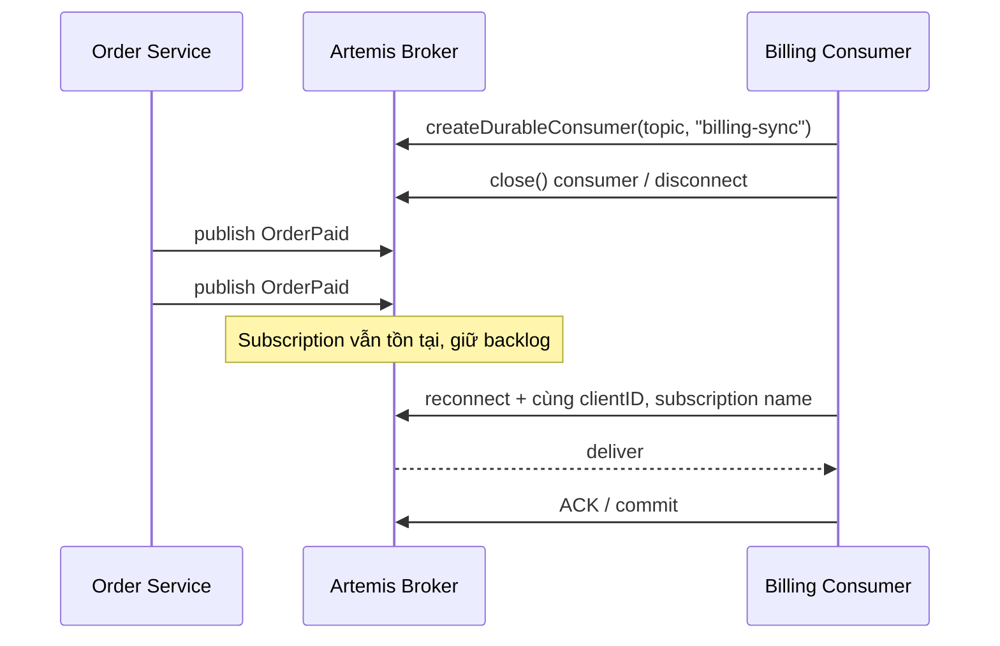
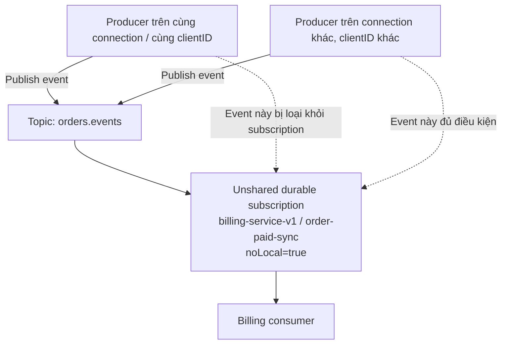

# Quản lý durable subscription, noLocal và thao tác unsubscribe

> **Chương:** Consumer  
> **Bối cảnh:** Apache ActiveMQ Classic và Artemis, ứng dụng Java dùng JMS/Jakarta Messaging để nhận sự kiện từ topic. Bài tập trung vào **định danh, vòng đời, cấu hình noLocal, sử dụng shared/unshared durable subscription và xóa subscription an toàn**.

## 1. Durable subscription lưu cái gì khi consumer không chạy?

Giả sử dịch vụ `Billing` cần nhận mọi sự kiện `OrderPaid` trên topic `orders.events`, kể cả khi ứng dụng tạm dừng để triển khai phiên bản mới. Với **non-durable subscriber**, subscription thông thường mất khi consumer ngừng hoạt động, và các sự kiện phát trong thời gian đó không được giữ riêng cho subscriber đã biến mất. Với **durable subscription**, broker duy trì một thực thể đăng ký có tên, lưu các message phù hợp trong lúc không có consumer hoạt động để consumer quay lại đọc.



Trong **Artemis**, topic JMS được ánh xạ sang một **address kiểu MULTICAST**; mỗi durable subscription thường được hiện thực bởi một **queue bền vững gắn vào address đó**. Một message publish lên topic có thể được route vào các queue subscription khác nhau; trong **một** subscription, message được xử lý theo cơ chế của consumer gắn với queue đó.

Độ bền có điều kiện:

- Subscription phải **được tạo trước khi message được publish**. Tạo subscription sau này không có nghĩa đọc ngược lịch sử topic.
- Message phải phù hợp với **selector** và `noLocal` của subscription. Message bị lọc không được giữ trong backlog subscription.
- Message có thể hết hạn theo TTL; message `NON_PERSISTENT` và broker không có persistence thích hợp không được bảo đảm giữ qua broker crash/restart.
- `close()` consumer hoặc connection **không xóa** durable subscription. Muốn xóa trạng thái này phải dùng `unsubscribe()` hoặc thao tác quản trị tương đương.

Durable subscription là tài nguyên của **broker**, không phải một biến Java chỉ sống trong JVM consumer.

## 2. Danh tính durable subscription và lý do phải ổn định

Đối với **unshared durable subscription**, danh tính logic chuẩn JMS là:

```text
(clientID, subscriptionName)
        │           │
        │           └── Tên subscription do ứng dụng đặt
        └─────────────── JMS client identifier của connection
```

Ví dụ:

```text
clientID          = billing-service-v1
subscriptionName  = order-paid-sync
topic             = orders.events
selector          = eventType = 'OrderPaid'
noLocal           = false
```

Tên topic, selector và `noLocal` là **định nghĩa** subscription. Chúng cần được giữ nhất quán qua các lần kết nối để mở lại **cùng** backlog; không nên tạo ra một tên mới sau mỗi lần khởi động.

| Thuộc tính | Vai trò | Hậu quả khi thay đổi |
| --- | --- | --- |
| `clientID` | Một phần định danh unshared durable subscription | Client mới dùng ID khác có thể tạo **subscription khác**; backlog cũ bị bỏ lại |
| `subscriptionName` | Định danh subscription trong phạm vi clientID | Đổi tên có thể tạo queue subscription mới, còn tài nguyên cũ vẫn tồn tại |
| `topic` | Nguồn sự kiện | Đổi topic khi không có consumer active có thể được hiểu là **xóa subscription cũ rồi tạo mới** |
| `messageSelector` | Điều kiện message được tích lũy vào subscription | Đổi selector có thể xóa backlog cũ theo cơ chế thay subscription |
| `noLocal` | Có nhận message publish từ cùng connection/ID hay không | Thay đổi cũng có thể khiến subscription cũ bị thay thế |
| `durable / shared` | Chế độ tiêu thụ | Không thể dùng cùng cặp tên/ID để đồng thời làm shared và unshared durable |

**Đặc biệt nguy hiểm:** Theo đặc tả Jakarta Messaging, nếu unshared durable subscription đã tồn tại, **không có consumer đang hoạt động**, nhưng lần `createDurableConsumer` tiếp theo dùng cùng `clientID + name` với **topic, selector hoặc noLocal khác**, hành vi tương đương **unsubscribe subscription cũ rồi tạo mới**. Backlog chưa xử lý ở bản cũ có thể bị mất. Đây là lý do không được đổi selector như một thay đổi cấu hình vô hại.

`clientID` cần được thiết lập **trước** khi connection bắt đầu được sử dụng (ví dụ trước `createSession` và `start`), hoặc được cấu hình sẵn qua provider/JNDI theo hợp đồng ứng dụng. Với unshared durable, `clientID` là bắt buộc. Không cho hai instance hoạt động đồng thời sử dụng cùng `clientID` để đăng ký **unshared** subscription; mỗi instance phải có thiết kế ownership rõ ràng.

### Một consumer active hay nhiều consumer active?

| Kiểu subscription | Consumer đồng thời trong cùng subscription | `clientID` | Có `noLocal` trên API tạo? |
| --- | --- | --- | --- |
| Unshared durable | **Tối đa một** consumer active | Bắt buộc | **Có**, overload nhận `boolean noLocal` |
| Shared durable (JMS 2.0+) | **Nhiều** consumer có thể chia một backlog | Có thể không đặt; nếu đặt phải dùng nhất quán | **Không** có tham số `noLocal` tương ứng |
| Shared non-durable | Nhiều consumer trong lúc subscription đang tồn tại | Có thể không đặt | Không có tham số `noLocal` tương ứng |
| Non-durable topic consumer | Theo consumer riêng lẻ | Không bắt buộc | Có thể dùng `createConsumer(topic, selector, noLocal)` |

Với **shared durable**, danh tính là `subscriptionName` và `clientID` **nếu có đặt**. Mỗi message trong backlog shared subscription được giao cho **một trong các consumer** của subscription đó, không phát bản sao cho mọi consumer. Nếu muốn nhiều nhóm nghiệp vụ khác nhau mỗi nhóm nhận mọi event, tạo **subscription riêng** cho từng nhóm.

## 3. `noLocal` lọc theo nguồn kết nối, không phải theo hostname

Ví dụ một ứng dụng vừa subscribe vừa publish lên topic `orders.events`. Nếu không muốn ứng dụng tự nhận sự kiện nó phát đi, một **unshared topic consumer** có thể dùng `noLocal=true`:

```java
// Jakarta Messaging 3.x / JMS 2.0 classic Session API:
MessageConsumer subscriber = session.createDurableConsumer(
    topic,
    "order-paid-sync",
    "eventType = 'OrderPaid'",
    true // noLocal
);
```

Ngữ nghĩa theo đặc tả: với `noLocal=true`, message được publish lên topic bằng **connection sở hữu consumer**, hoặc bằng một connection khác có **cùng client identifier**, sẽ **không được thêm** vào durable subscription đó. Message publish từ connection khác với client identifier khác (hoặc không đặt) vẫn có thể được nhận khi thỏa selector.



**Các nhầm lẫn thường gặp:**

- `noLocal` **không** so sánh IP, hostname, tên container, tên pod, cùng máy hay cùng JVM. Hai connection khác nhau trong cùng process vẫn có thể được coi là nguồn khác nhau.
- `noLocal` **không** phải JMS property của message. Nó là thuộc tính **subscription/consumer** khi tạo.
- `noLocal` chỉ áp dụng trên **topic consumption** theo API tương ứng; không dùng để bỏ qua message trên queue `Session.createConsumer(queue)`.
- `noLocal=true` **không** thay thế idempotency hoặc `eventId`: nó không lọc bản sao nghiệp vụ do service khác phát lại.
- Đừng cố truyền `noLocal` vào `createSharedDurableConsumer`: overload API **không có tham số này**. Nếu cần shared workers và tránh self-publish, hãy tổ chức đường publish/subscription hoặc đặt selector/property rõ ràng và kiểm tra với broker.

### So sánh `noLocal` với selector

| Cơ chế | Lọc dựa trên | Mục đích | Giới hạn |
| --- | --- | --- | --- |
| `noLocal=true` | Connection đã publish / cùng `clientID` | Không nhận message do chính connection/ID phát | Không lọc theo nghiệp vụ hoặc deployment |
| `messageSelector="origin = 'billing'"` | Header/property JMS có kiểu | Lọc theo nhãn ứng dụng | Producer có trách nhiệm gắn metadata đúng |
| Idempotency theo `eventId` | Trạng thái xử lý nghiệp vụ | Ngăn tác dụng phụ hai lần | Phải lưu và kiểm tra trạng thái ở consumer |

Nếu nhiều instance application sử dụng một pool connection, phải xác định **physical connection** và `clientID` mà provider thực sự gán; đừng dựa vào một request/thread Java để suy ra `noLocal`.

## 4. Vòng đời: `close`, mất kết nối, thay định nghĩa và `unsubscribe`

| Sự kiện | Consumer | Durable subscription / backlog |
| --- | --- | --- |
| Tạo durable consumer lần đầu | Bắt đầu active | Subscription mới được tạo, chưa có lịch sử trước khi tạo |
| `consumer.close()` | Inactive | **Giữ** subscription/backlog còn hợp lệ |
| `connection.close()` | Inactive do connection đóng | **Giữ** subscription/backlog còn hợp lệ |
| Client crash | Broker nhận ra kết nối chết theo timeout/heartbeat | Subscription vẫn còn; message mới tiếp tục tích lũy nếu hợp lệ |
| Mở lại với **cùng identity + cùng cấu hình** | Active trở lại | Tiếp tục xử lý message tồn chưa ack/commit, nếu chưa hết hạn |
| Đổi topic/selector/noLocal khi inactive | Tạo consumer theo cấu hình mới | Có thể **xóa rồi tạo lại** subscription: nguy cơ mất backlog |
| `session.unsubscribe(name)` | Không còn consumer active | **Xóa** subscription và trạng thái message chưa xử lý |
| Đổi `clientID` hoặc name | Tạo subscription khác | Subscription cũ **không tự bị dọn** |

Việc đóng consumer khi còn message chưa được ack hoặc đang tham gia transaction có thể khiến message được giao lại theo semantics provider. `unsubscribe` chỉ hợp lệ khi **không còn active consumer trên subscription** và **không còn message chưa ack hoặc đang nằm trong transaction liên quan**. Broker có thể báo `JMSException` nếu chưa đáp ứng điều kiện.

**Đừng dùng `unsubscribe` như “pause subscription”**. Nó mang nghĩa **xóa vĩnh viễn** subscription ở thời điểm gọi; producer gửi event sau khi unsubscribe không còn được lưu vào subscription đó. Tạo lại subscription cùng tên về sau là một subscription mới.

### Quy trình xóa có chủ đích

1. Xác định chính xác `clientID`, `subscriptionName`, topic và tenant/môi trường; kiểm tra subscription có cần giữ backlog không.
2. Dừng hoặc drain consumer và mọi instance đang dùng subscription đó; hoàn tất ack/commit hoặc xử lý rollback đúng cách.
3. Xác nhận không còn consumer active; đánh giá `messageCount` còn tồn. Nếu còn message quan trọng, phải xử lý/xuất dữ liệu trước.
4. Tạo connection có **đúng clientID**; tạo session và gọi `unsubscribe(subscriptionName)`.
5. Kiểm chứng subscription queue đã biến mất trong broker management; kiểm tra producer/consumer mới không vô tình tái tạo nó.
6. Lưu log vận hành: subscription identity, số message còn tồn trước khi xóa, người/phiên bản triển khai thực hiện, timestamp và kết quả.

Trong hệ thống phục vụ nhiều nhóm độc lập, tránh gọi `unsubscribe` tự động mỗi lần shutdown một consumer. Điều này sẽ làm mất khả năng nhận message khi consumer offline, chính là lý do dùng durable subscription.

## 5. Artemis: subscription là queue multicast, nhưng không tự quản lý bằng tên vật lý

Cấu hình tối thiểu một topic address trong `broker.xml` (trích đoạn đặt trong phần `<addresses>`):

```xml
<addresses>
    <address name="orders.events">
        <multicast/>
    </address>
</addresses>
```

Khi Java JMS tạo durable subscription trên topic `orders.events`, Artemis tạo hoặc dùng **queue multicast** tương ứng với subscription identity. Queue này tồn tại khi consumer disconnect. Đừng hardcode tên internal queue do protocol manager sinh và xóa bằng suy luận từ tên; hãy quản lý bằng `clientID + subscriptionName` trong JMS hoặc bằng công cụ quản trị có thông tin binding chính xác.

Một cấu hình quyền minh họa, chỉ đưa các vai trò cần thiết lên topic address:

```xml
<security-settings>
    <security-setting match="orders.events">
        <permission type="send" roles="event-publisher"/>
        <permission type="consume" roles="billing-consumer"/>
        <permission type="createDurableQueue" roles="billing-consumer"/>
        <permission type="deleteDurableQueue" roles="billing-admin"/>
    </security-setting>
</security-settings>
```

Đây là **trích đoạn** security policy, không phải cấu hình hoàn chỉnh của broker. Tài khoản thao tác `unsubscribe` cần quyền xóa queue durable tương ứng. Ở lab đơn giản có thể cấp cả quyền create/delete cho tài khoản test; trong production nên tách vai trò vận hành xóa tài nguyên và vai trò nhận message. Khi cấu hình address pattern, role và auto-create settings, hãy kiểm tra semantics theo phiên bản broker và chính sách tổ chức.

### Những số liệu cần theo dõi

- **Consumer count:** có consumer active trên subscription không?
- **Message count/backlog:** có bao nhiêu message đang đợi subscriber quay lại?
- **Messages added / acknowledged:** tốc độ tích lũy và xử lý.
- **Message expiration:** message bị mất do TTL, dù subscription durable.
- **Queue existence:** queue durable vẫn tồn tại sau consumer disconnect, chỉ biến mất sau unsubscribe/delete.
- **Storage/disk/paging:** nhiều durable subscription không được dọn có thể tích lũy số message lớn, nhất là khi publisher phát đều mà consumer nghỉ dài.

Một topic có `N` durable subscription độc lập có thể cần giữ **N bản ghi nhận message** cho mỗi event phù hợp (tùy implementation/storage). Vì vậy không nên tự sinh tên subscription mới theo mỗi lần deploy (ví dụ kèm random UUID): broker sẽ tích lũy những queue “mồ côi”.

## 6. Java JMS thực hành: đăng ký, đóng, nhận bù và xóa

Ví dụ dùng **Artemis Jakarta client** trên Java 17+, broker có endpoint `tcp://localhost:61616` và tài khoản được cấp quyền phù hợp. Sử dụng bốn lệnh `register`, `publish`, `receive`, `unsubscribe` để quan sát vòng đời qua **nhiều lần chạy JVM**.

Maven dependency minh họa:

```xml
<dependency>
    <groupId>org.apache.artemis</groupId>
    <artifactId>artemis-jakarta-client</artifactId>
    <version>2.50.0</version>
</dependency>
```

Chọn phiên bản client theo BOM/broker của dự án. Nếu sử dụng Classic 5.x, chọn client `javax.jms` tương thích và đổi import thành `javax.jms.*`; API `createDurableSubscriber` với `noLocal` cũng có trong JMS 1.1. Trong ví dụ dưới đây dùng Jakarta Messaging 3.x.

File `DurableLifecycleDemo.java`:

```java
import jakarta.jms.Connection;
import jakarta.jms.DeliveryMode;
import jakarta.jms.JMSException;
import jakarta.jms.Message;
import jakarta.jms.MessageConsumer;
import jakarta.jms.MessageProducer;
import jakarta.jms.Session;
import jakarta.jms.TextMessage;
import jakarta.jms.Topic;

import org.apache.activemq.artemis.jms.client.ActiveMQConnectionFactory;

public final class DurableLifecycleDemo {
    private static final String TOPIC = "orders.events";
    private static final String CLIENT_ID = "billing-service-v1";
    private static final String SUB_NAME = "order-paid-sync";
    private static final String SELECTOR = "eventType = 'OrderPaid'";
    private static final boolean NO_LOCAL = true;

    public static void main(String[] args) throws Exception {
        if (args.length != 1) {
            throw new IllegalArgumentException(
                    "Usage: DurableLifecycleDemo "
                    + "register|publish|receive|unsubscribe");
        }

        try (ActiveMQConnectionFactory factory =
                     new ActiveMQConnectionFactory(required("ARTEMIS_URL"))) {
            switch (args[0]) {
                case "register" -> register(factory);
                case "publish" -> publish(factory);
                case "receive" -> receive(factory);
                case "unsubscribe" -> unsubscribe(factory);
                default -> throw new IllegalArgumentException(
                        "Unknown command: " + args[0]);
            }
        }
    }

    // Tạo subscription rồi đóng consumer. Broker vẫn giữ subscription.
    private static void register(ActiveMQConnectionFactory factory)
            throws JMSException {
        Connection conn = connectionWithClientId(factory);
        try {
            Session session = conn.createSession(
                    false, Session.AUTO_ACKNOWLEDGE);
            Topic topic = session.createTopic(TOPIC);

            MessageConsumer consumer = session.createDurableConsumer(
                    topic, SUB_NAME, SELECTOR, NO_LOCAL);
            consumer.close();
            session.close();
            System.out.println("Registered durable subscription");
        } finally {
            conn.close();
        }
    }

    // Publish từ connection KHÁC clientID, để noLocal không loại message.
    private static void publish(ActiveMQConnectionFactory factory)
            throws JMSException {
        Connection conn = factory.createConnection(
                required("ARTEMIS_USER"), required("ARTEMIS_PASSWORD"));
        try {
            Session session = conn.createSession(
                    false, Session.AUTO_ACKNOWLEDGE);
            Topic topic = session.createTopic(TOPIC);

            MessageProducer producer = session.createProducer(topic);
            TextMessage event = session.createTextMessage("OrderPaid O-1001");
            event.setStringProperty("eventType", "OrderPaid");
            event.setStringProperty("eventId", "evt-orderpaid-1001");

            producer.send(event, DeliveryMode.PERSISTENT, 4, 0L);
            producer.close();
            session.close();
            System.out.println("Published from independent connection");
        } finally {
            conn.close();
        }
    }

    // Mở lại đúng cặp identity, nhận message đã publish khi offline.
    private static void receive(ActiveMQConnectionFactory factory)
            throws JMSException {
        Connection conn = connectionWithClientId(factory);
        try {
            Session session = conn.createSession(
                    true, Session.SESSION_TRANSACTED);
            Topic topic = session.createTopic(TOPIC);
            MessageConsumer consumer = session.createDurableConsumer(
                    topic, SUB_NAME, SELECTOR, NO_LOCAL);

            conn.start();
            Message message = consumer.receive(5_000L);
            if (message == null) {
                System.out.println("No matching message within 5 seconds");
            } else {
                try {
                    if (!(message instanceof TextMessage)) {
                        throw new JMSException("Expected TextMessage");
                    }
                    String body = ((TextMessage) message).getText();
                    System.out.println("Received: " + body);
                    session.commit(); // Đánh dấu xử lý JMS thành công.
                } catch (JMSException | RuntimeException e) {
                    session.rollback();
                    throw e;
                }
            }

            consumer.close();
            session.close();
        } finally {
            conn.close();
        }
    }

    // Chạy RIÊNG khi không còn consumer active và đã quyết định xóa backlog.
    private static void unsubscribe(ActiveMQConnectionFactory factory)
            throws JMSException {
        Connection conn = connectionWithClientId(factory);
        try {
            Session session = conn.createSession(
                    false, Session.AUTO_ACKNOWLEDGE);
            session.unsubscribe(SUB_NAME);
            session.close();
            System.out.println("Subscription removed: " + SUB_NAME);
        } finally {
            conn.close();
        }
    }

    private static Connection connectionWithClientId(
            ActiveMQConnectionFactory factory) throws JMSException {
        Connection conn = factory.createConnection(
                required("ARTEMIS_USER"), required("ARTEMIS_PASSWORD"));
        try {
            // Phải thiết lập trước khi sử dụng connection.
            conn.setClientID(CLIENT_ID);
            return conn;
        } catch (JMSException failure) {
            conn.close();
            throw failure;
        }
    }

    private static String required(String name) {
        String value = System.getenv(name);
        if (value == null || value.isBlank()) {
            throw new IllegalStateException("Missing env: " + name);
        }
        return value;
    }
}
```

Ví dụ biến môi trường:

```text
ARTEMIS_URL=tcp://localhost:61616
ARTEMIS_USER=lab_user
ARTEMIS_PASSWORD=<secret cấu hình của broker test>
```

**Trình tự kiểm chứng** (mỗi dòng là một lần chạy Java độc lập):

```text
java DurableLifecycleDemo register
java DurableLifecycleDemo publish
java DurableLifecycleDemo receive
java DurableLifecycleDemo unsubscribe
```

Kỳ vọng:

- Sau `register`: consumer và connection đã đóng nhưng subscription queue vẫn tồn tại.
- Sau `publish`: message `OrderPaid` đến từ connection khác, phù hợp selector, được giữ cho subscription khi offline.
- Sau `receive`: cùng `CLIENT_ID` và `SUB_NAME` mở lại backlog; `session.commit()` chốt việc nhận theo transaction.
- Sau `unsubscribe`: subscription bị xóa. Không còn consumer active tại thời điểm này; nếu message chưa ack còn tồn thì phải đánh giá trước khi thực hiện trong môi trường thật.

**Giới hạn mẫu:** `eventId` ở đây cố định để dễ nhận diện; nếu chạy `publish` nhiều lần, đó là **nhiều message riêng**, không có deduplication tự động. Broker phải có persistence và quyền thích hợp để thí nghiệm offline/khôi phục đúng như mô tả. Nếu dùng classpath quản lý bởi Spring, đừng tạo `clientID` mới ở mỗi request HTTP hoặc mỗi lần tạo bean.

### 6.1. Kiểm chứng `noLocal` trong cùng connection

Để xác minh `noLocal=true`, dùng một **subscription lab khác** với `clientID` khác, tránh tác động backlog `order-paid-sync`:

```java
// Bên trong một connection có clientID="billing-selftest":
Session session = connection.createSession(
        false, Session.AUTO_ACKNOWLEDGE);
Topic topic = session.createTopic("orders.events");
MessageConsumer selfConsumer = session.createDurableConsumer(
        topic, "selftest-no-local", "eventType = 'OrderPaid'", true);

MessageProducer sameConnectionProducer =
        session.createProducer(topic);
TextMessage own = session.createTextMessage("from same connection");
own.setStringProperty("eventType", "OrderPaid");
sameConnectionProducer.send(own, DeliveryMode.PERSISTENT, 4, 0L);

connection.start();
Message received = selfConsumer.receive(1_000L);
// Với subscription mới, không có backlog khác và noLocal=true:
// expected received == null vì publish đến từ cùng connection.

selfConsumer.close();
sameConnectionProducer.close();
session.unsubscribe("selftest-no-local"); // Dọn subscription test.
session.close();
```

Đoạn trên giả định `connection` đã được tạo và đặt `clientID` **trước** khi session được tạo. Nếu một producer **connection khác** gửi cùng loại message vào topic, consumer có thể nhận message đó. Khi kiểm thử, phải dùng subscription mới và không có publisher khác đang gửi, nếu không kết quả `receive()` có thể bị nhiễu.

### 6.2. Shared durable consumer khi muốn scale ngang

Nếu nhiều instance cùng xử lý **một backlog** mà không muốn giới hạn một active consumer, dùng **shared durable subscription** theo JMS 2.0+:

```java
// Jakarta JMS, sử dụng cùng subscription name và clientID (nếu có).
Topic topic = session.createTopic("orders.events");
MessageConsumer shared = session.createSharedDurableConsumer(
        topic, "billing-shared", "eventType = 'OrderPaid'");
```

Có thể tạo nhiều shared consumer cho cùng subscription (qua các session/connection hợp lệ). **Mỗi message trong subscription chỉ được giao cho một consumer**, khác với hai subscription tên khác nhau, mỗi subscription được giữ một bản message topic.

Shared durable API **không có** tham số `noLocal`; đừng cố áp `true` như overload của `createDurableConsumer`. Nếu shared durable được tạo **không có clientID**, việc tái sử dụng cần theo danh tính tên subscription và policy provider; nếu có clientID thì những connection truy cập phải dùng cùng clientID theo JMS contract. Kiểm chứng cách framework/pool tạo physical connections và giới hạn phiên bản broker trước khi scale.

## 7. Đổi selector, noLocal hoặc topic mà không làm mất backlog

Giả sử hiện tại:

```text
clientID = billing-service-v1
name     = order-paid-sync
topic    = orders.events
selector = eventType = 'OrderPaid'
noLocal  = true
backlog  = 12.000 message
```

Bản triển khai mới đổi selector thành:

```sql
eventType IN ('OrderPaid', 'OrderRefunded')
```

Nếu code chỉ gọi lại `createDurableConsumer` với **cùng clientID/name** nhưng selector mới khi consumer cũ đã ngừng, JMS cho phép xem đây là việc **xóa subscription cũ rồi tạo mới**. **12.000 message cũ có thể bị mất**.

Quy trình thay đổi an toàn hơn:

1. **Kiểm kê trước deployment:** quan sát topic, clientID, name, selector, noLocal, số consumer và backlog. Ghi rõ bản hiện hành.
2. **Drain subscription cũ** hoặc có kế hoạch giữ/di chuyển dữ liệu; không âm thầm thay selector trên một subscription còn backlog quan trọng.
3. **Tạo subscription có version mới** (ví dụ `billing-service-v2 / order-paid-sync-v2`) với selector mới **trước** mốc chuyển producer, nếu muốn nó bắt đầu tích lũy sự kiện từ thời điểm đó.
4. **Cho consumer mới xử lý** và kiểm tra khả năng idempotency nếu một khoảng thời gian có cả subscription cũ và mới nhận cùng event.
5. **Chỉ unsubscribe subscription cũ** sau khi xác nhận không còn dữ liệu cần thiết, không có consumer active, transaction được chốt và lịch chuyển đổi đã kết thúc.

Đối với `noLocal`, thay từ `false` sang `true` cũng là thay đổi định nghĩa subscription. Cân nhắc cùng quy trình; nếu hệ thống đang dùng publisher và subscriber chung connection hoặc chung client identifier, message đi vào backlog sẽ thay đổi đáng kể.

Với hệ thống không chấp nhận mất dữ liệu, migration giữa subscriptions phải tính đến **sự kiện phát trong khoảng giữa hai thao tác tạo**, yêu cầu replay từ nguồn/outbox nếu có lỗ hổng và trạng thái ack thực tế. Một durable subscription mới **không đọc lại** message đã publish **trước khi nó được tạo**.

## 8. Những lỗi vận hành thường gặp

| Triệu chứng | Nguyên nhân có thể | Hướng xử lý |
| --- | --- | --- |
| `InvalidClientIDException` hoặc không mở được connection | Hai connection đang dùng cùng clientID không hợp lệ cho cấu hình provider | Kiểm tra clientID cố định và số instance active, dùng shared durable nếu cần scale |
| `JMSException` khi tạo durable consumer lần hai | Unshared subscription đã có consumer active cùng identity | Đóng consumer cũ hoặc chuyển thiết kế sang shared durable |
| Restart consumer nhưng không thấy backlog | clientID/name khác, selector/noLocal thay đổi, message hết hạn, subscription chưa tạo lúc publish | Đối chiếu subscription identity và trạng thái queue broker |
| Queue durable tăng không ngừng sau deployment | Sinh clientID/name mới theo Pod UUID; subscription cũ bị bỏ lại | Dùng identity ổn định, lập kế hoạch dọn subscription cũ |
| `unsubscribe` bị từ chối | Consumer còn active, message chưa ack/transaction chưa chốt hoặc thiếu quyền | Drain/close và kiểm tra ACL `deleteDurableQueue` |
| Consumer nhận event do chính service phát | `noLocal=false` hoặc producer dùng connection/clientID khác | Kiểm tra physical connection/clientID, dùng filter nếu cần |
| Consumer không nhận message self-publish | `noLocal=true` đang loại nguồn cùng connection/ID | Kiểm tra định nghĩa subscription, tránh đổi noLocal tùy tiện |
| Shared durable bị lỗi khi tạo cùng tên unshared | Cùng cặp name/clientID được dùng cho hai kiểu subscription không tương thích | Dùng tên khác và migration có chủ đích |
| Broker restart làm mất message offline | Nonpersistent message, persistence/storage không đúng hoặc TTL hết hạn | Kiểm tra delivery mode, journal/disk và expiry policy |
| Đổi selector làm backlog biến mất | JMS tạo lại subscription khi inactive | Version subscription hoặc drain trước khi thay |

## 9. Bài thực hành kiểm chứng trên Artemis

**Chuẩn bị:** broker Artemis test, topic address `orders.events` có multicast và user có quyền tạo/đọc/xóa durable queue. Ghi queue message count và số consumer qua Artemis console/JMX trước/sau từng bước.

1. **Tạo rồi đóng:** chạy `register` và kiểm tra subscription còn tồn tại dù JVM client đã tắt.
2. **Publish lúc offline:** chạy `publish` sau khi `register` đã kết thúc. Kiểm tra message count tăng trong subscription queue.
3. **Mở lại đúng identity:** chạy `receive`. Xác nhận nhận `OrderPaid`, commit, backlog giảm; đóng consumer vẫn không xóa subscription.
4. **Đổi clientID có kiểm soát:** thay `billing-service-v1` thành `billing-service-v2` trong bản test, giữ name. Xem broker tạo subscription khác; không đọc được backlog của v1.
5. **noLocal:** chạy phép thử mục 6.1 trên một subscription mới. Gửi một event bằng cùng connection và một event từ connection khác; so sánh kết quả.
6. **Chặn subscriber trùng:** giữ unshared consumer đang active, cố tạo consumer thứ hai với cùng clientID/name; xác nhận provider báo lỗi thay vì cho hai consumer dùng đồng thời.
7. **Shared durable:** tạo hai consumer dùng cùng shared subscription và gửi nhiều message. Mỗi event chỉ nên được xử lý bởi một consumer của **subscription đó** (chú ý trường hợp redelivery nếu chưa ack).
8. **Đổi selector khi còn backlog:** trên một subscription **test khác**, gửi message lúc offline rồi khởi tạo lại cùng identity với selector mới. Quan sát subscription cũ được thay thế và backlog mất; không thử nghiệm trên queue dữ liệu quan trọng.
9. **Unsubscribe:** đảm bảo consumer đóng và transaction hoàn tất; gọi `unsubscribe`, kiểm tra queue subscription biến mất và message gửi về sau không được lưu riêng cho subscription đã xóa.

### Câu hỏi tự kiểm tra

1. **Đóng `MessageConsumer` có xóa durable subscription không?** — Không.
2. **Unshared durable subscription định danh bởi những gì?** — `clientID` và `subscriptionName`.
3. **`noLocal=true` chặn message do một process khác nhưng cùng host gửi?** — Không dựa trên host; dựa trên connection/clientID theo đặc tả.
4. **Đổi selector của subscription inactive có thể làm mất backlog không?** — Có; có thể tương đương unsubscribe rồi tạo mới.
5. **Shared durable có nhận cùng message trên mọi worker không?** — Không; các worker chia việc trong một subscription.
6. **`unsubscribe` có phải lệnh tạm dừng consumer không?** — Không; nó xóa durable subscription cùng state.
7. **Durable subscription mới có tự đọc lại mọi event đã publish hôm qua không?** — Không; nó chỉ tích lũy từ khi được tạo.
8. **`noLocal` có overload trong `createSharedDurableConsumer` không?** — Không.

## 10. Checklist vận hành

- [ ] Xác định rõ topic và tên subscription, dùng identity **ổn định qua restart**.
- [ ] Chọn **unshared** (một active consumer) hay **shared durable** (nhiều consumer chia backlog).
- [ ] Không tạo clientID ngẫu nhiên cho subscription cần giữ lâu dài.
- [ ] Ghi rõ selector và noLocal; kiểm tra bất kỳ thay đổi nào có nguy cơ tạo lại subscription.
- [ ] Phân biệt `consumer.close()` (ngừng đọc) với `unsubscribe()` (xóa state).
- [ ] Dọn consumer, chốt transaction/ack và đánh giá backlog trước unsubscribe.
- [ ] Cấp quyền create/consume/delete durable queue đúng role; kiểm tra policy Artemis.
- [ ] Giám sát queue tồn tại, message count, consumer count, expiration và disk/paging.
- [ ] Khi migration subscription, có kế hoạch tránh mất event và xử lý message trùng.
- [ ] Kiểm chứng thực tế bằng restart client, publish lúc offline, noLocal và unsubscribe.

## Tài liệu tham khảo

1. [Jakarta Messaging 3.1 Specification — Durable/Shared Durable Subscriptions](https://jakarta.ee/specifications/messaging/3.1/jakarta-messaging-spec-3.1.html).
2. [Jakarta Messaging 3.1 — `Session` API](https://jakarta.ee/specifications/messaging/3.1/apidocs/jakarta.messaging/jakarta/jms/session).
3. [Jakarta Messaging 3.1 — `JMSContext` API](https://jakarta.ee/specifications/messaging/3.1/apidocs/jakarta.messaging/jakarta/jms/jmscontext).
4. [Apache ActiveMQ Artemis — Address Model](https://artemis.apache.org/components/artemis/documentation/latest/address-model.html).
5. [Apache ActiveMQ Artemis — Security](https://artemis.apache.org/components/artemis/documentation/latest/security.html).
6. [Apache ActiveMQ Classic — Durable Subscriber Documentation](https://activemq.apache.org/components/classic/documentation/how-do-durable-queues-and-topics-work).
