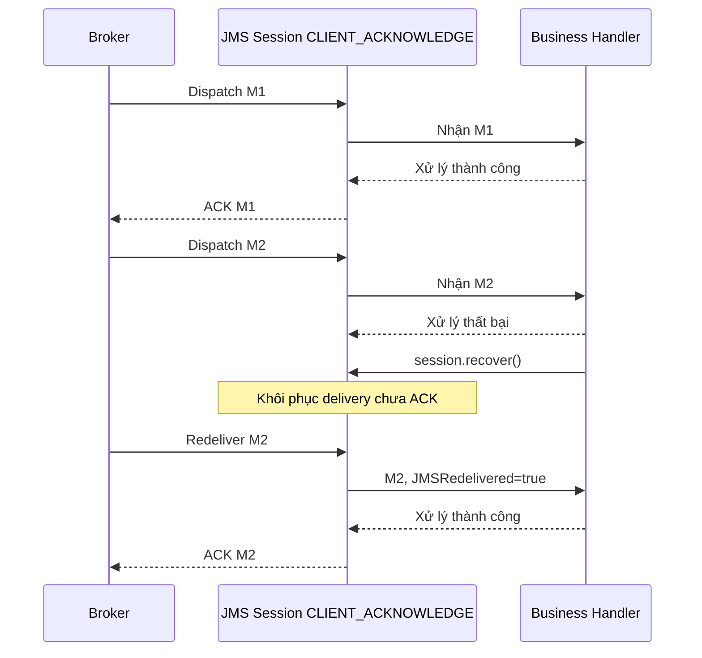

# Session.recover và gửi lại trong phiên không giao dịch

> **Chương:** Xác nhận và giao dịch  
> **Phạm vi:** JMS client Java làm việc với ActiveMQ Classic hoặc ActiveMQ Artemis; trọng tâm là `Session.recover()` trong **session không giao dịch** (`transacted=false`).

## 1. Vấn đề cần giải quyết: đã nhận nhưng chưa thể xác nhận

Giả sử `payment-worker` nhận thông điệp `PaymentRequested` từ queue. Worker kiểm tra dữ liệu thì thấy một dịch vụ phụ thuộc đang tạm thời lỗi. Nếu thông điệp **chưa được ACK**, worker có thể yêu cầu JMS provider **khôi phục luồng phân phối của session**, để những thông điệp đã giao nhưng chưa được xác nhận có cơ hội được gửi lại.

Trong JMS, thao tác tương ứng là:

```java
session.recover();
```

**Định nghĩa chính xác:** `Session.recover()` dừng tiến trình phân phối của session trong lúc khôi phục và khởi động lại việc phân phối từ **thông điệp cũ nhất đã được giao nhưng chưa được xác nhận** trong session đó. Các thông điệp còn thiếu ACK được **redeliver**, với dấu hiệu redelivery thích hợp. Đây là thao tác khôi phục **session đang hoạt động**; không phải gọi lại `producer.send()`, không tạo message nghiệp vụ mới và không đảo ngược ACK đã được chấp nhận.

Ví dụ, một consumer dùng `CLIENT_ACKNOWLEDGE`:

```text
Queue:      M1  M2  M3
                 |
Consumer:  nhận M1 -> ACK M1
           nhận M2 -> chưa ACK
           nhận M3 -> chưa ACK
                 |
           session.recover()
                 |
Broker:    giao lại M2, M3
           KHÔNG giao lại M1 do recover (đã ACK)
```

Kết quả trên giả định không có expiry, selector, priority, consumer cạnh tranh hoặc policy khác làm đổi lượt giao. Bài thực hành ở dưới dùng queue riêng để kiểm chứng trường hợp này.

## 2. Các điều kiện để `recover()` thực sự có tác dụng

### 2.1. Session phải không giao dịch

Phương thức này chỉ dành cho `Session` được tạo với `transacted=false`:

```java
Session s = connection.createSession(
        false, Session.CLIENT_ACKNOWLEDGE);
s.recover(); // Hợp lệ với session không giao dịch.
```

Ngược lại:

```java
Session tx = connection.createSession(
        true, Session.SESSION_TRANSACTED);

// Không gọi tx.recover(): session giao dịch dùng commit/rollback.
tx.rollback();
```

Nếu gọi `recover()` trên transacted session, JMS API quy định ném `javax.jms.IllegalStateException` (thuộc họ `JMSException`). Trong session có transaction, `rollback()` mới là cơ chế hủy thao tác nhận/gửi của transaction.

### 2.2. Tác dụng phụ thuộc chế độ ACK

| Mode trong session không giao dịch | Thời điểm ACK | `recover()` có thể phát lại gì? | Có phù hợp làm ví dụ chủ động retry? |
|---|---|---|---|
| `CLIENT_ACKNOWLEDGE` | Ứng dụng tự gọi `message.acknowledge()` | Những message **đã giao trong session nhưng chưa ACK** | **Có**; ranh giới ACK rõ |
| `AUTO_ACKNOWLEDGE` + `receive()` đồng bộ | Provider tự xác nhận khi `receive()` trả về thành công theo JMS semantics | Message đã tự ACK thường **không còn** để recover | **Không** nên dùng để mong retry lỗi nghiệp vụ sau `receive()` |
| `AUTO_ACKNOWLEDGE` + `MessageListener` | Provider xác nhận khi callback hoàn tất thành công theo semantics JMS | Kết quả phụ thuộc thời điểm callback hoàn thành và quy tắc xử lý exception/recovery | Cần kiểm thử; tránh suy luận giống `receive()` |
| `DUPS_OK_ACKNOWLEDGE` | Provider có thể ACK lười/định kỳ | Phần delivery **chưa được ACK thực tế** tại lúc recover | Có thể bị gửi trùng; phạm vi không quyết định như CLIENT_ACK |
| `SESSION_TRANSACTED` | Giao dịch dùng `commit()/rollback()` | `recover()` không hợp lệ | Dùng `rollback()` |

**Điểm cốt lõi:** `recover()` không phải “nút retry mọi message từng đọc”. Nó chỉ tác động đến **những delivery chưa được ACK trong session**, theo chế độ xác nhận mà session dùng.

### 2.3. Phạm vi là toàn session

Một `Session` có thể tạo nhiều consumer. Nếu consumer A và B dùng **cùng session**, `recover()` liên quan đến những message chưa ACK đã được giao trong session đó, không chỉ message mà callback/hàm đang xử lý thấy là lỗi.

Tương tự, trong `CLIENT_ACKNOWLEDGE`, `message.acknowledge()` thông thường xác nhận **tất cả các message đã được consume trong session** cho tới thời điểm gọi, không chỉ riêng instance được gọi.

Vì vậy, khi mỗi nhóm nhiệm vụ cần quyết định ACK/retry độc lập, hãy cân nhắc dùng **session riêng cho từng luồng xử lý**. JMS `Session` cũng được thiết kế cho cách dùng tuần tự, không chia sẻ đồng thời giữa nhiều thread.

## 3. Một lần `recover()` diễn ra như thế nào?



Các bước cần phân biệt:

1. **Message được dispatch:** Broker gửi message cho JMS client. Có thể message đã vào bộ đệm prefetch nhưng chưa được business handler xử lý.
2. **Ứng dụng consume:** `receive()` hoặc `onMessage()` nhận delivery. Với `CLIENT_ACKNOWLEDGE`, việc nhận không tự kết thúc trách nhiệm phân phối.
3. **Ứng dụng gọi `recover()`:** Session khởi động lại luồng delivery chưa ACK; provider phối hợp với broker và cấu hình retry.
4. **Delivery lại:** Message có thể trở lại với cờ `JMSRedelivered=true`; `JMSXDeliveryCount` có thể giúp quan sát số lượt giao tùy phiên bản/client.
5. **ACK sau xử lý thành công:** Chỉ lúc đó bản sao của queue/subscription được xác nhận.

**Phân biệt hai lớp:**

- **JMS semantics** quy định message chưa ACK được phân phối lại khi recover.
- **Broker/client implementation** quyết định chi tiết prefetch buffer, thời điểm dispatch lại, retry delay, cách đếm số lần giao, tương tác với nhiều consumer và thời điểm đưa vào DLQ.

Không xem `recover()` là bảo đảm “nhận lại đúng sau 1 giây” hoặc “chắc chắn vẫn tới cùng consumer” nếu không kiểm chứng chính sách đang áp dụng.

## 4. Thực hành Java: ACK M1, recover M2/M3 rồi ACK lại

Ta dùng **một queue riêng**, chỉ một consumer và **non-transacted `CLIENT_ACKNOWLEDGE`** để dễ nhìn thấy ranh giới. Producer cũng sử dụng session không giao dịch; mục tiêu thí nghiệm là semantics `recover()` ở consumer.

### 4.1. Dependency và điều kiện

Ví dụ dùng ActiveMQ Classic JMS client nói OpenWire:

```xml
<dependency>
  <groupId>org.apache.activemq</groupId>
  <artifactId>activemq-client</artifactId>
  <version>5.18.5</version>
</dependency>
```

Ứng dụng có thể kết nối **ActiveMQ Classic** hoặc **Artemis có OpenWire acceptor**, dùng đúng port thực tế (ví dụ `tcp://localhost:61616`). Cần quyền tạo queue, gửi và nhận. Với broker yêu cầu xác thực, chương trình lấy `BROKER_USER` và `BROKER_PASSWORD` từ environment. Chọn dependency được dự án hỗ trợ; `javax.jms` trong ví dụ không phải namespace `jakarta.jms`.

### 4.2. Mã hoàn chỉnh

Tạo `SessionRecoverDemo.java`:

```java
import java.util.UUID;
import javax.jms.Connection;
import javax.jms.DeliveryMode;
import javax.jms.JMSException;
import javax.jms.Message;
import javax.jms.MessageConsumer;
import javax.jms.MessageProducer;
import javax.jms.Queue;
import javax.jms.Session;
import javax.jms.TextMessage;
import org.apache.activemq.ActiveMQConnectionFactory;

public final class SessionRecoverDemo {

    public static void main(String[] args) throws JMSException {
        String url = args.length > 0
                ? args[0] : "tcp://localhost:61616";

        ActiveMQConnectionFactory factory =
                new ActiveMQConnectionFactory(url);

        String user = System.getenv("BROKER_USER");
        String password = System.getenv("BROKER_PASSWORD");

        Connection connection = user == null || user.isEmpty()
                ? factory.createConnection()
                : factory.createConnection(user, password);

        try {
            Session sendSession = connection.createSession(
                    false, Session.AUTO_ACKNOWLEDGE);
            Session receiveSession = connection.createSession(
                    false, Session.CLIENT_ACKNOWLEDGE);

            try {
                String queueName = "demo.recover." + UUID.randomUUID();
                Queue sendQueue = sendSession.createQueue(queueName);
                Queue receiveQueue = receiveSession.createQueue(queueName);

                MessageProducer producer =
                        sendSession.createProducer(sendQueue);
                MessageConsumer consumer =
                        receiveSession.createConsumer(receiveQueue);

                try {
                    producer.setDeliveryMode(DeliveryMode.PERSISTENT);

                    send(producer, sendSession, "M1");
                    send(producer, sendSession, "M2");
                    send(producer, sendSession, "M3");

                    connection.start();

                    // M1 đã ACK: recover về sau không hoàn tác được.
                    Message m1 = required(consumer.receive(5000), "M1");
                    expectEvent(m1, "M1");
                    trace("first", m1);
                    m1.acknowledge();

                    // M2 và M3 đã consume nhưng chưa ACK.
                    Message m2 = required(consumer.receive(5000), "M2");
                    Message m3 = required(consumer.receive(5000), "M3");
                    expectEvent(m2, "M2");
                    expectEvent(m3, "M3");
                    trace("before recover", m2);
                    trace("before recover", m3);

                    receiveSession.recover(); // Chỉ non-transacted.

                    // M2/M3 là hai message còn chưa xác nhận.
                    Message again2 =
                            required(consumer.receive(10000), "M2 replay");
                    Message again3 =
                            required(consumer.receive(10000), "M3 replay");
                    expectEvent(again2, "M2");
                    expectEvent(again3, "M3");
                    trace("after recover", again2);
                    trace("after recover", again3);

                    // CLIENT_ACKNOWLEDGE: ACK cả phần đã consume
                    // và chưa được ACK trong session, gồm M2 và M3.
                    again3.acknowledge();

                    Message extra = consumer.receive(1000);
                    if (extra != null) {
                        System.out.println("Unexpected remaining message: "
                                + extra.getJMSMessageID());
                    } else {
                        System.out.println("Queue test: no more deliveries");
                    }
                } finally {
                    try {
                        consumer.close();
                    } finally {
                        producer.close();
                    }
                }
            } finally {
                try {
                    receiveSession.close();
                } finally {
                    sendSession.close();
                }
            }
        } finally {
            connection.close();
        }
    }

    private static void send(
            MessageProducer producer, Session session, String eventId)
            throws JMSException {
        TextMessage m = session.createTextMessage(
                "PaymentRequested: " + eventId);
        m.setStringProperty("eventId", eventId);
        producer.send(m);
    }

    private static Message required(Message message, String label) {
        if (message == null) {
            throw new IllegalStateException(
                    "Timed out waiting for " + label);
        }
        return message;
    }

    private static void expectEvent(
            Message message, String expected) throws JMSException {
        String actual = message.getStringProperty("eventId");
        if (!expected.equals(actual)) {
            throw new IllegalStateException(
                    "Expected " + expected + ", got " + actual);
        }
    }

    private static void trace(String stage, Message m)
            throws JMSException {
        String count = "n/a";
        if (m.propertyExists("JMSXDeliveryCount")) {
            count = String.valueOf(
                    m.getIntProperty("JMSXDeliveryCount"));
        }
        System.out.printf(
                "%s eventId=%s redelivered=%s deliveryCount=%s%n",
                stage,
                m.getStringProperty("eventId"),
                m.getJMSRedelivered(),
                count);
    }
}
```

**Kết quả kỳ vọng trên một queue thử nghiệm sạch:** M1 được nhận và ACK một lần; M2 và M3 được nhận trước recover, sau đó được nhận lại; mỗi lần nhận sau recover có `JMSRedelivered=true` theo semantics redelivery. `JMSXDeliveryCount` thường tăng ở lượt gửi lại khi provider hỗ trợ, nhưng giá trị chính xác và thời điểm tăng cần đối chiếu broker/version.

Một log ví dụ (không dùng số đếm như bảo đảm cố định):

```text
first eventId=M1 redelivered=false deliveryCount=1
before recover eventId=M2 redelivered=false deliveryCount=1
before recover eventId=M3 redelivered=false deliveryCount=1
after recover eventId=M2 redelivered=true deliveryCount=2
after recover eventId=M3 redelivered=true deliveryCount=2
Queue test: no more deliveries
```

Vì queue được tạo với UUID nên mỗi lần chạy sử dụng một tên mới; trong môi trường dùng queue cố định hoặc có nhiều consumer, kết quả có thể khác do backlog cũ hay cạnh tranh xử lý. Demo không tự xóa queue server-side; có thể dùng môi trường thử nghiệm và dọn queue theo công cụ quản trị sau khi xác minh không còn message cần giữ.

### 4.3. Vì sao không đặt prefetch=1 trong thí nghiệm này?

Demo cố ý nhận **M2 và M3 trước khi ACK** để chứng minh recover xử lý nhiều delivery đang nợ ACK. Với client/broker có **prefetch/credit chỉ bằng 1**, consumer thứ hai có thể không nhận được M3 cho tới khi ACK M2, khiến thí nghiệm timeout.

Vì vậy, khi chạy ví dụ này cần để prefetch đủ lớn cho các message chưa ACK (thường giá trị mặc định của ActiveMQ Classic client đáp ứng được) hoặc chọn cấu hình >= 2 phù hợp với client/broker. **Không** suy diễn từ timeout rằng `recover()` hoạt động sai.

Trong môi trường production, prefetch lớn có thể tăng số message in-flight ở client, nên cần cấu hình theo tải và thời gian xử lý.

## 5. `recover()` khác gì `rollback()`, `stop()/start()` và reconnect?

| Thao tác | Phạm vi và điều kiện | Có hủy ACK đã hoàn tất? | Kết quả cần nhớ |
|---|---|---|---|
| `Session.recover()` | Session **không giao dịch**; khôi phục delivery chưa ACK | **Không** | Phát lại những message chưa ACK đã giao ở session |
| `Session.rollback()` | Session **giao dịch** | Hủy operation của transaction hiện tại, không hủy transaction đã commit trước | Rollback nhận/gửi trong transaction |
| `Connection.stop()` | Connection; tạm ngưng phân phối cho consumers | **Không** | Tạm dừng delivery; tự nó không phải lệnh redeliver |
| `Connection.start()` | Connection; bắt đầu/tiếp tục phân phối | **Không** | Tiếp tục delivery; không phải retry toàn bộ lịch sử |
| Đóng/mất connection chưa ACK | Kết nối và các session/consumer thuộc nó | Không khôi phục ACK đã có hiệu lực | Broker xử lý delivery chưa hoàn tất và có thể redeliver sang consumer khác |

**Ngộ nhận thường gặp:** gọi `recover()` sau khi `receive()` trả về trong session `AUTO_ACKNOWLEDGE` rồi hy vọng broker gửi lại message vì lỗi database. Lúc đó ACK tự động có thể đã hoàn tất, nên không còn message chưa ACK cho recover. Nếu cần quyết định ACK sau nghiệp vụ, dùng `CLIENT_ACKNOWLEDGE` hoặc transacted session theo yêu cầu.

### 5.1. Vì sao recover không thay thế producer retry?

Giả sử producer gọi `send()`, mạng đứt trước khi nhận được phản hồi và producer không biết broker đã chấp nhận message hay chưa. Đây là bài toán **kết quả gửi không chắc chắn** ở producer. `Session.recover()` của consumer không giải quyết bài toán đó; producer cần `eventId` ổn định và thiết kế idempotent/outbox thích hợp.

`recover()` chỉ nói về **phân phối lại delivery chưa ACK của một session tiêu thụ**.

## 6. Những trường hợp dễ gây ngạc nhiên khi dùng `recover()`

### 6.1. AUTO_ACKNOWLEDGE sau `receive()`

```java
Session s = connection.createSession(
        false, Session.AUTO_ACKNOWLEDGE);
Message message = consumer.receive(5000);

// Theo JMS semantics, receive thành công dẫn tới auto-ACK.
// Lỗi xử lý nghiệp vụ ở dưới có thể xảy ra sau ACK.
writeToDatabase(message);

// Lúc này s.recover() không đảo ngược ACK đã hoàn tất.
s.recover();
```

Đoạn này là **minh họa trình tự**, với `consumer` được tạo từ `s`. Muốn kiểm soát retry ở cấp application, dùng mode cho phép ACK sau nghiệp vụ và thiết kế chống trùng ở downstream.

### 6.2. CLIENT_ACKNOWLEDGE nhưng ACK quá rộng

```java
Message m1 = consumer.receive(5000);
Message m2 = consumer.receive(5000);

// Nếu cả hai thuộc cùng CLIENT_ACKNOWLEDGE session:
m2.acknowledge(); // ACK cả m1 và m2 đã consume trong session.
session.recover(); // Không thể yêu cầu broker phát lại m1.
```

Nếu m1 chưa xử lý nghiệp vụ thành công mà ứng dụng ACK m2, rất dễ **mất cơ hội retry tự động cho m1**. Với yêu cầu kiểm soát riêng từng task, nên xử lý tuần tự ACK từng message hoặc tách session.

### 6.3. Nhiều consumer, selector, priority và redelivery delay

`recover()` khởi động lại delivery chưa ACK, nhưng không bảo đảm thứ tự **giống tuyệt đối** mọi lần nhận khi có nhiều consumer, priority, selector, message expiration, scheduling và redelivery delay.

Nếu một queue có consumer A và B, message chưa ACK từ A có thể được broker giao lại cho A hoặc B, tùy chính sách và tình trạng kết nối. Không viết logic nghiệp vụ phụ thuộc vào “recover xong sẽ quay về đúng thread này”.

### 6.4. `MessageListener` và xử lý lỗi bất đồng bộ

Với listener, thời điểm callback hoàn tất ảnh hưởng ACK tự động. Nếu sử dụng `CLIENT_ACKNOWLEDGE` và muốn retry ngay trong listener, cần hiểu quy tắc provider áp dụng khi gọi `recover()` từ callback: tác động phục hồi thường chỉ thể hiện sau khi `onMessage()` thoát ra.

Không nên tạo vòng lặp trong callback gọi `recover()` liên tiếp hoặc chia sẻ session cho nhiều thread; có thể gây bão redelivery hoặc chặn luồng nhận. Với consumer đồng bộ, xử lý lỗi và quyết định recover trong một vòng lặp có kiểm soát thường dễ suy luận hơn.

### 6.5. Recover liên tục khi lỗi không thể khắc phục

Nếu message sai schema hoặc chứa dữ liệu nghiệp vụ không hợp lệ, gọi `recover()` rồi xử lý lại ngay có thể tạo **vòng lặp retry nóng**. Cần phân biệt:

- **Lỗi tạm thời:** cơ sở dữ liệu quá tải, HTTP 503, timeout phụ thuộc; có thể retry giới hạn với backoff.
- **Lỗi vĩnh viễn:** schema không hỗ trợ, thiếu field bắt buộc, vi phạm quy tắc không thể sửa bằng chờ đợi; cần quarantine/DLQ hoặc xử lý nghiệp vụ rõ ràng.

ActiveMQ Classic và Artemis có chính sách redelivery/poison message/DLQ riêng; sự tương tác với `recover()` và cách đếm số lần giao phải được **kiểm thử trên phiên bản thực tế**. Đừng mặc định mỗi lần gọi recover tương đương chính xác một bước đếm broker trong mọi client.

## 7. Áp dụng vào handler thực tế mà không gây lặp side effect

Một vòng xử lý đồng bộ có thể minh họa ý định:

```java
// Session đã được tạo với CLIENT_ACKNOWLEDGE.
while (running) {
    Message message = consumer.receive(1000);
    if (message == null) {
        continue;
    }

    try {
        // Cần kiểm tra eventId trong DB để idempotent.
        processAndCommitBusinessData(message);
        message.acknowledge();
    } catch (TransientDependencyException transientError) {
        session.recover();
        // Tránh vòng lặp retry nóng; phối hợp broker policy
        // hoặc đưa cơ chế retry có delay và giới hạn phù hợp.
    } catch (PermanentValidationException badData) {
        // Ghi nhận/quarantine có kiểm soát; quyết định ACK hoặc
        // chuyển sang DLQ theo hợp đồng, không recover vô hạn.
        handleInvalidMessage(message, badData);
    }
}
```

**Đây là pseudocode có chủ đích:** `TransientDependencyException`, `PermanentValidationException`, `processAndCommitBusinessData` và `handleInvalidMessage` là thành phần của ứng dụng. `handleInvalidMessage` phải quyết định rõ ACK/quarantine theo nghiệp vụ; nếu chỉ log lỗi rồi tiếp tục, message có thể kẹt unacked hoặc bị ACK ngoài ý muốn.

### 7.1. Idempotency vẫn bắt buộc

Một trường hợp phổ biến:

```text
1. Consumer đọc M42 và cập nhật database.
2. Database commit thành công.
3. Kết nối đứt trước khi broker nhận được ACK.
4. M42 được giao lại.
5. Consumer khác nhìn thấy M42 thêm một lần.
```

`recover()` và redelivery hướng tới **at-least-once processing** trong nhiều kịch bản failure, không tự bảo đảm exactly-once side effect. Nên dùng business `eventId` ổn định và unique constraint/inbox trong **cùng transaction với cập nhật nghiệp vụ**. Nếu gọi API thanh toán/email bên ngoài, cân nhắc idempotency key ở hệ thống đích.

### 7.2. Với topic subscription

Session recover tác động lên delivery chưa ACK của **subscription thuộc session đó**. Một durable topic subscriber đã ACK message không bị bắt buộc nhận lại chỉ vì subscription khác gọi recover. Trong Artemis, mỗi subscription thường ánh xạ tới một queue multicast; trạng thái ACK và redelivery của queue đó độc lập với subscription khác.

## 8. Kiểm thử và quan sát khi debug

### 8.1. Ma trận kiểm thử ngắn

| Ca thử | Thiết lập | Kỳ vọng |
|---|---|---|
| Chưa ACK → recover | CLIENT_ACKNOWLEDGE nhận M1, không ACK, gọi recover | M1 được redeliver; `JMSRedelivered` phản ánh delivery lặp |
| ACK trước recover | ACK M1, nhận M2 chưa ACK, gọi recover | M1 không bị recover; M2 được redeliver |
| Hai message chưa ACK | Nhận M2/M3, gọi recover một lần | Hai message chưa ACK được gửi lại trong kịch bản đơn giản |
| AUTO_ACK đồng bộ | `receive()` thành công rồi recover | Không trông đợi phát lại message đã auto-ACK |
| Transacted session | Gọi `recover()` | `IllegalStateException`; dùng `rollback()` |
| Prefetch nhỏ | Prefetch=1, cố nhận hai message trước ACK | Lượt nhận thứ hai có thể block/timeout; không phải lỗi recover |
| Lỗi dữ liệu vĩnh viễn | Luôn recover cùng message | Nguy cơ retry nóng; kiểm thử limit/backoff/DLQ |
| Crash trước ACK | Tắt consumer rồi kết nối lại | Message chưa ACK có thể redeliver theo broker policy |
| Nhiều consumer cùng queue | Consumer A recover/lỗi, consumer B còn hoạt động | Không bảo đảm lượt giao tiếp theo luôn đến A |

### 8.2. Log và metric có ích

Với một message, ghi ít nhất:

```text
eventId=payment-42
destination=payments.in
consumer=payment-worker-1
ackMode=CLIENT_ACKNOWLEDGE
action=receive|recover|acknowledge
jmsRedelivered=true|false
jmsxDeliveryCount=2
handlerResult=success|transient_error|permanent_error
```

Đây là **mẫu log**, không phải mọi provider đều cung cấp `JMSXDeliveryCount` dưới cùng điều kiện. Không log nguyên payload nhạy cảm. Đối chiếu số message ready, in-flight/delivering, dispatch, acknowledgment, redelivery và DLQ theo định nghĩa metric của broker.

Nếu thấy `recover()` đã được gọi nhưng không nhận lại message, cần kiểm tra theo thứ tự:

1. Session có thật sự **non-transacted** không?
2. Consumer có ở `CLIENT_ACKNOWLEDGE` hay message đã auto-ACK?
3. Có lệnh `acknowledge()` trước đó đã xác nhận **toàn bộ message đã consume** trong session không?
4. Message có bị selector/expiry/priority/retry delay tác động không?
5. Có consumer khác, prefetch buffer hoặc session khác đang tham gia không?
6. Broker còn queue/subscription và quyền consume hợp lệ không?
7. Log transport có cho thấy client/session đã mất kết nối trong lúc recover không?

## 9. Câu hỏi vận dụng

1. Consumer nhận M1, ACK M1, nhận M2 nhưng chưa ACK rồi gọi `recover()`. Message nào bắt buộc phải được xét redelivery? Tại sao?
2. Vì sao `recover()` không giải quyết lỗi nghiệp vụ xảy ra **sau `receive()`** trong AUTO_ACKNOWLEDGE?
3. Hai consumer cùng một CLIENT_ACKNOWLEDGE session đã nhận M1 và M2. Consumer thứ hai gọi `acknowledge()` trên M2. Lượt giao của M1 có còn chưa ACK không?
4. Phân biệt `recover()`, `rollback()` và `Connection.stop()` theo phạm vi và trạng thái ACK.
5. Một worker thường xuyên recover vì schema sai. Bạn sẽ thiết kế retry giới hạn và quarantine ra sao?
6. Dữ liệu DB đã commit trước khi ACK JMS được broker ghi nhận. Cách nào ngăn side effect lặp lại khi message bị redeliver?

## 10. Tài liệu tham khảo

- [Jakarta Messaging Specification](https://jakarta.ee/specifications/messaging/) — định nghĩa session recovery, acknowledgment modes và message redelivery. Khi dùng `javax.jms`, đối chiếu JMS 1.1/2.0 API tương ứng.
- [ActiveMQ Classic — Message Redelivery and DLQ Handling](https://activemq.apache.org/components/classic/documentation/message-redelivery-and-dlq-handling) — các tình huống redelivery và poison message của Classic.
- [ActiveMQ Classic — What is the prefetch limit for?](https://activemq.apache.org/components/classic/documentation/what-is-the-prefetch-limit-for) — lý do message có thể đã dispatch vào client buffer.
- [ActiveMQ Artemis — Message Redelivery and Undelivered Messages](https://artemis.apache.org/components/artemis/documentation/latest/undelivered-messages.html) — redelivery delay, delivery count và DLQ.
- [ActiveMQ Artemis — Using JMS or Jakarta Messaging](https://artemis.apache.org/components/artemis/documentation/latest/using-jms.html) — dùng JMS session và client Artemis.

**Điểm cần nhớ:** `Session.recover()` dành cho **session không giao dịch**, khởi động lại phân phối **những message đã giao nhưng chưa ACK trong session**. Nó không thu hồi ACK đã hoàn tất, không thay `rollback()` của transacted session và không giải quyết producer retry. Để ứng dụng đáng tin cậy, kết hợp ranh giới ACK đúng với idempotency và chính sách redelivery có giới hạn.
