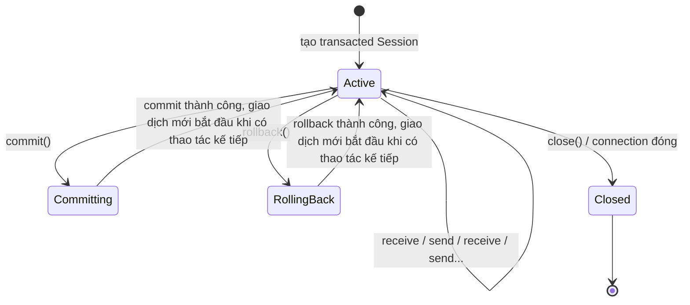
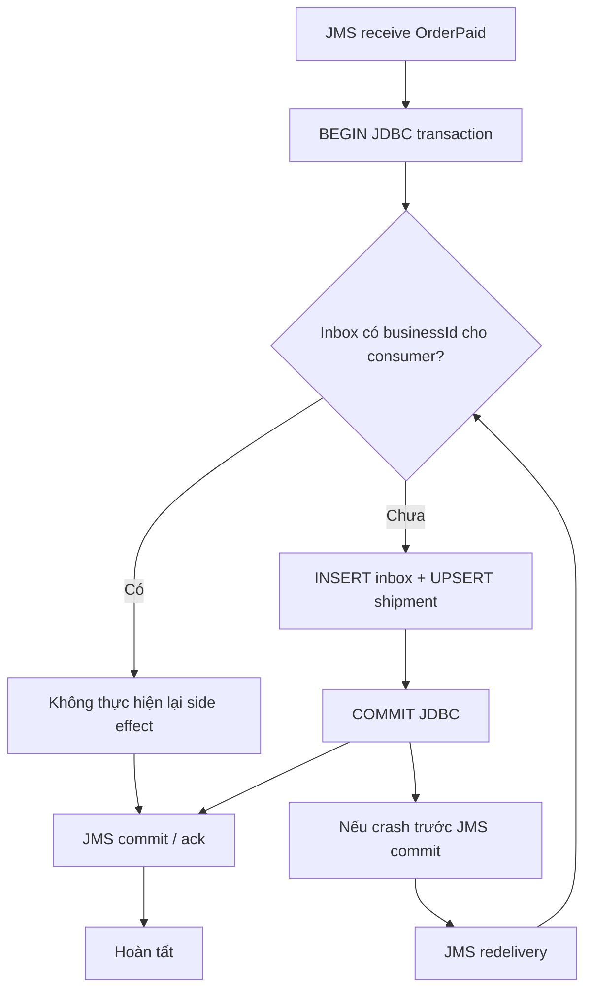

# Transacted Session: commit, rollback và ranh giới giao dịch cục bộ trong JMS

> **Chương:** Xác nhận và giao dịch  
> **Phạm vi module:** `INTEGRATION_MESSAGING_MESSAGE_BROKER_ACTIVEMQ` — ActiveMQ Classic và Artemis trong giao tiếp bất đồng bộ bằng queue, topic, routing và JMS; producer/consumer Java, acknowledgment, transaction, redelivery, DLQ, bảo mật và vận hành broker tin cậy.  
> **Trọng tâm duy nhất:** Ngữ nghĩa của **JMS transacted Session**, cách `commit()` và `rollback()` tác động đồng thời đến **các message đã gửi và đã nhận trên cùng Session**, cách kiểm chứng bằng code Java, và **ranh giới của giao dịch cục bộ** khi ứng dụng còn có database hoặc broker thứ hai.

## 1. Mục tiêu và bài toán cụ thể

Giả sử một worker làm ba thao tác:

1. Nhận `OrderPaid(orderId=O-101)` từ queue `lab.tx.in`.
2. Tạo message `PrepareShipment(orderId=O-101)` và gửi vào queue `lab.tx.out`.
3. Xác nhận với broker rằng `OrderPaid` đã xử lý xong.

Nếu worker **ack đầu vào trước rồi mới gửi đầu ra**, crash ở giữa sẽ làm mất bước tạo yêu cầu giao hàng. Nếu **gửi đầu ra trước rồi mới ack đầu vào**, crash ở giữa có thể khiến message đầu ra đã tồn tại nhưng đầu vào vẫn được redeliver, từ đó **gửi trùng**.

Một **transacted Session** giúp ghép **hai thao tác JMS trong cùng một broker/session** thành một đơn vị giao dịch:

```text
                         MỘT JMS TRANSACTED SESSION
                    ┌────────────────────────────────┐
Queue lab.tx.in ────►│ receive(OrderPaid O-101)      │
                    │ send(PrepareShipment O-101)   ├────► Queue lab.tx.out
                    │ commit() HOẶC rollback()      │
                    └────────────────────────────────┘

Nếu COMMIT thành công:
    input:  OrderPaid được xác nhận/xóa khỏi queue nhận
    output: PrepareShipment được công bố, sẵn sàng cho consumer khác

Nếu ROLLBACK:
    input:  OrderPaid không được xác nhận; có thể redeliver
    output: PrepareShipment chưa được commit, không tồn tại như một lần gửi hoàn tất
```

**Không** cần hai lệnh “ack input” và “commit output” riêng: cùng một `Session` là ranh giới nguyên tử đối với các thao tác JMS do Session đó quản lý.

Đọc xong bài này, bạn phải giải thích và kiểm thử được:

- Cách tạo `Session` transacted và ảnh hưởng của session mode.
- `commit()`/`rollback()` bao gồm chính xác những message nào.
- Khi nào acknowledgment xảy ra trong session giao dịch.
- Vì sao hai Session, hai Connection, hai broker hoặc JMS + JDBC **không tự chia sẻ** một local transaction.
- Điều gì xảy ra nếu worker crash, bị redelivery, hoặc không biết chắc `commit()` đã thành công.
- Cách ghi log/metrics và viết kiểm thử tránh kết luận nhầm là “exactly once end-to-end”.

## 2. Tạo transacted Session và nhận diện đúng ranh giới

### 2.1. JMS API truyền thống (Classic 5.x, `javax.jms`)

```java
Connection connection = connectionFactory.createConnection();
Session session = connection.createSession(
        true, Session.SESSION_TRANSACTED);

try {
    // MessageConsumer, MessageProducer được tạo TỪ session này.
    // ...
    session.commit();
} catch (JMSException | RuntimeException error) {
    session.rollback();
    throw error;
} finally {
    session.close();
    connection.close();
}
```

Điểm dễ bị bỏ qua: chữ ký JMS 1.1 là `createSession(boolean transacted, int acknowledgeMode)`.

- Khi `transacted=true`, **giá trị acknowledgeMode bị bỏ qua**. Dùng `Session.SESSION_TRANSACTED` để **diễn đạt ý định** dù thứ quyết định ở overload này là boolean `true`.
- `Session.SESSION_TRANSACTED` **không phải** một lựa chọn acknowledgment ngang hàng có thể bật trong một session `transacted=false`.
- Session hoạt động trong chế độ transaction cho đến khi đóng; `commit()`/**`rollback()` kết thúc giao dịch hiện tại**, và thao tác JMS tiếp theo thuộc giao dịch mới.
- `Connection.start()` cần thiết để consumer bắt đầu nhận message. Producer có thể gửi khi connection chưa start, nhưng lab nên gọi `start()` trước lúc thử receive.

**Phạm vi giao dịch là `Session`**, không phải toàn bộ `Connection` và càng không phải toàn bộ ứng dụng. Hai Session trên cùng một Connection vẫn có **hai local transaction độc lập**.

### 2.2. JMS 2.0 / Jakarta Messaging simplified API

JMS 2.0 bổ sung `JMSContext`; Jakarta Messaging 3.x dùng `jakarta.jms` thay cho `javax.jms`. Trong Java SE:

```java
try (JMSContext context =
         factory.createContext(JMSContext.SESSION_TRANSACTED)) {
    // Consumer và producer được tạo từ cùng JMSContext.
    Message message = context.createConsumer(inputQueue).receive(5000L);
    if (message != null) {
        context.createProducer().send(outputQueue, "next-step");
        context.commit();
    } else {
        context.rollback();
    }
}
```

`JMSContext` che bớt đối tượng `Connection`/`Session`, **không thay đổi ranh giới giao dịch**. `context.commit()` và `context.rollback()` vẫn chỉ tác động đến thao tác JMS của **context đó**.

Ứng dụng Jakarta EE/container-managed có thể dùng `JTA` hoặc container-managed transaction với quy tắc riêng; **không tự đem code `commit()` của Java SE** vào môi trường do transaction manager quản lý. Các ví dụ bên dưới sử dụng **application-managed local JMS transaction**.

### 2.3. Đừng nhầm phạm vi theo đối tượng

| Đối tượng | Có phải ranh giới local JMS transaction? | Hệ quả |
|---|---|---|
| `Message` | Không | Message riêng không sở hữu transaction |
| `MessageProducer` | Không | Hai producer cùng Session có thể cùng tham gia một transaction |
| `MessageConsumer` | Không | Hai consumer cùng Session có thể nhận trong cùng transaction |
| **`Session`** | **Có** | `commit/rollback` áp dụng tất cả thao tác gửi/nhận từ ranh giới trước |
| `JMSContext` trong simplified API | Có, thông qua session mà nó quản lý | Tương đương logic của một session giao dịch |
| `Connection` | Không | Hai Session cùng Connection không tự commit cùng nhau |
| `DataSource`/`JDBC Connection` | Không | Transaction của DB riêng, không được JMS local commit bao phủ |
| Broker thứ hai | Không | Local Session thứ nhất không commit journal của broker thứ hai |

**Quy tắc vàng:** Nếu muốn **ack input + publish output nguyên tử**, tạo cả **consumer và producer từ cùng một transacted Session** và trỏ tới **cùng một JMS provider/broker transaction domain**. Tách thành hai Session dù cùng broker là đã mất ranh giới nguyên tử đó.

## 3. Cơ chế commit và rollback: chính xác những gì được chốt?

### 3.1. Vòng đời giao dịch



Có thể nghĩ mỗi khoảng giữa hai lần `commit/rollback` là một **nhóm thay đổi JMS**:

```text
Transaction T1:
   receive(A)
   receive(B)
   send(X)
   send(Y)
   commit()     → A và B được ack; X và Y được commit

Transaction T2:
   receive(C)
   send(Z)
   rollback()   → C không được ack; Z bị hủy trong giao dịch T2

Transaction T3:
   send(K)
   commit()     → K được gửi; không có message nào phải ack
```

**Không có cơ chế “commit riêng X, rollback riêng B” trong cùng T1.** Nếu cần ranh giới độc lập, chia thành các transaction/session thích hợp. Việc gọi `Message.acknowledge()` trên message trong transacted Session **không phải cách thay thế `commit()`**; acknowledgment của session giao dịch do commit quản lý.

### 3.2. Kết quả sau commit/rollback

Giả sử đầu vào có một message `I-1`, đầu ra rỗng, không có consumer khác:

| Diễn biến | Input queue | Output queue | Giải thích |
|---|---|---|---|
| Chưa nhận | `I-1` sẵn sàng | Rỗng | Trạng thái ban đầu |
| `receive(I-1)` chưa commit | `I-1` đang giao/in-flight | Rỗng | Input chưa ack; message không nhất thiết vẫn browse thấy |
| `send(O-1)` cùng Session, chưa commit | `I-1` in-flight | `O-1` chưa visible như một message đã commit | Producer send chưa chốt transaction |
| `commit()` thành công | Không còn `I-1` chờ | Có `O-1` đã commit | Hai thay đổi JMS cùng hoàn tất |
| **Hoặc** `rollback()` | `I-1` có thể redeliver | Không có `O-1` từ transaction đó | Hủy thay đổi JMS chưa commit |
| Connection mất trước kết thúc transaction | Có thể redeliver sau recovery | Không có output **nếu transaction chưa được commit** | Broker xử lý transaction chưa hoàn tất theo recovery |
| Connection mất *trong lúc commit* | **Chưa chắc từ phía client** | **Chưa chắc từ phía client** | Cần kiểm tra broker/business state trước retry |

**Quan trọng:** `commit()` ném exception khi mạng đứt **không chứng minh** broker đã rollback. Broker có thể đã commit và mất response trên đường về. Đây là **in-doubt outcome** ở góc nhìn ứng dụng; không thể kết luận bằng cách bắt `JMSException` rồi luôn giả định chưa có output.

### 3.3. Rollback không đồng nghĩa nhận lại ngay

Khi gọi `rollback()` sau `receive()`:

- Message chưa ack có thể quay lại trạng thái đủ điều kiện dispatch.
- `JMSRedelivered` thường được đặt thành `true` ở lần giao lại tương ứng; `JMSXDeliveryCount`, nếu provider cung cấp, giúp đếm lần phát tới consumer.
- Broker/client có thể áp dụng **redelivery delay/backoff**; consumer không nhất thiết nhận lại trong 1–2 giây.
- Khi hết TTL, đạt giới hạn retry hoặc rơi vào chính sách poison message, message có thể đi **expiry/DLQ** thay vì cứ trở lại queue mãi.
- Khi consumer dùng prefetch, các message khác có thể đã nằm ở vùng dispatched; `rollback()` tác động message nhận trong session, không có nghĩa toàn bộ queue khôi phục thứ tự ban đầu tuyệt đối.

Dùng transaction để kiểm soát **kết quả giao nhận JMS**, không dùng `rollback()` như vòng lặp vô hạn khi gặp lỗi payload không bao giờ xử lý được.

## 4. Ví dụ quyết định: một Session chuyển message giữa hai queue

Ta xây dựng một lab chạy trên **ActiveMQ Classic 5.19.x** qua OpenWire với Java 17, Maven 3.9+. Nếu broker là **Artemis**, giữ cùng client Classic và bật **OpenWire acceptor**, đồng thời cấu hình hai queue anycast tương ứng. Mục đích là làm rõ **giao dịch cục bộ** nên dùng một broker mỗi lượt thử, không nhầm với chuyển message giữa hai broker.

### 4.1. Chuẩn bị

Broker có endpoint `tcp://127.0.0.1:61616`, tài khoản được phép gửi/nhận/browse hai queue:

```text
lab.tx.in
lab.tx.out
```

Tạo trước queue bằng management/khai báo broker nếu tắt auto-create destinations. Dùng **queue lab riêng, bắt đầu rỗng**, không bật worker nền. Nếu có nhiều message cũ, kết quả đếm có thể khác; đối chiếu bằng property `businessId` thay vì dựa tuyệt đối vào `QueueSize`.

Đặt biến môi trường của broker thử nghiệm (ví dụ Bash):

```bash
export BROKER_URL='tcp://127.0.0.1:61616'
export BROKER_USER='labuser'
export BROKER_PASSWORD='lab-only-password'
```

Trên PowerShell:

```powershell
$env:BROKER_URL = 'tcp://127.0.0.1:61616'
$env:BROKER_USER = 'labuser'
$env:BROKER_PASSWORD = 'lab-only-password'
```

Không đưa thông tin đăng nhập production vào source hoặc log. Với broker lab cho phép anonymous, chương trình có nhánh `createConnection()` không truyền user; trong production nên yêu cầu authentication và ACL.

### 4.2. Maven dependency

Tạo project Maven lab độc lập, với `pom.xml`:

```xml
<project xmlns="http://maven.apache.org/POM/4.0.0"
         xmlns:xsi="http://www.w3.org/2001/XMLSchema-instance"
         xsi:schemaLocation="http://maven.apache.org/POM/4.0.0
                  https://maven.apache.org/xsd/maven-4.0.0.xsd">
  <modelVersion>4.0.0</modelVersion>
  <groupId>demo.activemq</groupId>
  <artifactId>jms-local-transaction-lab</artifactId>
  <version>1.0-SNAPSHOT</version>

  <properties>
    <maven.compiler.release>17</maven.compiler.release>
    <project.build.sourceEncoding>UTF-8</project.build.sourceEncoding>
  </properties>

  <dependencies>
    <dependency>
      <groupId>org.apache.activemq</groupId>
      <artifactId>activemq-client</artifactId>
      <version>5.19.12</version>
    </dependency>
  </dependencies>

  <build>
    <plugins>
      <plugin>
        <groupId>org.apache.maven.plugins</groupId>
        <artifactId>maven-compiler-plugin</artifactId>
        <version>3.14.1</version>
      </plugin>
      <plugin>
        <groupId>org.codehaus.mojo</groupId>
        <artifactId>exec-maven-plugin</artifactId>
        <version>3.5.1</version>
      </plugin>
    </plugins>
  </build>
</project>
```

`activemq-client` trong ví dụ sử dụng `javax.jms` và OpenWire. Khi chọn native Artemis Jakarta client thì thay dependency, namespace và connection factory tương ứng; **ngữ nghĩa transacted Session về nguyên tắc vẫn là JMS/Jakarta Messaging**, nhưng transport, redelivery và broker config cần kiểm thử lại.

### 4.3. Chương trình `LocalTransactionLab.java`

Tạo `src/main/java/demo/LocalTransactionLab.java`:

```java
package demo;

import org.apache.activemq.ActiveMQConnectionFactory;

import javax.jms.Connection;
import javax.jms.DeliveryMode;
import javax.jms.JMSException;
import javax.jms.Message;
import javax.jms.MessageConsumer;
import javax.jms.MessageProducer;
import javax.jms.Queue;
import javax.jms.QueueBrowser;
import javax.jms.Session;
import javax.jms.TextMessage;

import java.util.Enumeration;

public final class LocalTransactionLab {
    private static final String IN = "lab.tx.in";
    private static final String OUT = "lab.tx.out";

    public static void main(String[] args) throws Exception {
        if (args.length == 0) {
            usage();
            return;
        }

        String url = System.getenv().getOrDefault(
                "BROKER_URL", "tcp://127.0.0.1:61616");
        String user = System.getenv("BROKER_USER");
        String password = System.getenv("BROKER_PASSWORD");

        ActiveMQConnectionFactory factory =
                new ActiveMQConnectionFactory(url);
        Connection connection =
                user == null || user.isBlank()
                        ? factory.createConnection()
                        : factory.createConnection(user, password);

        try {
            connection.start();
            switch (args[0]) {
                case "seed" -> {
                    if (args.length != 2) {
                        usage();
                        return;
                    }
                    seed(connection, args[1]);
                }
                case "browse-in" -> browse(connection, IN);
                case "browse-out" -> browse(connection, OUT);
                case "transfer-commit" -> transfer(connection, true);
                case "transfer-rollback" -> transfer(connection, false);
                default -> usage();
            }
        } finally {
            connection.close();
        }
    }

    // T1: gửi message vào input queue, rồi commit producer transaction.
    private static void seed(Connection connection, String businessId)
            throws JMSException {
        Session session =
                connection.createSession(true, Session.SESSION_TRANSACTED);
        try {
            Queue input = session.createQueue(IN);
            MessageProducer producer = session.createProducer(input);
            try {
                producer.setDeliveryMode(DeliveryMode.PERSISTENT);
                TextMessage message =
                        session.createTextMessage("OrderPaid:" + businessId);
                message.setStringProperty("businessId", businessId);
                message.setStringProperty("type", "OrderPaid");

                producer.send(message);
                session.commit();
                System.out.println("SEED COMMITTED " + businessId);
            } finally {
                producer.close();
            }
        } catch (JMSException | RuntimeException error) {
            try {
                session.rollback();
            } catch (JMSException rollbackError) {
                error.addSuppressed(rollbackError);
            }
            throw error;
        } finally {
            session.close();
        }
    }

    // Duyệt queue mà không lấy/ack message.
    private static void browse(Connection connection, String queueName)
            throws JMSException {
        Session session =
                connection.createSession(false, Session.AUTO_ACKNOWLEDGE);
        try {
            Queue queue = session.createQueue(queueName);
            QueueBrowser browser = session.createBrowser(queue);
            try {
                int count = 0;
                Enumeration<?> items = browser.getEnumeration();
                while (items.hasMoreElements()) {
                    Message message = (Message) items.nextElement();

                    String deliveryCount = message.propertyExists(
                            "JMSXDeliveryCount")
                            ? String.valueOf(message.getIntProperty(
                                    "JMSXDeliveryCount"))
                            : "not-provided";

                    System.out.printf(
                            "%s businessId=%s type=%s redelivered=%s"
                            + " deliveryCount=%s%n",
                            queueName,
                            message.getStringProperty("businessId"),
                            message.getStringProperty("type"),
                            message.getJMSRedelivered(),
                            deliveryCount);
                    count++;
                }
                System.out.println(queueName + " BROWSED=" + count);
            } finally {
                browser.close();
            }
        } finally {
            session.close();
        }
    }

    // T2: consume input + publish output trong CÙNG Session.
    private static void transfer(Connection connection, boolean commit)
            throws JMSException {
        Session session =
                connection.createSession(true, Session.SESSION_TRANSACTED);
        try {
            Queue input = session.createQueue(IN);
            Queue output = session.createQueue(OUT);

            MessageConsumer consumer = session.createConsumer(input);
            MessageProducer producer = session.createProducer(output);
            try {
                producer.setDeliveryMode(DeliveryMode.PERSISTENT);

                Message received = consumer.receive(5000L);
                if (received == null) {
                    session.rollback();
                    System.out.println("NO_INPUT_MESSAGE");
                    return;
                }

                String businessId =
                        received.getStringProperty("businessId");

                if (businessId == null || businessId.isBlank()) {
                    // Không commit message malformed.
                    session.rollback();
                    System.out.println("INVALID_MESSAGE_ROLLED_BACK");
                    return;
                }

                TextMessage outgoing = session.createTextMessage(
                        "PrepareShipment:" + businessId);
                outgoing.setStringProperty("businessId", businessId);
                outgoing.setStringProperty("type", "PrepareShipment");

                producer.send(outgoing);
                System.out.println(
                        "STAGED receive+send businessId=" + businessId);

                if (commit) {
                    // Xác nhận input VÀ công bố output nguyên tử
                    // trong phạm vi local JMS transaction này.
                    session.commit();
                    System.out.println("TRANSFER COMMITTED");
                } else {
                    // Hủy CẢ acknowledgment input và output send.
                    session.rollback();
                    System.out.println("TRANSFER ROLLED_BACK");
                }
            } finally {
                producer.close();
                consumer.close();
            }
        } catch (JMSException | RuntimeException error) {
            try {
                session.rollback();
            } catch (JMSException rollbackError) {
                error.addSuppressed(rollbackError);
            }
            throw error;
        } finally {
            session.close();
        }
    }

    private static void usage() {
        System.out.println("seed <businessId>");
        System.out.println("browse-in | browse-out");
        System.out.println("transfer-rollback | transfer-commit");
    }
}
```

**Chi tiết bắt buộc hiểu trong code:**

- `seed` là **transaction T1**, chỉ có thao tác send tới input queue. `session.commit()` làm message có hiệu lực trong broker.
- `transfer` là **transaction T2 khác**, gồm `consumer.receive` từ input và `producer.send` tới output. Hai đối tượng này được tạo từ **cùng `session`**.
- `transfer-rollback` **không tạo output đã commit**, kể cả code đã gọi `producer.send`.
- `transfer-commit` làm output xuất hiện đồng thời với việc input đã ack ở mức giao dịch JMS; callback business hoặc hệ thống khác vẫn có thể thất bại về sau.
- `QueueBrowser` chạy trên một **Session không transacted** và không acknowledge; các message in-flight có thể không nằm trong kết quả browse cho tới khi hoàn tất/rollback.
- Trong chương trình, `rollback()` được gọi rõ cho nhánh thử nghiệm và nhánh lỗi. Nếu lỗi mạng xảy ra **trong lúc `commit()`**, gọi `rollback()` sau đó có thể cũng lỗi hoặc không chứng minh transaction trước đã bị hủy. **Không dùng kết quả catch để khẳng định rollback chắc chắn**.
- Lệnh `createSession(true, Session.SESSION_TRANSACTED)` chỉ định boolean transacted; acknowledgement mode bị bỏ qua khi transacted.
- `businessId` là business key, không lấy `JMSMessageID` làm khóa chống lặp vì retry một nghiệp vụ có thể tạo message mới.

### 4.4. Thí nghiệm A: rollback cả nhận lẫn gửi

Chạy lần lượt trong thư mục Maven lab:

```bash
mvn -q compile exec:java '-Dexec.mainClass=demo.LocalTransactionLab' '-Dexec.args=seed O-101'

mvn -q compile exec:java '-Dexec.mainClass=demo.LocalTransactionLab' '-Dexec.args=browse-in'
mvn -q compile exec:java '-Dexec.mainClass=demo.LocalTransactionLab' '-Dexec.args=browse-out'

mvn -q compile exec:java '-Dexec.mainClass=demo.LocalTransactionLab' '-Dexec.args=transfer-rollback'

mvn -q compile exec:java '-Dexec.mainClass=demo.LocalTransactionLab' '-Dexec.args=browse-in'
mvn -q compile exec:java '-Dexec.mainClass=demo.LocalTransactionLab' '-Dexec.args=browse-out'
```

Khi queue ban đầu rỗng và không có consumer khác:

| Thời điểm | `lab.tx.in` | `lab.tx.out` |
|---|---:|---:|
| Sau seed commit | 1 | 0 |
| Trong khi transfer đã nhận/gửi nhưng chưa commit | 1 message in-flight | 0 message đã commit |
| Sau transfer rollback, khi đủ điều kiện redelivery | 1 | 0 |

Kết quả quan trọng không phải “nhận được ngay sau rollback”; broker/client có thể áp dụng redelivery delay. **Điểm phải được chứng minh:** Không có bản `PrepareShipment(O-101)` **đã commit** ở queue output từ transaction bị rollback.

### 4.5. Thí nghiệm B: commit cả hai thay đổi JMS

Khi `O-101` sẵn sàng nhận lại:

```bash
mvn -q compile exec:java '-Dexec.mainClass=demo.LocalTransactionLab' '-Dexec.args=transfer-commit'

mvn -q compile exec:java '-Dexec.mainClass=demo.LocalTransactionLab' '-Dexec.args=browse-in'
mvn -q compile exec:java '-Dexec.mainClass=demo.LocalTransactionLab' '-Dexec.args=browse-out'
```

Kỳ vọng:

```text
lab.tx.in  BROWSED=0
lab.tx.out businessId=O-101 type=PrepareShipment ...
lab.tx.out BROWSED=1
```

Đây là tính nguyên tử của **consume+send trên cùng broker/session**. Không có SQL transaction, không có gọi REST bên ngoài, nên **không được tuyên bố** hệ thống đã bảo đảm “tạo shipment trong database exactly once”.

**Nếu lệnh commit trả lỗi/timeout:** không lập tức seed hay transfer một lần nữa bằng businessId mới. Hãy quan sát queue, broker log và bảng trạng thái nghiệp vụ, vì kết quả broker commit có thể đã thành công dù client không nhận được response.

### 4.6. Thí nghiệm C: nhiều message cùng một transaction

Chỉnh local lab tạm thành logic:

```java
Message first = consumer.receive(3000);
Message second = consumer.receive(3000);
producer.send(session.createTextMessage("downstream-1"));
producer.send(session.createTextMessage("downstream-2"));

session.rollback(); // Hoặc session.commit();
```

Nếu tất cả các message thuộc **một Session**, `rollback()` hủy **cả hai send** và không ack **cả hai receive**. Không có “rollback second nhưng giữ first” trong cùng transaction. Trong thực tế, phải kiểm tra `first`/`second` khác `null` trước khi xử lý; fragment chỉ minh họa ranh giới sau khi đã nhận đủ.

**Hệ quả batch:** Khi gộp 100 message vào một transaction, message thứ 100 lỗi có thể làm 99 message trước **bị rollback cùng**, dù 99 handler đã chạy xong phần logic bên ngoài. Batch transaction càng lớn thì rollback/retry càng tốn, lock/store resource càng lâu và duplicate side effect càng khó kiểm soát.

## 5. Hai Session trên cùng Connection: không còn tính nguyên tử liên queue

Đoạn sau trông có vẻ tương tự nhưng **sai nếu mục tiêu là atomic transfer**:

```java
Session inputSession =
    connection.createSession(true, Session.SESSION_TRANSACTED);
Session outputSession =
    connection.createSession(true, Session.SESSION_TRANSACTED);

MessageConsumer consumer =
    inputSession.createConsumer(inputSession.createQueue("lab.tx.in"));
MessageProducer producer =
    outputSession.createProducer(outputSession.createQueue("lab.tx.out"));

// Nhận trên inputSession.
Message incoming = consumer.receive(5000);

// Gửi trên outputSession.
if (incoming != null) {
    producer.send(outputSession.createTextMessage("next-step"));
    outputSession.commit(); // T2 hoàn tất ở đây.

    // Nếu process chết ngay lúc này:
    // inputSession chưa commit, nên input có thể redeliver.
    inputSession.commit(); // T1 hoàn tất ở đây (nếu còn chạy).
}
```

Một `Connection` không phải transaction manager. `outputSession.commit()` và `inputSession.commit()` là **hai lệnh commit riêng**:

```text
    input Session transaction T1             output Session transaction T2

    receive(OrderPaid)                       send(PrepareShipment)
          |                                         |
          |                                 commit T2 ✓
          |                                   output tồn tại
       CRASH ✗
          |
      T1 chưa commit
      input redeliver     →   có nguy cơ tạo output lần hai
```

Đảo thứ tự hai commit lại tạo nguy cơ khác: input được ack rồi crash trước khi send output được commit, làm **mất bước tiếp theo**.

**Kết luận:** Muốn nguyên tử giữa nhận queue A và gửi queue B của cùng một broker, đừng tách hoạt động này ra hai Session cục bộ. Nếu hệ thống buộc dùng nhiều tài nguyên độc lập, bạn cần **thiết kế distributed transaction, outbox/inbox hoặc idempotency** thay vì cố thay thứ tự hai lần commit.

## 6. Ranh giới quan trọng nhất: JMS local transaction KHÔNG bao phủ database

Một worker xử lý `OrderPaid` thường còn cần JDBC:

```text
Receive OrderPaid from JMS
    |
    v
UPDATE orders SET status='PAID'   (JDBC transaction)
    |
    v
INSERT shipments(...)             (JDBC transaction)
    |
    v
JMS commit / ack
```

Dù JMS dùng `SESSION_TRANSACTED`, **`JMS Session` và `JDBC Connection` là hai resource managers riêng**. `session.commit()` không commit `jdbcConnection`; `jdbcConnection.commit()` không ack JMS message.

### 6.1. Hai thứ tự commit đều có cửa sổ lỗi

**DB commit trước, JMS commit sau:**

```text
JMS receive
DB INSERT shipment
DB commit ✓
-- crash --
JMS transaction chưa commit
→ Message redeliver
→ Nếu không dedup: INSERT shipment thêm lần nữa
```

**JMS commit trước, DB commit sau:**

```text
JMS receive
JMS commit ✓       (message bị ack)
-- crash --
DB INSERT/commit không thành
→ Message không còn để redeliver
→ Mất cập nhật nghiệp vụ
```

Không thể loại cả hai cửa sổ lỗi bằng cách đảo thứ tự hoặc thêm `try/catch`. Tính nguyên tử của local JMS transaction chỉ đúng **cho các thao tác JMS của Session**, không bao gồm JDBC.

### 6.2. Mẫu Inbox + idempotency (thường thực dụng hơn XA)

Giải pháp quen thuộc là một **inbox** lưu business key của message đã xử lý vào **cùng transaction JDBC** với kết quả nghiệp vụ.

Giả sử message có `businessId=O-101`, database có bảng:

```sql
CREATE TABLE processed_messages (
    consumer_name VARCHAR(100) NOT NULL,
    business_id   VARCHAR(100) NOT NULL,
    processed_at  TIMESTAMP NOT NULL DEFAULT CURRENT_TIMESTAMP,
    PRIMARY KEY (consumer_name, business_id)
);

CREATE TABLE shipments (
    order_id     VARCHAR(100) PRIMARY KEY,
    status       VARCHAR(30) NOT NULL
);
```

Luồng xử lý:



Pseudocode minh họa (không phải JDBC DAO hoàn chỉnh):

```java
Message incoming = consumer.receive(5000);
if (incoming != null) {
    String id = incoming.getStringProperty("businessId");

    // Bắt đầu JDBC transaction (setAutoCommit(false)).
    // INSERT processed_messages(consumer_name, business_id)
    // nếu chưa tồn tại, trong cùng transaction:
    // UPSERT shipments(order_id=id, status='READY')
    // Nếu businessId đã xử lý, KHÔNG lặp side effect.
    jdbcConnection.commit();

    // Chỉ chốt JMS khi DB đã bền vững.
    session.commit();
}
```

Ở bản thật:

- **Unique constraint** chặn race khi nhiều worker xử lý trùng.
- Phần inbox insert và phần thay đổi nghiệp vụ phải thuộc **cùng một transaction JDBC**.
- Nếu SQL lỗi, rollback JDBC **và** rollback JMS; không ack.
- Nếu JDBC commit thành công nhưng JMS commit timeout, redelivery sẽ gặp inbox key và bỏ qua side effect, rồi commit JMS.
- Business key phải ổn định theo **nghiệp vụ**, không dựa duy nhất vào `JMSMessageID` vì một logical command được producer gửi lại có thể nhận JMS ID mới.
- Luồng không biến transport thành “exactly once delivery”, mà tạo **effectively once side effect** khi idempotency được thực thi đúng.

**Outbox** xử lý bài toán đối xứng: ghi thay đổi DB và một record “cần publish message” trong cùng JDBC transaction, rồi có publisher relay gửi record đó tới broker với retry và dedup. Đây là mô hình thay thế cho cố commit JDBC + JMS bằng hai local transaction.

### 6.3. Khi nào cần XA/JTA?

Nếu yêu cầu thực sự là một giao dịch phân tán giữa JMS broker và database, có thể cân nhắc **XA** với transaction manager (JTA/XA, two-phase commit). Khi đó:

- Resource managers (broker và DB) phải hỗ trợ XA và được enlist vào **cùng global transaction**.
- Transaction manager điều phối prepare/commit/rollback và phải có recovery log đáng tin cậy.
- Không chỉ gọi `createSession(true, ...)` rồi `jdbc.commit()`: đó vẫn là **hai local transaction**.
- XA tăng latency, yêu cầu quản trị recovery/in-doubt transactions và khả năng gặp lỗi phức tạp hơn.
- Hỗ trợ/tích hợp XA khác nhau theo provider/client, framework và topology, cần test crash/recovery có chủ đích.

Trong nhiều hệ thống microservices, **idempotency + inbox/outbox** đơn giản và dễ vận hành hơn XA; lựa chọn cuối cùng phụ thuộc ràng buộc atomicity thực tế.

## 7. Producer transaction: send chưa đồng nghĩa message được chốt

Một hiểu nhầm dễ gặp: “`producer.send(message)` trả về rồi, vậy downstream đã nhìn thấy message.” Với transacted Session, `send()` nằm trong giao dịch chưa hoàn tất. `commit()` mới chốt cả đợt gửi.

```java
Session session =
    connection.createSession(true, Session.SESSION_TRANSACTED);
MessageProducer producer =
    session.createProducer(session.createQueue("lab.tx.out"));

producer.setDeliveryMode(DeliveryMode.PERSISTENT);
producer.send(session.createTextMessage("first"));
producer.send(session.createTextMessage("second"));

// Ở thời điểm này, transaction chưa commit.
// Consumer thuộc session khác chưa được coi các send là đã hoàn tất.
session.commit();
```

Nếu trong ví dụ này thay `commit()` bằng `rollback()`, **cả hai send chưa chốt bị hủy**.

Nếu gửi batch rất lớn, một transaction có thể tích lũy nhiều message và gây áp lực bộ nhớ, journal/store, thời gian commit, network timeout hoặc resource flow-control. Không dùng một transaction bao trùm hàng triệu message chỉ để giảm số lần commit.

**Persistence:** Với `DeliveryMode.PERSISTENT`, broker cần persistent store cho khả năng phục hồi sau sự cố. Nhưng `PERSISTENT` **không thể cứu** message mà transaction đã rollback hoặc chưa được commit. Broker restart đúng volume cũng không làm các bản gửi chưa commit biến thành giao dịch thành công.

## 8. Consumer transaction: acknowledgment diễn ra ở đâu?

Ở session giao dịch, một message được receive không được coi là **đã ack hoàn tất** chỉ vì API `receive()` trả về.

```text
receive(M) ──> process(M) ──> session.commit()
   │                                 │
   │                                 └── ACK/dequeue được chốt
   │
   └── đang trong JMS transaction; broker có thể
       theo dõi là delivering/in-flight cho Session
```

Đối chiếu ngắn:

| Session mode | Xác nhận message |
|---|---|
| `AUTO_ACKNOWLEDGE` (không giao dịch) | Đối với `receive` đồng bộ, ack khi lời gọi nhận hoàn tất thành công |
| `CLIENT_ACKNOWLEDGE` (không giao dịch) | Gọi `message.acknowledge()`; phạm vi ack thường gồm các message đã tiêu thụ của session |
| **`SESSION_TRANSACTED`** | **`session.commit()`** xác nhận tất cả message đã nhận trong giao dịch hiện tại |
| **`SESSION_TRANSACTED + rollback`** | Không ack; yêu cầu broker redeliver theo policy |

`Session.recover()` dành cho session không giao dịch để yêu cầu phục hồi các delivery chưa ack; **không dùng thay `rollback()` trong transacted Session**. Khi dùng `JMSContext`, `context.rollback()` chính là thao tác cần thiết.

**Tại sao người vận hành thấy “queue trống” khi receive chưa commit?** Management metric có thể đếm message đã dispatch ở `delivering/in-flight` thay vì pending; `QueueBrowser` không buộc phải hiển thị đầy đủ các message đang giao. Hãy nhìn cả pending, delivering, dequeue/ack và broker transaction state. Không suy message đã bị xóa bền vững chỉ từ một số `QueueSize`.

## 9. Thời điểm crash, kết nối lỗi và giao dịch chưa rõ kết quả

### 9.1. Bảng failure injection

| Điểm lỗi | Điều thường phải xảy ra về JMS | Điều ứng dụng nên làm |
|---|---|---|
| Trước `receive` | Input vẫn ở queue | Retry kết nối, không tạo output bừa |
| Sau `receive`, trước `send` | Session chưa commit; input có thể redeliver | Đảm bảo xử lý lặp an toàn |
| Sau `send`, trước `commit` | Input chưa ack; output chưa commit | Khi transaction bị rollback/recover, xử lý lại |
| Sau `commit` đã được broker xác nhận | Input ack và output send được chốt | Không lặp nghiệp vụ một cách mù quáng |
| **Trong lúc `commit`/response đang truyền** | **Outcome có thể chưa rõ** | Kiểm tra state theo businessId, phục hồi an toàn |
| Sau JDBC commit, trước JMS commit | DB đã thay đổi, input có thể redeliver | Inbox/unique constraint ngăn side effect lặp |
| Sau JMS commit, trước JDBC commit | JMS đã ack, DB có thể mất thay đổi | **Không tổ chức thứ tự này** khi DB side effect quan trọng |
| Trong thời gian redelivery delay | Message có thể chưa sẵn sàng | Chờ theo policy, kiểm tra scheduled/delivering |
| Sau nhiều rollback | Message có thể bị chuyển DLQ | Quan sát DLQ, max attempts và kế hoạch replay |

**Không nên viết:**

```java
try {
    session.commit();
} catch (JMSException ignored) {
    // Sai: "commit thất bại thì chắc chắn broker chưa xử lý"
    // → gửi lại ngay một nghiệp vụ mới, không có idempotency.
}
```

Đúng hơn là: ghi nhận lỗi, đánh dấu **trạng thái commit chưa xác định**, đóng/làm mới connection có vấn đề, tra cứu trạng thái message/business outcome từ các nguồn đáng tin cậy, và chỉ retry bằng **cùng business key** với idempotency.

### 9.2. Crash khi chưa commit khác lỗi trong lúc commit

Trong trường hợp broker biết chắc giao dịch chưa commit và connection/session biến mất, broker có thể rollback và redeliver. Tuy vậy, khi mạng mất đúng thời điểm broker xử lý commit, hai phía có thể **không cùng biết kết quả**. Lập luận “mất kết nối thì tự động rollback mọi thứ” là không chính xác với mọi điểm lỗi.

Khi dùng failover transport hoặc HA replication, cơ chế recovery, duplicate detection và transaction replay có thể khác giữa **ActiveMQ Classic** và **Artemis**. Phải kiểm thử theo client/broker version, không chỉ dựa trên Java API giống nhau.

### 9.3. Rollback và poison message

Giả sử một message chứa payload sai schema. Consumer luôn gặp exception và gọi `rollback()`. Nếu không có giới hạn, message sẽ quay lại gây vòng lặp và chặn backlog khác.

Cần thiết kế:

- Phân loại lỗi **transient** (DB timeout, mạng) và **permanent** (payload sai).
- Backoff cho retry, `maximumRedeliveries`/max delivery attempts và **DLQ** theo provider.
- Metrics về delivery attempts, message age, broker DLQ, số lần rollback.
- Khả năng **quarantine/replay** message đã sửa theo `businessId`; không phát lại bừa vào topic gây tất cả consumer nhận trùng.
- TTL/expiry: message có thể hết hạn trước khi đến lần retry tiếp theo.

**Classic vs Artemis:** Classic thường có redelivery policy trong client `ActiveMQConnectionFactory` và poison ACK để broker đưa message vào DLQ; Artemis có `address-settings` như `redelivery-delay`, `max-delivery-attempts` và `dead-letter-address` ở broker. Hai hệ có thể cho thời điểm retry và DLQ khác nhau dù đều dùng `Session.rollback()`.

## 10. Rủi ro của transaction dài, prefetch và concurrency

### 10.1. Transaction quá dài

Một worker nhận 500 message, gọi API bên ngoài từng message, rồi cuối cùng mới `commit()` tạo ra các vấn đề:

- Message đã giao vẫn chưa ack trong thời gian dài.
- Crash muộn làm **cả 500 receive** bị rollback, kể cả 499 tác vụ bên ngoài có thể đã chạy.
- Backpressure/memory, giới hạn transaction, disk journal, timeout và DLQ có thể gây ảnh hưởng dây chuyền.
- Người vận hành thấy `delivering` cao, `pending` thấp mà tưởng queue đã xử lý xong.
- Các message khác có thể bị trì hoãn do prefetch hoặc dispatch strategy.

Chọn transaction size theo **đơn vị nghiệp vụ cần atomicity**, không chỉ để tối ưu throughput. Một message trong một transaction thường đơn giản nhất cho handler có side effect; batch nhỏ chỉ khi business chấp nhận rollback cả batch và có idempotency tốt.

### 10.2. Session không phải công cụ shared concurrency

Không chia sẻ một `Session`/`JMSContext` cho nhiều thread worker cùng gọi `receive`, `send`, `commit`:

```text
Worker A: receive(A), xử lý
Worker B: receive(B), xử lý
Worker A: session.commit()  ── có thể chốt B ngoài ý định
```

Ngay cả trước khi xét vấn đề thread-safety của JMS session, **phạm vi commit là tất cả thao tác trong session**, nên mô hình chia sẻ này sai logic nghiệp vụ. Tạo **mỗi worker một Connection/Session hoặc mỗi worker một Session được quản lý rõ**; framework listener container có thể điều phối pool session và transaction per message.

### 10.3. Prefetch không phải ACK

ActiveMQ client có thể **prefetch** message để tăng throughput. Message được broker dispatch tới buffer client nhưng chưa được application nhận/commit vẫn không tương đương “đã xử lý”. Khi consumer crash, những message chưa ack có thể được redeliver.

Đo riêng:

- `enqueue`: broker nhận message.
- `dispatch/in-flight`: message đã gửi tới consumer.
- `dequeue/ack`: xử lý được xác nhận.
- `rollback/redelivery`: giao lại.
- `DLQ/expiry`: rời luồng xử lý bình thường.

Transaction commit có thể cập nhật các metric này không đồng bộ với thời điểm màn hình quản trị refresh; quan sát kết quả logic và business key quan trọng hơn một số đếm tức thời.

## 11. Tối giản bằng JMSContext với Artemis Jakarta

Nếu ứng dụng đã dùng **Artemis Jakarta JMS client** (`jakarta.jms`), cùng ví dụ atomic transfer có thể viết gọn. Đây là **mẫu riêng**, không ghép namespace với `javax.jms` của `activemq-client` Classic.

Maven dependency tương ứng:

```xml
<dependency>
  <groupId>org.apache.artemis</groupId>
  <artifactId>artemis-jakarta-client</artifactId>
  <version>2.57.0</version>
</dependency>
```

Mẫu Java (giả định `url`, `user`, `password` được cấp từ cấu hình an toàn):

```java
import jakarta.jms.DeliveryMode;
import jakarta.jms.JMSContext;
import jakarta.jms.JMSConsumer;
import jakarta.jms.Message;
import jakarta.jms.Queue;
import org.apache.activemq.artemis.jms.client.ActiveMQConnectionFactory;

// Cùng context = cùng JMS local transaction.
try (ActiveMQConnectionFactory factory =
         new ActiveMQConnectionFactory(url, user, password);
     JMSContext context =
         factory.createContext(JMSContext.SESSION_TRANSACTED)) {

    Queue input = context.createQueue("lab.tx.in");
    Queue output = context.createQueue("lab.tx.out");

    try (JMSConsumer consumer = context.createConsumer(input)) {
        Message message = consumer.receive(5000L);
        if (message == null) {
            context.rollback();
        } else {
            String businessId =
                    message.getStringProperty("businessId");

            if (businessId == null || businessId.isBlank()) {
                context.rollback();
                throw new IllegalArgumentException("Missing businessId");
            }

            context.createProducer()
                   .setDeliveryMode(DeliveryMode.PERSISTENT)
                   .send(output, "PrepareShipment:" + businessId);

            context.commit(); // nhận + gửi JMS trong cùng transaction
        }
    }
}
```

Nếu application cần xử lý exception giữa receive và commit, bao logic trong `try/catch` và gọi `context.rollback()` khi connection vẫn còn usable; không để code đi tiếp và `commit()` sau lỗi nghiệp vụ. `JMSRuntimeException` là unchecked exception trong simplified API; không nên bỏ qua chỉ vì compiler không bắt `throws JMSException`.

**Chú ý:** `JMSContext` không có phép thuật bao phủ transaction SQL; không tách producer và consumer sang hai context nếu muốn giữ nguyên tính atomicity JMS. Đừng dùng cùng context từ nhiều thread.

## 12. Kiểm thử tính nguyên tử một cách có bằng chứng

### 12.1. Bộ tiêu chí cho lab

Dùng queue cô lập, PERSISTENT message, cùng broker instance và không có consumer khác:

| Test case | Input sau test | Output sau test | Tiêu chí |
|---|---|---|---|
| Seed commit | Có `OrderPaid(O-101)` | Rỗng | Producer transaction được chốt |
| Receive rồi rollback, dù đã `send` output | Input còn/có thể redeliver | **Không có output đã commit** | Atomic rollback |
| Receive rồi commit cùng Session | Không còn input đó | Có `PrepareShipment(O-101)` | Atomic commit |
| Chỉ send hai message rồi rollback | Không liên quan | Không có hai output mới | Hủy tất cả uncommitted sends |
| Consume hai message rồi rollback | Hai input chưa ack | Không có output transaction | Rollback tất cả receives |
| Commit thành công, restart broker đúng store | Input vẫn đã ack | Persistent output còn nếu chưa bị consume/expiry | Recovery trạng thái giao dịch |
| Crash trước commit | Input được phục hồi/redeliver theo policy | Không có output được chốt | Recovery transaction chưa commit |
| Mất kết nối đúng lúc commit | **Không kết luận chỉ từ exception** | **Không kết luận chỉ từ exception** | Có đối chiếu state/idempotency |

**Không dùng test “restart mà queue trống = commit thành công”** nếu chưa kiểm tra có message expire, consumer khác ack, queue bị xóa, hoặc data volume đã đổi.

### 12.2. Kiểm thử lỗi ngay tại ranh giới commit

Trong môi trường staging có broker riêng, có thể mô phỏng:

1. Chạy một consumer nhận `OrderPaid(O-201)` và tạo output trong cùng Session.
2. Ngắt network ở thời điểm *gần commit* hoặc dừng broker có kiểm soát trong các mốc riêng.
3. Sau recovery, ghi trạng thái `lab.tx.in`, `lab.tx.out` theo `businessId`.
4. Xác nhận chỉ có một trong hai trạng thái JMS hợp lệ cho transaction đã quyết định: **input chưa ack, output chưa commit** hoặc **input ack, output commit**.
5. Nếu client không biết outcome, chạy lại handler idempotent và kiểm tra side effect DB không bị nhân đôi.
6. Lặp với persistent store/HA/failover thực tế của phiên bản broker bạn sẽ triển khai.

**Không giả lập bằng cách xóa journal/data volume**, vì đó là phá hủy storage ngoài phạm vi bảo đảm local transaction. Không thực hiện failure injection trên môi trường production hay queue nghiệp vụ thật.

### 12.3. Quan sát đúng trạng thái

Một bộ log nên liên kết được:

```text
businessId=O-201
consumerGroup=shipping
inputDestination=lab.tx.in
outputDestination=lab.tx.out
jmsMessageId=<JMS ID>
attempt=<JMSXDeliveryCount if provider supports>
transactionStage=RECEIVED|OUTPUT_STAGED|COMMIT_RETURNED|ROLLBACK_RETURNED|IN_DOUBT
sqlOutcome=NOT_STARTED|COMMITTED|ROLLED_BACK|UNKNOWN
```

Đừng log toàn bộ payload chứa dữ liệu nhạy cảm khi không cần; không đưa password/token vào log. Log `COMMIT_RETURNED` chỉ khi `commit()` thực sự trả về thành công; nếu gọi `commit()` ném exception, ghi `IN_DOUBT` nếu không xác định được broker decision, thay vì ghi “ROLLED_BACK” theo mặc định.

### 12.4. Checklist để review code

- [ ] `consumer` và `producer` cần nguyên tử được tạo từ **cùng transacted Session/JMSContext**.
- [ ] `commit()` chỉ gọi sau khi mọi bước thuộc local JMS transaction đã sẵn sàng.
- [ ] Mọi nhánh thất bại hợp lệ đều có logic `rollback()`; không che lỗi rollback.
- [ ] Code phân biệt **chắc chắn chưa commit** với **commit outcome chưa rõ do mất kết nối**.
- [ ] Không dùng `message.acknowledge()` thay `commit()` trong session giao dịch.
- [ ] Không dùng `Session.recover()` thay `rollback()` trong transacted session.
- [ ] Giao dịch không kéo dài qua nhiều lời gọi mạng bên ngoài nếu không có lý do/giới hạn rõ.
- [ ] JDBC transaction tách riêng; có unique constraint/inbox/outbox hoặc XA/JTA theo thiết kế.
- [ ] Retry có idempotency key; rollback không bị loop vô hạn với poison message.
- [ ] Có thử nghiệm commit, rollback, crash, redelivery và restart với broker/store đang triển khai.

## 13. Câu hỏi tình huống và lời giải

### Câu 1 — Hai producer cùng Session

Một Session đã nhận một message và dùng hai `MessageProducer` tạo từ chính Session đó để gửi tới hai queue đích. Nếu `rollback()`, có bao nhiêu message output được commit?

**Đáp án:** Không message nào được chốt từ transaction đó. Số producer không tạo thêm transaction; cả receive và hai send đều thuộc cùng local JMS transaction.

### Câu 2 — Cùng Connection nhưng hai Session

Một consumer thuộc `sessionA`, producer thuộc `sessionB`, cùng một Connection. `sessionB.commit()` thành công rồi process crash trước `sessionA.commit()`. Điều gì có thể xảy ra?

**Đáp án:** Output đã được commit, input chưa ack nên có thể redeliver. Đây **không** phải atomic transfer, dù cùng Connection.

### Câu 3 — Rollback làm mất tác dụng phụ DB?

Worker nhận `OrderPaid`, ghi invoice vào DB rồi gọi `session.rollback()`. Invoice trong DB có tự mất không?

**Đáp án:** Không. JMS rollback không điều khiển JDBC transaction. Nếu DB đã commit thì invoice còn; lần redelivery phải dùng idempotency/inbox để không tạo thêm invoice.

### Câu 4 — `commit()` trả lỗi

Broker ghi commit thành công nhưng TCP response bị mất. Client bắt `JMSException`. Có được khẳng định input chưa ack không?

**Đáp án:** Không. Outcome từ góc nhìn client có thể chưa xác định. Cần kiểm tra broker/business state, dùng idempotency để retry an toàn; không tự động tạo lệnh nghiệp vụ mới.

### Câu 5 — Ack riêng một message trong Session?

Session nhận A, B và gọi `session.commit()`. B có được ack mà A vẫn pending như lúc chưa nhận không?

**Đáp án:** Không. Commit kết thúc transaction bao gồm các message đã nhận trong Session. Muốn ranh giới ack riêng, tổ chức transaction khác nhau với nhận/xử lý/commit từng message.

### Câu 6 — Consumer nhận lại sau rollback

Worker rollback rồi gọi `receive(1000)` ngay nhưng trả về `null`. Có chắc broker đã xóa message?

**Đáp án:** Không. Redelivery delay, prefetch, queue state, TTL, DLQ hoặc consumer khác có thể làm message chưa đến trong 1 giây. Kiểm tra broker metrics theo businessId.

### Câu 7 — XA có tự xuất hiện khi gọi `createSession(true, ...)`?

**Đáp án:** Không. Đây là local JMS transaction. XA/JTA cần XA-capable resources, transaction manager và cơ chế enlistment; không phải đổi một boolean là có giao dịch phân tán.

### Câu 8 — Tại sao không đặt tất cả công việc vào một transaction lớn?

**Đáp án:** Mọi receive/send của session cùng bị commit/rollback, giữ nhiều in-flight messages và broker resources, tăng độ dài recovery, rủi ro rollback cả batch và duplicate side effect bên ngoài. Nên chọn transaction nhỏ theo đơn vị nghiệp vụ và dùng idempotency.

## 14. Tóm tắt trọng tâm

**Transacted Session là ranh giới giao dịch cục bộ của JMS**, không phải transaction của tất cả tài nguyên hệ thống:

1. `Session.commit()` chốt **toàn bộ receive acknowledgment và send** kể từ ranh giới trước của cùng Session.
2. `Session.rollback()` hủy các send chưa commit và để những receive chưa ack có thể được redeliver theo chính sách.
3. **Cùng Connection không đủ**: hai Session là hai local transaction độc lập. **JMS + SQL không tự nguyên tử**.
4. Crash trước commit khác lỗi đúng lúc commit; trong trường hợp sau **outcome có thể chưa rõ** đối với client.
5. Để đạt tác dụng phụ nghiệp vụ an toàn: transaction JMS ngắn, idempotency key, inbox/outbox hoặc kiến trúc XA/JTA nếu thực sự cần; có metrics cho redelivery, DLQ, in-flight và trạng thái commit.

## 15. Tài liệu tham khảo

- [Jakarta Messaging 3.1 — Session API](https://jakarta.ee/specifications/messaging/3.1/apidocs/jakarta.messaging/jakarta/jms/session) — session transacted, commit, rollback, recover.
- [Jakarta Messaging 3.1 — JMSContext API](https://jakarta.ee/specifications/messaging/3.1/apidocs/jakarta.messaging/jakarta/jms/jmscontext) — simplified local transaction.
- [Jakarta Messaging Specification 3.1](https://jakarta.ee/specifications/messaging/3.1/jakarta-messaging-spec-3.1.html) — quy định về local transactions, acknowledgment, recovery.
- [Apache ActiveMQ Classic — Redelivery Policy](https://activemq.apache.org/components/classic/documentation/message-redelivery-and-dlq-handling) — rollback, retry và dead-letter.
- [Apache ActiveMQ Artemis — Transactions](https://artemis.apache.org/components/artemis/documentation/latest/transaction.html) — transaction và XA.
- [Apache ActiveMQ Artemis — Undelivered Messages](https://artemis.apache.org/components/artemis/documentation/latest/undelivered-messages.html) — redelivery delay, max attempts, dead letter.
