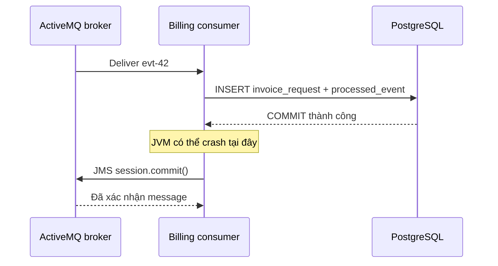
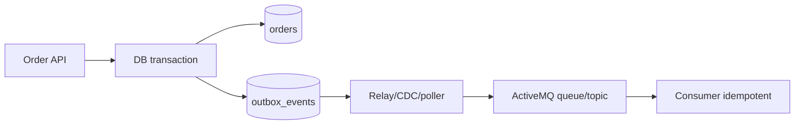
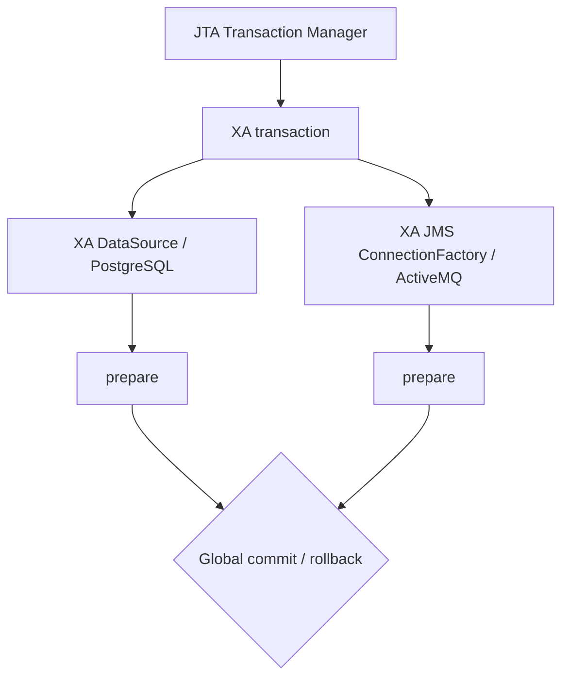

# Phân biệt giao dịch JMS cục bộ với giao dịch cơ sở dữ liệu

> **Chương:** Xác nhận và giao dịch  
> **Phạm vi:** Ứng dụng Java dùng JMS với Apache ActiveMQ Classic hoặc Apache ActiveMQ Artemis, đồng thời đọc/ghi cơ sở dữ liệu quan hệ qua JDBC/Spring. Bài tập trung vào ranh giới commit, các cửa sổ lỗi và những mẫu thiết kế đảm bảo tính đúng đắn nghiệp vụ.  
> **Kết quả cần đạt:** Giải thích được vì sao `session.commit()` của JMS không commit dữ liệu JDBC; xác định chính xác nơi có thể xảy ra mất hoặc lặp công việc; chọn idempotency, transactional outbox hoặc XA/JTA theo yêu cầu.

## 1. Một nghiệp vụ, hai tài nguyên, hai giao dịch

Dịch vụ Billing nhận lệnh từ queue `billing.commands`, tạo yêu cầu phát hành hóa đơn trong PostgreSQL rồi xác nhận message:

```text
1. MessageConsumer.receive() -> InvoiceRequested(eventId=evt-42)
2. INSERT invoice_requests vào PostgreSQL
3. dbConnection.commit()
4. jmsSession.commit()
```

Nhìn qua, đây là “một lần xử lý hóa đơn”. Nhưng **bước 3 và bước 4 là hai commit độc lập**:

- `dbConnection.commit()` chỉ commit những thay đổi trong **transaction của connection PostgreSQL**.
- `jmsSession.commit()` chỉ commit **transaction cục bộ của JMS Session**: với consumer, broker được báo rằng các delivery thuộc transaction đã hoàn tất; với producer, các message gửi trong transaction được commit theo hợp đồng của JMS provider.
- Nếu tiến trình chết **sau bước 3, trước bước 4**, database có thể đã ghi hóa đơn nhưng broker chưa được xác nhận. Message sẽ có thể được giao lại; một consumer thiếu idempotency sẽ phát hành hóa đơn lần thứ hai.



**Điểm quan trọng nhất:** bật `SESSION_TRANSACTED`, `DeliveryMode.PERSISTENT`, redelivery hay DLQ **không tự tạo transaction nguyên tử giữa JMS và database**. Chúng xử lý các phần khác nhau của hệ thống.

## 2. Phạm vi thực sự của transaction JMS và JDBC

| Thuộc tính | JMS local transaction | JDBC local transaction |
|---|---|---|
| Tạo qua | `connection.createSession(true, Session.SESSION_TRANSACTED)` | `db.setAutoCommit(false)` hoặc DB transaction manager |
| Đơn vị sở hữu trạng thái | **Một JMS Session** | **Một JDBC Connection / DB transaction context** |
| Các thao tác tham gia | `send` và `receive` trong cùng JMS Session | SQL `INSERT/UPDATE/DELETE/SELECT ... FOR UPDATE` dùng cùng DB connection |
| Commit | `session.commit()` | `db.commit()` |
| Rollback | `session.rollback()` | `db.rollback()` |
| Tác dụng khi nhận message | Hoàn tất acknowledgment các delivery trong transaction JMS | Không tự xác nhận message với broker |
| Tác dụng khi gửi message | Commit các message đã gửi trong transaction JMS | Không tự publish event vào broker |
| Dữ liệu bền vững | Theo persistence, journal/store và cấu hình broker | Theo DBMS, transaction isolation, WAL/fsync/replication |
| Có tự gộp với transaction bên kia? | **Không** | **Không** |

Kể cả khi JMS broker và database cùng chạy trên một máy, hai commit vẫn độc lập. Một Connection JMS có nhiều Session cũng **không tạo transaction chung cho mọi Session**. Transaction JMS local thuộc về Session được dùng.

### 2.1. Trường hợp chỉ có thao tác JMS

Nếu một worker **nhận message A rồi gửi message B bằng cùng một transacted Session**, `session.commit()` có thể commit việc nhận A và gửi B như **một transaction JMS cục bộ**, theo khả năng của provider/broker:

```java
Session session = connection.createSession(
        true, Session.SESSION_TRANSACTED);

Queue commands = session.createQueue("orders.commands");
Topic events = session.createTopic("orders.events");
MessageConsumer consumer = session.createConsumer(commands);
MessageProducer producer = session.createProducer(events);

Message received = consumer.receive(5000);
if (received != null) {
    try {
        TextMessage output = session.createTextMessage("OrderAccepted");
        output.setStringProperty(
                "eventId", received.getStringProperty("eventId"));
        producer.send(output);
        session.commit(); // JMS receive + JMS send của chính Session này.
    } catch (JMSException | RuntimeException error) {
        session.rollback();
        throw error;
    }
}
```

Mẫu này không gộp bất kỳ `INSERT` vào PostgreSQL nào. Nếu muốn một transaction JMS local chứa cả send lẫn receive, **phải sử dụng cùng transacted Session**; hai Session khác nhau không tự tham gia một local transaction.

### 2.2. Local transaction không đồng nghĩa acknowledgment mode khác

```java
Session session = connection.createSession(
        true, Session.SESSION_TRANSACTED);
```

Khi `transacted=true`, tham số acknowledge mode mang tính bị bỏ qua theo ngữ nghĩa JMS; `Session.SESSION_TRANSACTED` thường được truyền cho rõ ý. `message.acknowledge()` không thay thế `session.commit()` của transacted Session.

Với `AUTO_ACKNOWLEDGE` trong synchronous receive, message có thể đã được acknowledge khi `receive()` trả về thành công. Nếu sau đó DB ghi lỗi, không thể mặc định broker sẽ redeliver. Với `CLIENT_ACKNOWLEDGE`, việc ack có phạm vi Session, không phải một Java object riêng lẻ. Các khác biệt này giải thích vì sao một consumer cần nghiệp vụ tin cậy thường chọn **JMS transaction riêng kết hợp idempotency ở DB**.

## 3. Hai thứ tự commit đều có một cửa sổ lỗi

Giả sử consumer cần **vừa ghi DB vừa ack một message**. Không có transaction coordinator chung, ta buộc phải chọn thứ tự.

### 3.1. Ghi DB trước, ack JMS sau

```text
JMS receive -> DB BEGIN -> business UPDATE -> DB COMMIT
                                     |
                                     | crash trước JMS commit
                                     v
                                 JMS rollback/redelivery
                                 => DB có thể bị cập nhật lại
```

| Sự cố | Trạng thái DB | Trạng thái JMS | Hậu quả |
|---|---|---|---|
| Crash trước DB commit | DB rollback hoặc chưa commit | Chưa ack JMS | Redelivery; thường có thể xử lý lại |
| Crash sau DB commit, trước JMS commit | **DB đã commit** | Chưa ack JMS | **Giao lại**; dễ tạo tác dụng phụ trùng |
| Crash trong JMS commit/timeout phản hồi | DB đã commit | **Kết quả JMS có thể chưa rõ** từ phía client | Retry phải chịu được lặp |
| Cả hai commit thành công | DB đã commit | Đã ack/commit | Đã hoàn tất bình thường |

Đây thường là **thứ tự phù hợp hơn** cho consumer có side effect DB nếu kết hợp xử lý idempotent. Khi broker redeliver, DB nhận ra `eventId` đã xử lý và không làm lại side effect.

### 3.2. Ack JMS trước, ghi DB sau

```text
JMS receive -> JMS COMMIT -> DB BEGIN -> business UPDATE -> DB COMMIT
                    |
                    | crash trước DB commit
                    v
              Broker coi message đã hoàn tất
              => DB chưa thực hiện nghiệp vụ
```

Thứ tự này có cửa sổ **mất công việc**: message đã được ack, DB chưa ghi. Vì vậy không dùng “commit JMS ngay khi nhận rồi mới xử lý DB” cho lệnh nghiệp vụ bắt buộc hoàn thành, trừ khi đã lưu công việc vào một **nguồn bền vững khác** trước khi ack.

**Không tồn tại cách đảo thứ tự hai local commit để vừa loại bỏ cả mất lẫn trùng message**. Vấn đề cần giải bằng một trong hai chiến lược: chấp nhận at-least-once với **idempotency**, hoặc dùng **transaction coordinator** thật sự nếu yêu cầu nguyên tử giữa nhiều resource managers.

## 4. Producer cũng có hai cửa sổ lỗi: DB state và outgoing event

Một yêu cầu API chuyển trạng thái đơn hàng sang `PAID` rồi gửi `OrderPaid`:

### 4.1. DB commit trước, JMS send/commit sau

```text
DB UPDATE orders SET status='PAID'
DB COMMIT
        <-- crash -->
JMS send OrderPaid
JMS COMMIT
```

DB đã cập nhật nhưng event **không được publish**. Billing, Inventory hoặc Notification có thể mãi không biết trạng thái mới. Retry HTTP đôi khi bù được nhưng không phải một đảm bảo tin cậy.

### 4.2. JMS send/commit trước, DB commit sau

```text
JMS send OrderPaid
JMS COMMIT
        <-- crash hoặc DB rollback -->
DB UPDATE orders SET status='PAID'
DB COMMIT
```

Consumer có thể thấy `OrderPaid` dù DB chưa từng commit `PAID`: một **ghost event**. Điều này có thể dẫn đến email xác nhận thanh toán sai hoặc ghi nhận doanh thu không có thật.

### 4.3. Bốn trường hợp khác nhau cần nhận diện

| Luồng | Thứ tự | Lỗi nằm giữa hai commit | Hậu quả chính |
|---|---|---|---|
| **Consumer** | DB → JMS ack | DB xong, JMS chưa | **Duplicate side effect** nếu không idempotent |
| **Consumer** | JMS ack → DB | JMS xong, DB chưa | **Lost work** |
| **Producer** | DB → JMS publish | DB xong, message chưa được commit | **Missing event** |
| **Producer** | JMS publish → DB | Event đã hiện, DB chưa | **Ghost event** |

Cả Classic và Artemis đều có thể bảo đảm message persistence, acknowledgment và transaction **trong miền broker** nhưng không thể thay `COMMIT` của PostgreSQL bằng `session.commit()`.

## 5. Mẫu xử lý consumer: DB idempotency trước JMS commit

Khi message có thể redeliver, một consumer cần trả lời câu hỏi **“event này đã gây tác dụng phụ nghiệp vụ chưa?”** bằng dữ liệu bền vững. Dùng khóa `(consumer_name, event_id)` giúp nhiều nhóm consumer độc lập xử lý cùng event mà không ảnh hưởng nhau.

### 5.1. Bảng DB với ràng buộc unique

Ví dụ PostgreSQL:

```sql
CREATE TABLE processed_events (
    consumer_name text NOT NULL,
    event_id text NOT NULL,
    processed_at timestamptz NOT NULL DEFAULT now(),
    PRIMARY KEY (consumer_name, event_id)
);

CREATE TABLE invoice_requests (
    order_id text PRIMARY KEY,
    created_at timestamptz NOT NULL DEFAULT now()
);
```

Mỗi event nghiệp vụ do producer tạo phải có `eventId` **ổn định qua retry, redelivery, DLQ và redrive**. Không dùng `JMSMessageID` làm khóa duy nhất xuyên republish, vì một message mới có thể được provider cấp ID khác.

### 5.2. Trong một DB transaction: ghi dấu đã xử lý và business effect

Lệnh PostgreSQL dưới đây dùng `ON CONFLICT DO NOTHING` làm hàng rào chống xử lý trùng. Hai consumer nhận cùng `eventId` sẽ được DB unique constraint điều phối:

```sql
BEGIN;

INSERT INTO processed_events(consumer_name, event_id)
VALUES ('billing', 'evt-42')
ON CONFLICT DO NOTHING;

-- Chỉ khi INSERT ở trên thêm được 1 row mới tạo business effect:
INSERT INTO invoice_requests(order_id)
VALUES ('ORD-42')
ON CONFLICT (order_id) DO NOTHING;

COMMIT;
```

Đoạn SQL chỉ mô tả luồng; **trong code phải kiểm tra số row được INSERT ở lệnh đầu** rồi mới chạy lệnh business effect. Nếu là duplicate (0 row), bỏ qua side effect và vẫn commit DB để có thể ack JMS. Nếu business effect thất bại, rollback **cả dấu processed_events** trong cùng transaction; không được ghi “đã xử lý” rồi commit trước khi ghi invoice.

Mẫu này bảo vệ **side effect nằm trong cùng DB**. Nếu handler gọi REST API thanh toán, gửi email hoặc ghi sang database khác, cần idempotency/transaction phù hợp ở hệ thống ngoài đó; ràng buộc DB local không tự rollback side effect ngoài.

### 5.3. Ví dụ Java JMS + JDBC đầy đủ cho một message

Ví dụ dùng `javax.jms` và `javax.sql.DataSource`, phù hợp các client Classic/Artemis cung cấp namespace đó. Một worker dùng **một JMS Session transacted** và **một JDBC transaction**; chúng được commit theo hai bước riêng.

```java
import javax.jms.ConnectionFactory;
import javax.jms.JMSException;
import javax.jms.Message;
import javax.jms.MessageConsumer;
import javax.jms.Queue;
import javax.jms.Session;
import javax.jms.TextMessage;
import javax.sql.DataSource;
import java.sql.PreparedStatement;
import java.sql.SQLException;

public final class InvoiceConsumer {

    public static void receiveOne(ConnectionFactory cf, DataSource ds)
            throws JMSException, SQLException {

        javax.jms.Connection jms = cf.createConnection();
        try {
            Session session = jms.createSession(
                    true, Session.SESSION_TRANSACTED);
            try {
                Queue queue = session.createQueue("billing.commands");
                MessageConsumer consumer = session.createConsumer(queue);
                try {
                    jms.start();
                    Message message = consumer.receive(5_000L);
                    if (message == null) {
                        return;
                    }

                    try {
                        if (!(message instanceof TextMessage)) {
                            throw new IllegalArgumentException("Text expected");
                        }
                        String eventId =
                                message.getStringProperty("eventId");
                        String orderId =
                                ((TextMessage) message).getText();

                        if (eventId == null || eventId.isEmpty()) {
                            throw new IllegalArgumentException("Missing eventId");
                        }

                        processInDatabase(ds, eventId, orderId);
                        // DB đã commit; JMS vẫn là transaction khác.
                        session.commit();
                    } catch (JMSException | SQLException |
                             RuntimeException error) {
                        try {
                            session.rollback();
                        } catch (JMSException rollbackError) {
                            error.addSuppressed(rollbackError);
                        }
                        throw error;
                    }
                } finally {
                    consumer.close();
                }
            } finally {
                session.close();
            }
        } finally {
            jms.close();
        }
    }

    private static void processInDatabase(
            DataSource ds, String eventId, String orderId)
            throws SQLException {

        try (java.sql.Connection db = ds.getConnection()) {
            db.setAutoCommit(false);

            try {
                int newlyClaimed;
                try (PreparedStatement insert = db.prepareStatement(
                        "INSERT INTO processed_events" +
                        "(consumer_name, event_id) VALUES ('billing', ?) " +
                        "ON CONFLICT DO NOTHING")) {
                    insert.setString(1, eventId);
                    newlyClaimed = insert.executeUpdate();
                }

                if (newlyClaimed == 1) {
                    try (PreparedStatement write = db.prepareStatement(
                            "INSERT INTO invoice_requests(order_id) " +
                            "VALUES (?) ON CONFLICT (order_id) DO NOTHING")) {
                        write.setString(1, orderId);
                        write.executeUpdate();
                    }
                }
                // Nếu already processed, không tạo invoice lần hai.
                db.commit();
            } catch (SQLException | RuntimeException error) {
                try {
                    db.rollback();
                } catch (SQLException rollbackError) {
                    error.addSuppressed(rollbackError);
                }
                throw error;
            }
        }
    }
}
```

**Phân tích đúng ranh giới:**

1. `receive()` đưa message vào transaction của JMS Session.
2. `processInDatabase` kiểm tra `eventId` và ghi thay đổi trong **cùng transaction DB**.
3. `db.commit()` thành công nhưng `session.commit()` chưa chạy: có **cửa sổ redelivery**.
4. Nếu JMS commit thất bại hoặc không rõ kết quả, lần delivery sau sẽ thấy `eventId` đã có trong DB và **không lặp side effect**.
5. Nếu JDBC rollback trước khi JMS commit, phiên xử lý gọi JMS rollback; broker có thể redeliver theo chính sách.

**Không coi đoạn mẫu là bộ xử lý hóa đơn hoàn chỉnh.** Payload ở đây chỉ là `orderId` trong `TextMessage`; ứng dụng thật phải validate schema và quyền truy cập. JDBC commit có thể mất kết nối và cho kết quả chưa rõ; uniqueness/idempotency vẫn cần. Nếu domain cho phép nhiều event khác nhau cùng tác động một order, phải thiết kế ràng buộc nghiệp vụ phù hợp thay vì `ON CONFLICT DO NOTHING` tùy tiện.

### 5.4. Khi phát hiện một duplicate

Nếu lần đầu DB commit thành công nhưng JMS commit chưa hoàn tất, consumer nhận lại:

```text
Redeliver evt-42
  -> INSERT processed_events ON CONFLICT DO NOTHING
  -> affected rows = 0
  -> không INSERT invoice_requests lần hai
  -> DB COMMIT
  -> JMS COMMIT (ack bản được giao lại)
```

Ghi metric `deduplicated_events_total` và `JMSRedelivered`/`JMSXDeliveryCount` nếu có để điều tra; không phân loại duplicate hợp lệ là poison message rồi rollback mãi đến DLQ.

## 6. Mẫu phát event sau DB commit: transactional outbox

Idempotent consumer xử lý được chuyện **giao lại**, nhưng không sửa được chuyện producer **quên phát event** sau khi DB đã commit. Mẫu **transactional outbox** giải quyết bằng cách ghi state nghiệp vụ và event cần phát vào **cùng một DB transaction**.



### 6.1. Một commit DB cho state và ý định gửi event

Ví dụ PostgreSQL:

```sql
CREATE TABLE outbox_events (
    event_id uuid PRIMARY KEY,
    aggregate_id text NOT NULL,
    destination text NOT NULL,
    payload_json jsonb NOT NULL,
    created_at timestamptz NOT NULL DEFAULT now(),
    published_at timestamptz
);

BEGIN;

UPDATE orders
SET status = 'PAID'
WHERE order_id = 'ORD-42';

INSERT INTO outbox_events (
    event_id, aggregate_id, destination, payload_json
) VALUES (
    'f0e37da6-a4d5-4e7e-9d80-e1cf2f0df443',
    'ORD-42',
    'orders.events',
    '{"eventType":"OrderPaid","orderId":"ORD-42"}'
);

COMMIT;
```

Nếu DB transaction rollback, cả trạng thái đơn và outbox record đều không được ghi. Nếu DB commit, luôn còn một **bằng chứng bền vững** rằng sự kiện phải được phát, kể cả JVM chết ngay sau đó.

Ở production, cần kiểm tra `UPDATE` thực sự đổi đúng order theo trạng thái hợp lệ (ví dụ `WHERE status='PENDING'`) và chỉ ghi outbox khi business transition được chấp nhận. `event_id` phải được sinh **một lần** cho event logic đó, không đổi mỗi khi relay retry.

### 6.2. Relay publish ra JMS theo cơ chế at-least-once

Một relay điển hình:

1. **Claim** các outbox rows chưa publish bằng cách an toàn cho nhiều instance (row lock, lease có thời hạn, `FOR UPDATE SKIP LOCKED` hoặc CDC offset).
2. Publish từng event vào JMS theo destination hợp lệ, mang nguyên `eventId`.
3. Commit JMS send; chờ kết quả theo hợp đồng provider.
4. Đánh dấu outbox `published_at` hoặc tiến offset trong **transaction DB riêng**.
5. Nếu relay chết, giải phóng claim/lease và thử lại event chưa có xác nhận bền vững.

Có cửa sổ ngược lại:

```text
JMS COMMIT success
   | crash trước khi UPDATE outbox.published_at
   v
Outbox vẫn NEW -> relay lần sau publish lại cùng eventId
```

**Outbox đảm bảo không đánh rơi ý định publish đã commit cùng DB, nhưng thường chấp nhận duplicate publication.** Consumer dùng `eventId` để idempotent. Khi JMS commit bị timeout, relay không tự kết luận “chưa gửi”; nó retry an toàn với cùng business ID.

Nếu nhiều relay chạy song song, cần xử lý lock/lease expiration và ordering theo aggregate. Một số hệ thống dùng CDC thay cho polling; cả hai vẫn cần giải quyết retries, duplicate và việc theo dõi backlog. Không giữ DB transaction mở vô hạn chỉ để chờ broker reconnect.

### 6.3. Java producer tối thiểu trong outbox relay

```java
import javax.jms.ConnectionFactory;
import javax.jms.DeliveryMode;
import javax.jms.JMSException;
import javax.jms.MessageProducer;
import javax.jms.Session;
import javax.jms.TextMessage;
import javax.jms.Topic;

public final class OutboxJmsPublisher {

    public static void publish(
            ConnectionFactory cf, String eventId, String payloadJson)
            throws JMSException {

        javax.jms.Connection conn = cf.createConnection();
        try {
            Session session = conn.createSession(
                    true, Session.SESSION_TRANSACTED);
            try {
                Topic topic = session.createTopic("orders.events");
                MessageProducer producer = session.createProducer(topic);
                try {
                    producer.setDeliveryMode(DeliveryMode.PERSISTENT);

                    TextMessage message =
                            session.createTextMessage(payloadJson);
                    message.setStringProperty("eventId", eventId);
                    message.setStringProperty("eventType", "OrderPaid");

                    try {
                        producer.send(message);
                        session.commit(); // Chỉ commit JMS send.
                    } catch (JMSException | RuntimeException error) {
                        try {
                            session.rollback();
                        } catch (JMSException rollbackError) {
                            error.addSuppressed(rollbackError);
                        }
                        throw error;
                    }
                } finally {
                    producer.close();
                }
            } finally {
                session.close();
            }
        } finally {
            conn.close();
        }
    }
}
```

Đây là **bộ phận gửi** trong relay, chưa phải toàn bộ claim/lease/mark-published scheduler. Chỉ khi nó trả về thành công mới đánh dấu sent trong DB; nếu lỗi/timeout, không xóa outbox row, retry cùng `eventId`. Dùng client Classic hoặc Artemis tương ứng với broker/protocol và namespace `javax.jms`; với Jakarta Messaging chuyển import và chọn đúng client artifact.

## 7. Khi nào dùng XA/JTA để có một transaction phối hợp?

Nếu nghiệp vụ yêu cầu **commit nguyên tử giữa JMS resource manager và database**, có thể dùng **XA** (giao thức phối hợp nhiều resource) dưới **JTA transaction manager**. Đây là một giải pháp khác về kiến trúc, không phải bật một flag trên `Session` local là xong.



Trong two-phase commit (2PC) điển hình:

1. **Begin global transaction:** coordinator tạo một transaction toàn cục và enlist các XA resources.
2. **Prepare:** mỗi resource xác nhận có thể commit và giữ trạng thái phục hồi.
3. **Decision:** coordinator ghi quyết định commit/rollback.
4. **Commit/rollback:** coordinator yêu cầu từng resource hoàn tất; nếu có crash, thực hiện recovery những transaction *in-doubt*.

Với JMS+DB XA, cả việc acknowledgment/send JMS và thay đổi SQL nằm trong **global transaction** khi được enlist đúng. Nếu chuẩn bị hoặc commit có lỗi, transaction manager điều phối kết quả và phục hồi theo giao thức.

**Giới hạn thực tế của XA:**

- Broker, client, JDBC driver, DataSource, transaction manager và deployment topology đều phải hỗ trợ XA phù hợp.
- Có chi phí prepare, locking, logging và recovery; transaction dài dễ gây lock contention.
- Phải vận hành **recovery logs, XA resource identity, restart/failover, in-doubt transactions**. Mất coordinator state có thể làm recovery khó khăn.
- XA không làm HTTP call, gửi email, cache invalidate hay mọi tác dụng phụ bên ngoài DB/JMS tự động thành XA resource.
- Ngay cả khi XA bảo đảm atomic outcome trong các resource tham gia, consumer vẫn nên **idempotent** trước retry, duplicate từ upstream, redrive hoặc những workflow nằm ngoài transaction toàn cục.

Không lựa chọn XA chỉ vì “muốn exactly once” chung chung. Hãy định nghĩa invariant nào cần atomic, RTO/RPO và khả năng vận hành 2PC trước.

### 7.1. Cách phân biệt bằng API

**Local JMS:**

```java
Session session = connection.createSession(
        true, Session.SESSION_TRANSACTED);
session.commit(); // Chỉ giao dịch cục bộ của Session này.
```

**Global transaction:**

```text
JTA begin
  enlist XA JDBC resource
  enlist XA JMS resource
  update DB
  send/receive JMS
JTA commit
  -> transaction manager phối hợp cả DB và broker
```

Phần global chỉ là **pseudocode kiến trúc**: ứng dụng container-managed không tự trộn `session.commit()` của local Session bên trong một JTA transaction đang được framework quản lý. Phải cấu hình XA-capable `ConnectionFactory`/`DataSource` và recovery với transaction manager tương thích (ví dụ trong ứng dụng server hoặc framework hỗ trợ).

## 8. Spring `@Transactional` có đồng nghĩa DB + JMS nguyên tử?

Không mặc định. Chú ý **transaction manager nào** đứng sau annotation.

Ví dụ:

```java
@Transactional // Thông thường quản lý một DB transaction manager.
public void payOrder(String orderId) {
    orderRepository.markPaid(orderId);
    jmsTemplate.convertAndSend("orders.events", orderId);
}
```

Nếu `@Transactional` đang chọn **JDBC/JPA transaction manager**, phần SQL được commit theo transaction DB. JMS send có thể dùng một JMS Session độc lập và không tham gia vào DB transaction đó. Vì vậy, nếu gửi JMS trước khi DB commit, consumer có thể thấy event rồi DB lại rollback.

Nếu listener container được cấu hình `sessionTransacted=true` và handler có `@Transactional` cho DB:

```text
JMS listener nhận message
  -> @Transactional DB begin
  -> DB work
  -> @Transactional DB commit khi method return
  -> JMS container commit session sau callback
```

Đây thường là **hai local transactions theo thứ tự**, không phải một global XA transaction. Crash giữa DB commit và JMS commit vẫn có thể làm broker redeliver; cần idempotent DB processing.

**Quy tắc review code:**

- Ghi rõ `PlatformTransactionManager` nào áp cho `@Transactional` ở từng method.
- Kiểm tra `JmsTemplate`/listener container dùng connection/session/ack mode gì; container có thể là chủ thể gọi `commit()`.
- Nếu muốn transaction global thật, xác nhận **cả JDBC và JMS resource được enlist vào cùng JTA transaction**.
- Không tự ý gọi `session.commit()` ở bên trong callback khi container đang quản lý transaction.
- Với Spring Boot 3 và Jakarta Messaging, chọn client `jakarta.jms` và dependency/provider tương thích; không trộn `javax.jms` và `jakarta.jms`.

“Chained transaction managers” hoặc việc gọi hai transaction manager nối tiếp không biến hai local commit thành **atomic 2PC**. Nếu có cửa sổ commit thất bại, phải thiết kế bù đắp hoặc idempotency.

## 9. Chọn giải pháp cho từng yêu cầu

| Bối cảnh | Thiết kế phù hợp | Bất biến được bảo vệ | Rủi ro còn phải xử lý |
|---|---|---|---|
| Consume message rồi ghi **một** DB | DB transaction + unique `eventId` + JMS commit sau DB | Không lặp side effect trong DB dù message redeliver | Retry và DLQ; DB/JMS commit kết quả chưa rõ |
| Ghi DB rồi phát event | **Transactional outbox** + relay | Không quên publish event đã được ghi nhận bền vững | Có thể phát event trùng; consumer idempotent |
| Nhận JMS A rồi gửi JMS B, **không ghi DB** | Cùng transacted JMS Session | Receive/send thuộc một local JMS transaction | Provider/broker availability; upstream duplicates |
| Đòi atomic JDBC + JMS vì ràng buộc kiến trúc | JTA/XA với 2PC và recovery | Atomic outcome giữa các XA resources tham gia | Chi phí vận hành, lock, in-doubt recovery |
| Gửi email/call HTTP sau khi ghi DB | DB outbox + idempotent worker/external API | DB ghi được ý định thực hiện | Dịch vụ ngoài có thể thành công rồi client timeout |
| Analytics chấp nhận xử lý lại | At-least-once + deterministic upsert | Kết quả cuối có thể hội tụ | Thứ tự, duplicate, rebuild/retention |

**Định nghĩa đúng “exactly once”:** nhiều kiến trúc đạt được **“một lần tác dụng phụ có thể quan sát trong DB”** nhờ unique constraint, bất chấp message được giao nhiều lần. Điều đó khác với tuyên bố **mạng chỉ truyền message một lần** hoặc không bao giờ có duplicate publication.

## 10. Kiểm chứng bằng fault injection ở đúng ranh giới

Kiểm thử chỉ chạy thành công trong đường đi bình thường **không chứng minh** transaction giữa broker và DB an toàn. Cần cố tình tạo lỗi ngay trước/sau commit.

### 10.1. Bộ bài tập thực hành

| Case | Điểm cắt lỗi | Kỳ vọng nếu thiết kế đúng |
|---|---|---|
| C1 | Consumer crash **trước DB commit** | DB không có side effect; JMS có thể redeliver |
| C2 | Consumer crash **sau DB commit, trước JMS commit** | JMS redeliver; DB unique `eventId` ngăn side effect trùng |
| C3 | Network rớt **khi JMS commit** | Client có thể không biết commit thành công; retry an toàn, không nhân đôi DB effect |
| C4 | Consumer cố tình rollback 5 lần | Broker áp redelivery policy rồi chuyển DLQ theo cấu hình; không coi mọi retry là giao dịch DB mới |
| P1 | Producer crash **sau DB commit, trước JMS publish** | Outbox còn record; relay phát sự kiện sau khi phục hồi |
| P2 | Relay crash **sau JMS commit, trước outbox mark sent** | Publish lại có thể tạo duplicate; consumer dedupe theo `eventId` |
| P3 | Hai relay cùng tranh một outbox row | Claim/lease/row locking ngăn xử lý đồng thời ngoài chính sách; retry vẫn được quản lý |
| X1 | Với XA: kill coordinator ở prepare/commit | Recovery xử lý transaction in-doubt, không tùy tiện gọi local commit |
| S1 | Spring listener có DB transaction, JMS local transaction | Quan sát thứ tự commit và chứng minh vẫn có cửa sổ redelivery |

### 10.2. Hướng dẫn tái hiện case C2

1. Tạo queue test `billing.commands` và làm sạch **theo quy trình test**; bật persistence.
2. Gửi một message có `eventId=evt-42` và body `ORD-42`.
3. Thêm một điểm dừng có kiểm soát **ngay sau `db.commit()` nhưng trước `session.commit()`** trong worker test.
4. Kill JVM consumer; khởi động lại worker khác cùng queue.
5. Đối chiếu: `invoice_requests` chỉ có **một row** cho `ORD-42`; `processed_events` chỉ có một khóa `(billing, evt-42)`; message được ack sau lần redelivery thành công.
6. Ghi log `eventId`, `JMSRedelivered` và `JMSXDeliveryCount` khi provider hỗ trợ; không lấy delivery count làm bằng chứng một lần side effect.

### 10.3. Hướng dẫn tái hiện case P2

1. Trong DB, ghi đơn hàng `PAID` và một outbox record `eventId=evt-99` cùng transaction.
2. Cho relay publish event và JMS commit thành công.
3. Kill relay trước khi nó cập nhật `published_at`.
4. Khởi động lại relay, để nó phát lại outbox record.
5. Consumer có thể nhận event lặp nhưng chỉ tạo **một side effect** nhờ unique `eventId`.
6. Xác minh outbox cuối cùng được đánh dấu sent và không tồn đọng vô hạn.

**Không diễn tập kill/đầy disk trên production.** Dùng staging có database/broker riêng; ghi rõ phiên bản client, protocol, broker persistence, cấu hình retry và trạng thái queue/outbox.

## 11. Vận hành và đối soát sau lỗi

Độ tin cậy không kết thúc ở `commit()`. Cần đo các trạng thái ở cả DB và broker:

| Nguồn | Chỉ số/đối soát | Mục đích |
|---|---|---|
| DB `processed_events` | Tỷ lệ duplicate `eventId`, lỗi unique conflict, số business effects | Chứng minh consumer idempotency |
| DB `outbox_events` | Pending count, oldest pending age, retry attempts, stuck lease, published latency | Phát hiện DB đã commit nhưng event chưa ra broker |
| JMS broker | Queue pending/delivering, commit/rollback, redelivery, DLQ count, disk pressure | Phát hiện lỗi delivery và consumer failure |
| App logs/tracing | `eventId`, `JMSMessageID`, correlation/trace ID, DB commit phase, JMS commit phase | Nối một event qua nhiều lần gửi/nhận |
| Reconciliation job | So sánh business transition với outbox/event và kết quả consumer | Tìm message bị kẹt, lỗi schema hoặc workflow bỏ sót |

Nếu DLQ có message, **đừng xóa hoặc redrive mù**. Kiểm tra lỗi SQL, schema, quyền hoặc business validation; bảo toàn `eventId` khi gửi lại để tránh side effect lặp. Các tiêu chí lưu giữ, mã hóa dữ liệu, TLS, ACL và quyền xem payload trong DLQ phải được áp giống đường message bình thường.

### 11.1. Một số lỗi review thường gặp

| Giả định sai | Thực tế |
|---|---|
| “Đã bật `SESSION_TRANSACTED` nên DB và JMS commit cùng lúc” | JMS local transaction chỉ bao thao tác trong Session đó |
| “Đổi thứ tự commit là có exactly-once” | DB-first có duplicate window; JMS-first có lost-work window |
| “Gửi persistent message là consumer sẽ xử lý đúng một lần” | Persistence không thay DB idempotency hoặc consumer ack |
| “Đánh dấu event đã xử lý trước khi gọi DB” | Crash có thể đánh dấu thành công nhưng business effect chưa có |
| “Dùng `JMSMessageID` làm dedupe key xuyên outbox retry” | Republish có thể cấp JMSMessageID khác; cần `eventId` nghiệp vụ |
| “`@Transactional` luôn bao cả JmsTemplate và JPA” | Phụ thuộc transaction manager/enlistment thực tế |
| “Outbox nghĩa là broker không bao giờ nhận trùng” | Relay có thể publish lại sau JMS commit nhưng trước DB mark |
| “XA không cần vận hành recovery” | 2PC có in-doubt state, transaction logs và yêu cầu recovery |

## 12. Checklist quyết định trước production

- [ ] Đã chỉ rõ tài nguyên nào thuộc **JMS local transaction** và tài nguyên nào thuộc **DB transaction**.
- [ ] Đã vẽ hai commit và các điểm crash giữa chúng cho cả consumer và producer.
- [ ] Consumer DB-first có `eventId` bền vững và unique constraint cùng business side effect trong **một DB transaction**.
- [ ] Message redelivery sau DB commit không gây tác dụng phụ trùng; test bằng kill JVM.
- [ ] Nếu DB mutation phải phát event, đã có **outbox record** ghi cùng DB transaction.
- [ ] Relay giữ `eventId` ổn định qua retry, xử lý commit outcome chưa rõ và có cơ chế claim/lease.
- [ ] DLQ/retry được cấu hình và redrive bảo toàn ID; không rollback vô hạn với duplicate đã xử lý.
- [ ] Với Spring, đã xác nhận `@Transactional` chọn đúng transaction manager và listener container sở hữu ack/commit.
- [ ] Nếu chọn XA/JTA, đã chứng minh cả JDBC và JMS là XA resources, có recovery/failover tests.
- [ ] Có metrics/outbox age, dedupe rate, JMS redelivery/DLQ và reconciliation job.
- [ ] Đã phân biệt **nguyên tử giữa DB/JMS**, **độ bền của message**, **at-least-once delivery** và **một lần side effect nghiệp vụ**.

## 13. Tài liệu tham khảo

1. [JMS `Session` API](https://docs.oracle.com/javaee/7/api/javax/jms/Session.html) — local transacted Session, `commit`, `rollback` và acknowledgment.
2. [Jakarta Messaging specification](https://jakarta.ee/specifications/messaging/3.1/) — phạm vi transaction và các yêu cầu của Messaging API hiện đại.
3. [Jakarta Transactions specification](https://jakarta.ee/specifications/transactions/2.0/) — transaction manager, JTA/XA và phối hợp nhiều resource managers.
4. [Apache ActiveMQ Classic — Message Redelivery and DLQ](https://activemq.apache.org/components/classic/documentation/message-redelivery-and-dlq-handling) — xử lý lại message chưa được commit/ack.
5. [Apache ActiveMQ Artemis — Undelivered Messages](https://artemis.apache.org/components/artemis/documentation/latest/undelivered-messages.html) — redelivery và dead-letter address.
6. [Spring Framework — JMS Integration](https://docs.spring.io/spring-framework/reference/integration/jms.html) — listener containers, transacted sessions và transaction management.
7. [Transactional Outbox Pattern](https://microservices.io/patterns/data/transactional-outbox.html) — ghi state và ý định phát event trong cùng DB transaction.

> **Ghi nhớ:** `JMS Session commit` và `JDBC Connection commit` là **hai giao dịch local độc lập**. Với consumer ghi một database, dùng **DB-first + idempotent side effect + JMS ack sau**; với producer cập nhật DB rồi phát event, dùng **transactional outbox**; chỉ dùng **XA/JTA** khi thực sự cần nguyên tử giữa hai resource và có khả năng vận hành recovery. Cách chứng minh đúng đắn là thử crash giữa hai commit, không phải chỉ kiểm tra đường chạy thành công.
