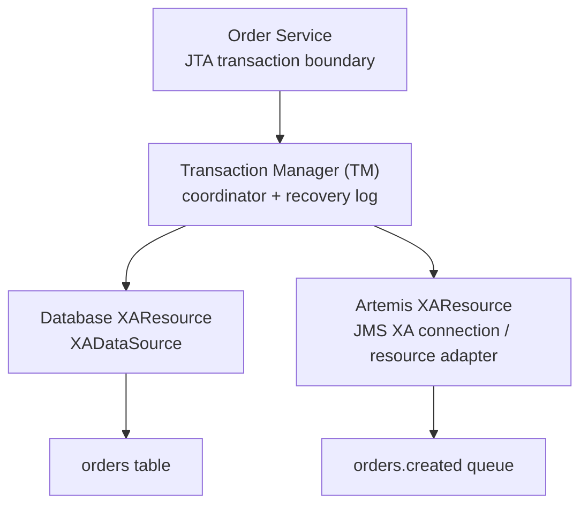
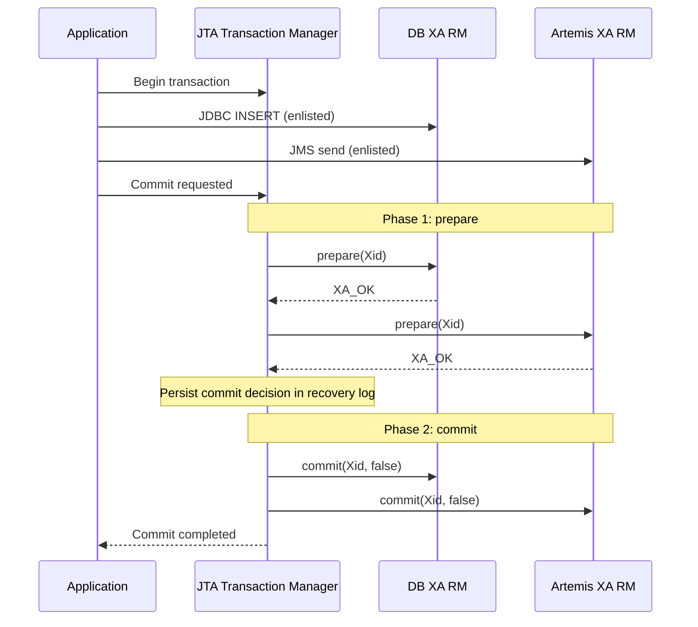

# XA/JTA, giao dịch phân tán và chi phí phối hợp tài nguyên

> **Chương:** Xác nhận và giao dịch  
> **Phạm vi:** Giao dịch phân tán giữa database và Apache ActiveMQ Artemis/Classic qua XA, Jakarta Transactions (JTA) và two-phase commit (2PC); tập trung vào sự phối hợp, khôi phục lỗi, chi phí và cách lựa chọn kiến trúc.

## 1. Khi DB commit nhưng JMS send thất bại

Dịch vụ Order thực hiện hai thao tác: ghi `Order(O-1001)` vào database và gửi `OrderCreated(O-1001)` tới queue Artemis để Inventory xử lý. Nếu mỗi thao tác có một transaction riêng, các thứ tự thực thi đều có cửa sổ lỗi:

| Trình tự | Lỗi có thể xảy ra | Hậu quả |
|---|---|---|
| DB commit rồi gửi JMS | Service chết trước khi broker chấp nhận message | DB có đơn nhưng không có event |
| Gửi JMS rồi DB commit | DB từ chối commit | Event đề cập đơn không tồn tại |
| DB commit, gửi JMS, mất phản hồi broker | Broker có thể đã nhận nhưng producer không biết | Retry có thể tạo message trùng |

Nếu **cả database và message broker là các XA-capable resource managers** và ứng dụng được quản lý bởi một **JTA transaction manager**, ta có thể phối hợp hai tài nguyên trong cùng một **global transaction**. Mục tiêu của 2PC là không báo commit thành công trong trạng thái một nhánh commit còn nhánh khác rollback theo luồng bình thường; nếu xảy ra sự cố giữa các pha, transaction manager (TM) phải khôi phục quyết định cuối.



**Phạm vi của bảo đảm:** XA chỉ phối hợp các tài nguyên thực sự tham gia **cùng global transaction**. Email, HTTP call tới payment gateway, filesystem hay database ở một service consumer khác không tự trở thành participant. XA cũng không tự giải quyết duplicate delivery sau crash ở một consumer bên ngoài transaction.

## 2. Phân biệt XA, JTA, 2PC và transaction cục bộ

| Thành phần | Vai trò | Ứng dụng thực tế |
|---|---|---|
| **Local JDBC transaction** | `commit`/`rollback` trên một DB connection | Chỉ quản lý transaction database |
| **Local JMS transaction** | `Session.commit()`/`rollback()` trong JMS session transacted | Chỉ quản lý các lần gửi/nhận JMS của session |
| **XA** | Protocol/API để resource manager tham gia global transaction: `start`, `end`, `prepare`, `commit`, `rollback`, `recover` | DB driver XA và client/adapter XA của Artemis |
| **JTA/Jakarta Transactions** | API cho global transaction và việc transaction manager điều phối resource: `UserTransaction`, `@Transactional` | App server/TM quản lý ranh giới và enlistment |
| **2PC** | Thuật toán hai pha: chuẩn bị rồi thống nhất commit/rollback | Phối hợp database với message broker |
| **TM** | Coordinator giữ định danh transaction, quyết định chung và durable recovery log | Narayana, Atomikos, TM của app server |
| **RM** | Resource manager bảo vệ dữ liệu và quyết định ở nhánh tham gia transaction | DB engine và ActiveMQ broker |

### 2.1. API Java và namespace

Trong Jakarta EE hiện đại, API quản lý transaction thuộc `jakarta.transaction`, JMS thuộc `jakarta.jms`. Tuy nhiên XAResource/Xid/XAException vẫn thuộc Java SE `javax.transaction.xa`:

```java
import jakarta.transaction.Transactional;
import jakarta.transaction.UserTransaction;
import jakarta.jms.ConnectionFactory;

import javax.transaction.xa.XAResource;
import javax.transaction.xa.Xid;
import javax.transaction.xa.XAException;
```

`XAResource` là giao diện mà **TM và resource adapter** dùng để phối hợp; code nghiệp vụ thường làm việc với `@Transactional` hoặc `UserTransaction`, không cần tự gọi prepare/commit cho từng nhánh.

## 3. Two-phase commit: vì sao có prepare?

JTA transaction manager gán một `Xid` cho global transaction và những branch tham gia. `Xid` mang global transaction identifier cùng branch qualifier, giúp khớp trạng thái các resource managers khi recovery. Trình tự điển hình:

1. Bắt đầu global transaction.
2. Khi ứng dụng lấy JDBC connection qua **XA-enabled managed DataSource**, TM enlist DB.
3. Khi ứng dụng dùng **XA-enabled managed JMS connection factory**, TM enlist Artemis.
4. Ứng dụng gọi `INSERT` và `send`. Cả hai thao tác thuộc transaction toàn cục, chưa phải commit cuối.
5. Khi ứng dụng kết thúc thành công, TM bắt đầu 2PC; khi có lỗi, TM rollback theo policy.



Trong pha **prepare**, mỗi RM kiểm tra có thể cam kết hay không và ghi lại thông tin cần thiết để hoàn thành quyết định về sau. `XA_OK` báo prepared; `XA_RDONLY` nghĩa là branch chỉ đọc, thường không cần commit pha 2. Nếu một resource không prepare được, TM điều phối rollback các branch liên quan. Nếu các resource sẵn sàng, TM phải lưu quyết định commit đủ bền vững rồi yêu cầu từng RM commit.

Một số trường hợp TM nhận diện chỉ có **một resource manager** cần commit, có thể tối ưu one-phase commit `commit(xid, true)`, không thực hiện đủ hai pha. TM có thể dùng `XAResource.isSameRM` để nhận diện các connection thực chất cùng một RM; không đếm số connection như số participant độc lập.

### 3.1. Prepared nhưng chưa committed: trạng thái in-doubt

```text
           TM crashes after both resources PREPARED
                      |
           +----------+----------+
           v                     v
    DB branch in-doubt    Artemis XA branch in-doubt
           |                     |
           +----------+----------+
                      v
       TM restart + durable recovery log
       -> restore decision -> commit/rollback
```

Đây là điểm khó của XA. **2PC là blocking protocol** trong một số sự cố: resource đã prepared không được tự ý rollback hoặc commit nếu không biết quyết định của coordinator. Trong thời gian chờ, database có thể còn giữ khóa hoặc broker còn lưu prepared transaction. XA cần khả năng **transaction recovery** của TM và RM, không đơn thuần chỉ có rollback trong `catch`.

Nếu coordinator đã ghi quyết định commit, rồi chỉ DB nhận commit trước khi kết nối broker mất, broker có thể giữ branch prepared cho tới khi TM recovery gửi lại lệnh commit. Điều cần tránh là operator tự rollback broker chỉ vì “queue chưa thấy message”; khi đó có thể làm hai tài nguyên lệch nhau.

## 4. Tích hợp Artemis, XA-aware JDBC và JTA transaction manager

Broker hỗ trợ XA **không** đủ để tạo một global transaction. Ba lớp phải khớp:

| Lớp | Điều kiện phải có | Lỗi nếu thiếu |
|---|---|---|
| **Broker Artemis** | Address/queue đúng, persistence và journal đủ bền vững, quyền gửi/nhận, storage phù hợp | Message không route, preparedness/recovery bị ảnh hưởng |
| **JMS client/resource adapter** | XA-capable client và adapter/pool thực sự được TM quản lý | JMS send có thể nằm ngoài JTA transaction |
| **Transaction manager** | XA-aware DB pool và JMS resource, durable recovery log, node identity, timeout, recovery credentials | Không có 2PC đúng nghĩa hoặc không thể recover in-doubt transaction |

### 4.1. Queue và journal trong Artemis

Đây là phần tử để chèn vào **`<addresses>` hiện có** trong `broker.xml`, không phải file XML hoàn chỉnh:

```xml
<address name="orders.created">
    <anycast>
        <queue name="orders.created"/>
    </anycast>
</address>
```

Nếu môi trường bật auto-create có kiểm soát, queue có thể được tạo động. Với một lab XA, khai báo trước giúp tránh nhầm lỗi authorization/provisioning thành lỗi distributed transaction.

Các lựa chọn đồng bộ journal liên quan tới độ bền của transaction đã được ghi trong broker (đặt dưới phần `<core>` của `broker.xml` nếu bản Artemis hỗ trợ cấu hình tương ứng):

```xml
<journal-sync-transactional>true</journal-sync-transactional>
<journal-sync-non-transactional>true</journal-sync-non-transactional>
```

**Journal của broker khác recovery log của TM.** Nếu mất log quyết định 2PC của TM, broker có thể còn branch prepared nhưng không biết nên commit hay rollback. Không xóa journal để “giải phóng” prepared transaction.

### 4.2. Hai XA resources được container quản lý

Ví dụ tên JNDI dưới đây do **app server/TM** provision:

```text
java:app/jdbc/OrdersXA  -> JDBC XADataSource in TM-managed pool
java:app/jms/EventsXA   -> XA-enabled, JTA-managed JMS ConnectionFactory
```

Checklist trước khi chạy:

1. JDBC driver có `XADataSource`, XA pool được enlist bởi TM, user DB đủ quyền và có recovery credentials.
2. Artemis XA connection factory / JCA resource adapter tương thích `jakarta.jms` với runtime. Một số client Artemis cung cấp `org.apache.activemq.artemis.jms.client.ActiveMQXAConnectionFactory`, nhưng **tự tạo class này trong Java không đồng nghĩa đã enlist vào JTA**.
3. Server cấu hình adapter ở chế độ **XA transaction support**, broker URL/protocol, username/password/TLS và pool/recovery tương thích; tên config cụ thể phụ thuộc server.
4. Recovery log của TM lưu trên storage bền vững, **node identity** ổn định qua restart, recovery worker có thể kết nối cả database và broker.
5. Kích hoạt transaction timeout và theo dõi prepared/in-doubt branches; không để một request treo vô hạn.

Không có một đoạn cấu hình XML/YAML XA chung cho mọi Jakarta EE server. Ví dụ ứng dụng phía dưới giả định server đã cung cấp tài nguyên XA theo hai tên JNDI trên. Nếu chỉ dùng `new ActiveMQConnectionFactory(url)` và một JDBC connection thông thường, hai thao tác có thể là **hai local transactions** dù method có annotation `@Transactional`.

## 5. Code Jakarta EE: ghi DB và gửi JMS trong một transaction

Đây là ví dụ **Jakarta EE managed transaction**, không phải ứng dụng Java `main()` chỉ cần một broker client JAR. Sử dụng JDK phù hợp với Jakarta EE runtime, app server có CDI/JTA và hai JNDI XA resources đã provision.

Tạo bảng:

```sql
CREATE TABLE orders (
    order_id VARCHAR(64) PRIMARY KEY,
    amount_minor BIGINT NOT NULL
);
```

Class service:

```java
package lab.orders;

import jakarta.annotation.Resource;
import jakarta.enterprise.context.ApplicationScoped;
import jakarta.jms.ConnectionFactory;
import jakarta.jms.DeliveryMode;
import jakarta.jms.JMSContext;
import jakarta.jms.Queue;
import jakarta.jms.TextMessage;
import jakarta.transaction.Transactional;

import javax.sql.DataSource;
import java.sql.Connection;
import java.sql.PreparedStatement;
import java.sql.SQLException;

@ApplicationScoped
public class OrderCommandService {
    @Resource(lookup = "java:app/jdbc/OrdersXA")
    private DataSource dataSource;

    @Resource(lookup = "java:app/jms/EventsXA")
    private ConnectionFactory messagingFactory;

    @Transactional(
        value = Transactional.TxType.REQUIRED,
        rollbackOn = SQLException.class
    )
    public void createOrder(String orderId, long amountMinor)
            throws SQLException {
        if (orderId == null || orderId.isBlank() || amountMinor < 0) {
            throw new IllegalArgumentException("Invalid order input");
        }

        // Both handles must be supplied by XA-aware managed pools.
        try (Connection db = dataSource.getConnection();
             JMSContext jms = messagingFactory.createContext()) {

            try (PreparedStatement ps = db.prepareStatement(
                    "INSERT INTO orders(order_id, amount_minor) VALUES (?, ?)")) {
                ps.setString(1, orderId);
                ps.setLong(2, amountMinor);
                ps.executeUpdate();
            }

            Queue destination = jms.createQueue("orders.created");
            TextMessage message = jms.createTextMessage(
                    "OrderCreated:" + orderId);
            message.setStringProperty("eventId", orderId);
            message.setStringProperty("orderId", orderId);
            jms.createProducer()
               .setDeliveryMode(DeliveryMode.PERSISTENT)
               .send(destination, message);
        }
        // The JTA transaction manager commits/rolls back after method exit.
        // Do NOT call db.commit() or a local JMS Session.commit().
    }
}
```

**Những điều phải hiểu trước khi dùng code:**

- `@Transactional(REQUIRED)` được áp dụng khi container/CDI interceptor thực sự chặn lời gọi method. Tự `new OrderCommandService()` hoặc self-invocation không qua proxy sẽ không tự tạo JTA transaction.
- `rollbackOn = SQLException.class` yêu cầu rollback cho checked `SQLException`; runtime exceptions thông thường cũng dẫn đến rollback theo Jakarta Transactions. Nếu code bắt lỗi rồi nuốt exception, cần đánh dấu rollback-only phù hợp.
- Type Java `DataSource` và `ConnectionFactory` **không tự chứng minh XA**: app server phải cung cấp XA-aware managed resources, TM phải enlist thực tế cả DB và JMS.
- Không gọi `Connection.commit()` của JDBC hoặc JMS `Session.commit()` trong global transaction. TM nắm quyền quyết định 2PC.
- `try-with-resources` đóng các handle do ứng dụng tạo; transaction vẫn được quản lý bởi TM/interceptor. Quy tắc đóng resource và pooling phải theo runtime thực tế.
- `eventId` được đặt ổn định cho consumer deduplication; XA không tự xử lý side effect lặp của một consumer ở hệ thống khác.

Khi hai XA resources prepare/commit thành công, row DB có mặt và message được commit ở broker. Nếu một trong hai gặp lỗi **trước** quyết định commit, TM có thể rollback cả hai. Nếu lỗi **sau prepare**, kết quả cần được TM recovery giải quyết; không suy trạng thái chỉ từ exception phía HTTP.

### 5.1. Một lỗi nhỏ khiến cơ chế XA âm thầm bị bỏ qua

Giả sử developer đổi resource `java:app/jms/EventsXA` thành một factory tự tạo:

```java
// SAI cho muc tieu 2PC: client duoc tao ngoai JTA-managed resource.
ConnectionFactory standalone =
        new org.apache.activemq.artemis.jms.client.ActiveMQConnectionFactory(
                "tcp://localhost:61616");

try (JMSContext jms = standalone.createContext("lab", "secret")) {
    jms.createProducer().send(
        jms.createQueue("orders.created"),
        jms.createTextMessage("OrderCreated:O-1001"));
}
```

Dù method bên ngoài được `@Transactional` quản lý, đoạn send này **không được phép mặc nhiên coi là đã enlist** vào global transaction. Nếu DB rollback mà send đã hoàn tất ngoài XA, event vẫn có thể có mặt ở broker. Vì vậy kiểm thử quan trọng nhất không phải “gửi được message”, mà là **tiêm lỗi sau send rồi chứng minh DB và JMS cùng rollback** đồng thời xem log enlistment của TM.

## 6. XA khi consumer nhận JMS và ghi database

Chiều ngược lại cũng cần atomicity: broker chỉ xác nhận việc tiêu thụ message khi database ghi kết quả thành công. Một ứng dụng Jakarta EE dùng **Message-Driven Bean (MDB)** với **container-managed transaction** có thể để JTA phối hợp JMS delivery và JDBC resource, nếu resource adapter của broker thực sự hỗ trợ XA.

Ví dụ phần logic MDB (destination, activation và adapter phải được cấu hình đúng tại application server; annotation này **chưa** chỉ định một queue cụ thể):

```java
package lab.orders;

import jakarta.annotation.Resource;
import jakarta.ejb.MessageDriven;
import jakarta.ejb.TransactionAttribute;
import jakarta.ejb.TransactionAttributeType;
import jakarta.jms.Message;
import jakarta.jms.MessageListener;
import jakarta.jms.JMSException;

import javax.sql.DataSource;
import java.sql.Connection;
import java.sql.PreparedStatement;
import java.sql.SQLException;

@MessageDriven
@TransactionAttribute(TransactionAttributeType.REQUIRED)
public class OrderProjectionConsumer implements MessageListener {
    @Resource(lookup = "java:app/jdbc/OrdersXA")
    private DataSource dataSource;

    @Override
    public void onMessage(Message message) {
        try {
            String eventId = message.getStringProperty("eventId");
            if (eventId == null || eventId.isBlank()) {
                throw new IllegalArgumentException("Missing eventId");
            }

            try (Connection db = dataSource.getConnection();
                 PreparedStatement ps = db.prepareStatement(
                     "INSERT INTO processed_events(event_id) VALUES (?)")) {
                ps.setString(1, eventId);
                ps.executeUpdate();
            }
            // Container va JTA xu ly message delivery ack/commit.
        } catch (JMSException | SQLException error) {
            throw new IllegalStateException("Processing failed", error);
        }
    }
}
```

Điều kiện:

1. Có bảng `processed_events(event_id PRIMARY KEY)`.
2. MDB được gắn vào đúng `orders.created` bằng activation configuration của app server/JCA adapter và JMS delivery **được enlist trong cùng JTA transaction**. Nếu MDB resource adapter là non-XA, ví dụ không có bảo đảm hai pha.
3. DB được cấp `OrdersXA` có XA driver/managed connection pool.
4. Lỗi runtime khiến CMT transaction rollback; broker có thể redeliver message theo chính sách. Đừng tự gọi `message.acknowledge()` trong mô hình này.
5. Nếu `eventId` đã tồn tại, cần **quy tắc idempotent**: một unique-key violation không được xử lý đơn giản bằng cách rollback vô hạn, vì message có thể redeliver rồi vào DLQ. Có thể nhận biết event đã hoàn tất và commit transaction không tạo tác dụng mới.

**Giới hạn của ví dụ:** nếu MDB gọi payment gateway HTTP trước DB commit, XA không thể rollback lệnh HTTP đó. Global transaction bao trùm JMS delivery và DB participant, **không** biến HTTP/payment gateway thành RM; vẫn cần idempotency key phía dịch vụ ngoài.

## 7. Lỗi xảy ra ở pha nào? Failure matrix

| Mốc lỗi | Trạng thái các participant | Điều cần làm |
|---|---|---|
| Ứng dụng ném exception trước prepare | Có thay đổi chưa commit | TM rollback các branch đã enlist |
| Một RM từ chối prepare | Có branch chưa chuẩn bị và branch có thể đã prepared | TM ra quyết định rollback và yêu cầu mọi nhánh liên quan rollback |
| **TM chết sau khi hai RM prepared**, trước khi hoàn tất quyết định | DB và broker có thể có branch **in-doubt** | Khởi động TM recovery, đọc transaction log để quyết định |
| TM đã ghi quyết định commit, mới commit DB rồi ngắt kết nối broker | DB committed, broker có thể vẫn prepared | TM recovery phải gửi tiếp `commit` cho Artemis |
| Broker đã commit nhưng TM mất phản hồi | Producer/app có thể thấy lỗi hoặc timeout | TM retry/resolve theo Xid, không vội phát lại sự kiện theo ID mới |
| TM recovery log bị mất vĩnh viễn | RM còn prepared nhưng thiếu quyết định chung | Cần điều tra từ durable logs/backup và quản trị; có rủi ro không thể quyết định tự động |
| Operator tự rollback một nhánh prepared dù bên kia committed | Hai RM có thể bất nhất | **Heuristic mixed outcome**, cần xử lý sự cố dữ liệu thủ công |

### 7.1. In-doubt và heuristic outcome

Một nhánh **in-doubt** đã chuẩn bị nhưng vẫn đợi kết quả commit/rollback; resource manager có thể giữ transaction records, locks hoặc tài nguyên liên quan. Nếu broker không khả dụng, TM có thể không hoàn tất commit; nếu TM không khả dụng, broker và DB đã prepare có thể tiếp tục chờ.

**Heuristic completion** là trường hợp RM/operator ra quyết định riêng không còn thống nhất với TM. Chẳng hạn DB đã commit, operator nhìn thấy prepared XA transaction ở Artemis rồi xóa/rollback nhánh đó để “dọn dẹp”, dẫn đến DB có đơn nhưng broker không có event. Đây là lỗi atomicity cần nghiệp vụ đối soát, có thể phải phát lại event hoặc bù trừ theo quy trình.

### 7.2. Khôi phục prepared transaction trên Artemis

Artemis có khả năng quan sát và quản trị các prepared XA transactions qua management interfaces/JMX, tùy phiên bản. Một số API quản trị cung cấp thao tác liệt kê prepared transactions và xác nhận commit/rollback theo định danh transaction. Những lệnh này dành cho **quản trị có kiểm soát**, không dùng như routine thay thế transaction manager recovery.

Quy trình an toàn:

1. Xác minh TM nào sở hữu transaction, node identity, Xid và thời điểm giao dịch.
2. Đọc recovery log của TM để biết quyết định đã được lưu bền vững; kiểm tra còn recovery worker hoạt động hay không.
3. So sánh Xid/branch ở database và broker Artemis; xác nhận cả hai đang ở trạng thái gì, tránh nhầm prepared với transaction mới.
4. Khôi phục kết nối, credentials và resource adapter để TM tự hoàn tất trước.
5. Chỉ khi có căn cứ về quyết định cuối mới thực hiện thao tác thủ công, kèm audit và kế hoạch đối soát dữ liệu.
6. Xác minh DB rows, message queues, consumer ack và không còn prepared branch bất thường.

**Không xóa journal, data directory hoặc broker volume để phá lock của XA.** Hành vi đó có thể làm mất trạng thái cần thiết cho recovery. Khi TM chạy nhiều node/pod, đảm bảo recovery node/transaction identity và quyền đọc log được thiết kế theo cơ chế của framework; TM mới không mặc nhiên biết quyết định của TM cũ nếu thiếu log.

## 8. Chi phí phối hợp XA/2PC

| Khoản chi phí | Cơ chế | Chỉ số đo |
|---|---|---|
| **Network round-trips** | TM chuẩn bị, nhận vote, ra quyết định rồi chờ xác nhận từ nhiều RMs | P50/P95/P99 thời gian `prepare` và `commit` |
| **Disk I/O** | TM và RMs phải duy trì durable logs để recovery | fsync latency, disk pressure, throughput |
| **Locks/in-doubt** | Resource prepared phải giữ trạng thái an toàn đến khi có quyết định | Lock wait, prepared transaction count, age |
| **Availability coupling** | Global commit cần nhiều participant hợp tác và có recovery | Timeout rate khi broker/DB lỗi |
| **Pools và threads** | Chờ xa giữ DB XA connection, JMS XA session và request threads | Pool saturation, request latency |
| **Operational recovery** | Cần quản lý Xid, node IDs, recovery credentials, orphan detection | Số nhánh in-doubt, recovery backlog |
| **Tính phức tạp** | Cấu hình JTA, resource adapter, TM log, security và deployment | Số lỗi enlistment, runbook, thời gian phục hồi |

Không có quy tắc “XA luôn chậm đúng gấp đôi”. Chi phí thực tế phụ thuộc số RMs, vị trí mạng, driver, journal sync, lock contention và các tối ưu như one-phase commit khi chỉ có một RM. Tuy nhiên, 2PC thường làm tăng **thời gian transaction giữ tài nguyên** và nguy cơ block khi một participant gặp lỗi.

### 8.1. Timeout không phải một nút duy nhất

- **JTA transaction timeout:** giới hạn thời gian global transaction; TM có thể đánh dấu rollback-only khi hết hạn.
- **XA resource timeout:** TM có thể dùng `XAResource.setTransactionTimeout` với driver hỗ trợ, nhưng semantics phải kiểm tra.
- **JDBC statement/lock/socket timeout:** điều khiển database query và tình huống chờ khóa.
- **JMS transport/reconnect timeout:** điều khiển kết nối broker; không tự giải quyết branch in-doubt.
- **Recovery retry interval:** TM chạy lại quyết định đã lưu sau lỗi, có thể vượt quá thời gian tồn tại của request HTTP.

Khi một HTTP request hết thời gian chờ, không được tự kết luận global transaction đã rollback. Nếu TM đã ghi commit decision rồi cần recover broker, client có thể đã nhận timeout trong khi trạng thái cuối sẽ là commit.

### 8.2. Giữ global transaction càng ngắn càng tốt

**Không đặt các việc chậm bên trong transaction XA:** gọi HTTP service, đợi user confirmation, upload file lớn, xử lý ảnh hoặc chạy batch phân tích kéo dài. Một phương án đúng hơn là kiểm tra và chuẩn bị dữ liệu trước, mở global transaction chỉ cho JDBC + JMS cần atomic commit, sau đó trả kết quả và tiếp tục các bước ngoài transaction theo kiến trúc phù hợp.

## 9. Bốn lỗi cấu hình thường gây “XA giả”

**Lỗi 1 — Chỉ DataSource XA, JMS vẫn non-XA.** Dịch vụ được gắn `@Transactional`, JDBC được enlist, còn JMS gửi bằng client tự tạo hoặc unmanaged connection factory. DB rollback **không** kéo theo JMS rollback.

**Lỗi 2 — Có XA client nhưng thiếu TM quản lý.** `XAConnectionFactory` cung cấp khả năng truy cập XA resource; nó không tự tạo global transaction, không có durable coordinator log và không tự enlist database.

**Lỗi 3 — Exception bị nuốt.** Ứng dụng bắt `SQLException` rồi log và return; TM có thể thấy method thành công và commit. Chỉ định `rollbackOn` hoặc chủ động báo rollback-only và truyền lỗi theo quy tắc framework.

**Lỗi 4 — Recovery logs nằm trên ephemeral volume.** Pod bị thay thế, TM node identity và transaction log mất trong khi database/broker vẫn giữ prepared Xid. Transaction có thể bị in-doubt rất lâu; cần lưu TM logs đúng chỗ và có recovery strategy được kiểm thử.

Đặc biệt cẩn thận với **last-resource commit optimization (LRCO)**: một số TM cho phép đưa **một non-XA resource** vào global transaction bằng cơ chế last resource. Đây không phải 2PC đầy đủ và có một cửa sổ lỗi có thể tạo kết quả không nhất quán. Không quảng bá LRCO như tương đương atomic XA giữa hai RMs.

## 10. Khi nào chọn XA, khi nào chọn transactional outbox?

| Quyết định | XA/JTA + 2PC | Local DB transaction + outbox |
|---|---|---|
| Cách xử lý DB + message | TM điều phối cả hai XA RMs | Ghi order và bản ghi outbox trong **một** DB transaction; worker gửi JMS sau |
| Khi broker mất kết nối | Global transaction có thể timeout/rollback/in-doubt | DB + outbox vẫn commit; publication bị hoãn, cần outbox capacity |
| Thời điểm message có trên broker | Sau global commit | Eventual publication sau DB commit |
| Đòi hỏi tích hợp | XA driver/adapter, TM, durable recovery logs | Bảng outbox, polling/CDC, retry publisher |
| Duplicate messages | Vẫn cần chống lặp ở consumer/ngoài transaction | Retry publisher có thể gửi trùng; bắt buộc event ID/idempotency |
| Chi phí | Round-trips, locks, 2PC logs và recovery | Lag, backlog, claim/retry, cleanup outbox |
| Hợp khi | Cần atomic coordination giữa XA-capable RMs, tổ chức vận hành 2PC | Chấp nhận eventual delivery và muốn tránh phụ thuộc availability của hai RMs tại cùng lúc |

Ví dụ ý tưởng outbox:

```sql
BEGIN;
INSERT INTO orders(order_id, amount_minor)
VALUES ('O-1001', 5000);
INSERT INTO outbox(event_id, aggregate_id, payload, status)
VALUES ('E-1001', 'O-1001', 'OrderCreated:O-1001', 'NEW');
COMMIT;
```

Sau DB commit, một publisher lấy outbox row, gửi message persistent qua JMS và đánh dấu kết quả khi provider báo hoàn tất. Nếu mất response, publisher có thể retry **cùng event ID**. Consumer phải idempotent; outbox không tự đảm bảo không gửi trùng. Cần quản lý claim/lease, thứ tự event, retry, DLQ hoặc trạng thái thất bại, cleanup và quan sát backlog.

## 11. Thực hành kiểm chứng global transaction và recovery

### 11.1. Kiểm tra cấu hình trước test

Chuẩn bị một môi trường lab độc lập gồm app server/TM, database hỗ trợ XA và ActiveMQ Artemis có queue `orders.created`. Ghi lại:

```text
TM provider/version, node identity, durable log location:
DB XADataSource JNDI, XA RM identity:
JMS XA ConnectionFactory / resource adapter JNDI:
Artemis endpoint, queue, persistence configuration:
Transaction timeout, recovery scan configuration:
Global Xid / correlation ID:
Event ID / order ID:
```

Không chỉ kiểm tra việc code khởi tạo connection thành công. Phải xem TM logs cho thấy **cả hai resources đã enlist trong cùng global transaction**.

### 11.2. Ma trận kiểm thử

| Kịch bản | Cách thực hiện | Kết quả/bằng chứng mong đợi |
|---|---|---|
| **Happy path** | Gọi `createOrder("O-1001", 5000)` | DB có order, queue có event nếu chưa tiêu thụ, TM báo commit hoàn tất |
| **DB constraint error** | Gửi lại `order_id` trùng | DB rollback; không sinh message đã commit từ lần gọi lỗi |
| **JMS failure before prepare** | Ngắt broker trước khi method gửi, đặt connection timeout hữu hạn | Global transaction rollback, DB không commit order |
| **TM crash after prepare** | Dùng fault injection có checkpoint chính xác ở môi trường cô lập | Prepared branches được nhận diện và phục hồi theo TM log |
| **TM recovery credential lỗi** | Làm sai credentials trong lab riêng | Recovery fail được báo rõ; sửa credential rồi TM tiếp tục hoàn tất |
| **Consumer XA rollback** | MDB ghi DB rồi ném runtime exception trước transaction completion | JDBC update rollback và JMS delivery có thể redeliver |
| **Broker outage kéo dài** | Ngắt broker khi app vẫn phục vụ requests | Đo transaction/pool timeout, tỉ lệ rollback và thời gian phục hồi |

Việc tắt broker ngẫu nhiên **không** chứng minh đã tạo sự cố “sau prepare”. Muốn kiểm tra giai đoạn đó cần fault injection/test harness thực sự xác định được checkpoint. Đừng tạo lỗi cưỡng bức lên broker hoặc database dùng chung.

### 11.3. Ba nguồn bằng chứng bắt buộc

1. **TM:** enlistment, global transaction status, prepare/commit/rollback, recovery log và prepared Xid đã xử lý.
2. **Database:** row tồn tại/không tồn tại, lock đang giữ, unique key của event, kết quả commit.
3. **Artemis:** queue messages added/ready/delivering, prepared XA branches, DLQ/expiry và consumer ack.

Một queue trống có thể là do consumer đã nhận và ack rất nhanh. Khi kiểm tra đường gửi, hãy tạm dừng consumer hoặc dùng công cụ management thích hợp; đối chiếu `eventId` và message added thay vì chỉ nhìn queue depth.

## 12. Bài tập và câu hỏi phân tích

**Bài 1 — Pha prepare:** DB và Artemis đều trả `XA_OK` rồi coordinator chết. Vì sao không thể tự động rollback cả hai? Cần những durable logs, Xid và dữ liệu recovery nào?

**Bài 2 — Lỗi annotation:** Code bắt `SQLException` rồi chỉ in log, method trở về bình thường. TM có thể commit không? Chỉ ra cách sửa bằng `rollbackOn` hoặc đánh dấu rollback-only theo container.

**Bài 3 — XA giả:** Application có `@Transactional` và DB XA, nhưng JMS dùng `new ActiveMQConnectionFactory(...)`. Hãy đưa ra timeline gây sai lệch, cách quan sát TM enlistment và cách sửa configuration.

**Bài 4 — Prepared transaction:** Artemis hiển thị prepared XA branch sau khi TM pod crash, database còn lock. Viết runbook xác minh quyết định, phục hồi coordinator và kiểm tra dữ liệu trước khi định ép commit/rollback.

**Bài 5 — Latency:** Đo p50/p95/p99 cho local JDBC, XA JDBC+JMS, và outbox với cùng workload. Tách DB lock time, TM prepare/commit, journal I/O, outbox publish lag; giải thích sự khác nhau về availability.

**Bài 6 — Giới hạn nghiệp vụ:** XA bao trùm Order DB và JMS gửi event; consumer gọi HTTP payment gateway rồi crash trước ack. Vì sao charge có thể lặp? Đề xuất idempotency key, inbox và quy trình reconciliation.

**Tiêu chí hoàn thành:** phân biệt được JTA transaction boundary với XA protocol và 2PC; mô tả chính xác prepare/commit/recovery; cấu hình được **hai XA-aware managed resources** thay vì hai local clients; đối soát kết quả DB/JMS trong ca success, rollback và in-doubt; giải thích được chi phí locks, latency, recovery và biết khi nào transactional outbox là lựa chọn hợp lý.
