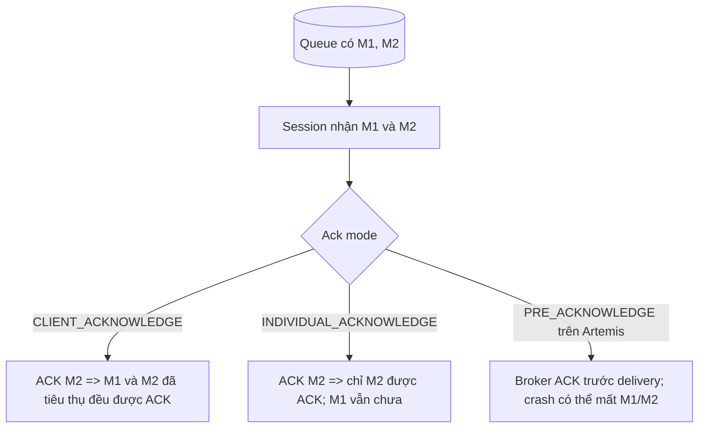
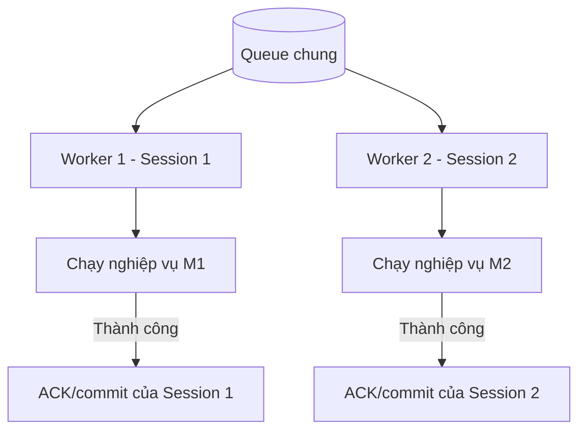

# Các chế độ xác nhận mở rộng của provider và tính di động của mã

> **Chương:** Xác nhận và giao dịch  
> **Phạm vi:** Java/JMS với Apache ActiveMQ Classic và Apache ActiveMQ Artemis; nhấn mạnh các chế độ xác nhận **ngoài chuẩn JMS** và hậu quả khi thay client, broker hoặc runtime.  
> **Mục tiêu:** Biết khi nào dùng `INDIVIDUAL_ACKNOWLEDGE`, hiểu rủi ro của Artemis `PRE_ACKNOWLEDGE`, phân biệt tối ưu ACK với ACK mode, và thiết kế ứng dụng có khả năng chuyển provider mà không âm thầm thay đổi bảo đảm giao message.

## 1. Vì sao cần ACK mode mở rộng?

Giả sử consumer lấy hai sự kiện `M1` và `M2` từ cùng một queue. Ứng dụng xác thực `M2` nhanh, còn `M1` phải gọi một API bên ngoài chậm. Muốn xác nhận riêng `M2` nhưng để `M1` có thể được giao lại khi lỗi, ta dễ viết:

```java
Message m1 = consumer.receive(5_000);
Message m2 = consumer.receive(5_000);

// Xử lý M2 thành công; M1 vẫn đang chờ kết quả.
m2.acknowledge();
```

**Điểm mấu chốt:** nếu session dùng `Session.CLIENT_ACKNOWLEDGE` chuẩn, lời gọi `m2.acknowledge()` xác nhận **mọi message đã được session tiêu thụ**, gồm cả `M1`. Việc ACK “trên object M2” **không có nghĩa ACK riêng M2**.

ActiveMQ Classic và Artemis cung cấp một phần mở rộng tên giống nhau là `INDIVIDUAL_ACKNOWLEDGE` để giải quyết nhu cầu xác nhận riêng từng message. Artemis còn có `PRE_ACKNOWLEDGE`: broker xác nhận **trước khi** giao message, tối ưu chi phí ACK với cái giá có thể mất message khi consumer hoặc mạng lỗi.

Đây là quyết định về **delivery semantics**, không chỉ là một hằng số `int` để điền vào `createSession(...)`.



## 2. Ranh giới giữa chuẩn JMS và phần mở rộng

Chuẩn JMS/Jakarta Messaging quy định các chế độ cơ bản cho session không giao dịch và hành vi commit của session giao dịch:

| Chế độ / cơ chế | API chuẩn | Khi nào message được xác nhận? | Phạm vi và lưu ý |
| --- | --- | --- | --- |
| `Session.AUTO_ACKNOWLEDGE` | Có | Sau `receive()` thành công hoặc listener trả về thành công theo JMS | Với xử lý nghiệp vụ **sau** synchronous `receive()`, ACK có thể xảy ra **trước** khi DB commit |
| `Session.CLIENT_ACKNOWLEDGE` | Có | Khi gọi `Message.acknowledge()` | **Toàn bộ message đã được session tiêu thụ**, kể cả qua nhiều consumer trong cùng session |
| `Session.DUPS_OK_ACKNOWLEDGE` | Có | Provider ACK **trì hoãn/lazy** | Có thể thấy nhiều bản giao trùng hơn khi lỗi; không dành cho logic không chịu được duplicate |
| `Session.SESSION_TRANSACTED` hoặc `createSession(true, ...)` | Có | `session.commit()` xác nhận phần nhận trong transaction; `rollback()` hoàn lại | Transaction là một cơ chế riêng; không có ACK riêng từng message |
| `INDIVIDUAL_ACKNOWLEDGE` | **Không** | Gọi `message.acknowledge()` đối với **message đó** | Extension của Classic và Artemis, nhưng **hằng số và triển khai khác nhau** |
| `PRE_ACKNOWLEDGE` | **Không** | Artemis broker ACK **trước delivery** tới client | Có thể mất message sau ACK nhưng trước khi handler chạy; mất ý nghĩa transaction đối với phần nhận |

**Phân biệt:** `SESSION_TRANSACTED` là giá trị/session mode tiêu chuẩn, không phải “chế độ ACK mở rộng”. Khi `createSession(true, acknowledgeMode)`, đối số `acknowledgeMode` bị bỏ qua theo hợp đồng JMS trong Java SE; giao dịch local điều khiển việc xác nhận. Không truyền extension mode vào session giao dịch rồi kỳ vọng ACK từng message.

### 2.1. ACK có nghĩa gì và không có nghĩa gì?

ACK là kết quả giữa **consumer/client provider và broker** về việc delivery đã được chấp nhận theo chế độ đang dùng. ACK **không** tự chứng minh:

- Database nghiệp vụ đã commit.
- API downstream đã xử lý thành công.
- Producer không thể gửi trùng cùng business event.
- Consumer sẽ không bao giờ nhận lại một message nếu broker/client lỗi đúng lúc xác nhận.

Ví dụ: consumer đã commit DB nhưng connection đứt trước khi broker ghi nhận ACK. Message có thể được giao lại; vì vậy với nghiệp vụ quan trọng cần **idempotency theo business event ID**, ngoài việc chọn ACK mode.

### 2.2. Tính di động của API khác tính di động của semantics

Cùng interface `javax.jms.Session`/`jakarta.jms.Session` có phương thức nhận `int acknowledgeMode`, nhưng chuẩn chỉ định nghĩa các giá trị chuẩn. Một giá trị mở rộng có thể:

1. Được provider A chấp nhận.
2. Bị provider B từ chối bằng `JMSException` hoặc lỗi tạo session.
3. Có tên cùng ý nghĩa nhưng **giá trị số khác** hoặc chỉ có trong client artifact riêng.
4. Không được hỗ trợ trong Jakarta EE managed connection/MDB, dù Java SE client sử dụng được.

Do đó **“code compile được vì tham số là int” không chứng minh nó portable**.

## 3. `INDIVIDUAL_ACKNOWLEDGE`: giải quyết bài toán ACK riêng từng message

### 3.1. Classic và Artemis cung cấp hằng số khác nhau

| Provider/client | Hằng số phải dùng | Ý nghĩa |
| --- | --- | --- |
| ActiveMQ **Classic** 5.x (`javax.jms`) | `org.apache.activemq.ActiveMQSession.INDIVIDUAL_ACKNOWLEDGE` | ACK một `Message` được gọi |
| ActiveMQ **Artemis** JMS client (`javax.jms` hoặc client Jakarta phù hợp) | `org.apache.activemq.artemis.api.jms.ActiveMQJMSConstants.INDIVIDUAL_ACKNOWLEDGE` | ACK một `Message` được gọi |
| JMS chuẩn, độc lập provider | **Không có** `Session.INDIVIDUAL_ACKNOWLEDGE` | Dùng thiết kế portable khác |

Trong API công khai tương ứng, Classic dùng **giá trị 4**, Artemis dùng **giá trị 101**. Hai giá trị này là **chi tiết provider**, không phải mã số chuẩn JMS. **Không hard-code `4` hay `101` trong module nghiệp vụ**; import hằng số do đúng client jar cung cấp.

Ví dụ Java SE (Classic 5.x):

```java
import javax.jms.Connection;
import javax.jms.Session;
import org.apache.activemq.ActiveMQConnectionFactory;
import org.apache.activemq.ActiveMQSession;

ActiveMQConnectionFactory factory =
        new ActiveMQConnectionFactory("tcp://localhost:61616");

try (Connection connection = factory.createConnection()) {
    Session session = connection.createSession(
            false, ActiveMQSession.INDIVIDUAL_ACKNOWLEDGE);
    // ... tạo consumer, gọi connection.start(), receive(),
    // rồi acknowledge() trên từng message đã xử lý thành công.
}
```

Ví dụ Java SE (Artemis Core client qua JMS):

```java
import javax.jms.Connection;
import javax.jms.Session;
import org.apache.activemq.artemis.api.jms.ActiveMQJMSConstants;
import org.apache.activemq.artemis.jms.client.ActiveMQConnectionFactory;

ActiveMQConnectionFactory factory =
        new ActiveMQConnectionFactory("tcp://localhost:61616");

try (Connection connection = factory.createConnection()) {
    Session session = connection.createSession(
            false, ActiveMQJMSConstants.INDIVIDUAL_ACKNOWLEDGE);
    // ... nhận message và gọi message.acknowledge() riêng.
}
```

Lưu ý tên `ActiveMQConnectionFactory` xuất hiện ở cả hai sản phẩm nhưng **full package name khác nhau**. Classic client nói **OpenWire**; Artemis JMS client nói **Artemis Core**. Dùng Classic client kết nối vào Artemis qua OpenWire không đồng nghĩa đó là Artemis JMS provider, và phải kiểm thử đặc tính extension trong tổ hợp thực tế.

### 3.2. Vì sao khác `CLIENT_ACKNOWLEDGE`?

Giả sử một session nhận lần lượt:

```text
t0: receive() -> M1 (chưa xử lý xong)
t1: receive() -> M2 (xử lý xong)
t2: M2.acknowledge()
t3: session.recover() hoặc consumer mất connection
```

| Chế độ | Sau `M2.acknowledge()` | Message có thể được giao lại ở `t3` |
| --- | --- | --- |
| `CLIENT_ACKNOWLEDGE` | `M1` và `M2` đều được ACK theo session | Không còn M1/M2 do ACK này, giả sử ACK đã đến broker |
| `INDIVIDUAL_ACKNOWLEDGE` | Chỉ `M2` được ACK | `M1` có thể redeliver |
| `AUTO_ACKNOWLEDGE` | Hai lần `receive()` thành công thường đã ACK theo chế độ auto | Không dùng được `M2.acknowledge()` để trì hoãn ACK như trên |
| Session transacted | `acknowledge()` không dùng thay commit | `rollback` có thể giao lại các message đã nhận trong transaction |

**Không nên ngộ nhận** rằng ở `CLIENT_ACKNOWLEDGE` chỉ có một consumer thì ACK sẽ riêng từng message: phạm vi vẫn là **cả session**. Một session có nhiều consumer thì ACK trên message của consumer B cũng có thể ACK message đã tiêu thụ bởi consumer A trong session đó.

### 3.3. Hạn chế khi xử lý bất đồng bộ

INDIVIDUAL ACK hữu ích khi xử lý không hoàn tất theo thứ tự nhận, nhưng vẫn cần tôn trọng JMS threading:

- `Session`/`JMSContext` không phải vùng trạng thái dùng đồng thời tùy ý bởi nhiều worker thread.
- Không phát tán `Message` rồi cho nhiều worker gọi `message.acknowledge()` trên cùng session mà không kiểm tra contract threading của provider; cách này khó khôi phục khi worker chạy lệch tốc độ.
- Ưu tiên **mỗi worker một session/consumer**, xử lý và ACK trong cùng luồng. Chỉ cân nhắc extension khi thật sự cần nhiều message inflight với ACK riêng và đã kiểm thử mô hình đó.
- Nhiều message chưa ACK giữ tài nguyên/broker delivery state; cần giới hạn inflight, timeout, giám sát redelivery và backpressure.

Cả Classic và Artemis cho phép individual ACK trong Java SE nhưng không biến phương thức `Message.acknowledge()` thành transaction DB. Một lỗi sau DB commit và trước ACK vẫn có khả năng redelivery.

## 4. Lab kiểm chứng: ACK message thứ hai, recovery message thứ nhất

Bài lab dưới dùng **một queue tạm, một connection, một session, một thread**. Tập message gồm `M1` và `M2`. Sau khi ACK `M2`, gọi `session.recover()` và so sánh kết quả giữa chế độ chuẩn với extension.

### 4.1. Dependency Maven

Chọn **một** client phụ thuộc vào broker đang kiểm thử. Ví dụ Classic 5.18.x:

```xml
<dependency>
    <groupId>org.apache.activemq</groupId>
    <artifactId>activemq-client</artifactId>
    <version>5.18.3</version>
</dependency>
```

Hoặc ví dụ Artemis 2.50.0, namespace `javax.jms`:

```xml
<dependency>
    <groupId>org.apache.artemis</groupId>
    <artifactId>artemis-jms-client</artifactId>
    <version>2.50.0</version>
</dependency>
```

Kể từ Artemis 2.50.0, Maven `groupId` của artifact Artemis chính thức là `org.apache.artemis`; các phiên bản trước cần đối chiếu groupId theo release. Hai nhóm dependency trên dùng cho **hai phương án build riêng**; tránh nhầm class factory/namespace. Với Classic 6.x hoặc Artemis Jakarta client, phải dùng bộ `jakarta.jms` tương ứng, không trộn `javax` và `jakarta`.

### 4.2. Phần kiểm chứng chỉ dùng interface `javax.jms`

Tạo class `AckScopeProbe`:

```java
import javax.jms.Connection;
import javax.jms.ConnectionFactory;
import javax.jms.Message;
import javax.jms.MessageConsumer;
import javax.jms.MessageProducer;
import javax.jms.Session;
import javax.jms.TemporaryQueue;
import javax.jms.TextMessage;

public final class AckScopeProbe {
    private static void require(boolean ok, String reason) {
        if (!ok) throw new IllegalStateException(reason);
    }

    private static String body(Message m) throws Exception {
        require(m instanceof TextMessage,
                "Expected TextMessage; got " + m);
        return ((TextMessage) m).getText();
    }

    public static void verify(ConnectionFactory factory,
                              int ackMode,
                              boolean expectIndividual) throws Exception {

        try (Connection connection = factory.createConnection()) {
            Session session = connection.createSession(false, ackMode);
            require(session.getAcknowledgeMode() == ackMode,
                    "Provider did not retain requested mode");

            TemporaryQueue queue = session.createTemporaryQueue();
            MessageProducer producer = session.createProducer(queue);
            MessageConsumer consumer = session.createConsumer(queue);

            producer.send(session.createTextMessage("M1"));
            producer.send(session.createTextMessage("M2"));
            connection.start();

            Message m1 = consumer.receive(5_000);
            Message m2 = consumer.receive(5_000);
            require(m1 != null && "M1".equals(body(m1)), "Missing M1");
            require(m2 != null && "M2".equals(body(m2)), "Missing M2");

            // Cùng lời gọi, nhưng scope ACK phụ thuộc session mode.
            m2.acknowledge();

            // recover() chỉ áp dụng cho session KHÔNG transacted.
            // Delivery chưa ACK có thể được giao lại.
            session.recover();
            Message redelivered = consumer.receive(5_000);

            if (expectIndividual) {
                require(redelivered != null
                        && "M1".equals(body(redelivered)),
                        "Individual ACK must leave M1 unacknowledged");
                redelivered.acknowledge(); // Dọn M1 sau khi kiểm chứng.
                require(consumer.receive(500) == null,
                        "Unexpected message after acknowledging M1");
                System.out.println("PASS: INDIVIDUAL_ACKNOWLEDGE");
            } else {
                require(redelivered == null,
                        "CLIENT_ACKNOWLEDGE should ack M1 and M2");
                System.out.println("PASS: CLIENT_ACKNOWLEDGE");
            }
        }
    }
}
```

**Chạy với ActiveMQ Classic** (class main riêng, client dependency Classic):

```java
import javax.jms.Session;
import org.apache.activemq.ActiveMQConnectionFactory;
import org.apache.activemq.ActiveMQSession;

public final class ClassicAckDemo {
    public static void main(String[] args) throws Exception {
        ActiveMQConnectionFactory factory =
                new ActiveMQConnectionFactory("tcp://localhost:61616");

        AckScopeProbe.verify(
                factory, Session.CLIENT_ACKNOWLEDGE, false);
        AckScopeProbe.verify(
                factory, ActiveMQSession.INDIVIDUAL_ACKNOWLEDGE, true);
    }
}
```

**Chạy với ActiveMQ Artemis** (class main riêng, client dependency Artemis):

```java
import javax.jms.Session;
import org.apache.activemq.artemis.api.jms.ActiveMQJMSConstants;
import org.apache.activemq.artemis.jms.client.ActiveMQConnectionFactory;

public final class ArtemisAckDemo {
    public static void main(String[] args) throws Exception {
        ActiveMQConnectionFactory factory =
                new ActiveMQConnectionFactory("tcp://localhost:61616");

        AckScopeProbe.verify(
                factory, Session.CLIENT_ACKNOWLEDGE, false);
        AckScopeProbe.verify(
                factory,
                ActiveMQJMSConstants.INDIVIDUAL_ACKNOWLEDGE,
                true);
    }
}
```

**Điều kiện lab:** chạy broker phù hợp ở cổng ví dụ; cho phép tạo temporary queue, send/consume; không có consumer khác trên queue tạm. `Session.recover()` sẽ khởi động lại quá trình delivery các message chưa được ACK; message redeliver có thể có `JMSRedelivered=true` nhưng thứ tự redelivery **không được chuẩn JMS bảo đảm tổng quát**. Trong lab chỉ còn M1 chưa ACK nên kỳ vọng cụ thể.

**Điểm kiểm chứng:** với `CLIENT_ACKNOWLEDGE`, sau ACK trên M2 không còn message để recover; với `INDIVIDUAL_ACKNOWLEDGE`, M1 xuất hiện trở lại. Không dùng `TemporaryQueue` để kiểm tra mất broker/đứt kết nối qua hai lần khởi động: queue này bị xóa khi connection sở hữu nó đóng.

### 4.3. Vì sao không dùng transaction cho bài test này?

Nếu đặt `createSession(true, Session.SESSION_TRANSACTED)`, `Message.acknowledge()` không quyết định kết quả; `commit()`/`rollback()` mới là ranh giới. Vì vậy lab cố ý chọn **non-transacted** để cô lập sự khác biệt của ACK mode.

Nếu bài toán là “chỉ xác nhận sau khi xử lý và gửi message đầu ra JMS cùng một transaction”, giải pháp portable thường là **transacted session**:

```java
Session session = connection.createSession(
        true, Session.SESSION_TRANSACTED);

try {
    Message received = consumer.receive(5_000);
    if (received != null) {
        // Xử lý và gửi message đầu ra qua chính session nếu cần.
        session.commit();
    }
} catch (Exception failure) {
    session.rollback();
    throw failure;
}
```

Các biến `consumer` và `connection` trong fragment được tạo trong cùng session/connection trước đó. Local JMS transaction **không tự bao gồm database**. Nếu có hiệu ứng nghiệp vụ ngoài JMS, phải thiết kế idempotency/outbox/inbox hoặc cơ chế giao dịch phân tán phù hợp.

## 5. Artemis `PRE_ACKNOWLEDGE`: khi thừa nhận có thể mất message

Artemis hỗ trợ một chế độ riêng tên `PRE_ACKNOWLEDGE`. **Broker xác nhận message trước khi giao tới consumer**. Đổi lại:

- Giảm lượng ACK đi ngược từ consumer và chi phí liên quan.
- Nếu node, mạng hoặc consumer lỗi sau khi broker đã ACK nhưng **trước khi ứng dụng xử lý thành công**, message có thể **mất vĩnh viễn đối với queue đó**.
- Không còn đảm bảo transaction cho phần message đã tiêu thụ: **rollback không thể hoàn tác ACK đã xảy ra trên broker**.

Dòng thời gian:

```text
                 PRE_ACKNOWLEDGE
Broker:  chọn M --> ACK M ngay --> gửi M -------> Consumer
                       |
                       +--- M không còn là backlog chờ xử lý

Lỗi:         ACK M xong --X mạng/consumer crash
Hậu quả:     consumer chưa xử lý M, nhưng broker không tự redeliver M
```

### 5.1. Ví dụ khai báo theo API

Với Artemis JMS client:

```java
import javax.jms.Connection;
import javax.jms.Session;
import org.apache.activemq.artemis.api.jms.ActiveMQJMSConstants;
import org.apache.activemq.artemis.jms.client.ActiveMQConnectionFactory;

ActiveMQConnectionFactory factory =
        new ActiveMQConnectionFactory("tcp://localhost:61616");

try (Connection connection = factory.createConnection()) {
    Session session = connection.createSession(
            false, ActiveMQJMSConstants.PRE_ACKNOWLEDGE);
    // ... tạo consumer và gọi connection.start().
    // Broker xác nhận trước khi delivery tới consumer.
}
```

Artemis cũng cho phép cấu hình ở URL client:

```text
tcp://localhost:61616?preAcknowledge=true
```

**Tuyệt đối không bật `preAcknowledge=true` chung cho một factory đang phục vụ luồng nghiệp vụ cần transaction/at-least-once.** Một thiết lập transport/provider có thể ảnh hưởng nhiều session dùng cùng factory, dễ làm mất các bảo đảm đang được kỳ vọng.

### 5.2. Kịch bản lab để thấy nguy cơ mất message

Tạo **queue cố định, bền vững** dùng riêng cho lab, ví dụ `lab.preack.loss`. Không dùng temporary queue vì nó bị xóa khi connection đóng.

1. Producer gửi `M1` persistent tới queue; xác nhận broker đã lưu message.
2. Consumer Artemis dùng `PRE_ACKNOWLEDGE` nhận `M1`.
3. Giả lập handler thất bại **sau khi nhận nhưng trước khi ghi DB** (không làm trên queue production).
4. Đóng consumer và mở consumer chuẩn mới để kiểm tra backlog.
5. Message `M1` **không được broker tự giao lại chỉ vì handler thất bại**, bởi nó đã được ACK trước delivery.

Không cần cố tình giết broker để chứng minh logic: failure của handler sau receive đã đủ chỉ ra **không có cơ chế retry bằng rollback/ACK thông thường**.

**Trường hợp nên cân nhắc:** feed giá liên tục, chỉ cần giá mới nhất và có nguồn cập nhật lại; bản tin telemetry mà mất vài mẫu là chấp nhận được. **Trường hợp không phù hợp:** thanh toán, hóa đơn, đặt hàng, xuất kho, tác vụ không thể tự tái tạo. JMS `PERSISTENT` cũng không cứu được một message mà broker đã ACK/xóa khỏi pending delivery.

### 5.3. Không thể suy ra `PRE_ACKNOWLEDGE` là tính năng chung của Classic

Classic có tối ưu acknowledgment/dispatch, nhưng **không có nghĩa Classic JMS client cung cấp đúng chế độ `PRE_ACKNOWLEDGE` của Artemis**. Đừng thay tên hằng số hoặc sửa giá trị số cho phù hợp compile. Nếu dự án thật sự cần chấp nhận loss để giảm độ trễ, hãy mô tả yêu cầu thành policy nghiệp vụ và đánh giá giải pháp được **provider đang dùng** hỗ trợ.

## 6. Tối ưu ACK và batching khác với ACK mode mới

Nhiều tùy chọn có chữ “acknowledge” nhưng không tạo ra bảo đảm semantics giống `INDIVIDUAL_ACKNOWLEDGE` hoặc `PRE_ACKNOWLEDGE`.

### 6.1. Classic `optimizeAcknowledge`

ActiveMQ Classic có tùy chọn tối ưu ACK bằng **gộp nhiều acknowledgment** để giảm traffic/overhead. Ví dụ theo tài liệu Classic:

```java
import org.apache.activemq.ActiveMQConnectionFactory;

ActiveMQConnectionFactory factory =
        new ActiveMQConnectionFactory(
                "tcp://localhost:61616?jms.optimizeAcknowledge=true");
```

Hoặc:

```java
factory.setOptimizeAcknowledge(true);
```

Các tham số Classic liên quan gồm `optimizeAcknowledgeTimeOut` và `optimizedAckScheduledAckInterval`, tùy phiên bản. Chúng giúp điều chỉnh thời điểm flush ACK, **không làm `CLIENT_ACKNOWLEDGE` bỗng nhiên ACK riêng từng message**.

Classic cảnh báo rằng tối ưu ACK có thể phát sinh vấn đề khi tự ACK ở thời điểm reconnect. Vì vậy:

- Chỉ bật sau benchmark và chaos test phù hợp.
- Đo duplicate/redelivery, unacknowledged/inflight, latency, throughput và reconnect.
- Không xem tùy chọn này như một bảo đảm tăng độ an toàn; thường là **đánh đổi throughput/latency với trạng thái ACK đang chờ**.

### 6.2. `DUPS_OK_ACKNOWLEDGE` là mode chuẩn, không phải extension

`DUPS_OK_ACKNOWLEDGE` cho phép provider ACK theo cách trì hoãn, nhằm giảm overhead. Nó thuộc **chuẩn JMS**, nên portable hơn một setting chuyên biệt Classic.

Tuy nhiên “DUPS_OK” có nghĩa ứng dụng **chấp nhận khả năng redelivery trùng**; nó không có nghĩa “bỏ ACK trước delivery” như PRE_ACK và cũng không cho lập trình viên ACK riêng M1/M2 theo ý muốn. Không dựa vào `DUPS_OK_ACKNOWLEDGE` để giải quyết case xử lý lệch thứ tự.

### 6.3. Prefetch, consumer window và ACK batching

| Khái niệm | Ảnh hưởng trực tiếp | Có thay đổi phạm vi `Message.acknowledge()` không? |
| --- | --- | --- |
| Classic `consumer.prefetchSize` | Số message có thể dispatch sẵn tới consumer | **Không** |
| Artemis `consumerWindowSize` | Flow control/credit cho message vào client | **Không** |
| Classic `optimizeAcknowledge` | Gộp/thời điểm gửi ACK provider | **Không** |
| JMS `DUPS_OK_ACKNOWLEDGE` | ACK trì hoãn theo chuẩn | Không cho ACK riêng message |
| Provider `INDIVIDUAL_ACKNOWLEDGE` | **Phạm vi ACK của một message** | **Có** |
| Artemis `PRE_ACKNOWLEDGE` | **Thời điểm broker xác nhận trước delivery** | Thay đổi mô hình bảo đảm delivery |

Khi muốn tăng throughput, nên đo từng yếu tố riêng. Giảm prefetch có thể hữu ích khi worker chậm hoặc cần kiểm soát inflight, nhưng không tự tạo exactly-once. Bật batching không thay thế xử lý duplicate trong nghiệp vụ.

## 7. Thiết kế mã có thể chuyển Classic ↔ Artemis hoặc provider khác

### 7.1. Đặt tính di động vào kiến trúc, không vào một hằng số

Dùng hằng số vendor trong lớp hạ tầng được kiểm soát và để module nghiệp vụ chỉ phụ thuộc **interface JMS chuẩn**, với các lựa chọn nghiệp vụ rõ ràng:

```text
BusinessHandler
    |
    v
MessageConsumptionService
    |
    +-- PortableJmsAdapter
    |      Session.CLIENT_ACKNOWLEDGE
    |      Session.SESSION_TRANSACTED
    |
    +-- ClassicJmsAdapter
    |      ActiveMQSession.INDIVIDUAL_ACKNOWLEDGE
    |
    +-- ArtemisJmsAdapter
           ActiveMQJMSConstants.INDIVIDUAL_ACKNOWLEDGE
           ActiveMQJMSConstants.PRE_ACKNOWLEDGE (chỉ khi cho phép loss)
```

Không tự động fallback từ `INDIVIDUAL_ACKNOWLEDGE` sang `CLIENT_ACKNOWLEDGE` nếu business dựa vào ACK riêng message: fallback im lặng sẽ ACK cả những message chưa xử lý.

Một cấu hình ứng dụng nên diễn đạt **yêu cầu semantics**, chẳng hạn:

```yaml
consumer:
  acknowledgment:
    behavior: INDIVIDUAL_AFTER_SUCCESS
  requireProviderSupport: true
```

Đây là **ví dụ thiết kế cấu hình ứng dụng**, không phải một khóa cấu hình sẵn có của ActiveMQ. Khi khởi động, adapter kiểm tra provider phù hợp. Nếu không hỗ trợ, **fail fast** với thông báo rõ ràng hoặc chuyển sang mô hình portable đã được đội ngũ duyệt.

### 7.2. Adapter chỉ giữ hằng số ở tầng provider

Ví dụ interface dùng với cả hai implementation:

```java
import javax.jms.Connection;
import javax.jms.Session;

public interface SessionModeStrategy {
    Session createConsumerSession(Connection connection) throws Exception;
}
```

Provider Classic:

```java
import javax.jms.Connection;
import javax.jms.Session;
import org.apache.activemq.ActiveMQSession;

public final class ClassicIndividualMode
        implements SessionModeStrategy {
    @Override
    public Session createConsumerSession(Connection connection)
            throws Exception {
        return connection.createSession(
                false, ActiveMQSession.INDIVIDUAL_ACKNOWLEDGE);
    }
}
```

Provider Artemis:

```java
import javax.jms.Connection;
import javax.jms.Session;
import org.apache.activemq.artemis.api.jms.ActiveMQJMSConstants;

public final class ArtemisIndividualMode
        implements SessionModeStrategy {
    @Override
    public Session createConsumerSession(Connection connection)
            throws Exception {
        return connection.createSession(
                false, ActiveMQJMSConstants.INDIVIDUAL_ACKNOWLEDGE);
    }
}
```

Với môi trường khác provider, module dành cho provider đó chỉ được build/deploy nếu tương thích. **Không** compile đồng thời hai adapter bắt buộc khi sản phẩm chỉ triển khai một client; có thể đóng gói thành module Maven/Gradle riêng theo provider.

Điều kiện tiên quyết để adapter còn hợp lệ: `Connection` do **đúng provider** tạo ra. Đừng dùng Artemis extension mode trên connection factory của Classic hoặc ngược lại.

### 7.3. Phương án portable thường tốt hơn khi không cần extension

Thay vì một session giữ M1 và M2 inflight rồi ACK lệch thứ tự, tách thành **một session/consumer cho mỗi worker**:



Mỗi worker dùng `Session.CLIENT_ACKNOWLEDGE` hoặc `SESSION_TRANSACTED` chuẩn, không cho một session giữ message đang xử lý bởi nhiều worker độc lập. Nhờ đó cùng một cơ chế chuẩn có thể đáp ứng “M2 hoàn tất trước M1” khi chúng thuộc **hai session khác nhau**.

Trade-off là nhiều session/consumer/connection hơn; cần giới hạn concurrency và quản lý prefetch/consumer window, DB pool. Cấu trúc này thường rõ ràng hơn về ownership và shutdown, thuận tiện dùng Spring JMS listener container hoặc managed runtime.

### 7.4. Chuyển `javax.jms` sang `jakarta.jms` là migration riêng

Classic 5.18.x thường dùng `javax.jms`; Classic 6.x sử dụng `jakarta.jms`. Artemis có artifact riêng cho client JMS và Jakarta. Dù chọn cùng broker, interface `javax.jms.Session` và `jakarta.jms.Session` là **hai kiểu Java khác nhau**.

Do đó kiểm tra đồng thời:

1. Namespace Java/phiên bản API.
2. Client artifact và implementation `ConnectionFactory`.
3. Broker protocol (Classic OpenWire hay Artemis Core/AMQP).
4. Vendor ACK constant và runtime support.
5. Mô hình transaction/managed container.

Không suy từ “đã build thành công với Jakarta” rằng mọi extension về acknowledgment tiếp tục hoạt động y hệt.

## 8. Những môi trường extension có thể không dùng được

### 8.1. Jakarta EE MDB / resource adapter

Artemis tài liệu chính thức lưu ý `INDIVIDUAL_ACKNOWLEDGE` **không được hỗ trợ qua MDB/inbound resource adapter**. MDB được quản lý theo transaction/lifecycle của container, vì vậy không thể thay một hằng số Java SE rồi kỳ vọng callback của MDB cho ACK riêng từng message.

Trong Jakarta EE container, các đối số `createSession(boolean, int)` còn có thể bị container/JTA chi phối; cơ chế chuẩn phù hợp là quản lý transaction của container, không tự bật một ACK mode mở rộng để lách contract.

### 8.2. Spring listener container

Với Spring JMS, cấu hình acknowledgment và transaction còn phụ thuộc container factory, connection/session cache, listener concurrency và transaction manager. Một số API của Spring dùng `sessionAcknowledgeMode` là số nguyên; việc truyền vendor constant chưa đủ để chứng minh:

- Container có chấp nhận mode đó không.
- Mỗi listener dùng session riêng hay chia sẻ.
- Exception trong listener gây ACK/rollback/redelivery theo cách dự kiến.
- Khi Spring quản lý transaction, mode ACK riêng có bị ghi đè không.

Hãy kiểm tra **đúng Spring version và provider**, dùng integration test có lỗi thật. Đối với xử lý đáng tin cậy, ưu tiên session transaction/ack semantics mà framework hỗ trợ rõ ràng.

### 8.3. Đổi protocol không chuyển nguyên semantics

Artemis broker có thể nhận client OpenWire và Artemis Core, nhưng ACK semantics ở phía client vẫn gắn với provider/protocol implementation. `INDIVIDUAL_ACKNOWLEDGE` của Classic client **không** trở thành `ActiveMQJMSConstants.INDIVIDUAL_ACKNOWLEDGE` chỉ vì server là Artemis.

Khi bridge JMS sang AMQP 1.0, STOMP hoặc MQTT, cơ chế settlement/QoS/ack của protocol kia **không tương đương từng trường hợp** với ACK mode JMS mở rộng. Không thiết kế hợp đồng liên ngôn ngữ dựa trên con số hằng số của JMS client.

## 9. Bảng quyết định theo nhu cầu nghiệp vụ

| Yêu cầu | Lựa chọn nên cân nhắc | Vì sao |
| --- | --- | --- |
| Mỗi worker xử lý tuần tự; chỉ ACK sau khi thành công | `CLIENT_ACKNOWLEDGE` với một worker/session, hoặc local transaction | Chuẩn JMS, dễ di chuyển |
| Nhận nhiều message trong **một session** và ACK từng cái ngoài thứ tự | `INDIVIDUAL_ACKNOWLEDGE` nếu provider hỗ trợ và đã kiểm thử | Bảo toàn message chưa ACK khác trong cùng session |
| Phải commit đồng thời việc nhận và gửi message JMS trên cùng session | `SESSION_TRANSACTED` | ACK được quyết định bởi commit/rollback |
| Tối ưu throughput, chịu được duplicate | `DUPS_OK_ACKNOWLEDGE` hoặc benchmark batching theo provider | Chọn trade-off duplicate rõ ràng |
| Dữ liệu cập nhật liên tục, **được phép mất mẫu** và cần giảm chi phí ACK | Artemis `PRE_ACKNOWLEDGE`, có phê duyệt rủi ro | Broker ACK trước delivery, không phù hợp giao dịch quan trọng |
| Payment/order/inventory không được mất tác vụ | Transaction + idempotency + retry/DLQ; không dùng PRE_ACK | Bảo vệ xử lý trước khi ACK |
| Tích hợp đa vendor hoặc cần chuyển broker | Chỉ dùng mode chuẩn ở business layer, adapter cho extension | Giảm phụ thuộc vào vendor-specific behavior |

**Hỏi trước khi bật extension:** “Nếu xử lý nghiệp vụ xong nhưng ACK chưa đến broker, điều gì xảy ra?” và “Nếu broker ACK trước khi xử lý nghiệp vụ, điều gì xảy ra?”. Hai cửa sổ lỗi này quyết định mức độ mất hoặc trùng message.

## 10. Kiểm thử tính di động phải xác nhận hành vi, không chỉ compile

Một phép thử hữu ích chạy **cùng kịch bản** trên Classic client/Classic broker, Artemis client/Artemis broker và tổ hợp cross-product được hỗ trợ:

| Test | Thiết lập | Kết quả mong đợi |
| --- | --- | --- |
| A1 | `CLIENT_ACKNOWLEDGE`, nhận M1/M2, ACK M2, recover | M1 và M2 không được redeliver do ACK này |
| A2 | `INDIVIDUAL_ACKNOWLEDGE`, nhận M1/M2, ACK M2, recover | M1 redeliver; M2 không |
| A3 | `SESSION_TRANSACTED`, nhận M1/M2, rollback | Hai message có thể redeliver, không tính ACK riêng |
| A4 | Provider khác nhận giá trị extension | Khởi tạo thất bại rõ ràng nếu không hỗ trợ; **không fallback âm thầm** |
| A5 | Artemis `PRE_ACKNOWLEDGE`, handler thất bại sau receive | Không có retry dựa vào ACK/rollback thông thường |
| A6 | Classic optimized ACK bật, mô phỏng reconnect | Đo duplicate/inflight/timeout; không giả định giống khi tắt |
| A7 | Consumer crash sau DB commit, trước ACK | Business ID ngăn side effect trùng khi redelivery |
| A8 | 2 worker, 2 session, chuẩn `CLIENT_ACKNOWLEDGE` | ACK của worker 2 không làm ACK message thuộc session 1 |
| A9 | MDB/container với extension | Kiểm tra provider/container từ chối/không hỗ trợ, dùng phương án chuẩn |
| A10 | Kết nối failover, queue có persistence | Kiểm tra mất/trùng message theo cơ chế đã chọn và trạng thái broker thực |

### 10.1. Chứng cứ cần thu thập

- `eventId`/business ID ổn định trên mỗi message.
- `JMSMessageID` và `JMSRedelivered`; `JMSXDeliveryCount` khi provider cung cấp, nhưng không dùng một mình để định danh business event.
- Thời điểm: `receive`, xử lý nghiệp vụ, DB commit, `acknowledge`/`session.commit` và ngắt kết nối.
- Queue metrics: pending, delivering/unacknowledged, redelivery và DLQ.
- Trạng thái session: `getTransacted()` và `getAcknowledgeMode()`.
- Client jar, phiên bản broker, protocol và framework runtime.

Một test không có consumer cạnh tranh nên dùng queue lab riêng; nếu cần kiểm tra qua restart broker, dùng **queue bền vững + persistent message**, không dùng `TemporaryQueue`.

### 10.2. Những lỗi dễ kết luận sai

**“ACK trên M2 thì chỉ M2 được ACK.”** Sai với `CLIENT_ACKNOWLEDGE` chuẩn: scope là cả session.

**“Hai provider cùng có tên INDIVIDUAL_ACKNOWLEDGE nên cùng giá trị số.”** Sai: Classic và Artemis dùng hằng số riêng; dùng import đúng implementation.

**“PRE_ACKNOWLEDGE bảo đảm nhanh hơn mà vẫn an toàn vì gửi persistent.”** Sai: ACK trước delivery cho phép message biến mất trước khi handler hoàn thành.

**“Tăng prefetch đồng nghĩa ACK theo batch.”** Sai: prefetch/consumer window liên quan điều phối và flow control, không quyết định contract phạm vi ACK.

**“Có JMSContext thì gọi `acknowledge()` sẽ ACK riêng message gần nhất.”** Sai: `JMSContext.acknowledge()` trong `CLIENT_ACKNOWLEDGE` xác nhận theo **session**, giống cơ chế chuẩn của `Message.acknowledge()`.

**“Local JMS transaction commit cũng commit luôn DB.”** Sai nếu không có cơ chế giao dịch chung; vẫn cần idempotency hoặc phối hợp transaction phù hợp.

## 11. Checklist khi review một PR đổi ACK mode

- [ ] Mã ghi rõ **semantics mong muốn**: ACK mỗi message, cả session, theo transaction, hay trước delivery.
- [ ] Giá trị mở rộng được tham chiếu bằng **hằng số của provider**, không hard-code `4`/`100`/`101`.
- [ ] Không chuyển ngầm extension sang `CLIENT_ACKNOWLEDGE` nếu nghiệp vụ cần ACK riêng.
- [ ] Một session được sử dụng theo mô hình thread-safe của JMS; không ACK từ nhiều worker tùy ý.
- [ ] Có giới hạn inflight và timeout cho message đang chờ ACK.
- [ ] Nếu dùng `PRE_ACKNOWLEDGE`, nghiệp vụ **chấp nhận mất message** và điều này được ghi rõ trong contract.
- [ ] Nếu có transaction, kiểm tra `createSession(true, ...)` và `commit()/rollback()`; không trộn ACK extension với transaction một cách mơ hồ.
- [ ] Nếu dùng Spring/Jakarta EE container, xác minh container hỗ trợ mode và lifecycle/transaction thực tế.
- [ ] Integration test chạy với đúng provider client/broker/version; có tình huống `recover`, crash, reconnect và redelivery.
- [ ] Theo dõi duplicate/side effect bằng `eventId` và cơ chế idempotency.
- [ ] Tối ưu `optimizeAcknowledge`, prefetch, batching phải có benchmark riêng và không làm thay đổi ngầm ACK semantics.
- [ ] Mọi thay đổi sang provider hoặc namespace `javax.jms`/`jakarta.jms` đều phải chạy lại các test ACK.

## 12. Câu hỏi tự kiểm tra

1. Trong `CLIENT_ACKNOWLEDGE`, session đã nhận M1 rồi M2. Gọi `M2.acknowledge()` có xác nhận M1 không?
2. Vì sao `INDIVIDUAL_ACKNOWLEDGE` là **phần mở rộng provider** dù lời gọi `Message.acknowledge()` vẫn là method của JMS?
3. Nếu một hằng số `INDIVIDUAL_ACKNOWLEDGE` trong Classic có giá trị 4, có nên truyền số 4 vào Artemis JMS session không?
4. Vì sao `PRE_ACKNOWLEDGE` có thể gây mất message ngay cả khi producer gửi `PERSISTENT`?
5. `DUPS_OK_ACKNOWLEDGE` có giúp ACK riêng M2 mà chưa ACK M1 trong cùng session không?
6. Khi một session transacted, lúc nào message đã nhận được xác nhận với broker?
7. Vì sao tối ưu `optimizeAcknowledge` hoặc tăng prefetch không thay thế individual ACK?
8. Bạn có thể thiết kế thế nào để M2 xử lý xong trước M1 mà vẫn sử dụng mode JMS chuẩn?
9. Tại sao chạy đúng trên Java SE client chưa đủ chứng minh `INDIVIDUAL_ACKNOWLEDGE` hoạt động trong MDB?
10. Nếu DB commit thành công nhưng ACK thất bại, biện pháp nghiệp vụ nào vẫn bắt buộc?

**Định hướng trả lời:** (1) có, ACK tất cả message đã tiêu thụ trong session; (2) contract phạm vi ACK do provider mở rộng; (3) không, Artemis có hằng số riêng; (4) broker đã ACK trước delivery, crash xảy ra sau đó; (5) không; (6) `commit`; (7) tối ưu thời điểm/dispatch, không đổi phạm vi; (8) mỗi worker/session riêng với `CLIENT_ACKNOWLEDGE` hoặc transaction; (9) MDB/container có quy tắc khác và Artemis không hỗ trợ extension này qua inbound adapter; (10) idempotency/outbox/inbox hoặc phối hợp transaction phù hợp.

## 13. Tài liệu đối chiếu theo phiên bản

1. [JMS `Session` API (Java EE 7)](https://docs.oracle.com/javaee/7/api/javax/jms/Session.html) — `CLIENT_ACKNOWLEDGE` theo session, `DUPS_OK_ACKNOWLEDGE` và local transaction.
2. [JMS `Connection.createSession` API](https://docs.oracle.com/javaee/7/api/javax/jms/Connection.html) — giá trị hợp lệ theo JMS và khác biệt Java SE/Jakarta EE container.
3. [JMS `JMSContext` API](https://docs.oracle.com/javaee/7/api/javax/jms/JMSContext.html) — `JMSContext.acknowledge()` và phạm vi ACK của Simplified API.
4. [ActiveMQ Classic `ActiveMQSession` Javadoc](https://activemq.apache.org/components/classic/documentation/maven/apidocs/org/apache/activemq/ActiveMQSession.html) — hằng số `INDIVIDUAL_ACKNOWLEDGE`.
5. [ActiveMQ Classic — Optimized Acknowledgement](https://activemq.apache.org/components/classic/documentation/optimized-acknowledgement) — `optimizeAcknowledge` và các lưu ý hiệu năng.
6. [ActiveMQ Classic — Connection Configuration URI](https://activemq.apache.org/components/classic/documentation/connection-configuration-uri) — tùy chọn `optimizeAcknowledge`/timeout.
7. [ActiveMQ Artemis — Extra Acknowledge Modes](https://artemis.apache.org/components/artemis/documentation/latest/pre-acknowledge.html) — `PRE_ACKNOWLEDGE`, `INDIVIDUAL_ACKNOWLEDGE` và hạn chế MDB.
8. [Artemis API — Constant Field Values](https://artemis.apache.org/components/artemis/documentation/javadocs/javadoc-latest/constant-values.html) — xác nhận các giá trị extension `PRE_ACKNOWLEDGE=100` và `INDIVIDUAL_ACKNOWLEDGE=101`.

> **Ghi nhớ:** JMS chuẩn chỉ định nghĩa ACK theo session/transaction, còn `INDIVIDUAL_ACKNOWLEDGE` và `PRE_ACKNOWLEDGE` là lựa chọn riêng của provider. Khi tính di động quan trọng, thiết kế một session cho mỗi đơn vị xử lý hoặc dùng transaction chuẩn; khi buộc phải dùng extension, đặt hằng số trong adapter, kiểm thử failure window và ghi rõ hệ quả **mất message** hoặc **giao trùng**.
