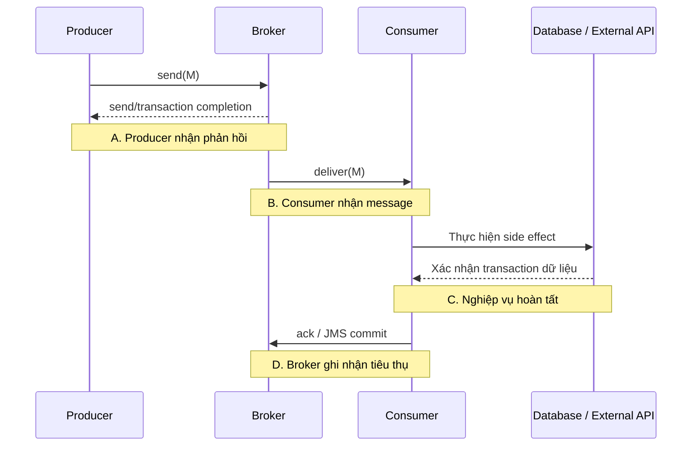
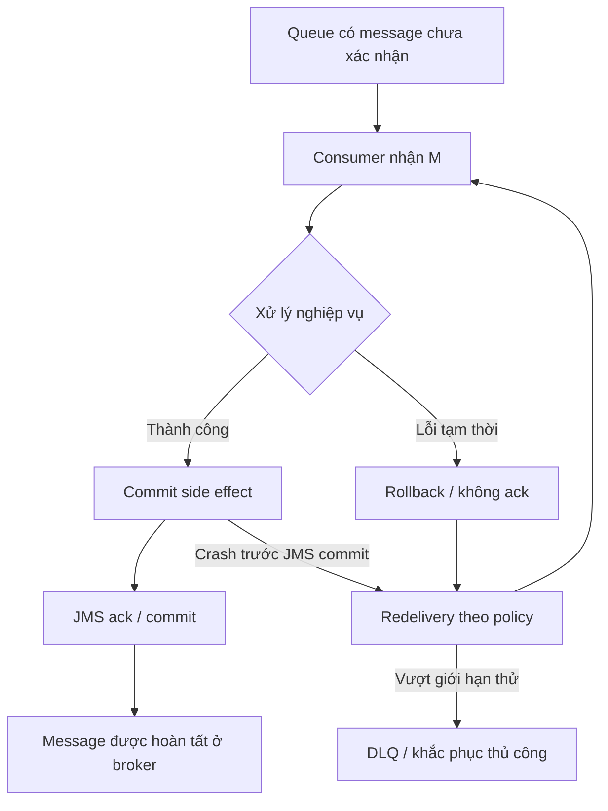

# At-most-once, at-least-once và phạm vi của từng cam kết

> **Chương:** Độ tin cậy  
> **Ngữ cảnh:** Java/JMS với Apache ActiveMQ Classic và ActiveMQ Artemis. Bài này xác định chính xác **đơn vị được bảo đảm**, **điểm kết thúc của một lần giao nhận** và **điều kiện để cam kết còn hiệu lực**. Các ví dụ sử dụng queue công việc; những khác biệt đối với topic subscription được nêu tại vị trí liên quan.

Giả sử một message `PaymentRequested(paymentRequestId=PAY-42)` đã được consumer nhận, cơ sở dữ liệu đã ghi “thanh toán hoàn tất”, nhưng kết nối tới broker mất ngay trước lúc consumer xác nhận. Broker không biết chắc nghiệp vụ đã hoàn tất và có thể **giao lại message**. Nếu ứng dụng xử lý lại một cách mù quáng, khách hàng có thể bị tính tiền hai lần.

Ngược lại, với cách nhận xác nhận quá sớm, broker có thể xem message đã xong trong khi ứng dụng chưa kịp ghi dữ liệu. Process chết tại thời điểm đó làm công việc **không bao giờ được thực hiện**. Hai trường hợp này minh họa đánh đổi trọng tâm giữa **at-most-once** và **at-least-once**.

## 1. Định nghĩa đúng đối tượng được bảo đảm

Với **một message đã được broker chấp nhận và đủ điều kiện phân phối**, các khái niệm dùng trong thiết kế hệ thống thường được hiểu như sau:

| Mô hình | Số lần một công việc/message có thể được giao đến phía xử lý | Đổi lại | Điều **không** được suy ra |
|---|---|---|---|
| **At-most-once** | Không quá một lần trong phạm vi giao nhận được xét; **có thể là 0 lần**. | Có thể mất công việc nếu lỗi xảy ra sau điểm xác nhận nhưng trước xử lý nghiệp vụ. | “Đã gửi thành công” không có nghĩa nghiệp vụ chắc chắn được thực hiện. |
| **At-least-once** | Có thể giao từ một lần trở lên; cần điều kiện lưu giữ, retry, consumer phục hồi và thời gian đủ dài để giao thành công. | Có thể nhận/giao lại **trùng** khi ack/commit chưa được xác nhận. | Không bảo đảm mỗi side effect chỉ chạy một lần; không hứa sẽ retry vô hạn. |
| **Exactly-once ở nghiệp vụ** | Mỗi yêu cầu logic tạo **một kết quả nghiệp vụ** bất chấp redelivery/producer retry. | Cần thiết kế thêm: khóa idempotency, transaction dữ liệu, đối soát hoặc cơ chế phối hợp phù hợp. | Không tự xuất hiện chỉ vì broker dùng `PERSISTENT` hay JMS session có `commit()`. |

**Phạm vi quan trọng:** “Một message” có thể được xác định bằng **JMS message ID của một lần gửi**, trong khi “một yêu cầu nghiệp vụ” phải được xác định bằng **business key**, ví dụ `paymentRequestId`. Nếu producer gửi lại cùng yêu cầu nhưng tạo **message mới có JMSMessageID khác**, broker có thể giao mỗi message đúng theo chính sách của nó, còn nghiệp vụ vẫn bị thực hiện hai lần. Do đó cần chỉ rõ đang cam kết **message delivery**, **processing attempt** hay **business effect**.

### 1.1. Bốn mốc không đồng nghĩa nhau



**A ≠ B ≠ C ≠ D.** `send()` trả về thành công không chứng minh consumer nhận message; consumer nhận message không chứng minh nghiệp vụ đã hoàn tất; nghiệp vụ hoàn tất cũng không chứng minh broker đã nhận được acknowledgment. Sự cố giữa **C và D** là nguồn redelivery điển hình.

### 1.2. Điều kiện ẩn của “at-least-once”

Mệnh đề “message chắc chắn sẽ được giao” chỉ hợp lý khi ghi rõ điều kiện, chẳng hạn:

1. Producer đã gửi/commit thành công theo cơ chế provider và message đã được route đến queue/subscription thích hợp.
2. Message không hết TTL, không bị purge, eviction hoặc chính sách loại bỏ khác; subscription đã tồn tại khi cần.
3. Broker có persistence/HA và tài nguyên đủ để đáp ứng loại lỗi đang xét.
4. Consumer cuối cùng quay lại hoạt động, kết nối được, có quyền nhận và không gặp lỗi vĩnh viễn.
5. Retry/redelivery và cơ chế xử lý message lỗi cho phép công việc được thử lại; khi số lần thử đã hết, message có thể đi **DLQ** thay vì tiếp tục xử lý.

Nếu người dùng nói “at-least-once processing” nhưng policy chỉ thử năm lần rồi chuyển DLQ, nghĩa đúng hơn là **có khả năng giao lại để xử lý**, sau đó **chuyển sang luồng khắc phục**. Không được cam kết ứng dụng nhất định đã thực thi thành công mọi message.

## 2. At-most-once: xác nhận trước khi hoàn tất nghiệp vụ

Mô hình at-most-once phù hợp với công việc **được phép bỏ lỡ**: cập nhật vị trí realtime, sample thống kê không bắt buộc, tín hiệu hiển thị tạm thời. Trong triển khai thực tế, một đường xử lý có thể đạt hành vi “không retry ở tầng consumer” bằng cách broker/provider xem message đã tiêu thụ **trước khi ứng dụng hoàn tất side effect**.

### 2.1. Ví dụ với `AUTO_ACKNOWLEDGE` và synchronous receive

```java
Session session = connection.createSession(
    false, Session.AUTO_ACKNOWLEDGE);
MessageConsumer consumer = session.createConsumer(
    session.createQueue("telemetry.samples"));
connection.start();

Message message = consumer.receive(5000);
if (message != null) {
    // Với synchronous receive trong AUTO_ACKNOWLEDGE,
    // provider xác nhận message khi receive() trả về thành công.
    saveSampleToDatabase(message); // Process có thể crash tại đây.
}
```

`saveSampleToDatabase` là hàm ứng dụng giả định. Nếu process crash **sau khi `receive()` trả về nhưng trước khi lưu dữ liệu**, message có thể đã được provider xác nhận, nên broker không có nghĩa vụ giao lại nó chỉ vì ứng dụng chưa xử lý xong. Đây là một **khoảng mất việc** khi tách nghiệp vụ khỏi acknowledgment.

**Cần phân biệt:** Với asynchronous `MessageListener` và `AUTO_ACKNOWLEDGE`, ngữ nghĩa ack gắn với lúc callback trả về thành công. Đừng khái quát rằng mọi chế độ AUTO_ACK đều xác nhận **trước** khi code trong `onMessage` chạy. Nếu callback bắt lỗi rồi trả về bình thường, provider có thể coi delivery thành công. Muốn lựa chọn chính xác cho từng kiểu receive, phải xét đúng API và thời điểm acknowledgment.

### 2.2. Có phải `NON_PERSISTENT` tương đương at-most-once?

**Không.** `DeliveryMode.NON_PERSISTENT` là chế độ **lưu bền của message khi gửi**: nó không có cùng bảo đảm sống sót qua broker failure như `PERSISTENT`. Còn at-most-once/at-least-once nói về **số lần giao/khả năng giao lại và tác động của điểm ack**. Một message `PERSISTENT` vẫn có thể bị mất về mặt xử lý ứng dụng nếu được ack quá sớm; một message `NON_PERSISTENT` vẫn có thể được redeliver khi broker còn hoạt động.

`DUPS_OK_ACKNOWLEDGE` cũng **không phải at-most-once**: mode này cho phép provider trì hoãn acknowledgment và tăng khả năng giao trùng.

## 3. At-least-once: xác nhận sau khi xử lý hoàn tất

Trong queue nghiệp vụ cần bảo toàn công việc, mô hình thông dụng là **chỉ ack/commit sau khi xử lý xong**. Nếu consumer chết trước điểm đó, broker có thể xem message chưa hoàn tất và giao lại sau recovery.



Lược đồ cho thấy **đảm bảo tốt hơn về việc không bỏ lỡ công việc** phải trả giá bằng **khả năng xử lý trùng**. Broker không thể tự biết một lần gọi HTTP, chuyển khoản hay giao dịch database bên ngoài JMS đã hoàn tất nếu chưa nhận được ack/commit tương ứng.

### 3.1. Phạm vi của `CLIENT_ACKNOWLEDGE` và JMS transaction

`CLIENT_ACKNOWLEDGE` cho phép ứng dụng gọi `message.acknowledge()` sau xử lý. Tuy nhiên một lời gọi `acknowledge()` có thể xác nhận **tất cả message đã tiêu thụ trong cùng `Session`** đến thời điểm đó, không phải chỉ message được gọi. Nếu ứng dụng cần ranh giới lô rõ ràng, có thể dùng **transacted session**:

```java
Session session = connection.createSession(
    true, Session.SESSION_TRANSACTED);
MessageConsumer consumer = session.createConsumer(
    session.createQueue("orders.commands"));
connection.start();

Message m = consumer.receive(10000);
if (m != null) {
    try {
        updateBusinessState(m); // Giả định side effect idempotent.
        session.commit();       // Hoàn tất nhận trong JMS transaction.
    } catch (BusinessUnavailableException retryable) {
        session.rollback();     // Message có thể được giao lại.
    }
}
```

`updateBusinessState` và `BusinessUnavailableException` là thành phần nghiệp vụ minh họa. **Một local JMS transaction không tự bao gồm database hoặc REST call** trong hàm đó. Nếu `session.commit()` ném `JMSException` do mất kết nối, trạng thái commit có thể **chưa xác định**: broker có thể đã hoàn tất nhưng phản hồi bị mất. Không tự mặc định “commit thất bại nên toàn bộ nghiệp vụ chưa chạy”.

### 3.2. Producer cũng có thể tạo duplicate

Giả sử producer gửi `PaymentRequested`:

1. Broker nhận và lưu message M1.
2. Phản hồi tới producer bị mất, `send()` hoặc `commit()` báo lỗi.
3. Producer retry bằng một lệnh gửi mới, tạo M2 mang cùng `paymentRequestId` nhưng **JMSMessageID khác**.
4. Consumer xử lý M1 và M2, mỗi message được ack đúng một lần nhưng khách hàng vẫn bị tính tiền hai lần nếu thiếu idempotency.

Không thể giải quyết loại trùng này chỉ bằng `JMSRedelivered` hoặc `JMSXDeliveryCount`: M2 là **message mới**, có thể mang cờ first delivery. Phải phân biệt bằng khóa yêu cầu nghiệp vụ ổn định, ví dụ `paymentRequestId`.

## 4. Ma trận lỗi: điều gì đã được xác nhận?

Giả sử message gửi `PERSISTENT` tới queue phù hợp, broker có persistence, consumer thực hiện side effect trên database và dùng JMS transaction:

| Điểm lỗi | Trạng thái có thể có ở database | Broker có thể làm gì? | Kết quả đối với ứng dụng |
|---|---|---|---|
| Trước khi `send/commit` của producer hoàn tất | Chưa liên quan. | Message có thể chưa tồn tại **hoặc đã được chấp nhận** nếu mất phản hồi. | Producer retry cần business idempotency. |
| Sau broker accept, trước delivery | Chưa xử lý. | Lưu chờ/recover nếu đáp ứng chính sách và persistence. | Có thể giao sau khi consumer hoạt động. |
| Sau delivery, trước database commit | Chưa hoàn tất. | Nếu JMS chưa ack, có thể redeliver. | Retry thường an toàn nếu DB chưa có side effect. |
| **Sau DB commit, trước JMS commit** | **Đã hoàn tất.** | Có thể redeliver M. | Nguy cơ **double processing**; cần idempotency. |
| Trong `session.commit()`, mất phản hồi | Có thể đã hoàn tất. | JMS transaction **có thể đã commit hoặc chưa**. | Kết quả JMS **UNKNOWN**; cần đối soát và idempotency. |
| Sau JMS commit thành công | Đã hoàn tất nếu DB commit trước đó. | Không còn pending M do lượt nhận đã commit. | Hoàn tất trong điều kiện bình thường; không ngăn producer gửi M2 cùng business key. |
| Handler trả lỗi vĩnh viễn | Có thể chưa xử lý. | Redelivery tới giới hạn; có thể chuyển DLQ theo policy. | At-least-once delivery attempt **không đồng nghĩa** nghiệp vụ thành công. |

**Bài học từ bảng:** một message chỉ có thể được xem là “đã xử lý chắc chắn đúng một lần” trong một phạm vi cụ thể. Với database và broker là **hai tài nguyên giao dịch độc lập**, luôn tồn tại ranh giới có thể gây giao trùng nếu không có coordination hoặc idempotency.

## 5. Cấu hình Classic và Artemis: bảo đảm gồm nhiều lớp

Không có một tùy chọn broker duy nhất `deliveryGuarantee=atLeastOnce`. Phải kết hợp chế độ gửi, tồn tại queue/subscription, persistence, acknowledgment và redelivery/DLQ.

| Tầng | ActiveMQ Classic | ActiveMQ Artemis |
|---|---|---|
| Gửi yêu cầu lưu bền | `MessageProducer.setDeliveryMode(PERSISTENT)`. | Cùng ngữ nghĩa JMS khi dùng client phù hợp. |
| Lưu message trên broker | Persistence adapter ví dụ KahaDB/JDBC; xác minh broker bật persistence và store hoạt động. | Durable queue binding và journal/paging/store được cấu hình, giám sát trạng thái lưu bền. |
| Hoàn tất receive | `acknowledge()` hoặc `Session.commit()` theo mode. | Cùng nguyên tắc JMS; core routing tới queue cũng cần đúng. |
| Redelivery | Classic client có `RedeliveryPolicy`; broker có dead-letter strategy. | Broker thường dùng `address-setting` với `redelivery-delay`, `max-delivery-attempts`, `dead-letter-address`. |
| Topic offline | Cần durable subscription được đăng ký **trước** khi phát event. | Cũng cần durable subscription/queue binding tương ứng đã tồn tại. |
| Điều kiện vượt retry | Policy có thể chuyển message vào DLQ; điều này **không** xác nhận nghiệp vụ đã xử lý. | Tương tự, cần cấu hình và giám sát queue/address DLQ thực tế. |

### 5.1. Classic: giới hạn redelivery từ client

Với **Classic client `org.apache.activemq.ActiveMQConnectionFactory`**, ví dụ:

```java
ActiveMQConnectionFactory factory =
    new ActiveMQConnectionFactory("tcp://127.0.0.1:61616");
factory.getRedeliveryPolicy().setInitialRedeliveryDelay(1000L);
factory.getRedeliveryPolicy().setUseExponentialBackOff(true);
factory.getRedeliveryPolicy().setBackOffMultiplier(2.0);
factory.getRedeliveryPolicy().setMaximumRedeliveries(5);
```

Đây là **API extension của Classic**, không phải method thuộc JMS `ConnectionFactory` chuẩn. `maximumRedeliveries=5` là giới hạn **redelivery** của Classic client, không được đồng nhất trực tiếp với trường `max-delivery-attempts` của Artemis. Cần kiểm tra dead-letter strategy của broker Classic và cách client phát poison acknowledgment khi hết số lần thử.

### 5.2. Artemis: chính sách trên broker

Một **đoạn con** trong `<address-settings>` của `<artemis-instance>/etc/broker.xml`:

```xml
<address-setting match="orders.commands">
    <redelivery-delay>1000</redelivery-delay>
    <redelivery-delay-multiplier>2.0</redelivery-delay-multiplier>
    <max-delivery-attempts>6</max-delivery-attempts>
    <dead-letter-address>DLQ</dead-letter-address>
</address-setting>
```

`DLQ` ở đây là **address đích**; broker còn phải có cơ chế tạo/binding queue nhận dead-letter message phù hợp (cấu hình tĩnh hoặc auto-create được hỗ trợ). Đoạn XML này không phải toàn bộ file broker. Cần kiểm tra pattern address, routing type, chính sách expiry, dead-letter resources và phiên bản Artemis đang chạy.

**Một giới hạn chung:** message `PERSISTENT` có thể vẫn hết TTL, bị purge/evict hoặc chuyển DLQ; consumer vẫn có thể không bao giờ xử lý thành công. Để hứa phục hồi qua mất điện, còn phải đánh giá store/replication, disk, cơ chế failover và các thao tác vận hành, không chỉ các dòng redelivery này.

## 6. Thực hành: at-least-once delivery với kết quả database idempotent

Mục tiêu thí nghiệm là làm xuất hiện **chính xác khoảng lỗi sau database commit và trước JMS commit**:

1. Producer gửi một message `ORDER-1001` vào queue `lab.reliability.orders` với delivery mode `PERSISTENT`.
2. Consumer dùng **transacted JMS session** nhận message, ghi một dòng vào H2 database **có khóa chính theo business ID**.
3. Chế độ `consume-gap` hoàn tất database commit rồi chủ động đóng JMS session **mà không commit JMS receive**, để mô phỏng process chết ở khoảng giữa hai hệ thống.
4. Lần `consume` tiếp theo nhận lại message và thấy khóa đã tồn tại; **không tạo side effect thứ hai**, sau đó commit JMS để hoàn tất nhận.
5. Chạy lại `send` tạo một JMS message khác cho **cùng business ID**; consumer vẫn không tạo thêm dòng database.

Đây là thí nghiệm **đếm hiệu ứng database**, không phải chứng minh exactly-once delivery của broker. Để dễ tái lập, dùng **ActiveMQ Classic 5.x** và `javax.jms`; trạng thái nghiệp vụ lưu ở **H2 file database** nên tiếp tục tồn tại giữa các lần chạy Java.

### 6.1. Maven

Tạo một dự án Maven với hai file `pom.xml` và `src/main/java/lab/DeliveryGuaranteeLab.java`:

```xml
<project xmlns="http://maven.apache.org/POM/4.0.0"
         xmlns:xsi="http://www.w3.org/2001/XMLSchema-instance"
         xsi:schemaLocation="http://maven.apache.org/POM/4.0.0
                             https://maven.apache.org/xsd/maven-4.0.0.xsd">
  <modelVersion>4.0.0</modelVersion>
  <groupId>lab.activemq</groupId>
  <artifactId>delivery-guarantee-lab</artifactId>
  <version>1.0-SNAPSHOT</version>
  <properties>
    <maven.compiler.release>11</maven.compiler.release>
    <project.build.sourceEncoding>UTF-8</project.build.sourceEncoding>
  </properties>
  <dependencies>
    <dependency>
      <groupId>org.apache.activemq</groupId>
      <artifactId>activemq-client</artifactId>
      <version>5.18.4</version>
    </dependency>
    <dependency>
      <groupId>com.h2database</groupId>
      <artifactId>h2</artifactId>
      <version>2.2.224</version>
    </dependency>
  </dependencies>
  <build>
    <plugins>
      <plugin>
        <groupId>org.apache.maven.plugins</groupId>
        <artifactId>maven-compiler-plugin</artifactId>
        <version>3.11.0</version>
      </plugin>
      <plugin>
        <groupId>org.codehaus.mojo</groupId>
        <artifactId>exec-maven-plugin</artifactId>
        <version>3.2.0</version>
      </plugin>
    </plugins>
  </build>
</project>
```

Các phiên bản nêu trên là **ví dụ tái lập** cho mã `javax.jms`, không phải tuyên bố đó là bản mới nhất. Chọn thư viện và JVM tương thích với môi trường khi dùng thực tế; ứng dụng Artemis với Jakarta Messaging cần đổi cả dependency lẫn package `jakarta.jms`.

### 6.2. Consumer và producer Java

```java
package lab;

import java.sql.DriverManager;
import java.sql.PreparedStatement;
import java.sql.ResultSet;
import java.sql.SQLException;
import java.sql.Statement;
import javax.jms.Connection;
import javax.jms.DeliveryMode;
import javax.jms.JMSException;
import javax.jms.Message;
import javax.jms.MessageConsumer;
import javax.jms.MessageProducer;
import javax.jms.Queue;
import javax.jms.Session;
import javax.jms.TextMessage;
import org.apache.activemq.ActiveMQConnectionFactory;

public final class DeliveryGuaranteeLab {
    private static final String BROKER =
            "tcp://127.0.0.1:61616";
    private static final String QUEUE =
            "lab.reliability.orders";
    private static final String BUSINESS_ID = "ORDER-1001";
    // File database tồn tại giữa các lần chạy (cùng working directory).
    private static final String DB =
            "jdbc:h2:file:./reliability-demo-db";

    private DeliveryGuaranteeLab() {
    }

    public static void main(String[] args) throws Exception {
        if (args.length != 1) {
            throw new IllegalArgumentException(
                    "Dùng: send | consume-gap | consume | count");
        }
        initDatabase();
        if ("count".equals(args[0])) {
            printRowCount();
            return;
        }
        String url = System.getenv("ACTIVEMQ_BROKER_URL");
        if (url == null || url.trim().isEmpty()) {
            url = BROKER;
        }
        ActiveMQConnectionFactory factory =
                new ActiveMQConnectionFactory(url);

        switch (args[0]) {
            case "send":
                send(factory);
                break;
            case "consume-gap":
                consume(factory, true);
                break;
            case "consume":
                consume(factory, false);
                break;
            default:
                throw new IllegalArgumentException("Mode không hợp lệ");
        }
    }

    private static void initDatabase() throws SQLException {
        try (java.sql.Connection db =
                    DriverManager.getConnection(DB, "sa", "");
             Statement statement = db.createStatement()) {
            statement.execute(
                "CREATE TABLE IF NOT EXISTS processed_orders (" +
                " business_id VARCHAR(100) PRIMARY KEY," +
                " processed_at TIMESTAMP DEFAULT CURRENT_TIMESTAMP)");
        }
    }

    private static void printRowCount() throws SQLException {
        try (java.sql.Connection db =
                    DriverManager.getConnection(DB, "sa", "");
             Statement statement = db.createStatement();
             ResultSet rows = statement.executeQuery(
                 "SELECT COUNT(*) FROM processed_orders")) {
            rows.next();
            System.out.println("BUSINESS_ROWS=" + rows.getLong(1));
        }
    }

    private static Connection openConnection(
            ActiveMQConnectionFactory factory) throws JMSException {
        String user = System.getenv("ACTIVEMQ_USER");
        String password = System.getenv("ACTIVEMQ_PASSWORD");
        return (user == null || user.trim().isEmpty())
                ? factory.createConnection()
                : factory.createConnection(user, password);
    }

    private static void send(ActiveMQConnectionFactory factory)
            throws JMSException {
        Connection connection = openConnection(factory);
        Session session = null;
        MessageProducer producer = null;
        try {
            session = connection.createSession(
                    true, Session.SESSION_TRANSACTED);
            Queue destination = session.createQueue(QUEUE);
            producer = session.createProducer(destination);
            producer.setDeliveryMode(DeliveryMode.PERSISTENT);
            TextMessage message = session.createTextMessage(
                    "Create an order record");
            message.setStringProperty("businessId", BUSINESS_ID);
            producer.send(message);
            session.commit();
            System.out.println("SENT/COMMITTED businessId=" + BUSINESS_ID
                    + " JMSMessageID=" + message.getJMSMessageID());
        } finally {
            close(producer);
            close(session);
            close(connection);
        }
    }

    private static void consume(
            ActiveMQConnectionFactory factory, boolean simulateGap)
            throws Exception {
        Connection connection = openConnection(factory);
        Session session = null;
        MessageConsumer consumer = null;
        try {
            session = connection.createSession(
                    true, Session.SESSION_TRANSACTED);
            consumer = session.createConsumer(session.createQueue(QUEUE));
            connection.start();

            Message message = consumer.receive(10000);
            if (message == null) {
                System.out.println("NO_MESSAGE in 10 seconds");
                return;
            }
            String businessId = message.getStringProperty("businessId");
            if (businessId == null || businessId.isEmpty()) {
                session.rollback();
                throw new IllegalArgumentException("Missing businessId");
            }
            System.out.println("DELIVERED id="
                    + message.getJMSMessageID()
                    + " redelivered=" + message.getJMSRedelivered());

            boolean inserted;
            try {
                // Database transaction là độc lập với JMS transaction.
                inserted = insertOnce(businessId);
            } catch (SQLException databaseFailure) {
                // Có thể retry; rollback JMS để broker còn cơ hội giao lại.
                try {
                    session.rollback();
                } catch (JMSException rollbackFailure) {
                    databaseFailure.addSuppressed(rollbackFailure);
                }
                throw databaseFailure;
            }
            System.out.println(inserted
                    ? "DB_INSERTED " + businessId
                    : "DB_DUPLICATE_SKIPPED " + businessId);

            if (simulateGap) {
                System.out.println(
                    "SIMULATED_GAP: DB committed, JMS not committed.");
                // Trả về sẽ đóng session còn transaction nhận chưa commit.
                // Broker có thể redeliver trong lần chạy tiếp.
                return;
            }
            try {
                session.commit(); // Xác nhận message sau database effect.
                System.out.println("JMS_COMMITTED " + businessId);
            } catch (JMSException commitFailure) {
                System.err.println(
                    "JMS_COMMIT_UNKNOWN: result may already be committed");
                throw commitFailure;
            }
        } finally {
            close(consumer);
            close(session);
            close(connection);
        }
    }

    // Một effect database có khóa duy nhất theo yêu cầu NGHIỆP VỤ.
    private static boolean insertOnce(String businessId)
            throws SQLException {
        try (java.sql.Connection db =
                    DriverManager.getConnection(DB, "sa", "")) {
            db.setAutoCommit(false);
            try (PreparedStatement insert = db.prepareStatement(
                    "INSERT INTO processed_orders(business_id) VALUES(?)")) {
                insert.setString(1, businessId);
                boolean inserted;
                try {
                    insert.executeUpdate();
                    inserted = true;
                } catch (SQLException duplicateOrFailure) {
                    if (!"23505".equals(duplicateOrFailure.getSQLState())) {
                        throw duplicateOrFailure;
                    }
                    inserted = false; // Khóa chính đã tồn tại.
                }
                if (inserted) {
                    db.commit();
                } else {
                    db.rollback();
                }
                return inserted;
            } catch (SQLException failure) {
                try {
                    db.rollback();
                } catch (SQLException rollbackFailure) {
                    failure.addSuppressed(rollbackFailure);
                }
                throw failure;
            }
        }
    }

    private static void close(MessageProducer item) {
        if (item != null) {
            try { item.close(); } catch (JMSException e) {
                System.err.println("Producer cleanup: " + e);
            }
        }
    }
    private static void close(MessageConsumer item) {
        if (item != null) {
            try { item.close(); } catch (JMSException e) {
                System.err.println("Consumer cleanup: " + e);
            }
        }
    }
    private static void close(Session item) {
        if (item != null) {
            try { item.close(); } catch (JMSException e) {
                System.err.println("Session cleanup: " + e);
            }
        }
    }
    private static void close(Connection item) {
        if (item != null) {
            try { item.close(); } catch (JMSException e) {
                System.err.println("Connection cleanup: " + e);
            }
        }
    }
}
```

### 6.3. Điều gì được bảo đảm trong mã trên?

Mỗi `Session` transacted xử lý **một lượt nhận**, sau đó gọi `commit()` hoặc đóng session chưa commit. Thí nghiệm `consume-gap` không thực sự giết JVM; nó tái tạo đúng **khoảng giao dịch** bằng cách hoàn tất DB commit rồi đóng session với một lượt nhận JMS chưa được commit. Khi session/connection đóng, broker có thể giao lại message. Đây là thí nghiệm an toàn hơn kill process và đủ để quan sát nguy cơ duplicate.

**Khóa chính `processed_orders.business_id` là điểm chống trùng.** Một message nhận lại có cùng business ID, kể cả khi `JMSMessageID` khác do producer retry, đều không thêm được dòng thứ hai. Cách này chỉ bảo vệ **effect nằm trong transaction H2**; nếu hàm còn gọi một dịch vụ thanh toán bên ngoài sau khi ghi database mà không có idempotency ở dịch vụ đó, nó chưa giải quyết được exactly-once payment.

Lỗi `SQLException` và lỗi JMS có thể xảy ra trong các giai đoạn khác nhau. Mã ghi `JMS_COMMIT_UNKNOWN` khi commit mất phản hồi; không gọi lại `commit()` hay tuyên bố broker đã rollback. Với database, nếu `db.commit()` gặp lỗi I/O và outcome chưa rõ, lần giao lại cùng khóa và việc kiểm tra trạng thái trong database là công cụ đối soát, **không phải bằng chứng chưa có effect**.

## 7. Thực hiện và kiểm chứng

Khởi chạy một **ActiveMQ Classic broker riêng cho lab**, có persistence và endpoint OpenWire khớp `ACTIVEMQ_BROKER_URL` (mặc định 61616). Hai lệnh nhận chỉ nên chạy khi không có worker nào khác tiêu thụ queue `lab.reliability.orders`. Nếu có message tồn đọng từ lần thử trước, kết quả thứ tự có thể khác; hãy quan sát queue lab hoặc dùng một business ID/queue lab mới cho phiên thử sạch.

Từ thư mục dự án Maven, thực hiện tuần tự:

**Bước 1 — ghi nhận trạng thái database và gửi một message:**

```bash
mvn -q compile exec:java "-Dexec.mainClass=lab.DeliveryGuaranteeLab" "-Dexec.args=count"
mvn -q compile exec:java "-Dexec.mainClass=lab.DeliveryGuaranteeLab" "-Dexec.args=send"
```

Nếu database/queue mới, số dòng trước khi gửi là `BUSINESS_ROWS=0`. Producer gửi một message `PERSISTENT` và chỉ báo `SENT/COMMITTED` sau `session.commit()` của producer.

**Bước 2 — nhận message, commit database rồi *không* commit JMS:**

```bash
mvn -q compile exec:java "-Dexec.mainClass=lab.DeliveryGuaranteeLab" "-Dexec.args=consume-gap"
mvn -q compile exec:java "-Dexec.mainClass=lab.DeliveryGuaranteeLab" "-Dexec.args=count"
```

Đầu ra điển hình:

```text
DELIVERED id=ID:... redelivered=false
DB_INSERTED ORDER-1001
SIMULATED_GAP: DB committed, JMS not committed.
BUSINESS_ROWS=1
```

**Bước 3 — consumer mới nhận lại message:**

```bash
mvn -q compile exec:java "-Dexec.mainClass=lab.DeliveryGuaranteeLab" "-Dexec.args=consume"
mvn -q compile exec:java "-Dexec.mainClass=lab.DeliveryGuaranteeLab" "-Dexec.args=count"
```

Đầu ra điển hình:

```text
DELIVERED id=ID:... redelivered=true
DB_DUPLICATE_SKIPPED ORDER-1001
JMS_COMMITTED ORDER-1001
BUSINESS_ROWS=1
```

Lần nhận thứ hai có thể mang `JMSRedelivered=true`; trạng thái chính xác còn phụ thuộc provider/broker. Điều quyết định là **business key đã tồn tại, không có thêm effect**, và lượt nhận JMS sau cùng được commit. Không dùng cờ `JMSRedelivered` như nguồn duy nhất của cơ chế chống trùng.

**Bước 4 — producer gửi lại cùng business ID dưới JMS message ID mới:**

```bash
mvn -q compile exec:java "-Dexec.mainClass=lab.DeliveryGuaranteeLab" "-Dexec.args=send"
mvn -q compile exec:java "-Dexec.mainClass=lab.DeliveryGuaranteeLab" "-Dexec.args=consume"
mvn -q compile exec:java "-Dexec.mainClass=lab.DeliveryGuaranteeLab" "-Dexec.args=count"
```

Kết quả vẫn phải là **một dòng trong database** cho `ORDER-1001`. Điều này minh họa trường hợp producer retry tạo **message riêng**: `JMSRedelivered` có thể là `false`, nhưng logic idempotency vẫn xác định được yêu cầu đã được xử lý.

**Kết luận được phép rút ra từ lab:** queue đã có thể giao lại một lượt nhận JMS chưa commit và bảng H2 với business primary key không ghi trùng trong các điều kiện thử. **Chưa được rút ra:** broker hay cơ sở dữ liệu đã đạt exactly-once trong mọi kiểu crash/failover, mọi loại side effect, hoặc trên production.

## 8. Cam kết nào áp dụng cho queue, topic và DLQ?

| Tình huống | Đơn vị nhận được bảo đảm | Giới hạn thiết kế |
|---|---|---|
| **Queue**, một consumer hiện diện | Message thuộc queue được giao cho consumer phù hợp; nhiều consumer thì cạnh tranh xử lý. | Consumer crash sau side effect trước ack có thể khiến message chuyển sang consumer khác. |
| **Topic + non-durable subscriber** | Event được định tuyến đến subscription còn hiện diện. | Subscriber offline có thể bỏ lỡ event, kể cả khi producer gửi `PERSISTENT`. |
| **Topic + durable subscription** | Backlog riêng cho subscription được tạo **trước khi publish** và còn tồn tại. | Ack, TTL, quota và broker recovery vẫn quyết định event còn pending hay không. |
| **Shared durable subscription** khi client/broker hỗ trợ | Một subscription có nhiều consumer chia nhau một luồng message. | Có thể có redelivery đến consumer khác; mỗi service cần backlog độc lập phải có subscription riêng. |
| **DLQ** sau hết retry | Message được chuyển tới nhánh xử lý lỗi theo policy. | **Không tương đương consumer đã thực hiện thành công công việc.** Cần alert, triage và reprocess có idempotency. |

Ở Artemis, routing `ANYCAST`/`MULTICAST` chọn queue nhận message; at-most/at-least-once **không phải một routing type**. Với một address multicast có hai queue subscription, mỗi queue có vị trí ack/backlog riêng. Một subscription đã xử lý xong không có nghĩa subscription còn lại đã xử lý xong.

## 9. Những lựa chọn thường bị gán nhầm là “exactly once”

- **`PERSISTENT`:** tăng bảo đảm lưu giữ message khi broker gặp lỗi, không buộc database và broker commit nguyên tử.
- **JMS local transacted `Session`:** có thể phối hợp các lần gửi/nhận JMS **trong cùng transaction của session**, không tự đưa transaction của JDBC/HTTP vào đó.
- **`JMSXDeliveryCount` hoặc `JMSRedelivered`:** hữu ích để quan sát retry, không phải business deduplication key; producer gửi lại thành message mới không nhất thiết có cờ redelivered.
- **Consumer chỉ có một instance:** vẫn có thể bị crash sau side effect, broker redeliver khi instance khởi động lại.
- **`AUTO_ACKNOWLEDGE`:** giảm quyền điều khiển điểm ack ở một số kiểu receive; không biến nghiệp vụ đang chạy thành atomic.
- **XA/JTA:** có thể phối hợp những resource manager thật sự tham gia transaction phân tán, nhưng không mặc định bao trùm một REST API bên ngoài và phải đánh giá timeout, recovery, khả năng hỗ trợ và chi phí vận hành.
- **Transactional outbox:** giúp gắn cập nhật database và bản ghi event/outbox vào **một DB transaction**, sau đó relay phát message; relay vẫn có thể publish lặp nên consumer cần idempotency/inbox.

### 9.1. Mẫu inbox/idempotency cho hệ thống nhiều worker

Với nhiều consumer cạnh tranh trên queue và cùng truy cập database, cần **một ràng buộc duy nhất mang tính nguyên tử** như:

```sql
CREATE TABLE processed_requests (
    consumer_name VARCHAR(100) NOT NULL,
    business_request_id VARCHAR(100) NOT NULL,
    processed_at TIMESTAMP NOT NULL,
    PRIMARY KEY (consumer_name, business_request_id)
);
```

Nếu mỗi dịch vụ có nghiệp vụ khác nhau đối với cùng một event, sử dụng cặp `consumer_name + business_request_id` thay cho khóa business ID chung toàn hệ thống. Nếu tồn tại side effect database khác, hãy đưa kiểm tra khóa và việc ghi side effect đó vào **cùng DB transaction**, tránh kiểu “kiểm tra tồn tại → xử lý → ghi khóa” tách rời vốn có race condition.

Nếu nghiệp vụ gọi API thanh toán bên ngoài, cần **idempotency key do API hỗ trợ** hoặc một quy trình đối soát trạng thái thanh toán; bảng inbox cục bộ một mình không thể làm cho lệnh HTTP và DB transaction trở thành nguyên tử.

## 10. Vận hành và các tiêu chí kiểm thử bảo đảm

Để đánh giá một tuyên bố “at-least-once” của một pipeline ActiveMQ, đừng chỉ chạy một lần send/receive trong trạng thái bình thường. Nên kiểm tra các khoảng lỗi quan trọng:

| Kịch bản thử | Quan sát mong muốn | Điều cần kết luận |
|---|---|---|
| Consumer chết trước database commit | Message chưa ack có thể được giao lại. | Công việc còn cơ hội hoàn tất khi service phục hồi. |
| Consumer chết **sau** DB commit, trước JMS commit | Message có thể giao lại, DB dedupe. | Side effect không bị nhân đôi. |
| Producer mất phản hồi `send/commit` và retry | Có thể xuất hiện hai JMSMessageID cùng business ID. | Business dedupe theo khóa ổn định, không dựa vào cờ redelivered. |
| Broker restart với message chưa ack | Message persistent được khôi phục trong điều kiện store/config đúng. | Phải đối chiếu journal/store, TTL và trạng thái queue. |
| Consumer xử lý lỗi vĩnh viễn | Retry có giới hạn, rồi DLQ/quarantine theo policy. | Có alert/triage/reprocess, không coi là xử lý thành công. |
| Topic subscriber offline khi publish | Durable subscription nhận backlog phù hợp; non-durable có thể bỏ lỡ. | Phạm vi cam kết phụ thuộc loại subscription đã tạo trước. |
| `commit()` mất phản hồi | Log trạng thái `UNKNOWN` và áp dụng idempotency. | Không suy từ exception rằng broker chắc chắn rollback. |

Những metric tối thiểu cần quan sát gồm **pending/in-flight**, thời gian message nằm chờ, số lần redelivery, số message expired/DLQ, lỗi `send/commit`, duplicate business key và tốc độ xử lý thành công. Nếu DLQ tăng trong khi “tỉ lệ nhận thành công” vẫn cao, hệ thống vẫn có thể đang **mất yêu cầu nghiệp vụ ở nhánh xử lý chính**.

Không dựa vào một lần restart sạch để kết luận hệ thống chịu được mất điện hoặc mất đĩa. Các kiểu lỗi này cần kiểm thử và hạ tầng lưu bền/replication phù hợp với SLA thật.

## 11. Câu hỏi tình huống

**1. Consumer nhận M, ghi DB thành công rồi chết trước ack. Đây là at-most-once hay at-least-once?**  
Ở cấp delivery, một thiết kế **at-least-once có redelivery** có thể giao M lần nữa. Kết quả nghiệp vụ có thể bị lặp nếu thiếu idempotency.

**2. Producer gửi M1 và M2 có cùng `paymentRequestId`, mỗi message chỉ được consumer nhận một lần. Có bảo đảm thanh toán đúng một lần không?**  
Không. M1 và M2 là hai JMS message khác nhau. Business idempotency phải dựa trên `paymentRequestId` ổn định, không dựa trên số lần giao từng JMSMessageID.

**3. Chuyển tất cả message sang `NON_PERSISTENT` có biến pipeline thành at-most-once không?**  
Không. Đây là thuộc tính lưu bền; broker vẫn có thể redeliver message còn tồn tại. Delivery guarantee phải xét điểm ack và retry.

**4. Broker chuyển message sang DLQ sau sáu lần giao. Có đáp ứng yêu cầu “mọi thanh toán đều hoàn tất” không?**  
Chưa. Nó đáp ứng yêu cầu **giữ dấu vết công việc không xử lý được** khi DLQ hoạt động đúng, nhưng nghiệp vụ thanh toán còn pending hoặc thất bại. Cần quy trình khắc phục, đối soát và reprocess.

**5. Dùng transacted JMS session và JDBC local transaction có tự động exactly-once không?**  
Không. Hai commit độc lập tạo khoảng có thể lỗi giữa DB và JMS. Muốn hiệu quả nghiệp vụ một lần, dùng unique business key/idempotent side effect hoặc một cơ chế transaction phối hợp thực sự phù hợp.

**6. Đã bật durable topic subscription sau khi event được phát. Có thể yêu cầu broker giao lại event cũ không?**  
Không mặc định. Subscription phải tồn tại từ trước để có backlog phù hợp; muốn đọc lịch sử cũ theo offset cần thiết kế replay/event store riêng.

## 12. Ghi nhớ về phạm vi cam kết

**At-most-once** ưu tiên tránh thử lại một delivery nhưng chấp nhận có thể mất công việc; **at-least-once** ưu tiên giữ cơ hội xử lý bằng retry/redelivery nhưng chấp nhận duplicate. Cả hai chỉ có nghĩa khi xác định rõ **đơn vị** (message hay business request), **điểm hoàn tất** (broker ack hay side effect) và **điều kiện vận hành** (persistence, TTL, subscription, giới hạn retry, DLQ, khả năng recovery).

Với ActiveMQ Classic và Artemis, một pipeline nghiệp vụ cần tin cậy thường chọn **persistent delivery + ack/transaction sau xử lý + redelivery có kiểm soát + DLQ + business idempotency**. Cam kết ở tầng broker và cam kết ở tầng database/API bên ngoài là **hai phạm vi khác nhau**; thiết kế đúng là kiểm soát được khoảng giao thoa giữa chúng, đặc biệt khi producer retry hoặc `commit()` trả kết quả chưa xác định.
