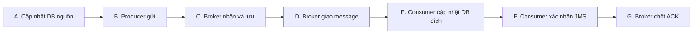
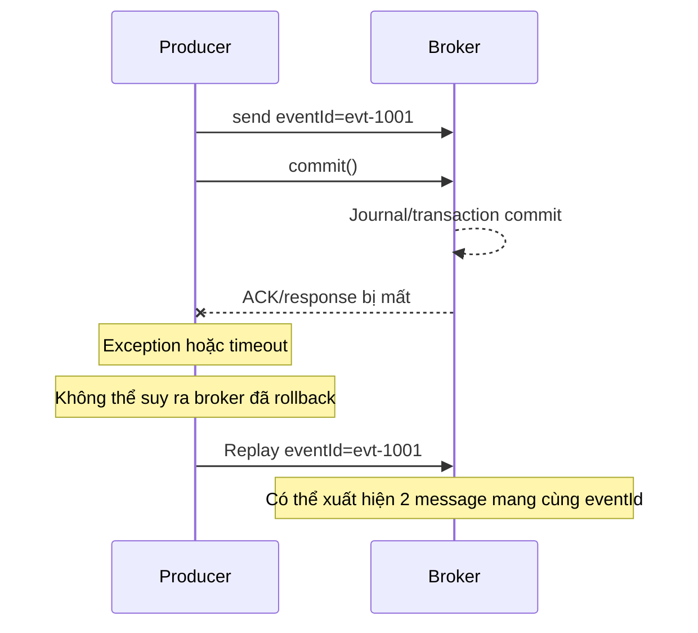
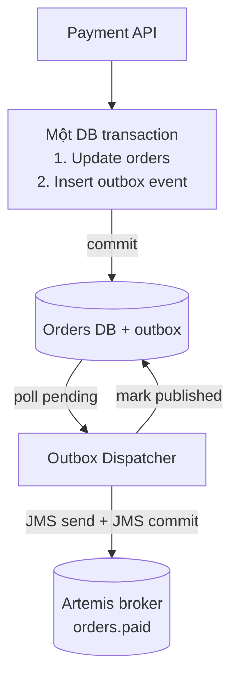

# Phân tích các điểm lỗi giữa gửi, lưu, giao, cập nhật dữ liệu và xác nhận

> **Chương:** Độ tin cậy  
> **Phạm vi:** Luồng producer → Apache ActiveMQ Classic/Artemis → consumer → cơ sở dữ liệu → xác nhận JMS. Bài tập trung vào **các khoảng thời gian lỗi (failure windows)**, trạng thái không chắc chắn sau timeout/crash và biện pháp giữ đúng kết quả nghiệp vụ.

## 1. Một message đi qua những ranh giới nào?

Ví dụ: dịch vụ thanh toán ghi trạng thái `PAID` cho đơn `O-1001` rồi phát sự kiện `OrderPaid` qua queue `orders.paid`. Consumer nhận sự kiện để cập nhật bảng `order_projection` trong một database khác. Hệ thống có thể hỏng ở **bất kỳ khoảng nào** giữa hai thao tác liên tiếp.



Các điểm này có **hợp đồng xác nhận khác nhau**:

- `DB commit` xác nhận thay đổi của **database đó**, không xác nhận một message đã được lưu tại broker.
- Lệnh `send()` trả về không phải lúc nào cũng đồng nghĩa dữ liệu đã được sync xuống thiết bị lưu trữ: còn phụ thuộc chế độ gửi, transaction, provider, thiết lập journal và đường xác nhận.
- `Broker accepted/stored` không có nghĩa consumer đã nhận, cũng không có nghĩa nghiệp vụ đã cập nhật thành công.
- `Consumer receive` chỉ cho biết message được giao tới client; database có thể chưa thay đổi.
- `JMS commit/ack` đánh dấu tiến độ giao trong broker; nó không tự commit database nghiệp vụ ở tiến trình khác.

**Mục tiêu thiết kế:** phân tích mọi ranh giới, giữ được khả năng *retry* và tránh tác dụng nghiệp vụ lặp lại. Không kết luận “exactly once” chỉ vì đang dùng persistent message, transaction hoặc `AUTO_ACKNOWLEDGE`.

## 2. Ma trận failure windows từ đầu đến cuối

| Điểm lỗi | Trạng thái đã có thể xảy ra | Nguy cơ | Cách phục hồi |
| --- | --- | --- | --- |
| **A. DB nguồn chưa commit** | Cập nhật trạng thái và outbox cùng transaction đều chưa chốt | Nếu gửi JMS trước DB commit, consumer có thể thấy event về thay đổi chưa tồn tại | Ghi **business row + outbox** trong một DB transaction; publish sau |
| **B. DB nguồn đã commit, trước gửi** | Business state đã đổi, broker chưa có message | Mất sự kiện nếu process chết và không có nguồn phát lại | Transactional outbox còn row `pending` cho dispatcher gửi sau |
| **C. Broker nhận message, producer chưa nhận xác nhận** | Message **có thể** đã được broker commit | Timeout khiến producer không biết nên retry hay không; retry có thể tạo bản sao | Event ID ổn định, replay và idempotent consumer |
| **D. Broker đã nhận nhưng chưa lưu bền vững theo policy** | Message có thể chỉ ở buffer/cache/journal chưa sync | Broker/host crash có thể làm mất message | Persistent delivery, durable queue, journal sync/HA và kiểm thử thực tế |
| **E. Broker đã lưu, chưa giao** | Message nằm trong queue | Backlog, hết hạn TTL, disk đầy hoặc không có consumer | Theo dõi queue, expiry, paging và tài nguyên |
| **F. Đã giao, DB đích chưa commit** | Consumer giữ message chưa ACK trong transaction | Consumer crash → message được giao lại; chưa có tác dụng DB nếu rollback | Rollback JMS, retry và xử lý lỗi tạm thời |
| **G. DB đích đã commit, JMS chưa ACK/commit** | Tác dụng nghiệp vụ đã xảy ra, broker vẫn có thể coi message chưa hoàn tất | **Redelivery và xử lý trùng** | Ghi marker `processed_event` cùng DB transaction nghiệp vụ |
| **H. JMS ACK trước DB commit** | Broker coi message đã xử lý, DB chưa chắc cập nhật | **Mất tác dụng nghiệp vụ** nếu DB thất bại sau ACK | Đổi thứ tự: DB commit trước, rồi JMS commit/ACK |
| **I. ACK/commit đã xử lý tại broker, phản hồi về client bị mất** | Client không biết trạng thái cuối cùng | Retry hoặc reconnect không rõ nên làm gì | Không suy từ exception rằng thao tác chắc chắn rollback; đối chiếu event ID |
| **J. Message vượt số lần gửi lại** | Message có thể bị đưa vào DLQ theo policy | Luồng nghiệp vụ vẫn chưa hoàn tất dù broker không còn retry queue gốc | Quan sát DLQ, giữ ngữ cảnh lỗi và quy trình xử lý lại |

Ma trận mô tả **khả năng**, không khẳng định một sự cố luôn diễn ra theo đúng một nhánh. Ví dụ broker có thể đã xác nhận producer theo một chính sách durable cụ thể, hoặc đã rollback transaction khi socket chết trước khi commit. Điều quan trọng là biết **phía ứng dụng có bằng chứng gì** để quyết định khôi phục.

## 3. Ba trạng thái phải phân biệt khi producer gửi

Một producer không chỉ có hai trạng thái `success` / `failed`. Sau một lần `send` hoặc `commit`, có thể có:

1. **Thành công đã xác nhận:** API trả về bình thường theo hợp đồng transport/transaction đang dùng. Có thể chuyển trạng thái outbox sang `published`, với điều kiện chấp nhận bảo đảm của provider.
2. **Thất bại được xác nhận trước khi broker chấp nhận:** ví dụ payload bị từ chối vì validation/cấu hình; cần sửa nguyên nhân hoặc đưa vào quy trình lỗi.
3. **Kết quả không xác định:** mất kết nối/timeout đúng lúc broker đang nhận hoặc commit. Producer **không thể chứng minh** message chưa được broker chấp nhận.

Trường hợp thứ ba tạo ra **bài toán xác nhận bị mất**:



Chọn **không retry** sẽ có nguy cơ mất message khi broker thật sự chưa nhận. Chọn **retry** sẽ có nguy cơ duplicate nếu broker đã nhận. Với bài toán cần độ tin cậy, cách thực tế là **at-least-once transport/replay + idempotent business processing**.

### 3.1. `JMSMessageID` không đủ cho dedup nghiệp vụ

`JMSMessageID` do provider sinh cho một lần gửi, và có thể khác khi gửi lại cùng một sự kiện. Thay vào đó, tạo một `eventId` tại **thời điểm phát sinh sự kiện nghiệp vụ**, lưu bền vững và giữ nguyên khi phát lại.

```text
Business event: evt-1001
  Attempt 1 → JMSMessageID=ID:broker:...:101
  Attempt 2 → JMSMessageID=ID:broker:...:102
  Cả hai attempt vẫn mang eventId=evt-1001
```

`JMSXDeliveryCount`, nếu có, hỗ trợ quan sát *redelivery của message trong broker*. Nó không nhận diện hai JMS message **khác nhau** do producer gửi trùng. Vì vậy consumer không nên dùng `JMSMessageID` hoặc `JMSXDeliveryCount` làm khóa duy nhất bảo vệ nghiệp vụ.

## 4. Khép khoảng lỗi giữa DB nguồn và broker bằng transactional outbox

Tình huống sai điển hình:

```text
UPDATE orders SET status='PAID'
DB COMMIT               ← Thành công
process crash           ← Chết trước JMS send
JMS send                ← Chưa chạy
```

Không có cách gọi một lệnh `send` sau `DB COMMIT` để bảo đảm nó luôn diễn ra khi JVM có thể crash. **Transactional outbox** biến yêu cầu gửi message thành dữ liệu có thể phát lại:



Đặc tính cần đạt:

- **Cùng DB transaction:** nếu update trạng thái và insert outbox không cùng commit, vẫn có khoảng mất sự kiện.
- **Nguồn event bền vững:** dispatcher có thể chạy lại sau crash, tiếp tục từ các hàng outbox chưa có `published_at`.
- **Event ID không đổi:** mỗi lần retry gửi cùng `eventId`, không sinh UUID mới trong dispatcher.
- **Chấp nhận gửi trùng:** nếu broker commit JMS rồi dispatcher chết trước khi đánh dấu published ở DB, outbox được gửi lại; phía consumer phải idempotent.

### 4.1. Ví dụ schema PostgreSQL

```sql
CREATE TABLE orders (
    order_id     text PRIMARY KEY,
    status       text NOT NULL
);

CREATE TABLE outbox_events (
    event_id      uuid PRIMARY KEY,
    aggregate_id  text NOT NULL,
    event_type    text NOT NULL,
    payload_json  jsonb NOT NULL,
    created_at    timestamptz NOT NULL DEFAULT now(),
    published_at  timestamptz
);

CREATE INDEX idx_outbox_pending
    ON outbox_events (created_at)
    WHERE published_at IS NULL;
```

Cập nhật nghiệp vụ và lưu event **trong một transaction**:

```sql
BEGIN;

UPDATE orders SET status = 'PAID'
WHERE order_id = 'O-1001';

INSERT INTO outbox_events (
    event_id, aggregate_id, event_type, payload_json
)
VALUES (
    '7e51535e-67b1-4fd5-b9c2-405ebf5a25e1',
    'O-1001',
    'OrderPaid',
    '{"eventId":"7e51535e-67b1-4fd5-b9c2-405ebf5a25e1",
      "orderId":"O-1001","type":"OrderPaid"}'::jsonb
);

COMMIT;
```

Ở ứng dụng thực tế, tạo `event_id` một lần, dùng prepared statement và kiểm tra số hàng `UPDATE`; ví dụ SQL trên minh họa ranh giới atomic. Hệ thống còn cần quy tắc chống việc cùng một yêu cầu thanh toán tạo nhiều event với ID khác nhau (idempotency ở API nguồn).

### 4.2. Dispatcher: ranh giới JMS commit và đánh dấu published

Một vòng dispatcher có thể được mô tả bằng pseudocode:

```text
claim pending outbox event (giữ eventId cố định)
  |
  +-- JMS transacted send(eventId, payload)
  +-- JMS commit()
  |
  +-- UPDATE outbox SET published_at = now()
      WHERE event_id = :eventId

Nếu JMS commit không rõ kết quả:
  giữ event ở trạng thái retryable; không tự sinh eventId mới

Nếu JMS commit thành công nhưng DB mark-published thất bại:
  event vẫn pending → lần sau có thể gửi lại
```

**Claim/lease cho nhiều dispatcher:** dùng `SELECT ... FOR UPDATE SKIP LOCKED` trong transaction lấy hàng hoặc cơ chế claim có lease/owner/expiry. Không cho nhiều worker đọc cùng một outbox row rồi phát vô hạn; đồng thời vẫn phải thiết kế chống duplicate vì crash có thể xảy ra sau `JMS commit` và trước `published_at`.

Không nên giữ transaction DB khóa nhiều row trong suốt một lời gọi broker có thể chờ rất lâu. Với throughput lớn, triển khai claim lease và trạng thái retry riêng; chỉ có thể dùng pattern outbox đúng khi quá trình reclaim row sau crash được định nghĩa.

### 4.3. Java Artemis JMS: phát một outbox event đã lưu

Đoạn Java sau **không đọc database**; nó minh họa phần dispatcher gửi **một outbox event đã lấy được từ DB**, dùng `eventId` cố định và JMS transaction:

```java
import jakarta.jms.DeliveryMode;
import jakarta.jms.JMSContext;
import jakarta.jms.Queue;
import jakarta.jms.TextMessage;

import org.apache.activemq.artemis.jms.client.ActiveMQConnectionFactory;

public final class PublishOutboxEvent {
    public static void publish(
            String brokerUrl,
            String user,
            String password,
            String eventId,
            String payloadJson) {

        ActiveMQConnectionFactory factory =
                new ActiveMQConnectionFactory(brokerUrl);

        try (JMSContext jms = factory.createContext(
                user, password, JMSContext.SESSION_TRANSACTED)) {

            Queue queue = jms.createQueue("orders.paid");
            TextMessage event = jms.createTextMessage(payloadJson);
            event.setStringProperty("eventId", eventId);
            event.setStringProperty("eventType", "OrderPaid");

            try {
                jms.createProducer()
                   .setDeliveryMode(DeliveryMode.PERSISTENT)
                   .send(queue, event);
                jms.commit(); // Chốt một local JMS transaction.
            } catch (RuntimeException error) {
                // Kết quả commit có thể không xác định sau disconnect.
                try {
                    jms.rollback();
                } catch (RuntimeException rollbackError) {
                    error.addSuppressed(rollbackError);
                }
                throw error; // Outbox worker quyết định thời điểm retry.
            }
        }
    }
}
```

Maven dependency minh họa:

```xml
<dependency>
    <groupId>org.apache.artemis</groupId>
    <artifactId>artemis-jakarta-client</artifactId>
    <version>2.50.0</version>
</dependency>
```

Chọn artifact/API khớp với phiên bản Artemis và stack Jakarta trong ứng dụng. Với ActiveMQ Classic 5.x, dùng `javax.jms` và client Classic tương ứng; phân tích failure windows **vẫn giống ở mức nghiệp vụ**.

**Không tự động đánh dấu `published_at` ngay trong `catch`.** Khi `commit` ném exception, outbox worker phải để event còn khả năng gửi lại và lưu dấu lỗi để theo dõi. Cũng không thể xem `rollback()` sau exception như bằng chứng rằng một transaction đã chốt trước đó được hoàn tác.

## 5. Ranh giới giữa broker nhận và broker lưu bền vững

Sau khi producer gửi, còn hai sự kiện khác nhau:

1. Broker **nhận** message và đặt trong state của transaction/queue.
2. Broker **hoàn tất ghi bền vững** theo hợp đồng persistence, journal, sync và replication đang cấu hình.

Nếu cần giữ message qua broker restart, những điều kiện quan trọng gồm:

- **Message delivery mode:** `DeliveryMode.PERSISTENT`.
- **Destination:** queue bền vững, lưu trữ của broker được bật và cấu hình đúng.
- **Commit:** transacted send phải được chốt; một lời gọi `send()` trên session transacted chưa đủ.
- **Storage acknowledgment:** journal sync, thiết bị lưu trữ, filesystem, replication/HA và khả năng khôi phục sau host failure.

Ví dụ Artemis `broker.xml` (trích đoạn các phần cấu hình liên quan, không phải toàn bộ file):

```xml
<core>
    <persistence-enabled>true</persistence-enabled>
    <journal-sync-transactional>true</journal-sync-transactional>
    <journal-sync-non-transactional>true</journal-sync-non-transactional>

    <addresses>
        <address name="orders.paid">
            <anycast>
                <queue name="orders.paid" durable="true"/>
            </anycast>
        </address>
    </addresses>
</core>
```

Với file Artemis thật, các mục phải nằm đúng thứ tự/vị trí hợp lệ theo schema cấu hình mà broker của phiên bản đó sử dụng; đoạn này chỉ cho thấy **các cờ cần kiểm tra**. Những cờ journal sync làm thay đổi trade-off giữa tính bền vững và tốc độ I/O; chưa đảm bảo không mất dữ liệu trước mọi loại hỏng hóc (ví dụ nhiều ổ đĩa lỗi cùng lúc).

**Sai lầm cần tránh:** coi `PERSISTENT` đồng nghĩa “không thể mất message trong mọi trường hợp”. Nếu data volume của container là ephemeral, journal bị xóa khi pod đổi hoặc storage không có fsync/HA đúng yêu cầu, broker restart có thể không phục hồi backlog dù producer từng thấy gửi thành công.

### Broker đã lưu nhưng consumer không đọc được

Đây là **lỗi tiến độ**, khác với lỗi mất message:

- Không có consumer đang hoạt động, consumer selector không khớp hoặc worker chậm.
- Queue bị paging, disk/quota gần đầy làm send/dispatch bị chặn.
- Message hết hạn trước khi consumer kịp nhận theo TTL.
- Producer gửi sai address/queue hoặc routing khiến message vào destination khác.

Lúc này cần nhìn `messagesAdded`, `messageCount`, `deliveringCount`, `acknowledged`, expired và DLQ theo đúng phiên bản broker. `send` thành công không phải bằng chứng consumer đã cập nhật DB.

## 6. Điểm lỗi nguy hiểm nhất: DB consumer commit trước JMS ACK

Khi consumer nhận message rồi cập nhật database riêng, không có giao dịch chung mặc định giữa **JMS local transaction** và **JDBC database transaction**.

### 6.1. Hai thứ tự commit và hai loại hậu quả

**Cách nguy hiểm: ACK trước DB commit**

```text
receive M
JMS ACK/commit      → broker loại M khỏi backlog
DB UPDATE
DB commit fails     → tác dụng nghiệp vụ chưa có, M đã ACK
```

Đây có thể là **mất tác dụng nghiệp vụ vĩnh viễn**, vì broker không biết database của consumer chưa cập nhật.

**Cách thường dùng: DB commit rồi JMS ACK**

```text
receive M
DB transaction: apply business effect + insert processed_event
DB commit          → dữ liệu đích và marker đã bền vững
JMS commit/ACK     → broker có thể loại M khỏi queue
```

Nếu crash ngay sau DB commit nhưng trước JMS commit, message có thể được **redeliver**, nhưng **marker `processed_event`** cho phép consumer nhận ra đã xử lý và ACK mà không làm lại tác dụng nghiệp vụ.

| Mốc lỗi | DB nghiệp vụ | Marker processed | JMS message | Cách phục hồi |
| --- | --- | --- | --- | --- |
| Trước DB commit | Chưa commit | Chưa commit | Chưa ACK | Redelivery, thực hiện lại |
| Trong DB commit, response bị mất | Chưa biết chắc | Chưa biết chắc, nhưng cùng transaction | Chưa ACK | Redelivery, kiểm tra unique marker |
| Sau DB commit, trước JMS commit | Đã commit | Đã commit | Chưa ACK | Nhận lại, bỏ qua tác dụng trùng |
| Sau JMS commit thành công | Đã commit | Đã commit | Đã ACK | Hoàn tất |
| Sau broker commit nhưng client mất ACK response | Đã commit | Đã commit | Có thể đã ACK | Nếu redelivery vẫn được bảo vệ bằng marker |

**Điều kiện sống còn:** việc ghi `processed_event` và thay đổi business table phải nằm trong **cùng transaction DB**. Nếu ghi marker ở transaction riêng trước khi cập nhật nghiệp vụ, consumer có thể đánh dấu “đã xử lý” rồi crash, sau đó bỏ qua việc chưa làm.

## 7. Ví dụ consumer Java với inbox/idempotency và JMS transaction

Đây là một mẫu **Artemis Jakarta JMS + PostgreSQL JDBC** tập trung vào failure window DB commit ↔ JMS commit. Nó giả định message `OrderPaid` có JMS properties `eventId` (UUID) và `orderId`, được producer tạo từ outbox; payload body có schema riêng. Trong ứng dụng thật, validate schema và kiểm tra property tương ứng với body trước khi xử lý.

### 7.1. Schema DB đích

```sql
CREATE TABLE order_projection (
    order_id text PRIMARY KEY,
    status   text NOT NULL
);

CREATE TABLE processed_events (
    consumer_name text NOT NULL,
    event_id      uuid NOT NULL,
    processed_at  timestamptz NOT NULL DEFAULT now(),
    PRIMARY KEY (consumer_name, event_id)
);
```

Đặt `(consumer_name, event_id)` làm khóa duy nhất để mỗi loại consumer quyết định tác dụng nghiệp vụ của mình. Một event có thể cần được xử lý độc lập bởi `billing-projection` và `audit-projection`, nên không đặt một unique key toàn cục trên event ID khi có nhiều nhóm nghiệp vụ khác nhau.

### 7.2. Consumer: chốt DB rồi chốt JMS

Dependency Maven minh họa bên cạnh Artemis client là PostgreSQL JDBC driver, phiên bản driver do BOM của dự án quản lý. Java dưới đây dùng các API `java.sql` và `jakarta.jms`:

```java
import java.sql.DriverManager;
import java.sql.PreparedStatement;
import java.sql.SQLException;
import java.util.UUID;

import jakarta.jms.JMSConsumer;
import jakarta.jms.JMSContext;
import jakarta.jms.Message;
import jakarta.jms.Queue;

import org.apache.activemq.artemis.jms.client.ActiveMQConnectionFactory;

public final class ReliableOrderPaidConsumer {
    private static final String CONSUMER = "billing-projection";

    public static void main(String[] args) {
        ActiveMQConnectionFactory factory =
                new ActiveMQConnectionFactory(required("ARTEMIS_URL"));

        try (JMSContext jms = factory.createContext(
                required("ARTEMIS_USER"),
                required("ARTEMIS_PASSWORD"),
                JMSContext.SESSION_TRANSACTED)) {

            Queue queue = jms.createQueue("orders.paid");
            JMSConsumer consumer = jms.createConsumer(queue);

            while (!Thread.currentThread().isInterrupted()) {
                Message message = consumer.receive(5_000L);
                if (message == null) {
                    continue; // Queue có thể đơn giản đang trống.
                }

                try {
                    String eventId = message.getStringProperty("eventId");
                    String orderId = message.getStringProperty("orderId");
                    if (eventId == null || orderId == null) {
                        throw new IllegalArgumentException(
                                "Missing eventId or orderId");
                    }

                    // DB transaction RIÊNG, kết thúc trước JMS commit.
                    applyIdempotently(UUID.fromString(eventId), orderId);
                    jms.commit(); // Chỉ ACK sau DB commit thành công.

                } catch (Exception failure) {
                    // Nếu DB đã commit nhưng JMS commit lỗi, redelivery là có thể.
                    // Unique processed_events bảo vệ khỏi tác dụng lặp.
                    try {
                        jms.rollback();
                    } catch (RuntimeException rollbackFailure) {
                        failure.addSuppressed(rollbackFailure);
                    }
                    System.err.println(
                            "Processing failed: " + failure.getMessage());
                    // Dùng log/metrics và broker redelivery policy;
                    // poison message cần xử lý riêng, tránh vòng lặp vô hạn.
                }
            }
        }
    }

    private static void applyIdempotently(
            UUID eventId, String orderId) throws SQLException {

        try (java.sql.Connection db = DriverManager.getConnection(
                required("DB_URL"),
                required("DB_USER"),
                required("DB_PASSWORD"))) {

            db.setAutoCommit(false);
            try {
                int inserted;
                try (PreparedStatement mark = db.prepareStatement(
                        "INSERT INTO processed_events(consumer_name, event_id) "
                        + "VALUES (?, ?) ON CONFLICT DO NOTHING")) {
                    mark.setString(1, CONSUMER);
                    mark.setObject(2, eventId);
                    inserted = mark.executeUpdate();
                }

                if (inserted == 1) {
                    // Chỉ áp dụng nghiệp vụ khi marker vừa được ghi.
                    try (PreparedStatement update = db.prepareStatement(
                            "UPDATE order_projection SET status = 'PAID' "
                            + "WHERE order_id = ?")) {
                        update.setString(1, orderId);
                        if (update.executeUpdate() != 1) {
                            throw new SQLException(
                                    "Projection row missing: " + orderId);
                        }
                    }
                }

                db.commit(); // Marker và business effect cùng commit.
            } catch (SQLException | RuntimeException failure) {
                try {
                    db.rollback();
                } catch (SQLException rollbackFailure) {
                    failure.addSuppressed(rollbackFailure);
                }
                throw failure;
            }
        }
    }

    private static String required(String name) {
        String value = System.getenv(name);
        if (value == null || value.isBlank()) {
            throw new IllegalStateException("Missing env: " + name);
        }
        return value;
    }
}
```

Cần truyền thêm `orderId` trong JMS property khi dispatcher phát message, ví dụ:

```java
event.setStringProperty("eventId", eventId);
event.setStringProperty("orderId", orderId);
```

Với môi trường test, tạo trước một dòng `order_projection` cho `O-1001`. Nếu row không tồn tại, transaction DB bị rollback, nên marker không bị ghi sai trạng thái. Một message sai dữ liệu lặp lại cần được xử lý theo policy retry/DLQ và sửa nghiệp vụ, không thể thành công chỉ nhờ retry.

**Cơ chế chống trùng trong code:**

1. Khi event lần đầu tới, lệnh `INSERT ... ON CONFLICT DO NOTHING` chèn marker và trả số hàng bằng `1`; consumer cập nhật projection, rồi **DB commit** cả hai.
2. Nếu broker gửi lại **cùng `eventId`**, insert trả `0`; consumer không cập nhật lần nữa nhưng vẫn gọi `DB commit` rồi `JMS commit` để hoàn tất delivery.
3. Nếu DB update lỗi, transaction rollback **cả marker**; lần redelivery sau còn cơ hội thực thi.
4. Nếu DB đã commit nhưng `jms.commit()` lỗi, message có thể được giao lại; marker ngăn tác dụng lặp.
5. Nếu `db.commit()` bị timeout và kết quả không rõ, việc retry theo cùng `eventId` vẫn an toàn vì business effect và marker ở chung một DB transaction; unique key kiểm tra trạng thái thực khi chạy lại.

Ví dụ này chỉ xử lý **một message mỗi transaction JMS**, nhằm làm ranh giới lỗi dễ quan sát. Nếu xử lý theo lô, mọi message trong một transaction JMS sẽ bị rollback/gửi lại theo phạm vi transaction đó; phải thiết kế marker cho từng event và cân nhắc giới hạn lô.

## 8. Vì sao `AUTO_ACKNOWLEDGE` dễ gây sai khi có database?

Với consumer dùng `AUTO_ACKNOWLEDGE`, JMS provider có thể tự xác nhận khi lời gọi synchronous `receive` đã trả về thành công hoặc khi `MessageListener.onMessage` trả về bình thường (theo semantics JMS). Trong xử lý đồng bộ bên ngoài DB transaction, điều này tạo ra khoảng dễ lỗi:

```text
message = consumer.receive()
JMS auto-ack hoàn tất theo provider/consumer mode
db.update(...)
db.commit()       ← có thể thất bại
```

Ở luồng này không có cơ chế thống nhất ACK với DB commit. Không nên kết luận chỉ cần đưa DB update vào `try/catch` là đã an toàn. `CLIENT_ACKNOWLEDGE` cũng có đặc tính riêng: `message.acknowledge()` xác nhận các message đã được giao trong **cùng session** theo hợp đồng JMS, không mặc nhiên chỉ một message duy nhất.

Khi cần kiểm soát rõ thời điểm xác nhận sau DB commit, dùng **transacted JMS session/context** hoặc transaction manager phù hợp; không gọi ACK sớm hơn tác dụng nghiệp vụ. Cần hiểu rằng ngay cả với JMS transacted và JDBC transacted riêng biệt, **chưa có atomicity xuyên hai hệ thống**; chính `processed_events` giải quyết khoảng lỗi còn lại.

## 9. Khi nào cần XA/JTA thay vì outbox + idempotency?

Có thể dùng **XA/two-phase commit** để phối hợp một XA database và một JMS provider hỗ trợ XA, nếu môi trường có transaction manager và recovery đúng:

```text
Global XA transaction:
  1. Prepare DB resource
  2. Prepare JMS resource
  3. Commit các resource qua coordinator
  4. Recovery nếu coordinator/participant crash
```

Nhưng XA tăng phụ thuộc vào transaction coordinator, log recovery, cấu hình resource và xử lý giao dịch *in-doubt*; cũng có giới hạn trong các hệ thống cloud/microservice không dùng chung transaction manager. Không coi XA là tính năng tự động xuất hiện khi gọi `Session.commit()` và `Connection.commit()` riêng.

| Yêu cầu | Cách thường dùng | Trade-off |
| --- | --- | --- |
| DB nguồn phải phát event không bỏ sót | **Transactional outbox** | Có thể publish trùng, cần dispatcher/retry |
| Consumer không làm lại tác dụng DB | **Inbox/processed-event marker** trong transaction DB | Tốn unique index/storage, cần quản lý retention |
| Broker giữ message qua restart | **Persistent send + durable storage** | Phụ thuộc journal/storage/HA, chi phí I/O |
| Phối hợp DB + JMS cùng atomic global transaction | **XA/JTA** khi thực sự được hỗ trợ | Cấu hình và recovery phức tạp |
| Có thể chấp nhận mất event nhưng ưu tiên latency tối thiểu | At-most-once theo quyết định nghiệp vụ | Tác dụng nghiệp vụ có thể thiếu vĩnh viễn |

**Tuyên bố bảo đảm nên chính xác:** Với outbox + at-least-once delivery + marker idempotent, có thể đạt **một tác dụng DB nghiệp vụ trên mỗi eventId** trong phạm vi xử lý đã định nghĩa. Điều này không phải “exactly-once end-to-end” cho email, HTTP, file storage hoặc các hệ thống ngoài DB nếu chúng không nằm trong cùng ranh giới giao dịch/idempotency.

## 10. Thiết kế quan sát để khoanh vùng điểm lỗi

Một hệ thống khó điều tra nếu chỉ log `"sent"` và `"processed"`. Ghi lại **các mốc có ý nghĩa** cùng `eventId`:

| Tầng | Metric/log | Diễn giải |
| --- | --- | --- |
| DB nguồn | `outbox_pending_count`, tuổi sự kiện cũ nhất | DB commit xong nhưng chưa phát broker được bao lâu |
| Dispatcher | `send_attempts`, `jms_commit_success`, `commit_unknown` | Phân biệt gửi thành công với kết quả không chắc chắn |
| Broker | `messagesAdded`, `messageCount`, `deliveringCount`, `messagesAcknowledged` | Message đang nằm trong queue, đang giao hay đã hoàn tất |
| Broker storage | journal sync latency, disk free, paging, HA state | Nguy cơ mất dữ liệu hoặc backlog do storage |
| Consumer | `receive_count`, `db_commit_success`, `duplicate_skipped` | Tách nhận message khỏi tác dụng DB |
| Retry | `JMSXDeliveryCount`, redelivery count, DLQ count | Phát hiện message xử lý thất bại lặp lại |
| End-to-end | `created_at → processed_at` theo eventId | Đo độ trễ nghiệp vụ thực, không chỉ throughput transport |

**Lưu ý về metric:** tên metric và cách đếm của Artemis/Classic có thể khác nhau giữa version, console/JMX và protocol. Counter `messagesAcknowledged` chỉ phản ánh trạng thái broker; không thay được kiểm chứng business DB.

### Ba câu hỏi điều tra nhanh

1. **DB nguồn có outbox row không?** Nếu không, lỗi nằm trước/trong commit nghiệp vụ; nếu có nhưng chưa publish, kiểm tra dispatcher.
2. **Broker có nhận và giữ message không?** Nếu outbox đã gửi mà queue không thấy, kiểm tra JMS commit, routing, TTL và journal; chú ý tình trạng commit không xác định.
3. **Consumer đã commit DB và ACK chưa?** Nếu DB có marker nhưng broker redeliver, đó là cửa sổ DB commit → JMS commit. Nếu broker ACK nhưng DB không có marker, kiểm tra ACK mode hoặc đường xử lý đã ACK sớm.

## 11. Lab fault injection: làm hỏng đúng từng điểm

**Chuẩn bị:** broker Artemis trong môi trường test với persistent queue `orders.paid`; hai DB schema theo mục 4 và 7; một outbox dispatcher; một consumer. Mỗi event có `eventId` duy nhất, giữ nguyên khi replay. Có thể tạm bật log/metric chi tiết để quan sát.

1. **Crash trước DB nguồn commit:** dừng process sau `UPDATE` nhưng trước `COMMIT`; xác nhận cả state và outbox row đều rollback. Không phát event.
2. **Crash sau DB nguồn commit, trước JMS send:** giữ outbox `published_at IS NULL`; restart dispatcher, xác nhận message cuối cùng được gửi.
3. **Ngắt mạng khi JMS commit:** gây network blackhole/kill process quanh commit. Không suy từ exception rằng chưa commit; replay cùng `eventId`, quan sát broker có thể có duplicate.
4. **Broker restart sau producer commit:** dùng persistent send và storage được cấu hình; kiểm tra queue message còn sau restart. Lặp lại với môi trường test tắt persistence để thấy sự khác biệt.
5. **Consumer crash trước DB commit:** xử lý message nhưng kill JVM trước `db.commit()`. Sau restart, DB chưa có marker; broker redeliver và consumer xử lý lại.
6. **Consumer crash sau DB commit, trước JMS commit:** cố tình dừng process ở đúng vị trí giữa hai lệnh. Sau restart, broker redeliver; `processed_events` đã có marker nên không cập nhật nghiệp vụ lần nữa.
7. **Thử thứ tự sai:** trên môi trường test riêng, ACK trước DB rồi gây lỗi DB. Quan sát nguy cơ broker không còn message để retry, giải thích vì sao phải đổi thứ tự.
8. **Dữ liệu hỏng lặp lại:** gửi event thiếu `orderId`. Đảm bảo retry được giới hạn và message có thể được cách ly theo DLQ policy; không để vòng lặp lỗi làm nghẽn toàn queue.
9. **Kiểm tra outbox publish trùng:** gửi hai message JMS riêng có cùng `eventId`; sau consumer commit, chỉ có một marker và một tác dụng nghiệp vụ cho nhóm consumer đó.
10. **Đo độ trễ thực:** tính thời gian từ outbox `created_at` tới processed marker, theo dõi `outbox_pending`/queue backlog để phân biệt trì hoãn tại dispatcher và consumer.

### Bảng kỳ vọng có thể kiểm chứng

| Lỗi chủ động | Outbox sau lỗi | Broker có thể thấy | DB consumer sau phục hồi |
| --- | --- | --- | --- |
| Crash trước DB commit | Không có row mới | Không có event tương ứng | Không áp dụng |
| Crash sau outbox commit | Row pending | Chưa có hoặc sẽ có sau replay | Một tác dụng sau xử lý thành công |
| Mất ACK producer commit | Row có thể vẫn pending | Không rõ trước replay; có thể có bản sao | Một tác dụng theo eventId nếu idempotent |
| Crash consumer trước DB commit | Không ảnh hưởng outbox | Message được redeliver | Một tác dụng sau retry |
| Crash consumer sau DB commit | Không ảnh hưởng outbox | Message có thể được redeliver | **Không nhân đôi** tác dụng |
| ACK JMS trước DB commit rồi DB lỗi | Không liên quan outbox | Có thể đã mất message trong queue | **Thiếu tác dụng**, mẫu triển khai sai |

Điều quan trọng của lab là **ghi bằng chứng ở cả ba nơi** — outbox DB, broker và consumer DB — rồi giải thích tại sao cùng một exception ở client có thể tương ứng nhiều trạng thái thực tế.

## 12. Checklist rà soát đường đi của message

- [ ] Business update và outbox event được ghi trong **cùng DB transaction**.
- [ ] Mỗi event có **eventId ổn định** qua mọi lần gửi lại.
- [ ] Outbox dispatcher có retry, claim/lease và cách khôi phục event pending sau crash.
- [ ] Producer không đánh dấu `published` khi `JMS commit` chưa được xác nhận theo policy của hệ thống.
- [ ] Broker dùng persistent delivery/durable storage và được thử nghiệm restart/host failure theo yêu cầu.
- [ ] Consumer phân biệt message **received** và nghiệp vụ **DB committed**.
- [ ] Consumer commit **business state + processed marker** trong cùng DB transaction.
- [ ] JMS ACK/commit xảy ra **sau** DB commit, với logic xử lý redelivery/idempotency.
- [ ] Cách xử lý `commit timeout`/disconnect có phân biệt **unknown outcome**.
- [ ] Có quy trình xử lý poison messages, backlog và DLQ; DLQ không được coi là nghiệp vụ đã thành công.
- [ ] Metric/log theo `eventId` đủ xác định lỗi đang nằm ở send, persist, deliver, DB hay ACK.
- [ ] Đã làm fault-injection test cho cả crash trước/sau hai commit và producer replay.

## Tài liệu tham khảo

1. [Jakarta Messaging 3.1 Specification — delivery mode, local transactions, redelivery](https://jakarta.ee/specifications/messaging/3.1/jakarta-messaging-spec-3.1.html).
2. [Apache ActiveMQ Artemis — Persistence](https://artemis.apache.org/components/artemis/documentation/latest/persistence.html).
3. [Apache ActiveMQ Artemis — Duplicate Detection](https://artemis.apache.org/components/artemis/documentation/latest/duplicate-detection.html).
4. [Apache ActiveMQ Artemis — Undelivered Messages](https://artemis.apache.org/components/artemis/documentation/latest/undelivered-messages.html).
5. [Apache ActiveMQ Classic — Redelivery and Dead Letter Queues](https://activemq.apache.org/components/classic/documentation/message-redelivery-and-dlq).
