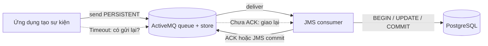
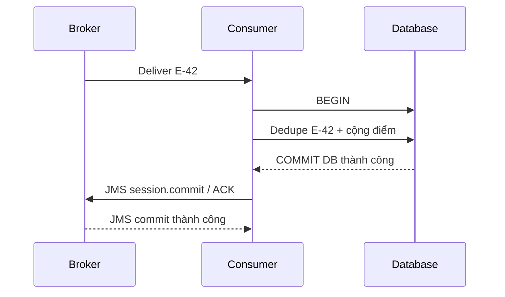
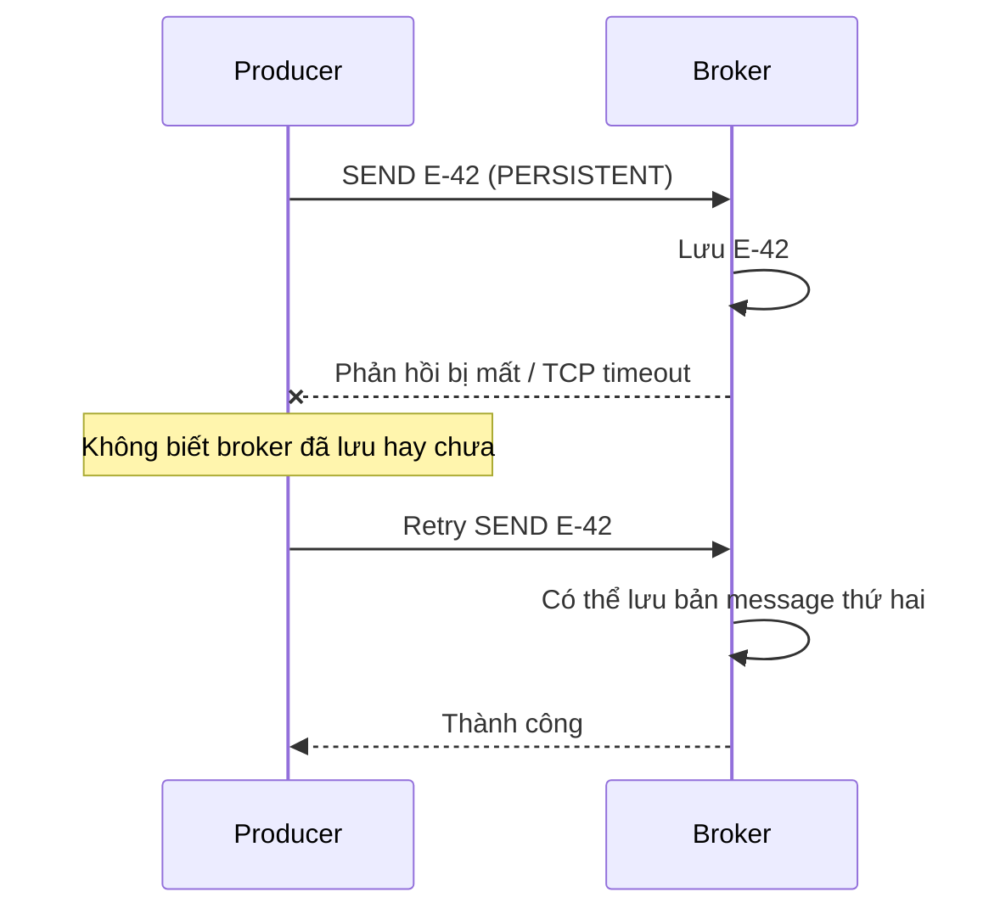
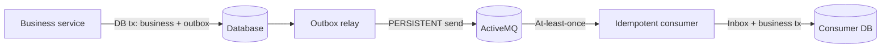

# Vì sao persistent message không tự bảo đảm xử lý nghiệp vụ đúng một lần

> **Chương:** Độ tin cậy  
> **Phạm vi:** Apache ActiveMQ Classic và ActiveMQ Artemis với queue/JMS: ranh giới giữa **lưu giữ message bền vững**, **xác nhận nhận message** và **tác động nghiệp vụ** ở database hoặc dịch vụ bên ngoài. Trọng tâm là các điểm lỗi, *at-least-once*, tính lũy đẳng (*idempotency*), transactional outbox/inbox và cách kiểm chứng. Ví dụ Java sử dụng **ActiveMQ Classic 5.x + `javax.jms`** và PostgreSQL.

## 1. Vấn đề không nằm ở việc broker có lưu message hay không

Giả sử nhận một message `PointsAwarded(eventId=E-42, accountId=A-9, points=5)`. Consumer cộng 5 điểm cho tài khoản trong PostgreSQL. Producer gửi với `DeliveryMode.PERSISTENT` và broker xác nhận đã chấp nhận message. Dù broker lưu bản tin trên đĩa, vẫn có hai câu hỏi **khác nhau**:

1. **Message có được broker lưu và tiếp tục giao theo ngữ nghĩa messaging hay không?**
2. **Có chắc tài khoản A-9 được cộng đúng 5 điểm *một lần* dù producer, consumer hoặc mạng gặp sự cố hay không?**

`PERSISTENT` chủ yếu tham gia câu hỏi (1), **không tự giải quyết câu hỏi (2)**. Để trả lời (2), phải xét ranh giới transaction của **database**, hành động ACK/commit của **JMS session**, và việc cùng một **event nghiệp vụ** có thể được gửi lại bởi producer.



**Kết luận sớm:** giao message *ít nhất một lần* (at-least-once) + xử lý nghiệp vụ **lũy đẳng** là cách triển khai thực dụng cho nhiều quy trình có database. Nếu nghiệp vụ cần đảm bảo mạnh hơn, phải mô tả chính xác các tài nguyên được đưa vào transaction phân tán, chi phí và những tác động bên ngoài nó.

### 1.1 Tách ba bảo đảm dễ bị gộp thành “exactly once”

| Tầng | Câu hỏi đúng | Điều không nên suy ra |
|---|---|---|
| **Producer → broker** | Một `SEND` hoặc JMS `Session.commit()` đã được broker chấp nhận và lưu theo policy/persistence thích hợp chưa? | Producer nhận thành công không có nghĩa consumer đã xử lý xong. |
| **Broker → consumer** | Message đã dispatch, đang in-flight, đã ACK hay đã commit transaction nhận? | Giao thành công không đồng nghĩa database đã commit. |
| **Consumer → nghiệp vụ** | Tác động lên database, thanh toán, email hoặc HTTP API đã thực sự diễn ra bao nhiêu lần? | JMS ACK thành công không chứng minh mọi hiệu ứng ngoài broker được thực hiện đúng một lần. |

Phải định nghĩa **“đúng một lần” ở cấp nào**: một lần broker dispatch, một lần consumer gọi hàm, hay một lần thay đổi số dư được ghi vào nguồn dữ liệu chuẩn. Hệ thống thực tế có thể xử lý một message **nhiều lần** nhưng đạt **một tác động nghiệp vụ** nhờ khóa idempotency.

## 2. `DeliveryMode.PERSISTENT` bảo vệ điều gì?

Trong JMS, producer có thể yêu cầu persistent delivery:

```java
MessageProducer producer = session.createProducer(queue);
producer.setDeliveryMode(DeliveryMode.PERSISTENT);
producer.send(session.createTextMessage(payload));
```

Ý định là broker lưu message để phục hồi tốt hơn sau sự cố broker, trong phạm vi provider, destination và cấu hình persistence. Với **ActiveMQ Classic**, broker có thể dùng KahaDB hoặc persistence adapter khác; **Artemis** có cơ chế journal/storage và các cấu hình HA/paging riêng. Bảo đảm thực tế phải đối chiếu phiên bản, độ bền ổ đĩa, flush/sync, giao thức kết nối và topology dự phòng.

Các điều kiện làm kết quả khác đi:

- **Gửi trong JMS transacted session:** message chưa được coi đã publish hoàn tất trước khi **`session.commit()` thành công**. Chỉ gọi `send()` rồi rơi khỏi phiên giao dịch không tương đương commit.
- **Gửi thành công nhưng phản hồi bị mất:** broker có thể đã lưu message, trong khi producer chỉ thấy timeout/mất kết nối. Producer không thể suy từ timeout rằng broker chắc chắn chưa nhận.
- **TTL/expiration:** persistent message vẫn có thể hết hạn theo chính sách, không phải cam kết lưu vĩnh viễn.
- **Địa chỉ/subscription:** topic message persistent **không tự tạo durable subscription** cho người đăng ký chưa tồn tại; queue và topic có vòng đời phân phối khác nhau.
- **Lỗi lưu trữ/HA:** disk corrupt, cấu hình persistence sai, replication không phù hợp hoặc thao tác quản trị xóa dữ liệu vẫn có thể phá khả năng khôi phục.
- **ACK/commit của consumer:** khi broker ghi nhận message đã tiêu thụ, message có thể bị loại khỏi queue dù nghiệp vụ bên ngoài chưa an toàn.

Vì vậy câu nói chính xác là **“persistent delivery hỗ trợ độ bền của message trong broker theo ngữ nghĩa và cấu hình đang sử dụng”**, không phải **“broker bảo đảm chính xác một lần tác động nghiệp vụ”**.

## 3. Phân tích các cửa sổ crash của consumer

Xét trình tự tốt nhất khi consumer xử lý một message rồi cập nhật database:



**DB commit** và **JMS commit** là **hai transaction độc lập** khi không có một coordinator phân tán thật sự. Vì không thể làm hai hành động này nguyên tử bằng hai lệnh gọi thông thường, luôn có một khoảng thời gian giữa chúng.

### 3.1 Ma trận tình huống

| Thời điểm lỗi | Trạng thái có thể xảy ra | Rủi ro | Giải pháp |
|---|---|---|---|
| Consumer chết **trước DB commit** | DB rollback; JMS chưa ACK | Message được giao lại, bình thường là mong muốn | Transaction DB rõ ràng, rollback JMS, retry có giới hạn |
| DB commit thành công, consumer chết **trước JMS commit** | Hiệu ứng DB đã có; broker chưa xác nhận tiêu thụ | Message được giao lại → **thực thi lặp** | Inbox/dedupe bằng `eventId` trong **cùng DB transaction** với hiệu ứng |
| Consumer gửi JMS commit, **mất phản hồi** | Broker có thể đã commit hoặc chưa | Không biết chắc message có quay lại | Không suy từ exception ra trạng thái; idempotency chịu được cả hai khả năng |
| JMS ACK/commit trước, DB commit sau và DB thất bại | Broker có thể đã loại message, DB chưa thay đổi | **Mất tác động nghiệp vụ** | Không ACK trước khi cập nhật nghiệp vụ đã an toàn |
| Consumer nhận message nhưng bị ngắt TCP | Broker có thể phát hiện kết nối chết trễ | Công việc có thể được giao lại cho consumer khác trong khi worker cũ vẫn chạy | DB unique constraint, khóa/version/fencing nếu cần |
| Message bị retry nhiều lần rồi sang DLQ | Nghiệp vụ chưa hoàn tất nhưng queue chính không còn message đó | Bỏ sót nếu chỉ đo queue chính | DLQ alert, quy trình phân loại/sửa/replay, đối soát |

**Ví dụ phản chứng:** nếu một lần cộng 5 điểm đã commit vào DB, nhưng ACK JMS thất bại, cùng một message persistent có thể được giao lại. Broker **không sai**: từ góc nhìn của broker, message chưa được xác nhận. Nếu consumer cộng thêm 5 điểm mà không tra `eventId`, tài khoản được cộng **10 điểm**, mặc dù cả hai bản message đều có delivery mode PERSISTENT.

### 3.2 Vì sao đổi chế độ ACK vẫn chưa đủ?

| Chế độ nhận | Ranh giới ACK/JMS | Giới hạn với DB nghiệp vụ |
|---|---|---|
| `AUTO_ACKNOWLEDGE` | Với `receive()` đồng bộ, message được tự ACK theo ngữ nghĩa provider khi thao tác nhận hoàn tất. | Có thể ACK **trước** khi ứng dụng thực hiện DB transaction sau `receive()`. |
| `CLIENT_ACKNOWLEDGE` | Ứng dụng gọi `message.acknowledge()`. | ACK trong session kiểu này thường mang ý nghĩa **cộng dồn** các message đã nhận của session, không phải một DB commit nguyên tử. |
| `SESSION_TRANSACTED` | `session.commit()` xác nhận giao dịch JMS; `rollback()` cho phép broker giao lại theo policy. | Chỉ làm nguyên tử **các thao tác JMS trong session**, không tự đưa JDBC transaction vào. |
| XA/JTA 2PC khi được cấu hình đúng | Coordinator quản lý các tài nguyên XA đã enlist, ví dụ DB XA + JMS XA. | Phức tạp về availability, recovery và hiệu năng; side effect ngoài XA vẫn không được bao trùm. |

Với session transacted, `commit()` của session JMS quyết định ACK cho các message đã nhận trong transaction đó. Nếu ứng dụng đọc nhiều message rồi commit một lần, phạm vi xác nhận/rollback có thể bao gồm **cả nhóm**, nên phải đặt ranh giới transaction phù hợp. Không diễn giải `Message.acknowledge()` trong `SESSION_TRANSACTED` là thay thế cho `session.commit()`.

## 4. Producer cũng có thể tạo message trùng

Ngay cả khi consumer không bao giờ nhận lại **cùng một bản message**, producer vẫn có thể **gửi hai bản message vật lý cho cùng một sự kiện**:



JMS `JMSMessageID` có thể khác nhau giữa hai lần `send`; nó là định danh message do provider cấp, **không phải một khóa idempotency nghiệp vụ luôn ổn định**. Nếu producer tạo `eventId` mới mỗi lần retry thì consumer **không thể** biết đó là cùng một giao dịch logic.

Thiết kế nên:

1. Tạo `eventId` ổn định **trong transaction nghiệp vụ** hoặc trước chuỗi retry, lưu lại nó.
2. Dùng cùng `eventId` nếu cần gửi lại một sự kiện logic đã phát sinh.
3. Chấp nhận rằng hai lần `send` có thể cùng thành công về mặt messaging.
4. Để consumer chống lặp ở tầng nghiệp vụ và kiểm soát mọi side effect quan trọng.

Một số bản ActiveMQ có cơ chế duplicate detection ở **broker/client** (ví dụ Artemis hỗ trợ id trùng chuyên dụng trong message property), nhưng chúng có phạm vi, trạng thái cache, quy tắc HA và giới hạn riêng. **Không dùng broker-side dedup như bằng chứng duy nhất rằng “khách hàng không bị cộng tiền hai lần”**. Cần idempotency đúng khóa nghiệp vụ tại storage.

## 5. Inbox: làm cho tác động trong database thực sự lũy đẳng

Giải pháp quan trọng nhất khi consumer cập nhật **một database quan hệ** là lưu **dấu đã xử lý** và **thay đổi nghiệp vụ** trong **cùng transaction database**.

### 5.1 Bảng và ràng buộc tối thiểu

PostgreSQL minh họa:

```sql
CREATE TABLE IF NOT EXISTS loyalty_points (
    account_id VARCHAR(64) PRIMARY KEY,
    points BIGINT NOT NULL DEFAULT 0
);

CREATE TABLE IF NOT EXISTS processed_events (
    handler VARCHAR(100) NOT NULL,
    event_id UUID NOT NULL,
    processed_at TIMESTAMPTZ NOT NULL DEFAULT now(),
    PRIMARY KEY (handler, event_id)
);
```

Khóa **`(handler, event_id)`** cho phép **mỗi loại handler** ghi nhận trạng thái xử lý riêng. Nếu hai consumer nghiệp vụ *khác nhau* cùng cần xử lý `E-42` (ví dụ một handler ghi điểm và handler khác phát thông báo), dedupe toàn hệ thống chỉ bằng `event_id` có thể chặn nhầm một handler hợp lệ.

### 5.2 Transaction xử lý một sự kiện

```sql
BEGIN;

-- Claim duy nhất cho handler; row count = 1 nếu mới, = 0 nếu đã có.
INSERT INTO processed_events(handler, event_id)
VALUES ('loyalty-points-v1', :event_id)
ON CONFLICT DO NOTHING;

-- CHỈ KHI insert ở trên tạo đúng một row:
INSERT INTO loyalty_points(account_id, points)
VALUES (:account_id, :points)
ON CONFLICT (account_id)
DO UPDATE SET points = loyalty_points.points + EXCLUDED.points;

COMMIT;
-- Sau DB commit an toàn mới gọi JMS session.commit().
```

Hai thao tác **claim** và **cộng điểm** phải nằm trong **cùng transaction**. Cần đọc **số row thực sự được insert** (hoặc `RETURNING`) để quyết định có thực hiện update hay không. Đoạn SQL trên là minh họa có điều kiện; **không chạy nguyên xi liên tục mà bỏ qua điều kiện row count** vì sẽ làm cộng điểm cả khi event đã tồn tại.

### 5.3 Tại sao không dùng `SELECT` rồi `UPDATE` rồi `INSERT`?

Hai consumer có thể cùng kiểm tra:

```text
T1: SELECT event_id=E-42 → chưa thấy
T2: SELECT event_id=E-42 → chưa thấy
T1: UPDATE balance +5
T2: UPDATE balance +5
```

Đây là race **check-then-act**. Unique constraint của DB là cơ chế phối hợp mạnh hơn: chỉ một transaction có thể claim cùng `(handler,event_id)` thành công. Transaction còn lại sẽ chờ/nhận conflict phù hợp, rồi **không thực hiện tác động nghiệp vụ**. Không dựa vào khóa mutex trong một JVM nếu có nhiều replica.

**Tính bất biến của ID:** cùng một `eventId` phải đại diện **cùng một sự kiện và cùng nội dung nghiệp vụ** qua mọi lần retry. Nếu nguồn có thể gửi payload khác nhưng giữ nguyên ID, consumer không nên âm thầm coi bản mới là duplicate hợp lệ; có thể lưu thêm hash nội dung chuẩn hóa trong inbox, so sánh khi gặp conflict và phát cảnh báo dữ liệu mâu thuẫn. Unique key là bước bảo vệ tác động lặp, không phải kiểm chứng tính chân thực của payload.

**Giới hạn quan trọng:** mô hình inbox trên bảo vệ **tác động thuộc cùng database**. Nếu handler đồng thời gửi email, gọi API thanh toán hoặc ghi vào database khác **ngoài transaction này**, hành động đó có thể bị lặp hoặc bỏ sót. Đối với side effect ngoài DB, cần một outbox riêng, idempotency key phía API đích hoặc workflow/saga với trạng thái bền vững và đối soát.

## 6. Lab Java 17: hai JMS message, một lần cộng điểm

Mục tiêu thí nghiệm: gửi **hai message vật lý có cùng `eventId`** vào queue persistent, consumer nhận cả hai nhưng PostgreSQL chỉ cộng điểm **một lần**. Sau đó giả lập crash **ngay sau DB commit và trước JMS commit**; quan sát cùng message có thể redeliver mà không cộng thêm điểm.

Lab sử dụng:

- **ActiveMQ Classic 5.x** có OpenWire tại `tcp://127.0.0.1:61616`.
- PostgreSQL có database/test user và quyền tạo bảng theo schema dưới đây.
- **JDK 17** và Gradle 8.x, ví dụ `javax.jms` vì dùng Classic client 5.x.
- Queue lab `lab.reliability.points` được tạo tự động hoặc đã được cấp quyền; **không** chạy trên queue/DB thật của tổ chức.

### 6.1 Cấu trúc và build

```text
reliability-once/
├── settings.gradle
├── build.gradle
└── src/main/java/lab/OnceEffectLab.java
```

`settings.gradle`:

```groovy
rootProject.name = 'reliability-once'
```

`build.gradle`:

```groovy
plugins {
    id 'java'
    id 'application'
}

repositories {
    mavenCentral()
}

java {
    toolchain {
        languageVersion = JavaLanguageVersion.of(17)
    }
}

dependencies {
    implementation 'org.apache.activemq:activemq-client:5.18.3'
    implementation 'com.fasterxml.jackson.core:jackson-databind:2.17.2'
    runtimeOnly 'org.postgresql:postgresql:42.7.5'
}

application {
    mainClass = 'lab.OnceEffectLab'
}
```

Phiên bản dependency được cố định làm **đầu vào minh họa API**, không phải khẳng định đã được cập nhật bảo mật hoặc phù hợp phiên bản broker hiện tại. Trước khi dùng production phải kiểm tra compatibility và advisory.

### 6.2 Mã Java producer/consumer

Tạo `src/main/java/lab/OnceEffectLab.java`:

```java
package lab;

import com.fasterxml.jackson.databind.ObjectMapper;
import java.sql.DriverManager;
import java.sql.PreparedStatement;
import java.util.UUID;
import javax.jms.Connection;
import javax.jms.DeliveryMode;
import javax.jms.JMSException;
import javax.jms.Message;
import javax.jms.MessageConsumer;
import javax.jms.MessageProducer;
import javax.jms.Queue;
import javax.jms.Session;
import javax.jms.TextMessage;
import org.apache.activemq.ActiveMQConnectionFactory;

public final class OnceEffectLab {
    private static final String QUEUE = "lab.reliability.points";
    private static final String HANDLER = "loyalty-points-v1";
    private static final ObjectMapper JSON = new ObjectMapper();

    public record PointsAwarded(
            UUID eventId, int schemaVersion, String accountId, int points) {
    }

    private OnceEffectLab() { }

    public static void main(String[] args) throws Exception {
        if (args.length == 2 && "send".equals(args[0])) {
            send(UUID.fromString(args[1]));
        } else if (args.length == 1 && "consume".equals(args[0])) {
            consume();
        } else {
            System.err.println("Usage: send <uuid> | consume");
        }
    }

    private static Connection newJmsConnection() throws JMSException {
        String url = env("BROKER_URL", "tcp://127.0.0.1:61616");
        ActiveMQConnectionFactory factory =
                new ActiveMQConnectionFactory(url);
        String user = System.getenv("BROKER_USER");
        String pass = System.getenv("BROKER_PASSWORD");
        if (user != null && !user.isBlank()) {
            return factory.createConnection(user, pass);
        }
        return factory.createConnection();
    }

    private static void send(UUID eventId) throws Exception {
        Connection jms = newJmsConnection();
        try {
            Session session = jms.createSession(
                    true, Session.SESSION_TRANSACTED);
            try {
                Queue queue = session.createQueue(QUEUE);
                MessageProducer producer = session.createProducer(queue);
                try {
                    producer.setDeliveryMode(DeliveryMode.PERSISTENT);
                    PointsAwarded event =
                            new PointsAwarded(eventId, 1, "acct-demo", 5);
                    TextMessage msg = session.createTextMessage(
                            JSON.writeValueAsString(event));
                    msg.setStringProperty("eventId", eventId.toString());
                    producer.send(msg);
                    session.commit(); // Commit message lên JMS broker.
                    System.out.println("JMS PUBLISHED: " + eventId);
                } finally {
                    producer.close();
                }
            } finally {
                session.close();
            }
        } finally {
            jms.close();
        }
    }

    private static void consume() throws Exception {
        String dbUrl = env("DB_URL",
                "jdbc:postgresql://127.0.0.1:5432/lab");
        String dbUser = env("DB_USER", "labuser");
        String dbPassword = System.getenv("DB_PASSWORD");

        Connection jms = newJmsConnection();
        try {
            Session session = jms.createSession(
                    true, Session.SESSION_TRANSACTED);
            try {
                Queue queue = session.createQueue(QUEUE);
                MessageConsumer consumer = session.createConsumer(queue);
                try (java.sql.Connection db = DriverManager.getConnection(
                        dbUrl, dbUser, dbPassword)) {
                    db.setAutoCommit(false);
                    jms.start();
                    System.out.println("Listening on " + QUEUE);
                    for (;;) {
                        Message received = consumer.receive(5000);
                        if (received == null) {
                            continue;
                        }

                        boolean dbCommitted = false;
                        try {
                            if (!(received instanceof TextMessage)) {
                                throw new IllegalArgumentException(
                                        "Expected TextMessage");
                            }
                            String body = ((TextMessage) received).getText();
                            if (body == null || body.length() > 8192) {
                                throw new IllegalArgumentException(
                                        "Missing/oversized body");
                            }
                            PointsAwarded event = JSON.readValue(
                                    body, PointsAwarded.class);
                            validate(event);
                            boolean firstTime = applyOnce(db, event);
                            db.commit(); // Chốt marker + điểm trong một DB tx.
                            dbCommitted = true;
                            System.out.println("DB COMMITTED " + event.eventId()
                                    + " firstTime=" + firstTime);

                            // Chỉ bật trong LAB: giả lập JVM chết sau DB commit
                            // nhưng trước JMS commit. Gỡ biến này khi chạy lại.
                            if ("true".equalsIgnoreCase(env(
                                    "LAB_CRASH_AFTER_DB_COMMIT", "false"))) {
                                Runtime.getRuntime().halt(77);
                            }

                            session.commit(); // ACK message qua JMS tx.
                            System.out.println("JMS ACKED " + event.eventId());
                        } catch (Exception error) {
                            if (!dbCommitted) {
                                try {
                                    db.rollback();
                                } catch (Exception rollbackDb) {
                                    error.addSuppressed(rollbackDb);
                                }
                            }
                            try {
                                session.rollback();
                            } catch (JMSException rollbackJms) {
                                error.addSuppressed(rollbackJms);
                            }
                            System.err.println("FAILED: " + error.getMessage()
                                    + ", dbCommitted=" + dbCommitted);
                            Thread.sleep(500); // Tránh vòng lặp lỗi quá dày.
                        }
                    }
                } finally {
                    consumer.close();
                }
            } finally {
                session.close();
            }
        } finally {
            jms.close();
        }
    }

    private static boolean applyOnce(
            java.sql.Connection db, PointsAwarded event) throws Exception {
        int inserted;
        try (PreparedStatement claim = db.prepareStatement(
                "INSERT INTO processed_events(handler, event_id) "
                + "VALUES (?, ?) ON CONFLICT DO NOTHING")) {
            claim.setString(1, HANDLER);
            claim.setObject(2, event.eventId());
            inserted = claim.executeUpdate();
        }
        if (inserted == 0) {
            return false; // Event đã xử lý bởi handler này.
        }
        if (inserted != 1) {
            throw new IllegalStateException("Unexpected claim row count");
        }
        try (PreparedStatement update = db.prepareStatement(
                "INSERT INTO loyalty_points(account_id, points) "
                + "VALUES (?, ?) ON CONFLICT (account_id) DO UPDATE "
                + "SET points = loyalty_points.points + EXCLUDED.points")) {
            update.setString(1, event.accountId());
            update.setInt(2, event.points());
            if (update.executeUpdate() != 1) {
                throw new IllegalStateException("Point update failed");
            }
        }
        return true;
    }

    private static void validate(PointsAwarded event) {
        if (event == null
                || event.eventId() == null
                || event.schemaVersion() != 1
                || event.accountId() == null
                || !event.accountId().matches("acct-[a-z0-9-]{1,24}")
                || event.points() < 1 || event.points() > 100) {
            throw new IllegalArgumentException("Invalid event");
        }
    }

    private static String env(String key, String fallback) {
        String value = System.getenv(key);
        return value == null || value.isBlank() ? fallback : value;
    }
}
```

**Điểm cần hiểu trong code:**

1. `send()` dùng `PERSISTENT` và **JMS `Session.commit()`**. Nó chỉ chốt phần broker, không cập nhật `loyalty_points`.
2. Consumer nhận bằng `SESSION_TRANSACTED` và commit **JDBC trước JMS**. Điều này ngăn ACK sớm rồi mất nghiệp vụ, nhưng có thể tạo redelivery sau DB commit.
3. `processed_events` có **unique primary key** theo `(handler, eventId)`. Chỉ transaction claim thành công mới cộng điểm. Khi duplicate, consumer vẫn commit JDBC và JMS, nhưng **không cộng lại**.
4. Hai JDBC statement nằm trong **cùng DB transaction**. Nếu cộng điểm thất bại, marker cũng bị rollback, không tạo dấu “đã xử lý” giả.
5. Biến `LAB_CRASH_AFTER_DB_COMMIT` chỉ dùng để tạo crash trong **lab**; không xuất hiện ở production. `Runtime.halt()` dừng JVM ngay, không chạy shutdown hook hay finally, nhằm mô phỏng mất tiến trình.
6. Chương trình không xử lý DLQ/poison message hoàn chỉnh; broker phải có redelivery limit và DLQ policy, đồng thời consumer cần phân loại lỗi dữ liệu không hợp lệ thay vì lặp vô hạn.

### 6.3 Chạy và kiểm chứng không cộng điểm hai lần

Trước tiên tạo các bảng theo `5.1` trong database lab, chuẩn bị broker Classic. Đặt `DB_URL`, `DB_USER`, `DB_PASSWORD` và nếu broker có authentication thì `BROKER_URL`, `BROKER_USER`, `BROKER_PASSWORD` ở terminal chạy consumer. Lệnh minh họa dùng Gradle đã cài:

```bash
gradle run --args="send 11111111-1111-4111-8111-111111111111"
gradle run --args="send 11111111-1111-4111-8111-111111111111"
gradle run --args="consume"
```

Hai lần gửi là **hai JMS message** nhưng cùng `eventId`. Trong log consumer, kỳ vọng một lần `firstTime=true`, một lần `firstTime=false` (thứ tự/thời điểm chịu ảnh hưởng broker). Dừng consumer sau khi đọc hai message rồi kiểm tra:

```sql
SELECT account_id, points
FROM loyalty_points
WHERE account_id = 'acct-demo';

SELECT handler, event_id, processed_at
FROM processed_events
WHERE event_id = '11111111-1111-4111-8111-111111111111';
```

Kỳ vọng: `acct-demo` có **5 điểm**, và đúng một marker cho `loyalty-points-v1`/event này, **không phải 10 điểm**. Nếu đã thử với cùng event ID trước đó, kết quả có thể là `firstTime=false` ở cả hai lần: dùng event UUID mới hoặc môi trường DB lab sạch, **không xóa dữ liệu production**.

**Thử nghiệm crash window:** chọn `eventId` mới. Chạy consumer với `LAB_CRASH_AFTER_DB_COMMIT=true`, gửi một event và quan sát JVM kết thúc sau dòng `DB COMMITTED` nhưng trước `JMS ACKED`. Mở lại consumer **không có biến crash** và chờ broker redeliver. Nếu broker nhận biết mất kết nối và giao lại message, `firstTime=false`; database vẫn chỉ cộng một lần. Thời điểm/khả năng redelivery phụ thuộc timeout, prefetch, connection detection và broker policy.

**Giới hạn của phép thử:** chương trình minh họa **business effect trong một PostgreSQL DB**; nó không chứng minh hiệu ứng trên API/email, không chứng minh broker không bao giờ mất dữ liệu, và chưa có bộ phân loại poison-message. Không dùng `Runtime.halt()` trên ứng dụng hoặc hạ tầng thật.

## 7. Outbox: tránh mất sự kiện khi nghiệp vụ ở phía producer đã commit

Consumer inbox chỉ giải quyết **đầu nhận**. Một lỗi tương tự xảy ra ở **đầu phát**:

```text
1. DB producer COMMIT đơn hàng mới.
2. Producer chuẩn bị SEND OrderCreated.
3. JVM chết trước khi broker nhận message.
=> Đơn hàng có thật nhưng event không được phát.
```

Đảo thứ tự SEND trước DB commit lại có nguy cơ **event đã phát cho việc chưa commit**. Vì vậy **transactional outbox** ghi dữ liệu nghiệp vụ và bản ghi cần phát **trong cùng DB transaction**, rồi relay gửi message bất đồng bộ.



Ví dụ schema outbox:

```sql
CREATE TABLE outbox_events (
    event_id UUID PRIMARY KEY,
    event_type VARCHAR(100) NOT NULL,
    payload JSONB NOT NULL,
    created_at TIMESTAMPTZ NOT NULL DEFAULT now(),
    published_at TIMESTAMPTZ NULL
);

BEGIN;
-- Thực hiện INSERT/UPDATE dữ liệu nghiệp vụ ở cùng transaction.
INSERT INTO outbox_events(event_id, event_type, payload)
VALUES (:event_id, 'OrderCreated', :event_json);
COMMIT;
```

Relay đọc các bản ghi `published_at IS NULL`, gửi đến ActiveMQ bằng `PERSISTENT` và chỉ ghi `published_at` sau khi có kết quả publish/commit theo thiết kế. **Cửa sổ lỗi vẫn còn:** relay đã commit message vào broker nhưng chết trước khi ghi `published_at`; relay khác sẽ gửi lại **cùng `eventId`**. Chính **consumer inbox** xử lý trùng lặp này.

**Outbox không phải exactly-once delivery.** Nó cung cấp **không bỏ sót event sau DB commit** trong giả định có relay hoạt động, outbox được lưu bền, retry và vận hành đúng; đổi lại delivery có thể trùng. Cần lập kế hoạch quét bản ghi, giới hạn retry/backoff, concurrency lock hoặc `SKIP LOCKED`, theo dõi tuổi outbox chưa gửi, và đối soát khi broker downtime.

### 7.1 Không có một transaction duy nhất cho mọi side effect

Ngay cả khi DB inbox/outbox hoạt động đúng, một consumer có thể:

- Cập nhật DB một lần rồi **gửi email hai lần** nếu gửi email trước khi ghi marker.
- Gọi hệ thống thanh toán, nhận timeout trong khi đối tác đã xử lý, rồi **gọi lại** không có idempotency key.
- Ghi vào DB A nhưng thất bại ở DB B trong một quy trình dài.

Cách xử lý tùy tác động: API đích hỗ trợ **idempotency key** bền vững, outbox cho outbound side effect, trạng thái workflow/saga, đối soát và bù trừ. Không gọi chung mọi thứ là “JMS exactly-once” nếu chỉ có local transaction của broker.

## 8. XA/JTA có làm biến mất vấn đề?

Về lý thuyết, **XA/JTA two-phase commit** có thể phối hợp một **JMS XA resource** và một **JDBC XA resource** trong cùng global transaction. Khi cả hai tài nguyên và transaction manager được cấu hình đúng, coordinator tiến hành prepare/commit theo giao thức 2PC để giảm ranh giới không nguyên tử giữa JMS ACK và DB update.

Tuy nhiên:

| Khía cạnh | Cần hiểu trước khi chọn XA |
|---|---|
| Cấu hình | Phải dùng đúng `XAConnectionFactory`/XA-capable resources, transaction manager và recovery log; `Session.SESSION_TRANSACTED` thông thường **không phải** XA. |
| Thất bại | In-doubt transaction, recovery, heuristic outcome và mất kết nối vẫn phải được giám sát/xử lý. |
| Hiệu năng | Thêm round trip, logging, giữ lock tài nguyên và có thể giảm availability khi coordinator gặp lỗi. |
| Phạm vi | Không bao gồm tự động email, HTTP API, filesystem hoặc một hệ thống bên ngoài không tham gia XA. |
| Duplicate nghiệp vụ | Producer retry với **hai event vật lý** vẫn có thể diễn ra; cần định danh/idempotency ở nghiệp vụ. |

Trong nhiều hệ thống tích hợp ActiveMQ + PostgreSQL, **local transaction + inbox/outbox** đơn giản, dễ vận hành hơn XA. XA vẫn là lựa chọn có thể cân nhắc nếu có yêu cầu nguyên tử xuyên các tài nguyên XA cụ thể, hệ thống đã có năng lực vận hành transaction coordinator và có bằng chứng phù hợp với SLO.

## 9. Classic và Artemis: kiểm tra durability thực tế, không suy từ cờ PERSISTENT

Không cần học lại toàn bộ cấu hình broker để trả lời câu hỏi của bài. Chỉ cần nhận diện các biến có thể ảnh hưởng kết quả khi chạy test:

| Chủ đề | ActiveMQ Classic | ActiveMQ Artemis |
|---|---|---|
| API Java minh họa | `org.apache.activemq:activemq-client` nhánh Classic 5.x, `javax.jms` | Có biến thể Core/JMS; client Jakarta dùng `jakarta.jms` với artifact tương ứng |
| Store/persistence | Thường là **KahaDB** hoặc adapter khác theo cấu hình | Journal và các cấu hình persistence/page/HA riêng |
| Durable send | `DeliveryMode.PERSISTENT`, transaction commit và store policy | JMS persistent hoặc Core durable message theo client/protocol, commit và broker policy |
| Consumer ACK | JMS ACK/session transacted; redelivery policy có thể liên quan client/broker | JMS ACK/session transacted; address settings cho redelivery/DLQ |
| Duplicate detection | Có cơ chế/extension riêng tùy client/broker, không là nghiệp vụ exactly-once | Có tính năng **duplicate detection** ở broker theo ID chuyên dụng; không thay thế DB inbox |
| HA/restart | Cần xem store, failover transport, network of brokers, TTL | Cần xem shared-store/replication, failover, live/backup, TTL |

Một quy trình kiểm chứng phù hợp cho **cả hai** broker:

1. Gửi một message `PERSISTENT` vào queue lab, xác minh producer nhận được kết quả send/commit.
2. Không chạy consumer; khởi động lại **đúng broker** theo quy trình an toàn và xem message còn trên queue không.
3. Chạy consumer ở `SESSION_TRANSACTED`, rollback trước commit; quan sát redelivery theo policy.
4. Cho DB commit nhưng ngắt consumer trước JMS commit; xác minh có thể redelivery nhưng nghiệp vụ **không bị cộng lặp**.
5. Gửi lại **cùng `eventId`** bằng hai JMS message khác nhau; kiểm tra chỉ một business effect.
6. Thử lỗi dữ liệu không hợp lệ đến giới hạn redelivery rồi quan sát DLQ/cảnh báo, không để tác vụ biến mất mà không ai xử lý.

**Không được** kết luận “persistent chắc chắn an toàn qua mọi failure” chỉ từ test restart sạch. Muốn chứng minh durability cần test bổ sung failure storage, broker crash, HA failover, lưu lượng cao, disk pressure, failover giữa commit/ACK và đo số message mất/duplicate trong giới hạn chấp nhận.

## 10. Quan sát hệ thống để phân biệt mất và trùng

Một ứng dụng đáng tin cậy nên có các chỉ số **ở cả broker và database**:

| Chỉ số | Trả lời câu hỏi gì? |
|---|---|
| Producer publish success/timeout/unknown | Có bao nhiêu lần gửi được xác nhận, bao nhiêu kết quả không chắc chắn? |
| Outbox oldest unpublished age | Bao lâu kể từ khi DB commit mà event vẫn chưa được relay gửi? |
| Broker enqueue/dequeue/queue depth/in-flight | Message đang chờ, đã dispatch hay đã ACK? |
| Redelivery count, `JMSRedelivered` / delivery count | Có bao nhiêu message được nhận lại? |
| Inbox claimed vs duplicate/conflict | Bao nhiêu event có business effect mới, bao nhiêu event bị bỏ qua vì đã xử lý? |
| DB transaction error/latency | Tại sao consumer rollback hoặc processing chậm? |
| DLQ depth/oldest age | Có event nào cần điều tra/replay hay đã bị bỏ quên? |
| Business reconciliation | Tổng event hợp lệ và tổng tác động DB có phù hợp quy tắc nghiệp vụ không? |

Đừng chỉ dựa vào `JMSRedelivered=true` để làm idempotency: hai bản message do producer gửi lại có thể **đều là lần giao đầu tiên** và `JMSRedelivered=false`, nhưng cùng `eventId`. Ngược lại, message được giao lại không luôn có cùng metadata trên mọi giao thức/bridge. **ID nghiệp vụ ổn định + unique constraint** mới là bằng chứng chống lặp ở storage.

Khi replay DLQ, cần giữ nguyên `eventId` của **sự kiện logic** để dedupe hoạt động. Nếu sửa payload có ý nghĩa nghiệp vụ khác, cần quy trình version/correction rõ ràng thay vì tự gán event ID mới và cộng lại tác động cũ.

## 11. Những câu khẳng định sai và cách viết lại cho chính xác

| Khẳng định sai | Cách hiểu đúng |
|---|---|
| “Đã gửi PERSISTENT nên người dùng chỉ bị cộng điểm một lần.” | PERSISTENT nói về độ bền của message ở broker; nghiệp vụ cần inbox/idempotency. |
| “Đã DB commit thì broker biết job xong.” | Broker chỉ biết ACK/commit JMS, không tự quan sát transaction JDBC. |
| “Đổi sang CLIENT_ACKNOWLEDGE là có exactly-once.” | ACK vẫn độc lập với DB; có thể trùng hoặc mất hiệu ứng nếu đặt sai ranh giới. |
| “Transacted JMS session là transaction chung với PostgreSQL.” | Local JMS transaction không bao gồm JDBC; phải có XA/JTA đúng cách nếu muốn enlist cả hai. |
| “Nếu `send()` timeout, chắc chắn broker chưa lưu.” | Kết quả gửi có thể **không xác định**; retry có thể tạo duplicate. |
| “Chỉ cần check event ID bằng SELECT trước khi cập nhật.” | Check-then-act có race giữa nhiều replica; dùng unique constraint và DB transaction. |
| “Không thấy message trong queue thì đã xử lý thành công.” | Message có thể đã ACK trước DB commit, hết hạn hoặc vào DLQ. |
| “Broker duplicate detection đủ thay inbox.” | Scope/retention của broker dedupe không thay thế business uniqueness khi nhiều nguồn/consumer. |
| “Chỉ lưu inbox và gửi email là đủ.” | Email nằm ngoài DB transaction; cần outbox hoặc idempotency ở dịch vụ gửi. |

## 12. Bài tập và checklist thiết kế

### Bài tập phân tích

1. Producer `send(PERSISTENT)` thành công nhưng mất phản hồi; producer retry. Hãy vẽ hai khả năng ở broker và chỉ ra lý do `eventId` phải không đổi.
2. Consumer đọc message, cập nhật database, DB commit, rồi process bị kill trước `session.commit()`. Broker làm gì khi phát hiện lỗi và vì sao số điểm không nên tăng lần hai?
3. Nếu đảo thứ tự **JMS commit trước DB commit**, hãy mô tả một kịch bản khiến nghiệp vụ không xảy ra dù queue không còn message.
4. Một producer gửi hai bản physical message khác nhau có cùng `eventId`. Tại sao `JMSRedelivered` không đủ để phát hiện trùng?
5. Hai handler cùng nhận `OrderCreated` nhưng có nhiệm vụ độc lập. Vì sao khóa inbox nên xét `(handler,event_id)`?
6. Relay outbox gửi message rồi chết trước khi đánh dấu published. Sau khi restart relay phải làm gì để vừa không bỏ sót, vừa không thực hiện nghiệp vụ hai lần?
7. Hệ thống có cập nhật DB và gọi API của bên thứ ba. Inbox local DB bảo đảm phần nào? Nêu cách thiết kế cho API ngoài transaction.
8. XA 2PC có tự làm cho email hoặc HTTP API trở thành nguyên tử với JMS/DB không? Giải thích.

### Checklist trước khi vận hành

- [ ] Định nghĩa rõ “đúng một lần”: **business effect** nào và ở nguồn dữ liệu chuẩn nào?
- [ ] Producer dùng persistent delivery **và** hiểu ranh giới send/transaction commit, unknown outcome khi timeout.
- [ ] Event logic có `eventId` ổn định qua producer retry, relay outbox và DLQ replay.
- [ ] Consumer không ACK trước khi nghiệp vụ đạt trạng thái an toàn.
- [ ] Inbox marker và business update được commit **trong cùng DB transaction**, có unique constraint chống race.
- [ ] Retry/redelivery có giới hạn, backoff, DLQ alert và quy trình replay/đối soát.
- [ ] Outbox bảo vệ việc phát event sau transaction nguồn; relay chịu được publish trùng.
- [ ] Side effect ngoài DB có idempotency key/workflow riêng, không dựa vào JMS ACK.
- [ ] Kiểm thử crash **trước/sau DB commit**, trước/sau JMS commit, producer timeout, restart broker và network failover.
- [ ] Theo dõi outbox age, broker queue/ACK, duplicate inbox, DLQ và đối soát tác động nghiệp vụ.

**Kết luận:** `DeliveryMode.PERSISTENT` giúp broker giữ message theo chính sách độ bền, nhưng broker không biết database đã commit hay chưa. **Khoảng lỗi giữa DB commit và JMS ACK**, cộng thêm **retry từ producer khi kết quả gửi không chắc chắn**, khiến cùng sự kiện có thể được xử lý nhiều lần. Muốn **tác động nghiệp vụ đúng một lần**, cần khóa event ổn định, transaction database với inbox/idempotency, outbox ở phía producer khi cần và cơ chế xử lý riêng cho side effect ngoài DB. Đó là bảo đảm của **thiết kế hệ thống từ đầu đến cuối**, không phải thuộc tính của riêng một cờ JMS.
