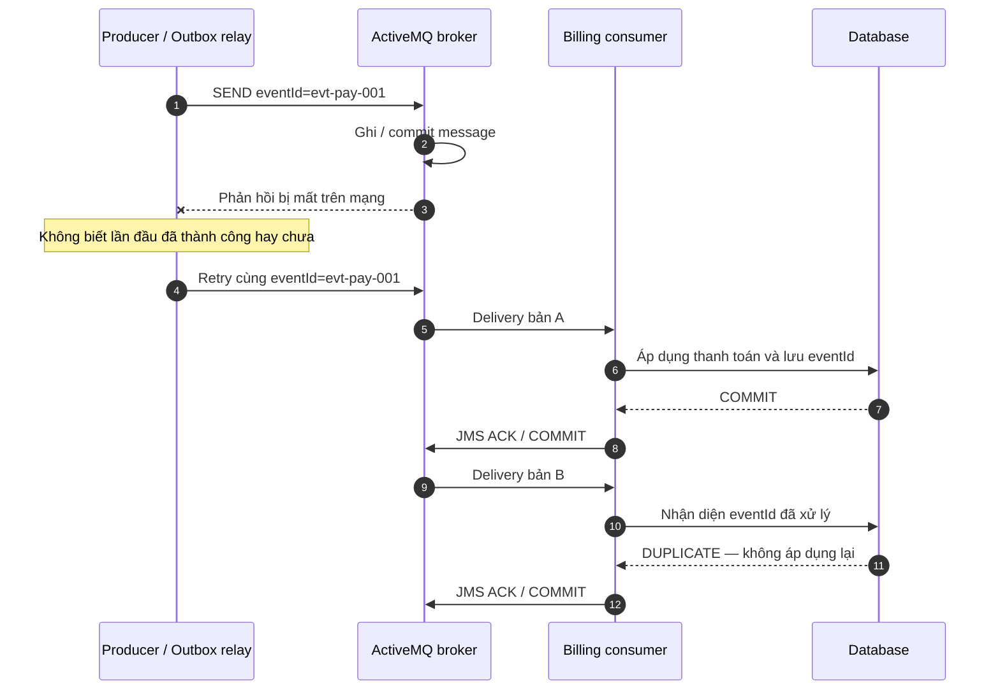
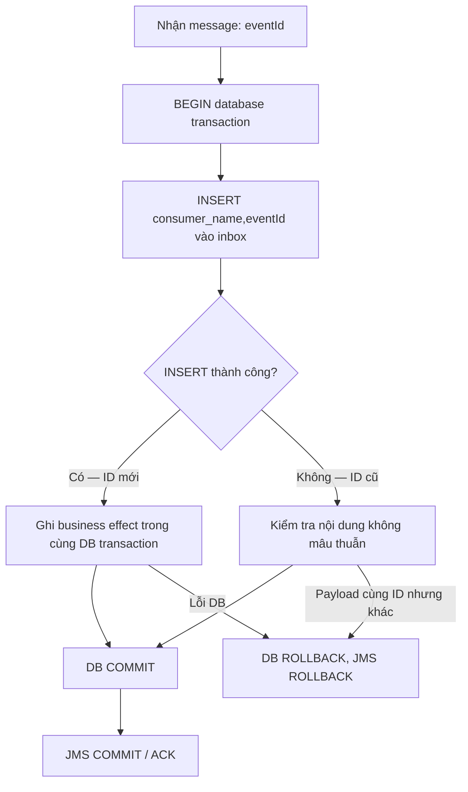

# Nhận diện thông điệp lặp bằng định danh nghiệp vụ ổn định

> **Chương:** Độ tin cậy  
> **Mô-đun:** `INTEGRATION_MESSAGING_MESSAGE_BROKER_ACTIVEMQ` — sử dụng Apache ActiveMQ Classic và Artemis để truyền thông điệp bất đồng bộ qua queue/topic, JMS, acknowledgment, transaction và cơ chế phục hồi tin cậy.  
> **Mục tiêu trực tiếp:** Chọn một định danh **ổn định qua các lần retry/redelivery**, nhận diện thông điệp trùng ở consumer bằng database transaction và unique constraint, phân biệt với duplicate detection của broker; kiểm chứng được những cửa sổ lỗi khiến một nghiệp vụ có nguy cơ được thực hiện hai lần.

## 1. Một nghiệp vụ, hai message: duplicate hình thành thế nào?

Giả sử dịch vụ thanh toán phải phát sự kiện `PaymentRequested` với ID nghiệp vụ `evt-pay-001`. Producer gửi message vào queue `payments.requested` nhưng kết nối đứt ngay trước khi nhận phản hồi hoàn tất.



Kịch bản khác cũng gây lặp: **consumer đã commit database nhưng chết trước khi ACK JMS**. Broker chưa biết công việc đã hoàn tất nên có thể redeliver message đó, thậm chí cho một tiến trình worker khác.

Cần phân biệt hai mục tiêu:

- **Duplicate message/delivery:** Có thể tồn tại nhiều bản message hoặc nhiều lần giao cho cùng sự kiện.
- **Duplicate business effect:** Nghiệp vụ thực hiện hai lần, ví dụ tạo hai khoản thu, phát hai mã giảm giá hoặc trừ tồn kho hai lần.

Trong hệ thống chịu được retry, việc có **nhiều delivery** không nhất thiết là lỗi. Mục tiêu là **mỗi sự kiện nghiệp vụ được phép gây side effect một lần theo hợp đồng xử lý**, dù message có thể được gửi/giao nhiều lần.

**Cốt lõi của bài:** Không thể biến “cùng sự kiện” thành “cùng message ID” chỉ bằng JMS. Phải xây dựng **định danh nghiệp vụ ổn định** ngay từ nguồn sự kiện và sử dụng nó tại ranh giới side effect.

## 2. ID nào dùng để nhận diện thông điệp trùng?

### 2.1. Bốn loại định danh không được đánh đồng

| Định danh | Ai tạo? | Bất biến qua retry gửi lại? | Vai trò đúng |
| --- | --- | --- | --- |
| `eventId` hoặc `jobId` **nghiệp vụ** | Producer hoặc nguồn sự kiện, lưu bền | **Có, nếu thiết kế đúng** | Khóa dedup chính của cùng sự kiện |
| `paymentId` / `orderId` / aggregate ID | Hệ thống nghiệp vụ | Thường ổn định theo thực thể | Bảo vệ ràng buộc nghiệp vụ như một hóa đơn cho một đơn |
| `JMSMessageID` | JMS provider khi `send()` | **Không đảm bảo** ổn định khi producer gửi lại | Tracing message vật lý, chẩn đoán delivery |
| `JMSCorrelationID` | Ứng dụng hoặc provider theo ngữ cảnh | Tùy cách đặt | Liên kết request/reply hoặc chuỗi xử lý; không tự có tính duy nhất |

Đặc tả Jakarta Messaging quy định `JMSMessageID` là giá trị do provider cấp cho message khi gửi. Hai lần `send()` có thể tạo **hai message vật lý** khác `JMSMessageID`, dù mang cùng sự kiện nghiệp vụ. Trong trường hợp **redelivery của một message**, `JMSMessageID` có thể được giữ; nhưng dựa vào nó **không giải quyết trường hợp producer resend**.

```text
Sự kiện gốc:
    eventId = evt-pay-001
    paymentId = pay-2026-001

Producer send lần 1:
    eventId = evt-pay-001
    JMSMessageID = ID:provider:1001

Producer retry send lần 2:
    eventId = evt-pay-001        <-- phải giữ nguyên
    JMSMessageID = ID:provider:1002  <-- có thể khác
```

**`JMSRedelivered` và `JMSXDeliveryCount` không phải khóa chống trùng.** Chúng giúp quan sát số lần delivery đối với một message và chẩn đoán rollback, không phát hiện chắc chắn hai message vật lý đại diện cùng một sự kiện.

### 2.2. Chọn phạm vi định danh đúng nghiệp vụ

Một định danh tốt phải trả lời: **đây có phải cùng một ý định/hành động nghiệp vụ không?**

- `eventId` của `OrderCreated` và `OrderPaid` phải khác nhau dù cùng `orderId`.
- Hai lần phát lại **cùng `OrderPaid`** phải giữ cùng `eventId`.
- Hai tác vụ thanh toán *hợp lệ nhưng khác lần* cho cùng một khách hàng không bị gộp vì chúng có cùng `customerId`.
- Nếu hệ thống có nhiều tenant, có thể dùng khóa `(tenant_id, event_id)` hoặc tạo event ID duy nhất toàn hệ thống. Quy định phạm vi duy nhất **trước khi** thiết kế unique constraint.
- Với các consumer độc lập, ví dụ Billing và Analytics nhận cùng event, dùng `(consumer_name, event_id)` để **mỗi consumer có quyền xử lý sự kiện một lần**. Chỉ một khóa `event_id` chung toàn bộ hệ thống sẽ vô tình khiến Analytics bỏ qua event mà Billing đã xử lý.

Một cách tạo ID hợp lý là UUID do producer tạo **một lần khi ghi bản ghi sự kiện/outbox**, sau đó giữ nó trong storage. Không gọi `UUID.randomUUID()` mới ở **mỗi lần retry gửi**.

### 2.3. Các nguyên tắc để ID thực sự ổn định

1. Tạo ID khi **sự kiện nghiệp vụ được ghi nhận**, không phải lúc retry network.
2. Lưu bền cùng payload/outbox; lấy lại chính ID đó sau process restart.
3. Dùng namespace và format rõ ràng: `tenant + eventId`, version nếu chính sách cần; tránh cắt chuỗi hoặc đổi case tùy tiện.
4. Không tái sử dụng ID cho hai nghiệp vụ khác nhau. **Cùng ID nhưng payload khác** là lỗi hợp đồng cần cảnh báo, **không** được âm thầm ACK như duplicate hợp lệ.
5. Giữ quy tắc nhận diện nhất quán khi phát lại từ DLQ, replay dữ liệu lịch sử hoặc chuyển broker.
6. Chỉ log ID và metadata cần thiết; không gắn dữ liệu cá nhân trực tiếp vào ID nếu không cần.

## 3. Idempotent consumer: dedup phải cùng transaction với tác động nghiệp vụ

Mẫu bền vững phổ biến là **inbox / processed-message table** ở database của consumer:



**Điểm bắt buộc:** Inbox row và thay đổi nghiệp vụ phải nằm trong **cùng database transaction**. Nếu chỉ viết:

```text
INSERT processed_events; COMMIT
gọi thanh toán / ghi hóa đơn; COMMIT
ACK JMS
```

thì crash sau commit đầu tiên nhưng trước tác động nghiệp vụ sẽ khiến lần redelivery thấy ID đã tồn tại và **bỏ qua công việc chưa hoàn thành**. Đây là kiểu “dedup” sai, có thể làm **mất nghiệp vụ**.

### 3.1. Thiết kế SQL với unique constraint

Ví dụ PostgreSQL:

```sql
CREATE TABLE processed_messages (
    consumer_name       VARCHAR(80) NOT NULL,
    event_id            VARCHAR(128) NOT NULL,
    payload_signature   VARCHAR(256) NOT NULL,
    processed_at        TIMESTAMPTZ NOT NULL DEFAULT CURRENT_TIMESTAMP,
    PRIMARY KEY (consumer_name, event_id)
);

CREATE TABLE payments (
    payment_id          VARCHAR(128) PRIMARY KEY,
    amount_minor        BIGINT NOT NULL CHECK (amount_minor > 0),
    status              VARCHAR(20) NOT NULL,
    source_event_id     VARCHAR(128) NOT NULL UNIQUE
);
```

Hai lớp bất biến:

- `PRIMARY KEY (consumer_name, event_id)` phát hiện **cùng event đã xử lý cho cùng consumer**. Nó cho phép consumer độc lập khác cũng xử lý event đó.
- `PRIMARY KEY (payment_id)` và `UNIQUE(source_event_id)` bảo vệ ý nghĩa nghiệp vụ. Nếu producer vô tình tạo **hai eventId khác nhau** cho cùng payment, inbox không coi là trùng nhưng `payments` vẫn từ chối tạo hai payment có cùng `payment_id`.

`payload_signature` lưu dấu vết nội dung nghiệp vụ để phát hiện **cùng eventId nhưng nội dung mâu thuẫn**. Trong demo có thể dùng chuỗi chuẩn hóa `paymentId + "|" + amountMinor` với quy tắc ký tự hạn chế; production thường dùng hash của payload đã canonicalize theo một format/version thống nhất, nhưng không dùng chữ ký này thay thế kiểm tra quyền hoặc MAC bảo mật.

### 3.2. Phép “claim” nguyên tử chống race giữa nhiều JVM

```sql
BEGIN;

INSERT INTO processed_messages (
    consumer_name, event_id, payload_signature
)
VALUES ('payment-worker', 'evt-pay-001', 'pay-001|19900')
ON CONFLICT (consumer_name, event_id) DO NOTHING;

-- Nếu INSERT ảnh hưởng 1 dòng: sự kiện mới, áp dụng side effect.
-- Nếu ảnh hưởng 0 dòng: trùng ID, kiểm tra payload_signature đã lưu.
-- Trên đường sự kiện mới, tạo payment trong cùng transaction.

COMMIT;
```

**Không thực hiện trước bằng `SELECT EXISTS` rồi mới INSERT** mà thiếu unique constraint: hai worker có thể cùng đọc “chưa tồn tại” và cả hai thực hiện side effect. Với khóa unique, PostgreSQL phân xử ngay trên ràng buộc; các transaction cạnh tranh cùng ID có thể đợi nhau cho đến khi transaction đầu commit/rollback.

Khi `ON CONFLICT DO NOTHING` trả về 0 dòng, cần đọc `payload_signature` đã lưu:

- **Bằng nhau:** Đây là bản gửi lại hợp lệ theo contract; có thể DB commit rồi ACK JMS.
- **Khác nhau:** ID bị tái sử dụng sai hoặc payload đã bị sửa; báo lỗi hoặc quarantine, **không lẳng lặng coi là đã xử lý**.

### 3.3. Tách hai transaction: database và JMS

```text
DB transaction:   [claim inbox + business write] ---> DB COMMIT
JMS transaction:  [receive delivery] -------------> JMS COMMIT/ACK
```

JMS local transaction **không** tự bao gồm JDBC transaction. Trình tự thường dùng:

1. Consumer nhận message bằng transacted JMS session/context.
2. Mở database transaction, claim event ID; nếu mới thì thực hiện business write trong **cùng DB transaction**.
3. DB commit thành công.
4. **Sau đó** JMS commit để broker xác nhận message.

Kết quả theo điểm crash:

| Thời điểm crash | DB đã commit? | JMS đã ACK? | Redelivery và tác động |
| --- | --- | --- | --- |
| Trước DB transaction | Chưa | Chưa | Nhận lại, xử lý như mới |
| Sau claim nhưng trước DB commit | Chưa (transaction rollback) | Chưa | Nhận lại, claim lại và xử lý |
| **Sau DB commit, trước JMS commit** | **Có** | **Chưa** | Nhận lại, thấy inbox và **không ghi thêm** |
| Sau JMS commit | Có | Có | Không cần redelivery message đó theo semantics bình thường |
| Khi JMS commit timeout | Có | Không rõ | Nếu redeliver, inbox giữ an toàn; không suy ra commit thất bại |
| Khi DB commit timeout | Không rõ | Chưa | Rollback/retry JMS; inbox/unique constraint xử lý dù DB đã commit hay chưa |

Cách này thường đạt **at-least-once message delivery + idempotent database effect**. Nó **không** tạo transaction phân tán cho mọi tài nguyên.

**Ranh giới cực kỳ quan trọng:** Nếu side effect là **gọi gateway thanh toán, HTTP API, gửi email** ngoài transaction của DB, inbox và business write **không tự đủ**. Cần idempotency key ở API đích, outbox cho tác vụ phụ, hoặc cơ chế transaction/saga có đối soát. Ví dụ gọi gateway xong nhưng JVM chết trước khi ghi inbox vẫn có thể gọi gateway lần hai nếu nhà cung cấp không hỗ trợ idempotency.

## 4. Producer phải giữ eventId qua send/retry/restart

Consumer chỉ nhận diện được lặp khi ID gốc không thay đổi. Thiết kế producer bằng **transactional outbox**:

```sql
CREATE TABLE payment_outbox (
    event_id          VARCHAR(128) PRIMARY KEY,
    payment_id        VARCHAR(128) NOT NULL,
    amount_minor      BIGINT NOT NULL CHECK (amount_minor > 0),
    state             VARCHAR(20) NOT NULL DEFAULT 'NEW',
    created_at        TIMESTAMPTZ NOT NULL DEFAULT CURRENT_TIMESTAMP
);
```

Tại thời điểm ghi nghiệp vụ vào DB nguồn:

```text
BEGIN DB transaction
  -> ghi ý định thanh toán/đơn hàng vào bảng nghiệp vụ
  -> tạo eventId MỘT LẦN và INSERT payment_outbox(eventId, ...)
COMMIT DB transaction
```

Một relay đọc bản ghi outbox:

```text
Lần 1: load evt-pay-001 -> send -> mất reply
Lần 2: load evt-pay-001 -> send lại -> cùng eventId
Lần 3: process restart -> load evt-pay-001 -> send lại -> cùng eventId
```

Chỉ cập nhật outbox sang `SENT` sau khi có xác nhận theo cơ chế send/commit đã chọn. Ngay cả khi relay cập nhật trạng thái sai hoặc mất kết nối, consumer inbox vẫn là tuyến bảo vệ cho business effect. Relay có thể đánh dấu `SENT` trễ và gửi trùng: thiết kế phải cho phép.

**Tránh hai lỗi thường gặp:**

- Tạo eventId trong hàm `retrySend()`: mỗi retry đổi ID, inbox coi là sự kiện mới.
- Dùng riêng `paymentId` làm eventId cho mọi sự kiện: `PaymentRequested` và `PaymentCancelled` có thể là **hai sự kiện hợp lệ khác nhau** cho cùng payment, nên không được gộp.

## 5. Broker-side duplicate detection: một lớp bảo vệ bổ sung

### 5.1. Artemis: thuộc tính `_AMQ_DUPL_ID`

Apache ActiveMQ **Artemis** có **duplicate ID cache theo address**. Producer có thể đặt JMS property `_AMQ_DUPL_ID` (kiểu `String` đối với JMS). Khi broker nhận một ID đã có trong cache của address đó, nó **không route message lặp** tới queue đích. Đây là cơ chế **lọc tại ingress**, khác với inbox ở consumer.

```java
TextMessage msg = context.createTextMessage(body);
msg.setStringProperty("eventId", eventId);      // ID hợp đồng nghiệp vụ
msg.setStringProperty("_AMQ_DUPL_ID", eventId); // Artemis broker dedup
context.createProducer().send(queue, msg);
```

Theo tài liệu Artemis:

- Cache duplicate ID là **vòng tròn, dung lượng hữu hạn**, mỗi address có bộ cache tương ứng. ID cũ sẽ bị thay thế khi cache đầy, nên resend rất muộn **có thể vượt qua cache**.
- Có thể đặt `id-cache-size` (mặc định thường là 20.000 trong tài liệu chính thức) và `persist-id-cache` để kiểm soát kích thước/durability của cache trên broker.
- Nếu một message trong **JMS transaction** có duplicate ID đã tồn tại, broker có cơ chế **bỏ qua cả transaction đó** theo tài liệu. Không dùng cùng một duplicate ID cho nhiều transaction chứa những sự kiện hợp lệ khác nhau.
- Một message được ACK hoặc hết hạn **không làm ID biến mất ngay** khỏi cache; điều này quan trọng khi producer retry sau khi consumer hoàn thành.
- Cache giúp giảm lưu/dispatch duplicate, nhưng **không bảo vệ side effect đã xảy ra ở consumer khi chính message bị redeliver sau crash trước ACK**, cũng không bảo vệ vượt quá cửa sổ cache hoặc giữa nhiều hệ thống không chia sẻ cache.

Trích đoạn cấu hình **`broker.xml` của Artemis**, đặt các trường dưới phần `<core>` hiện có theo cấu trúc/schema của phiên bản đang chạy:

```xml
<!-- Đặt trong core, không tạo thêm core thứ hai -->
<id-cache-size>50000</id-cache-size>
<persist-id-cache>true</persist-id-cache>
```

Số `50000` là ví dụ đo đạc để mở rộng cửa sổ chống resend; kích thước phù hợp phụ thuộc tốc độ message, thời gian retry và tài nguyên broker. **Cache không phải bảng idempotency vĩnh viễn.** Khi reconfigure/restore/rotate/clear cache, hành vi duplicate detection có thể đổi; không dựa duy nhất vào cache để bảo vệ thu tiền.

### 5.2. Classic không dùng nguyên property của Artemis

`_AMQ_DUPL_ID` là cơ chế đặc thù của **Artemis**. Đừng giả định đặt cùng property này trên ActiveMQ **Classic** sẽ kích hoạt bộ cache duplicate có semantics giống Artemis. Với Classic, giải pháp di động giữa provider là:

1. Producer mang `eventId` nghiệp vụ bền vững.
2. Consumer dùng inbox/unique constraint tại database.
3. Redelivery/transaction/DLQ được cấu hình theo Classic cụ thể.
4. Nếu dùng tính năng duplicate suppression riêng của client/broker Classic, cần kiểm tra cơ chế và phạm vi của **đúng phiên bản**, không thay thế lớp bảo vệ ở DB.

| Cơ chế | Loại trùng xử lý tốt | Giới hạn |
| --- | --- | --- |
| Artemis `_AMQ_DUPL_ID` | Producer gửi lại cùng ID trong cửa sổ cache của address | Hữu hạn, theo address, không bao phủ mọi redelivery/DB side effect |
| JMS ACK/transaction | Quản lý message chưa hoàn tất ở broker | Không đưa external DB/API vào cùng local JMS transaction |
| Consumer inbox + unique index | Nhiều delivery/send của cùng event trong phạm vi consumer và thời gian lưu ID | Cần transaction với business effect; quản lý lưu trữ lâu dài |
| Business unique constraint | Hai eventId khác nhau nhưng cùng tài nguyên nghiệp vụ | Cần xác định đúng invariant, xử lý conflict có chủ đích |
| External API idempotency key | Retry các thao tác tại hệ thống ngoài DB | Phụ thuộc API đích, TTL và scope của khóa |

**Khuyến nghị:** Có thể bật duplicate detection ở Artemis để giảm lưu lượng lặp **và đồng thời** giữ inbox tại consumer. Không coi hai lớp là thay thế cho nhau.

## 6. Thực hành: Java 17, Artemis JMS và PostgreSQL

### 6.1. Kết quả cần quan sát

Ví dụ chạy một producer nhiều lần với **cùng `eventId`**, nhưng mỗi lần tạo một JMS message mới; consumer nhận bằng **transacted JMSContext**, lưu dấu event ID và tạo payment trong **một JDBC transaction**, commit DB trước khi ACK JMS.

Các chế độ:

- `send evt-pay-001 pay-001 19900`: gửi message có business ID, không dùng broker duplicate detection; gọi hai lần sẽ tạo hai lần gửi.
- `send-broker-dedup evt-pay-002 pay-002 29900`: thêm `_AMQ_DUPL_ID`; gửi lặp có thể bị Artemis lọc ngay tại broker.
- `receive`: nhận một message và xử lý idempotent; hai tiến trình `receive` có thể chạy độc lập.
- Biến môi trường `FAIL_AFTER_DB_COMMIT=true` trên lần chạy consumer mô phỏng lỗi **sau DB commit nhưng trước JMS commit** để kiểm tra redelivery.

**Giới hạn:** Demo này tạo khoản ghi nhận payment **trong PostgreSQL**, không gọi gateway thanh toán. Nếu có cổng thanh toán thật, phải thêm idempotency key/đối soát ở gateway như phần 3 đã phân tích.

### 6.2. Artemis broker và PostgreSQL

Giả định Artemis broker chạy trên `tcp://127.0.0.1:61616`, có acceptor cho Artemis Core client, persistence bật và tài khoản có quyền SEND/CONSUME tại `payments.requested`.

Trong **`<addresses>` hiện có** của `broker.xml`, tạo queue:

```xml
<addresses>
    <address name="payments.requested">
        <anycast>
            <queue name="payments.requested"/>
        </anycast>
    </address>
    <address name="payments.DLQ">
        <anycast>
            <queue name="payments.DLQ"/>
        </anycast>
    </address>
</addresses>
```

Trong **`<address-settings>` hiện có**, cấu hình giới hạn retry:

```xml
<address-settings>
    <address-setting match="payments.requested">
        <redelivery-delay>1000</redelivery-delay>
        <max-delivery-attempts>5</max-delivery-attempts>
        <dead-letter-address>payments.DLQ</dead-letter-address>
    </address-setting>
</address-settings>
```

Hai đoạn trên là **trích đoạn**: nếu file đã có `<addresses>` / `<address-settings>` thì **gộp phần tử tương ứng**, không thêm một section trùng. Kiểm tra cấu hình tương thích với phiên bản Artemis và không dùng queue đang có dữ liệu production để thử rollback nhiều lần.

Trên PostgreSQL tạo database `messaging_demo` và chạy hai lệnh `CREATE TABLE` ở mục 3.1. Ví dụ sử dụng URL JDBC `jdbc:postgresql://127.0.0.1:5432/messaging_demo`. User DB cần quyền INSERT/SELECT trên `processed_messages` và INSERT trên `payments`. Cấp mật khẩu qua biến môi trường `DB_PASSWORD`; không đưa vào mã nguồn.

### 6.3. Maven `pom.xml`

```xml
<project xmlns="http://maven.apache.org/POM/4.0.0"
         xmlns:xsi="http://www.w3.org/2001/XMLSchema-instance"
         xsi:schemaLocation="http://maven.apache.org/POM/4.0.0
                             https://maven.apache.org/xsd/maven-4.0.0.xsd">
    <modelVersion>4.0.0</modelVersion>
    <groupId>example.messaging</groupId>
    <artifactId>stable-event-id-demo</artifactId>
    <version>1.0.0</version>

    <properties>
        <maven.compiler.release>17</maven.compiler.release>
    </properties>

    <dependencies>
        <dependency>
            <groupId>org.apache.activemq</groupId>
            <artifactId>artemis-jakarta-client</artifactId>
            <version>2.38.0</version>
        </dependency>
        <dependency>
            <groupId>org.postgresql</groupId>
            <artifactId>postgresql</artifactId>
            <version>42.7.4</version>
        </dependency>
    </dependencies>

    <build>
        <plugins>
            <plugin>
                <groupId>org.apache.maven.plugins</groupId>
                <artifactId>maven-compiler-plugin</artifactId>
                <version>3.13.0</version>
            </plugin>
            <plugin>
                <groupId>org.codehaus.mojo</groupId>
                <artifactId>exec-maven-plugin</artifactId>
                <version>3.5.0</version>
            </plugin>
        </plugins>
    </build>
</project>
```

Đây là các **version ví dụ đã xác định**, không hàm ý là bản phát hành mới nhất. Code dùng `jakarta.jms` và Artemis Jakarta client; với Classic 5.x cần đổi sang dependency/API `javax.jms` phù hợp mà vẫn giữ nguyên tư duy business ID + database inbox.

### 6.4. Code Java hoàn chỉnh

Tạo file `src/main/java/example/messaging/StableEventIdDemo.java`:

```java
package example.messaging;

import java.sql.Connection;
import java.sql.DriverManager;
import java.sql.PreparedStatement;
import java.sql.ResultSet;
import java.sql.SQLException;
import java.util.Locale;

import jakarta.jms.ConnectionFactory;
import jakarta.jms.DeliveryMode;
import jakarta.jms.JMSConsumer;
import jakarta.jms.JMSContext;
import jakarta.jms.Message;
import jakarta.jms.Queue;
import jakarta.jms.TextMessage;

import org.apache.activemq.artemis.jms.client.ActiveMQConnectionFactory;

public final class StableEventIdDemo {
    private static final String ADDRESS = "payments.requested";
    private static final String CONSUMER_NAME = "payment-worker";

    private StableEventIdDemo() {}

    public static void main(String[] args) throws Exception {
        if (args.length < 1) {
            throw new IllegalArgumentException(
                    "Usage: send|send-broker-dedup <eventId> <paymentId> "
                    + "<amountMinor> | receive");
        }

        String brokerUrl = System.getenv().getOrDefault(
                "BROKER_URL", "tcp://127.0.0.1:61616");
        String brokerUser = requiredEnv("BROKER_USER");
        String brokerPassword = requiredEnv("BROKER_PASSWORD");
        ConnectionFactory factory = new ActiveMQConnectionFactory(brokerUrl);

        switch (args[0]) {
            case "send", "send-broker-dedup" -> {
                if (args.length != 4) {
                    throw new IllegalArgumentException(
                            "Usage: send|send-broker-dedup "
                            + "<eventId> <paymentId> <amountMinor>");
                }
                String eventId = validateId(args[1]);
                String paymentId = validateId(args[2]);
                long amountMinor = Long.parseLong(args[3]);
                if (amountMinor <= 0) {
                    throw new IllegalArgumentException("amountMinor > 0 required");
                }
                send(factory, brokerUser, brokerPassword,
                     eventId, paymentId, amountMinor,
                     "send-broker-dedup".equals(args[0]));
            }
            case "receive" -> {
                if (args.length != 1) {
                    throw new IllegalArgumentException("Usage: receive");
                }
                receive(factory, brokerUser, brokerPassword);
            }
            default -> throw new IllegalArgumentException(
                    "Unknown mode: " + args[0]);
        }
    }

    private static String requiredEnv(String name) {
        String value = System.getenv(name);
        if (value == null || value.isBlank()) {
            throw new IllegalStateException("Missing env: " + name);
        }
        return value;
    }

    private static String validateId(String value) {
        if (!value.matches("[A-Za-z0-9_-]{1,80}")) {
            throw new IllegalArgumentException(
                    "IDs may contain only letters, digits, _ and -");
        }
        return value;
    }

    private static void send(ConnectionFactory factory, String user,
                             String password, String eventId,
                             String paymentId, long amountMinor,
                             boolean brokerDedup) {
        try (JMSContext context = factory.createContext(
                user, password, JMSContext.SESSION_TRANSACTED)) {

            Queue destination = context.createQueue(ADDRESS);
            String body = String.format(Locale.ROOT,
                    "{\"eventId\":\"%s\",\"paymentId\":\"%s\","
                    + "\"amountMinor\":%d}",
                    eventId, paymentId, amountMinor);
            TextMessage message = context.createTextMessage(body);
            message.setStringProperty("eventId", eventId);
            message.setStringProperty("paymentId", paymentId);
            message.setLongProperty("amountMinor", amountMinor);

            if (brokerDedup) {
                // TÍNH NĂNG RIÊNG ARTEMIS: cache ID ở phía broker.
                message.setStringProperty("_AMQ_DUPL_ID", eventId);
            }

            context.createProducer()
                    .setDeliveryMode(DeliveryMode.PERSISTENT)
                    .send(destination, message);

            String providerId = message.getJMSMessageID();
            context.commit();

            System.out.printf("SEND COMMIT eventId=%s jmsMessageId=%s "
                            + "brokerDedup=%s%n",
                    eventId, providerId, brokerDedup);
        }
    }

    private static void receive(ConnectionFactory factory, String user,
                                String password) throws Exception {
        String dbUrl = System.getenv().getOrDefault(
                "DB_URL", "jdbc:postgresql://127.0.0.1:5432/messaging_demo");
        String dbUser = requiredEnv("DB_USER");
        String dbPassword = requiredEnv("DB_PASSWORD");

        try (JMSContext context = factory.createContext(
                user, password, JMSContext.SESSION_TRANSACTED);
             Connection database =
                DriverManager.getConnection(dbUrl, dbUser, dbPassword)) {

            database.setAutoCommit(false);
            JMSConsumer consumer = context.createConsumer(
                    context.createQueue(ADDRESS));
            Message message = consumer.receive(5000);

            if (message == null) {
                System.out.println("No message in 5 seconds");
                return;
            }

            try {
                if (!(message instanceof TextMessage)) {
                    throw new IllegalArgumentException(
                            "Expected a TextMessage");
                }

                String eventId =
                        validateId(message.getStringProperty("eventId"));
                String paymentId =
                        validateId(message.getStringProperty("paymentId"));
                if (!message.propertyExists("amountMinor")) {
                    throw new IllegalArgumentException(
                            "Missing amountMinor");
                }
                long amountMinor =
                        message.getLongProperty("amountMinor");
                if (amountMinor <= 0) {
                    throw new IllegalArgumentException(
                            "Invalid amountMinor");
                }

                // Chữ ký minh họa được chuẩn hóa nhờ validateId().
                String signature = paymentId + "|" + amountMinor;

                boolean first = claimEvent(database, eventId, signature);
                if (first) {
                    // Side effect và inbox phải nằm trong CÙNG DB transaction.
                    insertPayment(database, paymentId, amountMinor, eventId);
                } else {
                    verifyDuplicate(database, eventId, signature);
                }

                // DB commit hoàn tất trước JMS commit.
                database.commit();
                System.out.printf("DB COMMIT eventId=%s first=%s%n",
                        eventId, first);

                // Failure injection: lần chạy này được coi như crash
                // sau DB commit, trước JMS commit (không kill process).
                if ("true".equalsIgnoreCase(
                        System.getenv("FAIL_AFTER_DB_COMMIT"))) {
                    throw new IllegalStateException(
                            "Simulated failure after DB COMMIT");
                }

                context.commit();
                System.out.printf("JMS COMMIT eventId=%s %s%n",
                        eventId, first ? "APPLIED" : "DUPLICATE-SKIPPED");
            } catch (Exception failure) {
                try {
                    database.rollback();
                } catch (SQLException rollbackError) {
                    failure.addSuppressed(rollbackError);
                }
                try {
                    context.rollback();
                } catch (RuntimeException rollbackError) {
                    failure.addSuppressed(rollbackError);
                }
                throw failure;
            }
        }
    }

    private static boolean claimEvent(Connection db, String eventId,
                                      String signature) throws SQLException {
        String sql = """
            INSERT INTO processed_messages
                (consumer_name, event_id, payload_signature)
            VALUES (?, ?, ?)
            ON CONFLICT (consumer_name, event_id) DO NOTHING
            """;

        try (PreparedStatement ps = db.prepareStatement(sql)) {
            ps.setString(1, CONSUMER_NAME);
            ps.setString(2, eventId);
            ps.setString(3, signature);
            return ps.executeUpdate() == 1;
        }
    }

    private static void insertPayment(Connection db, String paymentId,
                                      long amountMinor, String eventId)
            throws SQLException {
        String sql = """
            INSERT INTO payments
                (payment_id, amount_minor, status, source_event_id)
            VALUES (?, ?, 'RECORDED', ?)
            """;
        try (PreparedStatement ps = db.prepareStatement(sql)) {
            ps.setString(1, paymentId);
            ps.setLong(2, amountMinor);
            ps.setString(3, eventId);
            ps.executeUpdate();
        }
    }

    private static void verifyDuplicate(Connection db, String eventId,
                                        String signature) throws SQLException {
        String sql = """
            SELECT payload_signature FROM processed_messages
            WHERE consumer_name = ? AND event_id = ?
            """;
        try (PreparedStatement ps = db.prepareStatement(sql)) {
            ps.setString(1, CONSUMER_NAME);
            ps.setString(2, eventId);
            try (ResultSet rs = ps.executeQuery()) {
                if (!rs.next() ||
                        !signature.equals(rs.getString(1))) {
                    throw new IllegalStateException(
                            "Same eventId with different business payload");
                }
            }
        }
    }
}
```

**Vì sao cách này chịu được hai tiến trình consumer?** Cả hai cùng gọi `INSERT ... ON CONFLICT DO NOTHING` trên `(consumer_name, event_id)`. Unique index của PostgreSQL phân xử cạnh tranh; chỉ một DB transaction được chấp nhận claim mới cho event đó. Transaction còn lại, sau khi giải quyết conflict, đọc record đã commit và bỏ qua side effect. Đây không phải “check rồi insert” dễ bị race ở tầng ứng dụng.

**Vì sao vẫn có thể lỗi?** Nếu producer cố tình gửi hai event **khác ID nhưng cùng paymentId**, unique key ở `payments.payment_id` ném lỗi, DB transaction rollback và message có thể redeliver/DLQ. Đây là **xung đột nghiệp vụ phải điều tra**, không nên nuốt lỗi rồi ACK để che mất dữ liệu.

**Giới hạn minh họa:** Ứng dụng dùng các JMS properties làm input của DB; body JSON chứa cùng dữ liệu cho quan sát. Trong production nên parse/validate schema body và đối chiếu property trước khi commit; không tin giá trị property từ producer không được xác thực. `payload_signature` ở đây là chuỗi có cấu trúc đơn giản, không phải chữ ký số; nếu payload phức tạp, canonicalize dữ liệu rồi tính hash có version.

### 6.5. Chạy kiểm thử gửi lặp và redelivery

Đặt các biến môi trường trong **terminal đang chạy Maven**:

```text
BROKER_USER       = tài khoản đã cấp quyền trên Artemis
BROKER_PASSWORD   = secret của tài khoản Artemis
DB_USER           = tài khoản PostgreSQL của demo
DB_PASSWORD       = secret PostgreSQL
BROKER_URL        = tcp://127.0.0.1:61616
DB_URL            = jdbc:postgresql://127.0.0.1:5432/messaging_demo
```

Ví dụ lệnh chạy:

**Thử A — hai lần gửi nhưng một business effect:**

```bash
mvn -q compile exec:java -Dexec.mainClass=example.messaging.StableEventIdDemo -Dexec.args="send evt-pay-001 pay-001 19900"
mvn -q compile exec:java -Dexec.mainClass=example.messaging.StableEventIdDemo -Dexec.args="send evt-pay-001 pay-001 19900"

mvn -q compile exec:java -Dexec.mainClass=example.messaging.StableEventIdDemo -Dexec.args=receive
mvn -q compile exec:java -Dexec.mainClass=example.messaging.StableEventIdDemo -Dexec.args=receive
```

Kỳ vọng **sau hai lần consumer**: một lần log `APPLIED`, một lần `DUPLICATE-SKIPPED`. Bảng `payments` chỉ có **một** dòng `pay-001`; `processed_messages` chỉ có một dòng `(payment-worker, evt-pay-001)`. Hai lần gửi có thể có **hai `JMSMessageID` khác nhau**. Kết quả cần đối chiếu theo eventId chứ không phụ thuộc thứ tự log.

```sql
SELECT payment_id, amount_minor, source_event_id
FROM payments WHERE payment_id = 'pay-001';

SELECT consumer_name, event_id, payload_signature
FROM processed_messages WHERE event_id = 'evt-pay-001';
```

**Thử B — mô phỏng mất ACK sau khi DB đã commit:**

```bash
mvn -q compile exec:java -Dexec.mainClass=example.messaging.StableEventIdDemo -Dexec.args="send evt-pay-002 pay-002 29900"
```

Trong terminal consumer, đặt biến môi trường `FAIL_AFTER_DB_COMMIT=true`, sau đó:

```bash
mvn -q compile exec:java -Dexec.mainClass=example.messaging.StableEventIdDemo -Dexec.args=receive
```

Lệnh consumer đầu **cố ý kết thúc lỗi** sau khi DB commit nhưng trước JMS commit. **Gỡ biến môi trường `FAIL_AFTER_DB_COMMIT`**, đợi redelivery delay nếu có rồi chạy `receive` lại. Kỳ vọng lần sau log `DUPLICATE-SKIPPED` và **không tạo thêm payment**.

Đây là mô phỏng cửa sổ lỗi bằng exception và JMS rollback; **không phải crash OS thật**. Muốn test fail-stop, cần thử kết thúc tiến trình đúng thời điểm trên môi trường riêng mà không gây mất dữ liệu production.

**Thử C — Artemis broker duplicate detection:**

```bash
mvn -q compile exec:java -Dexec.mainClass=example.messaging.StableEventIdDemo -Dexec.args="send-broker-dedup evt-pay-003 pay-003 39900"
mvn -q compile exec:java -Dexec.mainClass=example.messaging.StableEventIdDemo -Dexec.args="send-broker-dedup evt-pay-003 pay-003 39900"

mvn -q compile exec:java -Dexec.mainClass=example.messaging.StableEventIdDemo -Dexec.args=receive
```

Nếu address cache đang bật, chưa bị clear/overwrite và không có backlog khác, broker có thể lọc lần gửi thứ hai, nên queue chỉ nhận một bản logic. **Điểm kiểm chứng** là delta enqueue/queue metrics cùng log cảnh báo duplicate, **không phải** chỉ nhìn số lần `send()` trả thành công.

**Lưu ý thứ tự thử:** Nên chạy A/B/C trên queue demo đã được dọn có kiểm soát hoặc dùng ID và paymentId mới cho mỗi lần thử. Không `TRUNCATE` bảng hay purge queue dùng chung khi worker khác còn đang xử lý. Đối với bài nhiều worker, chạy hai lệnh `receive` đồng thời ở hai terminal sau khi gửi hai message cùng eventId và kiểm tra unique constraint ngăn duplicate effect.

### 6.6. Khi nào không nên ACK một duplicate?

Trường hợp cùng `eventId` nhưng payload mâu thuẫn:

```text
send evt-pay-010 pay-010 19900
send evt-pay-010 pay-010 29900
```

Lần đầu nếu xử lý thành công thì inbox lưu signature `pay-010|19900`. Lần thứ hai có signature `pay-010|29900`: consumer sẽ **throw**, rollback và không đánh dấu đã xử lý bình thường. Sau số lần redelivery giới hạn, broker chuyển message vào DLQ theo cấu hình; người vận hành điều tra producer đã tái sử dụng ID sai hay dữ liệu bị thay đổi.

Phát hiện cùng ID nhưng khác payload là tín hiệu **vi phạm hợp đồng nghiêm trọng**. Nếu chỉ `return` khi thấy ID cũ, ta có thể che giấu tình huống thanh toán 19.900 bị đổi thành 29.900 mà không ai phát hiện.

## 7. Giới hạn của bảng dedup: TTL, replay, fan-out và migration

### 7.1. Thời gian giữ ID phải bao phủ cửa sổ replay

Inbox tăng dần theo số sự kiện xử lý; không thể lưu vô hạn mà không có kế hoạch. Nhưng xóa ID quá sớm sẽ làm message cũ qua DLQ/replay bị xử lý **lại như mới**.

Khi chọn retention, xem:

- Thời gian producer có thể retry, outbox relay ngắt kết nối.
- Thời gian message còn tồn tại trong broker và DLQ.
- Cửa sổ vận hành replay/backfill theo lịch.
- Thời gian một consumer offline hoặc khôi phục dữ liệu từ backup.
- Thời gian nghiệp vụ cho phép cùng hành động được lặp lại.

Nếu hệ thống cho phép **replay sau 90 ngày**, bảng inbox TTL 7 ngày là không an toàn trừ khi cơ chế khác giữ ID lâu hơn (ví dụ ledger nghiệp vụ duy nhất). Có thể archive inbox, partition theo thời gian hoặc dùng unique business key, nhưng phải chứng minh rằng bản phát lại muộn vẫn không tạo side effect ngoài ý muốn.

### 7.2. Một event fan-out tới nhiều nhóm là nhiều lần xử lý **hợp lệ**

Ví dụ `OrderCreated(eventId=evt-order-001)` được route tới Billing và Analytics:

```text
Billing   -> inbox key (billing, evt-order-001)   -> xử lý 1 lần
Analytics -> inbox key (analytics, evt-order-001) -> xử lý 1 lần
```

Đây **không** phải hai lần xử lý trùng trong cùng nghiệp vụ. Nếu cả hai dùng chung bảng và chỉ unique trên `event_id`, nhóm xử lý sau sẽ bị loại sai. Đặt scope dedup theo **consumer contract**, tenant và event ID nếu cần.

### 7.3. Khác eventId nhưng cùng side effect

Inbox bảo vệ “cùng sự kiện ID”. Nếu producer lỗi và tạo `evt-001`, `evt-002` cho **cùng ý định thu tiền**, DB vẫn coi là hai event khác nhau. Vì vậy:

- Có **ràng buộc nghiệp vụ** như `UNIQUE(payment_id)` hoặc idempotency key ở payment gateway.
- Đặt các khóa từ **ngữ nghĩa ý định**: ví dụ `chargeRequestId` ổn định, không chỉ `orderId` nếu một đơn hàng có nhiều lần charge hợp lệ.
- Nếu nghiệp vụ cho phép nhiều charge, thiết kế ID riêng cho từng charge intent và trạng thái rõ ràng, không ép unique sai.

### 7.4. Replay từ DLQ và thay đổi schema

Một DLQ có thể giữ message cũ với envelope/schema version cũ. Khi replay:

1. Giữ nguyên `eventId` gốc nếu đó thực sự là **cùng sự kiện** đang được thử lại.
2. Chuyển đổi schema qua adapter nhưng đừng đổi ý nghĩa event/ID tùy tiện.
3. Consumer inbox phải xem được ID đã xử lý trước khi áp dụng tác dụng phụ.
4. Nếu replay nhằm tạo **nghiệp vụ mới** thay vì retry cũ, phải định danh nghiệp vụ mới, ghi quan hệ `causationId`/`originalEventId` và xác định tác dụng phụ có hợp lệ không.

Một thao tác “purge inbox rồi replay toàn bộ” không an toàn khi có tác dụng phụ không thể đảo ngược.

## 8. Quan sát duplicate và phân loại lỗi

Một hệ thống idempotent không nên giấu tất cả duplicate dưới chữ “success”. Cần metric và log giúp phân biệt gửi lặp có chủ đích với sự cố:

| Tín hiệu | Ý nghĩa | Hướng điều tra |
| --- | --- | --- |
| `duplicate_skipped_total{consumer}` | ID đã xử lý, payload nhất quán | Producer retry nhiều hay consumer redeliver? |
| `duplicate_conflict_total{consumer}` | Cùng ID nhưng payload mâu thuẫn | Bug tạo ID hoặc sửa payload sau khi phát |
| `inbox_insert_conflict_rate` | Nhiều worker cùng claim/nhận duplicate | Cạnh tranh giữa consumer, relay retry, backlog replay |
| `jms_redelivery_count` | Message chưa ACK được phát lại | Lỗi xử lý, mất connection, cấu hình backoff |
| `producer_send_timeout_total` | Producer không nhận kết quả send/commit | Không được tự kết luận broker chưa commit |
| `dlq_messages_total` | Message vượt giới hạn redelivery | Phân loại poison payload, xung đột nghiệp vụ và lỗi hạ tầng |
| `outbox_unsent_age_seconds` | Event nguồn chưa xác nhận phát | Theo dõi relay bị kẹt và khả năng retry muộn |

Đối với mỗi message, log tối thiểu: `eventId`, `consumerName`, `paymentId` (nếu không nhạy cảm), `JMSMessageID` cho tracing, `JMSRedelivered`, `JMSXDeliveryCount`, kết quả `APPLIED/DUPLICATE-SKIPPED/CONFLICT` và thời điểm DB/JMS commit. Không log payload chứa PII/credentials. Với nhiều tenant, bảo đảm metric không tạo label cardinality không giới hạn theo từng eventId.

**Phân loại lỗi rõ ràng:**

- **Transient** (DB timeout, kết nối mạng): rollback để broker redeliver, kèm backoff.
- **Duplicate hợp lệ**: DB không thực hiện side effect lại, JMS ACK/commit.
- **Duplicate xung đột nội dung**: báo động, chuyển DLQ/quarantine theo policy; không tự bỏ qua.
- **Sự kiện malformed/unsupported schema**: quarantine có kiểm soát, không retry vô hạn như lỗi hạ tầng.
- **Kết quả external side effect không rõ**: tra cứu trạng thái bằng idempotency key ở hệ đích, không gọi lại bừa bãi.

## 9. Những thiết kế sai cần nhận diện

| Thiết kế sai | Vì sao hỏng? | Thay thế |
| --- | --- | --- |
| Dùng `JMSMessageID` làm ID nghiệp vụ duy nhất | Gửi lại bằng `send()` có thể được cấp provider ID mới | Event ID được tạo/lưu bền tại nguồn |
| Mỗi lần retry tạo UUID mới | Cùng event trông giống hai event hợp lệ | Giữ ID từ outbox/source record |
| `if (!exists) insert` mà không có UNIQUE | Hai consumer đồng thời có thể đều thấy chưa tồn tại | Unique constraint + atomic INSERT/ON CONFLICT |
| Commit inbox trước rồi mới xử lý | Crash giữa hai bước làm mất việc | Inbox và business write cùng DB transaction |
| ACK JMS trước khi DB commit | Crash mất khả năng redelivery cho việc chưa xong | DB commit → JMS commit |
| Cùng eventId nhưng payload khác vẫn ACK là duplicate | Che dữ liệu sai hoặc bug producer | So sánh signature/version, quarantine/alert |
| Dùng một eventId chung cho mọi sự kiện của `orderId` | `OrderCreated` và `OrderPaid` bị gộp sai | Event ID riêng cho từng sự kiện |
| Dùng bảng inbox chung chỉ unique eventId cho mọi consumer | Fan-out hợp lệ bị ngăn ở consumer thứ hai | Khóa `(consumer_name,event_id)` |
| Tin Artemis duplicate cache ngăn mọi duplicate mãi mãi | Cache có giới hạn, khác consumer redelivery và DB | Broker dedup bổ sung + durable inbox |
| Dùng in-memory Set để chống lặp giữa nhiều JVM | Process restart và nhiều replica không chia sẻ trạng thái | Store chung bền vững, DB unique constraint |
| Coi inbox bảo vệ HTTP payment gateway | Side effect ngoài DB không atomic với inbox | API idempotency key, outbox/saga và đối soát |
| Xóa inbox trước khi replay DLQ lịch sử | Bản cũ trở thành mới, gây side effect lại | Retention phù hợp replay horizon, giữ business unique keys |

## 10. Bài tập thực hành có tiêu chí đánh giá

### Bài tập A — Phân biệt JMSMessageID và eventId

Producer gửi hai lần `PaymentRequested(eventId=evt-A)`; mỗi lần gọi một `send()` mới. Hỏi: hai `JMSMessageID` có bắt buộc giống nhau không? Inbox nên dùng khóa nào? Nếu lần thứ hai dùng `eventId=evt-B` cho cùng payment, điều gì vẫn có thể bảo vệ?

**Hướng giải:** JMSMessageID có thể khác; inbox theo `(consumer_name, eventId)`. Nếu event ID đổi sai, ràng buộc nghiệp vụ `payment_id` hoặc gateway idempotency key giúp ngăn tác động lặp.

### Bài tập B — Hai worker tranh cùng event ID

Mở hai tiến trình `receive`, sau đó gửi hai message riêng có cùng `eventId` và payload. Quan sát hai worker cạnh tranh claim trong bảng `processed_messages`.

**Yêu cầu:** Chứng minh có đúng một dòng inbox và một payment; giải thích vì sao việc `SELECT` trước `INSERT` không thay unique constraint.

**Hướng giải:** Unique constraint phân xử concurrent insert; một transaction làm side effect, bản còn lại chỉ ACK sau khi đối chiếu signature.

### Bài tập C — Crash giữa DB commit và JMS ACK

Chạy `send evt-pay-200 pay-200 50000`, rồi chạy một `receive` với `FAIL_AFTER_DB_COMMIT=true`. Tắt cờ và chạy `receive` lại.

**Yêu cầu:** Quan sát cùng event được delivery lại nhưng bảng `payments` không tăng số dòng; giải thích thứ tự DB/JMS commit.

**Hướng giải:** Lần đầu DB đã ghi inbox/payment, JMS chưa ACK và rollback; lần sau đọc inbox nên bỏ qua side effect và commit JMS.

### Bài tập D — ID collision có payload khác

Gửi `evt-pay-300` với `pay-300 10000` và xử lý thành công; sau đó gửi lại **cùng eventId** nhưng số tiền `20000`.

**Yêu cầu:** Message thứ hai có nên được ACK như duplicate hợp lệ không? Phải quan sát gì trên DLQ/metric?

**Hướng giải:** Không. Signature không khớp, báo xung đột dữ liệu; rollback, đến giới hạn retry sẽ vào DLQ hoặc route quarantine theo policy.

### Bài tập E — Broker cache và inbox khác nhau

Gửi hai lần với `send-broker-dedup`, sau đó cố ý tắt/clear/điều chỉnh cache chỉ trong môi trường demo rồi lặp lại. So sánh số message enqueue và số dòng `payments`.

**Hướng giải:** Broker cache có thể lọc tại ingress trong cửa sổ hoạt động nhưng có thể không nhận ra bản gửi rất muộn/ngoài cache; inbox DB vẫn bảo vệ effect nếu còn record.

### Bài tập F — Fan-out nhiều consumer độc lập

Một `OrderCreated(eventId=evt-order-001)` được gửi tới Billing và Analytics bằng hai subscription queue. Hỏi unique key của inbox mỗi nhóm nên là gì? Có được dùng một bảng chung chỉ unique `eventId` không?

**Hướng giải:** Mỗi nhóm có khóa `(consumer_name,eventId)` hoặc bảng riêng; mỗi nhóm xử lý một lần độc lập.

## 11. Tài liệu tham khảo

1. Apache ActiveMQ Artemis — [Duplicate Message Detection](https://artemis.apache.org/components/artemis/documentation/latest/duplicate-detection.html): `_AMQ_DUPL_ID`, cache theo address, dung lượng và persistence, behavior trong transaction.
2. Jakarta Messaging — [Specification 3.1](https://jakarta.ee/specifications/messaging/3.1/jakarta-messaging-spec-3.1.html): provider-generated `JMSMessageID`, duplicate delivery, acknowledgment và transaction.
3. PostgreSQL — [INSERT ... ON CONFLICT](https://www.postgresql.org/docs/current/sql-insert.html): unique constraint và hành vi nguyên tử khi nhiều transaction cùng insert.
4. PostgreSQL — [Transaction Isolation](https://www.postgresql.org/docs/current/transaction-iso.html): concurrent writes và điều kiện retry transaction.
5. Apache ActiveMQ Artemis — [Message Redelivery and Undelivered Messages](https://artemis.apache.org/components/artemis/documentation/latest/undelivered-messages.html): delay, số lần thử và DLQ.
6. Apache ActiveMQ Classic — [Redelivery Policy](https://activemq.apache.org/components/classic/documentation/message-redelivery-and-dlq-handling): hành vi redelivery và DLQ trên Classic.

> **Kết luận:** Một message có thể được gửi hoặc giao nhiều lần mà vẫn biểu diễn **một sự kiện nghiệp vụ**. Định danh duy nhất để chống xử lý trùng phải được tạo **một lần tại nguồn và giữ ổn định qua retry**; consumer phải lưu định danh với side effect trong **cùng DB transaction**, sau đó mới ACK/commit JMS. Cache duplicate của Artemis giảm số bản được route, nhưng không thay thế durable inbox, business unique constraint và idempotency của hệ thống ngoài JMS.
