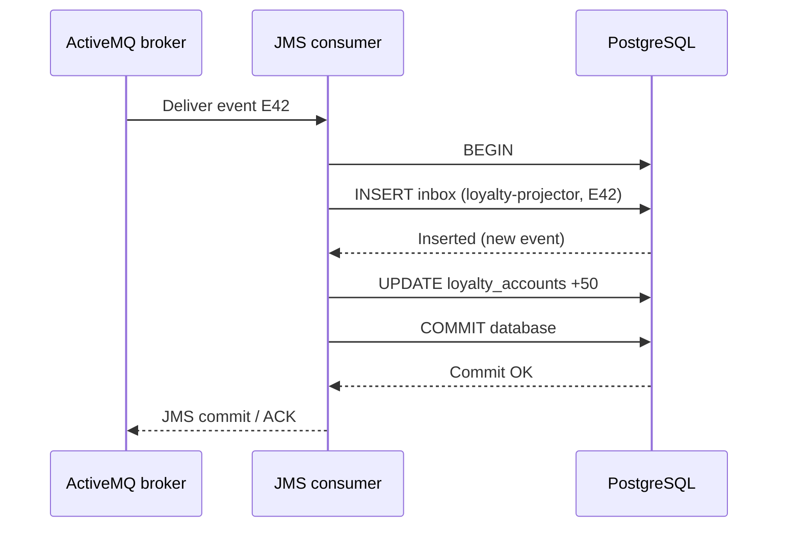
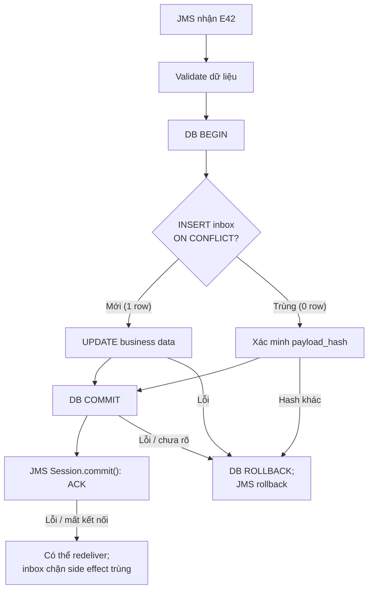

# Consumer lũy đẳng với bảng inbox, ràng buộc duy nhất và giao dịch dữ liệu

> **Chương:** Độ tin cậy  
> **Ngữ cảnh:** Consumer Java/JMS đọc message từ ActiveMQ Classic hoặc ActiveMQ Artemis; dữ liệu nghiệp vụ lưu trong PostgreSQL. Trọng tâm là **chống áp dụng tác dụng phụ lặp lại** bằng inbox, unique constraint và transaction database — không phải cấu hình ACK hay DLQ tổng quát.

## 1. Yêu cầu thực tế: message có thể lặp nhưng điểm thưởng không được cộng hai lần

Hệ thống phát sự kiện `LoyaltyPointsCredited` để tăng điểm khách hàng. Một message có các trường:

```json
{
  "eventId": "11111111-1111-1111-1111-111111111111",
  "eventType": "LoyaltyPointsCredited",
  "schemaVersion": 1,
  "accountId": "00000000-0000-0000-0000-000000000001",
  "points": 50
}
```

Giả sử consumer nhận event, cộng 50 điểm và commit PostgreSQL thành công. Ngay sau đó tiến trình chết **trước khi broker ghi nhận ACK**. Broker không biết nghiệp vụ đã hoàn tất, nên có thể giao lại cùng message. Nếu consumer lại chạy lệnh `UPDATE accounts SET points = points + 50`, tài khoản sẽ bị cộng thành 100 điểm.

Đây không phải lỗi của broker: **at-least-once delivery** có thể dẫn đến nhiều lần giao cho cùng một event. Điều ta cần bảo đảm là:

> Với một cặp **(nhóm xử lý, eventId)** hợp lệ, tác dụng phụ ghi vào database của nhóm đó được **commit không quá một lần**, bất kể event được giao bao nhiêu lần.

Phạm vi của khẳng định này quan trọng: ta kiểm soát **database chung nơi lưu inbox và business data**, không tự biến mạng, JMS hay HTTP bên ngoài thành hệ thống exactly-once.

### 1.1. Ba bản sắc dễ bị nhầm

| Định danh | Tạo bởi | Dùng để làm gì? | Nên dùng làm khóa inbox? |
|---|---|---|---|
| `eventId` | Producer/domain tạo, ổn định qua lần gửi lại cùng event | Xác định **sự kiện nghiệp vụ duy nhất** | **Có**, kèm namespace consumer và, khi cần, nguồn phát |
| `JMSMessageID` | JMS provider gán khi gửi | Truy vết một message ở cấp JMS | **Không đủ**: producer gửi lại event có thể có JMSMessageID mới |
| `JMSXDeliveryCount` / `JMSRedelivered` | Provider/broker | Gợi ý về lượt giao và redelivery | **Không**: không phân biệt mọi duplicate nghiệp vụ |

Nếu producer tái tạo `eventId` mới sau mỗi lần retry cùng một sự kiện, inbox không thể biết đó là duplicate. Vì vậy, **định danh ổn định từ producer là một phần bắt buộc của hợp đồng**.

## 2. Mô hình inbox: giữ dấu đã xử lý trong cùng transaction với business effect

Bảng **inbox** lưu những event mà một nhóm consumer đã áp dụng thành công. Trong ví dụ, nhóm xử lý mang tên `loyalty-projector`.



Thứ tự quan trọng không phải riêng câu lệnh `INSERT` đứng trước hay sau `UPDATE`, mà là **cả hai phải thành công hoặc rollback cùng một database transaction**. Quy trình đề xuất:

1. Validate message, lấy `consumerName`, `eventId` và dữ liệu nghiệp vụ.
2. Bắt đầu DB transaction.
3. Cố gắng **INSERT bản ghi inbox** với unique constraint.
4. Nếu INSERT thành công, thực hiện thay đổi nghiệp vụ **trong chính DB transaction đó**.
5. Nếu duplicate đã commit trước đó, **không áp dụng side effect lần nữa**; có thể kiểm tra fingerprint để phát hiện tái sử dụng eventId sai payload.
6. Commit DB transaction.
7. **Chỉ sau khi DB commit thành công**, xác nhận JMS delivery (`Session.commit()` trong ví dụ).
8. Nếu transaction DB lỗi/chưa xác định kết quả, **không ACK thành công**; cho broker redeliver và dựa vào inbox để phân xử.

### 2.1. Hai bất biến cần chứng minh

**Bất biến 1 — uniqueness:** trong cùng namespace consumer, một `eventId` không thể có hai bản ghi inbox đã commit.

**Bất biến 2 — atomicity:** **không có** trạng thái “đã commit inbox nhưng chưa commit thay đổi nghiệp vụ” hoặc ngược lại. Chúng thuộc cùng transaction.

Kết hợp hai bất biến, cộng với việc không ACK JMS trước khi DB commit, ta có thể chịu được phần lớn lỗi crash/replay mà **không cộng điểm trùng trong database**.

Không có transaction chung giữa JMS và PostgreSQL ở đây. Điều kiện thiết kế là: **DB commit trước → JMS ACK sau**, cho phép một số message bị giao lại, nhưng xử lý lặp được chặn bởi inbox.

## 3. Cấu trúc PostgreSQL: khóa duy nhất là trọng tài cuối cùng

Ví dụ dùng PostgreSQL để tận dụng `INSERT ... ON CONFLICT DO NOTHING`. SQL này **không phải cú pháp ANSI SQL chung**; MySQL, SQL Server và các RDBMS khác dùng cách xử lý conflict khác nhau.

```sql
CREATE TABLE loyalty_accounts (
    account_id UUID PRIMARY KEY,
    points BIGINT NOT NULL DEFAULT 0,
    CONSTRAINT chk_points_nonnegative CHECK (points >= 0)
);

CREATE TABLE consumer_inbox (
    consumer_name TEXT NOT NULL,
    event_id UUID NOT NULL,
    payload_hash CHAR(64) NOT NULL,
    processed_at TIMESTAMPTZ NOT NULL DEFAULT CURRENT_TIMESTAMP,

    CONSTRAINT pk_consumer_inbox
        PRIMARY KEY (consumer_name, event_id)
);

-- Dữ liệu thử nghiệm.
INSERT INTO loyalty_accounts (account_id, points)
VALUES ('00000000-0000-0000-0000-000000000001', 0)
ON CONFLICT (account_id) DO NOTHING;
```

### 3.1. Vì sao khóa là `(consumer_name, event_id)`?

Cùng event `OrderPaid` có thể được hai subscription sử dụng cho **hai projection khác nhau**, ví dụ `billing-ledger` và `analytics-projector`. Nếu khóa duy nhất toàn hệ thống chỉ là `eventId`, consumer thứ hai có thể tưởng event đã xử lý rồi và bỏ qua việc của mình.

```text
eventId = E42
  |
  +--> consumerName=billing-ledger      -> được xử lý 1 lần
  |
  +--> consumerName=analytics-projector -> được xử lý 1 lần
```

**Ranh giới idempotency là từng tác dụng phụ cần được khống chế**, không nhất thiết là toàn bộ topic. Các instance cùng thực thi một chức năng (ví dụ ba worker `loyalty-projector`) phải dùng **cùng consumer_name** để chia sẻ dedupe state.

Nếu `eventId` chỉ duy nhất **trong phạm vi producer**, bổ sung `producer_id`/`source_system` vào primary key và giữ nhất quán trong hợp đồng. Không thay khóa một cách tùy tiện vì sẽ khiến sự kiện cũ được xem là mới.

### 3.2. Vì sao thêm `payload_hash`?

Một `eventId` xuất hiện lại nhưng có `accountId` hoặc `points` **khác** không phải duplicate an toàn: có thể producer tái sử dụng ID sai, dữ liệu bị sửa hoặc message bị làm giả.

Lưu một fingerprint của các trường business **đã chuẩn hóa** cho phép phát hiện:

- **Same ID + same payload:** duplicate hợp lệ, bỏ qua side effect và ACK.
- **Same ID + different payload:** vi phạm hợp đồng; **không** âm thầm ACK như duplicate lành tính; cần ghi nhận cảnh báo/quarantine.

Fingerprint không thay thế chữ ký số hay xác thực producer. Nó nhằm bảo vệ **tính nhất quán khi tái sử dụng event ID**.

### 3.3. Không dùng `SELECT` rồi mới `INSERT` để phân xử

Cách sai rất thường gặp:

```sql
-- CẢ hai worker có thể đều đọc "không tìm thấy".
SELECT 1
FROM consumer_inbox
WHERE consumer_name = 'loyalty-projector'
  AND event_id = '11111111-1111-1111-1111-111111111111';

-- Sau đó cả hai đều thực hiện side effect trước khi ai đó INSERT.
```

Giữa `SELECT` và `INSERT` có **race condition (TOCTOU)**. Kể cả code kiểm tra “event chưa tồn tại”, hai worker vẫn có thể cùng qua bước kiểm tra.

Cách đúng là để **unique index** quyết định trong DB transaction:

```sql
INSERT INTO consumer_inbox (
    consumer_name, event_id, payload_hash
)
VALUES (
    'loyalty-projector',
    '11111111-1111-1111-1111-111111111111',
    '0123456789abcdef0123456789abcdef0123456789abcdef0123456789abcdef'
)
ON CONFLICT (consumer_name, event_id) DO NOTHING;
```

Ứng dụng kiểm tra **số dòng được INSERT**:

- `1`: event này được tiến trình hiện tại giành quyền xử lý trong transaction.
- `0`: event đã tồn tại; **không UPDATE nghiệp vụ lần nữa**.

**Không commit bản ghi inbox sớm.** Nếu insert inbox được commit độc lập rồi UPDATE nghiệp vụ thất bại, bản ghi sẽ chặn redelivery mãi mãi dù công việc chưa hoàn thành.

## 4. Vì sao unique constraint an toàn khi hai consumer xử lý cùng lúc?

Xét hai transaction PostgreSQL `T1` và `T2` dùng isolation **READ COMMITTED**, cùng event `E42` và cùng consumer namespace.

```mermaid
sequenceDiagram
    participant T1 as Worker 1 / T1
    participant DB as PostgreSQL unique index
    participant T2 as Worker 2 / T2
    T1->>DB: INSERT inbox(E42)
    DB-->>T1: 1 row inserted (uncommitted)
    T2->>DB: INSERT inbox(E42) ON CONFLICT DO NOTHING
    Note over T2,DB: Chờ kết quả unique conflict của T1
    T1->>DB: UPDATE account +50; COMMIT
    DB-->>T1: Commit OK
    DB-->>T2: 0 rows inserted
    T2->>DB: SELECT hash, COMMIT (no UPDATE)
    DB-->>T2: Duplicate confirmed
```

Trường hợp **T1 rollback** thay vì commit: T2 có thể tiếp tục insert thành công và chính T2 thực hiện UPDATE. Nhờ vậy, event không bị “đánh dấu đã làm” bởi một transaction thất bại.

**Lưu ý PostgreSQL:** `INSERT ... ON CONFLICT DO NOTHING` có thể phải đợi một transaction đang ghi key trùng. Ở mức `READ COMMITTED`, câu `SELECT` **riêng sau INSERT** có thể nhìn thấy bản ghi vừa được transaction khác commit. Không xây giải pháp giả định tương tự trên mọi isolation level hoặc DBMS; cần kiểm thử với cơ sở dữ liệu thực tế.

### 4.1. Lock và hiệu năng

Unique constraint giải quyết **tính đúng đắn**, nhưng các duplicate cùng ID có thể tranh chấp cùng index key và chờ commit. Tránh giữ transaction quá lâu:

- Validate payload trước khi mở DB transaction.
- Chỉ thao tác **database nội bộ cần nguyên tử** trong transaction.
- Tránh gọi API ngoài, chờ HTTP hoặc sleep trong lúc đang giữ lock.
- Dùng connection pool, timeout hợp lý và theo dõi `lock wait`/deadlock.
- Khi lỗi deadlock/serialization, rollback rồi cho message retry; không ACK sớm.

Nếu một message tạo quá nhiều phép ghi DB, cân nhắc điều chỉnh batch size hoặc chia lại dữ liệu, nhưng không tách inbox và thay đổi cần bảo vệ ra hai transaction riêng.

## 5. Ranh giới ACK: database commit trước, JMS commit sau

Ví dụ dùng **JMS transacted session** để xác nhận việc tiêu thụ. `Session.commit()` ở đây chỉ commit phần JMS; nó **không** bao gồm `java.sql.Connection.commit()`.



### 5.1. Ma trận crash cần nhớ

| Thời điểm lỗi | Trạng thái DB có thể có | Lần giao sau phải làm gì? |
|---|---|---|
| Trước khi INSERT inbox | Chưa ghi gì | Thử xử lý như message mới |
| Sau INSERT nhưng **trước DB commit** | Transaction chưa commit; DB rollback nếu connection chết | Thử lại; không có inbox đã commit chặn nhầm |
| Sau DB commit, **trước JMS ACK** | Inbox **và** business update đã commit | Nhận duplicate, đối chiếu hash, **không update nữa**, ACK |
| Trong lúc `Session.commit()`, kết quả ACK không rõ | DB đã commit; ACK JMS có thể thành công hoặc chưa | Nếu redelivery, inbox chặn trùng |
| Sau JMS ACK thành công | DB đã commit | Broker không cần giao lại message từ queue vì lượt giao đã hoàn tất |

**Không đảo thứ tự thành JMS ACK trước → DB commit sau.** Nếu worker chết giữa hai bước, message có thể đã rời queue nhưng DB chưa cập nhật — khó phục hồi bằng redelivery.

**Không cần** giả vờ hai commit là một XA transaction: inbox biến đoạn không nguyên tử giữa DB và JMS thành **an toàn khi phát lại** đối với tác dụng phụ trong DB.

## 6. Code Java: PostgreSQL inbox + JMS consumer

Ví dụ chạy theo mô hình:

- Broker: ActiveMQ Classic hoặc Artemis có **OpenWire acceptor**, queue `loyalty.credit`.
- Client: `activemq-client` 5.x và API `javax.jms`.
- Database: PostgreSQL, schema ở mục 3.
- Producer gửi `MapMessage` có `eventId`, `accountId`, `points`; ứng dụng thật có thể dùng `TextMessage` JSON/Protobuf nhưng vẫn giữ cùng thuật toán inbox.
- DB transaction ở isolation `READ COMMITTED`; một message được xử lý trong một transaction DB riêng.
- Consumer dùng `SESSION_TRANSACTED` để ACK sau DB commit. Không dùng `AUTO_ACKNOWLEDGE` vì ACK có thể diễn ra trước khi nghiệp vụ DB hoàn tất.

### 6.1. Maven dependency

```xml
<dependencies>
  <dependency>
    <groupId>org.apache.activemq</groupId>
    <artifactId>activemq-client</artifactId>
    <version>5.18.5</version>
  </dependency>

  <dependency>
    <groupId>org.postgresql</groupId>
    <artifactId>postgresql</artifactId>
    <version>42.7.4</version>
  </dependency>
</dependencies>
```

Đây là các version **minh họa cố định**, không phải tuyên bố bản mới nhất. Kiểm tra compatibility/security theo JDK và broker của dự án. Phần code sử dụng Java 11+ và `javax.jms`.

### 6.2. Consumer đầy đủ: `InboxConsumer.java`

```java
import java.nio.charset.StandardCharsets;
import java.security.MessageDigest;
import java.sql.DriverManager;
import java.sql.PreparedStatement;
import java.sql.ResultSet;
import java.sql.SQLException;
import java.util.UUID;

import javax.jms.Connection;
import javax.jms.JMSException;
import javax.jms.MapMessage;
import javax.jms.Message;
import javax.jms.MessageConsumer;
import javax.jms.Session;

import org.apache.activemq.ActiveMQConnectionFactory;

public final class InboxConsumer {
    private static final String CONSUMER_NAME = "loyalty-projector";
    private static final String QUEUE = "loyalty.credit";

    private static final class Event {
        final UUID eventId;
        final UUID accountId;
        final long points;
        final String payloadHash;

        Event(UUID eventId, UUID accountId, long points) throws Exception {
            this.eventId = eventId;
            this.accountId = accountId;
            this.points = points;
            // Thống nhất canonical format với producer/schema.
            String canonical = "LoyaltyPointsCredited|1|"
                    + accountId + "|" + points;
            MessageDigest md = MessageDigest.getInstance("SHA-256");
            byte[] digest = md.digest(
                    canonical.getBytes(StandardCharsets.UTF_8));
            StringBuilder hex = new StringBuilder(64);
            for (byte b : digest) {
                int n = b & 0xff;
                hex.append(Character.forDigit(n >>> 4, 16));
                hex.append(Character.forDigit(n & 0x0f, 16));
            }
            this.payloadHash = hex.toString();
        }
    }

    public static void main(String[] args) throws Exception {
        String brokerUrl = System.getenv().getOrDefault(
                "BROKER_URL", "tcp://localhost:61616");
        String jdbcUrl = requiredEnv("JDBC_URL");
        String dbUser = requiredEnv("DB_USER");
        String dbPass = requiredEnv("DB_PASSWORD");

        ActiveMQConnectionFactory factory =
                new ActiveMQConnectionFactory(brokerUrl);

        String brokerUser = System.getenv("BROKER_USER");
        String brokerPass = System.getenv("BROKER_PASSWORD");

        Connection jms = (brokerUser == null || brokerUser.isEmpty())
                ? factory.createConnection()
                : factory.createConnection(brokerUser, brokerPass);

        try {
            Session session = jms.createSession(
                    true, Session.SESSION_TRANSACTED);
            MessageConsumer consumer =
                    session.createConsumer(session.createQueue(QUEUE));
            try {
                jms.start();

                while (!Thread.currentThread().isInterrupted()) {
                    Message message = consumer.receive(5000);
                    if (message == null) {
                        continue;
                    }

                    try {
                        Event event = decodeAndValidate(message);
                        boolean fresh = applyToDatabase(
                                jdbcUrl, dbUser, dbPass, event);

                        // DB đã commit hoặc duplicate được xác minh.
                        session.commit(); // JMS ACK delivery.
                        System.out.println(
                                "eventId=" + event.eventId
                                + " applied=" + fresh);
                    } catch (Exception failure) {
                        System.err.println(
                                "Processing failed: " + failure);

                        // Không ACK message có DB transaction thất bại.
                        try {
                            session.rollback();
                        } catch (JMSException rollbackFailure) {
                            failure.addSuppressed(rollbackFailure);
                            throw failure; // Khởi động lại consumer/connection.
                        }

                        // JMS connection/session có thể đang lỗi hoặc
                        // commit outcome không xác định: kết thúc tiến trình.
                        if (failure instanceof JMSException) {
                            throw failure;
                        }

                        // Production: phân loại lỗi vĩnh viễn và
                        // giới hạn retry; không rollback vô hạn.
                    }
                }
            } finally {
                try {
                    consumer.close();
                } finally {
                    session.close();
                }
            }
        } finally {
            jms.close();
        }
    }

    private static Event decodeAndValidate(Message message)
            throws Exception {
        if (!(message instanceof MapMessage)) {
            throw new IllegalArgumentException("Expected MapMessage");
        }

        if (!"LoyaltyPointsCredited".equals(
                message.getStringProperty("eventType"))
                || !message.propertyExists("schemaVersion")
                || message.getIntProperty("schemaVersion") != 1) {
            throw new IllegalArgumentException(
                    "Unsupported event contract");
        }

        MapMessage map = (MapMessage) message;
        Object eventId = map.getObject("eventId");
        Object accountId = map.getObject("accountId");
        Object points = map.getObject("points");

        if (!(eventId instanceof String)
                || !(accountId instanceof String)
                || !(points instanceof Long)) {
            throw new IllegalArgumentException("Invalid body types");
        }

        long n = (Long) points;
        if (n <= 0 || n > 100_000) {
            throw new IllegalArgumentException("Invalid points");
        }

        return new Event(
                UUID.fromString((String) eventId),
                UUID.fromString((String) accountId), n);
    }

    private static boolean applyToDatabase(
            String url, String user, String password, Event event)
            throws Exception {
        try (java.sql.Connection db =
                     DriverManager.getConnection(url, user, password)) {
            db.setTransactionIsolation(
                    java.sql.Connection.TRANSACTION_READ_COMMITTED);
            db.setAutoCommit(false);

            try {
                boolean fresh = reserveInbox(db, event);
                if (fresh) {
                    creditPoints(db, event);
                }
                db.commit(); // Inbox và thay đổi điểm cùng commit.
                return fresh;
            } catch (Exception failure) {
                try {
                    db.rollback();
                } catch (SQLException rollbackFailure) {
                    failure.addSuppressed(rollbackFailure);
                }
                throw failure;
            }
        }
    }

    private static boolean reserveInbox(
            java.sql.Connection db, Event event) throws SQLException {
        String insert =
                "INSERT INTO consumer_inbox "
                + "(consumer_name, event_id, payload_hash) "
                + "VALUES (?, ?, ?) "
                + "ON CONFLICT (consumer_name, event_id) DO NOTHING";

        try (PreparedStatement ps = db.prepareStatement(insert)) {
            ps.setString(1, CONSUMER_NAME);
            ps.setObject(2, event.eventId);
            ps.setString(3, event.payloadHash);

            if (ps.executeUpdate() == 1) {
                return true; // Đã giành quyền xử lý event mới.
            }
        }

        // Câu SELECT mới ở READ COMMITTED, sau khi conflict
        // đã được giải quyết; kiểm tra lại tính nhất quán payload.
        try (PreparedStatement ps = db.prepareStatement(
                "SELECT payload_hash FROM consumer_inbox "
                + "WHERE consumer_name = ? AND event_id = ?")) {
            ps.setString(1, CONSUMER_NAME);
            ps.setObject(2, event.eventId);
            try (ResultSet rs = ps.executeQuery()) {
                if (!rs.next()) {
                    throw new SQLException(
                            "Inbox conflict but row not visible");
                }
                String storedHash = rs.getString(1).trim();
                if (!storedHash.equals(event.payloadHash)) {
                    throw new IllegalStateException(
                            "Same eventId with different payload");
                }
            }
        }
        return false; // Duplicate; không cộng điểm.
    }

    private static void creditPoints(
            java.sql.Connection db, Event event) throws SQLException {
        try (PreparedStatement ps = db.prepareStatement(
                "UPDATE loyalty_accounts "
                + "SET points = points + ? "
                + "WHERE account_id = ?")) {
            ps.setLong(1, event.points);
            ps.setObject(2, event.accountId);
            if (ps.executeUpdate() != 1) {
                throw new SQLException(
                        "Account not found: " + event.accountId);
            }
        }
    }

    private static String requiredEnv(String name) {
        String value = System.getenv(name);
        if (value == null || value.isEmpty()) {
            throw new IllegalArgumentException(
                    "Missing environment variable " + name);
        }
        return value;
    }
}
```

**Điểm cần đọc kỹ trong code:**

- `decodeAndValidate` kiểm tra type, version và giá trị **trước khi mở DB transaction**. Contract này chỉ là ví dụ; ứng dụng thật cũng phải xác thực producer, chống payload quá lớn và áp schema chính thức.
- `reserveInbox` không dùng `SELECT` trước `INSERT`; unique constraint là điểm phân xử khi nhiều worker chạy đồng thời.
- Nếu là duplicate đúng hash, hàm **không gọi** `creditPoints` và vẫn cho phép `session.commit()` để dọn bản giao lặp.
- Nếu không tìm được account, PostgreSQL transaction rollback **cả bản ghi inbox**, do đó retry sau khi account xuất hiện vẫn có thể áp dụng sự kiện.
- Nếu DB commit xong nhưng `session.commit()` thất bại, lần phát lại sẽ thấy bản ghi inbox và không cộng điểm nữa.
- Code cố tình dùng một DB connection mới cho mỗi message để minh họa ranh giới. Production nên dùng pool, timeout và giám sát transaction.
- Trường hợp **schema sai hoặc same ID khác payload** cần có chính sách quarantine/cảnh báo. Vòng catch ở ví dụ rollback để tránh ACK nhầm nhưng **không nên triển khai retry vô hạn** cho lỗi vĩnh viễn.

### 6.3. Producer tối thiểu để kiểm chứng

Dùng JMS producer như dưới đây (giả sử đã có `Connection`, `Session` và queue `loyalty.credit`):

```java
// Session gửi cũng có thể dùng transaction để commit rõ ràng.
Session sendSession = connection.createSession(
        true, Session.SESSION_TRANSACTED);

javax.jms.Queue queue =
        sendSession.createQueue("loyalty.credit");
javax.jms.MessageProducer producer =
        sendSession.createProducer(queue);
producer.setDeliveryMode(javax.jms.DeliveryMode.PERSISTENT);

javax.jms.MapMessage event = sendSession.createMapMessage();
event.setString(
        "eventId", "11111111-1111-1111-1111-111111111111");
event.setString(
        "accountId", "00000000-0000-0000-0000-000000000001");
event.setLong("points", 50L);
event.setStringProperty(
        "eventType", "LoyaltyPointsCredited");
event.setIntProperty("schemaVersion", 1);

producer.send(event);
sendSession.commit();
```

Đoạn này là phần producer minh họa, **không phải file Java độc lập**; `connection` phải được tạo và đóng theo lifecycle của ứng dụng, tương tự consumer. Để thử duplicate do producer, tạo **message mới với cùng các business fields và cùng eventId**, rồi gửi lần thứ hai. Đừng chỉ gọi `producer.send(event)` sau khi `eventId` đã bị sửa ngầm.

### 6.4. Kết quả kiểm chứng bằng SQL

Sau khi gửi cùng một event hai lần và để consumer xử lý xong:

```sql
SELECT account_id, points
FROM loyalty_accounts
WHERE account_id = '00000000-0000-0000-0000-000000000001';

SELECT consumer_name, event_id, payload_hash, processed_at
FROM consumer_inbox
WHERE consumer_name = 'loyalty-projector'
  AND event_id = '11111111-1111-1111-1111-111111111111';
```

Kỳ vọng với dữ liệu seed ban đầu `points=0`:

| Bảng | Kết quả |
|---|---|
| `loyalty_accounts` | Điểm cuối cùng **50**, không phải 100 |
| `consumer_inbox` | Đúng **1 dòng** cho cặp `(loyalty-projector, eventId)` |
| Log lần xử lý đầu | `applied=true` |
| Log lần giao trùng | `applied=false` |

Kết quả phụ thuộc điều kiện: queue sạch, không có event khác cập nhật cùng account và không có consumer ngoài phạm vi test. Nếu nhiều event hợp lệ khác nhau cùng cộng điểm, tổng điểm lớn hơn 50 là đúng; việc đối chiếu phải dựa trên **event ID**, không chỉ trên giá trị cuối.

## 7. Thử nghiệm sự cố và concurrency

### 7.1. Inject crash ở đúng ranh giới

Trong môi trường test riêng, có thể tạo các tình huống:

1. **Crash ngay sau INSERT inbox trước UPDATE:** dừng tiến trình hoặc rollback DB. Sau reconnect, không có bản ghi inbox đã commit; event có thể được xử lý lại.
2. **Crash sau UPDATE nhưng trước DB commit:** PostgreSQL rollback cả UPDATE và INSERT; event chưa được coi là xong.
3. **Crash sau DB commit nhưng trước JMS commit:** event được giao lại, `reserveInbox` trả false và không UPDATE tiếp.
4. **Không rõ kết quả DB commit:** driver ném lỗi sau khi kết nối đứt. Không được ACK JMS; lần replay dùng unique key để quyết định DB đã commit hay chưa.
5. **Hai worker cùng nhận hai message có cùng eventId:** chạy hai consumer process trên cùng DB. Một transaction áp dụng side effect; transaction còn lại đợi unique conflict rồi bỏ qua.

**Cách kiểm chứng:** truy vấn số dòng inbox bằng key và số điểm cuối; không chỉ dựa trên `JMSRedelivered`. Duplicate do producer gửi lại có thể là **message mới hoàn toàn** và `JMSRedelivered=false`.

### 7.2. Một bảng test bắt lỗi thiết kế

| Kịch bản | Số message có cùng eventId | Kết quả inbox | Side effect DB |
|---|---:|---:|---|
| Gửi lần đầu | 1 | 1 dòng | Cộng điểm đúng 1 lần |
| Gửi lại cùng eventId, cùng payload | 2+ | Vẫn 1 dòng | Không cộng thêm |
| Hai consumer đồng thời cùng eventId | 2 | Vẫn 1 dòng | Chỉ 1 transaction được áp dụng |
| DB lỗi trước commit | 1 | 0 dòng đã commit | 0 thay đổi được commit |
| Crash sau DB commit, trước JMS ACK | Replay | 1 dòng | Không cộng trùng |
| Cùng eventId nhưng `points` khác | 2 | 1 dòng | Lần sau phát hiện hash mismatch, không áp dụng thêm |
| Hai consumer name khác nhau | 1 event tới 2 subscription | 2 dòng (mỗi namespace 1) | Mỗi projection có thể áp dụng tác dụng phụ riêng |

### 7.3. Test số lượng lớn và tính tương tranh

Gửi 100 message vật lý cùng một `eventId` (dùng cùng payload) và chạy nhiều instance. Tiêu chí: cuối cùng chỉ **một** bản ghi inbox, account được cộng đúng `points` một lần, không có lỗi “duplicate key” bị hiểu thành sự kiện cần cộng lại.

Đừng kiểm thử bằng cách cho nhiều thread dùng **chung một JMS Session**; JMS session thường có yêu cầu dùng tuần tự. Mỗi worker nên có session/connection lifecycle riêng, nhưng dùng chung database và cùng consumer namespace.

## 8. Bẫy quan trọng khi triển khai thực tế

### 8.1. “Đánh dấu processed” trong transaction khác

**Sai:**

```text
Transaction A:
  INSERT inbox(E42)
  COMMIT

Transaction B:
  UPDATE loyalty_accounts +50
  -- crash trước COMMIT
```

Lần replay thấy `E42` trong inbox, nên bỏ qua UPDATE dù điểm chưa từng được cộng. Đây là **false duplicate**. Cách sửa là đưa INSERT inbox và UPDATE vào **cùng transaction**.

### 8.2. Business effect ở hệ thống ngoài database

Nếu consumer:

1. INSERT inbox vào PostgreSQL;
2. gọi API thanh toán, gửi email hoặc ghi một database khác;
3. COMMIT PostgreSQL;

thì **transaction PostgreSQL không bao trùm HTTP hay database khác**. Nếu API thành công nhưng DB rollback, lần replay có thể gọi API lần nữa.

Các cách giải quyết:

- API bên ngoài có **idempotency key** dựa trên event ID;
- lưu ý định thực hiện side effect vào **transactional outbox**, commit cùng inbox/business data; một worker khác gửi tới hệ thống ngoài với retry và idempotency;
- dùng state machine/saga có bù trừ nếu tác dụng phụ không thể hoàn toàn idempotent.

Không tuyên bố bảng inbox bảo đảm exactly-once cho **mọi** side effect bên ngoài phạm vi transaction.

### 8.3. Xóa inbox quá sớm

Bảng inbox tăng liên tục nên cần retention/partitioning, nhưng xóa bản ghi trước khi hết thời gian message có thể bị phát lại sẽ **mở cửa cho duplicate cũ**.

Ví dụ:

```text
Ngày 1: E42 xử lý thành công, inbox lưu E42.
Ngày 8: Job xóa E42 sau 7 ngày.
Ngày 10: Một DLQ được redrive, phát lại E42.
Ngày 10: Không còn inbox E42 -> side effect bị áp dụng lần nữa.
```

Retention phải bao phủ **toàn bộ cửa sổ replay có thể xảy ra**: độ trễ broker, DLQ, backup restore, lịch redrive thủ công và producer retry. Nếu không thể đặt thời hạn hữu hạn an toàn, cần định danh/tombstone có tuổi thọ dài hoặc cơ chế business uniqueness khác.

### 8.4. Inbox không tự giải quyết ordering

Hai event **khác** ID có thể đến sai thứ tự, ví dụ `AccountCreated` và `PointsCredited`. Inbox chỉ loại bỏ duplicate **cùng ID**; nó không bảo đảm event mới không đến trước event cũ.

Nếu tính đúng đắn phụ thuộc thứ tự, dùng `aggregateId`, `sequence`/version và điều kiện cập nhật có kiểm tra version, hoặc partition/order key khi broker hỗ trợ. Đừng dùng inbox như lời giải thay thế cho domain ordering.

### 8.5. Same event ID, khác meaning

Một nguồn có thể vô tình phát hai message cùng ID nhưng payload khác. Nếu chỉ `ON CONFLICT DO NOTHING` rồi ACK, consumer sẽ **âm thầm bỏ mất thay đổi** hoặc che lỗi producer. Bài thực hành dùng `payload_hash` để phát hiện khác biệt, nhưng vẫn cần alert/quarantine và quy định xử lý rõ ràng; không để exception vĩnh viễn quay vòng vô hạn trong queue nóng.

### 8.6. Dữ liệu nhạy cảm và đa tenant

Không nên lưu toàn bộ payload có thông tin nhạy cảm vào inbox nếu mục tiêu chỉ là deduplication. Lưu `eventId`, consumer namespace, fingerprint, timestamp và metadata truy vết tối thiểu.

Với multi-tenant, nếu `eventId` chỉ duy nhất theo tenant hoặc source, thêm `tenant_id`/`source_system` vào unique key; dùng parameterized SQL và phân quyền DB. Tránh lưu giá trị tài khoản, token hoặc PII trong log duplicate không cần thiết.

## 9. Quan sát và vận hành inbox

Đo tối thiểu:

| Metric / sự kiện | Ý nghĩa |
|---|---|
| `inbox_inserted_total` | Event mới được thực sự áp dụng |
| `inbox_duplicate_total` | Event được phát lại hoặc gửi trùng và được bỏ qua an toàn |
| `inbox_payload_conflict_total` | Same ID nhưng business payload khác — cần cảnh báo |
| `inbox_tx_failure_total` | DB transaction lỗi, message chưa ACK |
| `inbox_db_commit_latency` | Latency transaction bao gồm unique index + business update |
| `inbox_lock_wait` | Contention khi nhiều worker xử lý cùng key |
| `jms_redelivery_total` | Gợi ý broker phát lại; không thay thế duplicate count ở nghiệp vụ |
| `inbox_oldest_processed_at`, kích thước bảng | Cơ sở để lập retention/purge an toàn |

Một quy trình chẩn đoán khi “điểm bị cộng hai lần”:

1. Lấy hai log business effect và kiểm tra **eventId** có giống không.
2. Nếu khác ID: kiểm tra producer tái tạo sự kiện/ID khi retry; inbox không thể biết hai ID biểu diễn cùng giao dịch.
3. Nếu giống ID: kiểm tra **consumer_name**, tenant/source namespace và key thật trong DB.
4. Kiểm tra INSERT inbox và UPDATE có cùng DB connection/transaction không.
5. Xem có job purge/restore khiến row inbox biến mất không.
6. Xem side effect có được thực hiện qua HTTP/database khác không.
7. Kiểm tra các worker có dùng chung DB primary và unique index hay không; read replica không phải trọng tài ghi deduplication.

Cần giữ log đủ để đối chiếu với broker deliveries nhưng không biến `JMSXDeliveryCount` thành nguồn sự thật duy nhất của business duplication.

## 10. Câu hỏi vận dụng

1. Vì sao `SELECT inbox` rồi `INSERT inbox` không đủ an toàn khi hai worker chạy song song, dù mỗi worker có transaction?
2. Một consumer đã INSERT inbox và COMMIT, sau đó mới UPDATE nghiệp vụ. Nó chết giữa hai bước. Khi broker redeliver, điều gì xảy ra?
3. DB commit xong nhưng `Session.commit()` ném `JMSException` vì mất kết nối. Bạn nên ACK, rollback hay thoát và reconnect? Vai trò của inbox là gì?
4. Hai service `billing-ledger` và `analytics-projector` cùng nhận một event. Vì sao unique key chỉ có `eventId` có thể làm một service bỏ sót event?
5. Cùng `eventId` nhưng `points` khác. Nếu hệ thống chỉ dùng `ON CONFLICT DO NOTHING`, lỗi nghiệp vụ nào bị che giấu?
6. Một API thanh toán ngoài PostgreSQL đã xử lý thành công nhưng consumer crash trước DB commit. Inbox có bảo đảm API không bị gọi lại không? Cần bổ sung cơ chế gì?
7. Tại sao việc purge inbox sau 7 ngày có thể nguy hiểm nếu DLQ được redrive sau 30 ngày?
8. Viết test với hai JVM consumer và 100 message trùng ID để chứng minh chỉ có một business update được commit.

## 11. Tài liệu tham khảo

- [Jakarta Messaging Specification](https://jakarta.ee/specifications/messaging/) — JMS/Jakarta acknowledgment và transacted sessions; đối chiếu namespace `javax.jms`/`jakarta.jms` theo client.
- [PostgreSQL — INSERT, ON CONFLICT](https://www.postgresql.org/docs/current/sql-insert.html) — atomic insert và xử lý unique conflict.
- [PostgreSQL — Transaction Isolation](https://www.postgresql.org/docs/current/transaction-iso.html) — `READ COMMITTED`, concurrent transactions và visibility.
- [PostgreSQL — Constraints](https://www.postgresql.org/docs/current/ddl-constraints.html) — primary key, unique và check constraints.
- [Apache ActiveMQ Classic — Message Redelivery and DLQ Handling](https://activemq.apache.org/components/classic/documentation/message-redelivery-and-dlq-handling) — trường hợp broker có thể phát lại message.
- [Apache ActiveMQ Artemis — Undelivered Messages](https://artemis.apache.org/components/artemis/documentation/latest/undelivered-messages.html) — redelivery và dead-letter behavior.

**Kết luận:** Consumer lũy đẳng không cần ngăn broker giao lặp. Điều cần bảo đảm là **một event ID ổn định**, **unique constraint đúng phạm vi**, và **INSERT inbox cùng business UPDATE trong một DB transaction**. Sau khi DB commit mới ACK JMS. Khi crash hoặc hai consumer cạnh tranh, lần xử lý sau thấy inbox đã commit và bỏ qua tác dụng phụ, giúp hệ thống đạt **effectively-once database effect** trong giới hạn được thiết kế — không phải exactly-once delivery hay giao dịch nguyên tử với mọi hệ thống ngoài.
