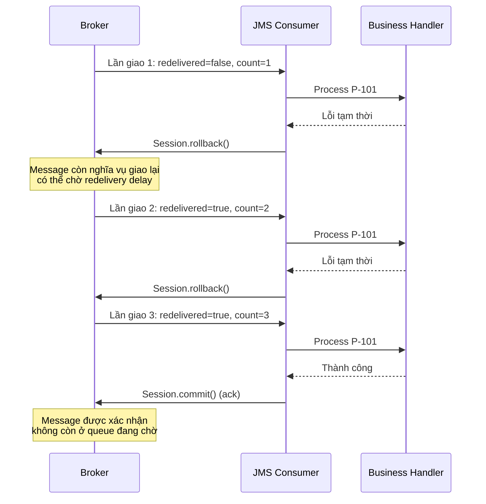

# JMSRedelivered, JMSXDeliveryCount và cách nhận biết số lần giao message

> **Chương:** Gửi lại và DLQ  
> **Module:** `INTEGRATION_MESSAGING_MESSAGE_BROKER_ACTIVEMQ` — thực hành ActiveMQ Classic và Artemis trong giao tiếp bất đồng bộ bằng queue, topic, routing và JMS, đặc biệt là acknowledgment, transaction, redelivery, dead-letter và vận hành broker tin cậy.  
> **Trọng tâm:** Hai dấu hiệu **do JMS provider cung cấp khi consumer nhận message**: `JMSRedelivered` (boolean header) và `JMSXDeliveryCount` (integer property). Bài tập trung vào cách đọc, diễn giải, kiểm tra bằng Java, và tránh quyết định sai khi dùng số lần giao để retry, chuyển DLQ hoặc chống trùng nghiệp vụ.

## 1. Hai dấu hiệu trả lời hai câu hỏi khác nhau

Một worker nhận `ChargePayment(paymentId=P-101)` và muốn biết đây có phải lần thử đầu hay một lần giao lại sau lỗi. JMS có hai nguồn thông tin:

| Dấu hiệu | Nằm ở đâu? | Trả lời câu hỏi | Giá trị thường thấy |
|---|---|---|---|
| `JMSRedelivered` | **Header** tiêu chuẩn của `Message` | Provider có lý do tin rằng message **đã được giao trước đó nhưng chưa được xác nhận** hay không? | `false` ở lần giao đầu; thường `true` khi giao lại |
| `JMSXDeliveryCount` | **Message property** thuộc nhóm `JMSX`, do provider thiết lập | Provider tính đây là **lần giao thứ mấy** đối với message? | `1` ở lần đầu; `2`, `3`… ở những lần giao tiếp theo |

Trong code Java, phải gọi **hai API khác nhau**:

```java
// javax.jms.Message hoặc jakarta.jms.Message:
boolean redelivered = message.getJMSRedelivered();

boolean hasCount = message.propertyExists("JMSXDeliveryCount");
Integer deliveryCount = hasCount
        ? message.getIntProperty("JMSXDeliveryCount")
        : null;
```

Không có `message.getJMSXDeliveryCount()` trong API JMS chuẩn. Ngược lại, không dùng `getBooleanProperty("JMSRedelivered")` để đọc header: `JMSRedelivered` **không phải** một application property.

**JMS 2.0/Jakarta Messaging yêu cầu provider cung cấp `JMSXDeliveryCount` cho message giao tới consumer, với số đếm bắt đầu bằng 1.** Khi làm việc với provider/client JMS cũ, bridge protocol hoặc hệ thống hỗn hợp, vẫn nên kiểm tra `propertyExists` rồi mới đọc để có đường xử lý rõ ràng nếu thuộc tính không xuất hiện.

### 1.1. Ví dụ vòng đời khi transaction bị rollback

Giả sử queue chỉ có một message `P-101`, worker dùng **transacted JMS Session**, broker không chuyển DLQ trước lượt thứ ba:



Trong một lần thử nghiệm không có prefetch/reconnect/HA phức tạp, log có thể là:

```text
DELIVERED businessId=P-101 JMSRedelivered=false JMSXDeliveryCount=1
ROLLBACK
DELIVERED businessId=P-101 JMSRedelivered=true  JMSXDeliveryCount=2
ROLLBACK
DELIVERED businessId=P-101 JMSRedelivered=true  JMSXDeliveryCount=3
COMMIT
```

Đây là **kết quả điển hình để kiểm thử**, không phải bảo đảm mọi broker sẽ giữ chính xác số đếm đó qua mọi loại mất điện, thay broker hay cơ chế bridge. Đặc biệt, số đếm là **thông tin giao message của provider**, không phải đồng hồ tuyệt đối đếm số lần nghiệp vụ thực hiện tác dụng phụ.

## 2. Phân biệt delivery attempt, retry và processing attempt

Trong một luồng message đáng tin cậy, thường có **ít nhất bốn bộ đếm khác nhau**:

| Khái niệm | Ai tăng? | Ví dụ | Có bằng `JMSXDeliveryCount`? |
|---|---|---|---|
| **Broker delivery attempt** | JMS provider/broker khi giao message | Lần gửi message tới consumer 1, 2, 3 | Thường được phản ánh, nhưng tùy tình huống runtime |
| **Application handler attempt** | Ứng dụng khi handler bắt đầu thực thi | `processPayment()` được gọi bao nhiêu lần | **Không chắc** |
| **Business operation attempt** | Dịch vụ/database/API bên ngoài | Số lần request charge tới payment gateway | **Không chắc** |
| **Producer publish retry** | Producer khi gửi lại event/command | `send(P-101)` được gọi hai lần vì timeout | **Không chắc**; có thể là hai JMS message khác nhau |

Một message có thể được broker dispatch/prefetch nhưng ứng dụng **chưa kịp gọi handler**. Nếu consumer chết, message có thể được phát lại. Bộ đếm delivery tăng dù handler chưa từng chạy. Trường hợp ngược lại, một handler có thể gọi API ngoài hai lần trong **một lần** nhận message. Hơn nữa, producer có thể gửi trùng **hai JMS message khác nhau** cho cùng một `paymentId`: cả hai cùng có `JMSXDeliveryCount=1` nhưng nghiệp vụ đã bị yêu cầu hai lần.

Ví dụ dễ nhầm:

```text
Producer gửi MessageID=A (paymentId=P-101)
    → Worker nhận: JMSXDeliveryCount=1
    → Ghi DB thành công nhưng crash trước JMS commit
    → Broker giao lại MessageID=A: JMSXDeliveryCount=2

Producer bị timeout và gửi lại cùng paymentId=P-101
    → Tạo MessageID=B
    → Worker nhận MessageID=B: JMSXDeliveryCount=1
```

**Từ góc nhìn nghiệp vụ**, có thể đã có ba lần tiếp cận xử lý một payment. Nhưng **không có** một JMS delivery count duy nhất đếm được cả MessageID A lẫn B.

### 2.1. Có thể lấy “số retry” bằng `count - 1` không?

Trong một chuỗi giao nhận liên tục **của cùng message và cùng provider**, `count=1` là lượt đầu và `count-1` thường là số lượt giao lại đã xảy ra trước lượt hiện tại:

- `count=1` → lượt đầu, chưa thấy delivery trước đó.
- `count=2` → đây là lượt giao thứ hai (một lượt trước).
- `count=4` → đây là lượt thứ tư (ba lượt trước).

Nhưng không nên tự đặt tên biến `retryCount` cho `JMSXDeliveryCount`: nó **đếm cả lượt đầu**, còn giới hạn “số redelivery tối đa” của từng provider có thể loại trừ lượt đầu. Đặc biệt sau broker crash, failover, bridge hoặc DLQ replay, số đếm có thể không tương ứng với lịch sử nghiệp vụ kỳ vọng.

Đặt tên rõ hơn:

```java
int providerDeliveryAttempt = message.getIntProperty("JMSXDeliveryCount");
int earlierDeliveries = Math.max(0, providerDeliveryAttempt - 1);
```

Dòng thứ hai chỉ là **diễn giải cục bộ** khi property hợp lệ và provider duy trì count như đã giả định; đừng dùng giá trị này làm audit trail nghiệp vụ duy nhất.

## 3. Khi nào `JMSRedelivered` trở thành `true`?

Về ý nghĩa, provider đặt `JMSRedelivered=true` nếu có lý do tin rằng message đã đến consumer trước đó nhưng **chưa được ack hoàn tất**.

Một số nguyên nhân thường gặp:

1. Consumer dùng `SESSION_TRANSACTED`, nhận message rồi gọi `Session.rollback()` / `JMSContext.rollback()`.
2. Consumer dùng session **không transacted**, chưa ack, rồi gọi `Session.recover()` khi API cho phép.
3. Consumer hoặc connection bị đóng/mất kết nối khi message đã được dispatch nhưng chưa ack.
4. Broker restart/failover sau khi đã dispatch message chưa xác nhận và cần phục hồi việc giao.
5. Consumer nhận message nhưng không commit trước khi worker/process chết.

**Đừng đồng nhất sự kiện lỗi của application với sự kiện redelivery.** Ví dụ:

- Worker nhận message ở `AUTO_ACKNOWLEDGE` bằng `receive()`; khi lời gọi trả thành công, provider có thể đã ack. Lỗi xử lý nghiệp vụ phát sinh **sau đó** không nhất thiết tạo redelivery.
- Worker trong transacted Session ném exception nhưng bắt lỗi rồi **vẫn gọi `commit()`**: message đã được ack hợp lệ theo broker, không còn để giao lại.
- Một message được giao lần thứ hai vì **producer tạo JMS message mới**, không phải redelivery của message cũ; `JMSRedelivered` trên message mới có thể vẫn là `false`.

### 3.1. Bảng tình huống

| Sự kiện | Có thể redeliver cùng JMS message? | Dấu hiệu kỳ vọng |
|---|---|---|
| `Session.rollback()` sau `receive` trong transacted Session | Có | `JMSRedelivered=true`, count tăng ở lần giao sau |
| `Session.recover()` ở session không giao dịch có delivery chưa ack | Có | Tương tự, tùy provider và thứ tự giao |
| Consumer crash trước ack/commit | Có | Lần tiếp theo thường có redelivery flag/count |
| Consumer commit thành công rồi ứng dụng crash | Thường **không** phải giao lại message đó | Queue đã xác nhận message |
| Producer gửi lại cùng payload thành message mới | Có **message mới**, không phải redelivery cũ | Có thể count=1, redelivered=false |
| Message hết TTL và bị expiry/discard | Không còn giao thông thường | Không có lần nhận mới; phải xem expiry metrics |
| Broker chuyển poison message vào DLQ | Không còn trong queue nguồn như trước | Kiểm tra DLQ; metadata khi đọc DLQ có thể khác |
| Message được dispatch nhưng chưa vào handler vì prefetch | Có thể phát lại sau khi consumer chết | Count có thể tăng dù handler attempt chưa tăng |

### 3.2. Hai dấu hiệu có bắt buộc luôn nhất quán?

Trong một provider thực hiện đầy đủ và vận hành bình thường, **`JMSXDeliveryCount >= 2` và `JMSRedelivered=true` thường đi cùng nhau**. Khi phát hiện:

```text
JMSRedelivered=false, JMSXDeliveryCount=3
hoặc
JMSRedelivered=true, JMSXDeliveryCount=1
```

không nên âm thầm sửa count hoặc xóa message. Hãy ghi log cả hai và kiểm tra:

- Broker/client version, loại giao thức và bridge nếu có.
- Message từng được chuyển DLQ, replay bằng producer mới hay được copy sang destination khác.
- Broker restart/failover hoặc persistence của delivery count.
- Khả năng provider không cung cấp property, hoặc client gặp lỗi chuyển kiểu dữ liệu.
- Đây là metadata quan sát trên `QueueBrowser` hay **message thực sự được `receive()`**?

Điểm mấu chốt: **không suy ra count chính xác chỉ từ boolean `JMSRedelivered`**. Nó không biểu đạt lần 2, 3 hay 100.

## 4. Đọc hai giá trị đúng cách và ghi log đủ để chẩn đoán

### 4.1. Java JMS 1.1/2.0 với `javax.jms`

Đoạn xử lý an toàn với cả provider cũ:

```java
import javax.jms.JMSException;
import javax.jms.Message;

static void logAttempt(Message message) throws JMSException {
    boolean redelivered = message.getJMSRedelivered();

    String deliveryCount = message.propertyExists("JMSXDeliveryCount")
            ? Integer.toString(message.getIntProperty("JMSXDeliveryCount"))
            : "NOT_PROVIDED";

    String businessId = message.propertyExists("businessId")
            ? message.getStringProperty("businessId")
            : "UNKNOWN";

    System.out.printf(
            "businessId=%s messageId=%s redelivered=%s "
            + "deliveryCount=%s%n",
            businessId,
            message.getJMSMessageID(),
            redelivered,
            deliveryCount);
}
```

Với Jakarta Messaging 3.x, thay import thành `jakarta.jms.Message`/`jakarta.jms.JMSException`; **phương thức đọc giống nhau**.

**Đừng để lỗi log làm thay đổi semantics xử lý:** `getIntProperty` có thể ném exception nếu provider/bridge đặt dữ liệu không có kiểu chuyển được. Trong handler production, log diagnostic phải không vô tình che mất exception chính, và nếu không đọc được metadata thì đánh dấu `unknown` rồi xử lý theo chính sách an toàn.

### 4.2. Phân biệt header, property và application metadata

| Trường | Nguồn | Nên dùng để làm gì? |
|---|---|---|
| `JMSMessageID` | Provider gán khi send | Theo vết một **JMS message**; không thay business ID |
| `JMSRedelivered` | Provider cập nhật khi giao | Nhận diện lần giao **có khả năng** là giao lại |
| `JMSXDeliveryCount` | Provider cập nhật khi giao | Nhận biết **thứ tự lượt giao** theo provider |
| `JMSCorrelationID` | Producer/application hoặc request-reply convention | Liên kết các message trong flow |
| `businessId` / `eventId` | **Ứng dụng** gán và giữ ổn định | Idempotency, audit, đối chiếu retries/re-publish |
| `JMSXGroupID` | Ứng dụng gán nếu dùng message groups | Giữ một nhóm message cùng khóa vào consumer phù hợp; **không** phải delivery count |

Không tự gán:

```java
// KHÔNG làm như sau:
message.setIntProperty("JMSXDeliveryCount", 7);
message.setJMSRedelivered(true);
```

Hai trường trên mô tả trạng thái giao message do **provider quản lý**. Producer không nên giả mạo giá trị để điều khiển retry. Dù API cho phép sửa một số header trên đối tượng `Message` trước khi gửi, đó không phải cách cấu hình broker redelivery hoặc cung cấp số đếm tin cậy.

### 4.3. Log tối thiểu cho một delivery

```text
timestamp=...
broker=...
destination=lab.delivery.attempts.caseA
consumerGroup=payments
workerId=payments-03
businessId=P-101
jmsMessageId=ID:...
jmsRedelivered=true
jmsxDeliveryCount=3
handlerStarted=true
handlerResult=TRANSIENT_FAILURE
transactionResult=ROLLBACK_RETURNED
```

Một dòng log “DeliveryCount=3, business charged three times” là **suy luận sai**. Chỉ khi đối chiếu application transaction và trạng thái gateway/DB mới biết charge đã chạy bao nhiêu lần.

## 5. Các nhân tố làm số đếm khác mong đợi

### 5.1. Prefetch và việc message đã dispatch trước handler

Với ActiveMQ Classic, client OpenWire thường có **prefetch**: broker cấp nhiều message cho client trong khi handler mới xử lý một message. Nếu worker chết:

```text
Broker ──dispatch──► Client buffer [M1, M2, M3]
                              │
                              └── Handler chỉ kịp chạy M1
                       process crash
Broker cần phát lại M1, M2, M3 chưa ack
```

Tùy provider, thời điểm cập nhật count và recovery, `M2`/`M3` có thể xuất hiện với dấu hiệu redelivery dù **application handler chưa từng chạy** cho chúng. Đây là lý do quan trọng nhất để **không biến JMSXDeliveryCount thành bộ đếm handler retry**.

Để lab dễ đo, có thể giảm queue prefetch trên Classic client. Tuy nhiên production không nên hạ prefetch xuống 1 mà không đo throughput/latency và hiểu tác động đến cân bằng tải.

### 5.2. Restart/failover và persistence của count

Một số broker chỉ ghi delivery count xuống store tại những mốc nhất định để giảm chi phí I/O. Sau broker crash, **delivery count có thể thấp hơn số dispatch từng xảy ra trên thực tế** nếu thông tin chưa được ghi bền vững.

**Artemis** có tùy chọn `persist-delivery-count-before-delivery` để cân nhắc ghi bền vững delivery count trước khi phát message. Việc bật tùy chọn này có thể tăng write I/O/latency; không chỉnh chỉ để “làm số đẹp” nếu chưa đo chi phí và kiểm tra behavior theo phiên bản. Quan sát default thực tế trong broker configuration đang chạy, không suy từ một snippet config rời rạc.

Với **Classic**, redelivery policy và trạng thái consumer/client OpenWire ảnh hưởng cách phát lại, trong khi broker journal/queue state quyết định recovery sau sự cố. Không mặc định mọi giá trị JMSX được giữ nguyên xuyên network connector hoặc chuyển message vào DLQ bằng công cụ quản trị.

### 5.3. Thay broker hoặc replay bằng cách gửi message mới

Nếu đội vận hành lấy payload trong DLQ rồi **tạo một JMS TextMessage mới** để gửi về queue gốc, đó là một message mới theo góc nhìn provider. `JMSXDeliveryCount` có thể quay về 1, `JMSMessageID` có thể đổi, dù `businessId` vẫn là payment cũ.

Quy trình replay cần lưu cả:

- `originalJmsMessageId` (nếu cần forensic).
- `businessId` / `eventId` ổn định.
- `replayBatchId`, ai duyệt replay, nguyên nhân.
- `originalDeliveryCount` như **thông tin tham khảo**, không làm ngưỡng logic sống còn.
- Quy tắc idempotency và giới hạn số lần replay cho nghiệp vụ.

### 5.4. Topic: mỗi subscription có ngữ cảnh giao nhận riêng

Với topic và nhiều durable subscriptions, cùng một event publish có thể được lưu/dispatch cho nhiều **subscription queues** khác nhau. Subscriber A rollback 3 lần **không có nghĩa** subscriber B cũng có 3 lần giao. Đánh giá `JMSXDeliveryCount` trong **ngữ cảnh consumer/subscription** chứ không cộng vào một “số retry toàn cục của event”.

Với subscriber non-durable offline, message không có backlog để nhận trong những thời điểm nhất định; không thể hỏi `JMSXDeliveryCount` của một message chưa từng được lưu/nhận cho subscription đó.

## 6. Lab Java: thấy rõ 1 → 2 → 3 mà không dựa vào suy đoán

Lab sử dụng **ActiveMQ Classic JMS client 5.19.12** (`javax.jms` + OpenWire). Broker có thể là:

- **ActiveMQ Classic** nhận OpenWire tại `tcp://127.0.0.1:61616`; hoặc
- **Apache Artemis** bật OpenWire acceptor và có anycast queue phù hợp.

Trong bài, ta chỉ dùng **một broker mỗi lượt chạy**. Một queue tên khác nhau cho từng `runId` giúp không lẫn message của test khác và tránh xóa dữ liệu cũ.

### 6.1. Maven dependency

Tạo project lab độc lập với `pom.xml`:

```xml
<project xmlns="http://maven.apache.org/POM/4.0.0"
         xmlns:xsi="http://www.w3.org/2001/XMLSchema-instance"
         xsi:schemaLocation="http://maven.apache.org/POM/4.0.0
                  https://maven.apache.org/xsd/maven-4.0.0.xsd">
  <modelVersion>4.0.0</modelVersion>
  <groupId>demo.activemq</groupId>
  <artifactId>delivery-count-lab</artifactId>
  <version>1.0-SNAPSHOT</version>

  <properties>
    <maven.compiler.release>17</maven.compiler.release>
    <project.build.sourceEncoding>UTF-8</project.build.sourceEncoding>
  </properties>

  <dependencies>
    <dependency>
      <groupId>org.apache.activemq</groupId>
      <artifactId>activemq-client</artifactId>
      <version>5.19.12</version>
    </dependency>
  </dependencies>

  <build>
    <plugins>
      <plugin>
        <groupId>org.apache.maven.plugins</groupId>
        <artifactId>maven-compiler-plugin</artifactId>
        <version>3.14.1</version>
      </plugin>
      <plugin>
        <groupId>org.codehaus.mojo</groupId>
        <artifactId>exec-maven-plugin</artifactId>
        <version>3.5.1</version>
      </plugin>
    </plugins>
  </build>
</project>
```

Giữ nguyên `activemq-client` và `javax.jms` nếu muốn thử **cùng OpenWire client** với cả Classic/Artemis. Muốn dùng Artemis native Jakarta JMS thì chuyển dependency sang `artemis-jakarta-client`, dùng `jakarta.jms` và factory của Artemis; không trộn hai namespace trong một source file.

### 6.2. Chương trình `DeliveryAttemptsLab.java`

Tạo `src/main/java/demo/DeliveryAttemptsLab.java`:

```java
package demo;

import org.apache.activemq.ActiveMQConnectionFactory;
import org.apache.activemq.RedeliveryPolicy;

import javax.jms.Connection;
import javax.jms.DeliveryMode;
import javax.jms.JMSException;
import javax.jms.Message;
import javax.jms.MessageConsumer;
import javax.jms.MessageProducer;
import javax.jms.Queue;
import javax.jms.QueueBrowser;
import javax.jms.Session;
import javax.jms.TextMessage;

import java.util.Enumeration;

public final class DeliveryAttemptsLab {
    private static final String PREFIX = "lab.delivery.attempts.";

    public static void main(String[] args) throws Exception {
        if (args.length < 2) {
            usage();
            return;
        }

        String runId = validateRunId(args[1]);
        String url = System.getenv().getOrDefault(
                "BROKER_URL", "tcp://127.0.0.1:61616");
        String user = System.getenv("BROKER_USER");
        String password = System.getenv("BROKER_PASSWORD");

        ActiveMQConnectionFactory factory =
                new ActiveMQConnectionFactory(url);

        // Chính sách của CLASSIC OPENWIRE CLIENT cho lab.
        // Đây không phải cấu hình max-delivery-attempts của Artemis.
        RedeliveryPolicy policy = new RedeliveryPolicy();
        policy.setInitialRedeliveryDelay(250L);
        policy.setRedeliveryDelay(250L);
        policy.setUseExponentialBackOff(false);
        policy.setMaximumRedeliveries(5);
        factory.setRedeliveryPolicy(policy);

        Connection connection =
                user == null || user.isBlank()
                        ? factory.createConnection()
                        : factory.createConnection(user, password);
        try {
            connection.start();
            String queueName = PREFIX + runId;

            switch (args[0]) {
                case "send" -> {
                    requireArgs(args, 2);
                    sendOne(connection, queueName, runId);
                }
                case "trace" -> {
                    requireArgs(args, 3);
                    int rollbacks = Integer.parseInt(args[2]);
                    if (rollbacks < 0 || rollbacks > 3) {
                        throw new IllegalArgumentException(
                                "trace rollbacks must be 0..3");
                    }
                    trace(connection, queueName, rollbacks);
                }
                case "poison" -> {
                    requireArgs(args, 3);
                    int maxReceives = Integer.parseInt(args[2]);
                    if (maxReceives < 1 || maxReceives > 12) {
                        throw new IllegalArgumentException(
                                "poison maxReceives must be 1..12");
                    }
                    poison(connection, queueName, maxReceives);
                }
                case "browse" -> {
                    requireArgs(args, 2);
                    browse(connection, queueName);
                }
                default -> usage();
            }
        } finally {
            connection.close();
        }
    }

    private static String validateRunId(String runId) {
        if (!runId.matches("[A-Za-z0-9_-]{1,40}")) {
            throw new IllegalArgumentException(
                    "runId must contain 1..40 letters/digits/_/-");
        }
        return runId;
    }

    private static void requireArgs(String[] args, int expected) {
        if (args.length != expected) {
            throw new IllegalArgumentException(
                    "Expected " + expected + " arguments");
        }
    }

    private static void sendOne(Connection connection,
                                String queueName, String runId)
            throws JMSException {
        Session session =
                connection.createSession(true, Session.SESSION_TRANSACTED);
        try {
            Queue queue = session.createQueue(queueName);
            MessageProducer producer = session.createProducer(queue);
            try {
                producer.setDeliveryMode(DeliveryMode.PERSISTENT);
                TextMessage message =
                        session.createTextMessage("test-payment:" + runId);
                message.setStringProperty("businessId", "PAY-" + runId);
                producer.send(message);
                session.commit();

                System.out.println("SENT businessId=PAY-" + runId
                        + " jmsMessageId=" + message.getJMSMessageID());
            } finally {
                producer.close();
            }
        } catch (JMSException | RuntimeException error) {
            rollbackQuietly(session, error);
            throw error;
        } finally {
            session.close();
        }
    }

    // Hai bản sao của CHÍNH message đó? Không.
    // Chỉ có một message được gửi trước đó; cùng consumer session
    // nhận rồi rollback, broker mới quyết định redeliver.
    private static void trace(Connection connection,
                              String queueName, int rollbacks)
            throws JMSException {
        Session session =
                connection.createSession(true, Session.SESSION_TRANSACTED);
        try {
            Queue queue = session.createQueue(queueName);
            MessageConsumer consumer = session.createConsumer(queue);
            try {
                for (int localReceive = 1;
                     localReceive <= rollbacks + 1; localReceive++) {

                    Message message = consumer.receive(10000L);
                    if (message == null) {
                        session.rollback();
                        System.out.println("TIMEOUT after receive #"
                                + localReceive);
                        return;
                    }

                    printDelivery(message, localReceive);

                    if (localReceive <= rollbacks) {
                        session.rollback();
                        System.out.println("ROLLBACK #" + localReceive);
                    } else {
                        // Chỉ chốt khi đã quan sát đủ lượt.
                        session.commit();
                        System.out.println("COMMIT after last receive");
                    }
                }
            } finally {
                consumer.close();
            }
        } catch (JMSException | RuntimeException error) {
            rollbackQuietly(session, error);
            throw error;
        } finally {
            session.close();
        }
    }

    // Cố ý không commit để quan sát policy retry/DLQ.
    // Chỉ chạy trên queue lab, giới hạn số lượt hữu hạn.
    private static void poison(Connection connection, String queueName,
                               int maxReceives) throws JMSException {
        Session session =
                connection.createSession(true, Session.SESSION_TRANSACTED);
        try {
            MessageConsumer consumer =
                    session.createConsumer(session.createQueue(queueName));
            try {
                for (int localReceive = 1;
                     localReceive <= maxReceives; localReceive++) {
                    Message message = consumer.receive(10000L);
                    if (message == null) {
                        session.rollback();
                        System.out.println("NO_MORE_DELIVERIES"
                                + " (possible DLQ/delay/other consumer)");
                        return;
                    }

                    printDelivery(message, localReceive);
                    session.rollback();
                    System.out.println("INTENTIONAL_ROLLBACK");
                }
            } finally {
                consumer.close();
            }
        } catch (JMSException | RuntimeException error) {
            rollbackQuietly(session, error);
            throw error;
        } finally {
            session.close();
        }
    }

    private static void browse(Connection connection, String queueName)
            throws JMSException {
        Session session =
                connection.createSession(false, Session.AUTO_ACKNOWLEDGE);
        try {
            QueueBrowser browser = session.createBrowser(
                    session.createQueue(queueName));
            try {
                Enumeration<?> entries = browser.getEnumeration();
                int count = 0;
                while (entries.hasMoreElements()) {
                    Message message = (Message) entries.nextElement();
                    System.out.println("QUEUED businessId="
                            + message.getStringProperty("businessId")
                            + " id=" + message.getJMSMessageID());
                    count++;
                }
                System.out.println("BROWSED=" + count);
            } finally {
                browser.close();
            }
        } finally {
            session.close();
        }
    }

    private static void printDelivery(Message message, int localReceive)
            throws JMSException {
        String providerCount = message.propertyExists(
                "JMSXDeliveryCount")
                ? Integer.toString(message.getIntProperty(
                        "JMSXDeliveryCount"))
                : "NOT_PROVIDED";

        System.out.printf(
                "LOCAL_RECEIVE=%d businessId=%s jmsMessageId=%s "
                + "JMSRedelivered=%s JMSXDeliveryCount=%s%n",
                localReceive,
                message.getStringProperty("businessId"),
                message.getJMSMessageID(),
                message.getJMSRedelivered(),
                providerCount);
    }

    private static void rollbackQuietly(Session session, Exception error) {
        try {
            session.rollback();
        } catch (JMSException rollbackError) {
            error.addSuppressed(rollbackError);
        }
    }

    private static void usage() {
        System.out.println("send <runId>");
        System.out.println("trace <runId> <rollbacks:0..3>");
        System.out.println("poison <runId> <maxReceives:1..12>");
        System.out.println("browse <runId>");
    }
}
```

**Lưu ý về tính đúng của ví dụ:**

- Mỗi `runId` tạo một queue khác nhau, chẳng hạn `lab.delivery.attempts.caseA`. Broker cần cho phép tạo queue tự động hoặc quản trị viên tạo queue tương ứng trước khi chạy. Trên Artemis OpenWire, queue tương ứng phải được định tuyến kiểu anycast.
- `send` tạo **một** `TextMessage` với `DeliveryMode.PERSISTENT` và commit producer transaction, để thử rollback mà không nhầm với message chưa được gửi thành công.
- `trace` dùng một **transacted Session** và nhận lại cùng queue. Sau mỗi `rollback()`, lần receive sau có thể là redelivery; khi đủ lượt thì commit để dọn queue lab.
- `poison` chỉ dành cho thí nghiệm DLQ, cố tình rollback và giới hạn số lần receive để không treo vô hạn. Nó **không** tự cấu hình DLQ: phải bật policy ở broker.
- `RedeliveryPolicy` ở đây thuộc **Classic OpenWire client**. Nếu kết nối Artemis, broker còn có `max-delivery-attempts`, `redelivery-delay` và policy riêng; không coi thiết lập client là cách duy nhất kiểm soát số lần giao.
- `LOCAL_RECEIVE` chỉ đếm **số lần lời gọi `receive()` thành công trong tiến trình thử nghiệm hiện tại**. Nó không thay `JMSXDeliveryCount` và sẽ bắt đầu lại từ 1 khi chạy JVM mới.
- `browse` chỉ kiểm tra message đang chờ. **Không sử dụng browser làm nguồn đếm delivery**: các thuộc tính liên quan dispatch có thể không có ý nghĩa như khi consumer thực sự nhận; browser cũng có thể không thấy message in-flight.
- Nếu `commit()` gặp sự cố mạng, kết quả có thể chưa rõ; không kết luận message đã ack hoặc đã rollback chỉ vì exception.

### 6.3. Kịch bản A: rollback hai lần, commit lần thứ ba

Đặt endpoint và tài khoản **lab** trong shell.

Bash:

```bash
export BROKER_URL='tcp://127.0.0.1:61616'
export BROKER_USER='labuser'
export BROKER_PASSWORD='lab-only-password'
```

PowerShell:

```powershell
$env:BROKER_URL = 'tcp://127.0.0.1:61616'
$env:BROKER_USER = 'labuser'
$env:BROKER_PASSWORD = 'lab-only-password'
```

Nếu broker thử nghiệm cho phép kết nối không truyền thông tin đăng nhập, có thể **không đặt** `BROKER_USER`. Môi trường production phải quản lý credentials/ACL riêng.

Từ project Maven:

```bash
mvn -q compile exec:java '-Dexec.mainClass=demo.DeliveryAttemptsLab' '-Dexec.args=send caseA'
mvn -q compile exec:java '-Dexec.mainClass=demo.DeliveryAttemptsLab' '-Dexec.args=browse caseA'
mvn -q compile exec:java '-Dexec.mainClass=demo.DeliveryAttemptsLab' '-Dexec.args=trace caseA 2'
mvn -q compile exec:java '-Dexec.mainClass=demo.DeliveryAttemptsLab' '-Dexec.args=browse caseA'
```

Kỳ vọng khi queue ban đầu rỗng, không consumer khác, không có TTL và broker cho phép ít nhất ba delivery:

```text
SENT businessId=PAY-caseA id=...
BROWSED=1

LOCAL_RECEIVE=1 ... JMSRedelivered=false JMSXDeliveryCount=1
ROLLBACK #1
LOCAL_RECEIVE=2 ... JMSRedelivered=true  JMSXDeliveryCount=2
ROLLBACK #2
LOCAL_RECEIVE=3 ... JMSRedelivered=true  JMSXDeliveryCount=3
COMMIT after last receive

BROWSED=0
```

**Điều quan trọng cần ghi nhận:** Giá trị của `JMSXDeliveryCount` được đọc từ message **thực sự nhận qua consumer**, không suy ra từ con số `LOCAL_RECEIVE` trong loop. Nếu kết quả khác, kiểm tra retry policy, broker queue/consumer khác, log và phiên bản trước khi quy kết lỗi.

Sau rollback có thể có delay; `receive(10000)` chỉ chờ tối đa 10 giây, có thể timeout nếu chính sách delay lớn hơn. Nếu `TIMEOUT`, message chưa chắc mất: xem queue status, scheduled/delivering count, DLQ, hoặc đặt timeout đủ theo policy trong lab. Đừng tăng vòng lặp xử lý vô hạn.

### 6.4. Kịch bản B: cho message trở thành poison message

Một lượt riêng, khác `runId`:

```bash
mvn -q compile exec:java '-Dexec.mainClass=demo.DeliveryAttemptsLab' '-Dexec.args=send casePoison'
mvn -q compile exec:java '-Dexec.mainClass=demo.DeliveryAttemptsLab' '-Dexec.args=poison casePoison 10'
mvn -q compile exec:java '-Dexec.mainClass=demo.DeliveryAttemptsLab' '-Dexec.args=browse casePoison'
```

**Đầu ra mong đợi tùy broker và policy**: sau các lần rollback, message có thể chuyển DLQ (nếu policy đã cấu hình), bị expire, tiếp tục chờ retry, hoặc chưa sẵn sàng. Không suy `NO_MORE_DELIVERIES` tự động là DLQ; hãy xem quản trị broker và **queue DLQ thật** để khẳng định. Để dễ so sánh, cấu hình test nên có số attempt hữu hạn và delay ngắn.

### 6.5. Kịch bản C: mất kết nối trước ack

Trên một queue lab khác:

1. `send caseCrash` và xác nhận queue có message.
2. Mở consumer **transacted**, nhận message rồi cố tình cho process dừng trước `commit()`, **không** chạy `rollback()` thủ công.
3. Khởi động consumer khác trên cùng queue sau khi broker phát hiện mất kết nối.
4. Ghi `JMSRedelivered` và `JMSXDeliveryCount`, so với lần đầu.
5. Lặp lại với broker restart sạch và với failure injection đúng lúc trước commit; ghi rõ trường hợp số đếm thay đổi hoặc không.

Đây là **thí nghiệm mở rộng**; chương trình CLI `DeliveryAttemptsLab` ở trên chỉ cung cấp sẵn các chế độ `send/trace/poison/browse`, chưa có chế độ crash injection. Để thực hiện, thêm một mode riêng trong project lab hoặc dùng worker transaction của ứng dụng test đang có; không được kết luận đã chạy thử chỉ từ code `trace`.

## 7. Classic và Artemis: chính sách làm count tăng và điểm đưa vào DLQ

`JMSRedelivered` và `JMSXDeliveryCount` là các dấu hiệu người nhận quan sát. **Giới hạn retry và routing DLQ** không do hai trường đó tự quyết định; chúng nằm ở client/broker policy.

### 7.1. ActiveMQ Classic: client RedeliveryPolicy, poison ACK và DLQ

Với client Classic OpenWire, một số tham số tiêu biểu:

```java
import org.apache.activemq.RedeliveryPolicy;

RedeliveryPolicy policy = new RedeliveryPolicy();
policy.setInitialRedeliveryDelay(250L);
policy.setRedeliveryDelay(250L);
policy.setUseExponentialBackOff(false);
policy.setMaximumRedeliveries(5);
factory.setRedeliveryPolicy(policy);
```

- `maximumRedeliveries` là giới hạn **số lượt giao lại** theo chính sách Classic client, thường **không tính lượt giao ban đầu**. Vì vậy `maximumRedeliveries=5` không đồng nghĩa “chỉ được giao 5 lần tính cả lần đầu”.
- Khi client xác định message đã vượt giới hạn, nó có thể báo **poison acknowledgment** để broker xử lý dead-letter strategy.
- DLQ của Classic thường có tên mặc định `ActiveMQ.DLQ`, nhưng broker có thể dùng individual DLQ hoặc policy khác. Nếu đích đã có consumer DLQ thì không nên suy message phải còn ở DLQ mãi.
- Nếu broker nhận OpenWire từ Artemis, behavior còn phụ thuộc Artemis address settings; **không** bê định nghĩa `maximumRedeliveries` của Classic sang `max-delivery-attempts` của Artemis bằng phép gán số giống nhau.

Ví dụ policy broker Classic để định tuyến message dead-letter vào queue riêng (fragment **gộp vào `destinationPolicy` hiện hữu** trong `conf/activemq.xml`):

```xml
<policyEntry queue="lab.delivery.attempts.>">
  <deadLetterStrategy>
    <individualDeadLetterStrategy
        queuePrefix="DLQ."
        useQueueForQueueMessages="true" />
  </deadLetterStrategy>
</policyEntry>
```

Nếu queue nguồn tên `lab.delivery.attempts.casePoison`, tên dead-letter queue thực tế sẽ phụ thuộc chiến lược và prefix; xem management thay vì tự đoán mỗi hệ có cùng tên. Bảo đảm quyền đọc/ghi DLQ, retention và quota phù hợp.

Tài liệu: [ActiveMQ Classic — Message Redelivery and DLQ Handling](https://activemq.apache.org/components/classic/documentation/message-redelivery-and-dlq-handling).

### 7.2. Artemis: broker max-delivery-attempts và dead-letter-address

Artemis cấu hình retry theo **address settings** trên broker. Fragment nằm trong `<address-settings>` của `etc/broker.xml`:

```xml
<address-setting match="lab.delivery.attempts.#">
  <redelivery-delay>250</redelivery-delay>
  <max-delivery-attempts>4</max-delivery-attempts>
  <dead-letter-address>DLQ</dead-letter-address>
</address-setting>
```

Và fragment **trong `<addresses>`** để định nghĩa DLQ anycast:

```xml
<address name="DLQ">
  <anycast>
    <queue name="DLQ" />
  </anycast>
</address>
```

Ý nghĩa:

- `max-delivery-attempts=4` của Artemis là giới hạn **số lần giao đã thử**, thường gồm **lượt đầu**. Sau thất bại ở ngưỡng cấu hình, broker có thể chuyển message vào dead-letter address.
- `redelivery-delay=250` đặt khoảng trì hoãn retry 250 ms ở broker (các tham số nhân backoff, delay tối đa có thể cấu hình thêm).
- `dead-letter-address=DLQ` định tuyến message vượt retry threshold sang DLQ; nếu broker cấu hình auto-created DLQ hoặc DLQ khác thì dùng đúng cấu hình hiện hữu, không khai báo đè trùng.
- `JMSXDeliveryCount` là **dấu hiệu của lượt giao hiện tại**, còn chính sách max attempts là **quyết định broker**. Không đồng nhất “count hiện thấy=4” với “đã vào DLQ”: thường phải **thất bại/rollback ở lượt ngưỡng** rồi broker mới thực hiện dead-letter handling.

Với lab có `trace caseA 2`, ba lượt giao 1/2/3 vẫn nằm trong giới hạn 4 để commit sau lần thứ ba. Để thử DLQ dùng `casePoison`/queue riêng và kiểm tra count tại các lần nhận thật, không bắt buộc giá trị phải match 1:1 nếu Artemis có policy khác hoặc client reconnect.

Tài liệu: [Apache Artemis — Undelivered Messages](https://artemis.apache.org/components/artemis/documentation/latest/undelivered-messages.html).

### 7.3. Vì sao một cấu hình “retry=4” dễ sai lệch một lượt?

| Khái niệm | Cách thường được hiểu |
|---|---|
| **Classic `maximumRedeliveries=4`** | Lượt đầu **+** tối đa 4 lần giao lại theo client policy |
| **Artemis `max-delivery-attempts=4`** | Tối đa 4 lần giao thử theo broker policy, **gồm** lượt đầu |
| `JMSXDeliveryCount=4` | Message đang ở **lượt giao thứ 4** theo provider |
| “Handler đã fail 4 lần” | **Chỉ chứng minh bằng log/DB của handler**, không từ JMS count riêng lẻ |

Không ghi “4 lần giao tương đương 4 lần retry” trong tài liệu vận hành. Hãy nêu rõ **lần đầu có tính trong giới hạn hay không**, điểm chuyển DLQ sau thất bại ở lượt nào, cách backoff và điều kiện message expire.

## 8. Có nên phân nhánh logic theo delivery count?

Có thể dùng hai dấu hiệu để **quan sát** và **tối ưu** cách xử lý, nhưng không nên giao cho chúng vai trò idempotency hay audit duy nhất.

### 8.1. Quy tắc nghiệp vụ thường an toàn

```java
boolean redelivered = message.getJMSRedelivered();

Integer count = message.propertyExists("JMSXDeliveryCount")
        ? message.getIntProperty("JMSXDeliveryCount")
        : null;

if (redelivered || (count != null && count > 1)) {
    // Tăng metric "observed_redelivery".
    // Kiểm tra inbox/idempotency key trước khi làm side effect.
}

// Luôn kiểm tra idempotency, kể cả count==1:
// producer có thể tạo message mới mang cùng businessId.
processIdempotently(message.getStringProperty("businessId"));
```

`processIdempotently` là **hàm ứng dụng giả định**, không phải JMS API. Implementation phải dựa trên business key, unique constraint/inbox hoặc trạng thái transaction bền vững, không chỉ một biến trong RAM.

### 8.2. Mẫu Inbox tránh charge trùng

```text
Receive ChargePayment(paymentId=P-101)
  |
  | JMSRedelivered=true / count=3?  (chỉ telemetry)
  v
BEGIN database transaction
  |
  +-- INSERT payment_inbox(paymentId) với UNIQUE(paymentId)
  |      Nếu key đã tồn tại -> không charge lại
  |
  +-- Cập nhật trạng thái payment một cách idempotent
  |
COMMIT DB
  |
JMS Session.commit() / acknowledge()
```

Nếu DB commit thành công nhưng process crash trước JMS commit, broker có thể phát lại message. Lần sau check inbox để **không lặp side effect**, rồi chốt JMS. Đây là kỹ thuật tạo hiệu quả nghiệp vụ gần “exactly once” dù delivery **at-least-once**.

**Không dùng:**

```java
if (message.getJMSRedelivered()) {
    message.acknowledge(); // SAI: bỏ qua mọi redelivery!
}
```

Một message bị redeliver **chưa có nghĩa nó đã được xử lý thành công** trước đó. Ack bỏ qua có thể làm mất nghĩa vụ thanh toán hoặc giao hàng.

### 8.3. Có nên tự chuyển DLQ khi count cao?

Nếu provider có chính sách retry/DLQ chuẩn, thường nên để **broker/client policy xử lý**, vì:

- Count có thể không chính xác tuyệt đối sau crash/bridge.
- Cần phân biệt lỗi **tạm thời** với lỗi **vĩnh viễn**.
- Tự gửi sang DLQ rồi ack nguồn qua **hai transaction khác nhau** có thể tạo mất/trùng message nếu crash ở giữa.
- Provider thường cần quyền/metadata/định dạng DLQ chuẩn để quản trị viên replay đúng.

Nếu chủ đích chủ động route lỗi nghiệp vụ sang quarantine queue, hãy thiết kế một **atomic JMS receive+send** trong cùng transacted Session khi broker cho phép, hoặc dùng outbox/idempotency khi vượt broker/resource boundary. Đừng chỉ check `count >= N` rồi `ack` nguồn mà chưa lưu bản lỗi.

## 9. Quan sát end-to-end: dùng count đúng mục đích

### 9.1. Bốn con số cần tách trong dashboard

| Metric | Nguồn | Câu hỏi |
|---|---|---|
| `delivery_attempts_observed` | Log/metrics consumer nhận message | Consumer app đã quan sát bao nhiêu lượt giao? |
| `redelivered_messages_observed` | `JMSRedelivered`/`JMSXDeliveryCount` | Có bao nhiêu lượt được đánh dấu giao lại? |
| `handler_failures_by_cause` | Application exception taxonomy | Vì sao handler thất bại? DB, network, payload hay bug? |
| `broker_dlq_enqueued` | Broker queue/address metrics | Bao nhiêu bản message đã bị dead-letter? |
| `business_duplicate_prevented` | Inbox/idempotency layer | Có bao nhiêu lần thực sự ngăn side effect trùng? |

Không nên cộng tất cả `JMSXDeliveryCount` quan sát trong một khoảng thời gian để ra “số lần retry” vì **một message có thể được ghi log ở các lần 1/2/3**, làm tổng 1+2+3=6 dù chỉ có ba lượt receive. Thay vào đó, đếm số sự kiện receive và phân nhãn `redelivered`/`deliveryCount` từng lượt; dùng histogram/distribution khi cần.

### 9.2. Tìm nguyên nhân khi số đếm tăng bất thường

| Triệu chứng | Giả thuyết | Kiểm chứng |
|---|---|---|
| `count` tăng, handler báo chưa chạy | Prefetch/disconnect trước handler | Broker dispatch/in-flight, worker startup/crash logs |
| `count=1` nhưng DB thấy dữ liệu trùng | Producer republish message mới, handler side effect bị lặp | Business ID, nhiều `JMSMessageID`, inbox/outbox logs |
| `redelivered=true` nhưng count không có | Provider/bridge cũ không cung cấp JMSX property | `propertyExists`, provider version, protocol |
| Count khác sau restart | Delivery count persistence/recovery | Broker config, journal, crash timeline |
| Message không quay lại sau rollback | Redelivery delay, TTL/expiry, DLQ, selector, consumer khác | Queue scheduled/delivering, expiry/DLQ, policy |
| Count đạt ngưỡng nhưng message chưa ở DLQ | Lượt hiện tại chưa rollback hoặc semantics policy khác | Xác nhận thời điểm failure/poison ack và broker setting |
| DLQ message có count “lạ” | DLQ transport, copy/replay hoặc provider metadata | OriginalMessageID, route, replay log, nguồn queue |
| Consumer log nhận count tăng mãi | Poison payload, handler crash, thiếu backoff/giới hạn | Error type, delivery count, redelivery policy, DLQ |
| Count không tăng dù thấy xử lý lặp | Hai JMS messages khác nhau cùng business key | So sánh business ID và `JMSMessageID` |

### 9.3. Một checklist điều tra một `businessId`

1. Xác định `businessId` (khóa nghiệp vụ), danh sách `JMSMessageID` có liên quan, broker và destination.
2. Với mỗi JMS message ID, xếp các dòng log **thực sự receive** theo timestamp và `JMSXDeliveryCount`.
3. Tìm ack/commit/rollback, mất kết nối, timeout, failover và sự kiện handler start/finish.
4. Kiểm tra prefetch, redelivery delay, max attempts và DLQ/expiry policy **đúng broker và version**.
5. So sánh với trạng thái bền vững ở DB/gateway; không suy số lần charge từ số delivery.
6. Nếu cần replay, dùng lại business key, log replay batch và đảm bảo idempotency.

## 10. Các tình huống nâng cao cần hiểu

### 10.1. `JMSRedelivered` có thể `true` nhưng nghiệp vụ chưa từng xử lý

Message M1, M2, M3 được prefetch. Worker chỉ gọi handler cho M1 rồi process chết; broker phân phối lại M2, M3 cho worker khác. Worker mới có thể thấy `JMSRedelivered=true` ở M2/M3 dù đây là lần đầu business handler thật sự chạy đối với chúng. **Do đó không được skip chỉ vì redelivered.**

### 10.2. `JMSXDeliveryCount=1` vẫn có thể là nghiệp vụ bị lặp

Producer đã publish `paymentId=P-101` hai lần vì timeout và tạo hai message ID. Consumer nhận cả hai lần đầu, đều `count=1`. Không có inbox/unique key, thanh toán có thể bị thực hiện hai lần. **Delivery count không phát hiện producer duplicate.**

### 10.3. Failover khiến client báo commit outcome chưa xác định

Consumer đã xử lý DB, gọi JMS commit và mất mạng đúng lúc broker xác nhận. Broker có thể đã commit, nhưng client không nhận response. Nếu application chỉ nhìn `JMSRedelivered` ở lần sau mà không kiểm tra DB, sẽ bỏ sót trường hợp outcome chưa rõ. Chọn thiết kế **idempotent** thay vì cố suy kết quả commit từ cờ header.

### 10.4. Count cao không đồng nghĩa message “độc”

Message `count=10` có thể do lỗi DB transient, broker restart liên tục hoặc cấu hình redelivery quá nhạy. Message `count=2` có thể là payload sai schema vĩnh viễn. **Phân loại lỗi** mới quyết định retry/quarantine; `count` chỉ hỗ trợ giới hạn tài nguyên và quan sát.

### 10.5. Message đi từ Classic sang Artemis

Đừng mang quy tắc `maximumRedeliveries` hay trạng thái `JMSXDeliveryCount` trên Classic áp thẳng sang Artemis. Dù cả hai cung cấp JMS headers, policy, store persistence, queue routing và cách poison/DLQ handling khác nhau. Khi di chuyển message bằng bridge/application, cần giữ business ID và ghi lại lịch sử chuyển; **không hứa** số đếm tiếp tục tăng liền mạch ở broker mới.

## 11. Bài tập tự kiểm chứng

### Bài 1 — Đếm số lần giao và số lần retry

Một message có log:

```text
receive #1: JMSRedelivered=false, JMSXDeliveryCount=1
rollback
receive #2: JMSRedelivered=true,  JMSXDeliveryCount=2
rollback
receive #3: JMSRedelivered=true,  JMSXDeliveryCount=3
commit
```

**Hỏi:** Đã có bao nhiêu lượt giao? Bao nhiêu lần giao lại? Bao nhiêu lần giao sau đó đã được xác nhận? Có được kết luận nghiệp vụ đã chạy thành công đúng một lần không?

**Đáp án:** Ba lượt giao, hai lượt giao lại, và một lần commit cuối ở mức JMS. **Không** suy được số tác dụng phụ nghiệp vụ chỉ từ metadata; cần kiểm tra handler/DB.

### Bài 2 — Count tăng dù handler không chạy

Một client prefetch 50 messages, handler mới chạy 1, process crash. Lần sau nhận được nhiều message `JMSRedelivered=true`. Đây có phải bằng chứng các message còn lại đã xử lý thất bại 1 lần?

**Đáp án:** Không. Broker dispatch vào client buffer cũng có thể tạo trạng thái cần redeliver. Cần quan sát `handlerStarted` trong log.

### Bài 3 — Classic và Artemis có cùng ngưỡng 4?

Classic client có `maximumRedeliveries=4`; Artemis có `max-delivery-attempts=4`. Hai cấu hình tương đương “tổng số lượt giao tối đa” không?

**Đáp án:** Không. Classic tính **lượt giao lại** sau initial delivery, còn Artemis thường tính **toàn bộ delivery attempts**, gồm lượt đầu. Cần thử với broker/client thực tế và kiểm tra thời điểm chuyển DLQ.

### Bài 4 — Property không xuất hiện

Ứng dụng đọc `message.getIntProperty("JMSXDeliveryCount")` và lỗi khi kết nối vào provider cũ. Cách xử lý đúng?

**Đáp án:** Kiểm tra `propertyExists`, log `NOT_PROVIDED` khi vắng thuộc tính, ghi provider/client version, không tự suy count từ `JMSRedelivered`, và dùng business ID + application telemetry cho recovery.

### Bài 5 — Tránh mất message khi redelivery

Worker gặp `JMSRedelivered=true` và lập tức ack vì cho rằng message đã xử lý ở lượt đầu. Sai ở đâu?

**Đáp án:** Redelivered chỉ cho biết **có khả năng từng được giao** mà chưa ack; không chứng minh side effect đã hoàn tất. Muốn skip an toàn, phải xác minh **idempotent completion** trong DB/inbox rồi ack.

### Bài 6 — Không thấy message sau rollback

Sau `rollback()`, `receive(1000)` trả `null`. Có chắc message đã sang DLQ?

**Đáp án:** Không. Nó có thể đang chờ redelivery delay, nằm ở một consumer khác, hết TTL, không match selector hoặc đã được DLQ. Đối chiếu queue metrics, scheduled/delivering và DLQ/expiry.

### Bài 7 — Thiết kế một bảng theo dõi replay

Yêu cầu lưu lịch sử các lần replay message từ DLQ mà không dựa vào `JMSXDeliveryCount`. Những khóa nào cần có?

**Đáp án:** `businessId`/`eventId` ổn định, original JMS message ID, replay ID/batch ID, reason, operator, source/destination, timestamp, outcome, idempotency check. Lưu số delivery count cũ chỉ như metadata điều tra.

## 12. Checklist hoàn thành

- [ ] Tôi đọc đúng `message.getJMSRedelivered()` và `message.getIntProperty("JMSXDeliveryCount")` khi property có mặt.
- [ ] Tôi hiểu `JMSXDeliveryCount=1` là **lượt đầu**; số retry không bằng thẳng count.
- [ ] Tôi phân biệt provider delivery attempts với handler attempts và business side effects.
- [ ] Tôi chạy được `send → trace 2 rollbacks → commit` trên queue lab độc lập.
- [ ] Tôi ghi rõ broker/client version, queue, business ID và JMS message ID trong kết quả thử.
- [ ] Tôi biết prefetch, reconnect, crash và bridge có thể ảnh hưởng số đếm/cờ redelivery.
- [ ] Tôi không dùng `JMSRedelivered=true` để bỏ qua một message chưa xác minh thành công nghiệp vụ.
- [ ] Tôi phân biệt Classic client `maximumRedeliveries` với Artemis broker `max-delivery-attempts`.
- [ ] Tôi kiểm tra DLQ/expiry bằng broker metrics/queue thực, không suy từ timeout `receive()`.
- [ ] Tôi dùng idempotency/inbox, retry policy và dead-letter để bảo vệ tính đúng của nghiệp vụ.

## 13. Tóm tắt

**`JMSRedelivered` là dấu hiệu boolean: message *có thể từng được giao*. `JMSXDeliveryCount` là số lần provider ghi nhận đã giao, bắt đầu từ 1.** Chúng rất hữu ích để quan sát việc retry và chẩn đoán DLQ, nhưng **không phải bộ đếm số lần handler hoặc nghiệp vụ đã thành công/thất bại**.

Dùng cả hai cùng `JMSMessageID`, `businessId`, log commit/rollback, metrics queue, redelivery/DLQ policy và trạng thái bền vững ở DB. Đó là cách giải thích đúng “message này đã được giao bao nhiêu lần” trong ActiveMQ Classic hoặc Artemis mà không biến một chỉ dấu transport thành quyết định nghiệp vụ sai.

## 14. Tài liệu tham khảo

- [Jakarta Messaging 3.1 — Message API: JMSRedelivered, JMS properties](https://jakarta.ee/specifications/messaging/3.1/apidocs/jakarta.messaging/jakarta/jms/message).
- [Jakarta Messaging Specification 3.1](https://jakarta.ee/specifications/messaging/3.1/jakarta-messaging-spec-3.1.html) — `JMSXDeliveryCount`, delivery, acknowledge và redelivery.
- [Apache ActiveMQ Classic — Message Redelivery and DLQ Handling](https://activemq.apache.org/components/classic/documentation/message-redelivery-and-dlq-handling).
- [Apache ActiveMQ Classic — What is the prefetch limit?](https://activemq.apache.org/components/classic/documentation/what-is-the-prefetch-limit-for).
- [Apache ActiveMQ Artemis — Undelivered Messages](https://artemis.apache.org/components/artemis/documentation/latest/undelivered-messages.html).
- [Apache ActiveMQ Artemis — Message Expiry](https://artemis.apache.org/components/artemis/documentation/latest/message-expiry.html).
- [Apache ActiveMQ Artemis — Persistence](https://artemis.apache.org/components/artemis/documentation/latest/persistence.html).
