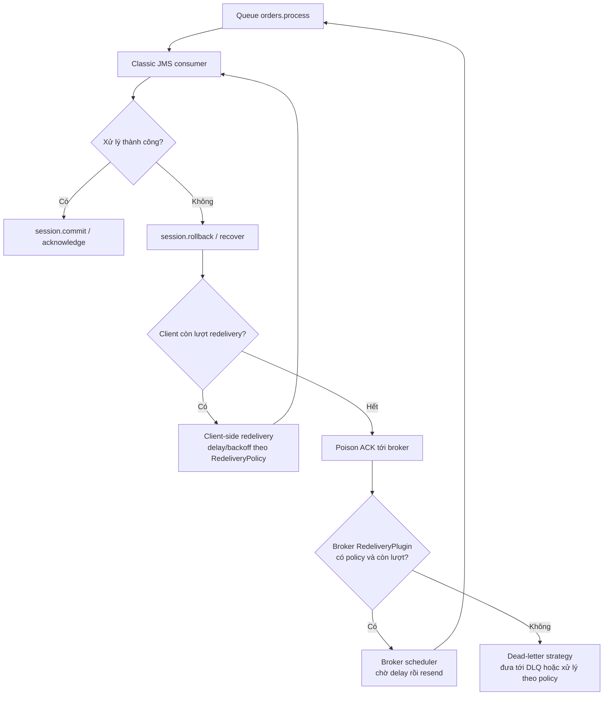
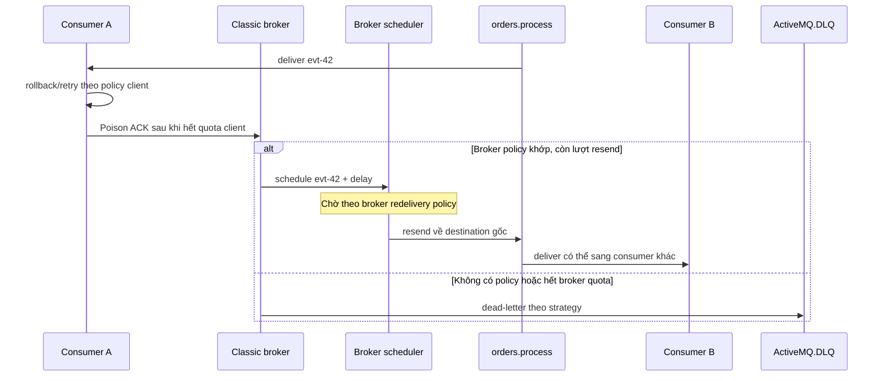

# Redelivery policy phía client Classic và broker redelivery plugin

> **Chương:** Gửi lại và DLQ  
> **Phạm vi:** Apache ActiveMQ **Classic** với JMS/OpenWire; phân biệt `RedeliveryPolicy` ở Java client với `RedeliveryPlugin` cài trong broker. Có đối chiếu ngắn với Artemis để tránh áp nhầm cấu hình.  
> **Mục tiêu:** Giải thích chính xác lúc nào retry còn do client điều phối, lúc nào broker chủ động lên lịch gửi lại, lúc nào message mới đi DLQ; cấu hình, viết consumer Java và kiểm thử được cả hai tầng.

## 1. Một poison message, hai chính sách retry rất khác nhau

Queue `orders.process` đang có message `evt-42`. Consumer nhận message, gọi database và gặp lỗi tạm thời. Lập trình viên đặt `maximumRedeliveries=2` trên ActiveMQ Classic client; quản trị viên lại đặt `maximumRedeliveries=3` trong broker `RedeliveryPlugin`.

Nếu nghĩ “hai con số này cộng lại thành năm lần thử” thì dễ tính sai. **Hai policy được kích hoạt tại hai ranh giới khác nhau**, và không phải mỗi lần `rollback()` đều do broker plugin lập lịch.

- **Client `RedeliveryPolicy`:** quy định cách Classic JMS client xử lý **giao lại cho consumer** sau rollback/recover và lúc nào coi message là poison. Khi vượt giới hạn, client phát **Poison ACK** tới broker.
- **Broker `RedeliveryPlugin`:** can thiệp ở đường xử lý **message sắp được gửi vào DLQ**. Nếu có rule phù hợp, plugin dùng **broker scheduler** để gửi lại message tới **destination gốc** sau một khoảng trễ, thay vì chuyển ngay vào DLQ.
- **Dead-letter strategy:** khi plugin không áp dụng hoặc đã hết giới hạn theo cấu hình, broker tiếp tục xử lý DLQ bình thường (nếu các tùy chọn fallback được bật).



**Cần ghi nhớ:** plugin không phải một callback chạy trên mỗi lần consumer gọi `rollback()`. Nó được tích hợp vào **đường broker xử lý dead-letter** khi client đã từ bỏ message hoặc có nguyên nhân chuyển tới DLQ phù hợp.

## 2. Hai tầng khác nhau ở đâu?

| Tiêu chí | Classic client `RedeliveryPolicy` | Classic broker `RedeliveryPlugin` |
|---|---|---|
| Nơi chạy | JVM của JMS client Classic | JVM của broker ActiveMQ Classic |
| Cấu hình | `ActiveMQConnectionFactory`/`ActiveMQConnection`, URI hoặc destination-specific policy map | `<redeliveryPlugin>` trong `activemq.xml` |
| Sự kiện chính | Rollback, recover, session/connection failure dẫn tới redelivery | Broker chuẩn bị xử lý một message qua đường DLQ |
| Cơ chế delay | Client redelivery policy và giao thức dispatch | **Broker scheduler** gửi lại tới destination gốc |
| Consumer nhận lại | Thường có xu hướng giữ redelivery gắn với consumer hiện tại khi còn hoạt động | Có thể là **consumer khác** khi message được resend |
| Ảnh hưởng thứ tự | Có thể giữ message in-flight, làm chậm message phía sau | Resend sau delay có thể **thay đổi thứ tự** |
| Giới hạn retry | Số lần client chấp nhận message được giao lại trước Poison ACK | Số chu kỳ broker resend theo broker policy khi được gọi xử lý DLQ |
| Khi hết giới hạn | Client gửi **Poison ACK** | Tiếp tục DLQ hoặc bỏ message theo flags |
| Phụ thuộc scheduler trên broker | Không phải điều kiện của client policy thông thường | **Bắt buộc bật `schedulerSupport`** |
| Áp dụng cho Artemis? | Không; đây là API ActiveMQ **Classic** client | Không; Artemis có cấu hình redelivery broker riêng |

Một broker Classic có thể gửi một **redelivery preference** qua gói `BrokerInfo`, nhưng client có thể cấu hình/ghi đè `RedeliveryPolicy`. Vì vậy không suy luận toàn bộ kết nối có retry policy như nhau chỉ từ cấu hình broker, đặc biệt khi có client khác loại, resource adapter hoặc nhiều ứng dụng.

### 2.1. Phân biệt “delivery attempt” và “lần broker resend”

Có ít nhất ba con số cần quan sát:

1. **Client redelivery attempts:** số lượt client còn thử xử lý message theo `RedeliveryPolicy` sau lần nhận đầu.
2. **Broker resends:** số chu kỳ plugin gửi lại một message từ scheduler về destination gốc.
3. **Business attempts:** số lần handler thực sự thực hiện side effect hoặc gọi downstream.

Chúng **không nhất thiết bằng nhau**; callback có thể thất bại trước khi gọi DB, consumer có thể crash, hoặc một lần resend của broker lại trải qua nhiều lượt xử lý của client. Không lấy `JMSXDeliveryCount` làm thước đo duy nhất cho số lượt broker đã schedule hoặc số lần business effect thực sự xảy ra.

## 3. Client Classic: cơ chế xử lý rollback và Poison ACK

Các tình huống có thể kích hoạt redelivery thường gặp:

- `Session.SESSION_TRANSACTED` và ứng dụng gọi `session.rollback()`.
- Transacted Session kết thúc khi chưa commit.
- `CLIENT_ACKNOWLEDGE` và ứng dụng gọi `session.recover()` để yêu cầu giao lại các message chưa ack.
- Connection/consumer không còn giữ delivery do timeout hoặc sự cố và broker phải phục hồi giao nhận.

Với transacted consumer, trình tự khái niệm:

```text
receive(evt-42) -> xử lý lỗi -> rollback()
      |
      v
Classic client áp RedeliveryPolicy
      |
      +-- còn lượt: chờ delay/backoff, giao lại cho consumer
      |
      +-- vượt giới hạn: Poison ACK -> broker xét đường DLQ/plugin
```

`maximumRedeliveries` đếm **lượt giao lại sau lần delivery đầu**, không phải “tổng số lần gọi handler thành công”. Ví dụ `maximumRedeliveries=2` cho phép một lượt đầu và tối đa hai lượt redelivery trong chu kỳ client thông thường. Nếu gặp connection failover hoặc broker plugin resend, cách hiển thị counter cần được kiểm chứng trên phiên bản thực tế thay vì áp công thức cứng.

### 3.1. Những thuộc tính quan trọng

| Thuộc tính | Chức năng | Cách chọn |
|---|---|---|
| `initialRedeliveryDelay` | Độ trễ trước lần redelivery đầu, mili giây | Tránh retry sát nhau với lỗi tạm thời |
| `redeliveryDelay` | Độ trễ cơ sở cho các lượt tiếp theo | Cân nhắc latency và thời gian hồi phục dependency |
| `useExponentialBackOff` | Bật tăng delay sau các lần retry | Phù hợp lỗi phụ thuộc hệ thống có thời gian phục hồi |
| `backOffMultiplier` | Hệ số tăng delay khi bật exponential backoff | Tránh tăng quá nhanh |
| `maximumRedeliveryDelay` | Trần delay của client trong những phiên bản hỗ trợ | Bảo vệ latency/recovery window |
| `maximumRedeliveries` | Giới hạn số lần giao lại trước khi poison ACK | `0`: không thử lại sau lần đầu; `-1`: không giới hạn |
| `useCollisionAvoidance` và hệ số liên quan | Thêm biến thiên thời gian nếu bật | Giảm đồng loạt retry khi nhiều consumer cùng thất bại |

Trang tài liệu Classic Redelivery Policy mô tả các default phổ biến như `initialRedeliveryDelay=1000 ms` và `maximumRedeliveries=6`, nhưng **không lấy default làm hợp đồng** khi có nhiều phiên bản client, activation spec, Spring/JCA hoặc cấu hình kết nối khác nhau. Đặt các giá trị cần thiết tường minh và log policy hiệu lực lúc startup.

**Điểm cần thận trọng:** `maximumRedeliveries=-1` khiến client có thể tiếp tục thử mãi. Khi đó client thường **không gửi Poison ACK do vượt ngưỡng**, nên broker `RedeliveryPlugin` không có cơ hội can thiệp theo đường poison/DLQ này. Đây là nguyên nhân phổ biến khiến người vận hành cài plugin mà không thấy nó chạy.

## 4. Cấu hình client Classic trong Java

Ví dụ dùng client ActiveMQ Classic 5.x với `javax.jms`. Đặt policy **trước khi tạo consumer**, không thay đổi cấu hình trong lúc Session đang xử lý message.

```java
import org.apache.activemq.ActiveMQConnectionFactory;
import org.apache.activemq.RedeliveryPolicy;

public final class ClassicClientConfig {

    public static ActiveMQConnectionFactory createFactory() {
        ActiveMQConnectionFactory factory =
                new ActiveMQConnectionFactory(
                        "tcp://127.0.0.1:61616");

        RedeliveryPolicy policy = factory.getRedeliveryPolicy();
        policy.setInitialRedeliveryDelay(500L);
        policy.setRedeliveryDelay(1_000L);
        policy.setUseExponentialBackOff(true);
        policy.setBackOffMultiplier(2.0);
        policy.setMaximumRedeliveryDelay(5_000L);

        // Tối đa hai lần redelivery trong chu kỳ client.
        policy.setMaximumRedeliveries(2);
        return factory;
    }
}
```

**Ứng dụng của các giá trị:**

- Consumer thất bại thì không retry vòng nóng, mà có thời gian chờ do policy quyết định.
- Khi kết thúc quota local, client có thể phát Poison ACK.
- Nếu broker **không bật plugin**, dead-letter strategy bình thường xử lý poison message.
- Nếu broker bật plugin và rule phù hợp, đường dead-letter được plugin chuyển thành broker resend theo cấu hình.

Đối với hệ thống có nhiều queue với yêu cầu khác nhau, Classic có `RedeliveryPolicyMap` để chọn policy theo destination. Không dùng một profile retry 5 phút cho cả `orders.commands` (yêu cầu độ trễ thấp) và `notifications.bulk` (chịu được xử lý muộn) khi SLA khác nhau.

### 4.1. Chính sách theo destination trên client

Đoạn code minh họa cách định nghĩa chính sách queue-specific trên Classic 5.x. Các tên queue và số lần retry phải khớp hợp đồng triển khai:

```java
import org.apache.activemq.ActiveMQConnectionFactory;
import org.apache.activemq.ActiveMQQueue;
import org.apache.activemq.RedeliveryPolicy;
import org.apache.activemq.broker.region.policy.RedeliveryPolicyMap;

ActiveMQConnectionFactory factory =
    new ActiveMQConnectionFactory("tcp://127.0.0.1:61616");

RedeliveryPolicy orderPolicy = new RedeliveryPolicy();
orderPolicy.setMaximumRedeliveries(1);
orderPolicy.setInitialRedeliveryDelay(1_000L);
orderPolicy.setRedeliveryDelay(1_000L);

RedeliveryPolicy defaultPolicy = new RedeliveryPolicy();
defaultPolicy.setMaximumRedeliveries(3);
defaultPolicy.setRedeliveryDelay(2_000L);

RedeliveryPolicyMap map = new RedeliveryPolicyMap();
map.put(new ActiveMQQueue("orders.process"), orderPolicy);
map.setDefaultEntry(defaultPolicy);
factory.setRedeliveryPolicyMap(map);
```

Đây là cấu hình **ở JVM client**, không phải plugin trong broker. Nhiều producer/consumer service có thể dùng factory riêng; hãy kiểm tra policy thực sự gắn với consumer của từng service.

### 4.2. Áp dụng qua Connection thay vì Factory

Trong hệ thống có factory dùng chung nhưng muốn tinh chỉnh một connection cụ thể, Classic cho phép truy cập policy từ `ActiveMQConnection`:

```java
import org.apache.activemq.ActiveMQConnection;
import org.apache.activemq.RedeliveryPolicy;

ActiveMQConnection connection =
        (ActiveMQConnection) factory.createConnection();

RedeliveryPolicy p = connection.getRedeliveryPolicy();
p.setMaximumRedeliveries(2);
// Sau đó mới tạo Session/Consumer và bật connection.start().
```

Cách này phụ thuộc **implementation Class của ActiveMQ Classic**; không ép kiểu một generic JMS Connection của Artemis hoặc provider khác thành `ActiveMQConnection`. Trong ứng dụng dùng JCA/Spring container, policy có thể do resource adapter/connection pool/activation spec quản lý, cần cấu hình ở đúng tầng đó.

## 5. Consumer transacted: tạo lỗi để quan sát client retry

Ví dụ sau xử lý `TextMessage` trong queue `orders.process`. Payload `"POISON"` dùng để diễn tập lỗi; trong production, kiểm tra dữ liệu hợp lệ và sử dụng lỗi nghiệp vụ thực tế.

```java
import javax.jms.Connection;
import javax.jms.JMSException;
import javax.jms.Message;
import javax.jms.MessageConsumer;
import javax.jms.Queue;
import javax.jms.Session;
import javax.jms.TextMessage;

import org.apache.activemq.ActiveMQConnectionFactory;

public final class PoisonOrderConsumer {

    public static void run(ActiveMQConnectionFactory factory)
            throws JMSException {

        Connection connection = factory.createConnection();
        try {
            Session session = connection.createSession(
                    true, Session.SESSION_TRANSACTED);
            try {
                Queue queue = session.createQueue("orders.process");
                MessageConsumer consumer = session.createConsumer(queue);
                try {
                    connection.start();

                    for (int i = 0; i < 30; i++) {
                        Message message = consumer.receive(15_000L);
                        if (message == null) {
                            System.out.println("No message available");
                            continue; // Timeout không phải rollback.
                        }

                        String eventId = message.getStringProperty("eventId");
                        int deliveryCount =
                                message.propertyExists("JMSXDeliveryCount")
                                    ? message.getIntProperty("JMSXDeliveryCount")
                                    : -1;

                        try {
                            if (!(message instanceof TextMessage)) {
                                throw new IllegalArgumentException(
                                        "Expected TextMessage");
                            }
                            String body =
                                    ((TextMessage) message).getText();

                            System.out.printf(
                                    "eventId=%s deliveryCount=%d redelivered=%b%n",
                                    eventId, deliveryCount,
                                    message.getJMSRedelivered());

                            if ("POISON".equals(body)) {
                                throw new IllegalStateException(
                                        "Simulated failure");
                            }

                            // Trong production: xử lý idempotent trước commit.
                            session.commit();
                        } catch (JMSException | RuntimeException error) {
                            try {
                                session.rollback();
                            } catch (JMSException rollbackError) {
                                error.addSuppressed(rollbackError);
                                throw error;
                            }
                            System.out.println("Rolled back " + eventId);
                        }
                    }
                } finally {
                    consumer.close();
                }
            } finally {
                session.close();
            }
        } finally {
            connection.close();
        }
    }
}
```

Để chạy demo, tạo factory từ `ClassicClientConfig.createFactory()` rồi gọi `PoisonOrderConsumer.run(factory)`, trong môi trường broker Classic test có queue `orders.process`. Gửi một message persistent có `eventId="evt-42"` và body `POISON`.

**Vì sao dùng `SESSION_TRANSACTED`?** Lệnh `rollback()` giúp tái hiện chính xác redelivery và đưa client tới ngưỡng Poison ACK. Với `AUTO_ACKNOWLEDGE` và `receive()` đồng bộ, message có thể đã được ack lúc method trả về; exception ném trong business code **không tự sinh rollback**.

**Không hiểu nhầm timeout:** `receive(15000)` trả `null` chỉ cho biết trong lần chờ này không có message được giao. Nó không tiêu tốn một lượt redelivery và không làm plugin broker tăng counter.

### 5.1. Gửi message thử nghiệm

```java
import javax.jms.Connection;
import javax.jms.DeliveryMode;
import javax.jms.MessageProducer;
import javax.jms.Queue;
import javax.jms.Session;
import javax.jms.TextMessage;

Connection c = factory.createConnection();
try {
    Session s = c.createSession(true, Session.SESSION_TRANSACTED);
    try {
        Queue q = s.createQueue("orders.process");
        MessageProducer producer = s.createProducer(q);
        try {
            producer.setDeliveryMode(DeliveryMode.PERSISTENT);
            TextMessage m = s.createTextMessage("POISON");
            m.setStringProperty("eventId", "evt-42");
            producer.send(m);
            s.commit();
        } finally {
            producer.close();
        }
    } finally {
        s.close();
    }
} finally {
    c.close();
}
```

Message `PERSISTENT` giúp diễn tập độ bền khi restart theo điều kiện persistence của broker. Nó không thay việc cấu hình dead-letter strategy, scheduler hay transaction.

## 6. Broker `RedeliveryPlugin`: chặn đường DLQ rồi gửi lại có lịch

Plugin này có từ ActiveMQ Classic 5.7. Cơ chế được triển khai như một broker plugin can thiệp vào việc xử lý message **sắp gửi tới dead-letter destination**:

1. Client nhận một message, redeliver theo policy local và cuối cùng gửi **Poison ACK** nếu vượt quota.
2. Broker bước vào đường xử lý DLQ cho message đó.
3. `RedeliveryPlugin` tìm `RedeliveryPolicy` phù hợp destination gốc.
4. Nếu còn quota broker resend và cấu hình scheduler hợp lệ, plugin **lên lịch resend** sau khoảng trễ, đến **destination gốc**.
5. Khi đến hạn, broker giao message lại cho một consumer đang sẵn sàng; **không bảo đảm là consumer cũ**.
6. Khi không có policy hoặc đã hết quota, plugin xử lý theo `fallbackToDeadLetter` và `sendToDlqIfMaxRetriesExceeded`.



**Động cơ sử dụng:** một message lỗi không cần giữ đường xử lý của consumer đó quá lâu; broker có thể hoãn message lỗi rồi tiếp tục phân phối công việc khác. Đổi lại, **thứ tự message có thể thay đổi**, nhất là khi có nhiều consumer hoặc dùng message groups.

### 6.1. Cấu hình `activemq.xml` minh họa

Đây là đoạn nằm trong cấu hình `<broker>` của **ActiveMQ Classic**. Nó theo cấu trúc XML plugin được tài liệu Classic mô tả; cần ghép với persistence adapter, transport connectors, security và những thành phần hiện có của broker.

```xml
<broker xmlns="http://activemq.apache.org/schema/core"
        brokerName="orders-broker"
        persistent="true"
        schedulerSupport="true">

    <plugins>
        <redeliveryPlugin
                fallbackToDeadLetter="true"
                sendToDlqIfMaxRetriesExceeded="true">

            <redeliveryPolicyMap>
                <redeliveryPolicyMap>
                    <redeliveryPolicyEntries>
                        <redeliveryPolicy
                                queue="orders.process"
                                maximumRedeliveries="3"
                                redeliveryDelay="10000"/>
                    </redeliveryPolicyEntries>
                </redeliveryPolicyMap>
            </redeliveryPolicyMap>
        </redeliveryPlugin>
    </plugins>

    <!-- Các phần khác của broker config được giữ theo bản triển khai. -->
</broker>
```

**Ý nghĩa từng điểm:**

- `schedulerSupport="true"`: **điều kiện bắt buộc** để broker có thể schedule resend. Chỉ thêm `redeliveryPlugin` mà không bật scheduler không tạo được cơ chế retry như mong muốn.
- `queue="orders.process"`: rule dành cho destination đó; các queue khác **không tự áp** cùng quota trừ khi có policy khác hoặc default entry.
- `redeliveryDelay="10000"`: chờ **10 giây** trước broker resend theo rule minh họa, không phải thời gian treo trong JVM consumer.
- `maximumRedeliveries="3"`: giới hạn **các lần broker redelivery/resend** theo policy plugin; không phải `maximumRedeliveries` của client.
- `fallbackToDeadLetter="true"`: khi **không có policy khớp**, dùng DLQ handling thông thường.
- `sendToDlqIfMaxRetriesExceeded="true"`: khi hết quota plugin, dùng DLQ handling thông thường.

**Không đặt hai flag cuối thành `false` trên queue nghiệp vụ quan trọng** trừ khi đã chủ động chấp nhận bỏ message. Theo tài liệu/API của plugin, `false` có thể khiến message không được đưa tới DLQ trong trường hợp tương ứng, gây mất khả năng điều tra và phục hồi.

### 6.2. Broker scheduler giữ trạng thái chờ ở đâu?

Đây là tác vụ scheduler **trong broker**, không phải một `Thread.sleep(10000)` ở consumer. Cần:

- Kiểm tra scheduler đã được bật và broker khởi động không lỗi.
- Cấp dung lượng đĩa và giám sát scheduler store, persistent store, queue backlog; dữ liệu chờ resend không nhất thiết hiện như message pending trên queue gốc trong suốt thời gian delay.
- Diễn tập restart broker trong khi đang chờ để xác nhận hành vi phục hồi theo persistence/configuration thực tế.
- Kiểm soát thời gian chờ quá dài và lượng scheduled jobs để tránh tích lũy disk không giới hạn.

**Không lấy `QueueSize=0` trong thời gian scheduled delay làm bằng chứng đã xử lý thành công**; message có thể đang đợi trong scheduler. Dashboard cần bổ sung scheduled jobs và độ tuổi message chưa hoàn tất.

### 6.3. Chính sách default và chính sách đặc thù

Có thể thêm `<defaultEntry>` bên trong `<redeliveryPolicyMap>` của plugin để áp rule fallback chủ động:

```xml
<redeliveryPolicyMap>
    <redeliveryPolicyEntries>
        <redeliveryPolicy queue="orders.process"
                          maximumRedeliveries="3"
                          redeliveryDelay="10000"/>
    </redeliveryPolicyEntries>
    <defaultEntry>
        <redeliveryPolicy maximumRedeliveries="1"
                          initialRedeliveryDelay="3000"
                          redeliveryDelay="5000"/>
    </defaultEntry>
</redeliveryPolicyMap>
```

Đoạn này là **phần lõi bên trong** nested wrapper của ví dụ đầy đủ ở `6.1`, **không phải** file XML độc lập. Khi đặt default rule, hãy kiểm tra tác động tới các queue không chủ ý, như queue hệ thống hoặc queue DLQ, và tránh áp policy tạo chu kỳ resend không giới hạn.

### 6.4. DLQ cuối cùng vẫn do dead-letter strategy quyết định

Plugin chỉ thay đổi **đường đi trước khi dead-letter**. Nơi message đến khi hết retry cuối cùng vẫn có thể là:

- `ActiveMQ.DLQ` — dead-letter queue mặc định thông thường của Classic.
- DLQ riêng theo queue/topic — nếu `individualDeadLetterStrategy` được cấu hình.
- Cơ chế drop/discard theo policy — nếu hệ thống được thiết kế như vậy.

Ví dụ tùy chọn DLQ riêng cho queue đã biết, đặt trong `<destinationPolicy>` của broker Classic:

```xml
<destinationPolicy>
    <policyMap>
        <policyEntries>
            <policyEntry queue="orders.process">
                <deadLetterStrategy>
                    <individualDeadLetterStrategy
                            queuePrefix="DLQ."
                            useQueueForQueueMessages="true"/>
                </deadLetterStrategy>
            </policyEntry>
        </policyEntries>
    </policyMap>
</destinationPolicy>
```

Với prefix này, đích DLQ dự kiến cho queue `orders.process` là `DLQ.orders.process`. **Không trộn** ví dụ cấu hình DLQ riêng với cấu hình shared DLQ khác mà chưa đánh giá thứ tự/matching policy của broker.

## 7. Kết hợp hai policy: điều chỉnh theo mục tiêu latency và throughput

Giả sử trong staging:

```text
Classic client:
  initialRedeliveryDelay = 500 ms
  redeliveryDelay        = 1.000 ms
  maximumRedeliveries    = 2

Classic broker plugin:
  queue                  = orders.process
  redeliveryDelay        = 10.000 ms
  maximumRedeliveries    = 3
  fallbackToDeadLetter   = true
  sendToDlqIfMaxRetriesExceeded = true
```

Một message có thể đi theo chuỗi khái niệm:

```text
Delivery ban đầu
  -> rollback
  -> client redelivery #1
  -> rollback
  -> client redelivery #2
  -> rollback
  -> Poison ACK
  -> broker scheduler (delay 10s)
  -> resend tới orders.process
  -> có thể vào consumer khác
  -> lại chịu các quy tắc giao nhận hiện hành
  -> cuối cùng DLQ nếu broker policy đã hết
```

**Không công bố SLA bằng phép nhân cứng** `(clientMax+1) × (brokerMax+1)`. Số callback thật còn phụ thuộc behavior của client/broker, counter được mang theo hay tái lập khi resend, failover, message expiration, consumer restart, selector/grouping và đường DLQ. Cần kiểm thử đúng các phiên bản triển khai và đo **thời gian từ lần lỗi đầu tới DLQ hoặc thành công**.

### 7.1. Ba cấu hình ý đồ khác nhau

| Mục tiêu | Client policy | Broker plugin | Nhận xét |
|---|---|---|---|
| Lỗi transient nhẹ, cần giữ thứ tự tương đối | Nhiều retry ngắn, backoff vừa phải | Không bật hoặc giữ quota hạn chế | Một message lỗi có thể chặn luồng consumer lâu hơn |
| Muốn retry sau delay dài, cho consumer khác xử lý | Client retry ít và hữu hạn (thậm chí `0`) | Bật scheduler, broker policy theo queue | Tách poison ra khỏi consumer, có thể thay đổi thứ tự |
| Cần chẩn đoán poison càng sớm càng tốt | Client retry hữu hạn thấp | Không có policy resend hoặc quota broker nhỏ | Message tới DLQ nhanh, support điều tra |
| Không chấp nhận message biến mất | Client không retry vô hạn, có DLQ | `fallbackToDeadLetter=true`, `sendToDlqIfMaxRetriesExceeded=true` | Vẫn cần kiểm tra persistence và bảo mật DLQ |

**Quan trọng:** nếu client `maximumRedeliveries=-1`, các lỗi lặp lại thường không tạo Poison ACK chỉ vì vượt giới hạn — plugin có thể **không bao giờ được gọi** theo nhánh này. Ngược lại, client `maximumRedeliveries=0` có thể chuyển rất nhanh sang xử lý broker plugin sau lần xử lý lỗi đầu; cần đo cách provider phiên bản thực tế đếm attempt.

### 7.2. Có nên bật đồng thời exponential backoff ở hai tầng?

Có thể, nhưng không nên bật chỉ vì “an toàn hơn”. Nếu client đã chờ 1s, 2s, 4s rồi plugin chờ 30s nhiều vòng, **tuổi message** và SLO xử lý có thể tăng đáng kể.

Xác định **retry budget** thay vì chỉ đặt count:

```text
retry budget =
  thời gian thử lại tối đa có thể chấp nhận
  + thời gian xử lý mỗi attempt
  + khả năng backlog/scheduler queueing
  + deadline của nghiệp vụ/message TTL
```

Nếu hệ thống đặt `JMSExpiration`/TTL ngắn hơn tổng lịch retry, message có thể hết hạn trước khi đến được một consumer trở lại. DLQ/expiration có thể có đường xử lý riêng; không coi TTL là một lượt retry của plugin.

### 7.3. Thứ tự message và tính công bằng

Client redelivery thường gắn message lỗi với consumer hiện tại khi nó còn giữ message in-flight; điều này có thể trì hoãn việc nhận những message phía sau. Broker resend trả message về destination sau delay:

- Consumer khác có thể nhận trước khi consumer cũ phục hồi.
- Message mới hơn có thể hoàn tất trước message lỗi.
- Với `JMSXGroupID`, redelivery và thay đổi consumer ownership có thể ảnh hưởng kỳ vọng thứ tự theo nhóm; cần test khi failover/rebalance.

Nếu xử lý **cực kỳ nhạy thứ tự** như áp ledger theo sequence, đừng bật broker resend mà không có chiến lược kiểm soát ordering hoặc kiểm tra version tại DB. Mặt khác, xử lý event độc lập thường được lợi từ việc tránh head-of-line blocking.

## 8. Điều gì không được coi là broker/plugin redelivery?

### 8.1. Exception trong code chưa chắc kích hoạt retry

```java
Session session = connection.createSession(
        false, Session.AUTO_ACKNOWLEDGE);

Message message = consumer.receive(1000);
process(message); // Ném exception tại đây không tự gọi rollback.
```

Với synchronous `AUTO_ACKNOWLEDGE`, provider có thể auto-ack ngay khi `receive` hoàn tất. Throw trong business code sau receive không làm Classic client tự gửi Poison ACK. Dùng transacted Session/rollback hoặc cấu hình listener container đúng để tái hiện đường retry.

### 8.2. `receive(timeout)==null` không phải một attempt hỏng

Không nhận được message trong khoảng chờ không tăng redelivery counter và không khiến broker plugin schedule resend. Tránh code coi `null` là poison message.

### 8.3. Broker plugin không sửa lỗi database transaction

Nếu consumer đã commit DB nhưng JVM chết trước JMS commit, broker có thể redeliver message, qua client policy hoặc broker plugin. Consumer cần **idempotency theo `eventId` trong database**. Plugin không làm side effect trở thành exactly-once.

### 8.4. Non-persistent và expired messages có quy tắc DLQ riêng

Classic dead-letter strategy thông thường **không xử lý non-persistent messages vào DLQ** theo default, trừ khi bật cấu hình phù hợp (ví dụ `processNonPersistent="true"`). Expired messages cũng có policy riêng và có thể đi DLQ hoặc bị discard theo `processExpired`.

Vì vậy **“plugin bật nhưng không thấy message ở DLQ”** chưa chứng minh plugin bị lỗi. Phải xem delivery mode, expiry, queue policy, flags drop và đường xử lý message cụ thể.

### 8.5. `nonBlockingRedelivery` ở client không phải broker plugin

Một số phiên bản Classic client cung cấp tùy chọn non-blocking redelivery riêng. Nó không đồng nghĩa `RedeliveryPlugin` trên broker. Hai thứ có ý nghĩa khác nhau về nơi chạy, scheduler và ảnh hưởng thứ tự; phải xác nhận client version/API khi dùng.

## 9. Theo dõi retry qua ba lớp dữ liệu

| Nguồn | Nên đo và ghi | Ý nghĩa |
|---|---|---|
| **Java consumer** | `eventId`, `JMSMessageID`, `JMSRedelivered`, `JMSXDeliveryCount` (nếu có), rollback count, handler duration, exception type | Biết xử lý thất bại ở bước nào |
| **Broker destination** | Pending, in-flight, enqueue/dequeue, consumer count, advisory/logs về poison/DLQ | Theo dõi message có được dispatch/ack hay không |
| **Broker scheduler** | Scheduled jobs count, oldest due time, scheduler storage, job failures | Biết message đang chờ broker resend, không nhầm với queue rỗng |
| **DLQ** | Message count, oldest age, source destination, eventId, nguyên nhân gần nhất | Triaging poison message, tránh thất lạc |
| **Database nghiệp vụ** | Idempotency key, unique effects, dependency failures | Phân biệt nhiều deliveries với số tác dụng phụ thật |

Tên MBean và property quan sát được khác theo phiên bản ActiveMQ Classic, exporter và công cụ management. `JMSXDeliveryCount` đếm delivery theo semantics provider, **không được hiểu chắc là tổng lượt plugin broker resend**. Một message được republish có thể nhận `JMSMessageID` mới; phải giữ **`eventId` nghiệp vụ** để nối các attempts.

### 9.1. Log cấu trúc cho một attempt

```text
eventId=evt-42
brokerDestination=orders.process
consumerInstance=orders-worker-2
jmsMessageId=ID:...
jmsRedelivered=true
jmsxDeliveryCount=3
handlingOutcome=ROLLBACK
exceptionClass=java.sql.SQLTransientConnectionException
processingLatencyMs=97
```

Không log payload nhạy cảm hoặc credentials. Khi message vào DLQ, lưu được `eventId`, nguồn ban đầu và thông tin xử lý đủ để quyết định redrive. Việc redrive lại có thể khiến broker/plugin tiếp tục áp retry; cần giới hạn số lần **redrive thủ công** và có runbook chống vòng lặp.

## 10. Bộ thí nghiệm phân biệt hai tầng

Chạy tất cả thử nghiệm trên **Classic broker riêng cho staging** và một queue `orders.process` mới. Tạo message persistent `POISON` bằng đoạn producer phần 5.1, bảo đảm có `eventId` ổn định. Ghi rõ version Classic server/client, broker config, redelivery policy hiệu lực và thời gian từng mốc.

### Thử nghiệm A — Chỉ client policy, không có plugin

1. Tắt `RedeliveryPlugin` và restart broker test.
2. Client: `maximumRedeliveries=2`, delay 1 giây.
3. Gửi `evt-42`, consumer cố tình rollback mọi lần nhận.
4. Quan sát số lượt nhận, thời gian giữa các attempts và cuối cùng Poison ACK.
5. Kiểm tra default `ActiveMQ.DLQ` hoặc DLQ được cấu hình riêng.

**Kết quả mong đợi:** trong ca thông thường, client thử lại theo quota rồi broker đưa message vào DLQ; **không** có giai đoạn broker scheduler resend.

### Thử nghiệm B — Bật broker plugin, client giới hạn retry hữu hạn

1. Bật `schedulerSupport=true` và `RedeliveryPlugin` ở phần 6.1, restart broker.
2. Dùng cùng client policy của A.
3. Chạy hai consumer cùng queue, log `consumerInstance` và `eventId`.
4. Gửi message poison; chờ client dùng hết quota.
5. Quan sát giai đoạn queue gốc tạm không có message ready nhưng scheduler có job; sau delay thấy message xuất hiện lại.
6. Tiếp tục cho xử lý lỗi đến khi plugin hết quota và message đi DLQ.

**Kết quả mong đợi:** giữa các chu kỳ plugin có khoảng delay từ broker, và một lượt có thể đến consumer khác. **Không khẳng định message luôn sang consumer khác**; điều đó phụ thuộc dispatch và consumer availability.

### Thử nghiệm C — Client retry vô hạn che mất plugin

1. Giữ broker plugin như B.
2. Đổi client thành `maximumRedeliveries=-1`.
3. Gửi `evt-43` có lỗi cố định.
4. Theo dõi local attempts và broker scheduler trong một cửa sổ test hữu hạn, sau đó dừng có kiểm soát.

**Kết quả mong đợi:** nếu client vẫn chủ động retry mãi mà không gửi Poison ACK, plugin không được kích hoạt bởi đường poison này. Không chờ vô hạn chỉ để chứng minh một cơ chế có khả năng vô hạn.

### Thử nghiệm D — Fallback khi không có broker rule

1. Plugin có rule `queue="orders.process"` và `fallbackToDeadLetter=true`.
2. Tạo queue `payments.process` nhưng không có matching plugin rule và không có default entry.
3. Gửi message poison tới `payments.process`, consumer có finite redeliveries.
4. Xác minh message đi DLQ theo strategy thông thường chứ không được broker schedule.

**Kết quả mong đợi:** broker plugin không phải policy toàn broker trừ khi có default rule/wildcard matching.

### Thử nghiệm E — Restart broker trong khi message đang scheduled

1. Gửi poison message, theo dõi tới khi plugin schedule thành công.
2. Dừng broker test trước lúc delay kết thúc.
3. Khởi động lại với persistence/scheduler store được cấu hình và kiểm tra recovery.
4. Ghi có resend sau restart hay không, thứ tự, thời gian và đích cuối.

**Kết quả mong đợi:** xác định được behavior recovery **thực tế của setup**; không suy luận chỉ từ cấu hình `schedulerSupport`. Cần đo cả disk/scheduler store và log recovery.

### Thử nghiệm F — Hết quota và chính sách không làm mất message

1. Đặt `fallbackToDeadLetter=true` và `sendToDlqIfMaxRetriesExceeded=true`.
2. Để plugin hết quota resend, kiểm tra DLQ cuối.
3. Trong một broker test hoàn toàn cô lập, so sánh với `sendToDlqIfMaxRetriesExceeded=false`.
4. Đối chiếu khả năng tìm lại message và lý do không bật flag false trong production.

**Kết quả mong đợi:** hiểu `false` có thể bỏ message thay vì giữ trong DLQ khi hết quota. **Không thử nhánh drop với message nghiệp vụ thật**.

### Mẫu số liệu kiểm thử

| Case | Client max | Broker max | Delay broker | Số consumer | Scheduled observed? | DLQ cuối | Nhận xét |
|---|---:|---:|---|---:|---|---|---|
| A: chỉ client | 2 | Không áp | — | 1 | Không | Có | |
| B: hai tầng | 2 | 3 | 10s | 2 | Có | Có sau khi hết quota | |
| C: client vô hạn | -1 | 3 | 10s | 1 | Không theo đường Poison ACK | Chưa trong cửa sổ test | |
| D: rule không khớp | 1 | Không match | — | 1 | Không | Có do fallback | |
| E: restart scheduled | 0–2 | 3 | 10s | 1 | Có trước restart | Theo recovery | |
| F: broker hết quota | 0–2 | 1 | 10s | 1 | Có | Tùy flag | |

Khi thí nghiệm, làm sạch queue test bằng quy trình có kiểm tra; không tự xóa DLQ chưa được đối soát. Nếu muốn triaging count chính xác, loại trừ các message test cũ, kiểm tra cả message pending, in-flight, scheduled và expired.

## 11. Điểm dễ gây lỗi khi triển khai

| Hiện tượng | Khả năng nguyên nhân | Cách kiểm chứng |
|---|---|---|
| Đã có `RedeliveryPlugin` mà message không được scheduled | Client retry vô hạn hoặc chưa gửi Poison ACK; broker scheduler chưa bật | Kiểm tra client `maximumRedeliveries`, broker config/log scheduler |
| Rollback xong message vẫn tới cùng consumer | Vẫn ở tầng client redelivery | Quan sát thời điểm Poison ACK và scheduled jobs |
| Queue gốc rỗng nhưng message chưa vào DLQ | Message đang ở broker scheduler | Kiểm tra scheduler jobs/store và delay |
| Chờ retry lâu hơn dự kiến | Cộng dồn client backoff, broker delay, failover, handler latency | Ghi timestamp từng delivery, Poison ACK và resend |
| Message lỗi làm các message phía sau chậm | Client còn giữ in-flight/ordering | Giảm quota client nếu cho phép reorder, dùng broker resend có kiểm chứng |
| Sau resend message đến worker khác | Broker resend về destination, không pin consumer | Xác nhận nhiều consumer và eventId |
| DLQ không có message non-persistent | Dead-letter strategy mặc định không giữ non-persistent | Kiểm tra delivery mode và `processNonPersistent` |
| Message vào DLQ sớm hơn mong đợi | Không matching rule, fallback, client config override | Kiểm tra tên destination, XML policy map và effective client policy |
| Broker scheduler tăng không ngừng | Nhiều poison messages, retry budget quá lớn | Alert scheduled count/oldest age, giới hạn inflow và điều tra lỗi upstream |
| `JMSXDeliveryCount` không khớp số attempt ứng dụng | Counter theo provider, reconnect hoặc broker resends | Đối soát `eventId` và app attempt log, không cộng cứng |
| Reorder gây sai trạng thái nghiệp vụ | Broker resend cho message cũ, message mới đi trước | Kiểm tra sequence/version/idempotency trong DB |
| Cấu hình flags false làm message biến mất khỏi DLQ | Plugin bỏ message khi không fallback/hết quota | Bật flags true cho nghiệp vụ cần phục hồi |
| Áp cấu hình này vào Artemis không có tác dụng | Artemis không dùng Classic `RedeliveryPlugin` | Dùng Artemis `address-settings` tương ứng |

## 12. Artemis dùng broker redelivery theo cách khác

Khi chuyển từ ActiveMQ Classic sang **Apache Artemis**, không mang nguyên `<redeliveryPlugin>` hoặc class `org.apache.activemq.RedeliveryPolicy` của Classic vào broker/client Artemis. Artemis có cơ chế broker-side redelivery qua **address settings** như `redelivery-delay` và `max-delivery-attempts`.

Ví dụ tham chiếu cú pháp Artemis:

```xml
<address-settings>
  <address-setting match="orders.#">
    <redelivery-delay>10000</redelivery-delay>
    <max-delivery-attempts>5</max-delivery-attempts>
    <dead-letter-address>DLQ</dead-letter-address>
  </address-setting>
</address-settings>
```

Đây là **một phần** của `broker.xml` Artemis, chưa bao gồm khai báo address/queue `DLQ`, security hoặc persistence. Trong Artemis, max-delivery-attempts và DLQ handling thuộc broker policy; **không dùng thuật ngữ Poison ACK + Classic broker plugin** để giải thích nguyên xi cơ chế Artemis.

Mục đích đối chiếu là tránh lỗi cấu hình trong đội dùng đồng thời Classic và Artemis: cả hai đều hỗ trợ redelivery/DLQ nhưng điểm điều khiển, tên tham số và đường scheduling khác nhau.

## 13. Checklist quyết định trước production

- [ ] Xác định rõ **Classic client** nào dùng `RedeliveryPolicy`, đúng phiên bản và configuration source.
- [ ] Có finite `maximumRedeliveries` cho các luồng cần cuối cùng đi vào broker DLQ/plugin.
- [ ] Đã xác minh client phát Poison ACK khi hết quota; không suy từ số lần gọi `rollback()`.
- [ ] Với broker plugin, bật `schedulerSupport=true` và xác nhận scheduler thực sự hoạt động.
- [ ] Destination rule khớp **đúng tên/loại destination**, có fallback policy rõ ràng.
- [ ] `fallbackToDeadLetter` và `sendToDlqIfMaxRetriesExceeded` giữ `true` nếu không chấp nhận mất poison message.
- [ ] Dead-letter strategy đưa tới đúng DLQ; permissions, alert, retention, redrive có chủ sở hữu.
- [ ] Thiết lập retry budget theo **thời gian**, không chỉ attempt count, và cân nhắc TTL.
- [ ] Kiểm chứng broker resend có thể đổi consumer và thứ tự message; xử lý idempotent theo `eventId`.
- [ ] Quan sát đủ client retries, Poison ACK, broker scheduled jobs, DLQ và business side effects.
- [ ] Diễn tập broker/client restart trong lúc có message scheduled, rollback và consumer failover.
- [ ] Không dùng cấu hình Classic client/plugin trực tiếp cho Artemis; kiểm tra address settings của Artemis.
- [ ] Tất cả thay đổi policy có test positive/negative trong môi trường cô lập trước khi bật production.

## 14. Nguồn tham khảo chính thức

1. [ActiveMQ Classic — Message Redelivery and DLQ Handling](https://activemq.apache.org/components/classic/documentation/message-redelivery-and-dlq-handling): cơ chế rollback/Poison ACK, DLQ strategy, và mục *Broker Redelivery (v5.7)* với XML `redeliveryPlugin`.
2. [ActiveMQ Classic — Redelivery Policy](https://activemq.apache.org/components/classic/documentation/redelivery-policy): danh sách tham số và semantics policy phía Java client.
3. [ActiveMQ Classic — `RedeliveryPlugin` Java API](https://activemq.apache.org/components/classic/documentation/maven/apidocs/org/apache/activemq/broker/util/RedeliveryPlugin.html): các flags `fallbackToDeadLetter`, `sendToDlqIfMaxRetriesExceeded` và vai trò thay DLQ handling bằng resend.
4. [ActiveMQ Classic — `RedeliveryPolicy` Java API](https://activemq.apache.org/components/classic/documentation/maven/apidocs/org/apache/activemq/RedeliveryPolicy.html): các setter và policy map/destination matching.
5. [ActiveMQ Artemis — Undelivered Messages](https://artemis.apache.org/components/artemis/documentation/latest/undelivered-messages.html): đối chiếu redelivery-delay, maximum-delivery-attempts và dead-letter address ở Artemis.

> **Kết luận:** Ở ActiveMQ Classic, **client `RedeliveryPolicy` quyết định khi nào consumer hết lượt và gửi Poison ACK**; **broker `RedeliveryPlugin` quyết định có schedule resend về destination gốc trước khi cuối cùng đưa vào DLQ hay không**. Hai giới hạn retry là **hai tầng**, không được cộng/nhân máy móc. Muốn vận hành tin cậy phải bật scheduler đúng cách, giữ fallback DLQ, đo scheduled backlog, và xử lý idempotent khi message được giao lại cho bất kỳ consumer nào.
