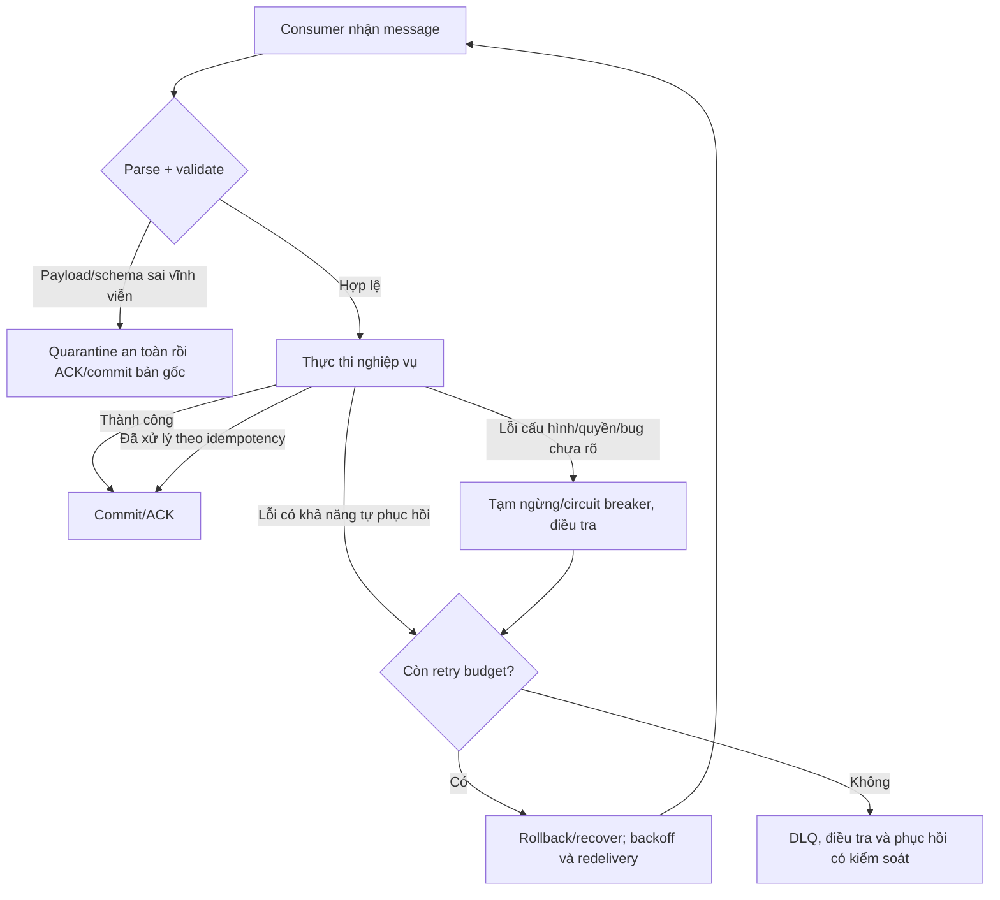

# Phân biệt lỗi tạm thời, lỗi vĩnh viễn và poison message

> **Chương:** Gửi lại và DLQ  
> **Phạm vi:** Consumer Java/JMS xử lý message qua Apache ActiveMQ Artemis và ActiveMQ Classic.  
> **Mục tiêu:** Phân loại lỗi theo **khả năng phục hồi bằng retry**, nhận diện *poison message*, quyết định **retry / xử lý thành công theo idempotency / quarantine / DLQ**, cấu hình broker phù hợp và kiểm chứng bằng message ID cùng trạng thái giao lại.

## 1. Cùng là exception, nhưng không phải lỗi nào cũng nên retry

Một consumer nhận ba thông điệp của queue `orders.tasks`:

| Message | Điều đã xảy ra | Có nên thử lại nguyên trạng? |
| --- | --- | --- |
| **M1:** đơn hàng hợp lệ, API thanh toán trả HTTP 503 vì bảo trì | Dịch vụ phụ thuộc tạm thời không khả dụng | **Có**, giới hạn số lần, có backoff, kết hợp circuit breaker |
| **M2:** payload thiếu `orderId` bắt buộc, schema version hợp lệ | Nội dung message vi phạm hợp đồng | **Không**, phải sửa producer hoặc dữ liệu; đưa vào nơi cách ly để điều tra |
| **M3:** nội dung hợp lệ nhưng cứ xử lý là ném exception | Có thể là bug trong handler, dữ liệu edge case, quyền truy cập hoặc một dependency hỏng kéo dài | **Chưa kết luận từ một exception**; xác minh tính lặp lại và nguyên nhân, giới hạn retry rồi cách ly nếu không tiến triển |

Nếu consumer gọi `session.rollback()` vô hạn cho cả ba, M2 sẽ được giao lại liên tục mà không thể tự thay đổi. Nó chiếm CPU, log, I/O, có thể chặn những message sau và làm queue/DLQ tăng.

Nếu consumer ngược lại **ACK tất cả khi gặp lỗi**, M1 có thể mất luôn, dù chỉ cần chờ API hoạt động lại là xử lý được.

**Nguyên tắc:** Quyết định retry phụ thuộc **loại thất bại, nguyên nhân, khả năng tác nhân thay đổi theo thời gian và hậu quả nếu chạy lại**, không phụ thuộc đơn giản vào việc exception có phải checked hay unchecked.



Sơ đồ là mô hình quyết định; **quarantine thủ công** và **DLQ tự động của broker** là hai đường xử lý có thể dùng riêng hoặc kết hợp, không nên lẫn tên và ý nghĩa.

## 2. Ba khái niệm: transient, permanent, poison

### 2.1. Lỗi tạm thời (*transient error*)

Lỗi tạm thời là lỗi **có khả năng biến mất nếu thử lại sau khi điều kiện bên ngoài thay đổi**, với điều kiện việc thử lại an toàn cho nghiệp vụ.

Ví dụ:

- TCP connection đến DB bị reset, DB failover ngắn; service discovery chưa cập nhật.
- HTTP `429 Too Many Requests`: phải tôn trọng giới hạn tốc độ và `Retry-After` nếu có.
- HTTP `502`/`503`/`504` do dịch vụ phụ thuộc đang quá tải hoặc triển khai.
- Deadlock/serialization conflict mà transaction có thể chạy lại an toàn.
- Rate limit nội bộ, mất khóa phân tán trong khoảng ngắn, replica chưa đồng bộ.

**Không phải mọi lỗi timeout đều an toàn để retry ngay.** Nếu một request thanh toán đã thành công tại đích nhưng client mất response, trạng thái nghiệp vụ là **không xác định**, không phải “chưa thực hiện”. Trước khi gửi lại phải dùng **idempotency key** hoặc truy vấn trạng thái giao dịch.

### 2.2. Lỗi vĩnh viễn (*permanent / non-retryable error*)

Lỗi vĩnh viễn là lỗi **không biến mất chỉ bằng việc phát lại nguyên message trong cùng điều kiện**. Ví dụ:

- JSON sai cú pháp, body không đúng kiểu, thiếu trường bắt buộc.
- `schemaVersion` chưa được consumer hỗ trợ, dù đó có thể chỉ là **không tương thích phiên bản tạm thời** trong quá trình rollout.
- ID/enum/đơn vị không hợp lệ theo contract; tổng số tiền âm khi nghiệp vụ cấm.
- Tài nguyên đích đã bị xóa vĩnh viễn hoặc yêu cầu đã hết thời hạn kinh doanh.
- Lỗi xác thực/ủy quyền do cấu hình sai **kéo dài**; retry dồn dập sẽ không sửa được quyền.

**Từ “vĩnh viễn” phải hiểu trong bối cảnh.** HTTP 403 có thể do token sai và chỉ sửa được bằng cấu hình, chứ không đồng nghĩa payload sai; nếu triển khai token mới vào ngày mai, message có thể xử lý được. Điều đúng là **không retry nóng ở từng message**, mà sửa điều kiện/phiên bản rồi khôi phục có kiểm soát.

### 2.3. *Poison message* là gì?

*Poison message* là message **liên tục khiến pipeline xử lý thất bại** và có nguy cơ bị giao đi giao lại, làm nghẽn hệ thống, tiêu hao retry budget hoặc ảnh hưởng các message khác.

Poison là một **trạng thái/triệu chứng vận hành**, không nhất thiết là một loại exception độc lập:

- Payload lỗi schema cố định → poison vì mỗi lần parse đều thất bại.
- Payload hợp lệ nhưng kích hoạt bug handler (ví dụ case ngày nhuận) → poison cho phiên bản code hiện tại.
- Phụ thuộc bị chặn với mọi message → cả loạt message có thể thất bại; **không nhất thiết** mọi message đều là dữ liệu độc.
- Một message luôn tranh chấp khóa, bị rollback tới giới hạn → poison theo hành vi quan sát, dù dữ liệu không sai.

Trên **ActiveMQ Classic**, thuật ngữ *poison ACK* còn có nghĩa **một loại tín hiệu ở cấp client/broker** khi chính sách redelivery đã hết giới hạn, khiến broker áp dụng xử lý dead letter. **Poison ACK của Classic không đồng nghĩa ứng dụng đã xác định JSON của message bị hỏng**.

Đặc biệt, “đã retry 5 lần” là **dấu hiệu vượt ngưỡng xử lý**, không phải bằng chứng loại lỗi. DLQ phải giữ reason, stack trace đã lọc và metadata để điều tra nguyên nhân thực sự.

## 3. Ma trận phân loại lỗi ngay tại consumer

| Triệu chứng | Phân loại ban đầu | Hành động khuyến nghị | Cần xác minh |
| --- | --- | --- | --- |
| HTTP 503, DB connection reset | Tạm thời | Retry có backoff, giới hạn số lần | Downstream health, idempotency |
| HTTP 429 | Tạm thời, có throttle | Retry theo `Retry-After` hoặc lịch được kiểm soát | Giới hạn theo tenant/API; không tạo retry storm |
| DB deadlock/serialization failure | Có thể tạm thời | Rollback transaction, retry có jitter | Có thể lặp do cùng thứ tự khóa |
| Payload JSON sai cú pháp | Vĩnh viễn với raw payload này | Quarantine, không retry nóng | Raw bytes, content type, version, producer |
| Sai `schemaVersion` | Không tương thích hiện tại | Quarantine/route consumer phù hợp | Kế hoạch rollout, consumer còn đọc bản cũ? |
| `orderId` không tồn tại | Phụ thuộc nghiệp vụ | Có thể retry chờ eventual consistency hoặc reject | ID sẽ xuất hiện sau hay thực sự sai? |
| HTTP 400 do tham số không hợp lệ | Thường vĩnh viễn | Cách ly + sửa producer | Mapping payload → request |
| HTTP 401/403 | Thường lỗi cấu hình/quyền | Ngừng nóng, cảnh báo vận hành | Token hết hạn hay quyền vĩnh viễn? |
| Duplicate key DB khi `eventId` đã xử lý | **Có thể là thành công idempotent** | Xác minh bản ghi đã hoàn tất, rồi ACK | Không nuốt duplicate của *khác* event |
| Timeout sau lệnh charge tiền | Kết quả **không xác định** | Query theo idempotency key, reconcile | Không charge lần hai |
| `NullPointerException` lặp đúng một event | Poison/bug có thể sửa | Retry rất hạn chế, quarantine, sửa code | Stack trace, schema và phiên bản deploy |
| Broker/consumer bị restart | Sự cố hạ tầng | Cho phép redelivery theo transaction | Không trùng side effect |
| Body vượt giới hạn an toàn | Vĩnh viễn đối với consumer hiện tại | Quarantine/quy trình riêng | Có cần thiết kế large message? |
| Hết disk của broker hoặc DB | Sự cố diện rộng | Alert, backpressure, giảm ingress | Đừng đẩy mọi message vào DLQ chỉ vì outage |

### 3.1. Chia lỗi theo *phạm vi*

Cùng một lỗi có thể thuộc những cấp khác nhau:

- **Per-message:** chỉ `eventId=42` thất bại; những event khác xử lý bình thường.
- **Per-tenant / per-destination:** mọi message tenant A bị 403; các tenant khác vẫn ổn.
- **Per-dependency:** toàn bộ consumer đều không truy cập được DB.
- **Per-deployment:** code mới không hiểu schema v2; nhiều queue cùng bị tác động.

Nếu mọi message thất bại do DB down, tự động đưa **tất cả** vào DLQ sau 3 lần retry có thể biến một outage tạm thời thành khối lượng re-drive khổng lồ. Cần kết hợp **circuit breaker / pause consumer** và ngưỡng cảnh báo, không chỉ dựa vào per-message delivery count.

## 4. Quy trình quyết định có kiểm soát

### 4.1. Phân loại theo stage, không theo tên exception chung chung

Một pipeline khả thi:

```text
Nhận message
   |
   +--> Kiểm tra type/size/schema
   |      +--> Sai dữ liệu không tự sửa --> quarantine + ACK atomically (khi có thể)
   |
   +--> Kiểm tra eventId đã xử lý?
   |      +--> Đã hoàn tất -> ACK như thành công idempotent
   |
   +--> Gọi nghiệp vụ / downstream
          +--> Thành công -> commit JMS (sau side effect)
          +--> Trạng thái không chắc chắn -> reconcile bằng eventId/idempotency key
          +--> Transient -> rollback/recover, backoff, deadline
          +--> Bug/cấu hình -> alert, circuit-break, quarantine nếu không tiến triển
```

**Không retry một thao tác không idempotent một cách mù quáng.** Ví dụ gửi tiền: `SocketTimeoutException` có thể xuất hiện **sau khi** server đã ghi nhận thanh toán. Dù dùng JMS transaction, transaction local của broker không tự bao gồm transaction phía dịch vụ ngoài.

### 4.2. Retry budget không chỉ là một số nguyên

Mỗi loại lỗi cần những giới hạn riêng:

- **Số lần:** tối đa N attempts/delivery theo broker, lưu ý mỗi sản phẩm định nghĩa cách đếm khác nhau.
- **Thời gian:** deadline cuối cùng từ khi event phát, ví dụ không retry sau 15 phút vì đơn hàng đã bị hủy.
- **Khoảng cách:** backoff tăng dần, tối đa một ngưỡng; thêm jitter để tránh tất cả consumer retry đồng loạt.
- **Áp lực hệ thống:** giới hạn số message đang retry, concurrency cho dependency; tránh retry storm.
- **Ngữ nghĩa nghiệp vụ:** khi hết deadline, event có thể cần cảnh báo/đối soát chứ không chỉ bỏ vào DLQ.

Một dãy delay minh họa:

\[
d_k = \min(d_{\max}, d_0 \times r^{k-1})
\]

Với `d0=2s`, hệ số `r=2`, `dmax=30s`: các lần trì hoãn khoảng 2, 4, 8, 16, 30 giây. Dãy này chưa có jitter và là mô hình **minh họa**, không bảo đảm tham số của mọi provider đều cho chuỗi y hệt (lần đầu giao không phải redelivery).

**Tránh `Thread.sleep(...)` trong listener JMS để giả lập retry**. Thread bị giữ, transaction/ack chưa hoàn tất, message inflight và concurrency bị chiếm; ưu tiên redelivery delay do broker/provider hoặc retry queue/scheduled message được thiết kế có kiểm soát.

### 4.3. Ba kết cục khác nhau

| Kết cục | Có ACK/commit bản gốc? | Có giữ message để khôi phục? | Tình huống |
| --- | --- | --- | --- |
| **Retry** | **Không**; rollback/recover theo chế độ | Message còn trong hệ thống | Lỗi tạm thời |
| **Quarantine chủ động** | **Có**, nhưng chỉ sau khi bản sao lỗi đã được gửi và commit an toàn | Queue cách ly với reason, event ID | Invalid JSON/schema không thể tự sửa |
| **Broker tự chuyển DLQ** | Broker áp dụng policy sau giới hạn giao lại | DLQ nếu đã cấu hình đúng | Exhausted redelivery sau rollback liên tiếp |

Quarantine do ứng dụng tự gửi **không tự là Dead Letter Queue gốc của broker**. Đặt tên riêng giúp phân biệt lý do và quy trình khôi phục.

## 5. Cơ chế ACK/rollback quyết định redelivery

### 5.1. Với `SESSION_TRANSACTED`

JMS consumer dùng session transacted:

```java
Session session = connection.createSession(
        true, Session.SESSION_TRANSACTED);
Message message = consumer.receive(5_000);

try {
    process(message);    // xử lý nghiệp vụ
    session.commit();    // ACK phần nhận trong JMS transaction
} catch (TransientProcessingException ex) {
    session.rollback();  // message chưa commit đủ điều kiện redelivery
}
```

Các biến `consumer`, `process` và exception trong đoạn này là minh họa; ví dụ hoàn chỉnh ở phần 8. **Rollback không có nghĩa chắc chắn message sẽ được trả ngay lập tức**: provider/broker áp dụng delay, số lần giao lại và giới hạn DLQ.

Trong một **JMS local transaction**, gửi bản sao lỗi vào queue quarantine **và** xác nhận message gốc có thể nằm trong một lần `session.commit()` nếu dùng **cùng session, cùng broker**. Điều này giúp tránh cửa sổ “đã xóa gốc nhưng chưa gửi được bản lỗi”. Transaction đó **không** bao gồm DB hoặc HTTP API bên ngoài.

### 5.2. Với `CLIENT_ACKNOWLEDGE`

Ở `CLIENT_ACKNOWLEDGE` chuẩn, `Message.acknowledge()` có thể ACK **tất cả message đã tiêu thụ trong session**, không chỉ message hiện tại. Khi cần rollback một delivery chưa ACK, `session.recover()` yêu cầu provider redeliver các message chưa được xác nhận theo hợp đồng JMS.

Vì vậy không viết một handler giữ nhiều message chưa xử lý rồi ACK riêng “message tốt” nếu tất cả dùng **một session CLIENT_ACKNOWLEDGE**. Phân tách một session cho mỗi worker hoặc dùng transaction thích hợp.

### 5.3. Với `AUTO_ACKNOWLEDGE`

Trong synchronous `receive()`, message có thể được JMS auto-ack **ngay khi receive trả về thành công**, trước khi code parse JSON, gọi DB và phân loại lỗi. Nếu catch exception và chỉ log, message đã không còn được broker redeliver do lỗi đó.

Trong asynchronous `MessageListener`, việc callback trả về thành công ảnh hưởng auto-ack theo contract JMS; nhưng vẫn không nên coi auto-ack là cơ chế chắc chắn bảo vệ side effect bên ngoài. Với consumer cần phân loại retry/quarantine có kiểm soát, ưu tiên **transaction/ack mode được hiểu rõ**.

### 5.4. Delivery count và cờ redelivery

```java
boolean redelivered = message.getJMSRedelivered();
int deliveryCount = message.propertyExists("JMSXDeliveryCount")
        ? message.getIntProperty("JMSXDeliveryCount") : -1;
```

- `JMSRedelivered` là gợi ý message đã được giao trước đó, **không** xác nhận nghiệp vụ đã thành công.
- `JMSXDeliveryCount` (nếu provider cung cấp) thường đếm cả **lần giao đầu tiên**. Cần xác minh behavior khi failover, persistence, consumer close và broker restart.
- Một message **được producer gửi lại thành message mới** có thể có `JMSMessageID`/delivery count mới dù cùng `eventId`; không dùng delivery count để chống trùng nghiệp vụ.
- Không mặc định `deliveryCount >= 5` đồng nghĩa message **chắc chắn** poison về payload.

Trong hệ nhiều nguồn, có thể ghi thêm `failureCategory` và `lastFailureCode` ở bản quarantine, chứ không nên cố sửa mọi property trực tiếp trên message đang được consumer nhận: JMS message đã nhận thường ở chế độ read-only.

## 6. Cấu hình Apache ActiveMQ Artemis: broker redelivery và DLQ

Artemis cho phép đặt policy theo **address setting** trong `broker.xml`. Để thử riêng, tạo ba địa chỉ ANYCAST: queue nguồn, DLQ tự động của broker, queue quarantine do ứng dụng gửi vào.

### 6.1. Khai báo địa chỉ/queue

Fragment bên trong `<addresses>` của Artemis `broker.xml`:

```xml
<address name="lab.errors.in">
    <anycast>
        <queue name="lab.errors.in" durable="true"/>
    </anycast>
</address>

<address name="lab.errors.dlq">
    <anycast>
        <queue name="lab.errors.dlq" durable="true"/>
    </anycast>
</address>

<address name="lab.errors.quarantine">
    <anycast>
        <queue name="lab.errors.quarantine" durable="true"/>
    </anycast>
</address>
```

Ở đây:

- `lab.errors.in`: nhận sự kiện nghiệp vụ.
- `lab.errors.dlq`: đích broker chuyển message khi vượt giới hạn delivery.
- `lab.errors.quarantine`: ứng dụng chủ động chuyển payload lỗi cố định kèm chẩn đoán, không đợi broker retry hết lượt.

Không sử dụng tên queue production cho bài lab. Nếu broker bật bảo mật, tạo quyền `send/consume` tương ứng; quyền send sang quarantine không đồng nghĩa có quyền browse/delete DLQ.

### 6.2. Cấu hình retry/DLQ

Fragment đặt trong `<address-settings>`, không phải toàn bộ `broker.xml`:

```xml
<address-setting match="lab.errors.in">
    <dead-letter-address>lab.errors.dlq</dead-letter-address>
    <max-delivery-attempts>5</max-delivery-attempts>

    <redelivery-delay>2000</redelivery-delay>
    <redelivery-delay-multiplier>2.0</redelivery-delay-multiplier>
    <max-redelivery-delay>30000</max-redelivery-delay>
</address-setting>
```

Ý nghĩa:

| Thuộc tính | Vai trò | Cẩn trọng |
| --- | --- | --- |
| `dead-letter-address` | Địa chỉ nhận message bị dead-letter từ nguồn | Địa chỉ/queue đích phải được provision và route hợp lệ |
| `max-delivery-attempts` | Giới hạn số lần broker thử giao message trước khi chuyển dead-letter | Kiểm chứng cách đếm first delivery và thời điểm chuyển ở đúng bản Artemis |
| `redelivery-delay` | Trì hoãn giao lại sau rollback/cancel | Không phải trì hoãn lần gửi ban đầu |
| `redelivery-delay-multiplier` | Hệ số backoff trên các lần retry | Không tự thêm random jitter nếu không cấu hình tương ứng |
| `max-redelivery-delay` | Giới hạn mức delay tối đa | Không phải tổng deadline nghiệp vụ |

**Đừng để `max-delivery-attempts=-1` (thử lại không giới hạn) cho queue dễ có poison message** nếu không có cơ chế circuit-break, ngừng retry hoặc cảnh báo bù trừ. Mặc định và ý nghĩa âm/dương cần đối chiếu theo bản Artemis đang chạy.

Artemis thực hiện việc chuyển message đã hết lượt sang **dead-letter address**; message sau đó được route vào queue ở địa chỉ ấy. Đừng nhầm `dead-letter-address` với một tên queue bất kỳ được “di chuyển” không cần routing.

### 6.3. Diễn tiến của một transient error

```text
Producer -> lab.errors.in: M1
                         |
                   Delivery #1 -> DB timeout -> rollback
                         |
                   Đợi redelivery-delay
                         |
                   Delivery #2 -> DB timeout -> rollback
                         |
                   Delivery #3 -> DB OK -> session.commit()
                         |
                   Kết thúc: không vào DLQ
```

Đây là kết quả mong muốn **nếu** dependency phục hồi, worker còn retry budget và logic nghiệp vụ an toàn để chạy lại.

### 6.4. Khi broker chuyển sang DLQ

```text
Producer -> lab.errors.in: M2
  -> delivery #1: rollback
  -> delivery #2: rollback
  -> ...
  -> vượt chính sách max-delivery-attempts
  -> broker chuyển M2 tới lab.errors.dlq
  -> cảnh báo / phân tích / sửa lỗi / re-drive có kiểm soát
```

Không dùng đồ thị queue-depth đơn lẻ để kết luận message bị “mất”: sau khi dead-letter, **queue nguồn giảm nhưng queue DLQ tăng**. Phải theo dõi cả hai.

## 7. ActiveMQ Classic: chính sách redelivery và dead-letter khác Artemis

ActiveMQ Classic truyền thống thường cho client `RedeliveryPolicy` xác định số lần và khoảng cách giao lại. Khi giới hạn redelivery được dùng hết, **Classic client có thể gửi poison ACK**, broker áp dụng `deadLetterStrategy` để xử lý message.

### 7.1. Cấu hình redelivery trên Classic Java client

Ví dụ Java `javax.jms`, client Classic 5.x:

```java
import org.apache.activemq.ActiveMQConnectionFactory;
import org.apache.activemq.RedeliveryPolicy;

ActiveMQConnectionFactory factory =
        new ActiveMQConnectionFactory("tcp://localhost:61616");

RedeliveryPolicy policy = factory.getRedeliveryPolicy();
policy.setInitialRedeliveryDelay(1000);
policy.setRedeliveryDelay(2000);
policy.setUseExponentialBackOff(true);
policy.setBackOffMultiplier(2.0);
policy.setMaximumRedeliveries(4);
```

**Quan trọng:**

- `maximumRedeliveries=4` là cấu hình **số lần giao lại** sau delivery đầu tiên trong chính sách Classic client; không bê giá trị đó sang Artemis `max-delivery-attempts` rồi tuyên bố tương đương.
- Đây là ví dụ **client policy**, không phải mọi đường nhận message của broker đều tự tuân theo nó. Với client khác OpenWire hoặc ứng dụng trên Artemis Core, phải cấu hình chính sách tương ứng.
- Thực tế retry còn chịu transaction, rollback, consumer prefetch và các cơ chế của Classic. Cần đo thời gian redelivery, kiểm tra poison ACK và DLQ trên phiên bản cụ thể.

### 7.2. Cấu hình DLQ ở Classic broker

Fragment `activemq.xml` bên trong `destinationPolicy`, theo cấu trúc policy của Classic:

```xml
<destinationPolicy>
    <policyMap>
        <policyEntries>
            <policyEntry queue="lab.errors.in">
                <deadLetterStrategy>
                    <individualDeadLetterStrategy
                        queuePrefix="DLQ."
                        useQueueForQueueMessages="true"/>
                </deadLetterStrategy>
            </policyEntry>
        </policyEntries>
    </policyMap>
</destinationPolicy>
```

Với `individualDeadLetterStrategy`, một queue kiểu `lab.errors.in` thường được dead-letter tới `DLQ.lab.errors.in` theo prefix trên. Cách đặt tên và bảo mật cần kiểm tra với policy thực tế; Classic cũng có shared DLQ, khác mô hình `dead-letter-address` của Artemis.

**Không dùng đồng thời hai mảnh XML của Artemis và Classic trên cùng broker.** Cấu hình và điểm chịu trách nhiệm retry là khác nhau:

| Khía cạnh | Artemis | Classic |
| --- | --- | --- |
| Cấu hình backoff/DLQ điển hình | `address-setting` trên broker | `RedeliveryPolicy` client và `deadLetterStrategy` broker |
| Giới hạn lần giao | `max-delivery-attempts` | `maximumRedeliveries` của Classic client |
| Cơ chế dead-letter | Broker chuyển vào `dead-letter-address` | Client có thể gửi `poison ACK`, broker áp dụng chiến lược DLQ |
| Hệ quả chuyển client | Tập trung kiểm tra broker policy + client behavior | Một client mới có thể không áp dụng RedeliveryPolicy như Classic client cũ |

Trong cả hai hệ, lỗi dạng invalid payload **không nên chờ đủ mọi lần retry** nếu consumer đã xác định chắc chắn là không thể tự phục hồi và có đường quarantine an toàn.

## 8. Ví dụ Java/JMS: phân loại, rollback transient và quarantine permanent

Ví dụ dưới chạy với **Apache ActiveMQ Artemis**, JMS 2.0 namespace `javax.jms`. Mục đích là kiểm chứng ba kết cục khác nhau trong một queue:

- `good`: message hợp lệ, xử lý thành công và commit.
- `flaky`: mô phỏng lỗi DB thoáng qua hai lần đầu; rollback rồi xử lý thành công ở lần sau.
- `invalid`: JSON sai cú pháp; gửi bản sao lỗi vào `lab.errors.quarantine` và ACK bản gốc **trong cùng local JMS transaction**.

Ví dụ không gọi DB thật, tránh khiến người học nhầm rằng transaction JMS bao trùm các side effect ngoài broker.

### 8.1. Dependency và điều kiện

Maven Java 17, ví dụ Artemis 2.50.0 cùng Jackson:

```xml
<properties>
    <maven.compiler.release>17</maven.compiler.release>
</properties>

<dependencies>
    <dependency>
        <groupId>org.apache.artemis</groupId>
        <artifactId>artemis-jms-client</artifactId>
        <version>2.50.0</version>
    </dependency>
    <dependency>
        <groupId>com.fasterxml.jackson.core</groupId>
        <artifactId>jackson-databind</artifactId>
        <version>2.17.2</version>
    </dependency>
</dependencies>
```

Broker cần Core acceptor tại `tcp://localhost:61616` và các queue/policy phần 6. Ví dụ dùng `javax.jms`; với `jakarta.jms` đổi cả client artifact/import. Trong broker lab nên chỉ có **một consumer** trên queue nguồn, và không có test/production khác sử dụng các queue `lab.errors.*`.

### 8.2. Mã thử nghiệm có chủ đích

```java
import com.fasterxml.jackson.databind.JsonNode;
import com.fasterxml.jackson.databind.ObjectMapper;
import org.apache.activemq.artemis.jms.client.ActiveMQConnectionFactory;

import javax.jms.Connection;
import javax.jms.DeliveryMode;
import javax.jms.Message;
import javax.jms.MessageConsumer;
import javax.jms.MessageProducer;
import javax.jms.Queue;
import javax.jms.Session;
import javax.jms.TextMessage;

import java.util.HashSet;
import java.util.Set;
import java.util.UUID;

public final class PoisonClassificationProbe {
    private static final ObjectMapper JSON = new ObjectMapper();

    static final class PermanentPayloadException extends Exception {
        PermanentPayloadException(String reason) { super(reason); }
    }

    static final class TransientProcessingException extends Exception {
        TransientProcessingException(String reason) { super(reason); }
    }

    private static void require(boolean condition, String reason) {
        if (!condition) throw new IllegalStateException(reason);
    }

    private static void seed(Session tx, MessageProducer producer,
                             String runId, String kind, String body)
            throws Exception {
        TextMessage message = tx.createTextMessage(body);
        message.setStringProperty("labRunId", runId);
        message.setStringProperty("kind", kind);
        message.setStringProperty("eventId", runId + ":" + kind);
        producer.send(message);
    }

    private static void validatePayload(String body)
            throws PermanentPayloadException {
        final JsonNode root;
        try {
            root = JSON.readTree(body);
        } catch (Exception parseError) {
            throw new PermanentPayloadException("MALFORMED_JSON");
        }

        if (root == null || !root.isObject()
                || !root.hasNonNull("eventType")
                || !"OrderCreated".equals(
                    root.path("eventType").asText(null))) {
            throw new PermanentPayloadException("UNSUPPORTED_SCHEMA");
        }
    }

    public static void main(String[] args) throws Exception {
        String url = args.length == 0
                ? "tcp://localhost:61616" : args[0];
        String runId = UUID.randomUUID()
                .toString().replace("-", "");

        ActiveMQConnectionFactory factory =
                new ActiveMQConnectionFactory(url);

        String user = System.getenv("ARTEMIS_USER");
        String password = System.getenv("ARTEMIS_PASSWORD");
        try (Connection connection = user == null
                ? factory.createConnection()
                : factory.createConnection(user, password)) {

            // Cùng một Session JMS giao dịch:
            // nhận/ACK bản gốc và gửi bản quarantine có thể commit atomically.
            Session tx = connection.createSession(
                    true, Session.SESSION_TRANSACTED);

            Queue input = tx.createQueue("lab.errors.in");
            Queue quarantine = tx.createQueue("lab.errors.quarantine");

            MessageProducer seedProducer = tx.createProducer(input);
            seedProducer.setDeliveryMode(DeliveryMode.PERSISTENT);
            MessageProducer quarantineProducer =
                    tx.createProducer(quarantine);
            quarantineProducer.setDeliveryMode(DeliveryMode.PERSISTENT);

            // Run ID riêng; selector hạn chế nhận đúng message của lần thử.
            // Không thay cho việc dùng queue lab độc lập với worker khác.
            seed(tx, seedProducer, runId, "good",
                    "{\"eventType\":\"OrderCreated\"}");
            seed(tx, seedProducer, runId, "flaky",
                    "{\"eventType\":\"OrderCreated\"}");
            seed(tx, seedProducer, runId, "invalid", "{bad-json");
            tx.commit();

            MessageConsumer consumer = tx.createConsumer(
                    input, "labRunId = '" + runId + "'");
            connection.start();

            Set<String> completed = new HashSet<>();
            int transientFailures = 0;
            long deadlineNanos = System.nanoTime()
                    + java.util.concurrent.TimeUnit.SECONDS.toNanos(45);

            while (completed.size() < 3
                    && System.nanoTime() < deadlineNanos) {

                Message message = consumer.receive(2500);
                if (message == null) continue;

                String kind = message.getStringProperty("kind");
                String eventId = message.getStringProperty("eventId");
                int deliveryCount = message.propertyExists("JMSXDeliveryCount")
                        ? message.getIntProperty("JMSXDeliveryCount") : -1;

                try {
                    if (!(message instanceof TextMessage)) {
                        throw new PermanentPayloadException(
                                "UNSUPPORTED_MESSAGE_TYPE");
                    }
                    String body = ((TextMessage) message).getText();
                    validatePayload(body);

                    // Đây là giả lập dependency thất bại, KHÔNG phải DB thật.
                    if ("flaky".equals(kind) && transientFailures < 2) {
                        transientFailures++;
                        throw new TransientProcessingException(
                                "SIMULATED_DB_TIMEOUT");
                    }

                    System.out.printf(
                            "SUCCESS %s, deliveryCount=%d%n",
                            eventId, deliveryCount);

                    // Trong production: dùng idempotency key và xử lý DB
                    // trước khi commit JMS, có tính đến cửa sổ lỗi hai hệ.
                    tx.commit();
                    completed.add(kind);

                } catch (PermanentPayloadException permanent) {
                    // Chuyển invalid message sang quarantine trước ACK gốc.
                    // Cùng một local JMS transaction (cùng broker).
                    try {
                        String originalBody =
                                message instanceof TextMessage
                                    ? ((TextMessage) message).getText()
                                    : "<unsupported message type>";

                        TextMessage parked =
                                tx.createTextMessage(originalBody);
                        parked.setStringProperty("originalEventId", eventId);
                        parked.setStringProperty("labRunId", runId);
                        parked.setStringProperty(
                                "failureCategory", "PERMANENT");
                        parked.setStringProperty(
                                "failureCode", permanent.getMessage());

                        quarantineProducer.send(parked);
                        tx.commit();   // Atomic: gửi bản sao + ACK bản gốc.
                        completed.add(kind);
                        System.out.println(
                                "QUARANTINE " + eventId + " / " +
                                permanent.getMessage());
                    } catch (Exception quarantineFailure) {
                        tx.rollback();
                        throw quarantineFailure;
                    }

                } catch (TransientProcessingException transientFailure) {
                    System.out.printf(
                            "RETRY %s, deliveryCount=%d, reason=%s%n",
                            eventId, deliveryCount,
                            transientFailure.getMessage());
                    tx.rollback();    // Broker quyết định delay/redelivery.

                } catch (Exception unexpected) {
                    tx.rollback();
                    throw unexpected;
                }
            }

            require(completed.equals(Set.of("good", "flaky", "invalid")),
                    "Không hoàn tất đủ các trường hợp: " + completed);

            // Browser chỉ quan sát quarantine, KHÔNG consume bản lỗi.
            javax.jms.QueueBrowser browser =
                    tx.createBrowser(quarantine,
                            "labRunId = '" + runId + "'");
            int parkedCount = 0;
            try {
                java.util.Enumeration<?> e = browser.getEnumeration();
                while (e.hasMoreElements()) {
                    Message m = (Message) e.nextElement();
                    parkedCount++;
                    System.out.println("PARKED "
                            + m.getStringProperty("originalEventId"));
                }
            } finally {
                browser.close();
            }

            // Browser không làm thay đổi JMS transaction phần nhận.
            tx.commit();
            require(parkedCount == 1,
                    "Cần đúng một quarantine record: " + parkedCount);
            System.out.println("PASS: success + transient + permanent");
        }
    }
}
```

**Kết quả mong đợi trong lab** (thứ tự khác nhau tùy dispatch/delay):

```text
SUCCESS ...:good, deliveryCount=1
RETRY ...:flaky, deliveryCount=1, reason=SIMULATED_DB_TIMEOUT
QUARANTINE ...:invalid / MALFORMED_JSON
RETRY ...:flaky, deliveryCount=2, reason=SIMULATED_DB_TIMEOUT
SUCCESS ...:flaky, deliveryCount=3
PARKED ...:invalid
PASS: success + transient + permanent
```

Có thể có một số dòng `deliveryCount` khác kỳ vọng ở trạng thái đặc biệt; ứng dụng **không dùng count để đưa ra quyết định nghiệp vụ**, chỉ in để quan sát. Nếu quá 45 giây không thành công, kiểm tra broker policy, quyền consume/send, DLQ, selector và lịch redelivery.

**Quan trọng về atomicity:** Ứng dụng dùng **cùng JMS transacted Session** cho việc nhận bản gốc và gửi bản quarantine. Nếu `tx.commit()` thành công, hai thao tác JMS này được commit cùng nhau trên broker. Nếu handler làm thay đổi **database bên ngoài**, local JMS transaction không bảo đảm atomicity với DB; phải có idempotency/inbox/outbox hoặc cơ chế phối hợp khác.

**Quan trọng về dữ liệu:** Code lab copy nguyên body lỗi để điều tra. Production phải đặt hạn mức payload, quyền truy cập quarantine, retention và cách xử lý PII. Không log toàn bộ raw message hay stack trace chứa credential. Bản quarantine nên có `reasonCode` có kiểm soát, `eventId`, thời điểm, nguồn message, schema version và runbook re-drive.

### 8.3. Cách làm bài thử DLQ tự động riêng

Demo phần 8 xử lý lỗi permanent **trước khi** hết retry, nên không có lý do để `lab.errors.dlq` tăng. Để thử **broker auto-DLQ**, tạo một ca độc lập, ví dụ message hợp lệ nhưng handler luôn trả lỗi tạm thời:

```java
// Một session transacted và consumer của lab.errors.in:
Message m = consumer.receive(5_000);
if (m != null && "alwaysFail".equals(
        m.getStringProperty("kind"))) {
    session.rollback();
}
```

Lặp lại theo chính sách redelivery đã cấu hình, giới hạn thời gian kiểm thử và quan sát queue nguồn giảm, `lab.errors.dlq` tăng sau khi vượt `max-delivery-attempts`. Không gọi `session.commit()` trong nhánh lỗi; không gửi bản quarantine thủ công cho cùng message khi đang thử DLQ, để dễ phân biệt hai cơ chế.

Trong lab thực, dùng message có `eventId`/`labRunId` riêng và broker metrics để xác minh message nào đã chuyển; đừng chỉ đo message count tổng của DLQ cũ.

## 9. DLQ không phải nơi kết thúc vòng đời nghiệp vụ

Một message nằm trong DLQ được **cách ly khỏi luồng xử lý chính**, nhưng nghiệp vụ chưa tự động hoàn tất. Cần runbook rõ:

1. **Phát hiện:** cảnh báo queue DLQ tăng, số message quá tuổi, tần suất poison ACK/rollback, lỗi theo tenant/schema version.
2. **Khoanh vùng:** đối chiếu `eventId`, `JMSMessageID`, `JMSXDeliveryCount` (nếu hỗ trợ), queue nguồn, code lỗi, consumer version, thời điểm lỗi đầu tiên/cuối cùng.
3. **Phân loại lại:** payload sai thật, bug consumer, outage kéo dài hay kết quả ngoài DB không chắc chắn?
4. **Sửa nguyên nhân:** sửa producer/schema, deploy handler, cấp quyền đúng hoặc khôi phục dependency.
5. **Re-drive có kiểm soát:** chọn message đủ điều kiện, rate limit, idempotency, dấu vết operator/ticket, không đẩy ồ ạt vào queue chính.
6. **Xác nhận kết quả:** ACK/commit đã hoàn tất, DLQ giảm, không trùng side effect; ghi kết luận RCA.
7. **Retention:** đặt thời hạn giữ lỗi và quy tắc xử lý dữ liệu nhạy cảm, tránh DLQ tăng vô hạn thành rủi ro storage.

**Đừng tự động re-drive toàn bộ DLQ cứ mỗi phút.** Nếu lỗi chưa sửa, message sẽ quay lại DLQ, tạo vòng lặp và tăng tải broker.

### 9.1. Giữ đủ thông tin nhưng không làm rò dữ liệu

Bản quarantine/DLQ nên có, trong giới hạn chính sách dữ liệu:

| Metadata | Lý do |
| --- | --- |
| `originalDestination` | Biết message xuất phát từ queue/address nào |
| `eventId` / business key | Đối chiếu producer, DB, consumer |
| `failureCategory` / `failureCode` | Tập hợp theo nguyên nhân, phân loại retry |
| `schemaVersion` và consumer version | Xác định lỗi tương thích triển khai |
| `firstFailureAt` / `lastFailureAt` | Biết duration outage và lịch xử lý |
| Delivery count được broker cung cấp | Phân biệt retry và khả năng giao trùng |
| Payload hoặc tham chiếu lưu an toàn | Cho phép sửa/re-drive với quyền phù hợp |

Không đặt stack trace dài vào JMS property không giới hạn; message/properties quá lớn có thể gây lỗi khác. Với raw payload nhạy cảm, lưu an toàn trong kho được phân quyền và dùng reference/correlation ID thay vì nhân bản tràn lan.

## 10. Quan sát đúng: không nhầm outage với poison

### 10.1. Bốn nhóm metric nên nhìn cùng nhau

| Nhóm | Metric / tín hiệu | Cách diễn giải |
| --- | --- | --- |
| **Queue nguồn** | message count, delivering/inflight, age of oldest, enqueue/dequeue | Queue tăng do chậm xử lý hay do rollback liên tục? |
| **Redelivery** | count và delay thực tế, phân bố `JMSXDeliveryCount`, rollback rate | Nhiều message mới lỗi hay chỉ một số ID quay vòng? |
| **DLQ/quarantine** | số mới vào theo `failureCode`, queue depth và tuổi | Phần không tự phục hồi có tăng không? |
| **Dependency/consumer** | HTTP 429/503, DB latency, exception theo handler version, CPU, thread pool | Lỗi per-message hay outage diện rộng? |

Nếu **đa số message** cùng lỗi `DB_CONNECTION_REFUSED`, ưu tiên sửa DB hoặc tạm dừng ingestion có kiểm soát. Nếu chỉ **một `eventId`** lặp lại `VALIDATION_ERROR`, đó là ứng viên poison rõ ràng.

### 10.2. Sự khác biệt giữa mất, trùng và cách ly

- **Mất thật:** broker/handler không còn message hoặc side effect cần thiết, cũng không còn ở DLQ/quarantine/backup.
- **Giao trùng:** message nhận lại sau rollback/ACK không chắc chắn hoặc producer retry; cần idempotency.
- **Cách ly:** message vẫn tồn tại trong DLQ/quarantine, chưa phải xử lý nghiệp vụ thành công.
- **Bị chặn bởi retry:** queue chính còn message, có thể đang inflight hoặc scheduled redelivery; không vội kết luận producer ngừng phát.

Từ góc độ SLA, cả “kẹt trong DLQ” và “re-drive mãi không xong” đều là **nợ xử lý nghiệp vụ** cần xử lý có người chịu trách nhiệm.

## 11. Khi nào không nên gọi lỗi là poison?

Một hệ thống có năm consumer và mọi message đều gặp HTTP 503 lúc DB deploy:

- Đây là **outage dependency**; nếu định nghĩa mỗi message là poison sau ba lần rollback, sẽ đưa hàng nghìn event tốt vào DLQ.
- Giải pháp tốt hơn có thể là **điều chỉnh concurrency**, giảm áp lực ingress, pause/restart listener theo health check, circuit breaker và retry khi dependency phục hồi.
- Broker retry budget vẫn cần để ngăn vòng lặp vô hạn, nhưng phải cân nhắc **thời gian outage dự kiến** và khả năng giữ backlog.

Ngược lại, một message đơn lẻ chứa `{"amount":"NaN"}` gây parse fail mỗi lần:

- Thay đổi delay từ 2 giây thành 20 giây chỉ làm lỗi lặp chậm hơn.
- Quarantine chủ động có lý do, sửa producer/data rồi re-drive là hướng phù hợp.
- Nếu không có đường quarantine atomic, dựa vào giới hạn broker redelivery và DLQ vẫn tốt hơn ACK rồi làm mất bản lỗi.

**Vì vậy không suy từ ngoại lệ “dữ liệu” hay “hạ tầng” theo tên class Java.** Ví dụ `IllegalArgumentException` có thể do code bug; `SQLException` có thể biểu thị vi phạm ràng buộc vĩnh viễn hoặc deadlock thoáng qua. Phải xác định **mã lỗi** và **ngữ cảnh**.

## 12. Những bẫy kỹ thuật cần tránh

### Bẫy 1: Catch exception rồi return dưới AUTO_ACK

```java
consumer.setMessageListener(message -> {
    try {
        process(message);
    } catch (Exception ex) {
        log(ex);
        // Trả về bình thường có thể khiến message được auto-ack.
    }
});
```

Đây là **đoạn phản ví dụ**, không phải cách làm khuyến nghị. Với listener AUTO_ACK, return thành công dù xử lý lỗi có thể làm mất cơ hội redelivery. Chọn transaction và quản lý lỗi rõ ràng.

### Bẫy 2: Thử lại liên tục, không delay

Một poison message có thể ngốn CPU và log rất nhanh. Retry phải có **giới hạn, backoff, quan sát và nơi cách ly**; đặc biệt khi lỗi hàng loạt cần circuit-breaker thay vì tăng retry per-message.

### Bẫy 3: ACK rồi mới gửi bản sao vào quarantine

```text
ACK gốc thành công
   |
   X  Quarantine broker hoặc network lỗi
   |
Không còn bản gốc để phát lại; bản sao lỗi cũng chưa được lưu.
```

Nếu cùng broker JMS, dùng **cùng session transacted** để gửi quarantine + xác nhận gốc trong một commit. Nếu hai broker hoặc có hệ lưu ngoài JMS, cần thiết kế reliability khác; không có atomicity mặc định.

### Bẫy 4: Tin rằng `JMSRedelivered=false` nghĩa là chưa xử lý

Producer retry có thể tạo một message **mới** (delivery count 1) dù business event đã được xử lý; consumer failover có thể giao lại message sau khi side effect commit. Chống trùng bằng **business event ID**, không bằng chỉ một JMS header.

### Bẫy 5: Sử dụng `PRE_ACKNOWLEDGE` cho tác vụ phải retry

Chế độ **Artemis PRE_ACKNOWLEDGE** xác nhận phía broker trước delivery; rollback sau lỗi handler không thể bảo đảm redelivery như kỳ vọng. Không chọn mode này cho những tác vụ cần at-least-once; tách riêng vấn đề ACK mode khỏi việc phân loại lỗi.

### Bẫy 6: Dựa vào thứ tự tuyệt đối khi có redelivery

Rollback và redelivery delay có thể khiến message sau được xử lý trước message đang retry. Nếu nghiệp vụ yêu cầu thứ tự theo `orderId`, thiết kế message group/partition, giới hạn concurrency hoặc dùng cơ chế giữ thứ tự riêng. Không hứa rằng “message nào gửi trước sẽ luôn commit trước” khi có DLQ và retry.

### Bẫy 7: Dùng dữ liệu DLQ để kết luận lỗi mãi mãi

DLQ là một cơ chế **giới hạn tác động lỗi**, không phải bộ phân loại ngữ nghĩa hoàn hảo. Một message ở DLQ vì đã hết retry có thể xử lý được ngay sau khi dependency phục hồi. Điều tra trước khi xóa hoặc sửa.

### Bẫy 8: Cấu hình giống nhau nhưng client/broker khác nhau

Classic `maximumRedeliveries` và Artemis `max-delivery-attempts` **khác phạm vi điều khiển và cách đếm**; broker Classic có thể nhận poison ACK từ client, Artemis thường đặt limit ở broker address settings. Kiểm thử trên **đúng client, broker, giao thức và phiên bản** thay vì copy số.

## 13. Ma trận kiểm thử chấp nhận

| Ca | Cách gây lỗi | Kỳ vọng |
| --- | --- | --- |
| T1: Success | Payload hợp lệ, downstream OK | Một lần xử lý, commit/ACK |
| T2: Transient phục hồi | Hai lần timeout rồi thành công | Rollback hai lần; redelivery sau delay; không vào DLQ |
| T3: Invalid JSON | Body sai cú pháp cố định | Quarantine + ACK gốc **cùng JMS transaction**; không retry nóng |
| T4: Always fail | Handler luôn rollback | Broker chuyển vào DLQ sau ngưỡng, không kẹt queue nguồn mãi |
| T5: Outage diện rộng | DB down trên mọi consumer | Circuit-break/pause/backpressure, không tự động vứt tất cả sang DLQ ngay |
| T6: Unknown result | Downstream charge thành công nhưng client timeout | Reconcile theo idempotency key; không charge trùng |
| T7: Lỗi quarantine | Quarantine send/commit thất bại | Bản gốc **không** bị ACK thành công đơn lẻ; có thể retry |
| T8: Consumer crash | Crash sau DB commit, trước JMS commit | Message có thể redeliver; idempotency ngăn side effect trùng |
| T9: DLQ re-drive | Sửa consumer rồi đưa lại một event có `eventId` cũ | Xử lý có kiểm soát, không nhân bản side effect |
| T10: Mixed tenant | Chỉ tenant A bị 403, tenant B OK | Lỗi được khoanh theo tenant, không chặn toàn bộ queue nếu có thể |
| T11: TTL/expiry | Message hết hạn trước lần retry | Xử lý theo expiry/retention policy; không nhầm expired với poison |
| T12: Sai cấu hình broker | Không có DLQ address hoặc thiếu quyền send | Cảnh báo/kiểm thử cấu hình; không báo thành công giả |

### 13.1. Cách đối chiếu bằng ID

Ghi vào test fixture và log đã lọc:

```text
eventId
JMSMessageID
JMSRedelivered
JMSXDeliveryCount (nếu có)
eventType / schemaVersion
firstFailureAt / lastFailureAt
failureCategory / failureCode
source queue, quarantine queue, DLQ
DB/business state trước và sau
```

**Kết luận dựa trên business ID**, không chỉ đếm log: cùng `eventId` có thể xuất hiện qua nhiều JMSMessageID sau producer retry; một JMSMessageID có thể được giao lại nhiều lần.

### 13.2. Kiểm thử thời điểm broker lỗi

Trong lab riêng, đặt lỗi đúng các cửa sổ:

1. Sau khi broker giao message nhưng **trước DB commit**.
2. Sau DB commit nhưng **trước JMS commit**.
3. Sau khi đã gửi quarantine trong transaction nhưng **trước JMS commit**.
4. Giữa thời điểm client gửi commit và nhận phản hồi commit.

Với trường hợp 4, kết quả commit có thể **không xác định** từ phía client. Khi chạy lại phải tra cứu business ID và destination/quarantine, không giả định “commit ném exception thì chắc chắn chưa commit”.

## 14. Checklist đưa vào production

- [ ] Có bảng phân loại **transient / permanent / unknown-result / poison** theo mã lỗi và nghiệp vụ, không chỉ theo loại exception.
- [ ] Không retry nóng payload sai schema/JSON; có cách ly và reason code.
- [ ] Retry có số lần, delay/backoff, jitter/giới hạn concurrency và deadline phù hợp SLA.
- [ ] Dùng transaction/ack semantics rõ ràng; không ACK mất message khi xử lý thất bại.
- [ ] Cùng broker JMS: quarantine send và ACK gốc trong **một local JMS transaction** nếu yêu cầu tránh mất bản lỗi.
- [ ] Có idempotency key cho downstream có side effect; biết cách reconcile khi timeout kết quả không rõ.
- [ ] Artemis: provision đúng `dead-letter-address`, `max-delivery-attempts` và destination DLQ.
- [ ] Classic: cấu hình/kiểm thử `RedeliveryPolicy` của client cùng `deadLetterStrategy` broker.
- [ ] Có cơ chế bảo vệ outage diện rộng (circuit breaker/pause), không làm DLQ phình vì dependency down.
- [ ] Theo dõi pending, delivering, redelivery, tuổi message, DLQ/quarantine theo reason.
- [ ] Có quyền truy cập, retention và runbook re-drive DLQ/quarantine an toàn.
- [ ] Test các cửa sổ crash trước/sau DB/JMS commit và chính sách failover.
- [ ] Kiểm tra semantics của **đúng** Classic/Artemis client/broker version, không copy policy giữa hai sản phẩm.

## 15. Câu hỏi tự kiểm tra

1. Một `SQLException` luôn có nên retry không? Nêu hai SQL error class có cách xử lý khác nhau.
2. Vì sao HTTP 503 thường được retry có giới hạn, nhưng HTTP 400 do payload sai thường phải quarantine?
3. Poison message có bắt buộc là JSON sai cú pháp không? Một bug consumer có thể tạo poison message như thế nào?
4. Tại sao `maximumRedeliveries=4` của Classic không tương đương trực tiếp `max-delivery-attempts=4` của Artemis?
5. Trong JMS transacted session, cách nào chuyển invalid payload vào queue quarantine mà tránh mất bản lỗi nếu commit thất bại?
6. Nếu DB đã ghi thanh toán thành công nhưng JMS commit lỗi, làm sao tránh charge trùng?
7. Tại sao nên dùng circuit breaker/pause khi toàn bộ message thất bại vì DB down, thay vì rollback vô hạn?
8. Khi queue nguồn giảm và DLQ tăng, có thể kết luận message đã được xử lý nghiệp vụ không?
9. `JMSXDeliveryCount` và `JMSRedelivered` có đủ để xác định một business event chưa từng được xử lý không?
10. Tại sao không nên tự động re-drive toàn bộ DLQ mỗi phút?

**Gợi ý:** (1) deadlock có thể retry, dữ liệu vi phạm constraint thường không; (2) điều kiện bên ngoài có thể phục hồi, payload không tự thay đổi; (3) không, bug có thể khiến một dữ liệu hợp lệ thất bại lặp; (4) khác nơi cấu hình và cách đếm; (5) gửi quarantine + ACK bản gốc trong cùng JMS local transaction; (6) idempotency/reconciliation theo event ID; (7) giảm retry storm; (8) không, có thể chỉ được cách ly; (9) không; (10) gây vòng lặp poison/DLQ và tăng tải.

## 16. Tài liệu tham khảo

- [Apache ActiveMQ Artemis — Undelivered Messages](https://artemis.apache.org/components/artemis/documentation/latest/undelivered-messages.html): redelivery delay, backoff, dead-letter address và max delivery attempts.
- [Apache ActiveMQ Artemis — Address Model](https://artemis.apache.org/components/artemis/documentation/latest/address-model.html): address/queue/routing khi cấu hình DLQ.
- [Apache ActiveMQ Artemis — Configuration](https://artemis.apache.org/components/artemis/documentation/latest/configuration-index.html): vị trí `address-settings` và cấu hình broker.
- [Apache ActiveMQ Classic — Message Redelivery and DLQ Handling](https://activemq.apache.org/components/classic/documentation/message-redelivery-and-dlq-handling): chính sách Classic client, poison ACK và DLQ.
- [Apache ActiveMQ Classic — Redelivery Policy](https://activemq.apache.org/components/classic/documentation/redelivery-policy): các tùy chọn client redelivery.
- [Java EE 7 JMS `Session` API](https://docs.oracle.com/javaee/7/api/javax/jms/Session.html): `commit()`, `rollback()`, `recover()` và ACK mode.
- [Jakarta Messaging Specification](https://jakarta.ee/specifications/messaging/): hợp đồng giao nhận/ack/transaction theo chuẩn, độc lập provider.

> **Kết luận:** *Transient error* có thể hết khi điều kiện ngoài thay đổi; *permanent error* không sửa được bằng việc retry nguyên message; *poison message* là message lặp lại gây lỗi và tiêu hao pipeline, đôi khi bắt nguồn từ bug hoặc outage chứ không phải dữ liệu hỏng. Thiết kế đúng cần **phân loại có căn cứ**, **retry có giới hạn**, **quarantine/DLQ có thể điều tra** và **idempotency để bảo vệ nghiệp vụ trước redelivery**.
