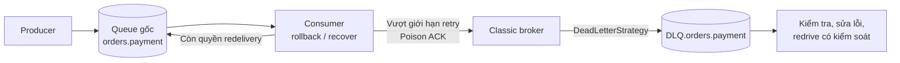
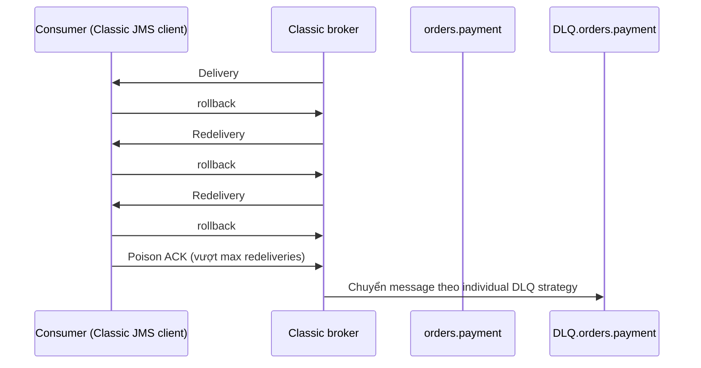

# Dead Letter Queue của Classic và Individual Dead Letter Strategy

> **Chương:** Gửi lại và DLQ  
> **Trọng tâm:** Apache ActiveMQ **Classic**: lúc nào message đi vào Dead Letter Queue, sự khác biệt giữa `SharedDeadLetterStrategy` và `IndividualDeadLetterStrategy`, cách cấu hình `destinationPolicy`, quan sát, xử lý và kiểm chứng. Những khác biệt với Artemis được nêu ngắn để tránh dùng nhầm cấu hình.

## 1. Vì sao cần DLQ riêng theo destination?

Giả sử ba queue của hệ thống đặt hàng cùng dùng một broker Classic:

- `orders.payment`: xử lý thanh toán, lỗi có thể liên quan đến dữ liệu tài chính.
- `orders.shipment`: xử lý vận chuyển, lỗi có thể do mã kho hoặc địa chỉ giao.
- `notifications.email`: gửi email, lỗi có thể do mẫu thông báo.

Nếu cả ba queue đều đẩy message không thể xử lý vào một hàng đợi chung `ActiveMQ.DLQ`, nhóm vận hành sẽ phải tự phân loại nguồn lỗi, độ ưu tiên và người chịu trách nhiệm. **Individual Dead Letter Strategy** cho phép tạo **DLQ riêng cho mỗi destination**, ví dụ:

```text
orders.payment        -> DLQ.orders.payment
orders.shipment       -> DLQ.orders.shipment
notifications.email   -> DLQ.notifications.email
```

Nhờ đó, từng nhóm có thể áp dụng cảnh báo, quyền truy cập, thời gian giữ và quy trình điều tra riêng. Đây là **cách tổ chức message thất bại**, không phải cơ chế giúp message tự động thành công sau khi vào DLQ.

### Hai tầng quyết định cần tách biệt



**Tầng 1 — Khi nào message không còn được redeliver bình thường?** Trong đường JMS/OpenWire Classic thông dụng, **redelivery policy của client** xác định số lần thử lại; khi vượt giới hạn, client gửi **Poison ACK** báo broker rằng message không thể xử lý theo chính sách ấy.

**Tầng 2 — Message đó sẽ đi đâu?** **Dead-letter strategy trên broker**, thường đặt theo `destinationPolicy`, quyết định có chuyển message sang DLQ nào, dùng queue hay topic, và có xử lý message expired/nonpersistent hay không.

Nếu message liên tục bị xử lý lỗi nhưng client luôn retry không giới hạn, **không thể chỉ đặt `individualDeadLetterStrategy` rồi chờ message tự xuất hiện ở DLQ**. Ngược lại, nếu client gửi Poison ACK nhưng strategy mặc định là shared, message sẽ vào `ActiveMQ.DLQ`, không tự có `DLQ.orders.payment`.

## 2. Shared DLQ và Individual DLQ khác nhau ở đâu?

| Khía cạnh | SharedDeadLetterStrategy | IndividualDeadLetterStrategy |
| --- | --- | --- |
| **DLQ mặc định** | Thường là một queue `ActiveMQ.DLQ` | DLQ được suy ra từ **tên destination gốc** |
| **Phân loại lỗi** | Message nhiều nguồn tập trung; cần tra nguồn gốc | Tách backlog theo queue/topic của nguồn |
| **Cấu hình** | `<sharedDeadLetterStrategy .../>` hoặc default Classic | `<individualDeadLetterStrategy queuePrefix="..." .../>` |
| **Quan sát** | Một tổng backlog; cần filter/metadata để tìm nguồn | Metric, cảnh báo và consumer theo từng DLQ |
| **Bảo mật** | Quyền truy cập DLQ chung thường rộng hơn cần thiết | Có thể chia role theo nhóm destination |
| **Chi phí quản trị** | Ít queue hơn | Nhiều queue hơn, cần quy ước tên và cleanup |
| **Tách biệt theo consumer** | Không | **Theo destination**, không đồng nghĩa mỗi consumer hoặc subscription đều có DLQ riêng |

Classic mặc định thường sử dụng một **shared DLQ `ActiveMQ.DLQ`**. Để chuyển sang individual DLQ, cấu hình policy cho **destination nguồn**; không phải đổi URL producer hay gọi `session.createQueue("DLQ...")` trong business code.

### Quy tắc đặt tên bằng prefix/suffix

Ví dụ cấu hình `queuePrefix="DLQ."`:

```text
Queue gốc                 DLQ (queue)
orders.payment            DLQ.orders.payment
orders.shipment           DLQ.orders.shipment
notifications.email       DLQ.notifications.email
```

Tên được hình thành bởi cấu hình strategy, không nhất thiết có queue DLQ khi broker vừa khởi động: queue đích có thể chỉ xuất hiện khi broker thực sự cần đưa một message vào đó, tùy cấu hình tạo destination.

Đặt prefix dễ nhận diện, ví dụ `DLQ.`. Không nên đặt DLQ của cùng một nguồn dưới tên thay đổi theo phiên bản ứng dụng, pod hoặc request; nếu làm vậy các bản nâng cấp có thể tạo thêm queue bị bỏ quên.

## 3. Cấu hình `IndividualDeadLetterStrategy` cho queue Classic

Trong file cấu hình broker **ActiveMQ Classic** (thường là `activemq.xml`), đặt một policy dành cho các queue nguồn cần tách DLQ:

```xml
<destinationPolicy>
    <policyMap>
        <policyEntries>
            <policyEntry queue="orders.>">
                <deadLetterStrategy>
                    <individualDeadLetterStrategy
                        queuePrefix="DLQ."
                        useQueueForQueueMessages="true"
                        processExpired="false"
                        processNonPersistent="false"/>
                </deadLetterStrategy>
            </policyEntry>
        </policyEntries>
    </policyMap>
</destinationPolicy>
```

Đây là **trích đoạn** thuộc phần cấu hình `<broker>` của Classic; cần ghép vào đúng vị trí XML hiện có của instance broker, không tạo một `<destinationPolicy>` thứ hai chỉ để copy ví dụ.

Giải nghĩa chính xác:

- `<policyEntry queue="orders.>">`: áp policy cho các **queue** có tên thuộc nhóm `orders.` theo cú pháp wildcard của Classic. Ví dụ `orders.payment` và `orders.shipment` khớp; `notifications.email` **không khớp**.
- `<individualDeadLetterStrategy>`: tạo tên DLQ riêng theo destination nguồn.
- `queuePrefix="DLQ."`: gắn `DLQ.` trước tên queue gốc, như `orders.payment → DLQ.orders.payment`.
- `useQueueForQueueMessages="true"`: DLQ của message từ queue vẫn là **queue**, giúp vận hành theo kiểu competing consumer/QueueBrowser.
- `processExpired="false"`: message **hết hạn TTL** không bị đưa vào DLQ theo policy này; dùng khi không muốn DLQ đầy bởi message không còn giá trị.
- `processNonPersistent="false"`: không đưa message `NON_PERSISTENT` vào DLQ theo policy. Muốn thu thập cả message không persistent, đặt `true` **sau khi đánh giá chi phí tài nguyên**.

**Ví dụ kiểm chứng:** gửi message persistent vào `orders.payment`; consumer rollback tới khi vượt redelivery limit; broker áp policy `orders.>` và gửi message sang `DLQ.orders.payment`. Với `notifications.email`, policy trên **không áp dụng**, nên nó theo policy khác hoặc shared DLQ mặc định.

### 3.1. Khi muốn tách tất cả queue

Có thể dùng wildcard tổng quát:

```xml
<policyEntry queue=">">
    <deadLetterStrategy>
        <individualDeadLetterStrategy
            queuePrefix="DLQ."
            useQueueForQueueMessages="true"/>
    </deadLetterStrategy>
</policyEntry>
```

Tuy nhiên `queue=">"` cũng có thể khớp **chính các queue DLQ**. Nếu tiếp tục đặt thời hạn hết hạn hoặc xử lý lại message độc một cách tùy tiện, DLQ có thể bị tạo vòng lặp hoặc phát sinh các bản sao khó vận hành. Nên ưu tiên **policy có phạm vi rõ**, tách policy quản lý DLQ, và kiểm tra hành vi khi message trong DLQ hết hạn hoặc bị rollback.

**Quy tắc thiết kế:** queue có tiền tố `DLQ.` là tài nguyên xử lý lỗi, không phải queue công việc bình thường. Không cho consumer nghiệp vụ tự subscribe các queue này bằng wildcard `>` nếu chưa có cơ chế riêng.

### 3.2. Cấu hình cho topic: phải dùng policy topic

Topic cần policy tương ứng, không dùng `queue="orders.>"` để áp cho một JMS topic. Ví dụ:

```xml
<policyEntry topic="events.>">
    <deadLetterStrategy>
        <individualDeadLetterStrategy
            topicPrefix="DLQ.Topic."
            useQueueForTopicMessages="true"
            processExpired="false"/>
    </deadLetterStrategy>
</policyEntry>
```

Ở đây message bị loại khỏi đường redelivery của **topic subscription** có thể chuyển sang **DLQ kiểu queue**, ví dụ tên bắt đầu `DLQ.Topic.` với tên topic gốc. Tên đó không tự động là một DLQ **riêng cho từng subscriber**; “individual” trong strategy được hiểu theo **destination**. Nếu nhiều durable subscriptions trên cùng topic cần cách ly lỗi hoàn toàn theo người đăng ký, phải thiết kế/kiểm chứng topology và policy cụ thể, không suy từ prefix.

**Bẫy Classic Virtual Topic:** Consumer của Virtual Topic thường đọc từ các **queue** dạng `Consumer.A.VirtualTopic.Orders`. Mặc dù sự kiện được publish lên topic, message nằm trong consumer queue là message của **queue destination**; policy `queue=...` phù hợp cho DLQ của queue đó. Đừng dùng policy `topic=...` và kỳ vọng nó nhất định bao trùm các consumer queue của Virtual Topic.

## 4. Điều gì đưa một message vào DLQ của Classic?

Chuỗi điển hình khi consumer sử dụng **transacted session**:

1. Broker giao `M` tới consumer.
2. Xử lý thất bại; consumer gọi `session.rollback()`.
3. ActiveMQ client áp **RedeliveryPolicy** của connection: delay và giới hạn redelivery.
4. Khi đã vượt `maximumRedeliveries`, client gửi **Poison ACK**.
5. Broker xử lý Poison ACK theo **DeadLetterStrategy** của destination nguồn.
6. Message phù hợp policy được chuyển sang DLQ; consumer bình thường không còn tiếp tục nhận message đó từ queue gốc.



Sơ đồ mô tả tương tác logic: cách client giữ/prefetch message, gửi ACK và thực hiện rollback chi tiết phụ thuộc transport và phiên bản.

### Hiểu chính xác `maximumRedeliveries`

Ví dụ đặt `maximumRedeliveries=2`:

- **Delivery ban đầu**: lần xử lý thứ nhất.
- **Redelivery #1**: lần xử lý thứ hai.
- **Redelivery #2**: lần xử lý thứ ba.
- Khi lần thứ ba lại bị rollback và đã vượt số lần phát lại cho phép, client báo poison để broker xử lý DLQ.

Vì vậy `maximumRedeliveries=2` không có nghĩa tổng cộng chỉ nhận message hai lần. Nó có nghĩa tối đa **hai lần giao lại**, ngoài delivery đầu tiên, trong trường hợp đường xử lý và provider policy được áp dụng như mong đợi.

**Phạm vi chính sách:** Trong cấu hình client OpenWire của Classic, `maximumRedeliveries`, `initialRedeliveryDelay`, `redeliveryDelay` và exponential backoff thường được đặt tại **RedeliveryPolicy của connection factory**. `deadLetterStrategy` là **policy broker**. Một số môi trường có **broker redelivery plugin** và những khả năng quản lý riêng, nhưng không được giả định thay cấu hình DLQ broker sẽ tự thay giới hạn retry phía client.

### Những trường hợp khác cần tách ra

| Tình huống | Có thể vào DLQ? | Cần kiểm tra |
| --- | --- | --- |
| Consumer rollback liên tục và vượt client redelivery limit | **Có**, theo đường Poison ACK và strategy | RedeliveryPolicy, Poison ACK, policy đúng destination |
| Consumer crash đột ngột khi đang xử lý | Message chưa ACK có thể được giao lại; **chưa nhất thiết vào DLQ ngay** | Broker phát hiện connection chết và consumer mới nhận |
| Message hết hạn TTL | Tùy `processExpired`; có thể **bị loại** thay vì DLQ | Giá trị TTL và dead-letter strategy |
| Message `NON_PERSISTENT` bị poison | Tùy `processNonPersistent` | Mặc định Classic thường không đưa loại này vào DLQ |
| Message không được route tới queue gốc | Không thể dựa vào strategy của một queue chưa nhận message | Destination, producer, policy route và quyền |
| Message bị DLQ consumer rollback | Có thể làm phức tạp việc xử lý DLQ hoặc tạo vòng lặp khi policy không kiểm soát | Policy của chính DLQ, retry/TTL và chế độ đọc |

**Không dùng `JMSXDeliveryCount` hoặc `JMSRedelivered` một cách đơn độc để quyết định rằng “message đã vào DLQ”.** Chúng phản ánh lịch sử delivery nhìn từ consumer; trạng thái thực tế phải kiểm tra trên destination DLQ của broker.

## 5. Code Java: tạo poison message rồi quan sát DLQ riêng

Ví dụ dùng **ActiveMQ Classic 5.x** với `javax.jms` và OpenWire. Điều kiện:

- Broker Classic có listener `tcp://localhost:61616`.
- Broker đã nạp policy `queue="orders.>"` ở mục 3 và đang chạy.
- Queue test `orders.payment` không có consumer khác và không chứa backlog gây nhiễu.
- User JMS có quyền gửi/nhận queue gốc và xem `DLQ.orders.payment`.
- Chạy trong môi trường test, **không** rollback dữ liệu nghiệp vụ thật.

Maven dependency minh họa:

```xml
<dependency>
    <groupId>org.apache.activemq</groupId>
    <artifactId>activemq-client</artifactId>
    <version>5.19.0</version>
</dependency>
```

File `ClassicIndividualDlqDemo.java`:

```java
import java.util.Enumeration;

import javax.jms.Connection;
import javax.jms.DeliveryMode;
import javax.jms.JMSException;
import javax.jms.Message;
import javax.jms.MessageConsumer;
import javax.jms.MessageProducer;
import javax.jms.Queue;
import javax.jms.QueueBrowser;
import javax.jms.Session;
import javax.jms.TextMessage;

import org.apache.activemq.ActiveMQConnectionFactory;
import org.apache.activemq.RedeliveryPolicy;

public final class ClassicIndividualDlqDemo {
    private static final String SOURCE = "orders.payment";
    private static final String DLQ = "DLQ.orders.payment";

    public static void main(String[] args) throws Exception {
        String url = System.getenv("ACTIVEMQ_URL");
        if (url == null || url.isBlank()) {
            url = "tcp://localhost:61616";
        }

        ActiveMQConnectionFactory factory =
                new ActiveMQConnectionFactory(url);

        RedeliveryPolicy redelivery = factory.getRedeliveryPolicy();
        redelivery.setMaximumRedeliveries(2);
        redelivery.setInitialRedeliveryDelay(300L);
        redelivery.setRedeliveryDelay(300L);
        redelivery.setUseExponentialBackOff(false);

        Connection connection = factory.createConnection();
        try {
            sendPoisonTestMessage(connection);

            Session workerSession = connection.createSession(
                    true, Session.SESSION_TRANSACTED);
            try {
                MessageConsumer worker = workerSession.createConsumer(
                        workerSession.createQueue(SOURCE));
                try {
                    connection.start();
                    for (int attempt = 1; attempt <= 3; attempt++) {
                        Message m = worker.receive(5_000L);
                        if (m == null) {
                            throw new IllegalStateException(
                                    "Expected test message, attempt=" + attempt);
                        }

                        String businessId = m.getStringProperty("eventId");
                        System.out.println("Delivery attempt=" + attempt
                                + ", eventId=" + businessId
                                + ", JMSRedelivered=" + m.getJMSRedelivered());

                        // Cố tình không xử lý; kích hoạt chính sách retry.
                        workerSession.rollback();
                    }
                } finally {
                    worker.close();
                }
            } finally {
                workerSession.close();
            }

            // QueueBrowser chỉ đọc, không ACK/xóa message khỏi DLQ.
            Session inspectSession = connection.createSession(
                    false, Session.AUTO_ACKNOWLEDGE);
            try {
                Queue dlq = inspectSession.createQueue(DLQ);
                QueueBrowser browser = inspectSession.createBrowser(dlq);
                try {
                    Enumeration<?> entries = browser.getEnumeration();
                    int count = 0;
                    while (entries.hasMoreElements()) {
                        Message m = (Message) entries.nextElement();
                        count++;
                        System.out.println("DLQ eventId="
                                + m.getStringProperty("eventId")
                                + ", JMSMessageID=" + m.getJMSMessageID());
                    }
                    System.out.println("Browsable DLQ messages=" + count);
                } finally {
                    browser.close();
                }
            } finally {
                inspectSession.close();
            }
        } finally {
            connection.close();
        }
    }

    private static void sendPoisonTestMessage(Connection connection)
            throws JMSException {
        Session session = connection.createSession(
                false, Session.AUTO_ACKNOWLEDGE);
        try {
            Queue source = session.createQueue(SOURCE);
            MessageProducer producer = session.createProducer(source);
            try {
                producer.setDeliveryMode(DeliveryMode.PERSISTENT);
                TextMessage message =
                        session.createTextMessage("invalid-payment-event");
                message.setStringProperty(
                        "eventId", "evt-dlq-demo-001");
                producer.send(message);
                System.out.println("Test message sent");
            } finally {
                producer.close();
            }
        } finally {
            session.close();
        }
    }
}
```

**Kết quả kỳ vọng:** một message được giao lần đầu và hai lần redelivery, sau đó broker đưa vào `DLQ.orders.payment`. `QueueBrowser` có thể thấy property `eventId=evt-dlq-demo-001`. Nếu browser chưa thấy ngay, kiểm tra log, queue metrics và thời điểm Poison ACK thay vì tự động gửi hàng loạt bản sao mới.

**Điểm cần kiểm chứng khi chạy thực tế:**

1. `RedeliveryPolicy` được cấu hình ở **Classic client**, không phải trong `broker.xml`.
2. `rollback()` trên một transacted session làm message được giao lại theo policy.
3. Broker đọc policy của **`orders.payment`**, suy ra tên DLQ theo `queuePrefix`.
4. `QueueBrowser` chỉ duyệt message và không tiêu thụ/ACK. Nếu thay bằng `MessageConsumer.receive()` và commit, bạn sẽ **xóa** message khỏi DLQ theo JMS semantics thông thường.
5. Đoạn test này chỉ dùng một message và một consumer để dễ xác định số attempt; nếu queue có message khác, prefetch, nhiều consumer hoặc policy khác thì kết quả quan sát có thể khác.

**Cảnh báo về version/API:** Classic 5.x thường dùng `javax.jms`, không phải `jakarta.jms`. Đây là ví dụ cho ActiveMQ Classic, **không chạy bằng Artemis client chỉ vì broker đều có port 61616**.

## 6. Điều tra một message trong DLQ: đừng chỉ nhìn tên queue

DLQ là nơi **giữ bằng chứng lỗi** và triển khai quy trình sửa. Tối thiểu nên lưu/quan sát:

| Thông tin | Để làm gì? | Nguồn |
| --- | --- | --- |
| **DLQ name** | Xác định luồng gây lỗi | Tên queue theo `queuePrefix` và destination policy |
| **Destination gốc** | Biết nơi message cần quay lại nếu redrive | Broker/provider metadata hoặc bản ghi vận hành; kiểm tra bằng công cụ Classic |
| **`JMSMessageID`** | Truy vết lần gửi qua broker | JMS header, không phải ID nghiệp vụ cố định |
| **`eventId` / `orderId`** | Chống xử lý trùng và liên kết bản ghi DB | Property/body do ứng dụng định nghĩa |
| **`JMSRedelivered` / delivery count** | Hỗ trợ hiểu lịch sử giao, nếu có | JMS/provider metadata |
| **Exception/stack trace** | Tìm nguyên nhân payload, DB hoặc môi trường | Log consumer/APM, correlation ID |
| **Thời gian tạo/sent/expired** | Đánh giá message đã quá hạn nghiệp vụ hay chưa | Header, timestamp nghiệp vụ |
| **Message body/schemaVersion** | Kiểm tra tương thích contract | Payload và properties |

**Không giả định** một trường provider-specific nào luôn tồn tại và cùng tên trên mọi Classic version/protocol. Trong nhiều hệ thống, message vào DLQ không tự chứa toàn bộ Java exception của business handler; cần ghi log theo `eventId` hoặc correlation ID ngay lúc xử lý lỗi.

Nên cảnh báo theo **DLQ depth tăng**, tuổi message cũ nhất và tỷ lệ Poison ACK, không chỉ tổng message trong `ActiveMQ.DLQ`. Nếu đã bật individual DLQ, truy vấn riêng từng queue hoặc gom bằng wildcard query từ hệ thống monitoring; nếu chỉ nhìn shared DLQ sẽ bỏ sót lỗi.

### 6.1. Khi expired message vào DLQ

Nếu `processExpired=true`, expired message có thể được chuyển sang DLQ thay vì loại bỏ. Điều này hữu ích khi cần audit message quá hạn, nhưng gây nhiễu nếu các message TTL ngắn hết hạn hàng loạt.

Nếu cấu hình thời gian hết hạn mới cho **message trong DLQ**, cần tránh tình huống: message expired trong DLQ lại được chuyển sang một DLQ khác hoặc quay về chính DLQ do wildcard policy. Trong Classic, tính năng `expiration` trên dead-letter strategy cần được đặt trên **policy phù hợp**, không áp đại trà với `queue=">"` mà không kiểm chứng vòng đời expired message.

**Thực hành:** chọn một trong hai hướng có chủ đích:
- Không đưa message expired vào DLQ (`processExpired=false`) nếu TTL có nghĩa “sau hạn thì không cần nữa”.
- Đưa expired message vào DLQ để audit (`processExpired=true`), nhưng có chính sách retention/cleanup và kiểm thử hành vi expiration của chính DLQ.

## 7. Redrive từ Individual DLQ về queue gốc: chỉ làm sau khi sửa lỗi

**Redrive** là gửi lại message từ DLQ đến destination có thể xử lý. Đây là thao tác **nghiệp vụ có rủi ro**, vì một message đã gây lỗi nhiều lần có thể lại làm consumer crash hoặc tạo duplicate.

Quy trình an toàn:

1. **Phân loại nguyên nhân:** bug parser, schema không tương thích, thiếu dữ liệu, downstream outage hay payload không hợp lệ.
2. **Sửa nguyên nhân và kiểm thử:** nếu không, redrive chỉ tạo vòng lặp queue gốc → DLQ → queue gốc.
3. **Chọn phạm vi nhỏ:** lọc theo `eventId`, thời gian, loại lỗi; không chuyển toàn bộ DLQ ồ ạt.
4. **Giữ khóa idempotency:** bảo toàn `eventId`/business key; gửi lại có thể có `JMSMessageID` mới.
5. **Giới hạn tốc độ:** đặt batch size và theo dõi queue depth, consumer latency, redelivery count.
6. **Kiểm chứng nghiệp vụ:** sau redrive, đối chiếu DB/side effects, không chỉ thấy message biến mất khỏi DLQ.
7. **Ghi audit:** thời gian, người thực hiện, reason, DLQ nguồn, queue đích, số message thành công/thất bại.

### 7.1. Di chuyển một `TextMessage` bằng một local JMS transaction

Ví dụ với **cùng một Classic broker**; giả sử đã xác minh message là sự kiện đúng, đã sửa bug và có quyền trên cả hai queue:

```java
// connection: javax.jms.Connection đã tạo từ Classic factory.
Session session = connection.createSession(
        true, Session.SESSION_TRANSACTED);

Queue sourceDlq = session.createQueue("DLQ.orders.payment");
Queue original = session.createQueue("orders.payment");

MessageConsumer dlqReader = session.createConsumer(sourceDlq);
MessageProducer replayProducer = session.createProducer(original);

connection.start();
try {
    Message incoming = dlqReader.receive(5_000L);
    if (incoming != null) {
        try {
            if (!(incoming instanceof TextMessage)) {
                throw new JMSException("Unsupported body type");
            }

            TextMessage copy = session.createTextMessage(
                    ((TextMessage) incoming).getText());

            // Sao chép có chủ đích những trường của ứng dụng.
            String eventId = incoming.getStringProperty("eventId");
            if (eventId == null) {
                throw new JMSException("Missing eventId");
            }
            copy.setStringProperty("eventId", eventId);

            // Send message mới, đồng thời ACK message DLQ khi commit.
            replayProducer.send(
                    original, copy, DeliveryMode.PERSISTENT, 4, 0L);
            session.commit();
        } catch (Exception failure) {
            session.rollback();
            throw failure;
        }
    }
} finally {
    replayProducer.close();
    dlqReader.close();
    session.close();
}
```

**Tính chất:** vì **nhận từ DLQ + gửi về queue gốc** nằm trong cùng transacted session và một broker, `commit` là một local JMS transaction. Nếu rollback thành công, message cũ vẫn ở DLQ và message mới chưa được chốt. Tuy nhiên, khi mất connection đúng lúc commit, **outcome có thể không rõ**; bên nhận phải xử lý idempotent theo `eventId`.

**Không sao chép mù quáng toàn bộ JMS headers/properties của message DLQ.** Một số metadata phản ánh delivery cũ (destination, redelivery state, expiration, provider extensions). Dùng message mới và sao chép **những field nghiệp vụ được phép**, đồng thời lưu audit/redrive ID riêng. Đoạn ví dụ chỉ copy `eventId` và body, không phải một công cụ redrive tổng quát cho mọi message type.

Nếu queue gốc và DLQ không cùng broker/session hoặc redrive đồng thời phải cập nhật database, local transaction ở trên **không** cung cấp atomicity xuyên các hệ thống. Dùng outbox/idempotency và quy trình khôi phục phù hợp.

## 8. Phân biệt Dead Letter Queue của Classic với Artemis

Đây là bài về **ActiveMQ Classic**; không copy XML `<individualDeadLetterStrategy>` vào Artemis.

| Tiêu chí | ActiveMQ Classic | ActiveMQ Artemis |
| --- | --- | --- |
| Nơi định nghĩa DLQ | `<destinationPolicy>` / `<deadLetterStrategy>` | `<address-settings>` / `<dead-letter-address>` |
| Trigger thường gặp | Client Classic báo **Poison ACK** khi vượt RedeliveryPolicy | Broker quản lý delivery attempts và dead-letter theo `max-delivery-attempts`/redelivery settings |
| Shared mặc định | Thường `ActiveMQ.DLQ` | Phụ thuộc cấu hình address-settings; không mặc định suy ra tên Classic |
| Tách DLQ theo nguồn | `IndividualDeadLetterStrategy` + prefix/suffix | Tổ chức dead-letter address/queue, có thể dùng auto-create DLQ theo phiên bản/cấu hình |
| Thông số cấu hình | `queuePrefix`, `processExpired`, `processNonPersistent`, … | `dead-letter-address`, `max-delivery-attempts`, `redelivery-delay`, … |

Artemis có cấu trúc address/queue và redelivery riêng. Dù hai broker có thể cung cấp cùng giao diện Java JMS, file cấu hình DLQ và trách nhiệm client/broker **không thể hoán đổi trực tiếp**.

## 9. Checklist sự cố: message không vào đúng individual DLQ

| Triệu chứng | Nguyên nhân có thể | Cách kiểm chứng |
| --- | --- | --- |
| Message vào `ActiveMQ.DLQ` thay vì `DLQ.orders.payment` | `policyEntry` không khớp source queue, XML chưa được nạp hoặc có policy khác | Kiểm tra destinationPolicy đang chạy và tên queue gốc |
| Rollback nhiều lần nhưng không có DLQ | Client redelivery không giới hạn; chưa gửi Poison ACK; message còn được redeliver | Log redelivery, config `maximumRedeliveries` và client version |
| DLQ không chứa message `NON_PERSISTENT` | `processNonPersistent=false` | Gửi thử một message persistent, so sánh |
| Message TTL hết hạn nhưng không thấy DLQ | `processExpired=false` | Kiểm tra policy và `JMSExpiration` |
| DLQ có nhiều message nhưng không biết lỗi | Không log lỗi consumer theo eventId | Thêm correlation ID trong log, metric và truy vết |
| Nhiều queue `DLQ.*` không ai theo dõi | Tạo individual DLQ nhưng monitoring chỉ đọc `ActiveMQ.DLQ` | Discovery queue theo prefix, alert theo depth/age |
| Redrive xong lại quay vào DLQ | Chưa sửa lỗi gốc, cùng payload poison hoặc max retry quá thấp | Canary redrive một message, xem exception trước khi bulk |
| Message trong DLQ liên tục hết hạn/tự di chuyển | DLQ bị áp chính sách expiration/redispatch không phù hợp | Rà soát wildcard policy, retention và expiry behavior |
| Consumer nhận từ DLQ rồi message biến mất | Reader dùng `receive` và đã ACK/commit | Dùng QueueBrowser để quan sát không phá dữ liệu, phân quyền thao tác |
| Topic poison không vào DLQ dự kiến | Dùng policy `queue` cho topic hoặc topic subscriber mapping khác dự kiến | Kiểm tra `policyEntry topic="..."`, `useQueueForTopicMessages` và subscription |

## 10. Lab kiểm chứng với Classic

**Điều kiện:** broker Classic test, quyền sửa `activemq.xml`, console/JMX/QueueBrowser và Java client `javax.jms`. Không thao tác trên DLQ production.

### Lab A — Shared DLQ và individual DLQ

1. Không cấu hình individual strategy cho queue test `orders.payment`; cấu hình RedeliveryPolicy client `maximumRedeliveries=2`. Gửi một persistent message cố tình gây lỗi và rollback đến khi poison. Quan sát `ActiveMQ.DLQ` khi broker đang dùng shared strategy.
2. Xóa message test theo quy trình test, thêm policy `queue="orders.>"` ở mục 3, khởi động/nạp lại broker theo cơ chế cấu hình được hỗ trợ.
3. Gửi message mới vào `orders.payment`, làm lỗi tương tự. Kiểm tra `DLQ.orders.payment`; queue `ActiveMQ.DLQ` không còn là đích của message này.
4. Gửi message vào `orders.shipment` và làm poison; kiểm tra một queue **khác** là `DLQ.orders.shipment`. Hai DLQ không chia sẻ message.
5. Gửi message vào `notifications.email`; nếu không có policy riêng, kiểm tra nó theo shared/default strategy, không tự suy vào `DLQ.notifications.email`.

### Lab B — So sánh expired và nonpersistent

1. Với `processExpired=false`, gửi persistent message TTL ngắn và không bật consumer. Đợi TTL hết, kích hoạt cơ chế broker xử lý expired và quan sát nó **không được DLQ hóa** theo policy này.
2. Đổi `processExpired=true` trên broker test, lặp lại với message ID mới. Quan sát message expired có thể vào DLQ; lưu ý timing sweep/expiry của broker.
3. Với `processNonPersistent=false`, gửi nonpersistent poison message và quan sát chính sách loại khỏi DLQ. Sau đó bật `true`, lặp lại test để thấy khác biệt.
4. Ghi log/metrics để phân biệt message expired, poison và message bị thao tác thủ công; không đánh đồng mọi bản ghi ở DLQ là lỗi parse.

### Lab C — Redrive an toàn

1. Dùng QueueBrowser duyệt `DLQ.orders.payment` **không ACK**; ghi eventId, JMSMessageID, nguồn và thời điểm.
2. Sửa logic consumer hoặc dữ liệu phụ thuộc rồi redrive **một** message với code `Session.SESSION_TRANSACTED`.
3. Kiểm tra message mới xuất hiện ở queue gốc, message cũ biến mất khỏi DLQ **sau commit**.
4. Gây rollback trước commit để xác minh message DLQ còn, message gốc chưa được chốt.
5. Đối chiếu side effect tại database bằng eventId; nếu cùng event đã từng xử lý một phần, xác minh idempotency.

### Câu hỏi tự kiểm tra

1. **Ai quyết định thời điểm poison theo luồng Classic JMS thông dụng?** — Client RedeliveryPolicy; khi vượt giới hạn, client gửi Poison ACK.
2. **Ai quyết định queue DLQ đích?** — DeadLetterStrategy của broker đối với destination nguồn.
3. **Mặc định Classic thường chuyển message độc đi đâu?** — Shared queue `ActiveMQ.DLQ`.
4. **`IndividualDeadLetterStrategy` có tạo DLQ riêng cho mỗi consumer của một queue?** — Không, là theo destination.
5. **`queuePrefix="DLQ."` tạo tên gì cho `orders.payment`?** — `DLQ.orders.payment`.
6. **`maximumRedeliveries=2` tương đương tổng hai lần giao?** — Không; có thể là một delivery đầu và hai redelivery.
7. **`processExpired=false` nghĩa là gì?** — Không đưa message expired vào DLQ theo strategy đó.
8. **Một message `NON_PERSISTENT` poison luôn nằm trong DLQ?** — Không; phụ thuộc `processNonPersistent`.
9. **Gọi `QueueBrowser` có xóa message DLQ không?** — Không; khác với receive rồi ACK/commit.
10. **Redrive có bảo đảm business effect chỉ một lần không?** — Không; cần eventId và consumer idempotent.

## 11. Checklist triển khai

- [ ] Biết client đang dùng **ActiveMQ Classic OpenWire**, không nhầm cấu hình Artemis.
- [ ] Đã giới hạn redelivery theo yêu cầu nghiệp vụ, hiểu cơ chế Poison ACK.
- [ ] `destinationPolicy` chọn đúng queue/topic nguồn bằng wildcard có chủ đích.
- [ ] Đã quyết định shared hay individual DLQ theo nhu cầu phân nhóm vận hành.
- [ ] `queuePrefix` nhất quán, tránh trùng tên queue nghiệp vụ.
- [ ] Đã xác định chính sách `processExpired` và `processNonPersistent` theo SLA/audit.
- [ ] Policy áp cho DLQ không tạo vòng lặp expiry/dead-letter ngoài ý muốn.
- [ ] Monitoring phát hiện các queue DLQ mới và cảnh báo theo depth/age.
- [ ] Có quyền riêng cho producer/consumer DLQ, người điều tra và công cụ redrive.
- [ ] Có quy trình redrive chọn lọc, audit và idempotency; không tự động replay vô hạn.
- [ ] Đã kiểm thử persistent poison, nonpersistent poison, expired message và topic/virtual-topic nếu dùng.
- [ ] Đã đối chiếu log consumer, JMS message metadata, broker metrics và business eventId trước khi kết luận.

## Tài liệu tham khảo

- [Apache ActiveMQ Classic — Message Redelivery and DLQ](https://activemq.apache.org/components/classic/documentation/message-redelivery-and-dlq): Shared/Individual DeadLetterStrategy, expired và nonpersistent.
- [Apache ActiveMQ Classic — Per Destination Policies](https://activemq.apache.org/components/classic/documentation/per-destination-policies): cách cấu hình `destinationPolicy` và các policy entries.
- [Apache ActiveMQ Classic — Redelivery Policy](https://activemq.apache.org/components/classic/documentation/redelivery-policy): tham số redelivery của Classic client.
- [Apache ActiveMQ Artemis — Undelivered Messages](https://artemis.apache.org/components/artemis/documentation/latest/undelivered-messages.html): đối chiếu cơ chế dead-letter của Artemis.
