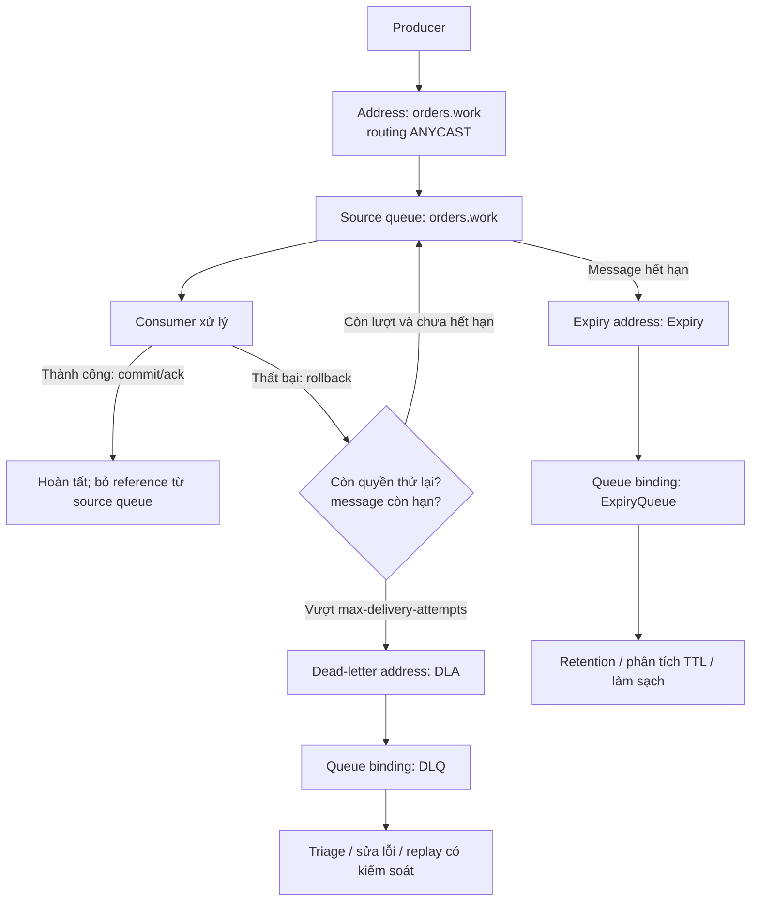

# Dead-letter address, expiry address và các queue tương ứng của Artemis

> **Chương:** Gửi lại và DLQ  
> **Phạm vi:** Apache ActiveMQ **Artemis**; cấu hình `broker.xml`, mô hình address–queue, redelivery, TTL/expiry và cách quan sát bằng Java/Jakarta Messaging. Không dùng các thẻ dưới đây để cấu hình ActiveMQ **Classic**, vì Classic có dead-letter strategy và mô hình đích khác.

Trong Artemis, khi một message không thể được consumer xử lý sau nhiều lần thử, broker có thể **chuyển message đến một dead-letter address**. Khi message hết thời gian sống (**TTL/expiration**) trước khi được xử lý, broker có thể **chuyển nó đến một expiry address**. Hai loại address đó **không phải queue**: muốn giữ message để quản trị viên hoặc consumer khác đọc, address đích phải có **queue binding** nhận message.

Một sự cố điển hình: người vận hành thấy cấu hình `<dead-letter-address>DLA</dead-letter-address>` và tưởng đã có queue `DLA`. Trong thực tế, `DLA` là tên **address**; nếu địa chỉ này không có queue nhận hoặc chính sách tạo resource không đúng, không thể kỳ vọng message xuất hiện trong một queue để kiểm tra. Với expiry cũng vậy.

## 1. Mục tiêu và ranh giới

Sau bài này, bạn sẽ:

1. Phân biệt rõ **source address**, **source queue**, **dead-letter address**, **expiry address** và **queue binding tương ứng**.
2. Hiểu điều kiện chuyển message đến DLQ vì **vượt số lần delivery** so với chuyển đến expiry queue vì **hết hạn**.
3. Cấu hình một lab Artemis bằng `<address-settings>` và `<addresses>`, không nhầm lẫn address với queue.
4. Biết khi nào nên khai báo queue tĩnh và khi nào cân nhắc **auto-create dead-letter/expiry resources**.
5. Dùng Java/Jakarta JMS tạo poison message, message có TTL, thử rollback và browse hai queue đích bằng **fully qualified queue name (FQQN)**.
6. Xác định metadata, metric, quyền và quy trình khắc phục/replay an toàn.

Các khái niệm queue/topic, acknowledge và persistence chỉ được đề cập khi quyết định **message chuyển đi đâu**; bài không lặp lại lý thuyết JMS nền tảng.

## 2. Hình dung đường đi của một message

Giả sử ứng dụng gửi đơn hàng đến address `orders.work`, trong đó có queue cùng tên:



**Luồng trong sơ đồ là hai nguyên nhân khác nhau:**

- **Dead-letter (DLQ):** Một message vẫn có thể còn hợp lệ về thời gian nhưng **không xử lý thành công sau số lần giao tối đa**. Artemis route sang `dead-letter-address` theo `address-setting` phù hợp; từ đó queue nhận DLQ giữ message để xử lý ngoài luồng.
- **Expiry:** Message **đã hết thời gian tồn tại** khi ở queue/broker. Artemis route sang `expiry-address` theo policy; queue nhận expiry giữ message quá hạn để quan sát hoặc xử lý đặc thù.

Nếu một message vừa liên tục bị rollback vừa có TTL ngắn, **đường nào kích hoạt trước** phụ thuộc thời điểm, delay và trạng thái của message. Không mặc định mọi message lỗi đều đi DLQ hay mọi message cũ đều đi expiry queue.

### 2.1. Năm tên khác nhau có thể cùng tham gia

| Thành phần | Ví dụ trong lab | Vai trò |
|---|---|---|
| **Original/source address** | `orders.work` | Producer gửi message tới đây; address phân phối theo routing type. |
| **Original/source queue** | `orders.work` | Consumer nhận từ đây; lưu trạng thái message chưa hoàn tất. |
| **Dead-letter address** | `DLA` | Đích broker **re-route** message vượt giới hạn delivery. |
| **Dead-letter queue** | `DLQ` (binding vào `DLA`) | Queue thực sự giữ dead-letter messages. |
| **Expiry address / expiry queue** | `Expiry` / `ExpiryQueue` | Address nhận message quá hạn / queue lưu message quá hạn. |

Tên `DLA`, `DLQ`, `Expiry` và `ExpiryQueue` là **lựa chọn cấu hình**, không phải hằng số cố định của giao thức JMS. Một số bản phân phối sử dụng giá trị mặc định khác hoặc hỗ trợ tự tạo resource. Luôn xem cấu hình **runtime của instance** thay vì đoán từ tên.

### 2.2. Một address có thể có nhiều queue

Artemis là broker **address–queue**: address là nơi route, queue là nơi giữ các reference và cung cấp message cho consumer. Một `dead-letter-address` có thể gắn **một hoặc nhiều queue**, và message được route theo binding/routing type thích hợp. Trong bài lab dùng mỗi address đích có **một queue ANYCAST duy nhất** để loại bỏ sự mơ hồ.

Không nhầm với JMS `Session.createQueue("DLQ")`: method này tạo một **đối tượng `Queue` tại client**, không đảm bảo broker đã có binding đúng đến `DLA`.

## 3. Dead-letter address: đường đi của message vượt delivery attempts

### 3.1. Trigger là *delivery failure*, không phải cứ gọi `send()` là DLQ

Một consumer ở transacted JMS session có thể gọi `rollback()` khi xử lý thất bại. Broker ghi nhận những lượt delivery và áp `max-delivery-attempts`. Khi vượt chính sách, message có thể được chuyển đến **dead-letter address** được khai báo cho source address.

Ví dụ:

```xml
<address-setting match="orders.work">
    <max-delivery-attempts>3</max-delivery-attempts>
    <redelivery-delay>1000</redelivery-delay>
    <dead-letter-address>DLA</dead-letter-address>
</address-setting>
```

Giải thích chính xác:

- `max-delivery-attempts=3` giới hạn tổng lượt delivery được phép theo chính sách Artemis; **đừng đồng nhất với “3 lần redelivery sau lượt đầu”** của một provider khác.
- `redelivery-delay=1000` đặt khoảng trì hoãn cơ bản tính bằng millisecond giữa các lượt giao lại khi áp dụng.
- `dead-letter-address=DLA` là **tên address mà broker sẽ route đến**, **không phải tên queue `DLQ`**.
- Cần có queue binding thích hợp trên `DLA`, hoặc dùng cơ chế auto-create resources đã cấu hình đúng.

Các lần delivery không đồng nghĩa với số lần nghiệp vụ đã tạo side effect. Consumer có thể thực hiện thành công một phần rồi chết trước ack; broker chỉ nhìn thấy message chưa được xác nhận.

### 3.2. Điều kiện khiến không thấy message trong DLQ

| Quan sát | Kiểm tra trước |
|---|---|
| Consumer liên tục lỗi nhưng source queue vẫn còn message | `max-delivery-attempts` có áp dụng cho đúng address? Consumer có thật sự rollback/chưa ack? Redelivery delay đã hết chưa? |
| Message biến mất khỏi source queue mà `DLQ` rỗng | `DLA` có queue binding? Message có **hết hạn** nên sang expiry? Có chính sách khác loại/purge message không? |
| DLQ có message nhưng ứng dụng không browse được | Có đang truy vấn **tên address** thay vì **FQQN của queue**? Có quyền browse/consume đúng queue không? |
| Tạo source queue mới nhưng policy không áp dụng | `match` có đúng address thực tế không? Cấu hình wildcard/độ ưu tiên có ảnh hưởng không? |

Không nên “sửa” hiện tượng này bằng cách tăng `max-delivery-attempts` vô hạn. Message có payload vĩnh viễn sai sẽ gây vòng lặp redelivery, chiếm tài nguyên và chặn throughput. DLQ là điểm để **kết thúc tự động retry và chuyển sang xử lý có kiểm soát**.

### 3.3. Dead-letter không đồng nghĩa message đã được xử lý thành công

Một message ở DLQ thường phản ánh **thất bại của việc xử lý trên queue nguồn**, không phải một xác nhận của nghiệp vụ. Đội vận hành cần định nghĩa ai sở hữu DLQ, thời hạn triage, cơ chế báo động và điều kiện replay.

Trong luồng thanh toán, một dead-letter message có thể đã gọi cổng thanh toán thành công nhưng consumer crash trước khi ack. Do đó **không replay mù quáng**: dùng `paymentRequestId` để đối soát trạng thái và tránh tác dụng phụ trùng.

## 4. Expiry address: đường đi của message hết TTL

### 4.1. Expiration là một điều kiện thời gian, không phải lỗi xử lý

Producer có thể đặt TTL cho lần gửi:

```java
producer.send(message, DeliveryMode.PERSISTENT, 4, 2500L);
```

Ở đây `2500L` là **timeToLive tính bằng millisecond**; priority `4` là giá trị bình thường. Nếu message không được xử lý trước khi hết hạn, Artemis có thể route nó sang `expiry-address` của source address:

```xml
<address-setting match="orders.work">
    <expiry-address>Expiry</expiry-address>
</address-setting>
```

**Khác với DLQ**, message không cần trải qua bất kỳ lượt rollback nào để hết hạn. Một queue không có consumer vẫn có thể chứa message đến khi TTL trôi qua, sau đó broker phát hiện expiration và chuyển tới queue nhận expiry theo cấu hình.

Đừng kỳ vọng TTL vừa hết ở millisecond thứ 2500 thì console lập tức hiển thị message ở `ExpiryQueue`. Broker có cơ chế kiểm tra expiry theo lịch/sự kiện; thời điểm **phát hiện** và thời điểm **hết hạn logic** không nhất thiết trùng nhau.

### 4.2. Nếu không có expiry address hoặc queue nhận thì sao?

Message hết hạn **không thể tiếp tục được coi là message còn hợp lệ để xử lý trên source queue**. Nếu không có destination expiry phù hợp, message có thể bị loại khỏi source mà không tồn tại một queue quan sát riêng. Nếu `expiry-address` trỏ tới một address không có queue binding, việc khai báo tên address **không đủ** để giữ các message hết hạn.

Vì vậy hãy kiểm chứng **cả hai**:

1. `<expiry-address>Expiry</expiry-address>` thực sự áp dụng cho source address.
2. Address `Expiry` có queue `ExpiryQueue` (hoặc queue tự tạo phù hợp) được broker route vào.

### 4.3. TTL không phải retention của expiry queue

TTL điều khiển **khi nào message không còn hợp lệ ở queue nguồn**. Khi message được route đến expiry queue, chính sách giữ ở queue đích lại là một vấn đề riêng: dung lượng, expiry/cleanup, giới hạn tuổi dữ liệu, quyền truy cập và thao tác quản trị.

Expiry queue không nên được sử dụng như “kho lưu lịch sử vô hạn”. Nếu giữ payload chứa dữ liệu cá nhân hoặc nhạy cảm, cần có retention và quyền truy cập tương ứng.

### 4.4. Cách phân biệt DLQ và expiry khi cùng một message gặp hai nguy cơ

| Điều kiện | Dấu hiệu chính | Đích dự kiến khi cấu hình đúng |
|---|---|---|
| Consumer rollback nhiều lần, message vẫn còn hạn | Đạt/vượt giới hạn delivery attempts. | Dead-letter address → DLQ. |
| Producer gửi TTL ngắn, consumer không đọc | `JMSExpiration` đến hạn; không cần có lỗi handler. | Expiry address → expiry queue. |
| Rollback liên tục nhưng TTL hết trước khi đạt max attempts | Expiration được phát hiện trước khi retry hoàn tất. | Có thể sang expiry thay vì DLQ. |
| Payload sai nhưng handler **ack/commit** thành công | Broker xem message đã tiêu thụ. | Thường **không** vào DLQ chỉ vì log nghiệp vụ báo lỗi. |

**Quy tắc suy luận:** Hãy tìm *trigger thật* và trạng thái message tại thời điểm broker chuyển queue; không kết luận từ nội dung exception của ứng dụng khi chưa kiểm tra ack/rollback/TTL.

## 5. Cấu hình `broker.xml`: address-setting và các queue tĩnh

Lab sử dụng **một Artemis broker instance riêng**. Trong bản phân phối Artemis thông thường, cấu hình runtime ở `<instance>/etc/broker.xml`. Hãy xác định đúng instance đang chạy, sao lưu file trước khi thử và kiểm tra log khi restart. Các đoạn dưới đây là **phần tử con để chèn vào những khối hiện hữu**; không phải một file `broker.xml` hoàn chỉnh.

### 5.1. `<address-settings>`: các quyết định định tuyến lỗi/hết hạn

Trong khối `<address-settings>` của `broker.xml`, khai báo:

```xml
<address-setting match="orders.work">
    <!-- Tính trên các delivery attempts theo ngữ nghĩa Artemis -->
    <max-delivery-attempts>3</max-delivery-attempts>
    <redelivery-delay>1000</redelivery-delay>

    <!-- Tên ADDRESS, không phải tên queue nhận -->
    <dead-letter-address>DLA</dead-letter-address>
    <expiry-address>Expiry</expiry-address>
</address-setting>
```

Ví dụ dùng **match chính xác** `orders.work`. Nếu dùng wildcard như `orders.#`, policy có thể tác động lên nhiều address; chọn pattern có chủ đích và quan sát cấu hình hiệu lực. Các `address-setting` khác của broker có thể cung cấp thêm giá trị mặc định cho các trường không ghi đè; không nên sao chép một cấu hình mẫu rồi giả định đã thấy toàn bộ policy.

### 5.2. `<addresses>`: nơi message thật sự được giữ

Trong khối `<addresses>` hiện hữu, khai báo ba address cùng những queue tương ứng:

```xml
<!-- Đặt bên TRONG <addresses>, không khai báo <addresses> mới -->
<address name="orders.work">
    <anycast>
        <queue name="orders.work" durable="true"/>
    </anycast>
</address>

<address name="DLA">
    <anycast>
        <queue name="DLQ" durable="true"/>
    </anycast>
</address>

<address name="Expiry">
    <anycast>
        <queue name="ExpiryQueue" durable="true"/>
    </anycast>
</address>
```

Kết quả topology cần nhìn thấy trên Artemis console/management:

| Address | Routing | Queue binding | Chức năng |
|---|---|---|---|
| `orders.work` | `ANYCAST` | `orders.work` | Hàng đợi công việc gốc. |
| `DLA` | `ANYCAST` | `DLQ` | Giữ message được broker dead-letter từ queue nguồn. |
| `Expiry` | `ANYCAST` | `ExpiryQueue` | Giữ message được broker chuyển đi khi hết hạn. |

Một queue khai báo `durable="true"` có binding bền vững; điều này **không biến message `NON_PERSISTENT` thành persistent**. Trong lab, producer sẽ gửi message `PERSISTENT` để phép thử tập trung vào **điều kiện chuyển queue**.

Để tránh kết quả mơ hồ:

- Không khai báo trùng address/queue tên `orders.work`, `DLA`, `DLQ` hoặc `Expiry` trong cùng instance mà chưa kiểm tra topology hiện có.
- Nếu queue đã được auto-create trước khi bạn chỉnh `broker.xml`, hãy kiểm tra **binding thực tế sau restart**; XML mới không nhất thiết tự thay đổi mọi thuộc tính của queue cũ.
- Giữ **một queue ANYCAST** trên mỗi address đích trong lab. Với nhiều binding hoặc routing type khác, cần kiểm tra kỹ cách broker route message sang từng queue.
- Bảo đảm client/role có quyền gửi đến source, tiêu thụ source và quyền browse/consume queue DLQ/expiry nếu cần; quyền quản trị đích lỗi thường nên hạn chế hơn quyền xử lý thường.

### 5.3. Vì sao tên queue `DLQ` không phải tên address `DLA`?

JMS ứng dụng có thể dùng **fully qualified queue name (FQQN)** theo dạng Artemis:

```text
orders.work::orders.work
DLA::DLQ
Expiry::ExpiryQueue
```

FQQN chỉ định rõ **address::queue**. Với địa chỉ gốc và queue cùng tên, code thường dùng `createQueue("orders.work")`. Nhưng với address lỗi tên `DLA` và queue tên `DLQ`, gọi `createQueue("DLQ")` có thể dẫn đến việc client cố thao tác trên **address `DLQ`**, chứ không phải queue `DLQ` gắn với `DLA`. Trong lab, luôn dùng:

```java
Queue deadLetters = session.createQueue("DLA::DLQ");
Queue expired = session.createQueue("Expiry::ExpiryQueue");
```

Không được hiểu FQQN là thao tác tạo queue binding bền vững: **server-side topology phải tồn tại/được tạo đúng từ trước** và consumer phải có quyền tương ứng.

### 5.4. Các resource có thể được tự tạo — nhưng đừng mặc định

Artemis hỗ trợ cơ chế tự tạo dead-letter và expiry resources ở những phiên bản/cấu hình thích hợp, với nhóm tùy chọn address-setting như:

```xml
<!-- Ví dụ CƠ CHẾ KHÁC cho source address,
     KHÔNG chèn đè lên static lab mà không chọn rõ một phương án. -->
<address-setting match="orders.work">
    <dead-letter-address>DLA</dead-letter-address>
    <expiry-address>Expiry</expiry-address>
    <auto-create-dead-letter-resources>true</auto-create-dead-letter-resources>
    <auto-create-expiry-resources>true</auto-create-expiry-resources>
</address-setting>
```

Khi bật auto-create resources, **tên queue được tạo có thể được ghép theo prefix/suffix và tên address nguồn**, không nhất thiết chính xác là `DLQ` hoặc `ExpiryQueue` như lab tĩnh. Artemis cũng cung cấp các tùy chọn liên quan đến prefix/suffix của queue tạo tự động; hãy kiểm tra tính năng và tên queue thực tế trên phiên bản broker đang dùng.

**Lựa chọn cho bài này:** Dùng **queue tĩnh ở mục 5.2** và **không cần bật auto-create dead-letter/expiry resources**. Như vậy các FQQN `DLA::DLQ` và `Expiry::ExpiryQueue` sẽ khớp chính xác mô hình. Khi chuyển sang auto-create, phải cập nhật cách browse, giám sát và reprocess theo các queue thực tế; không trộn hai phương án rồi cho rằng chỉ có một queue nhận.

### 5.5. Khi nào cấu hình có hiệu lực?

Quy trình kiểm tra:

1. Dừng broker lab theo phương thức được hỗ trợ; sao lưu file `broker.xml`.
2. Sửa đúng các khối `<address-settings>` và `<addresses>` hiện hữu.
3. Khởi động lại broker; đọc log để xác nhận XML được nạp, không có lỗi schema/binding.
4. Mở Artemis console/management, xác nhận **ba address và ba queue** như bảng.
5. Xem policy **hiệu lực cho address `orders.work`**, đặc biệt `max-delivery-attempts`, `dead-letter-address` và `expiry-address`.
6. Chỉ sau khi topology khớp mới chạy Java/JMS.

Đây là hướng dẫn cho instance lab; không xóa và tạo lại một queue production đang có backlog để “sửa cho giống XML”.

## 6. Hai thí nghiệm tách biệt để tránh nhầm trigger

| Bài test | Message được gửi | Tác động của consumer | Điều quan sát |
|---|---|---|---|
| **Poison → DLQ** | `PERSISTENT`, **TTL=0** (không đặt hạn bởi producer). | Consumer rollback liên tiếp để đạt policy `max-delivery-attempts=3`. | Source queue giảm, queue `DLA::DLQ` nhận message. |
| **TTL → expiry queue** | `PERSISTENT`, **TTL=2500ms**. | **Không mở consumer** ở source trong thời gian đợi. | Khi broker phát hiện hết hạn, queue `Expiry::ExpiryQueue` nhận message. |

Phải chạy trên **queue nguồn sạch** hoặc hoàn thành riêng từng tình huống. Nếu gửi message TTL rồi lại chạy poison consumer, consumer có thể nhận message chưa hết hạn và làm kết quả khó diễn giải.

Đối với poison message, khi đã dead-letter, không nên kỳ vọng message còn nằm ở source queue. Đối với expiry, message có thể nằm ở source một lúc sau thời điểm expiration vì cơ chế scan/dispatch của broker chưa xử lý; không coi đây là thiếu cấu hình ngay lập tức.

## 7. Java/Jakarta JMS: tạo poison, TTL và browse đúng queue

Ví dụ này dùng **Artemis 2.38.x/Jakarta Messaging**, minh họa với `artemis-jakarta-client:2.38.0` và **JDK 17**. Đó là phiên bản cụ thể để mô tả API, **không phải tuyên bố bản mới nhất**; trên hệ thống thật cần chọn client tương thích phiên bản broker/JDK và kiểm tra cấu hình acceptor. Với ActiveMQ Classic 5.x dùng `javax.jms`, tên class factory và dependency **không giống** ví dụ này.

Tạo dự án Maven:

```text
artemis-dead-letter-expiry-lab/
├── pom.xml
└── src/main/java/lab/DeadLetterExpiryLab.java
```

### 7.1. Maven dependency

```xml
<project xmlns="http://maven.apache.org/POM/4.0.0"
         xmlns:xsi="http://www.w3.org/2001/XMLSchema-instance"
         xsi:schemaLocation="http://maven.apache.org/POM/4.0.0
                             https://maven.apache.org/xsd/maven-4.0.0.xsd">
  <modelVersion>4.0.0</modelVersion>

  <groupId>lab.artemis</groupId>
  <artifactId>dead-letter-expiry-lab</artifactId>
  <version>1.0-SNAPSHOT</version>

  <properties>
    <maven.compiler.release>17</maven.compiler.release>
    <project.build.sourceEncoding>UTF-8</project.build.sourceEncoding>
  </properties>

  <dependencies>
    <dependency>
      <groupId>org.apache.activemq</groupId>
      <artifactId>artemis-jakarta-client</artifactId>
      <version>2.38.0</version>
    </dependency>
  </dependencies>

  <build>
    <plugins>
      <plugin>
        <groupId>org.apache.maven.plugins</groupId>
        <artifactId>maven-compiler-plugin</artifactId>
        <version>3.13.0</version>
      </plugin>
      <plugin>
        <groupId>org.codehaus.mojo</groupId>
        <artifactId>exec-maven-plugin</artifactId>
        <version>3.3.0</version>
      </plugin>
    </plugins>
  </build>
</project>
```

### 7.2. Code đầy đủ

```java
package lab;

import java.util.Enumeration;
import java.util.UUID;
import jakarta.jms.Connection;
import jakarta.jms.DeliveryMode;
import jakarta.jms.JMSException;
import jakarta.jms.Message;
import jakarta.jms.MessageConsumer;
import jakarta.jms.MessageProducer;
import jakarta.jms.Queue;
import jakarta.jms.QueueBrowser;
import jakarta.jms.Session;
import jakarta.jms.TextMessage;
import org.apache.activemq.artemis.jms.client.ActiveMQConnectionFactory;

public final class DeadLetterExpiryLab {
    private static final String SOURCE = "orders.work";
    private static final String DEAD_LETTER = "DLA::DLQ";
    private static final String EXPIRED = "Expiry::ExpiryQueue";

    private DeadLetterExpiryLab() {
    }

    public static void main(String[] args) throws Exception {
        if (args.length != 1) {
            throw new IllegalArgumentException(
                "Dùng: send-poison | consume-poison | send-expiring "
                + "| browse-source | browse-dlq | browse-expiry");
        }

        String url = System.getenv("ARTEMIS_BROKER_URL");
        if (url == null || url.isBlank()) {
            url = "tcp://127.0.0.1:61616";
        }

        // Không hardcode credential của broker trong source.
        String username = System.getenv("ARTEMIS_USER");
        String password = System.getenv("ARTEMIS_PASSWORD");
        ActiveMQConnectionFactory factory =
                new ActiveMQConnectionFactory(url);
        Connection connection = (username == null || username.isBlank())
                ? factory.createConnection()
                : factory.createConnection(username, password);

        try {
            // Session transacted: gửi có commit, lỗi xử lý có rollback.
            Session session = connection.createSession(
                    true, Session.SESSION_TRANSACTED);
            try {
                connection.start();
                switch (args[0]) {
                    case "send-poison":
                        send(session, "POISON", 0L);
                        break;
                    case "consume-poison":
                        consumeAndRollback(session);
                        break;
                    case "send-expiring":
                        send(session, "EXPIRING", 2500L);
                        break;
                    case "browse-source":
                        browse(session, SOURCE);
                        break;
                    case "browse-dlq":
                        browse(session, DEAD_LETTER);
                        break;
                    case "browse-expiry":
                        browse(session, EXPIRED);
                        break;
                    default:
                        throw new IllegalArgumentException(
                                "Mode không hợp lệ: " + args[0]);
                }
            } finally {
                session.close();
            }
        } finally {
            connection.close();
        }
    }

    private static void send(
            Session session, String category, long ttlMillis)
            throws JMSException {
        Queue source = session.createQueue(SOURCE);
        MessageProducer producer = session.createProducer(source);
        try {
            String requestId = UUID.randomUUID().toString();
            TextMessage message = session.createTextMessage(
                    category + " example, requestId=" + requestId);
            message.setStringProperty("requestId", requestId);
            message.setStringProperty("testCategory", category);

            producer.send(
                    message,
                    DeliveryMode.PERSISTENT,
                    4,           // JMS priority
                    ttlMillis);   // 0 = không giới hạn TTL do producer đặt
            session.commit();
            System.out.println("SENT/COMMITTED " + category
                    + " id=" + message.getJMSMessageID()
                    + " ttlMs=" + ttlMillis);
        } finally {
            producer.close();
        }
    }

    private static void consumeAndRollback(Session session)
            throws JMSException {
        Queue source = session.createQueue(SOURCE);
        MessageConsumer consumer = session.createConsumer(source);
        try {
            // max-delivery-attempts=3 trong broker.xml của bài lab.
            // Giới hạn vòng lặp để không bao giờ thử vô hạn.
            for (int i = 1; i <= 5; i++) {
                Message message = consumer.receive(6000);
                if (message == null) {
                    System.out.println(
                        "NO_MORE_DELIVERIES (source may be empty/DLQ)");
                    break;
                }

                int count = message.propertyExists("JMSXDeliveryCount")
                        ? message.getIntProperty("JMSXDeliveryCount")
                        : -1;
                System.out.println("DELIVERY " + i
                        + " id=" + message.getJMSMessageID()
                        + " attempt=" + count
                        + " redelivered=" + message.getJMSRedelivered());

                // Giả lập xử lý thất bại. Không gọi acknowledge().
                session.rollback();
                System.out.println("ROLLED_BACK");
            }
        } finally {
            consumer.close();
        }
    }

    private static void browse(Session session, String queueFqqn)
            throws JMSException {
        Queue queue = session.createQueue(queueFqqn);
        QueueBrowser browser = session.createBrowser(queue);
        int found = 0;
        try {
            Enumeration<?> messages = browser.getEnumeration();
            while (messages.hasMoreElements()) {
                Message message = (Message) messages.nextElement();
                found++;

                String body = message instanceof TextMessage
                        ? ((TextMessage) message).getText()
                        : "<non-TextMessage>";
                System.out.println("[" + found + "] "
                        + "queue=" + queueFqqn
                        + " | id=" + message.getJMSMessageID()
                        + " | requestId="
                        + message.getStringProperty("requestId")
                        + " | body=" + body);

                // Tìm metadata broker về nguồn gốc/chuyển đích;
                // tên field thực tế phụ thuộc version/protocol.
                Enumeration<?> props = message.getPropertyNames();
                while (props.hasMoreElements()) {
                    String key = (String) props.nextElement();
                    if (key.startsWith("_AMQ_")
                            || key.toLowerCase().contains("orig")
                            || key.toLowerCase().contains("expiry")) {
                        System.out.println("    " + key + "="
                                + message.getObjectProperty(key));
                    }
                }
            }
        } finally {
            browser.close();
        }
        System.out.println("BROWSED " + queueFqqn
                + ": " + found + " message(s)");
        // QueueBrowser không consume/ack message.
    }
}
```

### 7.3. Vì sao chọn những API này?

- `ActiveMQConnectionFactory` thuộc package **`org.apache.activemq.artemis.jms.client`**, cùng Jakarta API `jakarta.jms.*`; không nhầm với factory của ActiveMQ Classic.
- `Session.SESSION_TRANSACTED` giúp mô phỏng **rollback thật của lượt nhận** thay vì chỉ ném exception rồi dựa vào một acknowledgment mode không rõ.
- `producer.send(message, DeliveryMode.PERSISTENT, 4, ttlMillis)` đặt TTL **cho lần gửi**. `ttlMillis=0` không thiết lập thời hạn từ producer; broker vẫn có thể có chính sách expiration/expiry riêng.
- `session.commit()` ở producer xác nhận **JMS transaction gửi**. Nếu commit ném `JMSException` khi mạng lỗi, kết quả có thể **chưa xác định**; ứng dụng production cần business idempotency.
- `MessageConsumer.receive()` ở mode thử poison chỉ nhận message rồi `rollback()`; nếu source queue còn message của bài khác, nó cũng có thể nhận nhầm. **Phải tách phép thử**.
- `QueueBrowser` cho phép xem message mà **không ack hoặc thay đổi backlog do thao tác consume**. Trong hệ thống có producer/consumer đồng thời, kết quả enumeration không phải snapshot nguyên tử.
- Các tên `DLA::DLQ` và `Expiry::ExpiryQueue` là **FQQN của cấu hình tĩnh ở mục 5**, không nhất thiết đúng khi dùng auto-created queue hay deployment khác.

Code không thực hiện replay tự động. Đây là quyết định có chủ đích: replay poison message chưa sửa sẽ tạo một vòng nhận lỗi → DLQ → replay vô hạn, và replay event hết hạn có thể vi phạm tính đúng đắn của nghiệp vụ.

## 8. Kịch bản A — một poison message chuyển vào DLQ

### 8.1. Chuẩn bị

Đảm bảo broker có:

- Source queue `orders.work`, chưa có message khác và không có consumer ngoài lab.
- `max-delivery-attempts=3`, `redelivery-delay=1000`, `dead-letter-address=DLA` đang có hiệu lực.
- `DLA` có queue binding `DLQ` để giữ dead-letter message.
- Không có TTL ngắn hoặc policy expiry làm thay đổi phép thử.

Chạy từ thư mục dự án:

```bash
mvn -q compile exec:java "-Dexec.mainClass=lab.DeadLetterExpiryLab" "-Dexec.args=send-poison"
mvn -q compile exec:java "-Dexec.mainClass=lab.DeadLetterExpiryLab" "-Dexec.args=browse-source"
```

Source queue thường đang có **một message** được gửi persistent, chưa ai tiêu thụ.

### 8.2. Tạo các lần delivery thất bại

```bash
mvn -q compile exec:java "-Dexec.mainClass=lab.DeadLetterExpiryLab" "-Dexec.args=consume-poison"
```

Đầu ra minh họa:

```text
DELIVERY 1 id=ID:... attempt=1 redelivered=false
ROLLED_BACK
DELIVERY 2 id=ID:... attempt=2 redelivered=true
ROLLED_BACK
DELIVERY 3 id=ID:... attempt=3 redelivered=true
ROLLED_BACK
NO_MORE_DELIVERIES (source may be empty/DLQ)
```

Tổng số lượt giao thực tế được giới hạn bởi policy của Artemis và có thể phụ thuộc thời điểm broker xử lý rollback; `JMSXDeliveryCount` là metadata hữu ích nhưng **không thay thế việc xem policy runtime**. `receive(6000)` trả `null` chỉ cho biết không có message để nhận trong thời hạn, **chưa tự chứng minh** nó đã vào DLQ. Cần kiểm tra queue đích.

### 8.3. Browse DLQ bằng FQQN

```bash
mvn -q compile exec:java "-Dexec.mainClass=lab.DeadLetterExpiryLab" "-Dexec.args=browse-dlq"
mvn -q compile exec:java "-Dexec.mainClass=lab.DeadLetterExpiryLab" "-Dexec.args=browse-source"
```

Với một message poison cô lập và cấu hình đúng, kỳ vọng:

```text
[1] queue=DLA::DLQ | id=ID:... | requestId=... | body=POISON example, requestId=...
BROWSED DLA::DLQ: 1 message(s)
BROWSED orders.work: 0 message(s)
```

Các dòng metadata bổ sung do `browse()` in ra có thể khác giữa phiên bản Artemis và giao thức JMS. Hãy tìm **original address/queue** khi broker cung cấp; mục tiêu là truy ra message đã đến từ `orders.work`, không dựa riêng vào queue hiện tại.

**Điều đã chứng minh:** Source message đã được broker chuyển sang queue gắn với dead-letter address sau những lần delivery thất bại. **Điều chưa chứng minh:** Message đã được xử lý thành công về nghiệp vụ hoặc việc tự động replay sẽ an toàn.

## 9. Kịch bản B — message hết hạn chuyển vào expiry queue

Phép thử này **không chạy đồng thời** với poison consumer.

### 9.1. Gửi một message TTL ngắn, không có consumer

```bash
mvn -q compile exec:java "-Dexec.mainClass=lab.DeadLetterExpiryLab" "-Dexec.args=send-expiring"
```

Lệnh đặt TTL **2.500ms** và gửi message persistent. Không chạy `consume-poison` hoặc consumer khác trên `orders.work` trong khoảng quan sát. Khi producer hoàn thành:

1. Message có thể ở source queue trước khi hết hạn.
2. Sau khi TTL đến và broker kiểm tra expiry, message không còn hợp lệ để giao như công việc thường.
3. Nếu `expiry-address=Expiry` áp dụng và queue `ExpiryQueue` nhận đúng, message xuất hiện ở `Expiry::ExpiryQueue`.

### 9.2. Quan sát sau thời điểm expiration

Đợi đủ thời gian để broker chạy cơ chế kiểm tra expiry (nhiều hơn TTL 2,5 giây, và có thể cần chờ thêm theo scan period/cấu hình thực tế), sau đó:

```bash
mvn -q compile exec:java "-Dexec.mainClass=lab.DeadLetterExpiryLab" "-Dexec.args=browse-expiry"
mvn -q compile exec:java "-Dexec.mainClass=lab.DeadLetterExpiryLab" "-Dexec.args=browse-source"
```

Đầu ra minh họa:

```text
[1] queue=Expiry::ExpiryQueue | id=ID:... | requestId=... | body=EXPIRING example, requestId=...
BROWSED Expiry::ExpiryQueue: 1 message(s)
BROWSED orders.work: 0 message(s)
```

Nếu expiry queue chưa thấy message ngay:

- Xác nhận **thời gian UTC/clock và TTL** được tính đúng, không cần suy diễn từ giờ hiển thị của UI.
- Kiểm tra broker có đang chạy cơ chế expiry scan/scheduled expiration và đã đến chu kỳ chưa.
- Đối chiếu `expiry-address` ở address-setting thực sự áp dụng cho `orders.work`.
- Xác nhận `Expiry` có queue binding `ExpiryQueue` và client dùng đúng FQQN.
- Kiểm tra message có bị consumer khác nhận/ack trước lúc hết hạn hoặc đã bị policy khác loại không.

Đừng sửa redelivery policy để xử lý một vấn đề **thuần TTL**. Với kịch bản này, không có lỗi handler và không cần một lần `rollback()` nào.

### 9.3. Các metadata hữu ích

Artemis có thể ghi thêm thông tin nội bộ về **address/queue gốc** khi dead-letter/expire và thời điểm expiry thực tế. Tên property có thể mang tiền tố của broker, ví dụ những trường liên quan đến *original address*, *original queue* hoặc *actual expiry*. Cách biểu diễn một số property có thể thay đổi theo phiên bản/client, nên hãy đọc metadata qua management hoặc liệt kê JMS properties như trong code, thay vì hardcode một schema metadata chưa được kiểm chứng cho toàn bộ phiên bản.

**Đừng nhầm `JMSExpiration` trên message đã được chuyển đến expiry queue với một hợp đồng về thời hạn giữ ở queue đích.** Khi broker chuyển và điều chỉnh metadata, expiry queue còn chịu các chính sách lưu giữ riêng; muốn xác định lúc message thật sự hết hạn ở queue gốc, ưu tiên thông tin original/actual expiry mà broker cung cấp.

## 10. Một source queue, hai nhánh vận hành khác nhau

| Khía cạnh | Dead-letter queue | Expiry queue |
|---|---|---|
| Điều kiện vào | Vượt giới hạn giao thử/loại bỏ theo dead-letter policy. | Message hết hạn trước khi được tiêu thụ phù hợp. |
| Nguyên nhân phổ biến | Payload sai, dependency chết lâu, xử lý quá chậm, rollback liên tục. | TTL quá ngắn, backlog cao, consumer offline lâu, SLA xử lý bị vượt. |
| Policy nguồn | `dead-letter-address`, `max-delivery-attempts`, `redelivery-delay`. | `expiry-address` và TTL/expiration cùng chính sách expiry. |
| Address nhận | `DLA` trong lab. | `Expiry` trong lab. |
| Queue giữ | `DLQ` trên `DLA`. | `ExpiryQueue` trên `Expiry`. |
| Có phải retry thành công? | Không. Message còn yêu cầu triage. | Không. Message không còn đáp ứng thời hạn gốc. |
| Hướng xử lý | Phân loại lỗi, sửa dependency/payload, đối soát business key, replay có kiểm soát. | Phân tích SLA/TTL/backlog; thường không tự replay message hết hạn. |
| Metric cần xem | Delivery attempts, DLQ depth, tuổi message, reason code, retry/delay. | Expired count, age, TTL, expiry queue depth, consumer lag. |

Đặc biệt, **DLQ tăng không tự động đồng nghĩa consumer gặp bug**: một phụ thuộc downstream có thể outage kéo dài hơn giới hạn retry. **Expiry queue tăng không tự động đồng nghĩa broker làm mất message**: TTL và backlog có thể không tương thích. Hai metric này nên được phân tích với tiêu chí nghiệp vụ khác nhau.

## 11. Topology nâng cao: nhiều source queue, nhiều DLQ/expiry queue

### 11.1. Dùng chung một address nhận

Giả sử hai source address `orders.work` và `billing.work` đều cấu hình:

```xml
<dead-letter-address>DLA</dead-letter-address>
<expiry-address>Expiry</expiry-address>
```

Nếu cả hai route đến **cùng queue `DLQ`** và **cùng queue `ExpiryQueue`** như lab, các message từ nhiều nguồn có thể bị trộn. Đây là lựa chọn vận hành có thể hợp lý khi quy mô nhỏ, nhưng yêu cầu:

- Có thể truy về source address/queue gốc và business/correlation ID.
- Quyền triage không làm lộ dữ liệu nhạy cảm giữa những team.
- Không replay một message của `billing.work` sang `orders.work` vì chỉ nhìn tên queue hiện tại.
- Metric và chính sách retention phân loại theo nguồn, không chỉ tổng backlog.

### 11.2. Khi cần queue tách theo source

Đối với môi trường nhiều tenant hoặc nhiều domain, cân nhắc **dead-letter/expiry queue riêng** cho từng nguồn, thông qua cấu hình tĩnh hoặc cơ chế auto-create resources có naming convention. Khi dùng auto-create, phải xác minh:

1. Source address nào được address-setting match.
2. Resource nào sẽ được broker tạo (address, queue và tên thực).
3. FQQN của queue cần browse/consume.
4. Quyền/retention/alert của từng queue.

Không nên vừa cấu hình một queue tĩnh `DLA::DLQ` vừa giả định auto-created queues sẽ có **cùng tên đó** và cùng policy. Với nhiều queue trên một address, **routing type/binding** sẽ quyết định bản nào vào queue nào; hãy quan sát thực tế thay vì suy luận chỉ từ tên address.

### 11.3. Topic subscription cũng có thể dead-letter hoặc expire

Trong một address `MULTICAST`, các queue subscription có backlog và trạng thái ack riêng. Một event có thể:

- Được subscriber A xử lý/ack thành công.
- Gặp rollback nhiều lần ở subscriber B, rồi bản thuộc queue B được dead-letter.
- Hết hạn trong backlog của subscriber C vì consumer offline quá lâu.

Không kết luận rằng event “toàn topic” đã bị dead-letter hoặc hết hạn chỉ vì một queue subscription chuyển message đi. Đối với Artemis, hãy tìm **source queue cụ thể** bên cạnh source address, nhất là khi nhiều subscription cùng chia address.

## 12. Reprocess và dọn DLQ/expiry queue an toàn

### 12.1. Không tự động chuyển mọi message từ DLQ về source

Khi một message đến DLQ, broker đã xác định **chuỗi xử lý tự động không thành công theo policy**. Đưa nó về source ngay lập tức thường chỉ lặp lại lỗi cũ và tạo vòng lặp:

```text
source queue -> consumer lỗi -> max attempts -> DLQ
     ^                                       |
     +--------------- replay tự động --------+
```

Để replay có kiểm soát:

1. Xác định **source address/queue gốc**, `requestId`, loại lỗi, số lần thử và service sở hữu nghiệp vụ.
2. Kiểm tra dependency đã phục hồi, payload đã được sửa hoặc ứng dụng đã triển khai bản hỗ trợ schema tương ứng.
3. **Đối soát side effect** theo business key; một lần xử lý trước đó có thể đã thành công dù ack/commit bị mất.
4. Quyết định cách replay: giữ nguyên payload, tạo message sửa lỗi có tham chiếu bản gốc, hoặc chuyển sang một kênh xử lý thủ công.
5. Nếu re-publish, giữ `businessRequestId` ổn định để consumer idempotent; đặt TTL, priority, delivery mode và correlation metadata có chủ đích. Không tùy tiện sao chép toàn bộ header provider-managed.
6. Ghi nhận operator, thời gian, lý do, source và message ID mới. Xác nhận trạng thái thành công trước khi xóa/ack message trong DLQ.

Một cách triển khai bằng **JMS local transaction** khi source và DLQ nằm trên cùng broker là nhận một message từ `DLA::DLQ`, tạo một **message mới** gửi về queue nguồn và `commit()` trong **cùng transacted session**. Như vậy việc tiêu thụ bản DLQ và gửi bản replay cùng là các thao tác JMS thuộc một transaction. Tuy nhiên, bạn vẫn phải xử lý tình huống **kết quả commit chưa xác định** và tác động nghiệp vụ trùng. Không tự động replay trên production bằng một script chỉ vì có hàng đợi.

### 12.2. Expiry queue thường đòi hỏi quyết định khác DLQ

Ví dụ `QuoteRequested` hết TTL vì giá đã quá hạn thì replay sau 30 phút có thể **sai nghiệp vụ**. Đối với expiry message, hãy đặt câu hỏi:

- Tại sao message chờ lâu hơn TTL? Consumer offline, throughput thấp, selector sai, không có queue binding hay network lỗi?
- TTL được chọn có phù hợp SLA và thời gian xử lý thực tế không?
- Có cần phát **yêu cầu mới** với timestamp/version mới, thay vì replay payload đã hết hạn?
- Message có chỉ để phân tích/kiểm toán rồi xóa theo retention không?

Đừng “chữa” expiry bằng cách đặt TTL vô hạn trên mọi message. Điều đó có thể gây backlog lớn và khiến ứng dụng xử lý những tác vụ vốn không còn giá trị.

### 12.3. Retention, quyền truy cập và dữ liệu nhạy cảm

DLQ/expiry queue có thể chứa nội dung đã xử lý thất bại, dữ liệu nghiệp vụ hoặc thông tin cá nhân. Cần:

- Phân quyền **browse/consume**, **send**, **purge** và quản trị riêng theo vai trò.
- Không in body đầy đủ trong production log. Mã `browse()` của lab chỉ phù hợp với **payload thử nghiệm không nhạy cảm**.
- Đặt chính sách giữ dữ liệu, dung lượng/quota, cleanup có xác nhận và nơi lưu audit trail.
- Dùng cảnh báo theo **tuổi message, tốc độ tăng, số nguồn lỗi và tỷ lệ hồi phục**, không chỉ số lượng tổng.

Khi queue đã tích nhiều message, thao tác purge là hành động mất dữ liệu có chủ đích; phải biết chính xác FQQN, phạm vi và quyền sở hữu trước khi thực hiện.

## 13. Runbook chẩn đoán nhanh

| Hiện tượng | Nguyên nhân cần loại trừ | Hành động kiểm chứng |
|---|---|---|
| Đã khai báo `dead-letter-address=DLA` nhưng không thấy queue DLQ | Chỉ có address, chưa có binding; dùng auto-create nhưng queue được đặt tên khác. | Xem **address + queue binding** ở runtime, đối chiếu `DLA::DLQ`. |
| Message rollback mãi mà không vào DLQ | Policy không match, giới hạn attempts khác thực tế, transaction không rollback như dự kiến. | Xem source address, `max-delivery-attempts`, attempt counter, session mode. |
| Message rời source nhưng DLQ không có | Có thể hết TTL, expiry policy, selector/consumer khác, purge; hoặc đích lỗi không có queue nhận. | Kiểm tra **cả DLQ và expiry queue**, log, metrics và routing. |
| Message có TTL đã qua nhưng vẫn thấy ở source | Chưa đến expiry scan, đồng hồ/mốc TTL sai, message đang delivering. | Kiểm tra `JMSExpiration`, expiry scanner, delivering count. |
| `ExpiryQueue` không có message sau khi gửi TTL | `expiry-address` không match, thiếu queue binding, consumer đã nhận/ack hoặc expiry chưa được xử lý. | Đối chiếu topology, TTL thực tế và quyền browse FQQN. |
| `createQueue("DLQ")` không cho ra dữ liệu | Dùng **tên queue** nhưng Artemis cần xác định address khác tên. | Dùng `createQueue("DLA::DLQ")` với binding tĩnh trong lab. |
| Sau bật auto-create, có nhiều queue DLQ tên lạ | Resource naming theo prefix/suffix và source address; queue tĩnh/queue tự tạo cùng tồn tại. | Liệt kê queue binding thực, kiểm tra policy auto-create và naming convention. |
| DLQ tăng vọt khi dependency outage | Retry quá nhanh hoặc giới hạn thấp so với thời gian phục hồi. | Xem backoff, max attempts, error rate, circuit breaker, health của dependency. |
| Expiry tăng vọt trong giờ cao điểm | TTL nhỏ so với queue latency và consumer throughput. | So sánh message age, thời gian chờ p95/p99, SLA và capacity. |
| Replay message rồi bị dead-letter lần nữa | Root cause chưa sửa, business key trùng hoặc retry/replay sai destination. | Kiểm tra rejection reason, source FQQN, idempotency, log phiên bản mới. |

### 13.1. Checklist trước khi kết luận “broker làm mất message”

- [ ] Message được gửi vào **đúng source address/queue**, transaction gửi đã commit.
- [ ] Kiểm tra `JMSExpiration`/TTL và thời điểm broker phát hiện expiry.
- [ ] Xem queue pending, delivering/in-flight, consumer count và trạng thái transaction.
- [ ] Xác minh address-setting **được match thật**, không chỉ có một đoạn XML trong file đã sửa nhầm.
- [ ] Xác nhận address DLQ và expiry **có queue binding**, đang hoạt động và có quyền xem.
- [ ] Đối chiếu FQQN khi address và queue không cùng tên.
- [ ] Kiểm tra redelivery attempts, dead-letter policy và nguyên nhân rollback.
- [ ] Xem thao tác quản trị, purge, auto-delete hoặc retention policy có tác động không.
- [ ] Đối chiếu metadata nguồn gốc, request ID và log của producer/consumer.

Những kiểm tra này giúp phân biệt **message được broker chuyển đích theo policy**, **message hết hạn rồi bị loại**, và **message vẫn tồn tại nhưng client đang truy vấn nhầm queue**.

## 14. Bài tập tình huống

**Câu 1.** `orders.work` có `max-delivery-attempts=3` và `dead-letter-address=DLA`. Trong console chỉ thấy address `DLA`, không thấy queue. Có thể khẳng định message lỗi sẽ được giữ trong `DLQ` không?

**Trả lời:** Không. Cần kiểm tra queue binding gắn vào `DLA` hoặc chính sách tự tạo resources. Address không đồng nghĩa với một queue nhận message.

**Câu 2.** `DLA` có queue `DLQ`. Java gọi `session.createQueue("DLQ")` nhưng không nhận được message. Nguyên nhân có thể là gì?

**Trả lời:** `DLQ` là queue **gắn với address `DLA`**, trong khi tên queue JMS không đủ biểu thị address khác tên. Dùng FQQN `DLA::DLQ` và kiểm tra quyền, routing/binding thực tế.

**Câu 3.** Một message TTL 3 giây chưa từng được consumer nhận, sau 30 giây xuất hiện ở `ExpiryQueue`. Có phải max-delivery-attempts đã hết?

**Trả lời:** Không. Expiry không yêu cầu delivery failure. Trigger là expiration theo TTL/policy; cần kiểm tra `expiry-address`.

**Câu 4.** Consumer rollback message hai lần, trước lần thứ ba TTL hết. Message có bắt buộc nằm trong DLQ không?

**Trả lời:** Không. Nếu broker phát hiện hết hạn trước khi đạt giới hạn delivery, message có thể được route sang expiry address.

**Câu 5.** Một source address multicast có subscription queue A và B. A xử lý thành công; B rollback đến giới hạn. Cả hai bản đều vào DLQ?

**Trả lời:** Không mặc định. Từng queue subscription có backlog và kết quả xử lý riêng. Bản thuộc queue B có thể bị dead-letter; bản A đã được ack thì không vì B thất bại mà tự chuyển đích.

**Câu 6.** DLQ có một message thanh toán. Người vận hành muốn chuyển thẳng về source để chạy lại. Bước quan trọng nhất trước khi replay là gì?

**Trả lời:** Đối soát business key và side effect hiện có, xác định lý do lỗi đã được khắc phục, rồi mới chọn replay idempotent. Không được coi có mặt trong DLQ là bằng chứng chưa từng thanh toán.

## 15. Kết luận

Trong **Apache ActiveMQ Artemis**, cấu hình `dead-letter-address` và `expiry-address` xác định **address nhận message được broker chuyển đi**; muốn message còn được quản lý và tiêu thụ, cần **queue binding tương ứng**. Với cấu hình tĩnh của bài:

```text
orders.work (address + source queue)
    ├── vượt giới hạn delivery ──> DLA (address) ──> DLQ (queue)
    └── hết TTL/expiration ──────> Expiry (address) ──> ExpiryQueue (queue)
```

Đường **DLQ** trả lời “message thất bại sau những lượt xử lý nào?”; đường **expiry** trả lời “message còn hợp lệ đến khi nào?”. Cả hai phải được kiểm chứng bằng **address-setting hiệu lực, queue bindings, FQQN, metadata và metric runtime**. Không replay hoặc purge tự động khi chưa xét tác động nghiệp vụ, quyền sở hữu dữ liệu và khả năng xử lý trùng.
