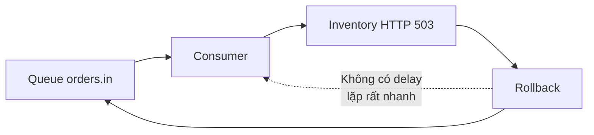
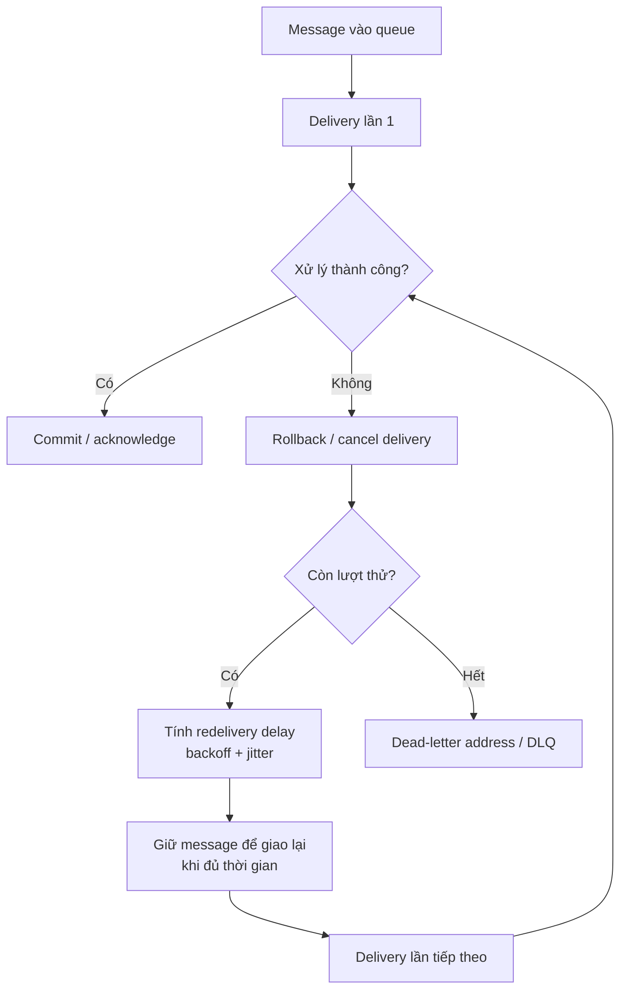

# Thiết kế lịch thử lại để tránh vòng lặp nóng và bão retry

> **Chương:** Gửi lại và DLQ  
> **Trọng tâm:** Thiết kế lịch **redelivery có giới hạn, backoff và jitter** cho consumer sử dụng Apache ActiveMQ Artemis; nhận diện vòng lặp nóng, tránh bão retry khi dịch vụ downstream lỗi đồng loạt, và đưa message không thể xử lý sang dead-letter queue (DLQ) để xử lý có kiểm soát. Có đối chiếu cách ActiveMQ Classic điều khiển redelivery.

## 1. Khi rollback trở thành bộ khuếch đại lỗi

Order Consumer lấy message `OrderCreated(O-1001)` rồi gọi Inventory API. Inventory đang trả HTTP 503. Consumer rollback JMS session, broker giao lại message, consumer lại gọi Inventory và lại rollback. Nếu không có khoảng chờ hoặc không giới hạn số lần thử, **một message có thể tạo hàng nghìn lời gọi thất bại** trong vài giây. Khi hàng nghìn message cùng lỗi, chúng tranh nhau connection, CPU và tài nguyên broker, khiến Inventory càng khó phục hồi.



Đây là **hot retry loop**: lỗi tạm thời bị khuếch đại thành tải liên tục. Nếu nhiều instance cùng thử lại sau đúng 5 giây, ta còn có **retry storm / thundering herd**: hàng loạt lời gọi đồng thời rơi vào dịch vụ vừa hồi phục.

Một chính sách thử lại tốt phải trả lời đồng thời:

1. **Lỗi nào đáng retry?** HTTP 503/429, timeout, connection reset thường khác lỗi payload invalid, schema sai hoặc quyền truy cập vĩnh viễn.
2. **Khi nào được thử lại?** Khoảng trì hoãn đầu, cách tăng dần, mức trần, thêm jitter.
3. **Thử tối đa bao nhiêu lần?** Số lượt delivery và tổng thời gian chấp nhận được trước khi chuyển sang DLQ.
4. **Ai điều phối retry?** Broker redelivery, client library, hay retry trong chính business code; tránh nhiều vòng retry lồng nhau.
5. **Khi cả downstream gặp sự cố thì làm gì?** Giới hạn concurrency, tạm ngừng nhận, circuit breaker và kiểm soát backlog thay vì chỉ tăng delay.

**Điểm phân biệt:** redelivery là việc broker phân phối lại **cùng một message chưa được xác nhận** sau rollback/consumer failure. Nó không đồng nghĩa ứng dụng tạo một message mới rồi gửi lại vào queue; cách thứ hai có vòng đời, delivery count và rủi ro trùng lặp khác.

## 2. Sơ đồ vòng đời một message thất bại



Ở Artemis, **address settings** có thể chỉ định số lần giao tối đa, khoảng trì hoãn redelivery, hệ số nhân, trần độ trễ và hệ số tránh va chạm (*collision avoidance*). Khi consumer rollback một session transacted hoặc provider thu hồi delivery chưa ack, broker căn cứ vào trạng thái message và chính sách address/queue để phân phối lại.

Điểm cần nhớ: **rollback không tự động có nghĩa message biến mất**. Broker có thể giữ message ở trạng thái chờ giao lại, chưa có trong số message sẵn sàng cho consumer. Thời điểm message thực sự được delivery lại còn phụ thuộc scheduler, số consumer, flow control, prefetch và tải broker.

### 2.1. Các thời gian cần tách riêng

| Thời gian | Bắt đầu tính từ đâu? | Liên quan đến |
|---|---|---|
| **Processing duration** | Consumer nhận message đến khi xử lý thành công/thất bại | Timeout HTTP/DB, CPU, khóa và thread pool |
| **Redelivery delay** | Sau lần delivery thất bại theo cơ chế broker | Thời điểm message có thể được giao lại |
| **End-to-end age** | Producer phát event đến khi xử lý xong hoặc DLQ | SLA nghiệp vụ, TTL, độ tươi dữ liệu |
| **Outage duration** | Khi dependency ngừng đáp ứng đến khi khỏe lại | Số lần thử vô ích và khả năng tạo bão retry |

Một lịch “thử lại mỗi 30 giây” không có nghĩa tổng thời gian xử lý là 30 giây: mỗi lượt còn chiếm thời gian xử lý và có thể chờ consumer. TTL/expiry có thể làm message hết hạn trước khi dùng hết retry budget.

## 3. Công thức backoff có trần và jitter

Giả sử khoảng delay ban đầu `D₀ = 2 giây`, hệ số tăng `m = 2`, trần `Dmax = 30 giây`. Với lần **giao lại thứ k**, `k >= 1`, delay danh nghĩa:

\[
D_k = \min\left(D_{\max},\, D_0 \times m^{k-1}\right)
\]

Với `max-delivery-attempts = 6` trong ví dụ, budget gồm **một lần giao ban đầu và tối đa năm lần giao lại** trước khi kết thúc bằng xử lý thành công hoặc chuyển DLQ theo chính sách. Bảng minh họa **chưa áp dụng jitter và chưa cộng thời gian xử lý**:

| Lần delivery | Delay trước lần đó | Thời điểm sớm nhất so với lúc đầu | Nếu vẫn lỗi |
|---|---:|---:|---|
| 1 | 0 giây | 0 giây | Chờ 2 giây |
| 2 | 2 giây | ~2 giây | Chờ 4 giây |
| 3 | 4 giây | ~6 giây | Chờ 8 giây |
| 4 | 8 giây | ~14 giây | Chờ 16 giây |
| 5 | 16 giây | ~30 giây | Chờ 30 giây |
| 6 | 30 giây | ~60 giây | Hết lượt; vào DLQ nếu vẫn không thành công |

Đây là lịch **có trần, giới hạn tổng số lần thử**; khoảng chờ không tiếp tục tăng vô hạn. Nếu sau 6 lần vẫn không xử lý được, tiếp tục giữ message vô thời hạn chỉ khiến queue tích tụ và khó phát hiện lỗi vĩnh viễn.

### 3.1. Jitter giảm việc nhiều message cùng thức dậy

Nếu mọi message đều lỗi lúc 10:00:00 và có delay cố định 2 giây, hàng nghìn message có thể đồng loạt eligible lúc 10:00:02. **Jitter** làm phân tán thời điểm đủ điều kiện nhận lại. Với hệ số tránh va chạm minh họa `0.15`, khoảng chờ có thể dao động quanh delay danh nghĩa, ví dụ quanh 2 giây thay vì tất cả cùng đúng 2.000 ms. Biên độ, thứ tự áp dụng trần và kết quả thực tế phải xem implementation/phiên bản broker.

**Jitter không giảm tổng số message thất bại cần xử lý**; nó chủ yếu giảm các đỉnh đồng thời. Nếu backend vẫn không khỏe, cần thêm concurrency limit, circuit breaker và giới hạn throughput.

### 3.2. Độ dài lịch retry phải xuất phát từ mục tiêu nghiệp vụ

Đừng chọn `10` hay `100` lần thử chỉ vì giá trị nghe có vẻ đủ an toàn. Ví dụ:

- Event cập nhật trạng thái shipment cho dashboard có thể chịu chờ vài phút.
- Event xác nhận thanh toán cần thời gian phản hồi chặt hơn và hành lang xử lý thủ công khi chưa rõ kết quả.
- Event điều phối batch không yêu cầu real-time có thể dùng lịch hàng phút hoặc hàng giờ nhưng phải tính giới hạn retention/TTL và backlog.

Lập **retry budget** gồm số lượt, tổng thời gian chờ, timeout từng attempt, concurrency và tài nguyên có thể chiếm dụng. Khi tổng thời gian dự kiến vượt SLA, cân nhắc chuyển sang trạng thái pending/manual review sớm thay vì tiếp tục thử một cách mù quáng.

## 4. Cấu hình Artemis: redelivery delay, multiplier, cap, jitter và DLQ

Ví dụ dành cho một Artemis instance đã chạy và có broker config `broker.xml`. Nội dung dưới đây gồm các **phần tử con của `<core>`**, cần chèn vào các khối `<addresses>` và `<address-settings>` đang tồn tại; không tạo nhiều wrapper trùng nhau nếu broker đã có các khối đó.

```xml
<!-- Trong <addresses> hiện có -->
<address name="lab.retry.orders">
    <anycast>
        <queue name="lab.retry.orders"/>
    </anycast>
</address>
<address name="DLQ">
    <anycast>
        <queue name="DLQ"/>
    </anycast>
</address>

<!-- Trong <address-settings> hiện có -->
<address-setting match="lab.retry.orders">
    <dead-letter-address>DLQ</dead-letter-address>
    <max-delivery-attempts>6</max-delivery-attempts>
    <redelivery-delay>2000</redelivery-delay>
    <redelivery-delay-multiplier>2.0</redelivery-delay-multiplier>
    <max-redelivery-delay>30000</max-redelivery-delay>
    <redelivery-collision-avoidance-factor>0.15</redelivery-collision-avoidance-factor>
</address-setting>
```

### 4.1. Ý nghĩa chính xác các trường

| Tên cấu hình | Ý nghĩa trong Artemis | Tác dụng với lịch đang thiết kế |
|---|---|---|
| `match="lab.retry.orders"` | Áp policy cho address khớp tên/pattern | Chỉ nhánh queue lab được áp dụng |
| `dead-letter-address` | Address đích khi message vượt giới hạn giao lại hoặc được dead-letter theo cơ chế phù hợp | `DLQ`, cần queue binding để lưu |
| `max-delivery-attempts` | Số lần delivery tối đa trước khi xử lý không thành công chuyển sang dead-letter | `6` lượt tính cả lần đầu |
| `redelivery-delay` | Độ trễ redelivery cơ sở, theo millisecond | `2000 ms` |
| `redelivery-delay-multiplier` | Hệ số tăng cho những lần giao tiếp theo | `2.0` |
| `max-redelivery-delay` | Giới hạn độ trễ danh nghĩa khi backoff tăng | `30000 ms` |
| `redelivery-collision-avoidance-factor` | Cho phép độ lệch thời gian để giảm nhiều message đến lại đúng cùng một thời điểm | `0.15` |

Không lẫn `dead-letter-address` với `expiry-address`. **DLQ** dành cho các message không được xử lý thành công sau policy; **expiry** liên quan message vượt hạn sống. Nếu message có TTL nhỏ hơn tổng retry window, nó có thể hết hạn trước khi đạt mức delivery cuối.

**Điều kiện của DLQ:** phải tồn tại address/queue nhận dead-letter message, đúng routing type và policy quyền phù hợp. Chỉ khai báo `<dead-letter-address>DLQ</dead-letter-address>` mà không có binding hợp lệ có thể khiến message không nằm ở nơi người vận hành kỳ vọng. Nếu nhiều source queue cùng forward tới một DLQ chung, phải giữ đủ metadata nguồn để tra cứu và replay chính xác.

### 4.2. Những giới hạn cấu hình cần kiểm chứng

1. **Chính sách áp theo address:** nếu source address có nhiều queue hoặc wildcard match nhiều address, chúng có thể cùng chịu policy, nên luôn đối chiếu với routing topology.
2. **Giới hạn attempts:** đếm lần giao theo semantics Artemis; không tự quy đổi `max-delivery-attempts=6` thành “sáu lần retry sau lần đầu”.
3. **Backoff/jitter:** bảng thời gian là danh nghĩa; broker không cam kết giao message đúng từng millisecond. Cần xác minh trên broker phiên bản thực.
4. **Persistence:** dùng persistent message và durable broker storage nếu muốn giữ scheduled redelivery/backlog qua restart. Cấu hình journal và volume vẫn quyết định độ bền thực tế.
5. **Đổi policy khi queue còn backlog:** trạng thái delivery count, scheduled deliveries hiện có và việc thay đổi `broker.xml` không nhất thiết được tính lại đồng loạt như người dùng kỳ vọng. Kiểm thử cấu hình mới trên lab trước khi áp production.
6. **Permission:** consumer xử lý message cần quyền consume; thao tác quản trị DLQ/replay cần quyền riêng. Không cấp quyền xóa/replay DLQ đại trà cho tất cả consumer.

### 4.3. Khi nào dùng một DLQ chung, khi nào tách riêng?

Một DLQ chung giúp quan sát tập trung trong lab nhỏ. Ở production, nếu khối lượng lớn hoặc dữ liệu nhạy cảm, nên cân nhắc **dead-letter queue theo domain/address**, chính sách retention, phân quyền, ngưỡng cảnh báo và owner xử lý. Không để các message thất bại của Payments lẫn với Audit mà không có nguồn gốc và quy trình tái xử lý.

## 5. Phân loại lỗi và quyết định “retry hay không?”

Không phải mọi exception đều xứng đáng được đẩy qua lịch backoff:

| Nhóm lỗi | Ví dụ | Phản ứng đề xuất |
|---|---|---|
| **Transient** | 503, timeout, connection reset, database temporarily unavailable | Rollback, để broker redeliver theo backoff và retry budget |
| **Throttling** | HTTP 429, downstream gửi `Retry-After` | Tôn trọng khả năng phục hồi/khả năng xử lý; nếu chỉ có broker backoff tĩnh, cần cơ chế pause/throttle phù hợp |
| **Permanent/data invalid** | Sai schema, thiếu trường bắt buộc, không thể parse dữ liệu theo contract | Quarantine sớm theo policy; tránh đốt hết budget khi lỗi không tự hồi phục |
| **Authorization/configuration** | Sai credentials, thiếu quyền, endpoint sai môi trường | Cảnh báo và tạm ngừng luồng; retry hàng nghìn message không sửa được cấu hình |
| **Kết quả nghiệp vụ không chắc chắn** | HTTP payment timeout sau khi downstream có thể đã charge thành công | Đối soát bằng idempotency key trước khi gọi lại; retry mù gây tác dụng trùng |

Nếu **tất cả** message đều không xử lý được do backend đang down, dùng một giới hạn retry per-message đơn thuần có thể đẩy cả backlog sang DLQ. Khi xác nhận sự cố diện rộng, có thể **tạm dừng việc tiêu thụ** hoặc giảm concurrency để bảo toàn retry budget cho tới lúc dependency hồi phục, thay vì buộc mọi message thất bại sáu lần.

**Không dùng `Thread.sleep(...)` trong mỗi consumer thread như cơ chế backoff chính.** Cách đó giữ thread/session/connection trong khi chỉ chờ thời gian, giảm khả năng xử lý message khác và dễ tạo deadlock/cạn pool khi tải cao. Với Artemis, ưu tiên rollback/để broker sắp lịch redelivery hoặc dùng scheduler/queue delay được thiết kế riêng.

## 6. Lab Jakarta Messaging: quan sát các lượt redelivery trên Artemis

Lab này mô phỏng hai loại message trên queue `lab.retry.orders`:

- `mode=transient`: hai lượt đầu giả lập lỗi; đến **lần delivery thứ ba** xử lý thành công và `commit()`.
- `mode=poison`: mọi lần xử lý đều thất bại; sau khi hết budget, broker chuyển message sang `DLQ`.

Ứng dụng chỉ **rollback** để kích hoạt cơ chế broker redelivery. Không gọi `Thread.sleep`, không tạo message mới và không tự tăng bộ đếm lần thử. `JMSXDeliveryCount` được đọc từ message khi broker/provider cung cấp, còn `JMSRedelivered` cho biết đây có phải một lần giao lại theo JMS hay không.

### 6.1. Maven và môi trường

Ví dụ dùng Java 17, Maven, Artemis Jakarta client. Có thể sử dụng một phiên bản client đã được kiểm thử tương thích với broker; phiên bản sau đây chỉ để cố định dependency của lab:

```xml
<project xmlns="http://maven.apache.org/POM/4.0.0"
         xmlns:xsi="http://www.w3.org/2001/XMLSchema-instance"
         xsi:schemaLocation="http://maven.apache.org/POM/4.0.0
                             https://maven.apache.org/xsd/maven-4.0.0.xsd">
    <modelVersion>4.0.0</modelVersion>
    <groupId>lab.messaging</groupId>
    <artifactId>artemis-redelivery-lab</artifactId>
    <version>1.0.0</version>
    <properties>
        <maven.compiler.release>17</maven.compiler.release>
        <project.build.sourceEncoding>UTF-8</project.build.sourceEncoding>
        <artemis.version>2.38.0</artemis.version>
    </properties>
    <dependencies>
        <dependency>
            <groupId>org.apache.activemq</groupId>
            <artifactId>artemis-jakarta-client</artifactId>
            <version>${artemis.version}</version>
        </dependency>
    </dependencies>
    <build>
        <plugins>
            <plugin>
                <groupId>org.apache.maven.plugins</groupId>
                <artifactId>maven-compiler-plugin</artifactId>
                <version>3.13.0</version>
            </plugin>
            <plugin>
                <groupId>org.codehaus.mojo</groupId>
                <artifactId>exec-maven-plugin</artifactId>
                <version>3.3.0</version>
            </plugin>
        </plugins>
    </build>
</project>
```

Broker phải đã nạp `broker.xml` ở mục 4, có queue `lab.retry.orders` và `DLQ`. Tạo file `src/main/java/RetryScheduleLab.java`:

```java
import jakarta.jms.Connection;
import jakarta.jms.DeliveryMode;
import jakarta.jms.JMSException;
import jakarta.jms.Message;
import jakarta.jms.MessageConsumer;
import jakarta.jms.MessageProducer;
import jakarta.jms.Queue;
import jakarta.jms.Session;
import jakarta.jms.TextMessage;
import org.apache.activemq.artemis.jms.client.ActiveMQConnectionFactory;

import java.util.UUID;
import java.util.concurrent.TimeUnit;

public final class RetryScheduleLab {
    private static final String QUEUE = "lab.retry.orders";

    public static void main(String[] args) throws Exception {
        if (args.length != 2) {
            throw new IllegalArgumentException(
                "Usage: send transient|poison  OR  consume <seconds>");
        }

        String brokerUrl = System.getenv().getOrDefault(
                "BROKER_URL", "tcp://localhost:61616");
        String user = System.getenv().getOrDefault("BROKER_USER", "lab");
        String password = System.getenv("BROKER_PASSWORD");
        if (password == null || password.isBlank()) {
            throw new IllegalStateException("Set BROKER_PASSWORD");
        }

        ActiveMQConnectionFactory factory =
                new ActiveMQConnectionFactory(brokerUrl);
        Connection connection = factory.createConnection(user, password);
        try {
            if ("send".equals(args[0])) {
                if (!"transient".equals(args[1])
                        && !"poison".equals(args[1])) {
                    throw new IllegalArgumentException("Unknown mode");
                }
                sendOne(connection, args[1]);
            } else if ("consume".equals(args[0])) {
                int seconds = Integer.parseInt(args[1]);
                if (seconds < 1 || seconds > 180) {
                    throw new IllegalArgumentException("seconds in 1..180");
                }
                consumeFor(connection, seconds);
            } else {
                throw new IllegalArgumentException("Unknown action");
            }
        } finally {
            connection.close();
            factory.close();
        }
    }

    private static void sendOne(Connection connection, String mode)
            throws JMSException {
        Session session = connection.createSession(
                false, Session.AUTO_ACKNOWLEDGE);
        try {
            Queue queue = session.createQueue(QUEUE);
            MessageProducer producer = session.createProducer(queue);
            try {
                producer.setDeliveryMode(DeliveryMode.PERSISTENT);
                producer.setTimeToLive(0L);
                String id = UUID.randomUUID().toString();
                TextMessage message = session.createTextMessage(
                        "Demo retry " + id);
                message.setStringProperty("eventId", id);
                message.setStringProperty("failureMode", mode);
                producer.send(message);
                System.out.printf(
                        "SENT eventId=%s mode=%s time=%d%n",
                        id, mode, System.currentTimeMillis());
            } finally {
                producer.close();
            }
        } finally {
            session.close();
        }
    }

    private static void consumeFor(Connection connection, int seconds)
            throws JMSException {
        Session session = connection.createSession(
                true, Session.SESSION_TRANSACTED);
        try {
            Queue queue = session.createQueue(QUEUE);
            MessageConsumer consumer = session.createConsumer(queue);
            try {
                connection.start();
                long deadline = System.nanoTime()
                        + TimeUnit.SECONDS.toNanos(seconds);

                while (System.nanoTime() < deadline) {
                    Message message = consumer.receive(1000L);
                    if (message == null) {
                        continue;
                    }

                    String id = message.getStringProperty("eventId");
                    String mode = message.getStringProperty("failureMode");
                    int attempt = message.propertyExists("JMSXDeliveryCount")
                            ? message.getIntProperty("JMSXDeliveryCount")
                            : (message.getJMSRedelivered() ? 2 : 1);

                    boolean fail = "poison".equals(mode)
                            || ("transient".equals(mode) && attempt < 3);
                    System.out.printf(
                            "DELIVERY time=%d eventId=%s mode=%s"
                            + " count=%d redelivered=%s%n",
                            System.currentTimeMillis(), id, mode, attempt,
                            message.getJMSRedelivered());

                    if (fail) {
                        // Broker lap lich giao lai; KHONG sleep / resend.
                        session.rollback();
                        System.out.println("ROLLED_BACK eventId=" + id);
                    } else {
                        // Minh hoa success; production chi commit SAU
                        // khi side effect nghiep vu da thanh cong.
                        session.commit();
                        System.out.println("COMMITTED eventId=" + id);
                    }
                }
            } finally {
                consumer.close();
            }
        } finally {
            session.close();
        }
    }
}
```

**Giới hạn của ví dụ:** Logic `attempt < 3` chỉ tạo lỗi giả lập để thấy lịch retry; production phải phân loại lỗi dựa trên trạng thái dependency, dữ liệu và khả năng khôi phục, không dựa vào số lần delivery để cho rằng nghiệp vụ tự hết lỗi. Mã không thực hiện database side effects nên không mô phỏng atomicity với DB; trong thực tế consumer vẫn cần idempotency.

### 6.2. Các lệnh chạy

Trên Bash/WSL:

```bash
export BROKER_URL='tcp://localhost:61616'
export BROKER_USER='lab'
export BROKER_PASSWORD='replace-with-local-secret'

# Test 1: loi tam thoi, thanh cong o lan delivery thu 3.
mvn -q compile exec:java -Dexec.mainClass=RetryScheduleLab -Dexec.args="send transient"
mvn -q compile exec:java -Dexec.mainClass=RetryScheduleLab -Dexec.args="consume 20"

# Test 2: loi vinh vien, kiem tra DLQ sau khi het budget.
mvn -q compile exec:java -Dexec.mainClass=RetryScheduleLab -Dexec.args="send poison"
mvn -q compile exec:java -Dexec.mainClass=RetryScheduleLab -Dexec.args="consume 100"
```

Trên PowerShell, dùng `$env:BROKER_URL = 'tcp://localhost:61616'`, `$env:BROKER_USER = 'lab'` và `$env:BROKER_PASSWORD = '...'` rồi chạy các lệnh Maven tương tự. Trong hai bài thử, hãy đảm bảo queue lab không có message cũ hoặc ghi lại `eventId` để phân biệt. Chỉ xóa/purge đúng queue thử nghiệm khi đã quyết định bỏ dữ liệu; không xóa DLQ chung nếu nó có sự kiện của hệ thống khác.

### 6.3. Cách đọc kết quả

Ví dụ **thời gian chỉ mang tính minh họa** (jitter, thời gian xử lý và scheduling khiến mốc thực tế dao động):

```text
SENT eventId=... mode=transient time=...
DELIVERY time=T0   ... count=1 redelivered=false
ROLLED_BACK
DELIVERY time=T0+~2s ... count=2 redelivered=true
ROLLED_BACK
DELIVERY time=T0+~6s ... count=3 redelivered=true
COMMITTED
```

Với `poison`, dự kiến có các lượt delivery được giãn dần rồi sau lần thứ sáu bị rollback, Artemis chuyển message sang `DLQ` theo policy. Cần kiểm tra **message/queue trong broker management** chứ không chỉ đọc log ứng dụng. Nếu consumer dừng trước khi đủ sáu lượt hoặc broker chưa lên đúng cấu hình, message có thể còn ở queue nguồn, đang scheduled hoặc chưa đến DLQ.

**Không so timestamps bằng phép bằng tuyệt đối:** backoff 2–4–8–16–30 giây là delay danh nghĩa; jitter, thời gian rollback, tải và kiểm soát luồng có thể thay đổi khoảng cách quan sát. Lệnh `consume 100` là thời gian dành cho lab, không phải SLA mà broker cam kết.

### 6.4. Bảng kiểm chứng bắt buộc

| Test | Count kỳ vọng | Queue sau test | Bằng chứng |
|---|---|---|---|
| `transient` | Lần 1 lỗi; lần 2 lỗi; lần 3 thành công | Message không còn chờ ở source, không vào DLQ do case này | Cùng `eventId` qua ba dòng DELIVERY, sau cùng `COMMITTED` |
| `poison` | Lỗi ở tất cả delivery tới giới hạn | Message đến `DLQ` nếu policy và binding đúng | Log rollback, số lần giao, message mang `eventId` trong DLQ |
| Broker restart giữa lúc chờ delay | Tùy policy/persistence, message vẫn cần được phục hồi | Source hoặc scheduled state, sau đó tiếp tục route | Persistent message, data volume, broker logs và ID |
| Consumer dừng hẳn trong outage | Không còn rollback mới | Message/backlog tồn tại và chờ | Consumer count, ready/scheduled count, age |

Để tránh làm thay đổi dữ liệu khi kiểm chứng, dùng tính năng **browse** của console/management API. Một consumer gọi `receive` và `commit` sẽ thực sự tiêu thụ message; không nên dùng nó để chỉ “nhìn thử DLQ”.

## 7. Cách bão retry hình thành dù đã có backoff

Một backoff đúng cho **từng message** chưa chắc đã bảo vệ được hệ thống khi số message rất lớn. Giả sử có `100 message mới/giây` và downstream chịu tối đa `120 request/giây`. Nếu mọi lượt xử lý độc lập thất bại với xác suất `p`, và giới hạn tối đa sáu lượt, số attempt kỳ vọng **trên một message** trong mô hình đơn giản là:

\[
E[A] = 1 + p + p^2 + p^3 + p^4 + p^5
\]

| Xác suất thất bại mỗi lượt (giả định độc lập) | Lượt thử kỳ vọng / message | Tải attempt tương đương ở dòng 100 message mới/giây* |
|---|---:|---:|
| `p=0` | 1.00 | ~100/s |
| `p=0.30` | ~1.43 | ~143/s |
| `p=0.90` | ~4.69 | ~469/s |
| `p=1` | 6.00 | ~600/s |

*Tải tương đương là trung bình dài hạn khi luồng ổn định và queue được phục vụ đủ; **không** phải dự đoán instant RPS khi áp dụng delay/jitter, và xác suất lỗi trong thực tế không độc lập. Dù vậy, nó cho thấy: retries có thể khiến tổng lượt gọi vượt năng lực backend và làm lỗi càng kéo dài.*

Nếu trong code HTTP client cũng tự retry ba lượt trong một lần xử lý JMS, còn Artemis cho phép sáu lần delivery, **một event có thể tạo tới 18 lần gọi** downstream. Lồng thêm retry của SDK/database có thể nhân số lượt hơn nữa. Vì thế phải xác định **một tầng sở hữu retry chính** và ngân sách tổng của cả pipeline.

### 7.1. Bộ cơ chế chống bão theo từng tầng

| Cơ chế | Nơi áp dụng | Mục đích |
|---|---|---|
| **Exponential backoff có cap** | Artemis address settings | Giảm nhịp retry của từng message |
| **Jitter/collision avoidance** | Artemis redelivery policy | Giảm đỉnh đồng thời khi nhiều message cùng lỗi |
| **Max delivery attempts + DLQ** | Broker | Chặn hot loop vô hạn và cô lập poison messages |
| **Giới hạn số consumer/concurrency** | Consumer deployment / pool | Giữ tổng request đến dependency trong khả năng phục vụ |
| **Circuit breaker và pause consumer** | Ứng dụng/vận hành | Ngừng tạo thêm lượt lỗi khi downstream đã xác nhận outage |
| **Rate limiting/token bucket** | Worker/API client/gateway | Giới hạn lưu lượng kể cả khi backlog lớn |
| **Health check, queue pressure alert** | Monitoring | Phát hiện retry storm và backlog sớm |
| **Idempotency** | Consumer và downstream side effects | Chặn tác dụng nghiệp vụ lặp khi broker giao lại message |

**Một cảnh báo:** nếu giảm số consumers hoặc pause hoàn toàn, backlog và độ trễ xử lý sẽ tăng. Đây có thể là điều đúng khi dependency đang lỗi, nhưng cần biết dung lượng broker, retention/TTL, SLA nghiệp vụ và thời điểm mở lại để không chuyển toàn bộ sự cố thành mất message do expiry/storage.

### 7.2. Circuit breaker nên can thiệp thế nào?

Khi Inventory đã lỗi diện rộng:

1. Worker đo tỷ lệ 503/timeout và mở circuit breaker theo ngưỡng.
2. Dừng/giảm việc nhận message mới trên những consumer liên quan theo lifecycle an toàn; hoàn tất hoặc rollback những delivery còn in-flight.
3. Duy trì backlog trên broker bằng persistent storage, quan sát queue depth và disk/paging.
4. Khi Inventory hồi phục, mở lại theo **ramp-up**: tăng số consumer hoặc request rate từng bước, có jitter và giới hạn tải.
5. Theo dõi retry failure rate và DLQ; nếu lỗi tiếp tục, quay về chế độ bảo vệ.

Không để mọi replica cùng tự đóng/mở theo nhịp giống hệt nếu đang vận hành tải cao; cấu hình ngưỡng, cửa sổ đo và randomization phù hợp để tránh dao động “mở → nghẽn → đóng → mở”.

## 8. DLQ là điểm kết thúc retry có kiểm soát, không phải nơi xóa lỗi

Với một **poison message** (không thể xử lý do payload sai hoặc bug cố định), retry nhiều lần chỉ tạo tải. DLQ tách message đó khỏi luồng tiêu thụ chính để các message hợp lệ không phải chờ một lỗi vĩnh viễn.

Điều quan trọng nhất sau khi đưa vào DLQ là xác định **nguyên nhân, chủ sở hữu và chính sách replay**. Một message xuất hiện trong DLQ chưa được xử lý thành công; đó là một **trạng thái cần hành động**.

### 8.1. Cách tổ chức quy trình vận hành DLQ

| Giai đoạn | Thao tác | Điều cần giữ lại |
|---|---|---|
| **Phát hiện** | Alert khi DLQ tăng, message cũ quá ngưỡng hoặc quá nhiều source cùng lỗi | Thời gian, queue nguồn, event ID, nhóm lỗi |
| **Phân loại** | Phân biệt payload invalid, lỗi code, dependency outage, auth/config | Exception/stack trace đã làm sạch secret, application version |
| **Khắc phục** | Sửa payload/schema/code/config hoặc dependency, có test trước | Root cause, rollout version, owner |
| **Thử lại có kiểm soát** | Chọn đúng message và lô nhỏ, đặt rate limit/đơn vị sở hữu | Event ID, số bản, trạng thái nghiệp vụ, thời điểm replay |
| **Đối soát** | Kiểm tra commit/ack, log consumer, DB effects | Không tạo tác dụng lặp, không trở về DLQ |
| **Lưu trữ/xóa** | Theo retention và quyền phê duyệt | Bằng chứng xử lý, audit trail |

Không tự động replay toàn bộ DLQ liên tục về queue nguồn. Nếu bug chưa sửa, message sẽ đi **source → retries → DLQ → replay → source** vô hạn, một loại vòng lặp nóng ở cấp quản trị.

### 8.2. Một thông điệp “mất” có thể đang ở đâu?

Sau consumer rollback, message có thể:

- Chờ redelivery theo lịch, chưa sẵn sàng cho `receive()` ngay.
- Đang được delivery cho consumer khác.
- Đã được commit/ack bởi một worker khác.
- Được chuyển sang DLQ sau khi vượt attempt budget.
- Hết TTL và được xử lý bởi expiry policy riêng.

Khi tra cứu, đừng chỉ nhìn số message **ready**. Dùng thêm **scheduled count**, **delivering count**, consumer count, messages added/acknowledged, DLQ/expiry và message ID/tracing để xác định trạng thái chính xác.

## 9. So sánh Artemis và ActiveMQ Classic khi cấu hình lịch retry

Đây là khác biệt dễ gây lỗi khi chuyển broker. **Artemis** thường cấu hình redelivery policy tại broker theo `address-setting`. Với **ActiveMQ Classic**, cách phổ biến là cấu hình **`RedeliveryPolicy` ở client**, theo JMS/OpenWire client và phiên bản được sử dụng; Classic còn có broker-side redelivery plugin hoặc chính sách dead-letter riêng nếu được triển khai.

Ví dụ **Classic client Java** để minh họa những tên setting thông dụng (chọn đúng artifact JMS namespace `javax.jms` hay `jakarta.jms` theo client được cài; chỉ thể hiện phần config policy):

```java
import org.apache.activemq.ActiveMQConnectionFactory;
import org.apache.activemq.RedeliveryPolicy;

ActiveMQConnectionFactory factory =
        new ActiveMQConnectionFactory("tcp://localhost:61616");
RedeliveryPolicy policy = factory.getRedeliveryPolicy();
policy.setInitialRedeliveryDelay(2000L);
policy.setRedeliveryDelay(2000L);
policy.setUseExponentialBackOff(true);
policy.setBackOffMultiplier(2.0);
policy.setMaximumRedeliveryDelay(30000L);
policy.setMaximumRedeliveries(5);
policy.setUseCollisionAvoidance(true);
policy.setCollisionAvoidancePercent((short) 15);
```

**Chú ý về cách đếm:** tham số Classic `maximumRedeliveries` biểu thị số lần **giao lại**, trong khi Artemis `max-delivery-attempts` biểu thị tổng **delivery attempts**. Không sao chép trực tiếp giá trị `6` của Artemis thành `6` ở Classic rồi mặc định số lần xử lý bằng nhau. Ở Classic, cách DLQ hoạt động khi hết lượt phụ thuộc broker dead-letter strategy và cách client xử lý poison acknowledgment; địa chỉ `ActiveMQ.DLQ` là giá trị thường gặp, không phải quy tắc có thể áp dụng vô điều kiện cho mọi deployment.

### 9.1. Điểm khác trong vận hành

| Khía cạnh | ActiveMQ Artemis | ActiveMQ Classic |
|---|---|---|
| Nơi điều khiển delay điển hình | Broker `address-settings` | JMS/OpenWire client `RedeliveryPolicy` |
| Tên setting mẫu | `redelivery-delay`, `redelivery-delay-multiplier`, `max-redelivery-delay` | `initialRedeliveryDelay`, `redeliveryDelay`, `useExponentialBackOff`, `backOffMultiplier` |
| Giảm va chạm retry | `redelivery-collision-avoidance-factor` | `useCollisionAvoidance`, `collisionAvoidancePercent` |
| Giới hạn lượt | `max-delivery-attempts`: tổng delivery attempts | `maximumRedeliveries`: số redeliveries |
| DLQ | `dead-letter-address` và queue binding của broker | Dead-letter strategy/broker policy |
| Điểm cần thống nhất | Address match/routing và broker instance config | Redelivery policy trên **tất cả client** cùng kiểu, broker policy |

Chỉ đổi `ConnectionFactory` từ Classic sang Artemis mà không chuyển chính sách retry có thể khiến hệ thống thay đổi đáng kể: hot loop xuất hiện, số lần xử lý khác dự kiến hoặc message đi vào DLQ khác. Khi migration, tạo **bảng thời điểm attempt và hành vi rollback** trên hai hệ để so sánh bằng test, đừng chỉ đối chiếu tên property.

## 10. Playbook khi phát hiện retry storm trên production

### 10.1. Dấu hiệu

- Tỷ lệ rollback/redelivery tăng nhanh nhưng số message được commit thành công giảm.
- Cùng `eventId` xuất hiện dồn dập trong logs của nhiều consumer.
- Backend trả 429/503 tăng, connection pool cạn, thread count tăng.
- Queue scheduled/ready/delivering tăng, thời gian message chờ tăng.
- DLQ tăng liên tục sau khi đạt attempt budget; disk/paging pressure đe dọa broker.

### 10.2. Các bước xử lý theo thứ tự

1. **Khoanh vùng:** xác định source address/queue, failure mode, downstream, message IDs và thời điểm bắt đầu. Tách sự cố chỉ vài poison messages khỏi outage toàn bộ dependency.
2. **Giảm tải ngay:** giảm consumer concurrency/rate limit; khi downstream hoàn toàn down, có thể pause consumer có kiểm soát thay vì tiếp tục đốt retry budget.
3. **Kiểm tra cấu hình:** policy nào thực sự match queue? Delay/multiplier/cap/jitter và số lần có đúng phiên bản đã triển khai không? Có ứng dụng retry nội bộ lồng thêm không?
4. **Bảo toàn dữ liệu:** giữ persistent backlog; kiểm tra TTL/expiry, disk/paging limits, DLQ binding và alarm. Không “sửa” bằng cách purge queue hoặc xóa journal.
5. **Khôi phục dependency:** sửa cấu hình/bug, test một message từ môi trường cô lập, đảm bảo consumer idempotent với event đã xử lý dở.
6. **Mở lại dần:** khởi động ít consumer trước, giới hạn RPS và quan sát error rate; chỉ tăng tốc khi downstream ổn định.
7. **Quản lý DLQ:** lọc lô phù hợp, kiểm tra event ID và side effects, replay có rate limit sau khi nguyên nhân được xử lý; ghi audit.
8. **Ngăn tái diễn:** kiểm thử chaos/fault injection cho outage, alert trên retry ratio và backlog age, xác định owner và SLA khi DLQ xuất hiện.

### 10.3. Các metric cần nhìn cùng nhau

| Metric | Vì sao cần |
|---|---|
| `messagesAdded`, `messagesAcknowledged` | So đầu vào và throughput xử lý thành công |
| Ready/scheduled/delivering counts | Phân biệt message chờ mới, chờ retry và đang in-flight |
| Redelivery count/rate, `JMSXDeliveryCount` | Phát hiện cùng message bị lặp và tổng retry pressure |
| DLQ count, oldest age, growth rate | Phát hiện lỗi không thể xử lý và thời gian tồn |
| Consumer count, processing p95/p99 | Liên hệ concurrency với thời gian xử lý |
| Downstream 429/503/timeout, RPS | Xác nhận backoff đang bảo vệ dependency hay làm quá tải |
| Broker memory/paging/disk, journal latency | Đánh giá nguy cơ backlog vượt khả năng lưu trữ |

Không xem `JMSRedelivered=true` là bằng chứng chắc chắn một nghiệp vụ đã chạy trước đó: message có thể được giao nhưng consumer chết **trước khi bắt đầu side effect**. Tương tự, `JMSRedelivered=false` không chứng minh producer chưa gửi bản event trùng với một JMSMessageID khác. Dùng `eventId` nghiệp vụ để triển khai idempotency.

## 11. Những anti-pattern cần tránh

| Anti-pattern | Điều xảy ra | Cách sửa |
|---|---|---|
| `while(true) { receive(); rollback(); }` không delay | Hot loop liên tục | Broker backoff + DLQ budget |
| `Thread.sleep` trong mọi consumer sau lỗi | Tốn thread, session và connection; backlog không được quản lý hiệu quả | Trả quyền điều phối cho broker và giới hạn concurrency |
| Retry HTTP 3 lần **bên trong** mỗi JMS delivery, broker retry 6 lần | Có thể nhân thành 18 calls/event | Thiết kế tổng retry budget và tầng chịu trách nhiệm |
| Mọi lỗi đều retry | Lỗi schema/auth vĩnh viễn làm nghẽn queue | Phân loại lỗi; quarantine hoặc sửa cấu hình |
| Delay cố định giống hệt ở mọi replica | Thundering herd | Jitter, ramp-up, rate limiting |
| Infinite retry không DLQ | Một poison message tích tụ hoặc giữ mãi nợ xử lý | Max attempts và DLQ có owner |
| `max-delivery-attempts` quá thấp trong outage diện rộng | Hàng loạt event bị đẩy DLQ dù downstream chỉ tạm ngừng | Pause/throttle consumer, recovery plan theo incident |
| Re-send message mới sau mọi lỗi | Delivery count bị reset, có thể duplicate/loop | Rollback để broker quản lý redelivery; chỉ requeue bằng workflow có chủ đích |
| Replay toàn bộ DLQ sau deploy fix | Tạo spike và lỗi lại | Replay từng lô có limit, xác minh idempotency |
| Chỉ theo dõi ready queue depth | Bỏ sót scheduled, delivering và DLQ | Quan sát toàn vòng đời message |

## 12. Bài tập áp dụng và câu hỏi phân tích

**Bài 1 — Lịch thời gian.** Với delay 2 s, multiplier 2, cap 30 s, max attempts 6, tính delay danh nghĩa và mốc thời gian sớm nhất của các lần giao. Nếu mỗi attempt chạy hết 1,5 giây rồi rollback, tổng thời gian từ attempt đầu đến lúc đi DLQ tăng thêm bao nhiêu?

**Bài 2 — Jitter và đồng bộ lỗi.** Gửi cùng lúc 500 message gặp HTTP 503. So sánh thời gian delivery lại khi `redelivery-collision-avoidance-factor=0` và `0.15`, đo đỉnh RPS và tỷ lệ 503. Vì sao jitter không thay thế rate limiting?

**Bài 3 — Chứng minh broker redelivery.** Chạy `send transient` rồi `consume 20`, lưu các timestamp, `eventId`, `JMSXDeliveryCount` và `JMSRedelivered`. Giải thích vì sao không cần `Thread.sleep` hoặc gửi lại message mới.

**Bài 4 — Poison message.** Chạy `send poison` và `consume 100`. Xác minh message ở DLQ, giữ nguyên event ID và tra cứu thông tin queue nguồn. Hãy ghi quy trình replay an toàn **sau khi** lỗi xử lý được sửa.

**Bài 5 — Budget chồng lấp.** JMS broker cho sáu attempts, HTTP client cho ba attempts mỗi lần delivery. Tính số lần gọi tối đa đến Inventory cho một event. Đề xuất phương án giảm tổng số call khi Inventory báo 503 trong 15 phút.

**Bài 6 — Quyết định tạm ngừng.** Queue có 20.000 persistent messages, downstream ngừng hoạt động, còn 20 GB disk và SLA 30 phút. Hãy thiết kế pause/throttle, backoff, cảnh báo storage, điều kiện mở lại và chính sách DLQ mà không xóa event hợp lệ.

**Bài 7 — Di chuyển Classic → Artemis.** Giải thích vì sao Classic `maximumRedeliveries=5` thường tương đương **tối đa sáu lần delivery** trong mô hình đơn giản, trong khi Artemis cần `max-delivery-attempts=6`. Đề xuất test để xác minh thay vì chỉ dựa vào tên setting.

### Checklist thiết kế

- [ ] Phân loại rõ lỗi transient, permanent, throttling và kết quả không chắc chắn.
- [ ] Chọn delay đầu, hệ số tăng, mức trần và jitter; mô tả thời gian retry dự kiến.
- [ ] Có **max delivery attempts**, DLQ binding và người chịu trách nhiệm xử lý.
- [ ] Dự tính **tổng số attempts** khi retry tồn tại ở nhiều tầng (HTTP/JMS/SDK).
- [ ] Giới hạn concurrency và request rate; có chiến lược pause/ramp-up khi downstream outage.
- [ ] Giữ event ID ổn định và consumer idempotent; không tạo message mới vô thức khi rollback.
- [ ] Kiểm tra TTL/expiry, persistence, scheduled backlog và dung lượng broker.
- [ ] Kiểm thử failure/recovery thực tế, đối chiếu message IDs, số lượt, thời gian và DLQ.

**Tiêu chí hoàn thành bài:** cấu hình được Artemis broker-side redelivery delay, exponential backoff, cap, collision avoidance và DLQ; chứng minh bằng transaction rollback rằng lỗi transient được giao lại rồi xử lý thành công, còn poison message kết thúc tại DLQ; giải thích được vì sao **retry budget + backpressure + jitter + idempotency** cần kết hợp để ngăn hot loop và retry storm.
