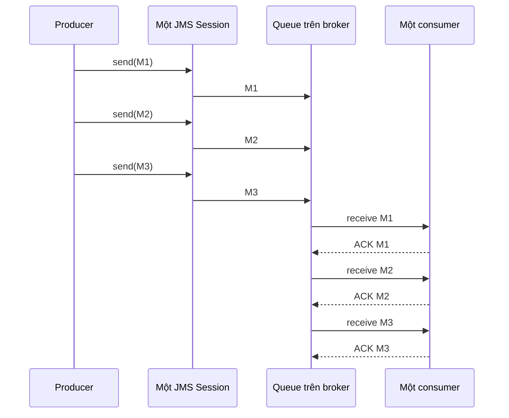
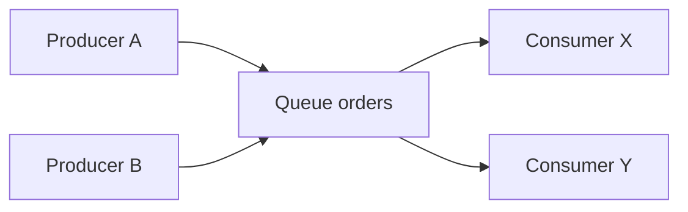

# Phạm vi bảo đảm thứ tự với một producer, một Session và một consumer

> **Chương:** Thứ tự và thời gian  
> **Phạm vi:** ActiveMQ Classic và ActiveMQ Artemis qua JMS Java. Bài này chỉ xét **một producer gửi tuần tự vào một destination, một JMS Session và một consumer nhận tuần tự**; từ đó xác định chính xác khi nào có thể kỳ vọng FIFO và những giới hạn không được suy rộng.

## 1. Câu hỏi: gửi M1, M2, M3 thì consumer có nhận đúng M1 → M2 → M3?

Xét một hệ thống cập nhật trạng thái đơn hàng:

```text
Order O-100:
  M1 = CREATED
  M2 = PAID
  M3 = SHIPPED
```

Producer gửi ba message theo thứ tự trên. Consumer phải xử lý `CREATED` trước `PAID` và `PAID` trước `SHIPPED`; nếu thứ tự đảo, projection có thể tạo trạng thái không hợp lệ.

Trong trường hợp **đơn giản, được kiểm soát**, một producer gửi tuần tự qua một `Session` vào **cùng một queue**, có **một consumer** nhận và xử lý tuần tự trong một `Session`, các message có **cùng priority**, không bị trì hoãn/hết hạn, không rollback/redelivery và không có nguồn phát khác, ta có thể **kỳ vọng thứ tự FIFO khi nhận**:



**Không nên biến kỳ vọng trên thành tuyên bố “JMS bảo đảm mọi message luôn được xử lý đúng thứ tự”.** JMS cho phép các yếu tố như priority, nhiều producer/consumer và delivery lại ảnh hưởng thứ tự. Ngoài ra, **nhận đúng thứ tự** và **hoàn tất thay đổi nghiệp vụ đúng thứ tự** là hai bài toán khác nhau.

### Mục tiêu bài học

Sau bài này, bạn phải:

1. Chỉ ra **phạm vi** của thứ tự tại producer, `Session`, destination, consumer và business handler.
2. Thiết lập tập điều kiện đủ rõ để thử nghiệm **M1 → M2 → M3** trên queue.
3. Hiểu vì sao một `Session` không được sử dụng đồng thời bởi nhiều thread.
4. Phân biệt thời điểm `send()`, enqueue/commit, `receive()`, ACK và hoàn tất nghiệp vụ.
5. Nhận diện chính xác trường hợp nào phá vỡ hoặc làm suy yếu kỳ vọng FIFO.
6. Viết thử nghiệm Java ghi sequence number để **kiểm chứng**, không suy đoán dựa vào timestamp.

## 2. Bốn lớp thứ tự phải tách riêng

| Lớp | Dãy sự kiện quan sát | Cái gì đang được bảo toàn? | Điều chưa được bảo đảm |
|---|---|---|---|
| **Thứ tự gọi gửi** | `send(M1)` → `send(M2)` → `send(M3)` | Ứng dụng gọi API trong một luồng tuần tự | Chưa chứng minh mọi message đều được broker chấp nhận hoặc transaction đã commit |
| **Thứ tự vào destination** | Queue nhận M1, M2, M3 | Các message đã được định tuyến/enqueue theo điều kiện của provider | Không có thứ tự toàn cục giữa queue, producer khác hoặc transaction độc lập |
| **Thứ tự nhận** | `receive()` trả M1, rồi M2, rồi M3 | Một consumer thấy các message theo dãy giao nhận | Không chứng minh business action đã hoàn tất |
| **Thứ tự hoàn tất nghiệp vụ** | DB cập nhật M1, rồi M2, rồi M3 | Ứng dụng thực thi, commit tuần tự theo quy tắc domain | Không tự đến từ broker khi handler chạy bất đồng bộ hoặc retry |

Ba thời điểm `send()`, `receive()` và `commit dữ liệu nghiệp vụ` có thể rất xa nhau.

### 2.1. Thứ tự gửi nằm ở đâu?

Giả sử:

```java
producer.send(m1);
producer.send(m2);
producer.send(m3);
```

Nếu đây là **cùng producer, cùng Session, một luồng thực thi**, các lời gọi theo chương trình có thứ tự rõ ràng. Ngược lại, tạo ba `CompletableFuture` cùng gọi `send()` trên cùng JMS `Session` **không** phải cách hợp lệ để thu được một luồng gửi có thứ tự: các phương thức của một JMS Session nói chung không thiết kế để được dùng đồng thời từ nhiều thread.

Một `Connection` có thể chứa nhiều `Session`. Nhưng **một Connection không phải một luồng thứ tự duy nhất** cho mọi Session.

### 2.2. Thứ tự ở queue có phạm vi destination

Queue `orders.command` và queue `orders.audit` có hai luồng phân phối độc lập. Việc M1 vào queue command trước M2 vào queue audit **không** có nghĩa consumer bên command sẽ xử lý M1 trước consumer bên audit xử lý M2.

Với topic, mỗi subscription có luồng backlog và delivery của riêng mình. Hai subscription có thể cùng nhận M1/M2 nhưng khác tốc độ và thời điểm xử lý; không nên so thứ tự hoàn tất giữa chúng như một tổng trật tự.

### 2.3. Nhận tuần tự không tự đồng nghĩa hoàn tất tuần tự

Vòng lặp đồng bộ:

```java
Message m1 = consumer.receive(5000);
processAndCommit(m1);

Message m2 = consumer.receive(5000);
processAndCommit(m2);
```

có thứ tự business dễ suy luận hơn tình huống nhận nhanh rồi giao mỗi message cho một task bất đồng bộ:

```text
receive M1 -> submit worker A (chạy 500 ms)
receive M2 -> submit worker B (chạy 20 ms)

Có thể M2 hoàn tất trước M1,
dù consumer đã nhận theo M1 rồi M2.
```

Nếu ứng dụng ACK message sau khi chỉ **submit task**, message có thể bị coi là đã xử lý trước khi side effect hoàn tất. Đó là vấn đề của mô hình xử lý, không phải bằng chứng queue đã nhận đảo thứ tự.

## 3. Bộ giả định để kiểm chứng FIFO trong phạm vi hẹp

Bài thử nghiệm cần thỏa **đồng thời** các điều kiện sau:

| Điều kiện | Thiết lập thử nghiệm | Vì sao cần |
|---|---|---|
| Một producer logic | Một `MessageProducer`, gọi `send()` tuần tự trên một thread | Không tạo cạnh tranh thứ tự gửi từ nhiều nguồn |
| Một `Session` | Cả producer và consumer của demo dùng cùng session, không chia sẻ thread | Có một ngữ cảnh JMS tuần tự, dễ quan sát |
| Một queue | Mọi message gửi vào **cùng một destination** | Tránh suy luận thứ tự xuyên queue/topic |
| Một consumer | Chỉ một `MessageConsumer` cho queue thử nghiệm | Không có consumer khác nhận hoặc xử lý song song |
| Cùng priority | Đều priority `4` | Tránh broker ưu tiên message mới có mức priority cao hơn |
| Không có TTL/delay | `timeToLive=0`, không đặt scheduled-delivery property | Tránh message hết hạn hoặc chưa đến hạn nhận |
| Không rollback/recover | Handler không cố tình yêu cầu redelivery | Tránh những lượt giao lại chen vào luồng quan sát |
| Không có backlog cũ | Queue duy nhất cho mỗi lần chạy | Không lẫn message không thuộc dãy kiểm thử |
| Không có failover trong lượt thử | Broker và kết nối ổn định | Loại trừ thay đổi phân phối khi connection/broker lỗi |
| ACK tuần tự | Nhận và kiểm tra xong M_i mới ACK, rồi nhận M_(i+1) | Ranh giới xử lý message rõ ràng |

Các điều kiện này **không phải công thức bảo đảm mọi cấu hình và mọi phiên bản**. Chúng là phạm vi kiểm chứng vận hành hợp lý cho JMS queue trên ActiveMQ Classic/Artemis. Nếu cần ràng buộc nghiêm ngặt trong nghiệp vụ, vẫn phải bổ sung business sequence/version, idempotency và kiểm thử failure.

### 3.1. Những thứ không đủ để kết luận có thứ tự

- `JMSMessageID` là định danh message, **không** phải số thứ tự nghiệp vụ có thể so sánh để xác định FIFO.
- `JMSTimestamp` không phải đồng hồ thứ tự toàn cục giữa producer, broker và consumer.
- `JMSPriority=4` giống nhau loại bỏ một yếu tố gây đảo thứ tự, nhưng không tự khắc phục redelivery và concurrency.
- `PERSISTENT` liên quan khả năng lưu trữ theo delivery mode, **không phải “bật FIFO”**.
- Queue size giảm không chứng minh handler commit dữ liệu theo thứ tự.

Để kiểm tra đúng thứ tự, gửi một `sequence` hoặc `aggregateVersion` **do ứng dụng cấp**. Đó là dữ liệu quan sát độc lập với metadata của provider.

## 4. Một Session có ý nghĩa gì đối với producer và consumer?

### 4.1. Session là ngữ cảnh xử lý tuần tự

JMS `Session` là ngữ cảnh đơn luồng cho producer, consumer, listener, transaction và acknowledgment. Trong chương trình đơn giản, gọi:

```java
Session session = connection.createSession(
        false, Session.CLIENT_ACKNOWLEDGE);
MessageProducer producer = session.createProducer(queue);
MessageConsumer consumer = session.createConsumer(queue);
```

Sau đó dùng **cùng thread** gửi hết dãy rồi gọi `receive()` lần lượt. Như vậy không có tranh chấp thao tác Session từ nhiều thread.

Trong ứng dụng listener bất đồng bộ, JMS provider phân phối callback `onMessage()` cho một Session theo semantics tuần tự của Session. Nhưng nếu handler tự đẩy việc sang thread pool và kết thúc callback sớm, **thứ tự commit business** có thể khác thứ tự callback. Không gọi `acknowledge()` hoặc các thao tác Session từ nhiều thread cùng lúc một cách tùy tiện.

### 4.2. Một producer không đồng nghĩa một Session cho toàn ứng dụng

Hai producer có thể dùng **hai Session khác nhau**. Khi đó, dù cùng gửi vào một queue, không nên giả định sẽ có trật tự toàn cục giữa các lời gọi ở hai thread hay hai máy. Ngay cả khi log timestamp của producer A “sớm hơn”, thời điểm broker nhận và enqueue phụ thuộc mạng và lịch thực thi.

Tương tự, một consumer object đặt trong service có thể được thay bằng nhiều consumer/Session khi scale-out, và điều kiện “một consumer” của bài này không còn đúng.

## 5. Thực hành Java JMS: đo thứ tự bằng sequence number

Đây là demo **một Connection, một Session, một producer, một consumer**. Producer gửi `M1..M10` vào queue riêng, tất cả có cùng priority, delivery mode và TTL; consumer đọc đồng bộ và so từng số thứ tự trước khi ACK.

### 5.1. Chuẩn bị

Dùng JMS client của ActiveMQ Classic 5.x qua **OpenWire**:

```xml
<dependency>
  <groupId>org.apache.activemq</groupId>
  <artifactId>activemq-client</artifactId>
  <version>5.18.5</version>
</dependency>
```

Các kiểu là `javax.jms`. Có thể chạy với ActiveMQ Classic, hoặc Artemis có OpenWire acceptor và quyền tạo/ghi/đọc queue. Broker ví dụ lắng nghe `tcp://localhost:61616`; nếu khác, truyền URL ở command line. Version dependency chỉ để minh họa, chọn phiên bản đã được dự án phê duyệt.

### 5.2. Chương trình hoàn chỉnh

Tạo `OrderingScopeDemo.java`:

```java
import java.util.UUID;

import javax.jms.Connection;
import javax.jms.DeliveryMode;
import javax.jms.JMSException;
import javax.jms.Message;
import javax.jms.MessageConsumer;
import javax.jms.MessageProducer;
import javax.jms.Queue;
import javax.jms.Session;
import javax.jms.TextMessage;

import org.apache.activemq.ActiveMQConnectionFactory;

public final class OrderingScopeDemo {
    private static final int MESSAGE_COUNT = 10;
    private static final int SAME_PRIORITY = 4;

    public static void main(String[] args) throws JMSException {
        String brokerUrl = args.length > 0
                ? args[0]
                : "tcp://localhost:61616";

        ActiveMQConnectionFactory factory =
                new ActiveMQConnectionFactory(brokerUrl);

        String user = System.getenv("BROKER_USER");
        String pass = System.getenv("BROKER_PASSWORD");

        Connection connection =
                user == null || user.isEmpty()
                        ? factory.createConnection()
                        : factory.createConnection(user, pass);

        try {
            // Đúng một Session, không dùng đồng thời qua nhiều thread.
            Session session = connection.createSession(
                    false, Session.CLIENT_ACKNOWLEDGE);

            try {
                String queueName =
                        "demo.ordering." + UUID.randomUUID();
                Queue queue = session.createQueue(queueName);

                MessageProducer producer = session.createProducer(queue);
                MessageConsumer consumer = session.createConsumer(queue);

                try {
                    String producerId = UUID.randomUUID().toString();

                    // Gửi tuần tự qua cùng producer, cùng Session.
                    for (int seq = 1; seq <= MESSAGE_COUNT; seq++) {
                        TextMessage message =
                                session.createTextMessage("M" + seq);
                        message.setStringProperty(
                                "producerId", producerId);
                        message.setIntProperty("sequence", seq);
                        message.setStringProperty(
                                "eventId", producerId + "-" + seq);

                        // Cùng delivery mode, priority, TTL = 0 (không hết hạn).
                        producer.send(
                                message,
                                DeliveryMode.PERSISTENT,
                                SAME_PRIORITY,
                                0L);

                        System.out.printf(
                                "SEND sequence=%d id=%s%n",
                                seq, message.getJMSMessageID());
                    }

                    connection.start();

                    // Chỉ nhận/validate/ACK xong một message
                    // mới gọi receive() cho message tiếp theo.
                    for (int expected = 1;
                         expected <= MESSAGE_COUNT;
                         expected++) {

                        Message received = consumer.receive(10_000L);

                        if (!(received instanceof TextMessage)) {
                            throw new IllegalStateException(
                                    "Expected TextMessage at " + expected);
                        }

                        int actual =
                                received.getIntProperty("sequence");
                        String text =
                                ((TextMessage) received).getText();

                        System.out.printf(
                                "RECEIVE expected=%d actual=%d body=%s "
                                + "priority=%d redelivered=%s%n",
                                expected,
                                actual,
                                text,
                                received.getJMSPriority(),
                                received.getJMSRedelivered());

                        if (actual != expected) {
                            // Không ACK message bất thường.
                            throw new IllegalStateException(
                                    "Out of order: expected=" + expected
                                    + ", actual=" + actual);
                        }

                        // CLIENT_ACKNOWLEDGE có hiệu lực theo Session.
                        // Ở đây mỗi lần chỉ có 1 message mới được consume
                        // kể từ ACK trước, nên ranh giới vẫn dễ kiểm chứng.
                        received.acknowledge();
                    }

                    Message extra = consumer.receive(1_000L);
                    if (extra != null) {
                        throw new IllegalStateException(
                                "Unexpected extra message: "
                                + extra.getJMSMessageID());
                    }

                    System.out.println(
                            "PASS: received 1..10 in order");
                } finally {
                    try {
                        consumer.close();
                    } finally {
                        producer.close();
                    }
                }
            } finally {
                session.close();
            }
        } finally {
            connection.close();
        }
    }
}
```

**Vì sao demo dùng `CLIENT_ACKNOWLEDGE`?** Mục tiêu không phải so sánh toàn bộ ACK mode mà là cho thấy bước nhận và xác nhận nối tiếp nhau. `CLIENT_ACKNOWLEDGE` về nguyên tắc ACK **mọi message đã consume trong cùng session** đến thời điểm gọi; vì demo chỉ lấy một message mới rồi ACK ngay, ta có ranh giới trực quan.

Cũng có thể tạo session transacted rồi `commit()` sau từng lần nhận; điểm khác biệt là producer phải `commit()` phần gửi trước khi bắt đầu nhận (xem mục 6).

### 5.3. Kết quả mong đợi và cách diễn giải

Ví dụ rút gọn:

```text
SEND sequence=1 id=ID:...
SEND sequence=2 id=ID:...
...
SEND sequence=10 id=ID:...
RECEIVE expected=1 actual=1 body=M1 priority=4 redelivered=false
RECEIVE expected=2 actual=2 body=M2 priority=4 redelivered=false
...
RECEIVE expected=10 actual=10 body=M10 priority=4 redelivered=false
PASS: received 1..10 in order
```

**Một lần PASS không chứng minh FIFO vô điều kiện.** Nó xác nhận thứ tự trong **một topology, một lần chạy và một bộ điều kiện**. Thử hàng nghìn lần, thay kích thước payload và broker/version, rồi dùng các bài kiểm thử âm tính ở cuối bài để hiểu giới hạn.

### 5.4. Những chi tiết của thử nghiệm giúp tránh kết luận sai

- Queue có UUID riêng, tránh backlog từ lần chạy trước. Tài nguyên queue có thể vẫn tồn tại trên broker sau demo; dọn bằng công cụ quản trị khi phù hợp.
- `connection.start()` chỉ cần trước bước receive; producer có thể gửi trước khi bắt đầu delivery cho consumer.
- Một Session được dùng tuần tự trên một thread, không có `ExecutorService` gửi hoặc ACK song song.
- Message cùng priority và TTL 0; không đặt scheduled delivery hoặc selector.
- Message ID chỉ được in để đối soát; phép kiểm chứng thứ tự dùng **`sequence` property**.
- Không có handler DB thật: demo xác minh **delivery order**, không chứng minh nhiều transaction dữ liệu sẽ commit đúng order nếu code ứng dụng thay đổi.

## 6. Nếu dùng transacted Session thì thứ tự và visibility thay đổi ra sao?

Trong session giao dịch, việc gửi và nhận được gắn với `Session.commit()` và `Session.rollback()`. Sự khác biệt quan trọng nhất với bài thử trên là **message gửi chưa commit không được xem là đã hoàn tất giao dịch gửi**.

```java
// Đoạn code minh họa, giả sử connection đã được tạo.
Session session = connection.createSession(
        true, Session.SESSION_TRANSACTED);
Queue queue = session.createQueue("demo.ordering.tx");
MessageProducer producer = session.createProducer(queue);
MessageConsumer consumer = session.createConsumer(queue);

for (int seq = 1; seq <= 3; seq++) {
    TextMessage m = session.createTextMessage("M" + seq);
    m.setIntProperty("sequence", seq);
    producer.send(m, DeliveryMode.PERSISTENT, 4, 0L);
}

// Với transacted Session: commit lần gửi trước khi receive.
session.commit();

connection.start();

for (int expected = 1; expected <= 3; expected++) {
    Message m = consumer.receive(5000L);
    if (m == null || m.getIntProperty("sequence") != expected) {
        session.rollback();
        throw new IllegalStateException("Missing or reordered message");
    }

    processBusinessData(m); // Hàm ứng dụng minh họa.
    session.commit();        // Commit lượt nhận này.
}
```

**Lưu ý:** Đoạn trên là ví dụ API, không phải chương trình tự chạy — `processBusinessData` cần được triển khai. Nếu dữ liệu nghiệp vụ nằm trong database riêng, `session.commit()` **không tự commit database transaction**. Nếu handler lỗi và gọi `rollback()`, message có thể được redeliver theo broker policy; lúc đó phép đo thứ tự cần phân biệt lượt nhận ban đầu với lượt giao lại.

### 6.1. Commit nhiều message trong một transaction

Một producer có thể gửi `M1,M2,M3` rồi `commit()` một lần. Điều này tạo một **ranh giới visibility/atomicity** của giao dịch gửi: không nên coi các send chưa commit là message đã được công bố thành công. Tuy nhiên, **transaction atomicity không đồng nghĩa một lệnh “khóa thứ tự toàn hệ thống”** khi có nhiều producer/session gửi vào cùng destination.

### 6.2. Redelivery có thể làm lịch sử nhận khác dãy gửi ban đầu

Ví dụ:

```text
Producer send:       M1  M2  M3
Consumer receives:   M1  M2
Consumer rollback M2
Broker:              retry M2 (có thể có delay)
Consumer receives:   M3, rồi M2  (tùy broker/policy/topology)
```

Trong tình huống trên, `M2` chưa hoàn tất và được giao lại. Việc nhìn thấy `M3` trước lượt giao lại của `M2` **không phủ nhận** thứ tự của lượt gửi ban đầu; đó là thay đổi do retry policy.

Nếu nghiệp vụ yêu cầu không được áp dụng version 3 trước version 2, đừng chỉ dựa vào việc broker từng giao version 2 trước đó. Hãy kiểm tra **expected version** trong dữ liệu ứng dụng.

## 7. Những yếu tố phá vỡ hoặc giới hạn kỳ vọng thứ tự

### 7.1. Priority khác nhau

Producer gửi:

```java
producer.send(m1, DeliveryMode.PERSISTENT, 4, 0L);
producer.send(m2, DeliveryMode.PERSISTENT, 9, 0L);
```

Nếu hai message đều đang chờ được chọn từ queue, broker có thể ưu tiên `m2` (priority 9) trước `m1` (priority 4). Thứ tự thực tế còn phụ thuộc thời điểm message đã được dispatch/prefetch, chính sách priority và cấu hình broker.

Vì vậy, **test priority không phải lúc nào cũng tái hiện thứ tự đảo**: nếu `m1` đã được đưa vào client trước khi `m2` đến, bạn có thể vẫn thấy m1 trước. Đó là lý do phải mô tả điều kiện enqueue/dispatch khi viết test.

### 7.2. Scheduled delivery hoặc message delay

Một message `M1` được hẹn giao sau 30 giây, trong khi `M2` được gửi sau nhưng giao ngay:

```text
t=0s:  send M1 (scheduled for t=30s)
t=1s:  send M2 (ready immediately)
t=2s:  consumer receives M2
t=30s: M1 becomes eligible
```

Lúc này **thứ tự được phép giao** khác thứ tự gọi send. Các property lập lịch có thể là extension riêng của Classic hoặc Artemis; không nên dùng cú pháp của broker này cho broker kia mà không kiểm tra.

### 7.3. Expiration

Nếu M2 hết hạn trước khi được giao, consumer có thể quan sát `M1, M3`. Đây là **một khoảng trống trong sequence**, không nhất thiết là M3 được giao “vượt” M2. Phải phân biệt:

- **Gap:** thiếu một sequence number do expiry, filter, drop hoặc chuyển destination.
- **Reorder:** quan sát một sequence lớn trước một sequence nhỏ vẫn còn đủ điều kiện nhận.
- **Duplicate:** nhận cùng sequence nhiều lần do redelivery hoặc producer gửi lặp.

Cả ba đều cần cách xử lý khác nhau trong nghiệp vụ.

### 7.4. Selector

Nếu consumer đặt selector chỉ nhận `eventType='PAID'`, những message `CREATED` hay `SHIPPED` không khớp **sẽ không xuất hiện** tại consumer đó. Không thể dùng log của một filtered consumer để kết luận nó đã nhận toàn bộ dãy sequence.

### 7.5. Prefetch / consumer buffer

ActiveMQ Classic có prefetch; Artemis có cơ chế consumer credit/window. Một số message có thể đã được broker dispatch vào **buffer của client** trước khi ứng dụng gọi `receive()`.

**Prefetch tự nó không tất yếu làm đảo thứ tự trong một consumer**; nó làm việc diễn giải “message đang ở đâu” khó hơn và ảnh hưởng khi có nhiều consumer, rollback hoặc reconnect.

Một test có prefetch=1 có thể đơn giản hóa số message in-flight, nhưng không được dùng như **bảo đảm thứ tự toàn cục**; và nếu ứng dụng muốn nhận nhiều message trước ACK, prefetch quá nhỏ có thể làm block.

### 7.6. Nhiều producer hoặc nhiều consumer



- Với **hai producer**, mỗi producer có thứ tự cục bộ riêng. Broker không nhận một “thứ tự toàn cục” do ứng dụng phát minh nếu không có bộ đánh số/chốt thứ tự chung.
- Với **hai consumer**, broker có thể dispatch M1 cho X và M2 cho Y. X xử lý 500 ms, Y xử lý 20 ms: M2 **hoàn tất trước M1**.
- Với topic có nhiều subscription, mỗi subscription có backlog và ACK riêng. Thứ tự hoàn tất giữa subscription không phải một chuỗi chung.

Đây là lý do điều kiện **một producer, một Session, một consumer** không nên bị bỏ qua trong một kết luận về FIFO.

### 7.7. Recover, rollback, broker failover

`Session.recover()`, `Session.rollback()` và lỗi connection có thể dẫn tới redelivery. Những lần gửi lại có thể tương tác với prefetch, retry delay và các consumer khác. Nếu producer không nhận được kết quả send rồi phát lại event với một `JMSMessageID` mới, consumer còn có thể nhìn thấy **duplicate nghiệp vụ**.

Với failover, luôn kiểm tra:

- business `eventId` có ổn định qua retry không;
- `sequence` có được cấp **trước khi publish** không;
- handler có idempotent không;
- sau reconnect, hệ thống có phát hiện duplicate/gap/out-of-order không.

## 8. Thứ tự nghiệp vụ: khi nào broker FIFO chưa đủ?

Giả sử hai event của cùng đơn hàng:

```json
{"orderId":"O-100","version":2,"state":"PAID"}
{"orderId":"O-100","version":3,"state":"SHIPPED"}
```

Ngay cả khi broker nhận được version 2 trước version 3 trong luồng bình thường, retry của version 2 hoặc consumer scale-out vẫn có thể làm version 3 được đưa tới handler lúc version 2 chưa commit.

### 8.1. Bảo vệ bằng version ở database

Ví dụ bảng:

```sql
CREATE TABLE order_projection (
    order_id VARCHAR(64) PRIMARY KEY,
    version BIGINT NOT NULL,
    state VARCHAR(32) NOT NULL
);
```

Đối với event có version `nextVersion`, một cách kiểm soát optimistic concurrency:

```sql
UPDATE order_projection
SET state = ?, version = ?
WHERE order_id = ?
  AND version = ?;
```

Với event phiên bản 3, truyền `newVersion=3` và `expectedVersion=2`. Nếu update trả 0 row, phải **phân biệt**:

- version hiện tại đã >= 3: có thể event đã xử lý/trùng hoặc cũ; kiểm tra business `eventId`/version để quyết định;
- version hiện tại = 1: còn **gap** version 2; cần chờ, buffer hoặc retry có kiểm soát;
- order chưa tồn tại: event tạo đơn hàng chưa được áp dụng; xử lý theo workflow tương ứng.

Không được hiểu mọi `UPDATE 0 rows` là duplicate lành tính rồi ACK bỏ qua, vì có thể đang thiếu một event bắt buộc.

### 8.2. Chọn mức bảo đảm đúng bài toán

| Yêu cầu nghiệp vụ | Thiết kế phù hợp |
|---|---|
| Một job đơn lẻ, không phụ thuộc job trước | Queue, nhiều consumer; không cần thứ tự toàn cục |
| Một consumer xử lý lần lượt một dòng message | Một Session/consumer, đồng bộ, cùng priority, kiểm thử FIFO |
| Thứ tự **theo orderId** khi mở rộng nhiều worker | Message grouping/partitioning theo orderId, cộng kiểm tra version |
| Không bao giờ cộng hoặc ghi side effect trùng | Idempotency/inbox hoặc unique key ở business data |
| Chống version mới vượt qua version cũ | Expected-version update, phát hiện gap và chính sách retry/buffer |
| Nhiều service cùng nhận event | Subscription độc lập; không giả định thứ tự commit xuyên service |

ActiveMQ Classic và Artemis đều có khả năng **message grouping** theo nhóm (thường dùng `JMSXGroupID` ở JMS). Grouping giúp các message cùng nhóm được gắn với một consumer trong giai đoạn ổn định, nhưng **không biến mọi lỗi retry/failover thành bảo đảm exactly-once hoặc global order**. Cấu hình/điều kiện reassignment cần được kiểm thử theo phiên bản broker.

## 9. Ma trận kiểm thử cần có trong dự án

| Ca thử | Thiết lập | Điều cần quan sát |
|---|---|---|
| **FIFO cơ sở** | 1 producer, 1 Session, 1 consumer, cùng priority, queue riêng | Dãy receive `1..N` |
| Consumer đồng bộ | Process M_i xong mới nhận M_(i+1) | Business completion theo `1..N` |
| Producer transacted | Gửi M1..M3 rồi commit, sau đó receive | Message xuất hiện sau commit; kiểm tra receive order |
| Khác priority | M1 priority 4, M2 priority 9 | Broker có thể ưu tiên M2; không khẳng định chắc đảo |
| Scheduled delivery | M1 delay 30s, M2 sẵn sàng ngay | Có thể thấy M2 trước M1 |
| Expiration | TTL M2 ngắn, consumer nhận muộn | Phát hiện gap; không gán nhầm thành reorder |
| Rollback/redelivery | Consumer nhận M2 rồi rollback | Theo dõi số lượt và vị trí giao lại; không giả định FIFO cũ |
| Hai consumers | Một worker chậm, một worker nhanh | Receive/commit nghiệp vụ có thể không còn thứ tự tổng |
| Hai producers | Cùng gửi vào queue, mỗi producer có sequence riêng | Không có một total order theo thời điểm gọi gửi phía hai máy |
| Failover | Restart/đứt mạng ở ranh giới send/ACK | Phát hiện duplicate, gap và xử lý idempotent |
| Message group | Mỗi `orderId` là một group | Đo thứ tự **theo key**, kể cả sau consumer chết/reassign |

### 9.1. Ghi log đúng để phân biệt lỗi

Thay vì chỉ log “Received OrderPaid”, nên log:

```text
broker=activemq-test
destination=orders.commands
producerId=producer-01
eventId=evt-1002
aggregateId=O-100
sequence=2
jmsMessageId=ID:...
jmsPriority=4
jmsRedelivered=false
jmsDeliveryCount=1
consumerId=orders-worker-01
phase=RECEIVED|DB_COMMITTED|ACKED
```

Đây là **mẫu log**, không phải tất cả provider đều cung cấp `JMSXDeliveryCount` trong mọi tình huống. Dùng `eventId` để nhận diện trùng, `sequence` để phát hiện đảo/gap và `phase` để biết **nhận** hay **commit nghiệp vụ** đã diễn ra.

Một phép kiểm tra đơn giản trên log của **một aggregate**:

```text
lastCommittedVersion = 1
incoming version = 2 -> hợp lệ, commit -> last = 2
incoming version = 4 -> GAP: thiếu version 3
incoming version = 2 -> DUPLICATE hoặc event cũ, cần đối chiếu eventId
incoming version = 3 -> chưa thể kết luận chỉ từ receive order
```

Tuyệt đối không dùng `JMSTimestamp` thay thế `aggregateVersion` để phát hiện gap.

## 10. Ngộ nhận thường gặp

**“Một producer nghĩa là thứ tự luôn được bảo toàn.”** Chưa đủ: phải xét cùng Session, destination, priority, scheduling và trạng thái retry. Việc producer bị gọi đồng thời từ nhiều thread qua chung Session cũng là thiết kế sai.

**“Một Connection bảo đảm thứ tự cho tất cả Session.”** Không đúng. Mỗi Session có ngữ cảnh hoạt động riêng; message từ những Session độc lập không có thứ tự toàn cục chỉ vì dùng cùng socket/Connection.

**“Một consumer nhận M1 trước M2 thì DB luôn commit M1 trước M2.”** Không đúng nếu handler xử lý song song hoặc hoàn tất không đồng bộ.

**“Prefetch=1 là bật FIFO.”** Không đúng. Prefetch chủ yếu điều khiển lượng delivery chưa ACK ở client; không khắc phục multiple producers, retry, priority hoặc các phép ghi DB song song.

**“Có thể sắp xếp theo JMSMessageID để lấy lại thứ tự.”** Không có hợp đồng JMS portable nào cho phép diễn giải ID message thành thứ tự nghiệp vụ.

**“Broker bảo đảm đúng thứ tự nên không cần version trong event.”** Với những domain phụ thuộc version, nên có cơ chế phát hiện gap/duplicate/reorder khi scale hoặc phục hồi từ lỗi.

## 11. Câu hỏi tự kiểm tra

1. Nêu chính xác các điều kiện trong đó consumer có thể kỳ vọng nhận M1 → M2 → M3 với một producer và một Session.
2. Vì sao `producer.send(M1)` trước `producer.send(M2)` không tự chứng minh database đã commit tác dụng phụ của M1 trước M2?
3. Chuyển một producer tuần tự sang ba thread cùng dùng một `Session` có làm tăng throughput an toàn không? Vì sao?
4. M1 có priority 4, M2 có priority 9. Có thể bảo đảm consumer luôn nhận M1 trước không? Có thể bảo đảm luôn nhận M2 trước không?
5. Khi retry có delay, consumer nhận M3 trước lượt giao lại của M2. Bạn phân biệt hiện tượng này với thứ tự gửi ban đầu như thế nào?
6. Vì sao `aggregateVersion` đáng tin cậy hơn `JMSTimestamp` khi xử lý đúng thứ tự sự kiện của một order?
7. Thiết kế một bài kiểm thử với hai worker cạnh tranh cùng queue và chứng minh “nhận đúng thứ tự” không đồng nghĩa “hoàn tất đúng thứ tự”.

## 12. Tài liệu tham khảo

- [Jakarta Messaging Specification](https://jakarta.ee/specifications/messaging/) — semantics của JMS Session, delivery mode, priority, transactions và message delivery.
- [ActiveMQ Classic — Prefetch Policy](https://activemq.apache.org/components/classic/documentation/what-is-the-prefetch-limit-for) — dispatch trước và in-flight tại consumer.
- [ActiveMQ Classic — Message Groups](https://activemq.apache.org/components/classic/documentation/message-groups) — phân luồng nhóm message khi mở rộng consumer.
- [ActiveMQ Artemis — Message Grouping](https://artemis.apache.org/components/artemis/documentation/latest/message-grouping.html) — grouping theo key, những lưu ý khi reassign.
- [ActiveMQ Artemis — Undelivered Messages](https://artemis.apache.org/components/artemis/documentation/latest/undelivered-messages.html) — retry, redelivery delay và tác động tới lịch giao nhận.

**Ghi nhớ:** **Một producer + một Session + một consumer + một queue + các điều kiện giao nhận ổn định** cho phép kỳ vọng và kiểm chứng FIFO ở phạm vi **lượt nhận tuần tự**. Đừng suy rộng thành thứ tự toàn cục, thứ tự commit nghiệp vụ hoặc exactly-once dưới mọi failure. Nếu thứ tự ảnh hưởng tính đúng đắn của domain, thêm **sequence/version theo aggregate**, kiểm tra gap/duplicate và quyết định ACK/commit theo kết quả xử lý thật.
