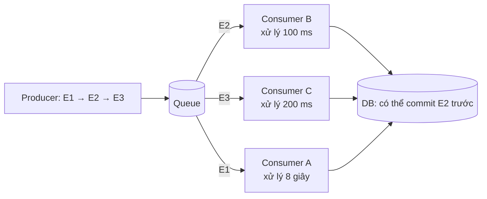
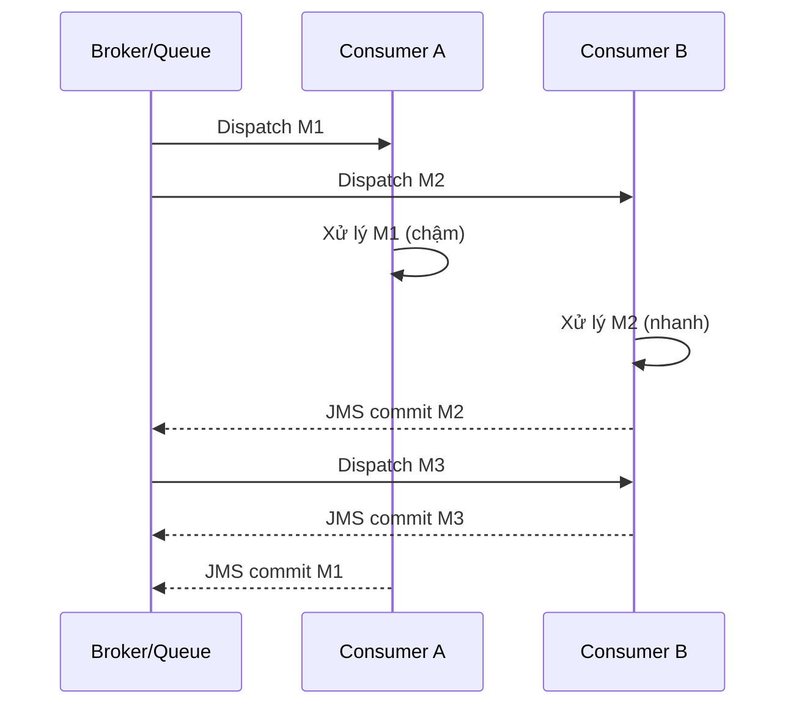
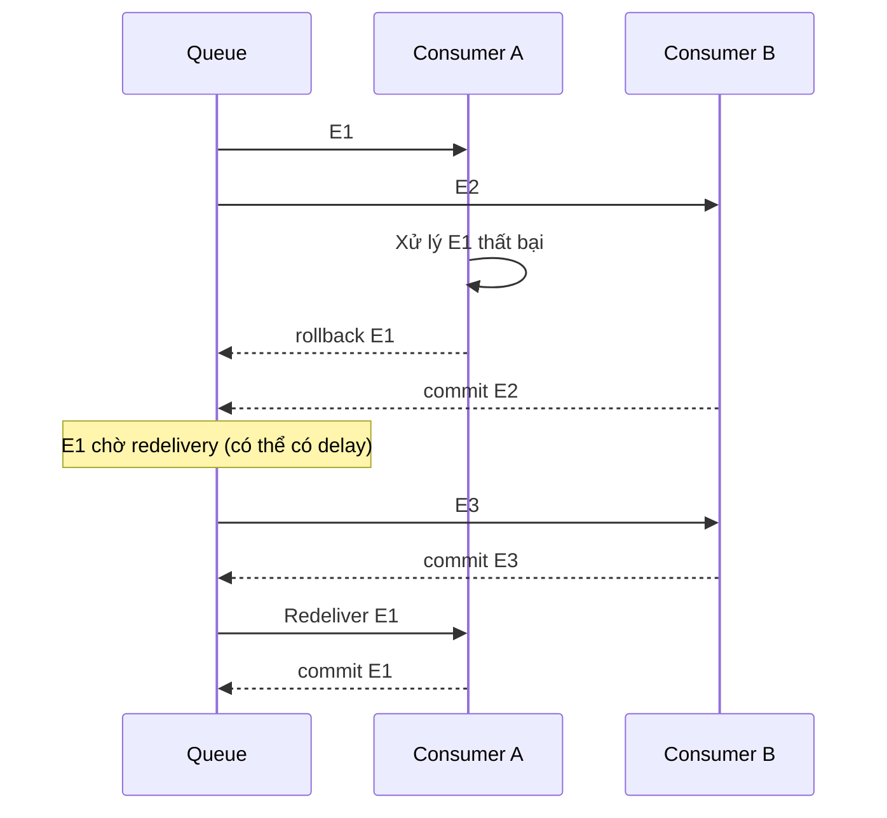

# Tác động của nhiều consumer, prefetch, priority, rollback và failover đến thứ tự

> **Chương:** Thứ tự và thời gian  
> **Phạm vi:** Phân tích **thứ tự message trên queue** trong Apache ActiveMQ Classic và Artemis khi đồng thời có nhiều consumer, bộ đệm nhận trước (*prefetch/consumer window*), JMS message priority, rollback/redelivery và failover. Mã thực hành sử dụng **ActiveMQ Classic 5.x, Java 17 và `javax.jms`**; những đặc thù Artemis được chỉ rõ thay vì suy diễn rằng hai broker có cùng thuật toán dispatch.

## 1. “Đúng thứ tự” là đúng ở thời điểm nào?

Producer gửi ba lệnh cập nhật cùng đơn hàng:

```text
E1: OrderCreated(order-17, version=1)
E2: OrderAddressChanged(order-17, version=2)
E3: OrderCancelled(order-17, version=3)
```

Ứng dụng cần tránh việc hủy đơn (E3) được áp dụng lên database **trước** khi dữ liệu tạo đơn (E1) được lưu. Nhưng chỉ nhìn “producer gửi E1 → E2 → E3 vào một queue” không đủ: khi hai consumer hoạt động, message có thể bắt đầu xử lý và **commit nghiệp vụ theo thứ tự khác**.

Phải tách ít nhất năm khái niệm:

| Cấp độ | Nghĩa chính xác | Dữ liệu quan sát |
|---|---|---|
| **Thứ tự phát sinh nghiệp vụ** | Các sự kiện được tạo theo version/sequence của một aggregate. | `orderId`, `version`, `eventId` do domain đặt. |
| **Thứ tự gửi/chấp nhận vào broker** | Producer gọi `send()` và broker ghi nhận message theo điều kiện session/transaction. | Producer timestamp, commit của JMS transaction, broker enqueue. |
| **Thứ tự dispatch** | Broker cấp message cho các consumer/session. | Queue delivering/in-flight, consumer ID, dispatch metric. |
| **Thứ tự bắt đầu xử lý** | Ứng dụng thực sự chạy handler sau khi nhận message. | Log `START` theo worker và thời gian. |
| **Thứ tự hoàn tất và commit nghiệp vụ** | Database hoặc hệ thống đích đã chấp nhận thay đổi. | Log `DB COMMIT`, version trong DB, log JMS ACK. |

**Không thể lấy thứ tự của một cấp để suy ra chắc chắn thứ tự của cấp khác.** Thậm chí log `JMS ACK` cũng chưa chứng minh rằng transaction database đã commit theo đúng version nếu ứng dụng đặt ACK sai thời điểm.



### Mục tiêu sau bài

- Giải thích điều kiện mà một queue có thể được quan sát gần FIFO và vì sao **nhiều consumer** phá vỡ giả định thứ tự hoàn tất.
- Diễn giải khác biệt giữa **prefetch count** của Classic và **consumer window/credit** của Artemis; nhận biết message đang in-flight không còn ở danh sách pending.
- Phân biệt **JMS message priority** với **consumer priority**, hiểu vì sao priority có thể thay đổi thứ tự dispatch.
- Phân tích một rollback, redelivery delay, consumer crash hoặc broker failover có thể làm message đến muộn, lặp hoặc thay đổi thứ tự.
- Thực hiện lab Java/JMS, ghi log có trình tự và thiết kế bảo vệ thứ tự **theo khóa nghiệp vụ** khi FIFO vận chuyển không đủ.

## 2. Thứ tự của queue: điều kiện và phạm vi

Giả định đơn giản nhất là **một producer gửi tuần tự vào một queue, một consumer xử lý tuần tự**, tất cả message cùng priority, không delay/expiry, selector, rollback, reconnect hoặc chuyển qua broker khác. Khi đó có thể thường quan sát thứ tự nhận tương ứng thứ tự gửi.

Nhưng “queue là FIFO” là một mô hình **có điều kiện**, không phải lời hứa rằng mọi hệ thống sử dụng queue sẽ commit transaction theo đúng thứ tự tạo sự kiện. Một số yếu tố làm giả định không còn đúng:

1. **Nhiều producer:** thứ tự gọi `send()` trong các process khác nhau không định nghĩa một thứ tự nghiệp vụ toàn cục. Thứ tự broker chấp nhận message còn phụ thuộc network và transaction.
2. **Nhiều consumer:** dispatch có thể chia E1/E2/E3 cho ba worker; worker nhanh hoàn tất trước.
3. **Prefetch/consumer window:** một số message đã được cấp phát tới bộ đệm client, dù handler chưa gọi `receive()` cho từng message.
4. **JMSPriority:** message ưu tiên cao có thể được chọn trước message thấp **còn đang pending** khi policy hỗ trợ.
5. **Rollback/redelivery:** E1 chưa được ACK có thể giao lại muộn hơn E2 đã commit; delay làm khoảng cách lớn hơn.
6. **Consumer/broker failover:** message chưa ACK được khôi phục/giao lại; session mới, thời gian phát hiện lỗi và bộ đệm khác có thể đổi thứ tự quan sát.
7. **Delivery delay, expiration và selectors:** message chưa đến thời điểm giao, đã hết hạn hoặc không khớp consumer có thể khiến “khoảng trống” trong chuỗi quan sát.

### 2.1 Bảo đảm nào có thể xây trên broker?

| Nhu cầu | Giả định có thể sử dụng | Thiết kế bổ sung cần có |
|---|---|---|
| Một job độc lập được xử lý bất kỳ lúc nào | Nhiều competing consumers tốt cho throughput. | Idempotency, timeout, retry/DLQ. |
| Toàn queue xử lý tuần tự | Một consumer/session xử lý đồng bộ giảm khả năng đảo thứ tự. | Chấp nhận nút cổ chai; xét redelivery và state của producer. |
| Cùng một `orderId` tuần tự, các order khác song song | Message grouping có thể giữ affinity theo key. | Sequence/version validation ở DB và chiến lược failover. |
| Không bao giờ áp version N+1 trước N | Domain cần tính đơn điệu của version. | Atomic compare-and-set/optimistic lock hoặc buffer/retry có giới hạn. |
| Toàn hệ thống có một “thứ tự đúng” xuyên nhiều producer/broker | Không có chỉ từ queue name. | Sequencer/partition/transaction log hoặc định nghĩa thứ tự nghiệp vụ rõ ràng. |

Hãy viết **yêu cầu nghiệp vụ** trước, ví dụ “với từng `orderId`, version được lưu trong DB phải tăng 1 đơn vị và không giảm”; đừng biến tính chất vận chuyển “queue thường FIFO” thành invariant của domain.

## 3. Nhiều consumer: dispatch sớm không có nghĩa commit sớm

Giả sử broker nhận `M1`, `M2`, `M3` theo thứ tự đó, consumer A mất 5 giây/job và B mất 100 ms/job.



Trong một lần chạy như trên:

```text
Broker enqueue: M1, M2, M3
Handler START:  M1, M2, M3       (chỉ là một lịch trình khả dĩ)
JMS COMMIT:    M2, M3, M1
```

Kết quả không phụ thuộc broker “sai FIFO”: broker có thể đã dispatch lần lượt đúng theo thứ tự, nhưng **nhiều handler có thời gian xử lý khác nhau**. Queue không tự tạo transaction hay lock giữa consumer A/B.

Điểm cần nhớ: với cùng một queue, một lần phân phối bình thường **không nhân bản message để hai consumer cùng nhận**, nhưng **redelivery** sau thất bại có thể làm **cùng một message logic được xử lý nhiều lần**. Nếu producer gửi lặp cùng `eventId`, còn có thể có **hai message vật lý** cùng công việc.

### 3.1 Một session, nhiều thread có làm tốt hơn?

Không được chia sẻ tùy tiện cùng một JMS `Session` cho nhiều thread xử lý đồng thời; JMS session có mô hình thực thi tuần tự. Nếu dùng nhiều consumer song song trong một JVM, nên **mỗi worker có session riêng**. Nhưng việc đúng thread-safety **không bảo đảm thứ tự business commit**: số worker càng nhiều, khả năng E2 xử lý trước E1 càng cao.

Nếu một consumer nhận tuần tự rồi tự `submit` các message vào thread pool, handler vẫn có thể hoàn tất đảo thứ tự dù broker chỉ thấy **một JMS consumer**. Do đó khi kiểm thử phải ghi log **cả thread thực thi nghiệp vụ**, không chỉ số consumer broker báo cáo.

## 4. Prefetch và consumer window: message có thể “rời hàng chờ” mà chưa xử lý

### 4.1 Classic: prefetch là số message broker cấp trước cho consumer

Trong ActiveMQ Classic, consumer có thể giữ nhiều message trong bộ đệm phía client do **prefetch**. Giả sử có hai worker A/B, mỗi worker xử lý lần lượt:

```text
Queue nhận: M1 M2 M3 M4 M5 M6
Consumer A được dispatch/prefetch: [M1 M2 M3 M4]
Consumer B mới kết nối:         [M5 M6]

A đang xử lý M1; M2 M3 M4 đã in-flight nhưng handler A chưa xử lý.
B xử lý M5 và M6 xong trước khi A xử lý M2.
```

Đây là ví dụ **có thể xảy ra** khi prefetch lớn, không mô tả thuật toán phân phối bắt buộc của mọi phiên bản Classic. Message trong buffer A **không phải message còn sẵn để B tự động lấy**, dù A chậm. Khi A chết hoặc kết nối bị broker đóng, những message chưa ACK có thể quay lại để giao tiếp.

Đặt prefetch nhỏ khi cần giảm số message in-flight trên mỗi consumer:

```java
import org.apache.activemq.ActiveMQConnectionFactory;
import org.apache.activemq.ActiveMQPrefetchPolicy;

ActiveMQConnectionFactory factory =
        new ActiveMQConnectionFactory("tcp://127.0.0.1:61616");
ActiveMQPrefetchPolicy prefetch = new ActiveMQPrefetchPolicy();
prefetch.setQueuePrefetch(1);
factory.setPrefetchPolicy(prefetch);
```

Đây là cấu hình **ActiveMQ Classic client**. Prefetch `1` thường hữu ích khi quan sát thứ tự, phân phối giữa worker, hoặc mỗi job tốn nhiều giây, nhưng có thể làm giảm throughput với network latency lớn. Prefetch nhỏ **không biến nhiều consumer thành một consumer** và cũng không hứa FIFO hoàn tất.

### 4.2 Artemis: consumer window/credit không phải số lượng message

Artemis điều tiết message đến client bằng **consumer credits/window**, trong đó `consumerWindowSize` thường là **ngưỡng byte**, khác với `queuePrefetch` dạng số message của Classic. Cách đặt trên Artemis JMS client, tùy nhánh client:

```java
// Ví dụ riêng cho Artemis JMS/Jakarta client tương thích.
org.apache.activemq.artemis.jms.client.ActiveMQConnectionFactory factory =
        new org.apache.activemq.artemis.jms.client.ActiveMQConnectionFactory(
                "tcp://127.0.0.1:61616");
factory.setConsumerWindowSize(0);
```

Giá trị `0` thường được dùng để hạn chế **client-side buffering/prefetch**, giúp message không nằm đợi hàng loạt ở phía consumer. Không suy luận rằng `0` đồng nghĩa **không thể nhận message**, hoặc `1024` đồng nghĩa 1.024 message. Cần đối chiếu phiên bản Artemis, protocol/Core/JMS, kích thước message và thông số acceptor.

### 4.3 Đánh đổi: công bằng, độ trễ và throughput

| Thiết lập | Lợi ích thường gặp | Đánh đổi/rủi ro |
|---|---|---|
| Prefetch/window cao | Ít chờ round-trip, throughput tốt với message nhỏ/handler nhanh | Worker chậm giữ nhiều in-flight; failover phải xử lý nhiều message đang cấp phát; thứ tự hoàn tất khó đoán |
| Prefetch/window thấp | Ít message nằm đệm, dễ chia việc lại, log nhận gần với xử lý thật hơn | Tăng giao tiếp mạng/credit; throughput có thể giảm |
| Nhiều consumer | Tăng năng lực xử lý job độc lập | Mất thứ tự hoàn tất toàn queue |
| Một consumer tuần tự | Đơn giản hóa ordering ở consumer | Throughput bị giới hạn bởi một worker; failover/retry vẫn có thể đảo trạng thái |

**Cách đo:** lấy số message pending, delivering/in-flight, số consumer, `START`/`COMMIT` theo từng worker và latency từ enqueue đến commit. Chỉ nhìn queue depth có thể tưởng message “đã biến mất” khi thực ra nó đang in-flight trong client.

## 5. Priority: message nào được chọn trước?

### 5.1 JMS message priority là 0–9, không phải consumer priority

JMS định nghĩa mức ưu tiên message **0 đến 9**, mặc định thường là `4`. Producer có thể gửi:

```java
// Chữ ký chuẩn JMS 1.1: send(message, deliveryMode, priority, timeToLive).
producer.send(normal, DeliveryMode.PERSISTENT, 4, 0L);
producer.send(urgent, DeliveryMode.PERSISTENT, 9, 0L);
```

Nếu cả hai message còn chờ trong broker và cơ chế broker **thực sự ưu tiên message**, urgent có thể được dispatch trước normal **dù được enqueue sau**. Đây là chủ đích khi chọn priority, nên không còn có thể yêu cầu FIFO tuyệt đối cho tất cả message trong queue.

Trong **ActiveMQ Classic**, cần chú ý policy **`prioritizedMessages`** cho destination. Ví dụ thêm đoạn sau vào `policyEntries` đang có trong `activemq.xml`:

```xml
<policyEntry queue="lab.ordering.>"
             prioritizedMessages="true"/>
```

Đây là **một phần tử**, không phải toàn bộ `activemq.xml`. Phải ghép vào policy hiện có, tránh trùng/mâu thuẫn pattern, restart/reload theo phiên bản và kiểm tra policy match queue thực tế. Chỉ gọi `producer.setPriority(9)` không đủ để suy rằng một broker Classic đang cấu hình mặc định sẽ reorder ngay toàn backlog.

Artemis cũng có xử lý **JMS message priority** theo các mức ưu tiên; cơ chế lưu/chọn message và tương tác với paging/scheduled message/consumer credits có thể khác Classic. Hãy kiểm thử trên bản Artemis thật và **không** chép thuộc tính XML `prioritizedMessages` của Classic vào `broker.xml` Artemis.

### 5.2 Message đã dispatch không bị “rút lại” chỉ vì ưu tiên cao xuất hiện

```text
t0: M1 (priority 4) đã được gửi tới client A và nằm trong prefetch buffer.
t1: M2 (priority 9) đến broker.
t2: Broker có thể ưu tiên M2 trong tập pending phù hợp.
t3: A vẫn có quyền xử lý M1 đã nhận; M2 không thể bắt nó hủy công việc.
```

Priority tác động mạnh tới **chọn message khi broker dispatch**, không tạo khả năng preempt một thao tác nghiệp vụ đang chạy. Message ưu tiên thấp có thể hoàn tất trước ưu tiên cao đã xuất hiện sau; hoặc message cao có thể hoàn tất trước message thấp được enqueue trước nếu còn pending.

### 5.3 Đừng nhầm với consumer priority

**Consumer priority** (cơ chế riêng của broker/client, ví dụ Classic `consumer.priority`) ưu tiên **consumer nào** được dispatch; **JMS message priority** ưu tiên **message nào**. Có thể kết hợp, nhưng **không có công thức tổng** mặc định giữa hai loại.

Một rủi ro thực tế là **starvation**: nếu liên tục có nhiều message priority 9, các message priority 4 có thể chờ lâu hơn kỳ vọng. Với công việc có deadline, có thể cần **queue riêng cho SLO riêng**, quota, chính sách tuổi message hoặc scheduler ở tầng ứng dụng, thay vì dùng priority 9 cho mọi thứ.

## 6. Rollback/redelivery: message cũ có thể quay lại sau message mới

### 6.1 Điểm gãy thứ tự

Xét consumer A/B:



Ở đây **thứ tự hoàn tất = E2, E3, E1** dù thứ tự enqueue ban đầu là E1, E2, E3. Nếu E2 yêu cầu state từ E1, cả hai worker có thể gặp lỗi nghiệp vụ. Khi E1 quay lại sau rollback, không thể coi nó như “sự kiện mới hơn” chỉ vì lần nhận sau.

**`JMSRedelivered`** và **`JMSXDeliveryCount`** giúp quan sát redelivery khi provider hỗ trợ, nhưng chúng không thay thế `eventId` và sequence nghiệp vụ. Hai message vật lý cùng `eventId` do producer retry có thể đều báo lần giao đầu tiên.

### 6.2 Rollback khác gì không ACK?

- Trong **SESSION_TRANSACTED**, `session.rollback()` hủy các thao tác nhận/gửi chưa commit thuộc JMS transaction đó; message nhận có thể được giao lại theo policy.
- Nếu consumer **chết/mất kết nối** trước commit, broker phải phát hiện session không còn khả dụng rồi xử lý các delivery chưa ACK.
- Trong **CLIENT_ACKNOWLEDGE**, `message.acknowledge()` thường mang tính cộng dồn đối với session; nó không tương đương rollback của transacted session.
- Nếu handler **commit DB trước JMS**, lỗi ở JMS commit có thể gây duplicate business attempt sau redelivery; cần idempotency. Nếu **JMS commit trước DB**, lỗi DB có thể làm message biến mất khỏi queue mà nghiệp vụ chưa xảy ra.

### 6.3 Classic: policy redelivery phía client ảnh hưởng thời điểm và thứ tự

Với ActiveMQ Classic JMS client, ví dụ:

```java
import org.apache.activemq.ActiveMQConnectionFactory;
import org.apache.activemq.RedeliveryPolicy;

ActiveMQConnectionFactory factory =
        new ActiveMQConnectionFactory("tcp://127.0.0.1:61616");
RedeliveryPolicy redelivery = factory.getRedeliveryPolicy();
redelivery.setInitialRedeliveryDelay(1000L);
redelivery.setRedeliveryDelay(2000L);
redelivery.setMaximumRedeliveries(3);
redelivery.setUseExponentialBackOff(false);
```

Các giá trị là ví dụ **lab**: sau lỗi có thể chờ trước khi giao lại, tối đa số lượt redelivery do client policy điều khiển. Hành vi gửi **poison ACK** và DLQ của Classic sau vượt ngưỡng còn phụ thuộc broker/dead-letter strategy. Không nhầm `maximumRedeliveries=3` với “tổng cộng đúng ba lần xử lý” trong mọi hoàn cảnh; lần giao ban đầu và các lần redelivery phải được đếm theo API/metric thực tế.

**Không bảo đảm** redelivery được đặt lại chính xác trước mọi message mới, hay giữ vị trí tuyệt đối của nó trong queue. Prefetch, nhiều worker, delay và policy lỗi có thể làm E1 trở lại sau E2.

### 6.4 Artemis: cấu hình redelivery ở address settings

Với Artemis, ví dụ **đoạn con** bên trong phần `<address-settings>` đã tồn tại:

```xml
<address-setting match="lab.ordering.#">
    <redelivery-delay>2000</redelivery-delay>
    <max-delivery-attempts>4</max-delivery-attempts>
    <dead-letter-address>DLQ</dead-letter-address>
</address-setting>
```

Để message thực sự được chuyển DLQ theo policy, **address/queue DLQ phải tồn tại hoặc được cấu hình auto-create phù hợp** và quyền xử lý phải hợp lệ. Đây là syntax của Artemis, **không** áp vào `activemq.xml` Classic. Delay/retry/DLQ bảo vệ vận hành và giúp tránh vòng lỗi quá nhanh, nhưng có thể khiến các event sau vượt event trước về thời điểm hoàn tất.

**Poison message và thứ tự:** nếu E1 liên tục rollback, một hệ thống giữ tuyệt đối thứ tự toàn queue có thể bị kẹt; cho E2/E3 đi tiếp giúp throughput nhưng có thể vi phạm phụ thuộc nghiệp vụ. Quyết định này phải thể hiện rõ trong yêu cầu: **block theo key**, chuyển DLQ có đối soát, hay bù trừ/version-check; không để broker tự quyết định correctness của domain.

## 7. Failover: thứ tự có thể thay đổi dù broker đã lưu persistent

### 7.1 Consumer failover (một worker chết)

Timeline:

```text
t0: Broker dispatch E1, E2 cho A; E3 cho B.
t1: A xử lý E1 rồi commit DB, nhưng chưa JMS commit.
t2: A mất kết nối; B xử lý xong E3.
t3: Broker phát hiện A mất session; E1/E2 chưa ACK có thể được giao lại.
t4: B nhận lại E1 hoặc E2 theo broker/redelivery policy.
t5: E1 có thể được thực thi lại; DB phải chống lặp.
```

Khi worker A biến mất, thông thường message chưa ACK không được coi đã xử lý; broker tìm cách giao lại. **Thời điểm** nhận biết lỗi không cố định. Với TCP half-open hoặc worker bị pause, A có thể tiếp tục thao tác ngoài broker trong khi broker đã xem phiên nhận mất hiệu lực và chọn worker B.

Không có một cờ JMS nào tạo **fencing token** cho database. Nếu đòi hỏi chỉ owner còn sống được ghi, cần kiểm tra lease/fencing tại storage, hoặc làm xử lý **idempotent/optimistic versioning** theo nghiệp vụ.

### 7.2 Broker failover (node ActiveMQ chết)

Đây là vấn đề khác với một consumer chết:

- **Classic:** client có thể sử dụng failover transport, ví dụ URI `failover:(tcp://host-a:61616,tcp://host-b:61616)?randomize=false`. Nhưng đó chỉ là **cấu hình client thử kết nối lại**; việc hai host có chia sẻ/replicate store và chuyển quyền broker an toàn hay không phải do topology HA đảm bảo.
- **Artemis:** failover phụ thuộc HA shared-store/replication, live/backup, client reconnect và cấu hình cluster. Không suy rằng hai broker cùng có queue tên giống nhau sẽ giữ cùng tập message hoặc cùng global order.
- **Cả hai:** session/consumer cũ có thể bị tái lập; message chưa ACK có thể redeliver, in-flight thay đổi, transaction outcome ở thời điểm lỗi có thể không xác định từ phía ứng dụng.

**Persistent ≠ FIFO xuyên failover.** Persistent hỗ trợ khả năng không mất message theo store/HA cấu hình, chứ không cam kết message được xử lý đúng một lần và theo đúng thứ tự nghiệp vụ qua sự cố.

### 7.3 Hai nguồn thay đổi thứ tự thường bị bỏ qua

1. **Duplicate sau commit không chắc chắn:** E1 đã commit database rồi nhận lại. Nếu consumer không dedupe, một update cũ có thể **ghi đè** state version mới.
2. **Producer retry/transaction recovery:** producer thấy timeout dù broker có thể đã commit E1; gửi lại E1 sau khi E2 đã vào queue làm thứ tự vật lý `E1, E2, E1`, khác hoàn toàn sự kiện logic `version=1, version=2`.

Do đó **bảo vệ thứ tự ở business storage** phải có cả **sequence/version** và **định danh/idempotency**.

## 8. Lab Java JMS Classic: quan sát các thứ tự khác nhau

Lab gồm **một producer** có thể gửi các message cùng priority hoặc xen kẽ priority 4/9, và **hai consumer** chạy ở hai JVM. Mỗi consumer có transaction JMS riêng, thời gian xử lý riêng, prefetch tùy chỉnh và tùy chọn rollback một job ở lần giao đầu tiên.

**Điều kiện:** JDK 17, Gradle 8.x, **ActiveMQ Classic 5.x** đang nghe OpenWire tại `tcp://127.0.0.1:61616`. Các thao tác chỉ dùng **queue lab** `lab.ordering.jobs` hoặc tên được chỉ định qua `LAB_QUEUE`, không tác động queue production.

### 8.1 Cấu trúc Gradle

```text
ordering-lab/
├── settings.gradle
├── build.gradle
└── src/main/java/lab/OrderingLab.java
```

`settings.gradle`:

```groovy
rootProject.name = 'ordering-lab'
```

`build.gradle`:

```groovy
plugins {
    id 'java'
    id 'application'
}

repositories {
    mavenCentral()
}

java {
    toolchain {
        languageVersion = JavaLanguageVersion.of(17)
    }
}

dependencies {
    implementation 'org.apache.activemq:activemq-client:5.18.3'
    runtimeOnly 'org.slf4j:slf4j-simple:1.7.36'
}

application {
    mainClass = 'lab.OrderingLab'
}
```

Phiên bản cố định để minh họa API, không khẳng định là phiên bản mới nhất. Trong production cần đánh giá compatibility và bản vá bảo mật tương ứng Classic/client.

### 8.2 Mã nguồn Java đầy đủ

Tạo `src/main/java/lab/OrderingLab.java`:

```java
package lab;

import java.time.Instant;
import javax.jms.Connection;
import javax.jms.DeliveryMode;
import javax.jms.JMSException;
import javax.jms.Message;
import javax.jms.MessageConsumer;
import javax.jms.MessageProducer;
import javax.jms.Queue;
import javax.jms.Session;
import javax.jms.TextMessage;
import org.apache.activemq.ActiveMQConnectionFactory;
import org.apache.activemq.ActiveMQPrefetchPolicy;

public final class OrderingLab {
    private OrderingLab() { }

    public static void main(String[] args) throws Exception {
        if ((args.length != 3 || !"send".equals(args[0]))
                && (args.length != 2 || !"work".equals(args[0]))) {
            System.err.println("Usage: send <count> uniform|mixed");
            System.err.println("   or: work <workerId>");
            return;
        }

        String brokerUrl = env("BROKER_URL", "tcp://127.0.0.1:61616");
        String queueName = env("LAB_QUEUE", "lab.ordering.jobs");
        int prefetchSize = Integer.parseInt(env("QUEUE_PREFETCH", "1"));
        if (prefetchSize < 0 || prefetchSize > 1000) {
            throw new IllegalArgumentException("QUEUE_PREFETCH must be 0..1000");
        }

        ActiveMQConnectionFactory factory =
                new ActiveMQConnectionFactory(brokerUrl);
        ActiveMQPrefetchPolicy prefetch = new ActiveMQPrefetchPolicy();
        prefetch.setQueuePrefetch(prefetchSize);
        factory.setPrefetchPolicy(prefetch);

        String user = System.getenv("BROKER_USER");
        String pass = System.getenv("BROKER_PASSWORD");
        Connection connection = user == null || user.isBlank()
                ? factory.createConnection()
                : factory.createConnection(user, pass);

        try {
            Session session = connection.createSession(
                    true, Session.SESSION_TRANSACTED);
            try {
                Queue queue = session.createQueue(queueName);
                if ("send".equals(args[0])) {
                    int count = Integer.parseInt(args[1]);
                    if (count < 1 || count > 500) {
                        throw new IllegalArgumentException("count must be 1..500");
                    }
                    if (!"uniform".equals(args[2])
                            && !"mixed".equals(args[2])) {
                        throw new IllegalArgumentException(
                                "mode must be uniform|mixed");
                    }
                    send(session, queue, count, args[2]);
                } else {
                    String workerId = args[1];
                    if (!workerId.matches("[A-Za-z0-9_-]{1,32}")) {
                        throw new IllegalArgumentException("Invalid workerId");
                    }
                    long workMs = Long.parseLong(env("WORK_MS", "500"));
                    if (workMs < 0 || workMs > 60000) {
                        throw new IllegalArgumentException("WORK_MS must be 0..60000");
                    }
                    connection.start();
                    work(session, queue, workerId, workMs);
                }
            } finally {
                session.close();
            }
        } finally {
            connection.close();
        }
    }

    private static void send(
            Session session, Queue queue, int count, String mode)
            throws JMSException {
        MessageProducer producer = session.createProducer(queue);
        try {
            for (int i = 1; i <= count; i++) {
                String jobId = String.format("job-%03d", i);
                int priority = "mixed".equals(mode) && (i % 2 == 0)
                        ? 9 : 4;
                TextMessage message = session.createTextMessage(
                        "Process " + jobId);
                message.setStringProperty("jobId", jobId);
                message.setIntProperty("sourceSequence", i);
                producer.send(message, DeliveryMode.PERSISTENT, priority, 0L);
                System.out.printf("SEND job=%s seq=%d priority=%d%n",
                        jobId, i, priority);
            }
            session.commit(); // Chỉ sau commit message mới được chốt lên broker.
            System.out.println("PRODUCER JMS COMMITTED count=" + count);
        } finally {
            producer.close();
        }
    }

    private static void work(
            Session session, Queue queue, String workerId, long workMs)
            throws Exception {
        MessageConsumer consumer = session.createConsumer(queue);
        String failFirstJob = env("FAIL_FIRST_JOB", "");
        try {
            System.out.println(workerId + " listening on " + queue
                    + " workMs=" + workMs);
            while (true) {
                Message message = consumer.receive(5000);
                if (message == null) {
                    continue;
                }
                String jobId = message.getStringProperty("jobId");
                int sourceSequence = message.getIntProperty("sourceSequence");
                int priority = message.getJMSPriority();
                boolean redelivered = message.getJMSRedelivered();
                int deliveryCount = message.propertyExists("JMSXDeliveryCount")
                        ? message.getIntProperty("JMSXDeliveryCount") : -1;
                System.out.printf(
                        "%s START worker=%s job=%s seq=%d priority=%d"
                        + " redelivered=%s deliveryCount=%d%n",
                        Instant.now(), workerId, jobId, sourceSequence,
                        priority, redelivered, deliveryCount);

                try {
                    if (jobId.equals(failFirstJob) && !redelivered) {
                        System.out.println(workerId + " ROLLBACK " + jobId);
                        session.rollback();
                        continue;
                    }
                    Thread.sleep(workMs);
                    session.commit();
                    System.out.printf("%s JMS_COMMIT worker=%s job=%s%n",
                            Instant.now(), workerId, jobId);
                } catch (InterruptedException e) {
                    session.rollback();
                    Thread.currentThread().interrupt();
                    break;
                } catch (Exception e) {
                    session.rollback();
                    System.err.printf("%s FAIL worker=%s job=%s error=%s%n",
                            Instant.now(), workerId, jobId, e.getMessage());
                }
            }
        } finally {
            consumer.close();
        }
    }

    private static String env(String name, String fallback) {
        String value = System.getenv(name);
        return value == null || value.isBlank() ? fallback : value;
    }
}
```

**Cách đọc mẫu:** `sourceSequence` ghi thứ tự producer định gửi; `JMSPriority` cho biết priority broker/client cung cấp; `JMSRedelivered` và `JMSXDeliveryCount` hỗ trợ chẩn đoán retry. Timestamp của `START` và `JMS_COMMIT` là thời điểm log của process; nếu chạy trên nhiều host, đồng hồ có thể lệch. **`JMS_COMMIT` không có nghĩa đã commit database** vì code lab chỉ mô phỏng xử lý bằng `Thread.sleep`.

### 8.3 Build và chạy hai consumer

Tại thư mục dự án, sau khi cài Gradle:

```bash
gradle wrapper --gradle-version 8.10.2
./gradlew installDist
```

Trên Windows dùng `.\gradlew.bat installDist`. `installDist` tạo script trong `build/install/ordering-lab/bin/` để mở **hai JVM riêng biệt**; các biến môi trường `LAB_QUEUE`, `QUEUE_PREFETCH`, `WORK_MS`, `FAIL_FIRST_JOB` phải đặt riêng trong terminal của worker tương ứng.

**Linux/macOS — ba terminal:**

```bash
# Terminal A:
export WORK_MS=3000
export QUEUE_PREFETCH=1
./build/install/ordering-lab/bin/ordering-lab work A

# Terminal B:
export WORK_MS=200
export QUEUE_PREFETCH=1
./build/install/ordering-lab/bin/ordering-lab work B

# Terminal C (sau khi hai worker đã sẵn sàng):
./build/install/ordering-lab/bin/ordering-lab send 12 uniform
```

**Windows PowerShell — các terminal tương đương:**

```powershell
# Terminal A:
$env:WORK_MS = "3000"
$env:QUEUE_PREFETCH = "1"
.\build\install\ordering-lab\bin\ordering-lab.bat work A

# Terminal B:
$env:WORK_MS = "200"
$env:QUEUE_PREFETCH = "1"
.\build\install\ordering-lab\bin\ordering-lab.bat work B

# Terminal C:
.\build\install\ordering-lab\bin\ordering-lab.bat send 12 uniform
```

Kết quả minh họa, **không phải lịch trình bắt buộc**:

```text
SEND job=job-001 seq=1 priority=4
SEND job=job-002 seq=2 priority=4
...
PRODUCER JMS COMMITTED count=12

... START worker=A job=job-001 seq=1 ...
... START worker=B job=job-002 seq=2 ...
... JMS_COMMIT worker=B job=job-002
... START worker=B job=job-003 seq=3 ...
... JMS_COMMIT worker=B job=job-003
... JMS_COMMIT worker=A job=job-001
```

Quan sát sự khác nhau giữa `sourceSequence` trên dòng `START` và thứ tự `JMS_COMMIT`. Trong phép thử có hai consumer và thời gian xử lý không đều, thứ tự hoàn tất thường khác thứ tự producer gửi.

### 8.4 Thử tác động của prefetch

Lặp lại bài với **queue lab trống mới**, ví dụ đặt `LAB_QUEUE=lab.ordering.prefetch` trong cả ba terminal. Cho A khởi động trước và chờ kết nối, đặt `QUEUE_PREFETCH=20` cho A; B kết nối muộn hơn, rồi gửi một lô `send 30 uniform`. So sánh số message `START`/`JMS_COMMIT` theo worker và metric **delivering/in-flight**.

Nếu A được broker dispatch nhiều message từ trước, B có thể phải chờ dù A xử lý chậm. Với prefetch 1, broker thường có cơ hội phân phối message tiếp cho consumer đang sẵn sàng sớm hơn. **Không biến nhận xét này thành bảo đảm 50/50**: hành vi còn phụ thuộc lúc subscribe, transaction, thời gian xử lý và dispatch policy.

### 8.5 Thử message priority

Đầu tiên bật `prioritizedMessages="true"` ở policy Classic thích hợp như mục 5.1, rồi tạo queue lab **sạch** như `lab.ordering.priority`. **Gửi message khi chưa có consumer**:

```bash
./build/install/ordering-lab/bin/ordering-lab send 12 mixed
```

Tiếp theo mới khởi động **một consumer** với `QUEUE_PREFETCH=1` để quan sát thứ tự `START`. Các message số chẵn có priority 9 và số lẻ priority 4. Khi policy priority đã thực sự được áp dụng và toàn bộ message còn pending, một số message được gửi **sau** có priority 9 có thể được dispatch **trước** message priority 4.

Vì việc lập chỉ mục/dispatch priority phụ thuộc phiên bản và timing, **không yêu cầu chính xác chuỗi 2,4,6,…,1,3,5,… ở mọi môi trường**. Nếu kết quả không đổi, kiểm tra policy thật sự match queue, thời điểm queue được tạo và các message đã in-flight chưa, trước khi kết luận broker bỏ qua priority.

### 8.6 Thử rollback và failover

**Rollback:** dùng queue mới `lab.ordering.rollback`, đặt `FAIL_FIRST_JOB=job-003` trong terminal worker và phát `send 8 uniform`. Lần nhận đầu của `job-003` sẽ được rollback; theo dõi lần nhận lại có `redelivered=true` và số lần nhận nếu provider cung cấp. Trong một số tình huống, `job-004` hoặc job sau có thể commit trước `job-003`. Cẩn thận: nếu cả hai worker đặt cùng `FAIL_FIRST_JOB` thì redelivery có thể đi qua worker khác; `JMSRedelivered` là chỉ báo quan sát chứ không phải mã xác định thứ tự.

**Failover consumer:** dùng queue sạch, đặt `WORK_MS=20000` cho worker A, bắt đầu A và B, gửi vài message. Sau khi A in `START` cho một job nhưng chưa commit, **dừng cưỡng bức đúng process A trong lab** rồi quan sát B tiếp tục nhận/re-deliver khi broker phát hiện session A mất. Đừng dùng phép thử trên queue thật; một lần dừng bằng Ctrl+C có thể là shutdown trật tự chứ không mô phỏng hoàn toàn việc process bị kill hoặc mất mạng.

**Failover broker:** chỉ làm với môi trường đã được cấu hình HA thực sự. Ghi lại log `START`/`JMS_COMMIT`, queue depth, in-flight và version ở DB; so sánh trước/sau failover. Không giả lập HA bằng cách chạy hai broker rời rạc có cùng queue name rồi khẳng định message sẽ được bảo toàn.

## 9. Thiết kế đúng thứ tự theo khóa nghiệp vụ mà vẫn song song

### 9.1 Message grouping: giữ affinity theo `orderId`

Nếu doanh nghiệp cần **E1/E2/E3 của cùng order** được một worker xử lý tuần tự nhưng các order khác chạy song song, cân nhắc **message groups** với JMS property `JMSXGroupID`:

```java
TextMessage e2 = session.createTextMessage("OrderAddressChanged");
e2.setStringProperty("eventId", "evt-E2");
e2.setStringProperty("orderId", "order-17");
e2.setIntProperty("eventVersion", 2);
e2.setStringProperty("JMSXGroupID", "order-17");
producer.send(e2);
```

Những message cùng group có thể được broker gán affinity về một consumer theo implementation, còn các group khác có thể chạy trên consumer khác. Nhưng:

- Grouping **không tự tạo transaction nghiệp vụ** xuyên nhiều message.
- Nếu consumer giữ message group rồi crash/rollback, ownership và redelivery có thể chuyển; cần kiểm tra behavior theo broker.
- Một group có lưu lượng rất lớn có thể làm **một worker quá tải** trong khi worker khác rảnh.
- Nếu nhiều producer tạo version và gửi sai thứ tự ngay từ đầu, grouping không tự sửa logic domain.

Classic và Artemis đều có hỗ trợ message grouping, nhưng quy tắc quản lý group/consumer và giới hạn riêng cần kiểm thử theo broker/version. **Không đặt toàn bộ message cùng một `JMSXGroupID`** nếu mục tiêu là mở rộng song song.

### 9.2 Database version check: invariant quan trọng hơn lịch dispatch

Giả sử có bảng `order_projection(order_id, version, status)`. Consumer nhận event version `v`. Có thể áp cập nhật có điều kiện:

```sql
-- Giả sử row cho order_id đã tồn tại với version >= 0.
UPDATE order_projection
SET version = :incoming_version,
    status  = :incoming_status
WHERE order_id = :order_id
  AND version = :incoming_version - 1
RETURNING version;
```

Nếu `UPDATE` trả **1 row**, version kế tiếp được áp hợp lệ trong transaction. Nếu **0 row**, phải phân biệt:

1. Version hiện có **≥ incoming_version**: event cũ/trùng, có thể đánh dấu idempotent đã xử lý sau khi xác nhận đúng `eventId` và trạng thái.
2. Version hiện có **< incoming_version - 1**: đang **thiếu event trước**; chưa nên ACK như đã áp thành công. Cần buffer/pending store, retry có backoff hoặc quy trình đồng bộ snapshot/reconciliation.
3. Chưa có row: kiểm tra thứ tự tạo aggregate, dữ liệu mất hoặc event đầu tiên chưa được nhận; không tự tạo row từ event giữa chuỗi nếu schema không cho phép.

**Không rollback liên tục mỗi vài mili giây để chờ event thiếu:** nó có thể tạo vòng retry nóng hoặc poison message, đặc biệt nếu E1 đã thất lạc. Cần bộ đệm có giới hạn, timeouts, alert và phương án phục hồi dữ liệu. Nếu nhiều consumer cập nhật cùng key, transaction DB/unique key hoặc optimistic locking là nơi bảo vệ invariant bất chấp thứ tự delivery.

### 9.3 Khi thứ tự hoàn tất còn quan trọng hơn thứ tự nhận

Một số hệ thống chấp nhận xử lý **song song** nhưng cần publish kết quả theo thứ tự. Khi đó có thể:

- Xử lý ở worker song song rồi đưa kết quả vào một **sequencer** theo `orderId` trước khi công bố.
- Ghi trạng thái theo `version` với điều kiện atomic; kết quả đến muộn bị loại trừ hoặc chờ.
- Phân vùng theo key với một worker trên mỗi partition và có cơ chế failover/dedupe.

Cách nào cũng phải trả lời câu hỏi “event v2 đến nhưng v1 chưa bao giờ xuất hiện thì sao?” và “worker cũ vẫn xử lý sau failover thì làm thế nào?”. Broker FIFO không phải lời giải cho hai trường hợp này.

## 10. Quan sát thực tế: log nào chứng minh điều gì?

Một phép thử ordering tốt cần log cùng các thuộc tính:

```text
eventId, aggregateId/orderId, sourceSequence, JMSMessageID,
JMSPriority, JMSRedelivered, JMSXDeliveryCount (nếu có),
workerId, brokerDestination, enqueueSentAt, startAt,
dbCommitAt, jmsCommitAt, outcome
```

Không đưa mật khẩu/PII vào log. Timestamp từ nhiều máy có thể lệch: dùng UTC, đồng bộ clock và khi cần hãy dựa vào **sequence nghiệp vụ** hoặc database commit order để suy luận chắc hơn timestamp log.

| Metric/dấu hiệu | Diễn giải đúng |
|---|---|
| **Queue size/pending** tăng | Producer nhanh hơn consumer hoặc có tắc nghẽn; không chứng minh thứ tự nào sai |
| **Delivering/in-flight** cao | Nhiều message đã dispatch nhưng chưa ACK; prefetch cao hoặc handler chậm có thể góp phần |
| **JMSRedelivered/JMSXDeliveryCount** | Cho biết lịch sử giao lại của delivery theo provider, không phải duplicate logic toàn nghiệp vụ |
| **Dequeue/ACK rate** | Cho biết tốc độ broker ghi nhận hoàn tất messaging; chưa phải DB commit rate |
| **Version conflict / gap count** | Bằng chứng trực tiếp hơn về out-of-order ở tầng domain |
| **Duplicate event ID** | Phát hiện retry/giao lại có thể tác động nhiều lần nếu không idempotent |
| **DLQ age/count** | Có event thiếu/lỗi cần phục hồi, quan trọng khi không muốn bỏ lỡ một version |
| **Failover takeover time** | Thời gian từ mất owner/kết nối đến khi worker mới ACK an toàn |

**Tập trung đo tính đúng của dữ liệu:** queue depth trở về 0 không chứng minh mọi event đã được áp đúng version; có thể một số message đã ACK, hết hạn, bị loại hoặc chuyển DLQ.

## 11. Ma trận kiểm thử thứ tự

| Mã | Thiết lập | Cần quan sát |
|---|---|---|
| O1 | 1 producer, 1 consumer, cùng priority, prefetch 1, không lỗi | So sánh producer sequence với `START`/`JMS_COMMIT` trong điều kiện baseline |
| O2 | 1 producer, 2 consumer A chậm/B nhanh | Commit order có thể khác enqueue order |
| O3 | Prefetch cao, A kết nối trước, B đến sau | Nhiều message in-flight phía A; B có thể rảnh |
| O4 | Prefetch 1, cùng workload với O3 | So sánh công bằng và throughput, không đòi 50/50 |
| O5 | Classic `prioritizedMessages=true`, gửi mixed priority trước khi consumer kết nối | Message priority cao có thể vượt message thấp còn pending |
| O6 | Priority cao được publish khi message thấp đã dispatch | Message đã in-flight không bị preempt |
| O7 | Rollback E1 một lần trong khi E2/E3 đang xử lý | E2/E3 có thể commit trước E1; log redelivery |
| O8 | Redelivery delay 2 giây, worker khác đang hoạt động | Đo khoảng chờ và sự thay đổi completion order |
| O9 | Kill consumer trước JMS commit | Đo redelivery/takeover và business duplicate handling |
| O10 | Broker HA failover đã cấu hình đúng | Đo khôi phục store, in-flight, reconnect, ordering và unknown transaction outcome |
| O11 | `JMSXGroupID=orderId` + nhiều consumer | Quan sát affinity theo key và takeover khi một worker lỗi |
| O12 | Event version 3 đến DB trước version 2 | Version check phải từ chối/đợi, không làm DB nhảy sai |

Để tránh dữ liệu cũ làm nhiễu phép thử, dùng **queue lab riêng theo từng case** qua `LAB_QUEUE` hoặc xóa đúng queue test khi chắc chắn không cần dữ liệu. Ghi lại broker/client version, policy, số worker, prefetch/window, send mode, priority và thứ tự khởi động. Không suy rộng từ một lần chạy duy nhất.

## 12. Những nhầm lẫn cần tránh

| Nhận định sai | Diễn giải đúng |
|---|---|
| “Queue FIFO nên DB chắc chắn commit FIFO.” | FIFO dispatch có điều kiện; nhiều consumer/async handler có thể commit đảo thứ tự. |
| “Prefetch chỉ là tối ưu tốc độ, không liên quan thứ tự.” | Prefetch thay đổi message đã cấp phát và in-flight, ảnh hưởng thời điểm nhận, phân phối và failover. |
| “Đặt prefetch=1 là có global order.” | Vẫn có nhiều consumer, rollback, priority, nhiều producer và DB commit khác nhau. |
| “Priority 9 chắc chắn hoàn tất trước priority 4.” | Priority tác động chọn message pending; không preempt message đã giao hoặc handler đang chạy. |
| “JMSPriority và consumer.priority là cùng một loại.” | Một bên chọn **message**, một bên (extension) ưu tiên **consumer**. |
| “Rollback tự đưa message về vị trí cũ.” | Redelivery policy/delay và các consumer khác có thể thay đổi thứ tự quan sát. |
| “Persistent đảm bảo order qua broker failover.” | Persistent hỗ trợ độ bền; session recovery/in-flight/duplicate vẫn cần kiểm thử. |
| “Một consumer là đủ để luôn giữ version đúng.” | Producer có thể gửi sai thứ tự hoặc retry event cũ; cần version/sequence check. |
| “Message grouping chính là exactly-once.” | Grouping hỗ trợ affinity, không loại duplicate hay bảo vệ transaction DB. |

## 13. Bài tập áp dụng và checklist thiết kế

**Bài tập:**

1. Với E1, E2, E3 đã enqueue theo thứ tự, A mất 10 giây xử lý E1 còn B mất 0,1 giây cho E2/E3. Vẽ riêng **dispatch timeline** và **DB commit timeline**. Nêu điều kiện để E2 không ghi đè trạng thái E1.
2. Tăng prefetch Classic từ 1 lên 50 khi consumer A kết nối trước B. Dự đoán và đo sự khác biệt ở **in-flight**, không chỉ queue size.
3. Broker có 10 message priority 4 chờ; sau đó gửi một message priority 9. Khi nào priority 9 có thể được giao trước? Khi nào không?
4. Rollback E1 rồi để E2 commit. Nếu E2 yêu cầu version 1, tại sao ACK E2 ngay có thể làm mất tính đúng? Thiết kế một pending/retry strategy có giới hạn.
5. Sau failover, producer gửi lại E1 mặc dù E2 đã commit. Giải thích vì sao `JMSMessageID` không đủ để loại trùng và thiết kế kiểm tra `eventId`/`version`.
6. Với 1.000 khách hàng, mỗi khách 10 sự kiện có thứ tự và không phụ thuộc khách khác, bạn chọn một exclusive consumer toàn queue hay group theo `customerId`? Đánh giá hotspot và cách đo throughput.
7. Giả sử message `version=5` đến nhưng DB mới có `version=2`. Liệt kê ít nhất ba khả năng (đến sớm, event 3/4 thất lạc, filter/TTL/DLQ) và cách phát hiện.

**Checklist nghiệm thu:**

- [ ] Đã xác định rõ thứ tự cần giữ là **enqueue**, **dispatch** hay **business commit theo key/version**.
- [ ] Mọi event quan trọng có `eventId`, `aggregateId` và sequence/version nghiệp vụ.
- [ ] Có phép thử với **hai consumer tốc độ khác nhau** và log start/commit tách biệt.
- [ ] Đã đo Classic prefetch hoặc Artemis consumer window cùng các metric in-flight/pending.
- [ ] Nếu dùng message priority, đã bật/kiểm tra broker policy tương ứng và chấp nhận khả năng reordering/starvation.
- [ ] Đã thử rollback, redelivery delay, consumer crash và HA failover theo topology thực.
- [ ] DB có idempotency + version check; không mặc định dựa vào queue FIFO để bảo vệ invariant.
- [ ] Có chiến lược cho event đến trước, thiếu version, retry độc, DLQ và phục hồi.
- [ ] Không nhầm JMS message priority với consumer priority hoặc message grouping.

**Kết luận:** Trên ActiveMQ Classic và Artemis, thứ tự **enqueue**, **dispatch**, **bắt đầu xử lý** và **commit nghiệp vụ** không phải một khái niệm. **Nhiều consumer** làm phát sinh song song; **prefetch/window** giữ message in-flight trước khi ứng dụng xử lý; **priority** có thể chọn message đến sau trước message cũ; **rollback/redelivery** và **failover** có thể khiến message cũ xuất hiện lại, chậm hoặc lặp. Nếu nghiệp vụ yêu cầu đúng thứ tự theo thực thể, hãy dùng **sequence/version + idempotency ở database**, kết hợp grouping hoặc phân vùng khi cần — thay vì coi FIFO của broker là một giao dịch bảo đảm thứ tự đầu-cuối.
