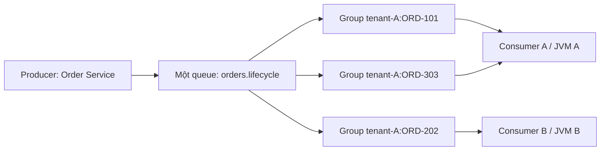
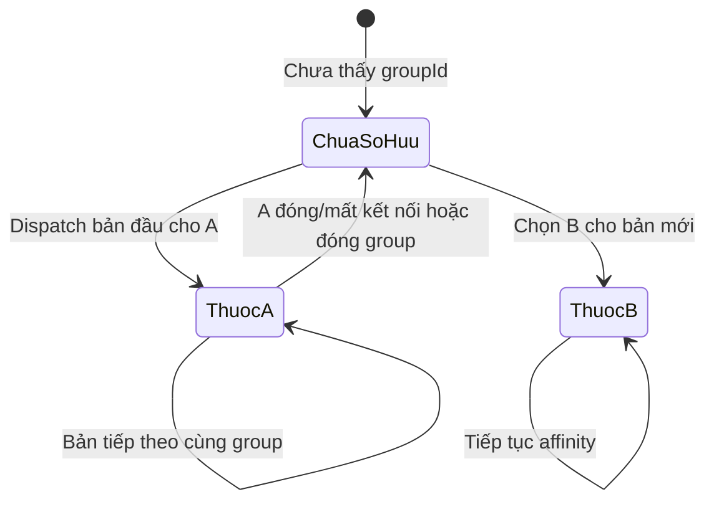

# Message group với JMSXGroupID và phân phối theo khóa nghiệp vụ

> **Chương:** Thứ tự và thời gian  
> **Mô-đun:** `INTEGRATION_MESSAGING_MESSAGE_BROKER_ACTIVEMQ` — ActiveMQ Classic và Artemis trong giao tiếp bất đồng bộ bằng queue/topic và JMS, có xác nhận, transaction, redelivery và vận hành tin cậy.  
> **Trọng tâm bài:** Cách gắn các message **cùng khóa nghiệp vụ** vào một **message group** bằng `JMSXGroupID`, cách broker giao quyền xử lý nhóm cho consumer, vai trò của `JMSXGroupSeq` và cách kiểm chứng giới hạn thứ tự, cân bằng tải, failover và rebalance trên Artemis.

## 1. Bài toán: muốn song song giữa đơn hàng nhưng tuần tự trong mỗi đơn hàng

Giả sử dịch vụ Order phát các sự kiện cho nhiều đơn:

```text
ORD-101: Created(1) -> Paid(2) -> Shipped(3)
ORD-202: Created(1) -> Paid(2) -> Cancelled(3)
ORD-303: Created(1) -> Paid(2) -> Shipped(3)
```

Cho ba consumer cùng đọc `orders.lifecycle` sẽ tăng thông lượng, nhưng không nhóm thì message `Paid` có thể tới worker B và hoàn tất trước khi worker A xử lý xong `Created` của **cùng ORD-101**.

Đặt **`JMSXGroupID = "tenant-A:ORD-101"`** cho tất cả sự kiện của đơn ORD-101. Broker gắn group này với một consumer để các sự kiện của nó được xử lý **tuần tự trong Session của consumer đó**, trong khi những đơn khác có thể sang consumer khác:



Sơ đồ là **một kết quả có thể xảy ra**, không phải cam kết broker luôn chia nhóm đúng như vậy. Đặc tính quan trọng nhất là *sticky assignment*: một group đang thuộc về consumer nào thì các message tiếp theo của group sẽ ưu tiên consumer đó **cho tới khi quyền sở hữu được giải phóng hoặc reset**.

**Phân biệt ba mục tiêu:**

| Mục tiêu | Công cụ phù hợp | Message group bảo đảm đến đâu? |
| --- | --- | --- |
| Chia việc giữa nhiều tiến trình | Nhiều consumer cùng một queue | Các **group khác nhau** có thể chạy song song |
| Giữ affinity và thứ tự từng khóa | `JMSXGroupID` + Session xử lý tuần tự | Cùng group thường về **cùng consumer** khi assignment ổn định |
| Exactly-once business effect, thứ tự DB tuyệt đối | Idempotency, kiểm tra phiên bản nghiệp vụ, DB transaction | **Không** được broker tự bảo đảm chỉ bằng `JMSXGroupID` |

**Không cần tạo một queue cho mỗi orderId.** Một queue có nhiều group là đủ cho trường hợp đơn giản, giảm số destination phải quản trị.

## 2. Cơ chế ownership khi broker dispatch message

### 2.1. Các bước gắn nhóm

Khi broker chuẩn bị phân phát message từ queue, nó đọc **String property `JMSXGroupID`**:

1. Nếu không có group ID, message đi theo quy tắc dispatch bình thường của queue.
2. Nếu group ID chưa có consumer sở hữu, broker chọn một consumer đủ điều kiện và ghi quan hệ **group → owner**.
3. Các message tiếp theo cùng group được chuyển đến owner đó, không vòng quanh các consumer mỗi message.
4. Khi owner đóng consumer hoặc mất kết nối, broker có thể gán lại group cho consumer khác.
5. Producer có thể chủ động **đóng nhóm** bằng message mang cùng `JMSXGroupID` và `JMSXGroupSeq` âm; message tương lai của group có thể được gán lại.



Đây là **quan hệ giữa queue và consumer**, không phải phiên bản của dữ liệu order. Nếu một producer phát vào **hai queue** khác nhau (multicast, virtual topic), mỗi queue có tập consumer và quyền sở hữu group **riêng**; `JMSXGroupID` không làm hai queue dùng chung một owner.

### 2.2. `JMSXGroupID` là String property, không phải một JMS destination

Cách gửi bằng Jakarta Messaging:

```java
TextMessage event = context.createTextMessage(json);
event.setStringProperty("JMSXGroupID", tenantId + ":" + orderId);
context.createProducer().send(context.createQueue("orders.lifecycle"), event);
```

- Tên property phải đúng **`JMSXGroupID`** với chữ hoa `ID`.
- Value phải là chuỗi đại diện **cùng một khóa nghiệp vụ** trong suốt chuỗi message.
- Gắn property **trước khi send**. Không tạo UUID ngẫu nhiên khác cho mỗi message của cùng đơn.
- JMS `Message` còn có `JMSXGroupSeq`, nhưng việc thiếu thuộc tính này **không ngăn grouping**. Group ID mới là khóa sở hữu.

Với **Artemis Core API** (không dùng JMS), tên property tương ứng là **`_AMQ_GROUP_ID`**. Đừng copy nguyên tên Core property sang ví dụ JMS và chờ broker hiểu như `JMSXGroupID`.

### 2.3. `JMSXGroupSeq` làm gì — và không làm gì?

```java
message.setStringProperty("JMSXGroupID", "tenant-A:ORD-101");
message.setIntProperty("JMSXGroupSeq", 2);
```

`JMSXGroupSeq` là giá trị thứ tự **do producer tự đặt** nếu muốn mô tả chuỗi sự kiện; **không phải bộ sắp xếp lại message**. Broker không đợi message seq=1 đến rồi mới chấp nhận message seq=2 do thấy số 2.

Công dụng có semantics grouping đặc biệt là **giá trị âm**, ví dụ:

```java
TextMessage closing = context.createTextMessage("GROUP_END");
closing.setStringProperty("JMSXGroupID", "tenant-A:ORD-101");
closing.setIntProperty("JMSXGroupSeq", -1);
producer.send(queue, closing);
```

Message này đóng group; message đến **sau khi group thực sự đóng** với ID đó có thể được giao cho consumer mới. **Không có cam kết sẽ đổi sang một consumer khác** — broker có thể chọn lại owner cũ nếu nó vẫn sẵn sàng.

**Tránh nhầm:** `JMSXGroupSeq=3` không chứng tỏ message seq=1/2 đã được consumer commit. Muốn phát hiện gap, duplicate hoặc sự kiện sai thứ tự nghiệp vụ, thêm một trường như `aggregateVersion` vào hợp đồng và kiểm tra ở database.

### 2.4. Thông báo message đầu tiên do consumer nhận

Trong ActiveMQ **Classic**, broker cung cấp boolean property `JMSXGroupFirstForConsumer` để biểu thị bản đầu tiên của group đến consumer sau khi ownership được tạo/chuyển.

Với **Artemis**, muốn nhận thông báo này phải **bật `group-first-key`** trên queue (hoặc default trong address settings). Khi được bật, broker gắn boolean property theo key đã chọn, ví dụ `JMSXGroupFirstForConsumer=true`.

Ứng dụng đọc:

```java
boolean firstForThisConsumer =
        message.propertyExists("JMSXGroupFirstForConsumer")
        && message.getBooleanProperty("JMSXGroupFirstForConsumer");

if (firstForThisConsumer) {
    // Nếu cache trong bộ nhớ gắn với group: làm mới/đọc lại từ DB.
}
```

Flag **không** phải `JMSXGroupSeq == 1`, và cũng **không** phải chứng cứ đây là sự kiện nghiệp vụ đầu tiên của một order. Nó là dấu mốc **assignment của group tới một consumer**. Sau disconnect/reconnect hoặc rebalance, flag có thể xuất hiện lại cho cùng group trên một consumer khác.

## 3. Thiết kế khóa nhóm theo business entity

### 3.1. Chọn khóa đủ hẹp để tăng song song, đủ rộng để giữ thứ tự

| Chọn `JMSXGroupID` | Kết quả | Đánh giá |
| --- | --- | --- |
| `orderId`, ví dụ `ORD-101` | Các sự kiện cùng đơn vào một group | Tốt khi orderId duy nhất trên toàn hệ thống |
| `tenantId + ":" + orderId` | Không đụng khóa giữa tenant có cùng orderId | Tốt cho multi-tenant |
| `customerId` | Mọi đơn của cùng khách hàng bị buộc vào một group | Có thể gây **hot group** nếu không cần thứ tự theo khách hàng |
| `eventId` (mỗi event một ID riêng) | Mỗi message có group mới, không còn affinity theo order | **Sai** nếu muốn thứ tự theo orderId |
| `"ALL_ORDERS"` | Mọi message bị dồn vào cùng một group | Gần như đánh mất scale ngang |
| Hash ngẫu nhiên mỗi lần send | Các message cùng order có thể khác group | Phá tính ổn định |

Trong ví dụ này, quy ước `groupId = "tenant-demo:ORDER-" + orderNo` và producer **tái sử dụng đúng chuỗi đó** với mọi sự kiện của cùng order.

Không dùng `JMSMessageID` làm group ID: đó là ID của message vật lý do provider tạo, khác giữa các lần gửi. `JMSXGroupID` phải được hình thành từ **khóa thực thể hoặc phân vùng nghiệp vụ**, không phải ID mỗi lần delivery.

### 3.2. Ordering theo khóa không đồng nghĩa ordering toàn hệ thống

Producer A phát `Created` và producer B phát `Paid` cho cùng order trên hai connection mà không có phối hợp. Nếu `Paid` đến broker trước, grouping sẽ giữ thứ tự **mà queue thấy**, không tự nhận biết rằng nghiệp vụ cần `Created` trước.

Tương tự:

- Một queue có group **không** đồng bộ giao dịch giữa các producer khác nhau.
- Priority, scheduled delivery, redelivery, expiry, network bridge và failover có thể làm thay đổi thứ tự quan sát.
- `JMSXGroupID` không loại duplicate khi retry.
- Thứ tự **dispatch/receive** của queue khác thời điểm **DB commit** nếu worker tách tác vụ ra thread khác rồi ACK sớm.
- Các dịch vụ nhận **bản khác nhau ở queue khác nhau** có thể hoàn tất theo thứ tự khác nhau.

**Thiết kế đúng:** Producer quản lý thứ tự phát theo aggregate và số phiên bản; consumer xử lý mỗi group tuần tự, ACK sau khi hoàn tất, và database kiểm tra `aggregateVersion`.

### 3.3. Kiểm tra version để ngăn state regression

Ví dụ bảng projection:

```sql
CREATE TABLE order_projection (
    tenant_id VARCHAR(80) NOT NULL,
    order_id VARCHAR(80) NOT NULL,
    last_version BIGINT NOT NULL,
    state VARCHAR(30) NOT NULL,
    PRIMARY KEY (tenant_id, order_id)
);

-- Với order đã có last_version = 1, chỉ chấp nhận version kế tiếp:
UPDATE order_projection
   SET state = :next_state, last_version = :incoming_version
 WHERE tenant_id = :tenant_id AND order_id = :order_id
   AND last_version = :incoming_version - 1;
```

Nếu `UPDATE` ảnh hưởng 0 dòng, đừng mặc nhiên ACK như thành công: cần phân biệt **duplicate** (`incoming_version <= last_version`), **gap** (`incoming_version > last_version+1`), hoặc chưa có bản ghi ban đầu. Với trạng thái lần đầu, tạo row có khóa duy nhất và `last_version=1` trong DB transaction. Xử lý gap bằng retry/quarantine hoặc workflow bổ sung dữ liệu, không bỏ thứ tự bất chấp.

Đây là lớp bảo vệ **bổ sung** cho message group khi consumer được restart, có nhiều producer hoặc ownership bị reset.

## 4. Cấu hình Apache ActiveMQ Artemis: queue có group affinity

### 4.1. `broker.xml` dành cho bài thực hành

Broker Artemis đang chạy riêng ở `tcp://127.0.0.1:61616`, acceptor chấp nhận Artemis Core protocol; tài khoản client được cấp SEND/CONSUME queue `orders.lifecycle`.

Tại `<ARTEMIS_INSTANCE>/etc/broker.xml`, đặt các phần tử sau vào **`<addresses>` hiện hữu** của `<core>`; nếu đã có section này thì chỉ thêm `<address>`, **không tạo section thứ hai**:

```xml
<addresses>
    <address name="orders.lifecycle">
        <anycast>
            <queue name="orders.lifecycle"
                   group-first-key="JMSXGroupFirstForConsumer"
                   group-rebalance="false"
                   group-buckets="-1">
                <durable>true</durable>
            </queue>
        </anycast>
    </address>
    <address name="orders.lifecycle.DLQ">
        <anycast>
            <queue name="orders.lifecycle.DLQ"/>
        </anycast>
    </address>
</addresses>
```

Ở `<address-settings>` hiện hữu, thêm rule tương ứng:

```xml
<address-settings>
    <address-setting match="orders.lifecycle">
        <redelivery-delay>1000</redelivery-delay>
        <max-delivery-attempts>5</max-delivery-attempts>
        <dead-letter-address>orders.lifecycle.DLQ</dead-letter-address>
    </address-setting>
</address-settings>
```

Ý nghĩa liên quan trực tiếp tới message groups:

- **`anycast` + một queue:** Mọi worker **tranh nhận cùng một hàng đợi**; mỗi group thuộc về một consumer tại một thời điểm theo logic broker.
- **`group-first-key`:** Bật flag `JMSXGroupFirstForConsumer` khi broker bắt đầu gán group cho consumer.
- **`group-rebalance="false"`:** Không tự reset ownership mỗi khi worker mới kết nối; thuận tiện để quan sát sticky assignment ban đầu.
- **`group-buckets="-1"`:** Artemis duy trì owner theo từng group, **không dùng hash buckets**; đơn giản cho bài học nhưng có thể tốn RAM nếu số group rất lớn.
- **`durable=true` + JMS persistent send:** Hỗ trợ khôi phục queue/message theo broker persistence, **không** khiến owner của group trở thành một trạng thái nghiệp vụ vĩnh viễn.
- **`redelivery-delay` và DLQ:** Dành cho message xử lý lỗi; **không phải** thiết lập tự sắp xếp lại thứ tự group.

Đây là **trích đoạn**, phải ghép vào cấu hình thực của Artemis, kiểm tra version/schema và chính sách ACL/TLS; không chạy thử trên queue production có dữ liệu thật. Khi đổi config, khởi động/reload theo quy trình được phiên bản hỗ trợ và xác nhận Console có queue đúng routing type và group options.

### 4.2. Group buckets: cân đối bộ nhớ với độ chi tiết affinity

| `group-buckets` | Cơ chế | Hệ quả |
| --- | --- | --- |
| `-1` (mặc định Artemis hiện được tài liệu mô tả) | Broker theo dõi từng group ID | Giữ ánh xạ chi tiết; số group lớn tiêu thụ nhiều RAM |
| `1024` (ví dụ) | Hash nhiều group ID vào 1.024 bucket | Giới hạn bộ nhớ, nhưng **hai group khác nhau có thể cùng bucket/owner** và làm giảm song song |
| `0` | Tắt grouping trên queue | Không phù hợp bài toán yêu cầu affinity theo orderId |

Ví dụ production có rất nhiều order ngắn sống, cân nhắc `group-buckets="1024"` và đo mức độ hot bucket, số nhóm thực tế và throughput. **Hash collision không có nghĩa hai order bị trộn payload**; nó làm các group cùng bucket có thể bị cùng consumer nhận, dẫn tới phân phối kém. `group-buckets=-1` không có xung đột bucket nhưng vẫn cần kế hoạch quản lý memory khi hàng triệu group.

### 4.3. Thêm worker và rebalance: tuyệt đối chú ý in-flight

Khi A và B đã sở hữu hết những group đang có, thêm consumer C **không tự bảo đảm C nhận ngay group cũ**. Artemis cho phép:

- **Manual reset:** Gọi operation `resetAllGroups` trên queue qua management API/Console.
- **Auto rebalance:** Đặt `group-rebalance="true"` để reset khi có consumer mới.
- **Pause dispatch khi rebalance:** `group-rebalance-pause-dispatch="true"` để broker đợi message in-flight được giải quyết trước khi tiếp tục phân phát theo ownership mới.

Ví dụ **chỉ dùng khi đã quyết định bật rebalance**, thay các thuộc tính của queue phía trên:

```xml
<queue name="orders.lifecycle"
       group-first-key="JMSXGroupFirstForConsumer"
       group-rebalance="true"
       group-rebalance-pause-dispatch="true"
       group-buckets="-1">
    <durable>true</durable>
</queue>
```

**Cảnh báo quan trọng:** Reset ownership **không mặc nhiên chờ** những message đã giao cho consumer cũ. Khi pause-dispatch **tắt**, một message cũ có thể còn đang xử lý ở A trong lúc message mới của cùng group đã chuyển đến C → **vi phạm giả định xử lý độc quyền theo thời điểm thực**. `group-rebalance-pause-dispatch=true` giảm rủi ro này bằng việc đợi in-flight, nhưng đổi lại có thể làm toàn queue bị ngưng dispatch trong lúc chờ một consumer chậm hoặc mất kết nối. Cần thử đúng workload và cơ chế failure handling.

Đừng dùng `resetAllGroups` thường xuyên như một biện pháp cân bằng thông lượng nếu ứng dụng chưa có idempotency/version check. Đối với hệ thống phải giữ thứ tự chặt, rebalance nên có quy trình điều phối và quan sát lượng in-flight.

### 4.4. Consumer window và giới hạn của cân bằng tải

Artemis Core/JMS client có thể buffer message trước khi `receive()` được gọi. Với những task xử lý chậm, ví dụ bài sử dụng:

```text
tcp://127.0.0.1:61616?consumerWindowSize=0
```

`consumerWindowSize=0` hạn chế prebuffer ở client, giúp quan sát group assignment và tránh worker chậm giữ nhiều message không thuộc group khác. Nhưng **không phân phối lại các group đang pinned**; worker A có nhiều group nặng vẫn có thể quá tải trong khi worker B rảnh. Một group đơn lẻ có rất nhiều message vẫn có thể gây **head-of-line blocking** và làm các group khác chờ ở queue.

`consumerWindowSize` là cấu hình **Artemis** (window tính theo byte nếu dương), khác `consumer.prefetchSize` của Classic (đếm message). Không sao chép một tham số sang broker khác.

## 5. Thực hành Java: gắn group và quan sát hai JVM consumer

### 5.1. Môi trường và Maven

Bài demo dùng **Java 17**, **Artemis broker** ở tiến trình riêng, Artemis Jakarta JMS client và một queue đã cấu hình ở mục 4. Đặt `BROKER_USER`, `BROKER_PASSWORD` theo tài khoản được cấp (không hardcode), và tùy chọn `BROKER_URL`. Nếu production dùng TLS, thay URL/connection options và truststore theo chính sách của tổ chức.

Tạo `pom.xml`:

```xml
<project xmlns="http://maven.apache.org/POM/4.0.0"
         xmlns:xsi="http://www.w3.org/2001/XMLSchema-instance"
         xsi:schemaLocation="http://maven.apache.org/POM/4.0.0 https://maven.apache.org/xsd/maven-4.0.0.xsd">
    <modelVersion>4.0.0</modelVersion>
    <groupId>example.messaging</groupId>
    <artifactId>artemis-message-groups</artifactId>
    <version>1.0.0</version>
    <properties>
        <maven.compiler.release>17</maven.compiler.release>
    </properties>
    <dependencies>
        <dependency>
            <groupId>org.apache.activemq</groupId>
            <artifactId>artemis-jakarta-client</artifactId>
            <version>2.38.0</version>
        </dependency>
    </dependencies>
    <build>
        <plugins>
            <plugin>
                <groupId>org.apache.maven.plugins</groupId>
                <artifactId>maven-compiler-plugin</artifactId>
                <version>3.13.0</version>
            </plugin>
            <plugin>
                <groupId>org.codehaus.mojo</groupId>
                <artifactId>exec-maven-plugin</artifactId>
                <version>3.5.0</version>
            </plugin>
        </plugins>
    </build>
</project>
```

Các phiên bản là **giá trị cố định để minh họa**, không khẳng định là phát hành mới nhất. Vì dùng `jakarta.jms`, không thay bằng thư viện Classic 5.x `javax.jms` rồi giữ nguyên import. `group-first-key` đã được bật để demo quan sát ownership.

### 5.2. Chương trình `MessageGroupDemo.java`

Tạo file `src/main/java/example/messaging/MessageGroupDemo.java`:

```java
package example.messaging;

import java.util.UUID;

import jakarta.jms.ConnectionFactory;
import jakarta.jms.DeliveryMode;
import jakarta.jms.JMSConsumer;
import jakarta.jms.JMSContext;
import jakarta.jms.JMSException;
import jakarta.jms.JMSProducer;
import jakarta.jms.Message;
import jakarta.jms.Queue;
import jakarta.jms.TextMessage;

import org.apache.activemq.artemis.jms.client.ActiveMQConnectionFactory;

public final class MessageGroupDemo {
    private static final String QUEUE = "orders.lifecycle";

    private MessageGroupDemo() {}

    public static void main(String[] args) throws Exception {
        if (args.length == 0) {
            throw new IllegalArgumentException(
                "Usage: seed <numOrders> <steps> | "
                + "worker <name> <delayMs> [fail-first] | "
                + "append <orderNo> <step> | close <orderNo>");
        }

        String url = System.getenv().getOrDefault(
                "BROKER_URL",
                "tcp://127.0.0.1:61616?consumerWindowSize=0");
        String user = requiredEnv("BROKER_USER");
        String password = requiredEnv("BROKER_PASSWORD");
        ConnectionFactory factory = new ActiveMQConnectionFactory(url);

        switch (args[0]) {
            case "seed" -> {
                if (args.length != 3) {
                    throw new IllegalArgumentException(
                        "Usage: seed <numOrders> <steps>");
                }
                int orders = Integer.parseInt(args[1]);
                int steps = Integer.parseInt(args[2]);
                if (orders < 1 || orders > 1000 ||
                    steps < 1 || steps > 100) {
                    throw new IllegalArgumentException(
                        "numOrders in [1,1000], steps in [1,100]");
                }
                seed(factory, user, password, orders, steps);
            }
            case "worker" -> {
                boolean failFirst = args.length == 4
                        && "fail-first".equals(args[3]);
                if (args.length != 3 && !failFirst) {
                    throw new IllegalArgumentException(
                        "Usage: worker <name> <delayMs> [fail-first]");
                }
                String name = args[1];
                long delay = Long.parseLong(args[2]);
                if (name.isBlank() || delay < 0 || delay > 60000) {
                    throw new IllegalArgumentException("Invalid worker args");
                }
                worker(factory, user, password, name, delay, failFirst);
            }
            case "append" -> {
                if (args.length != 3) {
                    throw new IllegalArgumentException(
                        "Usage: append <orderNo> <step>");
                }
                int orderNo = positive(args[1]);
                int step = positive(args[2]);
                sendOne(factory, user, password, orderNo, step, false);
            }
            case "close" -> {
                if (args.length != 2) {
                    throw new IllegalArgumentException(
                        "Usage: close <orderNo>");
                }
                sendOne(factory, user, password, positive(args[1]), -1, true);
            }
            default -> throw new IllegalArgumentException(
                "Unknown command: " + args[0]);
        }
    }

    private static String requiredEnv(String key) {
        String value = System.getenv(key);
        if (value == null || value.isBlank()) {
            throw new IllegalStateException("Missing env: " + key);
        }
        return value;
    }

    private static int positive(String value) {
        int parsed = Integer.parseInt(value);
        if (parsed <= 0) {
            throw new IllegalArgumentException("Expected a positive integer");
        }
        return parsed;
    }

    private static String groupKey(int orderNo) {
        return "tenant-demo:ORDER-" + orderNo;
    }

    private static TextMessage event(JMSContext context, int orderNo,
                                     int seq, String eventId) throws JMSException {
        TextMessage message = context.createTextMessage(
                "OrderEvent order=ORDER-" + orderNo + " seq=" + seq);
        message.setStringProperty("eventId", eventId);
        message.setStringProperty("orderId", "ORDER-" + orderNo);
        message.setStringProperty("JMSXGroupID", groupKey(orderNo));
        message.setIntProperty("JMSXGroupSeq", seq);
        message.setIntProperty("aggregateVersion", seq);
        message.setStringProperty("eventType",
                seq < 0 ? "GROUP_END" : "ORDER_EVENT");
        return message;
    }

    private static void seed(ConnectionFactory factory, String user,
                             String password, int orders, int steps)
            throws JMSException {
        try (JMSContext context = factory.createContext(
                user, password, JMSContext.SESSION_TRANSACTED)) {

            Queue queue = context.createQueue(QUEUE);
            JMSProducer producer = context.createProducer()
                    .setDeliveryMode(DeliveryMode.PERSISTENT);
            String batchId = UUID.randomUUID().toString();

            // Xen kẽ các group, nhưng tăng seq trong từng group.
            for (int step = 1; step <= steps; step++) {
                for (int orderNo = 1; orderNo <= orders; orderNo++) {
                    String eventId = batchId + "-" + orderNo + "-" + step;
                    producer.send(queue, event(context, orderNo, step, eventId));
                }
            }
            context.commit();
            System.out.printf("SEED COMMIT orders=%d steps=%d total=%d%n",
                    orders, steps, orders * steps);
        }
    }

    private static void sendOne(ConnectionFactory factory, String user,
                                String password, int orderNo,
                                int seq, boolean close) throws JMSException {
        try (JMSContext context = factory.createContext(
                user, password, JMSContext.SESSION_TRANSACTED)) {

            TextMessage message = event(context, orderNo, seq,
                    UUID.randomUUID().toString());
            context.createProducer()
                    .setDeliveryMode(DeliveryMode.PERSISTENT)
                    .send(context.createQueue(QUEUE), message);
            context.commit();
            System.out.printf("%s group=%s seq=%d%n",
                    close ? "CLOSE" : "APPEND", groupKey(orderNo), seq);
        }
    }

    private static void worker(ConnectionFactory factory, String user,
                               String password, String name,
                               long delayMs, boolean failFirst) {
        try (JMSContext context = factory.createContext(
                user, password, JMSContext.SESSION_TRANSACTED)) {

            JMSConsumer consumer = context.createConsumer(
                    context.createQueue(QUEUE));
            System.out.printf("[%s] READY; delay=%d ms%n", name, delayMs);

            while (!Thread.currentThread().isInterrupted()) {
                Message message = consumer.receive(2000);
                if (message == null) {
                    continue;
                }

                try {
                    String groupId =
                            message.getStringProperty("JMSXGroupID");
                    int seq = message.getIntProperty("JMSXGroupSeq");
                    String eventId = message.getStringProperty("eventId");
                    boolean first = message.propertyExists(
                            "JMSXGroupFirstForConsumer")
                            && message.getBooleanProperty(
                            "JMSXGroupFirstForConsumer");
                    boolean redelivered = message.getJMSRedelivered();
                    String type = message.getStringProperty("eventType");

                    // Chỉ mô phỏng tính toán: không phát side effect thật.
                    Thread.sleep(delayMs);

                    if (failFirst && seq == 2 && !redelivered) {
                        throw new IllegalStateException(
                                "Simulated failure before JMS commit");
                    }

                    // GROUP_END là marker vận hành; vẫn phải ACK hợp lệ.
                    context.commit();
                    System.out.printf(
                        "[%s] COMMIT group=%s seq=%d eventId=%s "
                        + "type=%s firstForConsumer=%s redelivered=%s%n",
                        name, groupId, seq, eventId, type, first, redelivered);
                } catch (InterruptedException stop) {
                    context.rollback();
                    Thread.currentThread().interrupt();
                    break;
                } catch (JMSException | RuntimeException error) {
                    context.rollback();
                    System.err.printf("[%s] ROLLBACK: %s%n",
                            name, error.getMessage());
                }
            }
        }
    }
}
```

**Những gì ví dụ bảo đảm và không bảo đảm:**

- `seed 8 4` gửi **32 message** (8 group, mỗi group có seq 1..4), xen kẽ các group trong một producer/session và **commit giao dịch JMS** sau batch. Vì một producer phát theo thứ tự, dễ quan sát sequence từng group.
- `worker` tạo **một consumer + một transacted JMSContext** riêng. Chạy hai terminal khác nhau ⇒ hai JVM/connection/session khác nhau, đều đọc **cùng queue**.
- `firstForConsumer` chỉ đúng khi queue đã bật `group-first-key` và broker đánh dấu một assignment mới. Không dùng nó thay thế `aggregateVersion`.
- `fail-first` mô phỏng một lần lỗi ở seq=2, sau đó rollback; message có thể được redeliver theo `redelivery-delay`. Không kỳ vọng log sequence tuyến tính trong thử nghiệm lỗi này.
- `close` gửi marker `JMSXGroupSeq=-1`. Nếu muốn quan sát assignment mới, **đợi marker được consume/ACK** rồi mới phát message tiếp cho group; vẫn không thể ép broker phải chọn consumer khác.
- `aggregateVersion` trong demo chỉ để minh họa; worker chỉ in/log, **chưa có DB version check**. Ứng dụng thật cần áp dụng logic ở mục 3.3.
- `UUID.randomUUID()` trong demo tạo ID cho các event thử nghiệm mới; với **retry cùng sự kiện thật**, phải dùng `eventId` lưu bền từ outbox thay vì tạo UUID mới.

### 5.3. Chạy producer và hai worker trong ba terminal

Đặt biến môi trường `BROKER_USER` và `BROKER_PASSWORD` trong **mỗi terminal**, cùng URL phù hợp nếu không dùng mặc định.

**Terminal A:**

```bash
mvn -q compile exec:java -Dexec.mainClass=example.messaging.MessageGroupDemo -Dexec.args="worker A 600"
```

**Terminal B:**

```bash
mvn -q compile exec:java -Dexec.mainClass=example.messaging.MessageGroupDemo -Dexec.args="worker B 250"
```

Khi cả A/B đã in `READY`, mở **terminal C**:

```bash
mvn -q compile exec:java -Dexec.mainClass=example.messaging.MessageGroupDemo -Dexec.args="seed 8 4"
```

Quan sát log (minh họa, không phải assignment cố định):

```text
[A] COMMIT group=tenant-demo:ORDER-1 seq=1 ... firstForConsumer=true
[B] COMMIT group=tenant-demo:ORDER-2 seq=1 ... firstForConsumer=true
[A] COMMIT group=tenant-demo:ORDER-1 seq=2 ... firstForConsumer=false
[B] COMMIT group=tenant-demo:ORDER-2 seq=2 ... firstForConsumer=false
...
```

**Kiểm tra đúng nhất** không phải “A xử lý 16, B xử lý 16”. Hãy lập bảng `groupId → workerName`, xem các message của **một group đang hoạt động có cùng owner không**, và khi không có rollback/rebalance liệu seq của mỗi group được log tăng dần không. Số group trên A/B có thể rất khác nhau, tùy thời điểm đăng ký và thuật toán broker.

### 5.4. Bài thử đóng group và gán lại

Đảm bảo queue không còn message của group `tenant-demo:ORDER-1` đang in-flight; nếu cần, dừng producer và kiểm tra trên Console trước.

```bash
mvn -q compile exec:java -Dexec.mainClass=example.messaging.MessageGroupDemo -Dexec.args="close 1"
```

Đợi worker ghi log `type=GROUP_END seq=-1` và commit, rồi gửi:

```bash
mvn -q compile exec:java -Dexec.mainClass=example.messaging.MessageGroupDemo -Dexec.args="append 1 5"
```

Kỳ vọng: group đã kết thúc và bản tiếp theo được broker quyết định owner lại; **có thể cùng A hoặc đổi sang B**. Nếu đổi owner và queue đã bật `group-first-key`, bản đầu của assignment mới có thể có `firstForConsumer=true`.

**Lưu ý nghiệp vụ:** Đừng gửi `GROUP_END` trước khi toàn bộ message của group thực sự đã xong. Việc kết thúc owner khi còn công việc in-flight có thể làm group được phân sang consumer khác trong khi worker cũ vẫn đang xử lý. Đây là tín hiệu **vòng đời group**, không nên coi như một message status tùy tiện gửi xen giữa chuỗi order.

### 5.5. Bài thử failover và redelivery

- Chạy hai worker A/B rồi `seed 4 3`; dừng **một worker** trước khi nó commit message đang xử lý. Broker có thể giao lại message chưa ACK cho consumer còn hoạt động; quan sát `JMSRedelivered` và thay đổi owner.
- Thử `worker A 200 fail-first` để chủ động rollback seq=2. Có thể cần chờ redelivery delay 1 giây; chú ý giới hạn `max-delivery-attempts` và DLQ nếu liên tục lỗi.
- Sau khi khởi động lại A, **không giả định A sở hữu lại group cũ**. Broker có thể đã gán group đó cho B.
- Nếu muốn tái hiện reset khi thêm consumer C, bật rebalance ở **môi trường demo riêng**, so sánh với cấu hình không rebalance; bật pause-dispatch để kiểm tra an toàn in-flight.

**Không thử failover bằng cách kill broker/worker đang phục vụ giao dịch thật.** Các trường hợp cần thông điệp có thứ tự nghiêm ngặt vẫn phải có logic chống trùng, kiểm tra version DB và cơ chế phục hồi khi bất định kết quả commit.

## 6. Classic và Artemis: giống API JMS, khác chính sách nhóm

| Khía cạnh | ActiveMQ Classic | ActiveMQ Artemis |
| --- | --- | --- |
| Property phía JMS | `JMSXGroupID` (String), `JMSXGroupSeq` (int) | `JMSXGroupID` (String), `JMSXGroupSeq` (int) |
| Phân phối theo group | Sticky group → consumer trong một queue | Sticky group → consumer trong một queue |
| Kết thúc group | `JMSXGroupSeq` âm | `JMSXGroupSeq` âm |
| Flag owner đầu | `JMSXGroupFirstForConsumer` có hỗ trợ từ broker Classic | Bật `group-first-key="JMSXGroupFirstForConsumer"` trên queue |
| Consumer vào muộn | Nhóm đã có owner có thể tiếp tục ở owner cũ | Nhóm đã có owner không tự cân bằng trừ khi reset/rebalance |
| Phương án reset | JMX operation `removeAllMessageGroups` trên queue | Management operation `resetAllGroups` trên queue |
| Quản lý số lượng group | Classic `CachedMessageGroupMap` mặc định giới hạn **1.024 group** qua LRU; cấu hình map/hash khác khi lớn hơn | `group-buckets=-1` theo dõi từng group; số bucket dương giới hạn bộ nhớ nhưng có collision |
| Điều tiết client-side buffer | OpenWire `consumer.prefetchSize` theo số message | Artemis Core `consumerWindowSize` theo byte |
| Cluster | Network of brokers cần kiểm thử route/ownership theo topology | Cluster grouping có grouping handler, phức tạp và **không được tài liệu Artemis khuyến nghị phổ biến** |

### 6.1. Cảnh báo Classic khi số group vượt cache mặc định

Theo tài liệu Classic, `CachedMessageGroupMap` mặc định theo dõi tối đa **1.024 group**; khi dùng LRU và số group vượt giới hạn, những group cũ có thể bị evict khỏi map. Nếu dựa vào ownership để giữ thứ tự, **mất mapping có thể làm group chuyển consumer ngoài dự kiến**. Có các implementation map khác, như `SimpleMessageGroupMap` và hash-bucket-based mapping, với đánh đổi memory và mức song song.

Đây là **khác biệt lớn** so với Artemis `group-buckets=-1`. Vì thế không nên hiểu “JMSXGroupID là chuẩn” thành “mọi broker đều giữ cùng một lượng group vô hạn”. Theo dõi số group active và kiểm tra từng phiên bản Classic khi cấu hình destination policy.

### 6.2. Nhóm trong cụm Artemis không đơn giản bằng nhiều JVM vào một broker

Bài thực hành dùng **nhiều JVM consumer cùng một broker**. Nếu chuyển sang nhiều broker node, grouping cần route group trên **toàn cụm**, liên quan `LOCAL/REMOTE grouping handler`, cluster connections, queue presence và failover. Tài liệu Artemis nhấn mạnh **clustered grouping thường xung đột với mục tiêu mở rộng song song và không phải lựa chọn được khuyến nghị mặc định**. Không sao chép kết quả của demo một broker để kết luận đảm bảo ordering end-to-end trong cluster.

Nếu cần strict per-key order và nhiều broker, cân nhắc partition/queue theo khóa có chủ đích, hoặc pipeline quản lý version tại DB; đo tính khả thi và đường failover trước khi chọn clustered grouping.

## 7. Điều kiện để “giữ thứ tự” thật sự đúng

### 7.1. Checklist các giả định phải được nêu rõ

Một test `JMSXGroupID` hợp lệ nên bắt đầu bằng:

1. Các message cùng group đi qua **cùng queue**, không bị tách sang hai queue độc lập.
2. Producer phát chuỗi theo thứ tự nghiệp vụ đã xác định, tốt nhất từ **một luồng phát tuần tự cho mỗi aggregate** hoặc outbox có sequence.
3. Worker dùng Session tuần tự, không tự tách tác vụ ra nhiều thread rồi commit/ACK trước.
4. Không rebalance/reset group trong khi còn message in-flight, hoặc có pause-dispatch và kiểm soát failure.
5. Client prefetch/window và queue backlog không gây hiểu lầm về trạng thái message đã nhận/đã xử lý.
6. Retry/redelivery/duplicate đã được xử lý bằng `eventId` ổn định, idempotency và `aggregateVersion`.
7. Producer/consumer sử dụng cùng quy ước group key (bao gồm tenant khi cần).
8. Chấp nhận rằng các group khác nhau có **thứ tự hoàn tất xen kẽ**, không có global ordering.

### 7.2. Nhiều consumer vẫn có thể nghẽn vì một group quá nóng

```text
Queue messages:
  A1 A2 A3 A4 A5 A6 A7 A8 A9 B1 C1 D1 ...

Group A -> worker 1 chậm
Group B/C/D -> worker 2 hoặc worker 3
```

Một loạt message A nằm ở đầu queue có thể làm các nhóm phía sau tạm thời chậm dispatch theo FIFO semantics và buffering, kể cả khi worker khác còn rảnh. **Message groups đánh đổi mức song song lấy thứ tự theo khóa**.

Chiến lược:

- Chọn khóa đủ phân tán; đừng group theo toàn tenant nếu chỉ cần order-level ordering.
- Giảm thời gian xử lý trong transaction; tránh gọi API ngoài chậm rồi giữ Session không ACK kéo dài.
- Tách workload hot và cold sang queue khác nếu ảnh hưởng lẫn nhau quá lớn.
- Đo tuổi message lâu nhất, độ sâu queue, delivering count, ACK rate và độ lệch group → consumer.
- Dùng group buckets có suy xét khi số lượng group lớn, hiểu rằng hash collisions giảm hiệu quả scale.

## 8. Debug theo dấu hiệu cụ thể

| Triệu chứng | Nguyên nhân có thể | Kiểm tra và xử lý |
| --- | --- | --- |
| `ORD-101` xuất hiện ở A rồi B mà A vẫn chạy | Group đã close/reset; Classic evict mapping; reconnect ẩn dưới client failover | Xem `JMSXGroupSeq` âm, rebalance, broker logs, số lượng group và connection state |
| Consumer C mới không nhận việc | Các group còn hoạt động đã pinned ở A/B | Đợi group mới hoặc cân nhắc rebalance có pause-dispatch |
| Một worker giữ gần hết group | Worker đầu nhận message trước khi các worker còn lại đăng ký | Mở worker trước producer, kiểm tra dispatch delay và ownership |
| `seq=3` xử lý trước `seq=2` | Producer phát sai thứ tự, priority/delay/redelivery, ownership reset | Dùng `aggregateVersion`, log producer sequence, xem broker routing và retry |
| `firstForConsumer` luôn vắng mặt trên Artemis | Chưa bật `group-first-key` | Cấu hình queue và xác minh lại trên broker |
| Số group rất lớn gây memory pressure | `group-buckets=-1`, group ID cardinality quá cao | Đo số group, cân nhắc buckets/cleanup, chọn lại key |
| Classic có group bị chuyển khi nhiều group active | LRU group map mặc định có giới hạn | Điều chỉnh message-group map theo version/capacity |
| Redelivery làm nghiệp vụ bị trừ tiền hai lần | DB commit trước JMS ACK, không có idempotency | Inbox/unique constraint, transaction và `eventId` ổn định |
| Cùng group vẫn bị xử lý song song ngoài broker | Worker đưa message cho async thread, ACK sớm hoặc rebalance khi in-flight | Giữ công việc trong Session tuần tự, version check ở DB |
| Nhiều group nhưng throughput vẫn thấp | Một hot group, head-of-line blocking, DB/API giới hạn | Giảm hot-key, phân queue, đo băng thông/ACK, không chỉ thêm worker |

**Log tối thiểu:** `eventId`, `JMSXGroupID`, `JMSXGroupSeq`, `aggregateVersion`, `consumerInstanceId`, `JMSMessageID`, `JMSRedelivered`, dấu `JMSXGroupFirstForConsumer` và thời điểm xử lý/commit. Không log thông tin bí mật trong key hoặc payload. Nếu số lượng group lớn, tránh dùng `groupId` làm metric label có cardinality vô hạn.

## 9. Bài tập thực hành

### Bài tập A — Chọn group key và giải thích quyết định

Một tenant có 100.000 đơn và 500 người mua. Nghiệp vụ yêu cầu thứ tự **trong từng đơn**, không yêu cầu thứ tự giữa các đơn.

**Yêu cầu:** So sánh `eventId`, `orderId`, `customerId` và `tenantId` làm `JMSXGroupID`; chọn khóa phù hợp. Nếu orderId chỉ duy nhất trong tenant, sửa key.

*Hướng giải:* `tenantId + ":" + orderId`; `eventId` phá affinity, `customerId`/`tenantId` gom quá rộng gây hot group.

### Bài tập B — Quan sát owner trong hai JVM

Chạy `worker A 500`, `worker B 100`, sau đó `seed 8 4`. Gom log theo group ID, lập bảng group → danh sách worker đã nhận và các seq.

**Yêu cầu:** Có cần 16/16 message chia đều không? Với group không close/rebalance, seq 1..4 có chuyển qua worker khác không?

*Hướng giải:* Không cam kết 16/16. Group owner ổn định cho đến khi close, consumer mất kết nối hoặc mapping bị reset; các group khác nhau có thể phân tải không đều.

### Bài tập C — Ý nghĩa của `JMSXGroupSeq=-1`

Đợi group ORDER-1 đã hết in-flight, gửi `close 1`, đợi ACK marker rồi `append 1 5`.

**Yêu cầu:** Vì sao có thể nhìn thấy `firstForConsumer=true` một lần nữa? Có bắt buộc message seq=5 phải sang worker khác?

*Hướng giải:* Close giải phóng ownership; bản mới có assignment mới nên có flag first nếu bật. Không bắt buộc đổi worker.

### Bài tập D — Rebalance an toàn

Bật `group-rebalance=true`, ban đầu có A/B, rồi thêm C trong lúc A đang xử lý message lâu.

**Yêu cầu:** Mô tả rủi ro khi `group-rebalance-pause-dispatch=false`; thử lại với `true` và đo latency/throughput.

*Hướng giải:* Khi reset không chờ in-flight, A có thể vẫn đang xử lý message cũ khi C nhận message mới cùng group. Pause-dispatch đợi giải quyết in-flight để giảm chồng lấn, nhưng làm đình trệ dispatch trong khoảng rebalance.

### Bài tập E — Ordering khi producer không tuần tự

Hai producer độc lập gửi `Paid(version=2)` và `Created(version=1)` cho cùng group; `Paid` đến broker trước.

**Yêu cầu:** `JMSXGroupID` có sắp lại 2 rồi 1 thành 1 rồi 2 không? Thiết kế kiểm tra nào ở consumer?

*Hướng giải:* Không. Group ID định tuyến affinity, không sửa thứ tự upstream. Consumer kiểm tra version và xử lý gap/out-of-order thay vì cập nhật state mù quáng.

### Bài tập F — So sánh Classic/Artemis với rất nhiều group

Một queue có 10.000 group hoạt động. Dựa trên tài liệu Classic và Artemis, giải thích vì sao group mapping có thể tốn bộ nhớ hoặc bị evict; chọn chính sách cho mục tiêu ordering so với throughput.

*Hướng giải:* Classic default LRU map giới hạn theo group khiến mapping cũ có thể bị evict; Artemis group-buckets=-1 theo dõi từng group nhưng tăng RAM; buckets dương giảm memory/collision làm giảm mức phân phối song song. Phải benchmark và test ownership với đúng broker/version.

## 10. Tài liệu tham khảo

1. Apache ActiveMQ Classic — [Message Groups](https://activemq.apache.org/components/classic/documentation/message-groups): `JMSXGroupID`, `JMSXGroupSeq` âm, `JMSXGroupFirstForConsumer`, giới hạn cache LRU, thêm consumer và JMX reset.
2. Apache ActiveMQ Artemis — [Message Grouping](https://artemis.apache.org/components/artemis/documentation/latest/message-grouping.html): group owner, `group-first-key`, `group-rebalance`, `group-rebalance-pause-dispatch`, `group-buckets` và cluster grouping.
3. Apache ActiveMQ Artemis — [Consumer Flow Control](https://artemis.apache.org/components/artemis/documentation/latest/flow-control.html): `consumerWindowSize` và buffering của client.
4. Apache ActiveMQ Artemis — [Address Model](https://artemis.apache.org/components/artemis/documentation/latest/address-model.html): queue, ANYCAST/MULTICAST và routing.
5. Jakarta EE — [Jakarta Messaging 3.1 Specification](https://jakarta.ee/specifications/messaging/3.1/): message properties, Session, acknowledgment và transaction.
6. Apache ActiveMQ Artemis — [Undelivered Messages](https://artemis.apache.org/components/artemis/documentation/latest/undelivered-messages.html): redelivery và DLQ khi một message trong group liên tục xử lý lỗi.

> **Ghi nhớ:** `JMSXGroupID` là **khóa gắn quyền sở hữu message group với một consumer trong cùng queue**; nó giúp giữ tính tuần tự theo thực thể trong khi các thực thể khác có thể xử lý song song. `JMSXGroupSeq` âm đóng group, không sắp xếp lại message theo số thứ tự. Khi consumer chết, group bị reset/rebalance, có retry hoặc nhiều producer, phải bảo vệ correctness bằng **eventId bền vững, DB transaction, idempotency và kiểm tra phiên bản nghiệp vụ** — không chỉ bằng affinity của broker.
