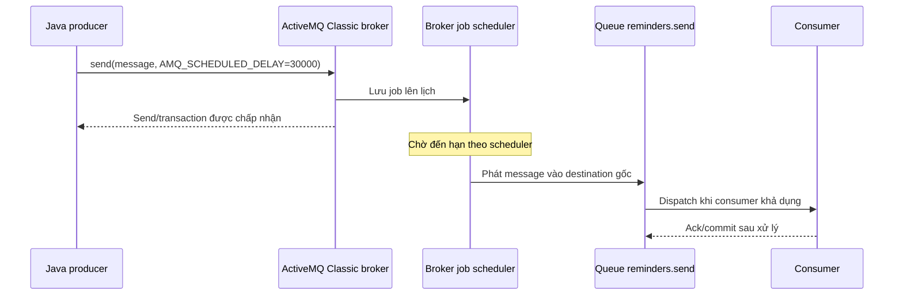

# Scheduled message của Classic với schedulerSupport và AMQ_SCHEDULED_*

> **Chương:** Thứ tự và thời gian  
> **Áp dụng:** Apache ActiveMQ **Classic**, chủ yếu qua JMS client Classic/OpenWire (`org.apache.activemq`). Đây là tính năng scheduling riêng của Classic; không lấy cấu hình này áp trực tiếp cho Artemis.  
> **Mục tiêu:** Bật scheduler trên broker, gắn chính xác các property `AMQ_SCHEDULED_DELAY`, `AMQ_SCHEDULED_PERIOD`, `AMQ_SCHEDULED_REPEAT` và `AMQ_SCHEDULED_CRON`, xác minh thời điểm message được phát, hiểu ranh giới với transaction, TTL, retry và thứ tự, rồi thiết kế lịch gửi an toàn cho nghiệp vụ.

## 1. Bài toán: gửi bây giờ nhưng xử lý không sớm hơn thời điểm mong muốn

Giả sử một ứng dụng nhận yêu cầu nhắc thanh toán, nhưng chỉ muốn consumer bắt đầu xử lý **sau 30 giây**. Một cách dễ gây lãng phí là producer tạo thread rồi `Thread.sleep(30000)` trước khi gửi. Cách đó đặt lịch ở JVM ứng dụng: khi instance chết, lịch đang nằm trong RAM có thể biến mất.

ActiveMQ Classic có **Job Scheduler** chạy phía broker. Producer gửi một JMS message thông thường nhưng kèm những **scheduled properties** đặc biệt. Khi scheduler được bật, broker nhận biết message phải **được giữ chờ** và chỉ phát vào destination khi đến hạn.



Tách ba mốc thời gian:

1. **Accepted/committed:** broker chấp nhận lệnh gửi theo hợp đồng JMS; nếu gửi trong local JMS transaction, phải `commit()`.
2. **Scheduled fire:** scheduler đến hạn, thực hiện việc phát message vào destination đích.
3. **Business completion:** consumer thực sự nhận, xử lý và ack/commit thành công.

**Đến hạn không có nghĩa hoàn thành đúng hạn.** Nếu consumer offline, queue backlog lớn, broker bận hoặc mạng lỗi, bước 3 diễn ra muộn. Một scheduler không thay thế được giám sát SLA và deadline nghiệp vụ.

## 2. Điều kiện tiên quyết: bật `schedulerSupport` trên broker Classic

Trong file cấu hình `activemq.xml` thực sự được broker load, đặt `schedulerSupport="true"` trên phần tử `<broker>`:

```xml
<!-- Đoạn cấu hình thuộc ActiveMQ Classic, ghép vào broker hiện có. -->
<broker xmlns="http://activemq.apache.org/schema/core"
        brokerName="classic-orders"
        persistent="true"
        schedulerSupport="true">

    <!-- Các phần còn lại như persistenceAdapter,
         destinationPolicy, systemUsage, transportConnectors,
         plugins và security vẫn phải được cấu hình riêng. -->

</broker>
```

**Không thay nguyên cấu hình triển khai bằng đoạn rút gọn này.** Thao tác thực tế:

1. Xác định đúng broker Classic và tệp `activemq.xml` đang được sử dụng, kể cả khi chạy Docker/Kubernetes.
2. Bổ sung thuộc tính `schedulerSupport="true"` vào `<broker>`; giữ các connector, persistence, security và usage limit của môi trường.
3. Kiểm tra cú pháp XML/schema trên môi trường thử nghiệm.
4. Restart broker theo quy trình deploy và đọc log startup để xác nhận scheduler được khởi tạo.
5. Gửi message trì hoãn **khi chưa có consumer**, theo dõi nó có đến queue đúng thời điểm không.
6. Khởi động consumer, đối chiếu `sendAt`, thời điểm message xuất hiện, `receiveAt` và ack.

**Không nên suy từ `producer.send()` không ném lỗi rằng scheduler đã bật.** Nếu broker hoặc client/protocol không nhận diện các property, message có thể được xử lý như lệnh gửi thông thường hoặc có hành vi khác theo phiên bản. Cần thử cả trường hợp scheduler bật/tắt với cùng workload.

### 2.1. Scheduler store và khả năng phục hồi

Lịch hẹn có thể tồn tại lâu hơn vòng đời một kết nối producer. Với cấu hình persistence và job scheduler store được hỗ trợ, broker lưu những job đã lên lịch vào storage do scheduler quản lý. Cần phân biệt:

- **Message store/queue:** nơi lưu message đã đến destination và chờ dispatch/ack.
- **Scheduler job store:** nơi theo dõi lịch chưa đến hạn, lịch lặp và trạng thái job.
- **Client buffer:** trạng thái phía producer/consumer; không phải nơi lưu lịch của broker.

Với thiết lập chạy thật, phải kiểm tra đường dẫn/cấu hình scheduler store theo phiên bản Classic, quyền ghi, dung lượng đĩa và quá trình khôi phục sau restart. **Chỉ bật flag không phải bằng chứng lịch đã bền vững qua crash**; hãy dùng message persistent, cấu hình storage đúng và thử fault injection.

### 2.2. Quyền gửi và quota vẫn áp dụng

Nếu service có quyền gửi vào `reminders.send`, service đó có thể tạo nhiều job tương lai bằng cách đặt properties. Vì vậy cần quản lý:

- Ai được phép schedule vào destination nào?
- Bao nhiêu job đang chờ, oldest/newest due time, tốc độ tạo job?
- Có cho phép lặp nhiều lần hoặc lịch vô hạn không?
- Scheduler store có quota, cảnh báo ổ đĩa và runbook cleanup không?
- Khi tenant hủy lịch, ai có quyền tác động đến job scheduler?

Selector và tên queue không thay cho authorization; không để user tự quyết một chuỗi CRON tùy ý mà không validate.

## 3. Bốn property `AMQ_SCHEDULED_*` và kiểu dữ liệu bắt buộc

Classic client định nghĩa các hằng trong `org.apache.activemq.ScheduledMessage`:

| Property chính xác | Kiểu JMS | Vai trò | Ví dụ |
|---|---|---|---|
| `AMQ_SCHEDULED_DELAY` | `long` | Hoãn lần phát đầu tiên theo mili giây | `30000L` |
| `AMQ_SCHEDULED_PERIOD` | `long` | Chu kỳ giữa các lần phát lại theo mili giây | `10000L` |
| `AMQ_SCHEDULED_REPEAT` | `int` | Số lần lặp lại của chu kỳ sau lần đầu | `3` |
| `AMQ_SCHEDULED_CRON` | `String` | Biểu thức lịch kiểu CRON được Classic scheduler hiểu | `"0 * * * *"` |

Dùng **đúng setter**: `setLongProperty` cho delay/period, `setIntProperty` cho repeat và `setStringProperty` cho cron. Không dùng `setStringProperty("AMQ_SCHEDULED_DELAY","30000")` rồi mong broker chắc chắn tự ép kiểu số.

```java
import org.apache.activemq.ScheduledMessage;

message.setLongProperty(
        ScheduledMessage.AMQ_SCHEDULED_DELAY, 30_000L);
```

### 3.1. Trì hoãn một lần: chỉ `DELAY`

```java
message.setLongProperty(
    ScheduledMessage.AMQ_SCHEDULED_DELAY, 30_000L);
```

Đây là lựa chọn cho email nhắc sau 30 giây hoặc một lệnh retry có lịch do ứng dụng tạo. Không có `PERIOD` và `REPEAT` nghĩa là chỉ có một lần phát theo lịch cho message đó.

### 3.2. Lặp cố định: `DELAY` + `PERIOD` + `REPEAT`

```java
message.setLongProperty(
    ScheduledMessage.AMQ_SCHEDULED_DELAY, 5_000L);
message.setLongProperty(
    ScheduledMessage.AMQ_SCHEDULED_PERIOD, 10_000L);
message.setIntProperty(
    ScheduledMessage.AMQ_SCHEDULED_REPEAT, 3);
```

Trong cách diễn giải thông thường của Classic scheduler: có **một lần phát đầu** sau khoảng 5 giây, và **ba lần lặp tiếp** cách nhau khoảng 10 giây, tổng cộng bốn lần phát theo lịch. Tuy nhiên lúc đo phải tách **số scheduler fire**, **số consumer delivery** và **số xử lý nghiệp vụ thành công**: rollback/redelivery có thể khiến tổng số lần `receive` lớn hơn số lần fire.

Tránh dùng `REPEAT` mà không có `PERIOD` dương. Khi nhận input bên ngoài, validate `delay >= 0`, `period > 0` nếu repeat, và `repeat` nằm trong giới hạn nghiệp vụ; không dựa vào các giá trị âm/biên để điều khiển lịch trừ khi đã đọc đúng tài liệu phiên bản.

### 3.3. Lịch định kỳ theo lịch biểu: `CRON`

```java
message.setStringProperty(
    ScheduledMessage.AMQ_SCHEDULED_CRON, "0 * * * *");
```

Biểu thức năm trường này có nghĩa là chạy **đầu mỗi giờ** theo cách scheduler Classic diễn giải cron. Nó phù hợp thời điểm lịch như đầu mỗi giờ, khác với chu kỳ “mỗi 60 phút kể từ lúc gửi”.

**CRON ở đây không phải cron của Quartz với trường giây hoặc cấu hình Linux crontab đầy đủ.** Classic sử dụng parser và tập biểu thức được tài liệu ActiveMQ Classic hỗ trợ; dùng các expression đơn giản và kiểm chứng trực tiếp trong môi trường broker mục tiêu. Không tự thêm trường giây ở đầu.

### 3.4. Các tổ hợp khác cần được thử riêng

Classic có khả năng kết hợp CRON với các property delay/period/repeat trong một số trường hợp để tạo các chuỗi fire phức tạp. Nhưng trước khi dùng:

- Xác định “mỗi lần CRON match lại tạo một chuỗi repeat mới” có đúng với bản Classic đang chạy không.
- Tính mức phát tối đa khi các chuỗi overlap.
- Xác định lúc nào dừng, khi nào cleanup scheduled job.
- Viết test đếm fire theo thời gian, đặc biệt khi CRON xảy ra sát restart hoặc đổi giờ.

**Không dùng đồng thời CRON và PERIOD/REPEAT trong các ví dụ cơ bản.** Hai cơ chế được trình bày độc lập để tránh lịch bùng nổ không dự tính.

## 4. Dòng thời gian chi tiết: lúc nào queue bắt đầu có message?

Một message `REM-42` được producer gửi ở thời điểm tham chiếu `t0` với `AMQ_SCHEDULED_DELAY=30000`:

```text
t0: producer.send() / transaction commit
    |
    | scheduler giữ job, queue đích có thể vẫn rỗng
    |
t0 + khoảng 30s: scheduler phát vào reminders.send
    |
    | backlog / prefetch / dispatch / network
    v
tReceive: consumer.receive() trả Message
    |
    | DB call / business validation
    v
tCommit: JMS acknowledge / commit
```

Các khái niệm cần phân biệt:

| Thời điểm | Ý nghĩa | Có được kiểm soát trực tiếp bằng `DELAY`? |
|---|---|---|
| Producer send | JVM đã gọi `send` | Không |
| Producer/JMS transaction commit | Lệnh gửi được xác nhận trong transaction | Không |
| Scheduler due time | Broker đến hạn và cố gắng phát message | **Có**, theo scheduling semantics |
| First dispatch | Broker đưa message tới consumer có thể nhận | Không, phụ thuộc broker/client |
| Business completion | Side effect hoàn tất và được ack | Không, phụ thuộc handler/DB |
| Deadline nghiệp vụ | Ví dụ “không gửi email sau 23:00” | **Phải tự kiểm tra**; delay không thay deadline |

Nếu một message scheduled đến hạn nhưng queue chưa có consumer, message có thể chờ trong queue theo delivery/persistence policy. Nếu consumer đang bận, deadline có thể bị trễ. Do đó **scheduler là cơ chế “không xử lý trước thời điểm được phép”, không phải hệ thống real-time guarantee**.

### 4.1. Transaction gửi: `send` chưa đồng nghĩa job đã được commit

```java
Session session = connection.createSession(
        true, Session.SESSION_TRANSACTED);

producer.send(scheduledMessage);

// Nếu rollback trước commit, không được coi job đã lên lịch thành công.
session.commit();
```

Trong transacted Session, chỉ sau `session.commit()` thành công mới có cơ sở công nhận lần gửi. Nếu `commit()` timeout hoặc connection mất, kết quả có thể **không xác định từ phía producer**; phải quản lý `scheduleId`/idempotency nếu quyết định retry để tránh tạo nhiều job trùng.

### 4.2. TTL/expiration: đừng để lịch dài hơn tuổi thọ message mà không chủ ý

`DeliveryMode.PERSISTENT` và `AMQ_SCHEDULED_DELAY` là hai khía cạnh khác nhau. `MessageProducer.setTimeToLive(...)`/`JMSExpiration` quy định hạn sử dụng của message. Nếu TTL được cấu hình quá ngắn so với thời gian scheduler chờ, một message có thể **không còn hợp lệ lúc đến hạn**; hành vi expiration cụ thể phụ thuộc Classic broker/version và policy.

Trong bài thử nghiệm one-shot có thể đặt TTL bằng 0 (không có expiration do producer ấn định), sau đó tự kiểm tra deadline ở consumer. Trong production, nếu cần giới hạn thời gian nhận, xây chính sách rõ: deadline nghiệp vụ là bao nhiêu, message quá hạn được audit/đưa expiry/DLQ ra sao.

### 4.3. JMS Topic: thời điểm subscriber tồn tại cũng quan trọng

Với scheduled message gửi tới **Topic**:

- Producer gửi lúc `t0`, scheduler phát tới topic lúc `tDue`.
- **Non-durable subscriber** chỉ nhận nếu subscription đang phù hợp ở lúc topic phát/delivery theo semantics provider.
- **Durable subscription** phải được đăng ký trước thời điểm cần giữ message khi subscriber offline.
- Scheduled topic không biến Topic thành kho sự kiện có thể replay tùy ý.

Nếu mong mỗi nhóm service nhận một bản sao, kiểm tra subscription có thật trước lúc scheduler fire. Nếu chỉ cần một worker xử lý một việc, thường chọn queue thay vì topic.

## 5. Java JMS: gửi một lần sau thời gian trễ

Ví dụ áp dụng client `activemq-client` của ActiveMQ Classic với API `javax.jms`, transport endpoint minh họa `tcp://127.0.0.1:61616`. Đừng ghép class `org.apache.activemq.ScheduledMessage` của Classic vào Artemis client hoặc `jakarta.jms` artifact khác mà chưa xác nhận hỗ trợ/namespace.

```java
import javax.jms.Connection;
import javax.jms.DeliveryMode;
import javax.jms.JMSException;
import javax.jms.MessageProducer;
import javax.jms.Queue;
import javax.jms.Session;
import javax.jms.TextMessage;

import org.apache.activemq.ActiveMQConnectionFactory;
import org.apache.activemq.ScheduledMessage;

public final class DelayedReminderProducer {

    public static void main(String[] args) throws JMSException {
        ActiveMQConnectionFactory factory =
                new ActiveMQConnectionFactory(
                        "tcp://127.0.0.1:61616");

        Connection connection = factory.createConnection();
        try {
            Session session = connection.createSession(
                    true, Session.SESSION_TRANSACTED);
            try {
                Queue queue = session.createQueue("reminders.send");
                MessageProducer producer = session.createProducer(queue);
                try {
                    producer.setDeliveryMode(DeliveryMode.PERSISTENT);
                    producer.setTimeToLive(0L); // Test: không có producer TTL.

                    TextMessage message =
                            session.createTextMessage("REM-42");
                    message.setStringProperty(
                            "scheduleId", "schedule-42");
                    message.setStringProperty(
                            "eventId", "reminder-42-once");
                    message.setLongProperty(
                            "publishedAtEpochMs",
                            System.currentTimeMillis());

                    message.setLongProperty(
                            ScheduledMessage.AMQ_SCHEDULED_DELAY,
                            30_000L);

                    try {
                        producer.send(message);
                        session.commit();
                        System.out.println(
                                "Scheduled one-shot: schedule-42, JMSMessageID="
                                        + message.getJMSMessageID());
                    } catch (JMSException | RuntimeException error) {
                        try {
                            session.rollback();
                        } catch (JMSException rollbackError) {
                            error.addSuppressed(rollbackError);
                        }
                        throw error;
                    }
                } finally {
                    producer.close();
                }
            } finally {
                session.close();
            }
        } finally {
            connection.close();
        }
    }
}
```

**Điều cần xác nhận bằng thử nghiệm:**

1. `schedulerSupport` đã bật ở broker, đúng endpoint, client Classic và queue `reminders.send`.
2. Trước thời điểm due, consumer chưa nhận được message; job có thể chưa được tính vào queue pending.
3. Sau khoảng 30 giây, message được phát tới queue và có thể được consumer nhận.
4. `session.commit()` của producer là transaction gửi JMS, **không** phải ack của consumer.
5. `eventId` dùng để chống trùng khi sender retry; `JMSMessageID` có thể thay đổi nếu application gửi lại một message mới.

### 5.1. Consumer đo độ trễ từ gửi đến nhận

```java
import javax.jms.Connection;
import javax.jms.JMSException;
import javax.jms.Message;
import javax.jms.MessageConsumer;
import javax.jms.Queue;
import javax.jms.Session;
import javax.jms.TextMessage;
import org.apache.activemq.ActiveMQConnectionFactory;

public final class ReminderConsumer {

    public static void main(String[] args) throws JMSException {
        ActiveMQConnectionFactory factory =
                new ActiveMQConnectionFactory(
                        "tcp://127.0.0.1:61616");
        Connection connection = factory.createConnection();

        try {
            Session session = connection.createSession(
                    true, Session.SESSION_TRANSACTED);
            try {
                Queue queue = session.createQueue("reminders.send");
                MessageConsumer consumer = session.createConsumer(queue);
                try {
                    connection.start();

                    Message message = consumer.receive(45_000L);
                    if (message == null) {
                        System.out.println("No delivery within 45s");
                        return;
                    }

                    try {
                        if (!(message instanceof TextMessage)) {
                            throw new IllegalArgumentException(
                                    "Expected TextMessage");
                        }
                        long now = System.currentTimeMillis();
                        long sentAt =
                                message.getLongProperty("publishedAtEpochMs");
                        System.out.printf(
                                "body=%s scheduleId=%s eventId=%s "
                              + "elapsedMs=%d redelivered=%s%n",
                                ((TextMessage) message).getText(),
                                message.getStringProperty("scheduleId"),
                                message.getStringProperty("eventId"),
                                now - sentAt,
                                message.getJMSRedelivered());

                        // Production: kiểm tra deadline và xử lý idempotent
                        // trong DB trước khi commit JMS.
                        session.commit();
                    } catch (JMSException | RuntimeException error) {
                        try {
                            session.rollback();
                        } catch (JMSException rollbackError) {
                            error.addSuppressed(rollbackError);
                        }
                        throw error;
                    }
                } finally {
                    consumer.close();
                }
            } finally {
                session.close();
            }
        } finally {
            connection.close();
        }
    }
}
```

Vì producer và consumer demo chạy trên cùng máy local, `elapsedMs` đủ để quan sát sơ bộ. Trong hệ phân tán, **clock skew** giữa các JVM có thể làm phép trừ epoch sai. Muốn đo thời gian từng pha, cần thêm timestamps/metrics của broker scheduler, đồng bộ giờ và đo round-trip/handler bằng đồng hồ đơn điệu (`System.nanoTime()`) trong cùng process.

### 5.2. Thực thi

1. Chạy broker Classic test có `schedulerSupport=true`.
2. Chạy `ReminderConsumer` trước để nó đợi tối đa 45 giây.
3. Chạy `DelayedReminderProducer` ở tiến trình khác.
4. Quan sát producer kết thúc sớm sau gửi/commit, consumer nhận trễ khoảng 30 giây tính từ lần publish, cộng scheduling và dispatch latency.
5. Nếu consumer trả `null` do hết 45 giây, kiểm tra scheduler/queue/connection thay vì giả định message đã mất.

Không cần gọi `connection.start()` trên **producer chỉ gửi**; consumer cần `start()` để bật delivery.

## 6. Java JMS: gửi theo chu kỳ cố định

Khi cần lặp một hành động trong số lần hữu hạn, kết hợp delay ban đầu, period và repeat.

```java
import org.apache.activemq.ScheduledMessage;

// Đoạn này nằm trong một JMS transacted Session + producer hợp lệ.
TextMessage message =
        session.createTextMessage("CHECK_PAYMENT_WINDOW");

message.setStringProperty("scheduleId", "check-payments-202");
message.setLongProperty(
        ScheduledMessage.AMQ_SCHEDULED_DELAY, 5_000L);
message.setLongProperty(
        ScheduledMessage.AMQ_SCHEDULED_PERIOD, 10_000L);
message.setIntProperty(
        ScheduledMessage.AMQ_SCHEDULED_REPEAT, 3);

producer.send(message);
session.commit();
```

Timeline kỳ vọng trong cấu hình thông thường:

```text
send / commit
   |  5s       10s          10s          10s
   v           v            v            v
  fire #1 --> fire #2 --> fire #3 --> fire #4
```

Sau `fire #4`, không nên còn job phát tiếp từ lịch này. Đây là **lịch lặp hữu hạn**, không phải cách đảm bảo luôn có đúng bốn business transaction thành công:

- Nếu consumer rollback, từng fire có thể bị redeliver.
- Nếu consumer restart, một fire có thể được xử lý lại theo ack/transaction.
- Nếu broker bị delay vì quá tải, các lần fire có thể lệch so với mốc tính toán.
- Nếu message expired hoặc lịch bị hủy, số lần delivery có thể ít hơn kỳ vọng.

### 6.1. Bẫy idempotency của message lặp

Với một message one-shot, `eventId="reminder-42-once"` làm khóa chống xử lý trùng là hợp lý. Nhưng nếu producer tạo **một scheduled message với `REPEAT=3`** và đặt **cùng `eventId="check-payments-202"`**, các lần fire có thể mang **cùng property này**.

Nếu consumer có:

```sql
INSERT INTO processed_events(event_id)
VALUES ('check-payments-202')
ON CONFLICT DO NOTHING;
```

thì sau lần fire đầu, ba lần tiếp theo rất dễ bị coi là duplicate và bị bỏ qua. Đây là **lỗi thiết kế hợp đồng**, không phải lỗi scheduler.

Phân biệt:

- `scheduleId`: ID của **lịch**, giữ nguyên qua mọi lần fire.
- `occurrenceId`: ID của **một lần kích hoạt logic**, cần khác giữa các lần phát dự kiến nhưng ổn định qua redelivery của lần đó.
- `JMSMessageID`: ID vận chuyển theo provider; **không dùng mặc định làm business occurrence ID** khi retry/republish.

**Cách thiết kế an toàn khi mỗi lần lặp là một nghiệp vụ độc lập:** để một application scheduler/outbox tạo **message riêng cho từng occurrence** với `occurrenceId` rõ ràng, sau đó gửi từng message dưới dạng one-shot delay. Nếu vẫn dùng broker-side `REPEAT`, phải chứng minh consumer xác định occurrence ổn định theo hợp đồng và có giới hạn thời gian/cửa sổ đúng, tránh tính theo giờ nhận thực tế rồi gây duplicate khi delivery trễ qua ranh giới cửa sổ.

### 6.2. Kiểm thử repeat khác kiểm thử redelivery

Với ví dụ bốn lần fire, hãy cho consumer **commit mọi message** và đếm bốn lần nhận trước khi thử rollback. Sau đó bật tình huống rollback một fire và quan sát `JMSRedelivered`/delivery count. Không suy từ “nhận được 5 lần” rằng scheduler fire 5 lần: lần thứ năm có thể là **redelivery của một fire cũ**.

## 7. Java JMS: lịch CRON trên broker Classic

Chọn CRON khi điều kiện theo **lịch đồng hồ**, không phải “mỗi n mili giây kể từ khi producer gửi”.

```java
import org.apache.activemq.ScheduledMessage;

TextMessage message =
        session.createTextMessage("HOURLY_STATUS_CHECK");

message.setStringProperty("scheduleId", "hourly-check-v1");
message.setStringProperty(
        ScheduledMessage.AMQ_SCHEDULED_CRON, "0 * * * *");

producer.send(message);
session.commit();
```

`"0 * * * *"` là mẫu năm trường để fire vào đầu các giờ theo scheduler. Mẫu `"15 9 * * *"` biểu diễn mốc 09:15 mỗi ngày trong bộ quy tắc cron Classic thông thường. Luôn kiểm chứng parser được phiên bản broker thực sự chấp nhận.

### 7.1. Timezone, DST và giờ hệ thống

Lịch CRON phụ thuộc cách broker diễn giải **giờ và múi giờ**, không phải timezone đang dùng trong browser hoặc JVM producer. Nếu broker chạy UTC, producer ở Việt Nam và yêu cầu “09:15 giờ Việt Nam”, cần làm rõ timezone quy định của hợp đồng nghiệp vụ.

Ví dụ:

```text
Business requirement:
  09:15 Asia/Ho_Chi_Minh mỗi ngày

Không đủ:
  Producer đặt "15 9 * * *" nhưng broker chạy UTC
  -> thực tế có thể là 09:15 UTC, không phải 09:15 Việt Nam.
```

Với lịch theo địa phương có DST, cần có chính sách cho giờ **không tồn tại** hoặc **lặp hai lần** trong ngày đổi giờ. Không giả định cron tự giải quyết đúng mọi vấn đề timezone/catch-up khi broker offline. Đối với nhiệm vụ có tác động tài chính, hãy lưu timezone nghiệp vụ, window ID và audit trạng thái ở database hoặc dịch vụ điều phối lịch.

### 7.2. CRON không phải cam kết fire khi broker đã dừng

Nếu broker ngừng hoạt động đúng mốc 09:15 và khởi động lại lúc 10:00, không thể tự tuyên bố scheduler sẽ bù tất cả occurrences bị lỡ theo đúng yêu cầu nghiệp vụ. Cần kiểm thử phiên bản Classic, cách scheduler store được khôi phục và cách cron job được lập lịch lại.

**Quyết định thiết kế:** nếu phải “không bỏ sót mọi kỳ thanh toán hằng ngày”, lưu occurrence có khóa bền vững trong DB và chạy reconciliation. CRON broker có thể dùng cho một số việc định kỳ hữu hạn/được phép lệch, nhưng không thay một hệ thống quản trị lịch nghiệp vụ có audit/catch-up rõ ràng.

### 7.3. Rủi ro cron trùng hoặc gửi quá nhiều

Đối với một CRON job dài hạn, mỗi lần fire có thể tạo một message mới. Hãy xem một job kiểu `"*/1 * * * *"` chạy mỗi phút có thể phát hàng nghìn message trong vài ngày. Đặt giới hạn số jobs, owner, retention/cancel plan và monitoring, không cho tenant tạo biểu thức quá dày hoặc job không có hạn sử dụng nếu chưa được phê duyệt.

## 8. Scheduled message và thứ tự queue: không hứa FIFO theo thời gian gửi

Một queue đơn thuần không biến scheduled message thành thứ tự cố định dựa trên `producer.send`.

Giả sử:

```text
t=00s  Producer gửi A, delay 30s
t=01s  Producer gửi B, không delay
t=05s  Consumer nhận B
t=30s  Scheduler phát A
t=31s  Consumer nhận A

Thứ tự send:    A -> B
Thứ tự receive: B -> A
```

Đây là **hành vi có chủ đích của scheduler**. Message A chưa đủ điều kiện giao trong lúc B đã nằm ở queue có thể dispatch.

### 8.1. Lý do thứ tự xử lý còn khác thứ tự fire

Ngay cả khi scheduler phát hai message đúng thứ tự, vẫn có:

- Nhiều consumer cùng một queue và xử lý song song.
- Prefetch của ActiveMQ Classic khiến message nằm in-flight ở client.
- `Session.rollback()`, redelivery và Poison ACK/DLQ.
- Message priority, selector, expiration và broker failover.
- Một job scheduler đến hạn nhưng destination đang bị flow control hoặc consumer offline.

Vì vậy phải phân biệt **send order, scheduled-fire order, dispatch order và business-completion order**.

### 8.2. Cần xử lý theo sequence nghiệp vụ?

Nếu `OrderCreated` và `OrderCancelled` yêu cầu thứ tự tuyệt đối theo `orderId`, đừng dùng delay như cách reorder an toàn. Cân nhắc:

1. `eventSequence` hoặc `aggregateVersion` trong payload.
2. Idempotency và optimistic locking/check version ở DB.
3. `JMSXGroupID` để hỗ trợ grouping theo khóa, với caveat failover/rebalance.
4. Một state machine quyết định event đến trễ có còn hợp lệ không.
5. Đo và thử trường hợp message cũ đến sau, retry và replay.

Thứ tự hoàn tất nghiệp vụ không được bảo đảm chỉ nhờ producer gửi lần lượt hoặc scheduler fire đúng giờ.

## 9. Hủy lịch và quản trị scheduled jobs

Scheduled message có thể bị hủy trước khi đến hạn, nhưng **hủy job chưa fire** khác với **xóa message đã phát vào queue**. Trong Classic có cơ chế scheduler management để duyệt, xóa hoặc quản lý scheduled jobs, qua management destination/API được tài liệu của phiên bản triển khai hỗ trợ.

### 9.1. Ba trạng thái cần phân biệt

| Trạng thái | Nằm ở đâu | Thao tác hủy tương ứng |
|---|---|---|
| Job còn chờ trong scheduler | Scheduler store của broker | Hủy scheduled job qua management API/command |
| Job đã fire, message đang chờ queue | Destination queue | Hủy/sửa nghiệp vụ phải xử lý queue message, không chỉ job |
| Message đã được consumer nhận | In-flight/DB workflow | Cần cancellation token hoặc idempotent state check ở consumer |

Đây là lý do “đã hủy lịch trong UI” không nhất thiết ngăn consumer gửi email nếu email job đã được dispatch.

### 9.2. Thiết kế hủy lịch theo nghiệp vụ

Ví dụ người dùng hủy nhắc thanh toán:

1. Lưu `scheduleId` và trạng thái `CANCELLED` trong database bằng transaction.
2. Nếu job chưa fire, dùng cơ chế quản trị scheduler để hủy khi được phép.
3. Consumer kiểm tra trạng thái lịch hoặc cancellation token **trước khi tạo side effect**.
4. Với message đã đến queue, consumer ghi kết quả “skipped due to cancellation” rồi ack/commit theo hợp đồng.
5. Nếu có race giữa hủy và fire, DB state + version/idempotency quyết định kết quả nghiệp vụ.

Không đưa quyền quản trị scheduler vào mọi producer account. Cần phân quyền, audit và khả năng đối soát khi job không tìm thấy hoặc lệnh hủy timeout.

### 9.3. Redelivery và copy lại message: tránh tự schedule vô ý

Một consumer nhận scheduled message rồi republish sang queue khác có thể **vô tình mang theo các property `AMQ_SCHEDULED_*`** nếu sao chép toàn bộ properties. Khi đó message mới có thể bị schedule **thêm lần nữa** thay vì gửi ngay.

Nên tạo JMS Message mới, copy **các business properties được allowlist**, và **không copy các scheduler-control properties** trừ khi nghiệp vụ chủ ý tạo một lịch mới.

```java
// Khi chuyển tiếp message: tạo message mới, chỉ copy business metadata.
TextMessage outbound =
        session.createTextMessage(
                ((TextMessage) inbound).getText());

outbound.setStringProperty(
        "eventId", inbound.getStringProperty("eventId"));
outbound.setStringProperty(
        "scheduleId", inbound.getStringProperty("scheduleId"));

// Không tự động sao chép AMQ_SCHEDULED_DELAY/PERIOD/REPEAT/CRON.
producer.send(outbound);
```

Nếu muốn thực sự reschedule, hãy tạo **lịch mới** với `scheduleId`, max attempts, deadline và audit rõ ràng thay vì vô tình tái sử dụng metadata cũ.

## 10. Những tương tác dễ hiểu sai

### 10.1. Scheduled delivery ≠ redelivery/backoff khi consumer lỗi

| Cơ chế | Ai kích hoạt? | Mục đích |
|---|---|---|
| `AMQ_SCHEDULED_DELAY` | **Producer** trước khi send | Gửi thông điệp sau một khoảng trễ |
| `AMQ_SCHEDULED_PERIOD/REPEAT` | Producer trước send | Phát nhiều lần theo lịch |
| `AMQ_SCHEDULED_CRON` | Producer trước send | Phát theo các mốc lịch |
| Client `RedeliveryPolicy` Classic | Consumer rollback/recover/không ack | Thử lại **message đã delivery** |
| Broker `RedeliveryPlugin` Classic | Đường dead-letter theo plugin | Có thể schedule resend tới destination gốc |
| DLQ/dead-letter strategy | Broker policy | Cô lập message không xử lý thành công |

Một message scheduled khi được dispatch tới consumer vẫn có thể rollback/redeliver và tới DLQ. **Không gộp retry count của consumer với `AMQ_SCHEDULED_REPEAT`.** Repeat là số lần phát theo lịch, còn redelivery là số lần gửi lại vì delivery/ack không hoàn tất.

### 10.2. Scheduled message không phải timer chính xác từng mili giây

`AMQ_SCHEDULED_DELAY=1000` nghĩa là broker lên lịch theo khoảng 1 giây, nhưng không có bảo đảm consumer bắt đầu xử lý đúng tại `t0+1000ms`. Các nguyên nhân chậm gồm:

- Scheduler thread đang bận, queue backlog hoặc storage chậm.
- Broker restart/failover, network reconnect.
- JVM GC pause hoặc disk pressure.
- Consumer offline, prefetch/ack/window behavior.
- Clock jump/timezone khi dùng CRON.

Với nhắc việc thông thường, đo **lateness distribution** là hợp lý; với deadline tài chính nghiêm ngặt, cần nguồn chân lý ở DB, reconciliation và quy tắc xử lý message quá hạn.

### 10.3. Không dùng `AMQ_SCHEDULED_*` để thay authorization hoặc chống spam

Ai có quyền gửi vào queue và điều khiển scheduled properties có thể chiếm dụng tài nguyên scheduler. Dùng kiểm tra request ở application, giới hạn delay/repeat/cron, rate limits, authentication, quyền publish và quotas broker. Message có thuộc tính `tenantId` không tạo isolation bảo mật nếu nhiều tenant chia sẻ quyền gửi/đọc cùng destination.

## 11. Vận hành và kiểm tra: job đang chờ khác queue pending

### 11.1. Dashboard nên theo dõi hai miền

**Tại scheduler:**

- Số job đang chờ, số job lặp/CRON đang hoạt động.
- Due time sớm nhất, độ trễ fire so với mốc dự định.
- Disk usage/health của scheduler store.
- Job creation/remove rate, lỗi fire và recovery sau restart.

**Tại destination và consumer:**

- Queue enqueue/pending/in-flight, message age và consumer count.
- JMS ack/rollback, redelivery, DLQ và business processing latency.
- Tỷ lệ message được xử lý sau deadline nghiệp vụ.
- Số occurrence duy nhất thực sự hoàn tất (`occurrenceId`).

Một dashboard chỉ có `QueueSize` có thể bỏ sót **toàn bộ số job đang chờ trong scheduler**. Khi queue rỗng nhưng người dùng hỏi “lịch đâu?”, hãy kiểm tra job scheduler trước khi kết luận producer chưa gửi.

### 11.2. Log mẫu để đối soát

```text
scheduleId=schedule-42
eventId=reminder-42-once
destination=reminders.send
requestedDelayMs=30000
producerCommittedAt=2026-11-17T08:00:00Z
scheduledFireObservedAt=2026-11-17T08:00:30.2Z
consumerReceivedAt=2026-11-17T08:00:30.4Z
businessCommittedAt=2026-11-17T08:00:31.1Z
status=COMPLETED
```

Đây là ví dụ **các trường cần quan sát**, không phải log mà Classic tự sinh đủ mọi trường. Nếu timestamp đến từ nhiều host, cần đồng bộ clock và chỉ rõ nguồn timestamp. `scheduledFireObservedAt` có thể đến từ management instrumentation hoặc một probe riêng, không nhất thiết suy ra từ `JMSTimestamp`.

### 11.3. Kế hoạch dung lượng tối thiểu

Đặt:

- `R` = số lịch mới mỗi phút.
- `D` = số phút trung bình mỗi job chờ.
- `K` = số lần phát trung bình trên một job.
- `S` = kích thước message/metadata và overhead scheduler (đo thực tế).

Ước lượng backlog job ổn định theo Little's law khi tốc độ/độ trễ ổn định: **số job chờ ≈ R × D**. Sau đó cần tính thêm số fire mỗi job và tải destination: **output rate ≈ R × K** về dài hạn cho những lịch hữu hạn trong mô hình ổn định. Với CRON vô hạn, `K` không cố định; phải tính riêng theo số job active và tần suất cron.

Ví dụ 100 lịch/phút với delay trung bình 60 phút có thể tạo khoảng **6.000 scheduled jobs chờ**. Đây chỉ là ước lượng count, **không suy ra ngay số byte disk**: storage layout, index, batching, repeat, persistence và metadata overhead phải được đo.

## 12. Bộ thí nghiệm có kiểm chứng rõ

Chạy trên **broker ActiveMQ Classic staging riêng**, có dữ liệu test, đúng client/version/protocol và management visibility. Giữ tất cả job chạy thử ở namespace `test.scheduled.*`, không dùng lịch CRON liên tục trong production.

### Bài A — Bật/tắt scheduler support

1. Chạy Classic broker test với `schedulerSupport=true`.
2. Gửi one-shot delay 10 giây vào `test.scheduled.once`, message persistent.
3. Xác nhận consumer không nhận trước due; sau đó nhận được.
4. Ở **broker test tách biệt**, tắt scheduler rồi thử cùng send.
5. Ghi hành vi thực tế và log: message có bị phát ngay, bị từ chối hay xử lý khác theo phiên bản?

**Đạt:** chứng minh broker phải hiểu scheduler properties. Không chấp nhận chỉ thấy Java `send` thành công.

### Bài B — Delay + Period + Repeat

1. Gửi message với `DELAY=2000`, `PERIOD=3000`, `REPEAT=3`.
2. Consumer commit tất cả để không có redelivery.
3. Ghi bốn thời điểm nhận, tính khoảng cách và số lần fire quan sát.
4. Sau mốc kết thúc, chờ thêm một khoảng period rồi xác nhận không có fire tiếp.
5. Bật rollback một delivery trong test riêng, đối chiếu repeat và redelivery.

**Đạt:** phân biệt four scheduled firings với có thể nhiều hơn four consumer deliveries khi retry.

### Bài C — CRON và timezone

1. Chọn biểu thức CRON đơn giản, có lần fire gần để quan sát trong test.
2. Ghi timezone broker và thời gian hệ thống.
3. Gửi cron message, kiểm tra due time và consumer nhận.
4. Dùng hai thiết lập timezone test khác nhau hoặc phân tích offset theo mốc UTC.
5. Kiểm tra phiên bản parser chấp nhận đúng số trường CRON.

**Đạt:** không nhầm “09:15 giờ broker” với “09:15 giờ client”; có bằng chứng timestamp và timezone.

### Bài D — Restart khi job còn chờ

1. Gửi persistent one-shot delay khoảng 60–120 giây, commit.
2. Xác nhận scheduler có job chưa đến hạn.
3. Dừng broker test có kiểm soát, start lại trước due.
4. Theo dõi job recovery, destination enqueue và consumer receive.
5. Nếu job mất hoặc fire bất ngờ, xem scheduler store, persistence, recovery logs và version.

**Đạt:** có kiểm chứng khả năng phục hồi **setup thực tế**, không chỉ kết luận từ `persistent=true`.

### Bài E — Gửi trong JMS transaction nhưng rollback

1. Producer dùng transacted Session tạo scheduled message delay 15 giây.
2. `producer.send(message)` rồi `session.rollback()`, không commit.
3. Đợi vượt quá delay và kiểm tra không có scheduled delivery.
4. Lặp lại cùng message payload với transaction mới và `commit()`.

**Đạt:** chứng minh commit là điều kiện của việc gửi theo local JMS transaction; rollback không được tạo lịch đã chấp nhận.

### Bài F — TTL và deadline nghiệp vụ

1. Với broker test, gửi message delay dài hơn TTL đã chọn.
2. Theo dõi message có được phát, expired hay bị xử lý theo broker policy.
3. Gửi một message khác TTL=0 nhưng có property `businessDeadlineEpochMs`.
4. Consumer đọc deadline và quyết định skip/ack nếu quá hạn theo chính sách.

**Đạt:** phân biệt expiration ở broker với deadline nghiệp vụ do ứng dụng tự đảm bảo.

### Bài G — Hủy lịch gần mốc fire

1. Tạo scheduled job có `scheduleId`, delay đủ để quan sát.
2. Tìm scheduled job bằng cơ chế management hỗ trợ ở phiên bản đang chạy.
3. Hủy job trước due và xác nhận không fire.
4. Lặp lại sát due, theo dõi race giữa cancel và enqueue.
5. Cho consumer kiểm tra DB cancellation state trước side effect.

**Đạt:** hiểu hủy scheduler job không thể đảo ngược một message đã enqueue hoặc một business effect đã hoàn tất.

### Bài H — Thứ tự gửi và thứ tự xử lý

1. Gửi A delay 10 giây.
2. Gửi B không delay sau A khoảng 1 giây.
3. Dùng một consumer transacted, commit mọi message.
4. So sánh `sentAt`, `receivedAt`, `completedAt` và sequence.

**Đạt:** quan sát B có thể nhận trước A; không suy luận FIFO nghiệp vụ từ thứ tự gửi.

### Mẫu bảng số liệu

| Case | Scheduled props | Producer tx | Broker scheduler | Số fire dự kiến | Số receive/ack thực tế | PASS/FAIL |
|---|---|---|---|---:|---|---|
| A | DELAY=10s | Commit | Bật | 1 | | |
| B | DELAY=2s, PERIOD=3s, REPEAT=3 | Commit | Bật | 4 | | |
| C | CRON được phép | Commit | Bật | Theo mốc quan sát | | |
| D | DELAY=90s, persistent | Commit | Bật + restart | 1 nếu recover đúng | | |
| E | DELAY=15s | Rollback | Bật | 0 | | |
| F | DELAY > TTL | Commit | Bật | Phụ thuộc expiry policy | | |
| G | DELAY=20s + hủy | Commit | Bật | 0 nếu hủy trước fire | | |
| H | A delayed, B immediate | Commit | Bật | 2 | Thứ tự B trước A có thể xảy ra | |

## 13. Troubleshooting theo triệu chứng

| Triệu chứng | Nguyên nhân cần kiểm tra | Cách kiểm chứng |
|---|---|---|
| Message đến queue ngay dù đặt DELAY | Broker chưa bật `schedulerSupport`, gửi qua protocol/client không hỗ trợ hoặc sai property type | Xem broker config hiệu lực, log startup, client `ScheduledMessage` constants, thử DELAY một lần |
| Producer `send` thành công nhưng không thấy queue message | Job còn trong scheduler chờ due | Kiểm tra scheduler jobs/store, due time và queue count theo thời điểm |
| Message không xuất hiện sau due | Broker down, scheduler/store lỗi, flow control, expired hoặc destination sai | Scheduler logs/job state, message expiry, destination và enqueue count |
| CRON fire sai giờ | Broker timezone khác business timezone, DST hoặc cron syntax không hỗ trợ | Ghi timezone/UTC offsets, kiểm tra parser và mốc fire thật |
| Lặp nhiều lần hơn dự kiến | `REPEAT` cộng với redelivery, hoặc producer retry tạo hai job | Đối chiếu `scheduleId`, broker jobs, `JMSRedelivered` và app attempts |
| Lặp ít hơn dự kiến | TTL, job hủy, restart recovery, consumer selector/filter, bad config | Kiểm tra scheduler và queue metrics; phân biệt fire với xử lý |
| One-shot nhận trễ nhiều so với DELAY | Queue backlog, consumer offline, GC, disk/dispatch lag | Đo due-to-enqueue và enqueue-to-ack từng pha |
| Hủy lịch nhưng vẫn gửi email | Message đã vào queue/in-flight hoặc race với cancellation | DB status check tại consumer trước side effect |
| Restart khiến job không khôi phục | Scheduler store/persistence chưa đáp ứng hoặc recovery lỗi | Diễn tập restarts với persistent test jobs, xem storage và log |
| Event lặp bị consumer bỏ qua ba lần | Cùng `eventId` cho mọi fire, idempotency key sai phạm vi | Phân biệt `scheduleId` và `occurrenceId`, hoặc tạo one-shot per occurrence |
| Republish làm message bị delay thêm lần nữa | Copy `AMQ_SCHEDULED_*` từ inbound sang outbound | Chỉ copy property whitelist, không copy scheduler controls |
| DLQ chứa message scheduled | Lỗi consumer sau khi scheduler đã fire; redelivery/poison xử lý bình thường | Xem delivery attempts, rollback và DLQ policy riêng |

## 14. Checklist và nguồn tham khảo

Trước khi đưa một luồng scheduled message của Classic vào production:

- [ ] Broker **Classic** thực sự bật `schedulerSupport="true"`, đã restart và thấy scheduler chạy.
- [ ] Client sử dụng đúng provider/protocol hỗ trợ `AMQ_SCHEDULED_*`, đúng property types.
- [ ] Đã phân biệt `DELAY`, `PERIOD`, `REPEAT` và `CRON`; đã kiểm thử riêng trước khi phối hợp.
- [ ] Có giới hạn delay, repeat, cron frequency, owner và quyền quản lý scheduled jobs.
- [ ] `send` trong transacted Session được commit; chưa rõ outcome thì có idempotency/schedule dedupe strategy.
- [ ] Message TTL, business deadline và timezone được xác định độc lập với scheduler delay.
- [ ] Có phương án hủy lịch xử lý race với fire/enqueue/consumer.
- [ ] Không dùng cùng một `eventId` cho mọi occurrence nếu mỗi lần fire cần một business effect độc lập.
- [ ] Consumer ack/rollback, redelivery/DLQ và idempotency đã được thử với scheduled deliveries.
- [ ] Đã kiểm chứng thứ tự xử lý có thể khác thứ tự producer gửi.
- [ ] Đã đo scheduler jobs/store, due lateness, queue backlog, oldest age và business completion.
- [ ] Đã thử broker restart trước due, xử lý khi consumer offline và recovery khi storage/network lỗi.
- [ ] Không tự copy `AMQ_SCHEDULED_*` khi forward/redrive message; không dùng cú pháp Classic cho Artemis.

### Tài liệu chính thức

1. [ActiveMQ Classic — Message Scheduling](https://activemq.apache.org/components/classic/documentation/delay-and-schedule-message-delivery): `schedulerSupport`, `AMQ_SCHEDULED_DELAY`, `AMQ_SCHEDULED_PERIOD`, `AMQ_SCHEDULED_REPEAT` và `AMQ_SCHEDULED_CRON`, cùng ví dụ Java JMS.
2. [ActiveMQ Classic — How Do I Configure the Job Scheduler?](https://activemq.apache.org/components/classic/documentation/job-scheduler): khái niệm scheduler/broker và cấu hình liên quan (đối chiếu với phiên bản triển khai).
3. [ActiveMQ Classic — Message Redelivery and DLQ Handling](https://activemq.apache.org/components/classic/documentation/message-redelivery-and-dlq-handling): phân biệt scheduled delivery với retry/redelivery khi consumer lỗi.
4. [JMS MessageProducer API](https://docs.oracle.com/javaee/7/api/javax/jms/MessageProducer.html): `send`, `setTimeToLive`, delivery mode.
5. [JMS Session API](https://docs.oracle.com/javaee/7/api/javax/jms/Session.html): transaction và commit/rollback.

> **Kết luận:** `schedulerSupport="true"` bật job scheduler trên broker Classic; producer điều khiển lịch bằng các **JMS properties có kiểu** `AMQ_SCHEDULED_DELAY`, `AMQ_SCHEDULED_PERIOD`, `AMQ_SCHEDULED_REPEAT` và `AMQ_SCHEDULED_CRON`. Scheduler chỉ quyết định **khi nào message đủ điều kiện được phát vào destination**, không bảo đảm thời điểm consumer hoàn thành. Muốn nghiệp vụ đúng, phải quản lý transaction, deadline, timezone, cancellation, occurrence identity, thứ tự, monitoring và recovery như những hợp đồng riêng.
