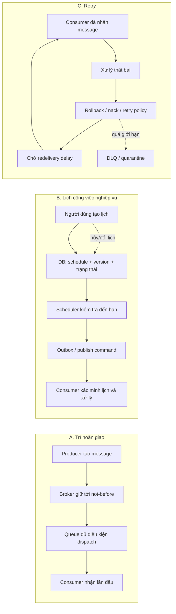
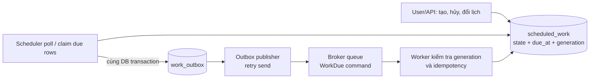

# Phân biệt trì hoãn giao, lịch công việc nghiệp vụ và retry trong ActiveMQ

> **Chương:** Thứ tự và thời gian  
> **Module:** `INTEGRATION_MESSAGING_MESSAGE_BROKER_ACTIVEMQ` — tìm hiểu Apache ActiveMQ Classic và Artemis trong giao tiếp bất đồng bộ với queue, topic, routing và JMS; producer/consumer Java, acknowledgment, transaction, redelivery, DLQ, bảo mật và vận hành broker tin cậy.  
> **Trọng tâm bài:** Ba yêu cầu nhìn giống nhau vì đều có chữ “đợi”, nhưng khác hẳn về **sự kiện khởi phát**, **ai giữ trạng thái**, **điều gì xảy ra khi hết thời gian**, **khả năng đổi/hủy lịch** và **bảo đảm nghiệp vụ**: (1) trì hoãn *delivery* một message đã gửi; (2) lên lịch một công việc nghiệp vụ; (3) retry sau khi một lần xử lý thất bại.

## 1. Một câu hỏi quan trọng: “Đợi 5 phút” để làm gì?

Cùng là yêu cầu “đợi 5 phút”, nhưng ba tình huống sau cần thiết kế khác nhau:

- **Tình huống A — trì hoãn giao:** Dịch vụ kiểm kho đã tạo message `RefreshInventoryCache` và muốn broker **không giao trước** 5 phút để tránh cache vừa bị thay đổi. Không có sự cố xử lý nào trước đó.
- **Tình huống B — lịch nghiệp vụ:** Khách đặt gửi báo cáo vào **08:00 ngày làm việc đầu tiên của tháng**, theo múi giờ `Asia/Ho_Chi_Minh`; khách có thể **đổi giờ, hủy hoặc tạm dừng**. Công việc phải giữ trạng thái đã chạy, số lần thực hiện, người đổi lịch và kết quả.
- **Tình huống C — retry:** Consumer đang xử lý `ChargePayment`, gọi API thanh toán bị HTTP 503. Nó **đã thử một lần và thất bại**; broker/ứng dụng cần thử lại sau 5 phút, với giới hạn lượt, backoff và DLQ.

Ba mô hình:



### 1.1. Bảng quyết định ngắn nhất

| Câu hỏi | Trì hoãn giao (*delivery delay*) | Lịch nghiệp vụ (*business schedule*) | Retry / redelivery |
|---|---|---|---|
| **Kích hoạt bởi** | Producer chủ động gửi một message nhưng hoãn thời điểm được nhận | User/business rule đặt lịch, thay đổi/hủy/định kỳ | Một lần nhận/xử lý đã **thất bại** hoặc chưa ack |
| **Message tồn tại từ khi nào?** | Đã gửi vào broker, nhưng chưa được phép dispatch trước thời điểm đã định | Có thể **chưa có message nào** cho đến sát giờ chạy | Đã có message và ít nhất một lần thử giao/xử lý |
| **Nguồn chân lý cho lịch** | Broker scheduler/delivery-time metadata | DB nghiệp vụ, lịch, timezone, version và trạng thái | Broker/client redelivery policy; đôi khi ứng dụng có retry ledger |
| **Tham số thời gian** | Khoảng delay hoặc `notBefore` | `dueAt`, timezone, calendar rule, trạng thái, generation | Khoảng backoff theo số lần fail và giới hạn retry |
| **Nếu không có consumer** | Vẫn đợi; đến hạn thì message đủ điều kiện dispatch, không ép consumer chạy | Job vẫn đến hạn và cần được dispatch/reconcile | Retry có thể tiếp tục chờ; không có worker thì không thể hoàn thành |
| **Đổi/hủy lịch** | Phụ thuộc API quản trị scheduler, không mặc định là thao tác nghiệp vụ an toàn | Chức năng chính của hệ thống, có concurrency/version control | Thường sửa retry policy/đưa quarantine, không “đổi lịch user” |
| **Khi xử lý thất bại** | Không tự biến delivery delay thành một retry policy | Job có state machine và retry riêng của execution | Rollback/nack → giao lại hoặc DLQ theo policy |
| **Đảm bảo đúng giờ** | **Không**: chỉ bảo đảm “không sớm hơn” khi provider hỗ trợ | Cần kiểm soát SLO, misfire, timezone và capacity | Không: backoff là **thời điểm sớm nhất được thử lại** |
| **Chống duplicate** | Consumer vẫn cần idempotency | Execution ID/generation + inbox/outbox | Cùng business key + idempotency; redelivery vốn có thể lặp |

**Quy tắc chọn:** Nếu producer đã có một message và chỉ muốn *giao muộn*, dùng delayed delivery. Nếu có lịch cần cập nhật/hủy, lịch theo ngày làm việc hoặc cần chứng minh công việc đã/không chạy, dùng **business scheduler có lưu trạng thái bền vững**. Nếu consumer đã thử và thất bại, dùng **redelivery/retry** với chính sách giới hạn.

## 2. Trục thời gian: sự khác biệt thấy ngay

Giả sử một message `M1` được gửi lúc `10:00:00`:

```text
10:00:00         10:00:05         10:00:08         10:00:11
   |                |                |                |
   |-- A send M1 ---|-- not-before --|-- actual recv --|-- done
   |                |                |
   |      (broker đủ điều kiện giao từ 10:00:05)
   |      actual receive trễ hơn nếu worker bận/backlog.

   |-- B user tạo job id=J1: "ngày mai 08:00 ở VN"
          Job nằm trong DB; chưa nhất thiết publish message.
          Nếu user đổi thành 09:00, scheduler dựa trên generation mới.

   |-- C consumer receive M2 --X thất bại tại 10:00:02
                             |
                      redelivery delay = 5s
                             |
                      có thể receive lại từ 10:00:07,
                      không phải tạo thêm một "job J2".
```

Ba loại **thời điểm** cần đặt tên khác nhau:

- `createdAt`: lúc message hoặc lịch được tạo.
- `eligibleAt` / `notBefore`: thời điểm **sớm nhất** broker được giao message.
- `dueAt` / `scheduledFor`: thời điểm nghiệp vụ kỳ vọng chạy, có lịch và trạng thái độc lập.
- `retryNotBefore`: thời điểm cho phép thử lại **sau khi thất bại**.
- `deadlineAt`: thời điểm nhiệm vụ **không còn có ý nghĩa**, khác với cả ba mốc trên.

Không dùng một trường chung như `delayTime` cho mọi trường hợp. Một consumer đọc `retryNotBefore` nhưng tưởng đó là `deadlineAt` có thể bỏ message đúng ra vẫn còn hiệu lực.

## 3. Trì hoãn giao: điều gì thực sự được bảo đảm?

### 3.1. “Không giao trước” không phải “chạy đúng lúc”

Với Jakarta Messaging/JMS 2.0, producer có thể dùng:

```java
JMSProducer producer = context.createProducer()
    .setDeliveryDelay(10_000L); // milliseconds

producer.send(queue, "RefreshInventoryCache");
```

Ý nghĩa của `setDeliveryDelay(10_000)`: provider **không được giao message sớm hơn** 10 giây tính từ lúc send (theo hợp đồng API). Nó **không** hứa rằng consumer bắt đầu chạy ở đúng giây thứ 10.

Những yếu tố có thể làm actual receive trễ hơn: queue backlog, thiếu consumer, prefetch, selector, quota/store flow control, broker restart/recovery, mạng, GC, dispatcher load và chính sách priority.

**Với transacted send:** JMS định nghĩa delivery delay tính từ **thời điểm client gửi** message, **không** phải thời điểm transaction commit. Nhưng message chưa được commit cũng không được xem là message đã hoàn tất gửi; vì vậy thời điểm có thể giao thực tế phải tôn trọng cả **commit** và **delivery delay**. Không dùng một transaction giữ mở 30 phút để thay scheduler.

### 3.2. `JMSDeliveryTime`, TTL và điều kiện thời gian

Jakarta Messaging 3.1 có header `JMSDeliveryTime` cho thời điểm message **sớm nhất được phép giao**. `JMSExpiration` diễn đạt thời hạn hết hiệu lực theo TTL. Hai ràng buộc độc lập:

```text
send() tại t0
    │
    ├─ JMSDeliveryTime ≈ t0 + deliveryDelay
    └─ JMSExpiration   ≈ t0 + timeToLive (nếu TTL > 0)

Để một delivery thông thường xảy ra:
    message đã commit/đã được broker chấp nhận
    VÀ now >= notBefore
    VÀ message chưa expire
    VÀ có consumer phù hợp + broker có capacity
```

Ví dụ **delay = 10 giây, TTL = 3 giây**:

```text
t=0       t=3                        t=10
send      expire                     not-before
 |----------X--------------------------|
            message hết hạn TRƯỚC lúc đủ điều kiện giao
```

Message có thể không bao giờ được consumer nhận theo đường bình thường. Hành vi expiry (discard hay chuyển sang expiry address/queue) phụ thuộc broker configuration. **TTL không phải delivery delay**, và redelivery delay không tự gia hạn `JMSExpiration`.

**Điều kiện về clock:** delay tương đối thường dễ quản lý hơn thời điểm tuyệt đối; với absolute scheduling như `_AMQ_SCHED_DELIVERY`, phải bảo đảm clock host/broker gần đúng bằng NTP và timestamp theo epoch milliseconds. Không dùng `LocalDateTime` không có timezone rồi chuyển thẳng thành epoch.

### 3.3. Một message bị delay vẫn là một message

Nếu producer gửi `M1` một lần và broker giữ đến hạn, đó **không phải** retry. `JMSRedelivered` ở lần giao đầu thường `false`, `JMSXDeliveryCount` thường bắt đầu `1`. Nếu M1 sau đó xử lý thất bại và rollback, **lúc ấy** mới có chu trình redelivery.

Đừng tăng `attempt` nghiệp vụ chỉ vì message nằm chờ delayed delivery trong broker. Timer qua đi không phải một lần handler thất bại.

## 4. ActiveMQ Classic: scheduler bằng thuộc tính ActiveMQ riêng

### 4.1. Bật scheduler trên broker

ActiveMQ Classic có **persistent scheduler** tùy chọn. Theo tài liệu Apache, cần bật `schedulerSupport="true"` trong phần tử `<broker>` của `conf/activemq.xml`, ví dụ fragment:

```xml
<broker xmlns="http://activemq.apache.org/schema/core"
        brokerName="lab-classic"
        persistent="true"
        schedulerSupport="true">
  <!-- Broker configuration hiện hữu: store, connectors, policies ... -->
</broker>
```

Đây **chỉ là ví dụ thuộc tính** của phần tử broker, không phải file `activemq.xml` hoàn chỉnh. Trong thực tế hãy thêm `schedulerSupport="true"` vào **phần tử `<broker>` hiện hữu**, không tạo thêm broker node thứ hai hay thay những cấu hình store/transport hiện có.

Muốn lịch đã ghi được giữ khi broker khởi động lại, cần kiểm tra **persistent scheduler store** của Classic được đặt trên storage bền vững, quyền ghi, cấu hình data directory/backup và loại lỗi mà hệ thống muốn chịu. `schedulerSupport=true` không thay thế backup hay bảo đảm hạ tầng không mất disk.

### 4.2. Hẹn giao một lần sau 8 giây

Classic 5.x OpenWire/JMS client dùng `javax.jms` và interface `org.apache.activemq.ScheduledMessage`:

```java
import javax.jms.Session;
import javax.jms.TextMessage;
import javax.jms.MessageProducer;
import org.apache.activemq.ScheduledMessage;

// session là JMS Session đang mở của Classic client.
TextMessage message = session.createTextMessage("refresh-cache");
message.setStringProperty("businessId", "cache-run-001");
message.setLongProperty(
    ScheduledMessage.AMQ_SCHEDULED_DELAY, 8_000L);

MessageProducer producer =
    session.createProducer(session.createQueue("lab.timing.delay"));
producer.send(message);
```

`AMQ_SCHEDULED_DELAY` là **property đặc thù ActiveMQ Classic**, không phải property JMS chuẩn. Nếu dùng transaction, cần `session.commit()` để chốt việc gửi. **Không** gọi `producer.setTimeToLive(8000)` thay cho delay: điều đó đặt hạn hết hiệu lực, không hẹn giao.

### 4.3. Period, repeat và CRON của Classic

Ngoài one-shot delay, Classic scheduler nhận các property:

| Property | Kiểu | Vai trò |
|---|---|---|
| `AMQ_SCHEDULED_DELAY` | `long` milliseconds | Trì hoãn lần giao đầu |
| `AMQ_SCHEDULED_PERIOD` | `long` milliseconds | Khoảng cách lặp lại |
| `AMQ_SCHEDULED_REPEAT` | `int` | Số lần lặp **sau lần đầu**, cần hiểu số lần phát tổng |
| `AMQ_SCHEDULED_CRON` | `String` | Cron expression của broker scheduler |

Ví dụ Classic tạo một lần đầu sau 5 giây, rồi lặp thêm 2 lần cách nhau 10 giây:

```java
message.setLongProperty(
    ScheduledMessage.AMQ_SCHEDULED_DELAY, 5_000L);
message.setLongProperty(
    ScheduledMessage.AMQ_SCHEDULED_PERIOD, 10_000L);
message.setIntProperty(
    ScheduledMessage.AMQ_SCHEDULED_REPEAT, 2);
producer.send(message);
```

Với cấu hình này, scheduler có thể tạo **ba lần giao theo lịch** (lần đầu + hai lần repeat), **không phải** một message liên tục được retry sau thất bại. Mỗi lần scheduler kích hoạt cần được xem như **một execution trigger có chủ đích**, chứ không diễn giải bằng `JMSRedelivered=true`.

Ví dụ Cron expression Classic theo tài liệu:

```java
message.setStringProperty(
    ScheduledMessage.AMQ_SCHEDULED_CRON, "0 * * * *");
producer.send(message);
```

**Cảnh báo:** Cron của Classic scheduler không tự cung cấp mô hình lịch doanh nghiệp đầy đủ: “ngày làm việc”, lịch nghỉ lễ, timezone từng khách, lần DST bị trùng/bỏ qua, user cancel, quyền duyệt, lịch sử execution và chính sách khi broker offline đúng giờ chạy. Cron còn có quy tắc kết hợp với delay/repeat; khi dùng chung, cần đọc kỹ documentation và thử số lần schedule trước khi production.

Một bẫy Classic rất cụ thể: property `scheduledJobId` được scheduler sử dụng. Nếu ứng dụng copy toàn bộ properties từ message đã schedule/nhận rồi gửi lại và vô tình **giữ `scheduledJobId`**, scheduler có thể **không áp dụng việc schedule mới** như bạn kỳ vọng. Khi republish, tạo một message mới và **chỉ copy các thuộc tính nghiệp vụ được cho phép**, không copy mọi header/property một cách mù quáng.

### 4.4. Giới hạn với JMS 2.0 delivery delay ở Classic

Không giả định `JMSProducer.setDeliveryDelay(...)` sẽ hoạt động chỉ vì `JMSProducer` xuất hiện trong dependency. Tài liệu hỗ trợ JMS 2.0 của ActiveMQ Classic ghi **delivery delay chưa được hỗ trợ đầy đủ ở các dòng Classic 5.19.x/6.x được liệt kê**, trong khi scheduler vendor-specific `AMQ_SCHEDULED_DELAY` có cơ chế riêng.

Với Classic 5.19.x, dùng API scheduler đặc thù đã kiểm chứng và bật broker `schedulerSupport` thay vì sao chép đoạn `setDeliveryDelay` của Artemis/Jakarta JMS rồi xem compile là bằng chứng hỗ trợ. Khi nâng version, cần chạy capability test với broker+client thực tế. Tham khảo [Classic — Delay and Schedule Message Delivery](https://activemq.apache.org/components/classic/documentation/delay-and-schedule-message-delivery) và [Classic — JMS 2.0 Support](https://activemq.apache.org/components/classic/documentation/jms2).

## 5. Artemis: delivery delay JMS và scheduled delivery theo thời điểm tuyệt đối

### 5.1. Delivery delay tiêu chuẩn bằng `JMSProducer`

Với **Artemis native Jakarta JMS client**, có thể dùng simplified API:

```java
try (JMSContext context =
         factory.createContext(JMSContext.SESSION_TRANSACTED)) {
    Queue queue = context.createQueue("lab.timing.delay");

    JMSProducer producer = context.createProducer()
        .setDeliveryMode(DeliveryMode.PERSISTENT)
        .setDeliveryDelay(8_000L)
        .setTimeToLive(0L);

    producer.send(queue, "refresh-cache");
    context.commit();
}
```

Đây là cách đưa ra **delay tương đối** có tính portable ở mức API JMS/Jakarta, **nếu provider thực sự hỗ trợ**. Message vẫn chỉ eligible sau delay; không có bảo đảm consumer hoàn tất đúng tại `t0 + 8 giây`.

### 5.2. Hẹn giao theo epoch milliseconds với property Artemis

Artemis có property đặc thù `"_AMQ_SCHED_DELIVERY"`, kiểu `long`, chứa **Unix epoch milliseconds của thời điểm sớm nhất được giao**:

```java
long notBeforeEpochMillis =
    System.currentTimeMillis() + 8_000L;

TextMessage message =
    context.createTextMessage("refresh-cache");
message.setLongProperty(
    "_AMQ_SCHED_DELIVERY", notBeforeEpochMillis);

context.createProducer().send(queue, message);
```

Đây là **bản tin đã được gửi vào broker** và được giữ tới `notBeforeEpochMillis`; nó **không phải bản ghi business schedule có quyền đổi lịch**. Khi dùng `setDeliveryDelay`, **không cần** đồng thời đặt `_AMQ_SCHED_DELIVERY`; nếu cả hai đều có, đừng đoán precedence của implementation, hãy chọn một cơ chế cho một message.

**Không mang nguyên property của Classic** `AMQ_SCHEDULED_DELAY` sang Artemis native và đòi broker hiểu giống Classic. Ngược lại, `_AMQ_SCHED_DELIVERY` là extension của Artemis, không được JMS spec bắt mọi provider khác phải hỗ trợ. Nếu dùng **Classic OpenWire client kết nối Artemis**, phải kiểm tra cách protocol adapter chuyển đổi property, không coi mọi vendor scheduler property tương đương.

### 5.3. Cấu hình queue dành cho lab Artemis

Trong `etc/broker.xml`, nếu không dựa vào auto-create, định nghĩa các address/queue anycast. Các fragment sau đặt **bên trong phần tử `<addresses>` đang có**, không tạo nhiều `<addresses>`:

```xml
<address name="lab.timing.delay">
  <anycast>
    <queue name="lab.timing.delay"/>
  </anycast>
</address>

<address name="lab.timing.retry">
  <anycast>
    <queue name="lab.timing.retry"/>
  </anycast>
</address>
```

Lab yêu cầu broker Artemis native connector/client có thể kết nối; port Netty 61616 thông thường hỗ trợ CORE trên cấu hình phù hợp. Cấu hình OpenWire chỉ cần thiết nếu bài test dùng Classic client, không phải cho Artemis native client.

**Quan sát scheduled:** Message hẹn giao của Artemis có thể đã được route vào queue nhưng đang ở trạng thái **scheduled/not yet deliverable**, khác với “consumer đã receive”. Queue depth, scheduled count, consumer count và expired count cần đọc đúng loại metric.

## 6. Retry sau thất bại: cùng message, điểm bắt đầu khác

### 6.1. Retry chỉ có nghĩa sau một lần giao/xử lý không thành công

Flow đúng:

```text
Broker dispatch M (attempt 1)
         |
Consumer nhận M trong transacted session
         |
business handler lỗi tạm thời
         |
Session.rollback() / recover / nack (theo API)
         |
Redelivery policy tính not-before lần kế tiếp
         |
Broker/client chờ, có thể giao message khác
         |
Broker dispatch M (attempt 2)
         |
thành công -> Session.commit()/ack
hoặc tiếp tục thất bại -> retry/DLQ
```

**Retry là chính sách phục hồi một nghĩa vụ chưa hoàn tất**, không phải producer gửi “công việc mới sau 5 phút”. Với cùng message, `JMSRedelivered` có thể đổi thành `true`, `JMSXDeliveryCount` có thể tăng. Message được sản xuất mới cho mỗi lần ứng dụng “retry bằng send lại” có thể tạo **JMSMessageID mới**, phá phân biệt nếu thiếu business key.

### 6.2. Artemis: redelivery policy ở broker

Fragment **trong `<address-settings>`** của `broker.xml`, áp dụng queue retry của lab:

```xml
<address-setting match="lab.timing.retry">
  <redelivery-delay>3000</redelivery-delay>
  <redelivery-delay-multiplier>2.0</redelivery-delay-multiplier>
  <max-redelivery-delay>10000</max-redelivery-delay>
  <redelivery-collision-avoidance-factor>0.0</redelivery-collision-avoidance-factor>
  <max-delivery-attempts>4</max-delivery-attempts>
  <dead-letter-address>DLQ</dead-letter-address>
</address-setting>
```

Giải thích bằng timeline nếu message cứ thất bại (độ lệch/jitter = 0):

| Lượt giao | Điều gì đã xảy ra trước đó? | Delay tiếp theo nếu rollback |
|---|---|---:|
| 1 | Lần nhận đầu tiên | 3.000 ms |
| 2 | Lần 1 thất bại | 6.000 ms |
| 3 | Lần 2 thất bại | 10.000 ms (giới hạn max) |
| 4 | Lần 3 thất bại | Sau thất bại lần 4, có thể chuyển DLQ theo `max-delivery-attempts=4` |

`redelivery-delay-multiplier` tạo exponential backoff; `max-redelivery-delay` ngăn khoảng đợi tăng vô hạn; `collision-avoidance-factor` thêm jitter để giảm tình trạng nhiều consumer retry cùng lúc. Nếu muốn thực hành kết quả số mili giây dễ so sánh, để factor `0.0`. Những con số trên là **ý định cấu hình**, actual receive vẫn có thể trễ do broker/consumer tải cao.

Khai báo DLQ riêng trong `<addresses>` nếu broker chưa có:

```xml
<address name="DLQ">
  <anycast>
    <queue name="DLQ"/>
  </anycast>
</address>
```

Nếu file broker đã có address setting/DLQ chung, hãy **gộp cấu hình** đúng nơi, không trùng tên. Khi dùng cấu hình production, phân quyền DLQ, retention, quota và quy trình replay cần được thiết kế.

### 6.3. Classic: redelivery policy là cơ chế khác scheduler

Ví dụ **Classic OpenWire client**:

```java
import org.apache.activemq.ActiveMQConnectionFactory;
import org.apache.activemq.RedeliveryPolicy;

ActiveMQConnectionFactory factory =
    new ActiveMQConnectionFactory("tcp://127.0.0.1:61616");

RedeliveryPolicy policy = factory.getRedeliveryPolicy();
policy.setInitialRedeliveryDelay(3_000L);
policy.setRedeliveryDelay(3_000L);
policy.setBackOffMultiplier(2.0);
policy.setUseExponentialBackOff(true);
policy.setMaximumRedeliveryDelay(10_000L);
policy.setMaximumRedeliveries(3);
```

Đây là **policy giao lại sau rollback/nack** của Classic client; **không cần** đặt `AMQ_SCHEDULED_DELAY` lên producer message để thực hiện một lần retry do rollback. Cần phân biệt:

- `maximumRedeliveries=3` của Classic client thường là tối đa **3 lần giao lại sau lượt đầu**.
- `max-delivery-attempts=4` ở Artemis broker thường tính **4 delivery attempts gồm lần đầu**.
- Cơ chế và chỗ đặt policy khác nhau. Không suy một cấu hình số học áp dụng 1:1 cho mọi provider.
- Classic có **broker RedeliveryPlugin** như một cơ chế bổ sung, có thể yêu cầu bật scheduler; đừng nhầm cấu hình plugin này với client `RedeliveryPolicy` cơ bản.

Khi vượt giới hạn, Classic client thường gửi poison acknowledgment và broker xử lý dead-letter strategy. **Không tự republish message sang queue gốc vô hạn** chỉ để né maximumRedeliveries: việc đó vừa tạo message ID mới vừa có thể làm mất metadata lỗi và vượt quota.

## 7. Lịch công việc nghiệp vụ: vì sao broker timer không đủ?

### 7.1. Hẹn giờ gửi message ≠ quản lý một cam kết nghiệp vụ

Giả sử khách hẹn `GenerateMonthlyStatement` vào 08:00 theo múi giờ của họ và có thể thay đổi:

- Tạo lịch hôm nay cho ngày 1 tháng sau.
- Đổi giờ thành 09:30.
- Tạm dừng khi tài khoản bị khóa.
- Bỏ qua ngày nghỉ lễ theo lịch thị trường.
- Chỉ tạo **một** statement cho mỗi tháng và mỗi khách, kể cả scheduler/broker restart.
- Hiển thị “đã lên lịch”, “đang chạy”, “đã chạy”, “đã hủy” và nguyên nhân.
- Cho phép điều tra một lần “lỡ lịch” (*misfire*) hoặc replay có duyệt.

Broker delayed message **không có sẵn toàn bộ mô hình này**. Ngay cả khi Classic scheduler hỗ trợ CRON, broker không biết `accountSuspended`, business calendar, trạng thái thanh toán, quyền hủy theo user hay version của lịch.

**Nguyên tắc:** Lịch nghiệp vụ là một **aggregate/state machine trong domain**, còn broker delayed delivery chỉ có thể là một **công cụ transport/wakeup**.

### 7.2. Mô hình dữ liệu cho one-shot business job

Ví dụ PostgreSQL (fragment schema minh họa, không thay migration thực tế):

```sql
CREATE TABLE scheduled_work (
    work_id        UUID PRIMARY KEY,
    tenant_id      UUID NOT NULL,
    kind           TEXT NOT NULL,
    due_at         TIMESTAMPTZ NOT NULL,
    time_zone      TEXT NOT NULL,
    generation     BIGINT NOT NULL DEFAULT 1,
    state          TEXT NOT NULL CHECK
                   (state IN ('SCHEDULED', 'QUEUED',
                              'RUNNING', 'COMPLETED',
                              'CANCELLED', 'FAILED')),
    updated_at     TIMESTAMPTZ NOT NULL DEFAULT CURRENT_TIMESTAMP
);

CREATE TABLE work_outbox (
    event_id       UUID PRIMARY KEY,
    work_id        UUID NOT NULL,
    generation     BIGINT NOT NULL,
    event_type     TEXT NOT NULL,
    payload        JSONB NOT NULL,
    published_at   TIMESTAMPTZ,
    UNIQUE (work_id, generation, event_type)
);
```

Ý nghĩa các field:

- `due_at` là **thời điểm tuyệt đối** lưu dạng `TIMESTAMPTZ`, tránh lưu local time mơ hồ.
- `time_zone` giữ **IANA Zone ID** (ví dụ `Asia/Ho_Chi_Minh`), dùng để tính kỳ lặp tiếp theo và quy tắc hiển thị, **không thay `due_at`**.
- `generation` tăng mỗi lần business reschedule/cancel để nhận diện trigger cũ.
- `state` cho phép biết job đã được enqueue, bắt đầu, hoàn tất hay bị hủy.
- `UNIQUE(work_id, generation, event_type)` ngăn scheduler cùng generation ghi trùng một trigger trong DB. Với recurring jobs, cần bổ sung **occurrence key** để phân biệt mỗi kỳ hợp lệ.

### 7.3. Lựa chọn an toàn: DB scheduler + transactional outbox



Một worker scheduler có thể claim các row đến hạn bằng PostgreSQL `FOR UPDATE SKIP LOCKED`, chốt kết quả **cùng outbox trong một transaction**. Luồng transaction ở mức pseudocode:

```sql
BEGIN;

SELECT work_id, generation, kind, due_at
FROM scheduled_work
WHERE state = 'SCHEDULED'
  AND due_at <= CURRENT_TIMESTAMP
ORDER BY due_at, work_id
FOR UPDATE SKIP LOCKED
LIMIT 50;

-- Với từng row đã khóa: INSERT vào work_outbox với
-- event_id do ứng dụng cấp, payload có work_id + generation.
-- Dùng UNIQUE(work_id, generation, event_type) để chống
-- nhiều scheduler ghi trùng trigger cho một generation.

-- Với từng row đã ghi outbox:
UPDATE scheduled_work
SET state = 'QUEUED', updated_at = CURRENT_TIMESTAMP
WHERE work_id = :work_id
  AND generation = :generation
  AND state = 'SCHEDULED';

COMMIT;
```

**Vì sao outbox?** Nếu ứng dụng cập nhật `state=QUEUED` trong DB rồi crash trước `JMSProducer.send()`, không còn broker message nhưng job đã đánh dấu queued — **mất công việc**. Nếu gửi JMS trước rồi crash trước DB commit, có thể sinh **message mồ côi hoặc trùng**. Ghi **outbox + state trong cùng DB transaction**, sau đó relay gửi với retry/idempotency, giúp phục hồi từ mọi điểm lỗi đó.

Đừng giữ transaction DB mở suốt lúc gọi broker hoặc thực hiện công việc lâu; claim/ghi outbox nên ngắn, xử lý nghiệp vụ riêng có trạng thái và timeout/recovery.

### 7.4. Đổi lịch, hủy lịch và race condition

Giả sử lịch generation 7 phải chạy 08:00. Đến 07:59:59, khách đổi thành 09:00:

1. API cập nhật `due_at` và tăng `generation=8` bằng transaction DB có kiểm soát concurrent update.
2. Một delayed message của generation 7 **có thể vẫn còn** trong broker hoặc outbox. Không giả định nó đã được thu hồi hoàn toàn chỉ vì DB đổi.
3. Worker nhận message `WorkDue(workId, generation=7)`, tải bản ghi DB, thấy generation đã là 8, **bỏ qua trigger cũ** và ack an toàn.
4. Scheduler tạo trigger mới chỉ cho generation 8 vào thời điểm đến hạn.
5. Nếu cancellation xảy ra **sau khi worker đã bắt đầu side effect**, cần định nghĩa *cancellation semantics*: hủy trước khi claim, hủy best effort khi RUNNING, hay có compensation. Không thể hứa “cancel chắc chắn dừng thao tác đã commit” nếu operation đã chạy.

**Generation guard là hàng rào phòng thủ quan trọng hơn việc cố xóa đúng từng broker scheduled message.** Xóa/hủy broker timer có thể là tối ưu tiết kiệm resource, nhưng **source of truth về lịch đã hủy** vẫn phải ở DB.

### 7.5. Định kỳ theo lịch tháng/ngày làm việc: những thứ Cron không tự giải quyết

- **Timezone:** lưu `ZoneId` IANA, không dùng một offset cố định nếu khách ở vùng có DST.
- **DST spring-forward:** một giờ local có thể **không tồn tại**. Hệ thống phải định nghĩa skip hay dời sang giờ hợp lệ tiếp theo.
- **DST fall-back:** một giờ local có thể xuất hiện **hai lần**. Hệ thống phải định nghĩa chạy một hay hai lần.
- **Business calendar:** ngày nghỉ, cuối tuần, phiên giao dịch, giờ cấm gửi.
- **Misfire:** nếu scheduler downtime 3 ngày, chạy bù đủ cả 3 kỳ, gom thành một kỳ, hay bỏ kỳ đã lỡ?
- **Late arrival:** nếu job hẹn 08:00 nhưng được enqueue 08:10, có còn hợp lệ không? Có deadline và đường xử lý late job?
- **Idempotency:** kỳ lặp cần khóa như `(workId, occurrenceDate)`, không chỉ `workId`.
- **Audit:** cần ghi `scheduledFor`, `enqueuedAt`, `startedAt`, `finishedAt` và trạng thái để đo lateness.

Broker timer là tiện ích hữu ích cho *message delivery*, nhưng không nên đóng vai trò **lịch nghiệp vụ duy nhất** khi các yêu cầu này tồn tại.

## 8. Lab Java Artemis: thử ba hiện tượng trong một JVM

Mục đích lab là **đo đúng timing**, tránh bị sai lệch do mỗi lệnh Maven khởi động JVM riêng. Dùng Artemis 2.57.0 với client native Jakarta Messaging, Java 17, queue anycast như phần 5 và address settings retry như phần 6.

### 8.1. Maven `pom.xml`

```xml
<project xmlns="http://maven.apache.org/POM/4.0.0"
         xmlns:xsi="http://www.w3.org/2001/XMLSchema-instance"
         xsi:schemaLocation="http://maven.apache.org/POM/4.0.0
                  https://maven.apache.org/xsd/maven-4.0.0.xsd">
  <modelVersion>4.0.0</modelVersion>
  <groupId>demo.messaging</groupId>
  <artifactId>message-timing-lab</artifactId>
  <version>1.0-SNAPSHOT</version>

  <properties>
    <maven.compiler.release>17</maven.compiler.release>
    <project.build.sourceEncoding>UTF-8</project.build.sourceEncoding>
  </properties>

  <dependencies>
    <dependency>
      <groupId>org.apache.artemis</groupId>
      <artifactId>artemis-jakarta-client</artifactId>
      <version>2.57.0</version>
    </dependency>
  </dependencies>

  <build>
    <plugins>
      <plugin>
        <groupId>org.apache.maven.plugins</groupId>
        <artifactId>maven-compiler-plugin</artifactId>
        <version>3.14.1</version>
      </plugin>
      <plugin>
        <groupId>org.codehaus.mojo</groupId>
        <artifactId>exec-maven-plugin</artifactId>
        <version>3.5.1</version>
      </plugin>
    </plugins>
  </build>
</project>
```

### 8.2. Code `MessageTimingLab.java`

Tạo `src/main/java/demo/MessageTimingLab.java` trong project lab:

```java
package demo;

import jakarta.jms.DeliveryMode;
import jakarta.jms.JMSConsumer;
import jakarta.jms.JMSContext;
import jakarta.jms.JMSProducer;
import jakarta.jms.Message;
import jakarta.jms.Queue;
import jakarta.jms.TextMessage;

import org.apache.activemq.artemis.jms.client.ActiveMQConnectionFactory;

import java.time.Instant;
import java.util.UUID;

public final class MessageTimingLab {
    private static final String DELAY_QUEUE = "lab.timing.delay";
    private static final String RETRY_QUEUE = "lab.timing.retry";

    public static void main(String[] args) throws Exception {
        if (args.length < 1) {
            usage();
            return;
        }

        String url = System.getenv().getOrDefault(
                "BROKER_URL", "tcp://127.0.0.1:61616");
        String user = required("BROKER_USER");
        String password = required("BROKER_PASSWORD");

        try (ActiveMQConnectionFactory factory =
                     new ActiveMQConnectionFactory(
                             url, user, password)) {
            switch (args[0]) {
                case "delay" -> testDelay(factory);
                case "expire" -> testExpiryBeforeDelay(factory);
                case "retry" -> testRollbackRedelivery(factory);
                case "at" -> {
                    if (args.length != 2) {
                        usage();
                        return;
                    }
                    testAbsoluteTime(factory, Instant.parse(args[1]));
                }
                default -> usage();
            }
        }
    }

    // SEND và CONSUME trong cùng JVM để đo đúng sự chờ.
    private static void testDelay(ActiveMQConnectionFactory factory)
            throws Exception {
        String id = UUID.randomUUID().toString();
        send(factory, DELAY_QUEUE, id, 7_000L, 0L, null);

        try (JMSContext context =
                     factory.createContext(JMSContext.AUTO_ACKNOWLEDGE);
             JMSConsumer consumer = context.createConsumer(
                     context.createQueue(DELAY_QUEUE), selector(id))) {

            long start = System.nanoTime();
            Message beforeDue = consumer.receive(1_000L);
            System.out.println("before-due="
                    + (beforeDue == null ? "NONE" : "UNEXPECTED"));

            if (beforeDue != null) {
                // Nếu send/commit mất nhiều giây, message có thể
                // đã đến hạn trước khi gọi receive(1000).
                long deliveryTime = beforeDue.getJMSDeliveryTime();
                long receivedAt = System.currentTimeMillis();
                if (deliveryTime > 0L && receivedAt < deliveryTime) {
                    throw new IllegalStateException(
                            "Received before JMSDeliveryTime");
                }
                System.out.println("ALREADY_ELIGIBLE_AT_FIRST_POLL"
                        + " deliveryTime=" + deliveryTime);
                return;
            }

            Message afterDue = consumer.receive(15_000L);
            long elapsedMs =
                    (System.nanoTime() - start) / 1_000_000L;
            if (afterDue == null) {
                System.out.println("TIMEOUT elapsedMs=" + elapsedMs);
            } else {
                long deliveryTime = afterDue.getJMSDeliveryTime();
                if (deliveryTime > 0L
                        && System.currentTimeMillis() < deliveryTime) {
                    throw new IllegalStateException(
                            "Received before JMSDeliveryTime");
                }
                System.out.println("RECEIVED elapsedMs=" + elapsedMs
                        + " messageId=" + afterDue.getJMSMessageID());
                // Ở AUTO_ACKNOWLEDGE, receive trả về thành công
                // thì message được ack; đây là lab, không có DB.
            }
        }
    }

    private static void testExpiryBeforeDelay(
            ActiveMQConnectionFactory factory) throws Exception {
        String id = UUID.randomUUID().toString();

        // TTL=2s, delay=7s: message thường expire trước
        // khi đủ điều kiện dispatch.
        send(factory, DELAY_QUEUE, id, 7_000L, 2_000L, null);

        try (JMSContext context = factory.createContext();
             JMSConsumer consumer = context.createConsumer(
                     context.createQueue(DELAY_QUEUE), selector(id))) {
            Message message = consumer.receive(9_000L);
            System.out.println(message == null
                    ? "NOT_DELIVERED (expected; inspect expiry metrics)"
                    : "UNEXPECTED_DELIVERY");
        }
    }

    private static void testRollbackRedelivery(
            ActiveMQConnectionFactory factory) throws Exception {
        String id = UUID.randomUUID().toString();
        send(factory, RETRY_QUEUE, id, 0L, 0L, null);

        try (JMSContext context =
                     factory.createContext(JMSContext.SESSION_TRANSACTED);
             JMSConsumer consumer = context.createConsumer(
                     context.createQueue(RETRY_QUEUE), selector(id))) {
            Message first = consumer.receive(5_000L);
            if (first == null) {
                context.rollback();
                System.out.println("NO_FIRST_DELIVERY");
                return;
            }

            logDelivery("FIRST", first);
            long rollbackStart = System.nanoTime();
            context.rollback();  // trigger redelivery policy
            System.out.println("ROLLED_BACK");

            Message second = consumer.receive(20_000L);
            if (second == null) {
                context.rollback();
                System.out.println("NO_REDELIVERY_IN_TIMEOUT"
                        + " (check policy/DLQ)");
                return;
            }

            long elapsedMs =
                    (System.nanoTime() - rollbackStart) / 1_000_000L;
            logDelivery("SECOND", second);
            System.out.println("afterRollbackElapsedMs=" + elapsedMs);
            context.commit();    // ack message trong JMS transaction
            System.out.println("COMMITTED");
        }
    }

    private static void testAbsoluteTime(
            ActiveMQConnectionFactory factory, Instant notBefore)
            throws Exception {
        if (!notBefore.isAfter(Instant.now().plusSeconds(3))) {
            throw new IllegalArgumentException(
                    "Select a UTC time > 3s in the future");
        }
        String id = UUID.randomUUID().toString();
        send(factory, DELAY_QUEUE, id, 0L, 0L,
                notBefore.toEpochMilli());

        try (JMSContext context = factory.createContext();
             JMSConsumer consumer = context.createConsumer(
                     context.createQueue(DELAY_QUEUE), selector(id))) {
            Message message = consumer.receive(60_000L);
            System.out.println("requestedNotBefore=" + notBefore);
            System.out.println("receivedAt=" + Instant.now());
            System.out.println("received="
                    + (message == null ? "NO" : "YES"));
        }
    }

    private static void send(ActiveMQConnectionFactory factory,
                             String queueName, String id,
                             long deliveryDelayMs, long ttlMs,
                             Long absoluteNotBeforeMs) throws Exception {
        try (JMSContext context =
                     factory.createContext(JMSContext.SESSION_TRANSACTED)) {
            Queue queue = context.createQueue(queueName);
            TextMessage message =
                    context.createTextMessage("TimingProbe:" + id);
            message.setStringProperty("runId", id);

            if (absoluteNotBeforeMs != null) {
                // Extension Artemis: absolute epoch milliseconds.
                message.setLongProperty(
                        "_AMQ_SCHED_DELIVERY", absoluteNotBeforeMs);
            }

            JMSProducer producer = context.createProducer()
                    .setDeliveryMode(DeliveryMode.PERSISTENT)
                    .setTimeToLive(ttlMs);
            if (absoluteNotBeforeMs == null) {
                producer.setDeliveryDelay(deliveryDelayMs);
            }

            producer.send(queue, message);
            context.commit();

            System.out.println("SENT " + queueName
                    + " at=" + Instant.now()
                    + " delayMs=" + deliveryDelayMs
                    + " ttlMs=" + ttlMs
                    + " notBeforeMs=" + absoluteNotBeforeMs);
        }
    }

    private static String selector(String runId) {
        // UUID do code sinh, không lấy trực tiếp input không tin cậy.
        return "runId = '" + runId + "'";
    }

    private static void logDelivery(String label, Message message)
            throws Exception {
        String count = message.propertyExists("JMSXDeliveryCount")
                ? Integer.toString(
                        message.getIntProperty("JMSXDeliveryCount"))
                : "not-provided";
        System.out.println(label + " messageId="
                + message.getJMSMessageID()
                + " redelivered=" + message.getJMSRedelivered()
                + " count=" + count);
    }

    private static String required(String name) {
        String value = System.getenv(name);
        if (value == null || value.isBlank()) {
            throw new IllegalArgumentException("Missing " + name);
        }
        return value;
    }

    private static void usage() {
        System.out.println("delay | expire | retry");
        System.out.println("at <ISO-8601 UTC instant, e.g. "
                + "2026-11-18T03:00:00Z>");
    }
}
```

**Cần hiểu cách test:**

- `delay`: gửi message `PERSISTENT` với `setDeliveryDelay(7000)`, gọi `receive(1000)` rồi chờ tiếp và in **elapsedMs**. Nếu send/commit đã chậm đến khi message đủ điều kiện giao, poll đầu **được phép nhận message**; code đối chiếu `JMSDeliveryTime` trước khi kết luận “giao sớm”. Vì một JVM chạy liên tục, không bị sai lệch bởi thời gian startup Maven từng lệnh.
- `expire`: đặt **delay=7 giây, TTL=2 giây**, dự kiến không deliver qua queue bình thường. Để xác nhận nó đi đâu, xem expiry address/metrics của Artemis, không chỉ coi `null` là đã xóa.
- `retry`: **không dùng delivery delay của producer**. Gửi message ngay vào `lab.timing.retry`, worker receive lần đầu, gọi `rollback()`, đo thời gian tới lượt thứ hai và in `JMSRedelivered`/`JMSXDeliveryCount`.
- `at`: đặt `_AMQ_SCHED_DELIVERY` theo **UTC absolute Instant**, kiểm tra actual receive không sớm hơn requestedAt. Nếu đặt quá xa, `receive(60000)` có thể timeout theo thiết kế; đó không tự chứng minh scheduler không hoạt động.
- Mỗi lần chạy dùng `runId` UUID và selector riêng để tránh nhiễu backlog từ test trước. Các queue phải tồn tại, được auto-create đúng policy hoặc khai báo như phần 5.
- Lab dùng `AUTO_ACKNOWLEDGE` cho phép thử delay/expiry **không có side effect**. Worker nghiệp vụ thật nên ack/commit sau khi xử lý và có idempotency.
- Tham số `BROKER_USER`, `BROKER_PASSWORD` là account môi trường lab, không hardcode trong source. Kết nối Artemis có thể cần TLS/ACL phù hợp nếu không dùng localhost.

### 8.3. Chạy bằng Bash / PowerShell

Bash:

```bash
export BROKER_URL='tcp://127.0.0.1:61616'
export BROKER_USER='labuser'
export BROKER_PASSWORD='lab-only-password'

mvn -q compile exec:java '-Dexec.mainClass=demo.MessageTimingLab' '-Dexec.args=delay'
mvn -q compile exec:java '-Dexec.mainClass=demo.MessageTimingLab' '-Dexec.args=expire'
mvn -q compile exec:java '-Dexec.mainClass=demo.MessageTimingLab' '-Dexec.args=retry'
```

PowerShell:

```powershell
$env:BROKER_URL = 'tcp://127.0.0.1:61616'
$env:BROKER_USER = 'labuser'
$env:BROKER_PASSWORD = 'lab-only-password'

mvn -q compile exec:java '-Dexec.mainClass=demo.MessageTimingLab' '-Dexec.args=delay'
mvn -q compile exec:java '-Dexec.mainClass=demo.MessageTimingLab' '-Dexec.args=retry'
```

Muốn thử `at`, chọn thời điểm **UTC tương lai trong vòng 60 giây** so với lúc chạy:

```bash
mvn -q compile exec:java '-Dexec.mainClass=demo.MessageTimingLab' '-Dexec.args=at 2026-11-18T03:00:00Z'
```

Timestamp trên **chỉ là ví dụ định dạng**, không bảo đảm vẫn nằm trong tương lai khi bạn thực hiện lab; thay bằng một `Instant` sắp tới. Với tham số ngoài 60 giây, chương trình có thể trả `received=NO` dù broker đã nhận lịch.

### 8.4. Kỳ vọng cần ghi vào báo cáo test

| Case | Điều phải quan sát | Điều **không** được kết luận |
|---|---|---|
| `delay` | Không nhận trong ~1s đầu; nhận khi >=7s nếu broker/worker sẵn sàng | “Chạy chính xác giây thứ 7” |
| `expire` | Không nhận message trước khi hết TTL và đến lúc delay; expiry count/address có thể tăng | “Message mất vì lỗi kết nối” |
| `retry` | Có lần 1; sau rollback có lần giao lại theo broker delay, count thường tăng | “Producer đã gửi hai message” |
| `at` | `receivedAt >= requestedNotBefore` nếu nhận được | “Broker đảm bảo lịch user và hủy lịch” |
| `restart broker` | Persistent scheduled message/transaction phục hồi nếu storage giữ đúng | “Không cần backup và không có duplicate” |

Nếu kết quả khác, đo `sendAt`, `JMSDeliveryTime`, `JMSExpiration`, `receiveAt`, queue scheduled/delivering count, redelivery/DLQ/expiry metrics, client/broker version và thời gian đồng hồ; không đoán nguyên nhân chỉ từ một `receive(null)`.

## 9. Cách phối hợp ba cơ chế mà không trùng trách nhiệm

### 9.1. Một workflow hẹn báo cáo và retry khi gọi API lỗi

```text
API: tạo ReportJob(dueAt, timezone, generation)
    |
    v
DB: SCHEDULED
    |
    v
Scheduler đến hạn -> outbox -> publish ExecuteReport
    |
    v
Consumer: validate generation + trạng thái job
    |
    +-- generation cũ / CANCELLED: ack, không làm gì
    |
    +-- valid: claim RUNNING, gọi report service
          |
          +-- thành công: update COMPLETED, ack
          |
          +-- lỗi transient: rollback/nack;
          |       broker redelivery policy + backoff
          |
          +-- lỗi permanent: ghi FAILED/quarantine;
                  ack theo quy trình hoặc DLQ
```

Trong flow này:

- **Business scheduler** quyết định *khi nào cần khởi động* một job và có được chạy nữa không.
- **Broker** vận chuyển command đến worker; tùy chọn delivery delay có thể dùng cho wakeup/coalescing, nhưng không phải nguồn chân lý về cancellation.
- **Retry policy** xử lý những lần **worker đã bắt đầu nhưng thất bại**.
- **Idempotency và state machine** ngăn execution trùng khi broker redeliver hoặc scheduler/outbox publish lại.
- **Deadline/expiry** giải quyết command quá trễ. Một message bị expire cần có đường cập nhật job FAILED/EXPIRED hoặc reconcile, không tự xem “không còn ở queue” là thành công.

### 9.2. Khi nào dùng retry bằng message mới?

Đôi lúc một external API có `Retry-After` dài, hoặc bước retry cần đổi payload/tham số. Ứng dụng có thể **tạo một command mới** với `nextAttemptAt`. Nhưng khi đó:

1. Đây là một *application-managed retry workflow*, **không còn chỉ là broker redelivery**.
2. Phải chốt trạng thái “attempt N failed, attempt N+1 planned” bền vững.
3. Publish job retry bằng outbox để tránh crash giữa ack nguồn và gửi message mới.
4. Dùng **cùng business key**, có `attemptId` riêng và giới hạn tổng.
5. Không vừa rollback nguồn vừa tạo retry message mới mà không kiểm soát, nếu không cả hai đường có thể chạy.
6. DLQ/quarantine và circuit breaker cần có định nghĩa rõ khi hết retry window.

Nếu lỗi chỉ là DB timeout ngắn và broker hỗ trợ redelivery delay/backoff, **broker retry trên cùng message** thường đơn giản hơn việc phát lại bản mới bằng tay.

## 10. Những lỗi thiết kế hay gặp

| Dấu hiệu | Hiểu nhầm | Cách sửa |
|---|---|---|
| Tới 08:00 nhưng job chưa chạy | “Delivery delay đảm bảo thực thi đúng 08:00” | Phân biệt eligibleAt và startedAt; đo broker backlog, consumer capacity, late SLO |
| User hủy lịch nhưng vẫn nhận command cũ | “Xóa lịch trong DB tự hủy broker message” | Có generation/version guard ở consumer; hủy broker timer chỉ là tối ưu |
| Một job bị chạy hai lần sau restart | “PERSISTENT scheduled message là exactly-once” | Idempotency/unique occurrence key, outbox, state machine |
| Message được giao sớm hơn thời điểm nghiệp vụ | Dùng `TTL` hoặc `redelivery-delay` thay `notBefore` | Chọn đúng delivery delay/absolute schedule và clock |
| Không nhận được message dù đã qua thời điểm | `TTL < deliveryDelay`; message expire | Kiểm tra `JMSExpiration` và expiry address |
| Rollback nhưng không nhận lại ngay | Nhầm redelivery delay với lỗi queue | Đọc backoff, scheduled/delivering count, DLQ và max attempts |
| Job đổi lịch nhưng broker vẫn có timer cũ | Tưởng broker scheduled message quản lý domain version | DB source of truth + generation guard |
| Classic client `setDeliveryDelay` không hoạt động | Cho rằng JMS 2.0 simplified API đầy đủ | Dùng Classic scheduler property và `schedulerSupport`, kiểm thử version |
| Artemis native không hiểu `AMQ_SCHEDULED_DELAY` | Copy property vendor-specific của Classic | Dùng `_AMQ_SCHED_DELIVERY` hoặc standard `setDeliveryDelay` |
| Retry nhiều lần tạo nhiều charge | Dùng `JMSXDeliveryCount` thay idempotency | Business ID + unique constraint/inbox/gateway idempotency key |
| Cron lặp hai lần cùng kỳ | DST, scheduler failover, duplicate dispatch, thiếu occurrence key | Quy định timezone/misfire, dedup theo `workId + occurrence` |
| DLQ trống nhưng lỗi vẫn tăng | Worker còn retry vô hạn, policy không có DLA, message expire | Đo max attempts, dead-letter-address, expiry và consumer logs |
| Nhiều retry đồng thời làm DB quá tải | Backoff không có jitter/circuit breaker | Exponential backoff + collision avoidance + giới hạn concurrency |
| Scheduler đánh dấu QUEUED nhưng broker không có message | DB commit trước JMS publish, crash giữa chừng | Transactional outbox/replay relay |
| Broker có message nhưng database job đã CANCELLED | Cancellation race hoặc message cũ | Consumer kiểm tra trạng thái/generation trước side effect |

## 11. Quan sát và tiêu chí nghiệm thu

Không thể vận hành tốt nếu mọi thứ đều chỉ có một metric “queue size”. Thiết kế riêng:

| Loại | Metric | Câu hỏi trả lời |
|---|---|---|
| Delayed delivery | `scheduledCount` / scheduled backlog, `eligibleAt`, `receiveAt`, dispatch lateness | Broker giữ bao nhiêu message chưa đủ giờ? Trễ so với mốc nào? |
| Business schedule | `jobs_due`, `jobs_misfired`, `jobs_cancelled`, `queued_not_published`, `oldest_due_age` | Job nào bị bỏ sót sau downtime? |
| Outbox | `unpublished_outbox_count`, retry publisher, oldest event age | DB đã ghi lịch nhưng chưa phát trigger bao lâu? |
| Retry | `JMSXDeliveryCount` histogram, rollback rate, redelivery delay, DLQ count | Message nào luôn lỗi? Backoff có giúp không? |
| Expiry | Expired count/expiry queue, reason, business state reconciliation | Message hết hạn có bị “mất âm thầm” không? |
| Consumer | `startedAt`, `finishedAt`, outcome, idempotency hit, handler error class | Công việc **thực sự** chạy và hoàn tất lúc nào? |
| Storage | Broker scheduler store, journal, persistent volume, DB availability | Khôi phục lịch sau restart/disk failure được không? |

**Thử nghiệm nghiệm thu cốt lõi:**

1. **Delay:** send lúc `t0` với delay 7 giây, không receive tại `t0+1s`, nhận không trước `t0+7s`; ghi sai số thực tế, không yêu cầu “đúng 7.000 ms”.
2. **TTL:** delay lớn hơn TTL, quan sát expiry path, xác nhận không giao bình thường.
3. **Retry:** lần 1 rollback, có redelivery delay và `JMSXDeliveryCount`/`JMSRedelivered` phù hợp, commit lượt sau; kiểm thử thêm max attempts→DLQ.
4. **Business cancel/reschedule:** tạo job generation 1, đổi lịch thành generation 2; đưa vào queue trigger cũ generation 1; worker phải **bỏ qua** dựa trên DB.
5. **Crash boundary:** ngắt scheduler sau DB commit outbox nhưng trước broker publish; relay phục hồi và không tạo hai execution cùng occurrence.
6. **Time-zone/misfire:** đổi giờ ở vùng DST và downtime qua một kỳ định lịch, kiểm tra skip/run-once/catch-up policy được công bố.
7. **Security:** giới hạn quyền user tạo lịch, quyền scheduler phát command, quyền consumer đọc queue và quyền điều tra DLQ/expiry; không dùng tài khoản admin cho tất cả service.

## 12. Bài tập ứng dụng có lời giải

### Bài 1 — Quyết định cơ chế

Một dịch vụ cần gửi reminder “một lần sau 30 giây”, không có chức năng hủy/đổi lịch và consumer có thể offline ngắn.

**Gợi ý:** Delayed delivery với persistent message và broker scheduler bền vững là lựa chọn đơn giản. Vẫn cần idempotency nếu reminder không được gửi trùng và cần xử lý expiry nếu đến quá trễ.

### Bài 2 — Lịch nhiều tháng

Khách tạo lịch “ngày làm việc cuối cùng mỗi tháng lúc 18:00”, có thể tạm dừng, audit và yêu cầu hủy.

**Gợi ý:** Business scheduler với DB `dueAt + timezone + calendar rule + version/state`, outbox và consumer validation. Không giao cho CRON broker làm nguồn chân lý nghiệp vụ duy nhất.

### Bài 3 — Lỗi 503 sau receive

Worker nhận lệnh cập nhật kho, API trả 503; muốn thử lại sau 2 giây, 4 giây và không quá 10 giây.

**Gợi ý:** Rollback/nack và redelivery policy với base delay 2.000 ms, multiplier 2, max 10.000 ms, giới hạn attempts/DLQ. Không gửi ba message mới ngay từ producer.

### Bài 4 — Hai cơ chế chồng nhau

Producer đặt `deliveryDelay=15_000` và `timeToLive=5_000`.

**Gợi ý:** Message có thể expire trước khi được giao. Kiểm tra `JMSDeliveryTime`, `JMSExpiration`, expiry address. Chọn TTL theo deadline thật, không đặt ngắn hơn not-before nếu vẫn muốn message được xử lý.

### Bài 5 — User đã hủy nhưng trigger cũ vẫn có trong queue

Job generation 12 chuyển sang `CANCELLED`, nhưng outbox relay đã phát message generation 11.

**Gợi ý:** Consumer đọc `workId/generation` trong payload, kiểm tra DB, phát hiện stale generation và ack mà không chạy side effect. Nếu job đã RUNNING trước cancellation, áp dụng cancellation semantics đã thỏa thuận, không hứa hoàn tác operation đã commit.

### Bài 6 — Đếm số lần “làm việc”

Classic scheduler dùng `AMQ_SCHEDULED_REPEAT=2`; ba lần message được phát theo lịch và handler đều xử lý thành công. Có được gọi đó là “hai lần retry” không?

**Gợi ý:** Không. Đó là ba trigger theo lịch (lần đầu + hai lần lặp), không có rollback thất bại làm nguyên nhân. Retry count thuộc một cơ chế khác.

### Bài 7 — Test failover

Một scheduled message PERSISTENT đã được gửi trước broker restart. Sau restart cùng volume, receiver không thấy message ở `QueueBrowser` ngay lập tức.

**Gợi ý:** Có thể nó vẫn **chưa đến hạn** hoặc đang nằm trong scheduler/scheduled count chứ chưa phải pending deliverable message; cũng có thể có lỗi persistence/mount/TTL. Phải kiểm tra broker scheduler store, scheduled count, due time, journal, expiry và thực nhận.

## 13. Kết luận kỹ thuật

**Trì hoãn giao, lịch nghiệp vụ và retry là ba lớp khác nhau**:

1. **Delivery delay:** producer gửi một message đã tồn tại; broker/client chỉ cho phép nó được **giao không sớm hơn** một mốc. Classic dùng `AMQ_SCHEDULED_DELAY` với `schedulerSupport`; Artemis có `JMSProducer.setDeliveryDelay` và `_AMQ_SCHED_DELIVERY`.
2. **Business schedule:** một cam kết domain với `dueAt`, timezone, state, cancel/reschedule, occurrence/generation và audit. DB scheduler + transactional outbox + consumer idempotency là mẫu bền vững khi có yêu cầu vận hành thực.
3. **Retry:** xảy ra **sau một lần thử thất bại**; được điều khiển bằng rollback/nack, redelivery delay/backoff, max attempts và DLQ. Classic client `RedeliveryPolicy` và Artemis broker `address-settings` không có cùng vị trí/cách đếm attempts.

Đừng dùng `TTL` để tạo delay, đừng dùng broker Cron làm cơ sở dữ liệu lịch nghiệp vụ, và đừng gửi message mới để mô phỏng redelivery nếu chưa kiểm soát duplicate. Cuối cùng, **cả ba cơ chế đều không chứng minh exactly-once end-to-end**: thiết kế cần business ID, idempotency, state transition và quan sát/khôi phục sự cố.

## 14. Tài liệu tham khảo chính thức

- [Apache ActiveMQ Classic — Delay and Schedule Message Delivery](https://activemq.apache.org/components/classic/documentation/delay-and-schedule-message-delivery): `schedulerSupport`, `AMQ_SCHEDULED_DELAY`, period, repeat, CRON, `scheduledJobId`.
- [Apache ActiveMQ Classic — JMS 2.0 Support](https://activemq.apache.org/components/classic/documentation/jms2): trạng thái hỗ trợ delivery delay trong Classic.
- [Apache ActiveMQ Classic — Redelivery Policy](https://activemq.apache.org/components/classic/documentation/redelivery-policy): cấu hình backoff/giới hạn trong client.
- [Apache ActiveMQ Classic — Message Redelivery and DLQ Handling](https://activemq.apache.org/components/classic/documentation/message-redelivery-and-dlq-handling): retry, poison ACK và DLQ.
- [Apache ActiveMQ Artemis 2.57.0 — Scheduled Messages](https://artemis.apache.org/components/artemis/documentation/latest/scheduled-messages.html): `_AMQ_SCHED_DELIVERY` và absolute epoch timestamp.
- [Apache ActiveMQ Artemis 2.57.0 — Message Redelivery and Undelivered Messages](https://artemis.apache.org/components/artemis/documentation/latest/undelivered-messages.html): broker redelivery-delay, multiplier, jitter, DLQ.
- [Apache ActiveMQ Artemis — Address Settings](https://artemis.apache.org/components/artemis/documentation/latest/address-settings.html): các tham số address-level.
- [Jakarta Messaging 3.1 — JMSProducer](https://jakarta.ee/specifications/messaging/3.1/apidocs/jakarta.messaging/jakarta/jms/JMSProducer.html): `setDeliveryDelay`, `setTimeToLive` và thời điểm bắt đầu delay trong transacted send.
- [PostgreSQL — SELECT / SKIP LOCKED](https://www.postgresql.org/docs/current/sql-select.html): cách nhiều scheduler worker claim row trong queue-like tables, không phải bảo đảm của broker JMS.
