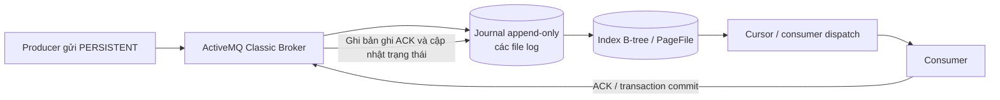
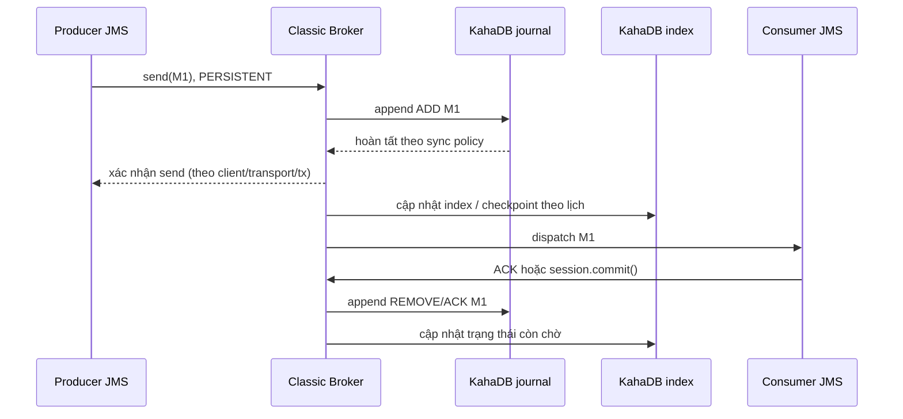
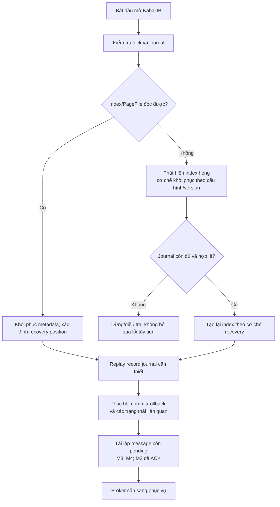

# KahaDB, journal, index và quá trình phục hồi sau khởi động

> **Chương:** Lưu trữ Classic  
> **Sản phẩm:** Apache ActiveMQ **Classic**; không áp dụng nguyên cơ chế/file KahaDB cho Apache ActiveMQ **Artemis**.  
> **Mục tiêu:** Giải thích bản ghi journal, index KahaDB, checkpoint/cleanup, chuỗi phục hồi khi broker khởi động lại; thực hành kiểm chứng message persistent sống qua restart và phân tích giới hạn khi journal/index lỗi.

## 1. Đặt vấn đề: broker chết sau khi nhận message nhưng trước khi consumer xử lý

Queue `orders.persisted` nhận message `M1` với delivery mode `PERSISTENT`. Producer nhận phản hồi gửi thành công, rồi broker Classic bị tắt đột ngột trước khi consumer ACK. Khi khởi động lại, broker phải biết:

- `M1` từng được gửi và đã cam kết lưu vào store chưa?
- `M1` thuộc destination nào, đã bị ACK/xóa chưa?
- Có transaction JMS chưa commit hoặc đang prepared không?
- Message còn nằm ở đoạn nào của journal để broker cấp lại cho consumer?
- Index nào có thể dùng ngay, phần index nào phải khôi phục từ các bản ghi sau checkpoint?

Đó là công việc của **KahaDB** — persistence adapter dựa trên file, mặc định trong ActiveMQ Classic từ 5.4. KahaDB không phải cơ sở dữ liệu SQL và không phải thành phần storage mặc định của Artemis.



Sơ đồ thể hiện luồng **logic**, không yêu cầu journal phải đợi index được ghi xuống disk trong mỗi lần gửi. Chính việc ghi theo thứ tự và có checkpoint cho phép index cập nhật trễ hơn nhưng vẫn khôi phục được sau crash.

## 2. Mô hình dữ liệu: journal là lịch sử thay đổi, index là cấu trúc tra cứu

KahaDB kết hợp hai cơ chế:

1. **Journal append-only**: ghi các sự kiện làm thay đổi trạng thái message store, theo thứ tự; tránh cập nhật ngẫu nhiên nhiều vị trí trên đĩa cho mỗi message.
2. **Index phân trang** (*PageFile*, dùng cấu trúc tra cứu kiểu B-tree): lưu metadata đã xử lý để tìm message theo destination/sequence/location và quản lý trạng thái đang chờ; có thể checkpoint và phục hồi dựa trên journal.

### 2.1. Ví dụ chuỗi thay đổi

```text
Thời điểm   Thao tác nghiệp vụ        Bản ghi logic trong KahaDB
t1          Producer gửi M1         ADD M1 -> queue orders.persisted
t2          Producer gửi M2         ADD M2 -> queue orders.persisted
t3          Consumer xử lý M1       REMOVE/ACK M1
t4          Broker checkpoint       Ghi trạng thái index và vị trí replay
t5          Producer gửi M3         ADD M3 -> queue orders.persisted
t6          Broker crash           Không có clean shutdown
```

Sau lần khởi động kế tiếp, broker cần đưa queue về trạng thái tương đương:

```text
orders.persisted: M2, M3 còn chờ
M1 đã ACK => không được tái xuất hiện chỉ vì index chưa kịp flush
```

Các tên `ADD`/`REMOVE` ở đây chỉ mô tả sự kiện **logic**; trên đĩa chúng được mã hóa thành command/record nhị phân KahaDB cùng metadata phục vụ transaction. Không mở file journal bằng text editor rồi diễn giải các dòng như log văn bản.

### 2.2. Journal lưu gì?

Tùy loại destination và thao tác, journal lưu bản ghi liên quan đến:

- Message mới cần lưu bền vững, bao gồm payload/metadata cần thiết.
- Acknowledgment hoặc thao tác loại message khỏi trạng thái còn chờ.
- Transaction JMS: các cập nhật chưa hoàn tất, commit/rollback và trạng thái cần phục hồi.
- Metadata cần khôi phục index/durable subscription theo cấu trúc của từng phiên bản.

**Journal không phải một file backup bất biến**: nó được chia thành nhiều log segment và broker có thể thu hồi segment không còn được tham chiếu. Sau khi một message đã ACK, thông tin về message vẫn có thể còn trên file vật lý cho đến đợt cleanup; ngược lại một segment có thể bị giữ vì bản ghi ACK cần thiết cho phục hồi.

### 2.3. Index lưu gì?

Index giúp broker tìm message còn chờ mà không cần quét **toàn bộ journal cho mỗi lần receive**. Có thể hình dung:

```text
Index:
  destination = orders.persisted
     sequence=42 -> Journal Location(fileId=7, offset=...)
     sequence=43 -> Journal Location(fileId=8, offset=...)

Journal:
  db-7.log -> ... ADD M2 ...
  db-8.log -> ... ADD M3 ...
```

`Location` là một tham chiếu tới bản ghi journal, không phải message body chứa nguyên trong B-tree. KahaDB quản lý nhiều cấu trúc metadata, bao gồm thông tin destination/message và transaction/durable subscription; sơ đồ trên chỉ thể hiện nguyên tắc để dễ học.

**Phân biệt rất quan trọng:** index là bộ máy tìm kiếm nhanh và checkpoint trạng thái; journal là nguồn lịch sử có thể replay. Nhưng không được kết luận “xóa index luôn an toàn”: journal có thể thiếu segment đã cleanup, metadata subscription có thể cần cấu trúc index, và độ an toàn phụ thuộc trạng thái store/phiên bản.

## 3. Các file thường thấy trong thư mục KahaDB

Một ví dụ thư mục của broker Classic:

```text
data/
└── kahadb/
    ├── lock
    ├── db.data
    ├── db.redo
    ├── db-1.log
    ├── db-2.log
    └── db-3.log
```

Đây là **tên điển hình**, không phải danh sách file bắt buộc luôn xuất hiện chính xác như vậy. Số lượng log, tên file phụ, thư mục `indexDirectory` và đường dẫn `dataDirectory` phụ thuộc phiên bản/cấu hình.

| File/nhóm | Vai trò | Quy tắc xử lý |
| --- | --- | --- |
| `db-*.log` | Journal segment chứa các record thay đổi của store | **Không xóa thủ công** vì có thể còn pending message, ACK hoặc transaction |
| `db.data` | PageFile/index metadata trên đĩa, phục vụ B-tree/tra cứu | Không xóa khi broker đang chạy; có nguy cơ phục hồi thiếu trạng thái nếu xử lý sai |
| `db.redo` | Recovery/redo file cho thao tác cập nhật PageFile/index, giúp nhất quán metadata khi crash giữa ghi | Không coi là bản sao toàn bộ journal hay bản backup độc lập |
| `lock` | Khóa truy cập KahaDB store, ngăn hai broker không được phối hợp cùng ghi vào thư mục | Không xóa để cưỡng ép hai process dùng chung store |
| File/archive bổ sung | Có thể xuất hiện theo preallocation/archiving hoặc tính năng store | Xác định vai trò qua phiên bản trước khi thao tác |

Theo tài liệu chính thức, `indexDirectory` (hỗ trợ từ Classic 5.10) có thể đặt `db.data` và `db.redo` tại vị trí **khác** thư mục journal. Vì vậy một bản backup chỉ chụp thư mục journal có thể thiếu index; ngược lại chỉ backup `db.data` thì không đủ để replay các thay đổi mới. Cần chụp **toàn bộ phạm vi store** theo chiến lược nhất quán.

### 3.1. Vì sao index có file `db.redo`?

Khi cập nhật nhiều trang index, mất điện/crash đúng giữa quá trình ghi có thể để lại metadata chỉ ghi được một phần. `db.redo` hỗ trợ cơ chế recovery của PageFile: lưu thông tin để kiểm tra/hoàn tất thay đổi index chưa nhất quán.

Đừng nhầm hai loại replay:

- **Redo index/PageFile:** bảo vệ tính nhất quán nội tại của metadata/index khi cập nhật bị gián đoạn.
- **Replay journal KahaDB:** áp dụng lại các record nghiệp vụ để tái tạo trạng thái store từ điểm đã biết tới cuối phần journal hợp lệ.

`db.redo` không thay thế `db-*.log`, và ngược lại. Nếu index bị hỏng, có thể cần xây dựng lại từ journal; đây là thao tác khắc phục sự cố có điều kiện, **không phải quy trình restart thường ngày**.

## 4. Đường ghi của một message PERSISTENT

Đường đi được đơn giản hóa:



Sơ đồ không mô tả thứ tự vật lý tuyệt đối của mọi thao tác dispatch/index: Classic có những lựa chọn **concurrent store and dispatch**. Giá trị quan trọng đối với tính bền vững là:

1. Producer dùng `DeliveryMode.PERSISTENT` và broker có `persistent="true"` cùng persistence adapter hoạt động.
2. Nếu session producer transacted, `send()` chỉ là một phần của transaction; **`session.commit()`** mới xác nhận transaction gửi đã hoàn tất.
3. Chính sách **disk sync** quyết định mức an toàn của các record đã ghi vào buffer hệ điều hành nhưng chưa được flush tới storage.
4. Consumer ACK/commit sau xử lý là một **thay đổi trạng thái** cần được lưu; nếu crash khi ACK chưa chắc chắn, message có thể được giao lại.

### 4.1. `PERSISTENT` không đồng nghĩa “an toàn trước mọi lỗi”

Ba miền lỗi cần tách riêng:

| Sự cố | KahaDB giải quyết điều gì? | Giới hạn |
| --- | --- | --- |
| Broker process bị kill/crash, disk nguyên vẹn | Khôi phục trạng thái từ index + journal hợp lệ | Chỉ những bản ghi đủ bền vững theo sync policy |
| Máy chủ mất điện, storage còn nguyên sau khi bật lại | Replay record đã được ghi bền vững | Page cache, controller cache và mức bảo đảm fsync/thiết bị ảnh hưởng dữ liệu ở đuôi |
| Ổ đĩa hỏng/mất cả server | KahaDB local **không tự tạo bản sao trên node khác** | Cần backup/HA/replication hoặc storage redundancy riêng |

`DeliveryMode.NON_PERSISTENT` không có cùng bảo đảm sống qua restart. Nếu một test thấy non-persistent message còn ở RAM sau restart nhẹ hoặc một trường hợp đặc thù, không được suy ra JMS yêu cầu lưu nó.

## 5. Checkpoint: cách index theo kịp journal

### 5.1. Vì sao không cập nhật bền vững mọi B-tree page với mỗi message?

Nếu mỗi ADD/ACK phải ghi ngẫu nhiên nhiều page index và `fsync` mọi page, I/O sẽ lớn. KahaDB ưu tiên ghi journal tuần tự rồi duy trì/cập nhật index theo các transaction nội bộ và checkpoint.

```text
Journal:  t0 ---- t1 ---- t2 ---- t3 ---- t4 ---- t5 ---- t6
                              ^
                    checkpoint / recovery position
Index:    metadata phản ánh trạng thái đã checkpoint
Crash:                                               X
Restart:            tải index + replay từ vị trí cần phục hồi -> t6
```

**Checkpoint không phải tên gọi khác của fsync journal.**

- **Journal sync** bảo vệ các record vừa ghi trước mất nguồn/crash.
- **Checkpoint index** đưa trạng thái index/metadata tới một mốc nhất quán để giảm công việc replay.
- **Cleanup journal** xác định segment nào không còn tham chiếu và đủ điều kiện thu hồi.

Các thao tác có lịch và ảnh hưởng khác nhau. Không được suy “checkpointInterval = 5000 ms nghĩa là broker có thể mất tối đa 5 giây message”. Cửa sổ mất dữ liệu phụ thuộc **journal sync strategy**, không phải đơn thuần khoảng checkpoint.

### 5.2. Tùy chọn liên quan

Ví dụ mặc định được tài liệu KahaDB công bố cho nhiều bản Classic:

| Thuộc tính | Ví dụ/mặc định tài liệu | Tác động cần hiểu |
| --- | --- | --- |
| `checkpointInterval` | `5000` ms | Chu kỳ checkpoint journal/index; giảm replay nhưng thêm I/O |
| `cleanupInterval` | `30000` ms | Chu kỳ kiểm tra khả năng dọn journal segment |
| `journalMaxFileLength` | `32mb` | Mức kích thước mục tiêu của mỗi journal log segment |
| `indexCacheSize` | `10000` pages | Số page index cache; tiêu tốn bộ nhớ |
| `indexWriteBatchSize` | `1000` | Batch cập nhật index |
| `indexDirectory` | Không đặt | Mặc định index nằm chung directory với journal |
| `journalDiskSyncStrategy` | `always` từ Classic 5.14+ | Đánh đổi sync an toàn với throughput |
| `checksumJournalFiles` | `true` trên các bản hiện đại | Có checksum phục vụ phát hiện record journal hỏng |

Các giá trị ở đây là **tham chiếu theo tài liệu**, không phải yêu cầu sao chép nguyên cho mọi workload/bản Classic. Chỉ thay sau khi đo tốc độ disk, mức persistent send/ACK, startup recovery, store usage và lỗi thực tế.

## 6. Khởi động lại: đường phục hồi bình thường và sau crash

### 6.1. Startup sạch: tải index rồi tiếp tục

Khi broker được dừng theo quy trình và KahaDB còn nguyên:

1. Broker khởi động, đọc cấu hình persistence adapter và xác định đường dẫn store.
2. Tiến hành khóa/kiểm tra quyền sở hữu store; hai broker độc lập không được cùng ghi vào cùng thư mục KahaDB.
3. Mở journal và PageFile/index, đọc metadata/checkpoint hợp lệ.
4. Phục hồi phần thay đổi chưa phản ánh đầy đủ trong index nếu cần (có thể rất ít).
5. Tái lập các queue, message còn pending, transaction state và durable subscription theo khả năng lưu trữ.
6. Broker sẵn sàng tiếp nhận client; consumer reconnect và nhận message còn đủ điều kiện delivery.

Restart bình thường **không nhất thiết phải quét tất cả journal từ đầu**. Recovery được rút ngắn nhờ index và vị trí ghi nhận gần nhất.

### 6.2. Startup sau crash: replay phần còn thiếu

Giả định trước khi crash:

```text
Index checkpoint cho biết: M1 đã ACK; M2 còn pending
Journal sau checkpoint:  ADD M3, ACK M2, ADD M4
Broker crash
```

Bước phục hồi:



Trên đường recovery bình thường, broker xác định điểm bắt đầu replay từ metadata/index, đọc tuần tự journal records còn cần áp dụng rồi cập nhật lại cấu trúc tra cứu. Khi index bị hỏng, code KahaDB có logic có thể **phát hiện lỗi nạp index và xây dựng lại từ journal**; quá trình này có thể rất lâu và không bảo đảm phục hồi hoàn hảo khi journal thiếu hoặc bị hỏng. Không sửa/xóa index để “ép” một startup như một bước vận hành thông thường.

### 6.3. Rebuild index không phải phép màu

Một thao tác kiểu “xóa `db.data` để KahaDB tự xây lại” có rủi ro:

- Journal segment cũ đã được cleanup nên không còn đầy đủ lịch sử từ thời điểm tạo destination/subscription.
- Một số metadata durable subscription, transaction hoặc vị trí checkpoint có thể không tái tạo theo cách mong muốn ở phiên bản cũ.
- Journal bị mất/chưa fsync hoặc hỏng; index không thể tạo lại dữ liệu không còn tồn tại.
- Nếu xóa index khi broker đang chạy, các file không còn nhất quán và có thể gây hỏng store nặng hơn.
- Backup chỉ chứa một phần file khiến recovery nhìn thấy các thời điểm khác nhau.

**Runbook an toàn:** ngừng mọi tiến trình dùng store, **chụp bản sao toàn bộ dữ liệu trước**, lưu log/version/configuration, kiểm tra ổ đĩa và journal integrity, rồi thực hiện trên bản clone trong môi trường lab. Chỉ dùng tùy chọn recovery đặc biệt theo tài liệu của **đúng bản Classic** và có phương án rollback. Không tự đề xuất lệnh xóa thủ công như biện pháp đầu tiên.

## 7. Đâu là giới hạn của `journalDiskSyncStrategy`?

Từ Classic 5.14, KahaDB có `journalDiskSyncStrategy`. Theo tài liệu:

| Chiến lược | Cơ chế | Ưu điểm | Rủi ro |
| --- | --- | --- | --- |
| `always` | Yêu cầu disk sync theo mỗi journal write | Bảo vệ mạnh nhất cho persistent record theo storage contract | Nhiều fsync có thể giới hạn throughput |
| `periodic` | Sync theo khoảng thời gian `journalDiskSyncInterval` nếu có ghi mới, và khi rotate journal | Ít I/O đồng bộ hơn | Có cửa sổ message đã báo gửi nhưng dữ liệu còn chưa kịp sync |
| `never` | Không chủ động sync journal | Có thể nhanh hơn | Có nguy cơ mất dữ liệu nhiều hơn khi process/host crash |

**Đừng tuyên bố RPO=0 chỉ vì `always`**. Tính đúng đắn còn phụ thuộc storage thực hiện flush thực sự, độ bền phần cứng, đường gửi/transaction và các miền lỗi như disk chết hẳn. `periodic` có khoảng rủi ro liên quan interval và hành vi OS/drive; không xem là một con số RPO chính xác áp dụng cho mọi outage.

Với workflow tài chính, nhiệm vụ cần giữ từng message, đặt `journalDiskSyncStrategy="always"` và đo latency trong điều kiện tải thật thường là điểm xuất phát hợp lý. Với analytics có thể tái tạo, `periodic` chỉ được xem xét nếu chủ sở hữu nghiệp vụ **chấp nhận rủi ro mất message**, có upstream replay/idempotency và SLA rõ ràng.

**Cảnh báo cấu hình cũ:** `enableJournalDiskSyncs` đã deprecated từ Classic 5.14; không trộn nó với `journalDiskSyncStrategy` rồi mặc định giá trị nào thắng. Với nhánh trước 5.14 dùng thuộc tính được hỗ trợ của phiên bản đó.

## 8. Cấu hình Classic `activemq.xml` cho một broker lab

Ví dụ fragment để đặt trong `<broker>` của Classic 5.14+:

```xml
<!-- Đặt trong <broker xmlns="http://activemq.apache.org/schema/core"> -->
<persistenceAdapter>
    <kahaDB
        directory="data/kahadb-recovery-lab"
        journalMaxFileLength="32mb"
        checkpointInterval="5000"
        cleanupInterval="30000"
        journalDiskSyncStrategy="always"
        checksumJournalFiles="true"/>
</persistenceAdapter>
```

Đây **không phải toàn bộ `activemq.xml`**. Broker ngoài thực tế còn có transport connectors, destination policies, security và `systemUsage`. Thư mục ở ví dụ là đường dẫn **tương đối** theo môi trường khởi động; trong production nên đặt path tuyệt đối hoặc variable được cấu hình ổn định, đảm bảo quyền ghi và volume bền vững.

Đồng thời broker phải có persistence được bật, ví dụ:

```xml
<broker xmlns="http://activemq.apache.org/schema/core"
        brokerName="kahadb-lab"
        persistent="true"
        ...>
    <!-- persistenceAdapter phía trên -->
</broker>
```

Dấu `...` là **minh họa cấu trúc**, không phải cú pháp XML hoàn chỉnh để copy chạy trực tiếp. Nếu đang dùng file phân phối Classic, thay đúng block `persistenceAdapter` và giữ nguyên phần còn lại do broker đã cấu hình.

### 8.1. Các thuộc tính không nên bật như một “cách sửa lỗi nhanh”

- `ignoreMissingJournalfiles="true"`: có thể cho phép bỏ qua journal bị thiếu, nhưng sẽ mất sự đảm bảo phát hiện dữ liệu hỏng và có nguy cơ mất message; **không** dùng để cho broker chạy bằng mọi giá.
- `checkForCorruptJournalFiles="true"`: tăng khả năng phát hiện đoạn journal hỏng lúc startup, nhưng **không** cam kết tự sửa mọi hư hỏng.
- `archiveCorruptedIndex="true"`: giữ lại index hỏng khi phục hồi, hữu ích cho chẩn đoán; không phải chính sách backup.
- `forceRecoverIndex` (nếu được hỗ trợ trên phiên bản đang dùng): chỉ cân nhắc theo runbook có bản sao dữ liệu và hiểu cơ chế.
- `enableIndexWriteAsync="true"`: thay đổi đường cập nhật index, cần benchmark và test crash; không mặc định “càng async càng tốt” cho persistent workload.

Một thay đổi cấu hình để broker khởi động được nhưng **bỏ qua dữ liệu thiếu** không nên được báo cáo là “đã phục hồi thành công”.

## 9. Journal cleanup: tại sao ACK hết rồi nhưng file log vẫn tăng?

KahaDB chia journal thành các segment. Chỉ một segment **không còn tham chiếu cần thiết** mới có thể được thu hồi (theo chu kỳ cleanup). Các nguyên nhân phổ biến giữ log cũ:

1. Trong segment còn một message pending thuộc queue hoặc durable topic subscription.
2. Segment chứa ACK liên quan tới ADD nằm trong một segment khác vẫn còn dùng; xóa ACK quá sớm có thể khiến replay hồi sinh message đã ACK.
3. Có transaction chưa hoàn tất/prepared cần bản ghi để recovery.
4. Segment đang được ghi hoặc còn vị trí chưa an toàn để cleanup.

Ví dụ:

```text
db-1.log: ADD M1, ADD M2
db-2.log: ACK M1, ADD M3
db-3.log: ACK M2, ACK M3

Tại thời điểm M1 đã ACK:
  db-1.log vẫn có ADD M2
  db-2.log có ADD M3 và ACK M1
  => chưa thể xóa chỉ vì "M1 đã hoàn thành"
```

Ngay cả khi queue depth về 0, journal vẫn có thể còn lớn trong một thời gian vì chu kỳ checkpoint/cleanup, các tham chiếu ACK, durable subscription khác và transaction. Classic có tính năng **ack compaction** (theo phiên bản) giúp gom thông tin ACK để giải phóng segment cũ.

### 9.1. Hai nhầm lẫn phổ biến

**Nhầm 1: `cleanupInterval=30000` nghĩa là mọi file quá 30 giây đều bị xóa.** Sai. Đây là chu kỳ *kiểm tra đủ điều kiện thu hồi*, không phải retention time cho message hay journal.

**Nhầm 2: Disk gần đầy, cứ xóa `db-1.log` cũ nhất.** Sai và nguy hiểm: log cũ có thể giữ ADD/ACK/transaction cần phục hồi. Hãy kiểm tra destination đang pending, durable subscriber không còn hoạt động, DLQ, scheduled message và transaction, rồi điều chỉnh dung lượng/retention bằng API và quy trình hợp lệ.

### 9.2. Chẩn đoán segment không được reclaim

- Kiểm tra queue depths, durable subscriptions, pending transactions và các destination không còn owner.
- Theo dõi `storeUsage`, free disk, I/O latency và tốc độ tăng journal.
- Xem broker log liên quan `org.apache.activemq.store.kahadb.MessageDatabase`, checkpoint/cleanup/recovery warnings; chỉ bật TRACE có giới hạn thời gian trong lab hoặc dưới kế hoạch vận hành vì log có thể rất lớn.
- Phân biệt **file preallocated** với mức bytes thực sự đã ghi và mức disk thực sự cấp phát; đừng kết luận memory leak chỉ từ kích thước file hiển thị.
- Xem cấu hình `enableAckCompaction`, `compactAcksAfterNoGC` và chiến lược archive theo phiên bản khi nhiều ACK giữ segment cũ.

## 10. Thực hành Java/JMS: persistent message tồn tại qua restart

Mục tiêu: dùng **cùng một broker và cùng KahaDB directory**, chứng minh:

1. Producer gửi **ba message PERSISTENT** bằng một JMS transaction rồi commit.
2. Dừng và bật lại broker **không xóa store**.
3. Browser hoặc consumer sau restart nhìn thấy ba message.
4. Consumer commit ACK ba message, restart lần nữa và xác nhận không còn pending.
5. Không nhầm lẫn với message cũ nhờ tên queue lab riêng cho mỗi run.

### 10.1. Dependency Maven Java 17

Ví dụ dành cho **ActiveMQ Classic 5.18.x** với `javax.jms`:

```xml
<properties>
    <maven.compiler.release>17</maven.compiler.release>
</properties>

<dependencies>
    <dependency>
        <groupId>org.apache.activemq</groupId>
        <artifactId>activemq-client</artifactId>
        <version>5.18.3</version>
    </dependency>
</dependencies>
```

Đây là phiên bản API **minh họa**, không phải khuyến nghị giữ nguyên phiên bản cũ trong production. Nếu dùng Classic 6.x, phải chọn đúng `jakarta.jms` và client artifact của nhánh đó. Bài tập lưu trữ không cần Artemis JMS client: **Artemis không dùng KahaDB làm store mặc định**.

### 10.2. Một chương trình hỗ trợ nhiều lần chạy

```java
import javax.jms.Connection;
import javax.jms.DeliveryMode;
import javax.jms.Message;
import javax.jms.MessageConsumer;
import javax.jms.MessageProducer;
import javax.jms.Queue;
import javax.jms.QueueBrowser;
import javax.jms.Session;
import javax.jms.TextMessage;

import org.apache.activemq.ActiveMQConnectionFactory;

import java.util.Enumeration;
import java.util.HashSet;
import java.util.Set;

public final class KahaDbRestartProbe {
    private static void require(boolean condition, String problem) {
        if (!condition) throw new IllegalStateException(problem);
    }

    public static void main(String[] args) throws Exception {
        if (args.length < 2 || args.length > 3) {
            throw new IllegalArgumentException(
                "Usage: <seed|browse|drain|empty> <queueName> [brokerURL]");
        }

        String mode = args[0];
        String queueName = args[1];
        String brokerUrl = args.length == 3
                ? args[2] : "tcp://localhost:61616";

        // Một queue chuyên biệt cho một lượt test. Ví dụ:
        // lab.kahadb.restart.run42
        require(queueName.startsWith("lab.kahadb.restart."),
                "Không được test trên queue nghiệp vụ");

        ActiveMQConnectionFactory factory =
                new ActiveMQConnectionFactory(brokerUrl);

        try (Connection connection = factory.createConnection()) {
            Session session = connection.createSession(
                    true, Session.SESSION_TRANSACTED);
            Queue queue = session.createQueue(queueName);

            switch (mode) {
                case "seed": {
                    MessageProducer producer =
                            session.createProducer(queue);
                    producer.setDeliveryMode(DeliveryMode.PERSISTENT);

                    for (int i = 1; i <= 3; i++) {
                        TextMessage message =
                                session.createTextMessage("payload-" + i);
                        message.setStringProperty(
                                "eventId", queueName + ":" + i);
                        producer.send(message);
                    }

                    // send() trong transacted session chưa đủ:
                    // chỉ commit xong mới tính 3 message đã được gửi.
                    session.commit();
                    producer.close();
                    System.out.println("SEED COMMITTED 3 messages");
                    break;
                }

                case "browse":
                case "empty": {
                    // Browser chỉ xem; không nhận để ACK.
                    connection.start();
                    QueueBrowser browser = session.createBrowser(queue);
                    Set<String> ids = new HashSet<>();
                    try {
                        Enumeration<?> e = browser.getEnumeration();
                        while (e.hasMoreElements()) {
                            Message message = (Message) e.nextElement();
                            String id = message.getStringProperty("eventId");
                            require(id != null && ids.add(id),
                                    "Missing/duplicate eventId: " + id);
                            System.out.println("BROWSE " + id);
                        }
                    } finally {
                        browser.close();
                    }

                    int expected = "empty".equals(mode) ? 0 : 3;
                    require(ids.size() == expected,
                            "Expected " + expected +
                            " pending messages, got " + ids.size());
                    System.out.println(
                            mode.toUpperCase() + " PASS: " + ids.size());
                    break;
                }

                case "drain": {
                    MessageConsumer consumer =
                            session.createConsumer(queue);
                    connection.start();

                    Set<String> ids = new HashSet<>();
                    for (int i = 1; i <= 3; i++) {
                        Message message = consumer.receive(5_000);
                        require(message instanceof TextMessage,
                                "Message missing or wrong JMS type");

                        String id = message.getStringProperty("eventId");
                        String body = ((TextMessage) message).getText();
                        require(id != null && ids.add(id),
                                "Missing/duplicate eventId: " + id);
                        require(body.startsWith("payload-"),
                                "Unexpected body: " + body);
                        System.out.println("RECEIVED " + id);
                    }

                    require(ids.size() == 3, "Unexpected message count");
                    session.commit();   // ACK cả ba message đã nhận.
                    consumer.close();
                    System.out.println("DRAIN COMMITTED 3 ACKs");
                    break;
                }

                default:
                    throw new IllegalArgumentException(
                            "Unknown mode: " + mode);
            }
        }
    }
}
```

**Điểm quan trọng trong code:**

- `DeliveryMode.PERSISTENT` trên producer và `session.commit()` sau khi seed là hai điều kiện riêng.
- Queue phải có tên mới cho mỗi test, ví dụ `lab.kahadb.restart.run42`; việc `createQueue` tạo object không mặc nhiên chứng minh broker đang dùng KahaDB — phải xem cấu hình `persistenceAdapter`.
- `browse` chỉ quan sát queue sau restart, **không ACK**.
- `drain` dùng transaction để ACK sau khi nhận và kiểm tra đủ ba message.
- Vì lab không có producer/consumer khác trên queue này, enumeration có thể dùng để kiểm tra số message quan sát được; trong hệ production, `QueueBrowser` không bảo đảm snapshot đầy đủ.

### 10.3. Kịch bản thao tác

Chạy một broker Classic lab với cấu hình KahaDB phần 8. Biên dịch chương trình trên bằng dependency phù hợp, rồi chạy `main` với các đối số theo thứ tự:

| Bước | Mode + queueName | Quan sát |
| --- | --- | --- |
| 1. Broker đang chạy | `seed lab.kahadb.restart.run42` | `SEED COMMITTED 3 messages` |
| 2. **Stop broker sạch** | Dùng cách dừng chuẩn của bản Classic đang chạy | Giữ nguyên thư mục `data/kahadb-recovery-lab` |
| 3. **Start broker lại** | Cùng file cấu hình, broker name và KahaDB directory | Log có dòng mở persistence adapter, có thể có replay |
| 4. Khi broker online | `browse lab.kahadb.restart.run42` | `BROWSE PASS: 3` |
| 5. Xử lý message | `drain lab.kahadb.restart.run42` | `DRAIN COMMITTED 3 ACKs` |
| 6. Stop/start broker lần hai | Vẫn giữ nguyên store | Không tạo queue test mới |
| 7. Kiểm tra cuối | `empty lab.kahadb.restart.run42` | `EMPTY PASS: 0` |

Đặt broker URL làm đối số thứ ba nếu không dùng `localhost:61616`. Với broker bật bảo mật, chỉnh cách tạo connection để nhận username/password từ nguồn an toàn trước khi chạy; không cố thử bằng tài khoản production.

**Đường so sánh:** Sau restart thứ nhất, ba message pending chứng minh persistent record và trạng thái queue đã phục hồi. Sau commit ACK và restart thứ hai, queue rỗng cho thấy ACK state cũng được lưu. **Không cần xóa hoặc sửa bất kỳ file KahaDB nào** để chứng minh điều đó.

### 10.4. Crash test là phép thử riêng

Chỉ trong lab có bản sao/queue riêng:

1. Seed thêm một run ID mới và xác nhận producer commit thành công.
2. Chấm dứt **broker process không graceful** (theo công cụ quản trị môi trường thử nghiệm), không phá filesystem.
3. Start lại broker với **cùng store**.
4. Quan sát log `Recovering from the journal`/`Recovery replayed ... operations` nếu có.
5. Browse/consume theo ID; ghi số message còn pending, thời gian broker startup và latency tới khi consumer kết nối lại.

Không áp dụng cách dừng thô cho production, và **không dùng trực tiếp kill hoặc tháo disk** trong một shared environment. Nếu test mất điện/storage, phải mô phỏng trên máy/volume cô lập và có backup.

**Giải thích giới hạn:** Một vài message ở biên có thể đã được producer gửi nhưng chưa nhận được **phản hồi transaction commit** khi broker crash. Sau khi reconnect, producer không thể tự biết chính xác kết quả commit từ network timeout; vì vậy cần event ID và idempotency/reconciliation, không suy “exception = chắc chắn chưa ghi”.

## 11. Đọc log startup để hiểu KahaDB đang phục hồi gì

Những chuỗi có thể xuất hiện trên Classic (thời gian/số record thay đổi theo bản):

```text
Using Persistence Adapter: KahaDBPersistenceAdapter[...]
KahaDB is version ...
Opening MessageDatabase
Recovering from the journal @...
Recovery replayed ... operations from the journal in ... seconds
... broker started ...
```

**Không mặc định tất cả các dòng sẽ xuất hiện ở mọi phiên bản**. Khối lượng replay bằng 0 hoặc rất nhỏ sau clean shutdown là điều bình thường.

### 11.1. Những tín hiệu cần phân biệt

| Tín hiệu | Suy luận đúng | Không được suy luận |
| --- | --- | --- |
| `Using Persistence Adapter: KahaDB...` | Broker dùng KahaDB tại path đang hiển thị | Mọi message gửi đều persistent |
| `Recovering from the journal @...` | Có vị trí cần scan/replay | “Broker đang mất dữ liệu” |
| `Recovery replayed N operations...` | N bản ghi được replay trong lần này | Queue đang có N message pending |
| `Index corrupted. Recovering...` | Index load gặp lỗi, đang vào đường recovery đặc biệt | Rebuild chắc chắn giữ 100% mọi metadata |
| `Missing journal file` / checksum/corruption | Store có vấn đề tính toàn vẹn cần điều tra | Bật ignoreMissing là phương án an toàn |
| Startup chậm bất thường | Có thể replay dài, disk I/O chậm hoặc index bất thường | Chỉ cần tăng RAM là xong |

Đừng đánh giá thành công chỉ vì TCP port đã mở. Phải xác nhận **queue message count, durable subscriptions, transaction recovery, khả năng consume/ACK và log cảnh báo**.

### 11.2. Tại sao restart có thể chậm?

- Journal sau checkpoint có nhiều operation cần replay.
- Index hỏng hoặc metadata thiếu, dẫn tới dựng lại phần lớn/trọn journal còn tồn tại.
- Disk bão hòa IOPS hoặc throughput; volume network có độ trễ fsync cao.
- Store nhiều destination và subscription, transaction đang prepared hoặc ACK references phức tạp.
- File journal lớn, preallocation, chống phân mảnh và checksum checking trên nhiều file.

Cách đo: ghi tổng thời gian `process start -> persistence recovered -> transport accepting -> consumer ready`, số record replayed, dung lượng log, tốc độ đọc disk và lỗi. Không tuyên bố đã cải thiện recovery nếu mới đo thời gian container khởi động nhưng chưa kiểm chứng message còn đầy đủ.

## 12. Backup, HA và ranh giới phục hồi

### 12.1. Backup KahaDB không phải copy một file tùy ý khi broker đang ghi

Nếu copy `db.data` ở thời điểm A, `db.redo` ở B và journal ở C trong lúc broker đang ghi, các phần có thể không cùng một trạng thái nhất quán.

Tài liệu ActiveMQ khuyến nghị **freeze filesystem** chứa database để lấy snapshot nhất quán (nếu dùng snapshot khi broker còn chạy). Một phương án dễ kiểm soát hơn trong lab là dừng broker sạch, backup **toàn bộ store**, sau đó thử restore lên **broker lab riêng**.

Quy trình vận hành gợi ý:

1. Xác định chính xác thư mục KahaDB, `indexDirectory` (nếu tách), phiên bản broker và cấu hình.
2. Đảm bảo backup nhất quán: stop broker sạch hoặc dùng snapshot filesystem atomic có hỗ trợ/freeze phù hợp.
3. Sao lưu **đầy đủ** journal, index, redo và metadata liên quan.
4. Kiểm tra checksum và lưu dấu phiên bản/configuration, định kỳ **restore test**.
5. Chỉ khởi động **một broker** trên bản store clone; không cho hai process cùng ghi lên bản thật.
6. Sau restore, kiểm tra pending, ACK state, durable subscription và một số business IDs, không chỉ file count.

**Không đưa một snapshot KahaDB độc lập làm lời hứa HA tự động.** Backup phục vụ khôi phục về điểm snapshot, chịu RPO/RTO tương ứng; ActiveMQ Classic HA/master-slave/storage topology là một bài toán khác.

### 12.2. Khi ổ đĩa KahaDB bị lỗi thật

Nếu journal thiếu record hoặc data file bị hỏng, không có cam kết rằng index rebuild sẽ cứu được mọi message. Cần đánh giá:

- Có bản backup/snapshot nhất quán gần nhất không?
- Những segment nào thiếu; checksum báo lỗi ở vị trí nào?
- Có message producer nào được xác nhận thành công nhưng sau đó mất không?
- Durable subscription và transaction state còn đầy đủ không?
- Có thể phục hồi từ upstream event log/outbox/replay theo event ID không?

**Phương án cứu dữ liệu phải bảo toàn bằng chứng**: không xóa journal hoặc chạy nhiều lần với cấu hình bỏ qua lỗi trên bản gốc. Thực hiện các thử nghiệm phục hồi trên clone và ghi rõ lượng dữ liệu xác minh được.

## 13. Tuning đúng mục tiêu: throughput, disk space hay recovery time?

| Mục tiêu | Chỉ số cần đo | Lựa chọn cần xem xét | Đánh đổi |
| --- | --- | --- | --- |
| Persistent send an toàn | p95/p99 send + commit latency, fsync, message loss khi fault test | `journalDiskSyncStrategy=always` | Disk sync nhiều |
| Giảm latency journal write | Disk IOPS, batching, log rotation, fsync | `journalMaxFileLength`, preallocation, storage nhanh | Tăng tốc không mặc nhiên tăng an toàn |
| Giảm thời gian restart | Recovery replayed operations, index status, IO read, startup time | Checkpoint interval và sức khỏe index | Checkpoint quá dày gây thêm write load |
| Kiểm soát disk đầy | Journal size, storeUsage, queue/DLQ/durable pending | Cleanup, ack compaction, xử lý pending đúng nguyên nhân | Không được xóa log cũ bằng tay |
| Tăng số destination | Queue count, index memory, GC, startup time | `indexCacheSize`, indexWriteBatchSize, tổ chức destination | Thêm cache ngốn heap |
| Cô lập hot destination | StoreUsage và journal retention theo nhóm | `mKahaDB` nếu cần, nhiều store theo destination | Cấu hình phức tạp, transaction xuyên journal có chi phí |

**Không cần chọn mKahaDB ngay** chỉ để hiểu journal/index. Một KahaDB store đã đủ minh họa. mKahaDB có thể chia destination thành nhiều persistence adapter để giảm ảnh hưởng một queue giữ log, nhưng không đổi nguyên lý replay và khiến transaction qua nhiều journal phức tạp hơn.

## 14. Những nhận định sai cần sửa

**“KahaDB là Artemis journal.”** Sai. KahaDB là persistence adapter của ActiveMQ **Classic**; Artemis có hệ journal/paging/bindings riêng. Không copy tên file `db.data`/`db.redo` hay `journalDiskSyncStrategy` của Classic sang broker Artemis.

**“Checkpoint mỗi 5 giây thì broker có thể mất tối đa 5 giây dữ liệu.”** Sai. Checkpoint giúp đồng bộ index/recovery position; cửa sổ mất record còn phụ thuộc journal sync strategy và tính đúng của storage.

**“Message đã ACK thì journal chứa nó được xóa ngay.”** Sai. Journal segment có thể còn các message, ACK và transaction cần thiết; cleanup theo điều kiện tham chiếu, không theo từng ACK tức thì.

**“db.redo là bản sao đầy đủ của message body.”** Sai. Nó phục vụ recovery của index/PageFile, không thay thế journal.

**“Có journal thì cứ xóa db.data khi gặp lỗi.”** Sai. Index có thể dựng lại trong điều kiện phù hợp, nhưng journal đã cleanup, durable subscription và dữ liệu hỏng là rủi ro nghiêm trọng. Không thao tác trên store gốc nếu chưa sao lưu và lập runbook.

**“Broker restart thành công nghĩa là không mất message.”** Sai. Cần đối chiếu tập `eventId` đã producer commit, message được khôi phục, dữ liệu đã ACK và những message ở transaction/DLQ.

**“PERSISTENT bảo vệ được mất cả ổ đĩa.”** Sai. Một store local không tự có replication sang node khác.

## 15. Checklist nghiệm thu bài thực hành

- [ ] Broker là **ActiveMQ Classic** và đang dùng `KahaDBPersistenceAdapter` tại đúng path.
- [ ] Đã ghi nhận phiên bản Classic, cấu hình `persistent=true` và `journalDiskSyncStrategy`.
- [ ] Producer gửi `DeliveryMode.PERSISTENT`, session transaction đã `commit()` thành công.
- [ ] Queue lab có tên riêng, không có consumer khác lấy message.
- [ ] Sau clean restart, `browse` thấy đúng message chưa ACK.
- [ ] Sau `drain` và commit ACK, restart lần hai không còn message pending.
- [ ] Không xóa/sửa `db-*.log`, `db.data`, `db.redo` hoặc `lock` trong bài test.
- [ ] Quan sát log recovery và ghi thời gian startup, không suy message count từ số record replayed.
- [ ] Đã hiểu checkpoint khác journal fsync và cleanup.
- [ ] Đã hiểu journal file không được thu hồi nếu còn pending message, ACK reference hay transaction.
- [ ] Biết cách backup nhất quán và restore thử trên clone.
- [ ] Chỉ thử crash không graceful trong **môi trường lab**, có dữ liệu có thể tái tạo.

## 16. Câu hỏi tự kiểm tra

1. Vì sao ActiveMQ Classic cần cả journal và index, thay vì duyệt journal cho mỗi lần `receive()`?
2. Vai trò của `db.data` khác `db.redo` và `db-*.log` ở đâu?
3. Một message đã producer commit và consumer chưa ACK, sau broker restart sạch phải có trạng thái thế nào?
4. Khi crash sau checkpoint, broker khôi phục trạng thái bằng bước nào thay vì nhất thiết quét toàn bộ journal từ đầu?
5. `checkpointInterval` có xác định cửa sổ mất dữ liệu giống `journalDiskSyncStrategy` không?
6. Vì sao journal segment cũ vẫn tồn tại khi queue depth đã giảm về 0?
7. Khi file `db.data` hỏng, có nên xóa ngay và khởi động broker trên store production không?
8. Nếu journal mất một đoạn nhưng index vẫn còn, có thể cam kết phục hồi không mất message không?
9. Mô hình `periodic` sync cần được phê duyệt về điều gì trước khi dùng cho luồng thanh toán?
10. KahaDB có thay thế backup, replication hoặc HA khi cả máy chủ và disk bị hỏng không?

**Gợi ý:** (1) journal ghi tuần tự, index tra cứu nhanh; (2) index/PageFile, redo metadata, journal record; (3) còn pending nếu record bền vững; (4) replay từ recovery position và xử lý transaction; (5) không; (6) còn tham chiếu/ACK/transaction hoặc chu kỳ cleanup; (7) không, backup clone/runbook; (8) không; (9) rủi ro mất message/RPO và upstream replay; (10) không.

## 17. Nguồn tham khảo chính thức

- [ActiveMQ Classic — KahaDB](https://activemq.apache.org/components/classic/documentation/kahadb): cấu hình, journal sync, indexDirectory, checkpointInterval và cleanupInterval.
- [ActiveMQ Classic — How do I back-up KahaDB](https://activemq.apache.org/components/classic/documentation/how-do-i-back-up-kahadb): snapshot/freeze filesystem và khôi phục index từ trạng thái nhất quán.
- [ActiveMQ Classic — Why do KahaDB log files remain after cleanup](https://activemq.apache.org/components/classic/documentation/why-do-kahadb-log-files-remain-after-cleanup): tham chiếu pending message, ACK và transaction giữ segment.
- [ActiveMQ Classic — Persistence](https://activemq.apache.org/components/classic/documentation/persistence): phân biệt thế hệ persistence adapter và đặc tính KahaDB.
- [ActiveMQ Classic — KahaDBPersistenceAdapter Javadoc](https://activemq.apache.org/components/classic/documentation/maven/apidocs/org/apache/activemq/store/kahadb/KahaDBPersistenceAdapter.html): API cấu hình hiện có và `forceRecoverIndex`.
- [Apache ActiveMQ — KahaDB MessageDatabase source](https://github.com/apache/activemq/blob/main/activemq-kahadb-store/src/main/java/org/apache/activemq/store/kahadb/MessageDatabase.java): các đường `open()`, `loadPageFile()`, `recover()`, replay journal và phục hồi index để tra cứu chuyên sâu theo phiên bản.

> **Kết luận:** **Journal** ghi lịch sử thay đổi có thể replay; **index/PageFile** giúp tra cứu và nắm trạng thái message hiệu quả; **checkpoint** rút ngắn replay; **cleanup** chỉ thu hồi journal segment không còn tham chiếu. Khi broker khởi động lại, KahaDB kết hợp index/redo và journal để tái lập những message chưa ACK cùng transaction state. Độ tin cậy thực tế còn phụ thuộc `PERSISTENT`, `commit()`, **disk sync**, sự toàn vẹn của store và chiến lược backup/HA riêng.
