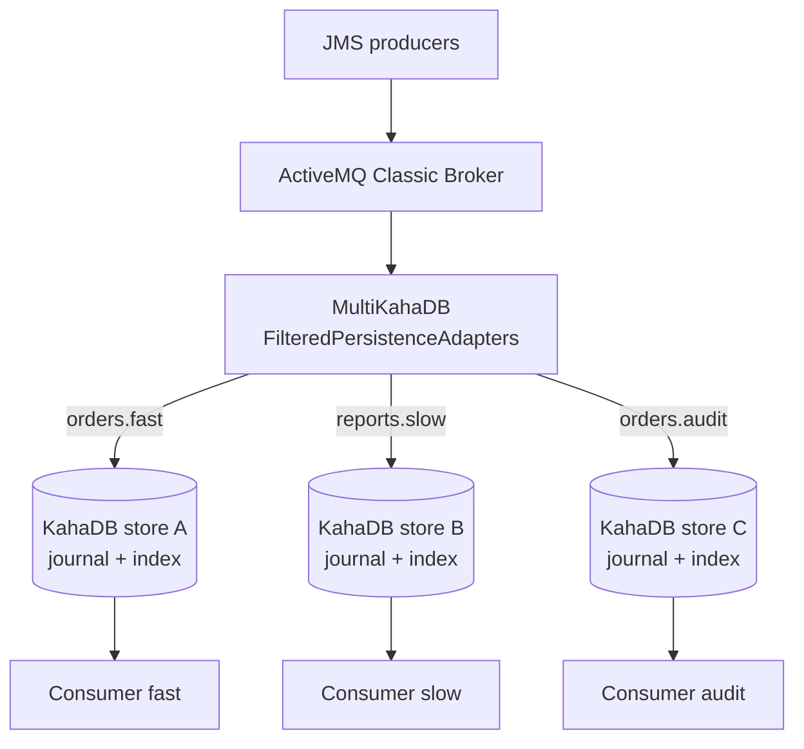

# MultiKahaDB và tách vùng lưu trữ theo destination

> **Chương:** Lưu trữ Classic  
> **Phạm vi:** Apache ActiveMQ **Classic** với persistence adapter `KahaDB`/`MultiKahaDB`. Trọng tâm là cách ánh xạ **destination → store**, lợi ích giới hạn ảnh hưởng của backlog lên journal cleanup, cấu hình `activemq.xml`, kiểm chứng bằng JMS và các lưu ý chuyển đổi/vận hành. Đây **không phải** cơ chế lưu trữ của Artemis.

## 1. Bài toán: một queue tồn đọng giữ chân dữ liệu của queue khác

Giả sử broker Classic phục vụ:

- `orders.fast`: lượng message lớn nhưng consumer thường xử lý ngay.
- `reports.slow`: consumer có thể ngừng nhiều giờ, tích backlog dài.
- `orders.audit`: yêu cầu lưu bền và cần phục hồi khi broker restart.

Với **một KahaDB store dùng chung**, journal chứa dữ liệu/metadata cho nhiều destination. Dù message của `orders.fast` đã được tiêu thụ, broker không thể tùy tiện xóa một journal segment nếu còn bản ghi sống hoặc tham chiếu cần thiết cho `reports.slow` trong segment đó. Hệ quả có thể là disk tăng, dọn journal chậm và các queue không liên quan tác động lẫn nhau.

**MultiKahaDB** cho phép broker Classic định tuyến *storage của message* tới **nhiều KahaDB persistence adapter**, dựa trên destination, ví dụ một store cho từng queue:



Khi `reports.slow` tồn backlog, các journal segment thuộc **store riêng của `orders.fast`** không bị giữ lại chỉ vì message trong store của `reports.slow`. Đây là **cách ly vòng đời lưu trữ và dọn journal**, không phải tạo broker mới hay chia cluster.

**Giới hạn rất quan trọng:** Tất cả store vẫn thuộc **một tiến trình broker**, có thể cùng JVM, filesystem, ổ đĩa và hạn mức tổng. MultiKahaDB không tự đem lại HA, replication, chống hỏng cùng ổ đĩa hoặc cam kết tăng throughput.

## 2. MultiKahaDB hoạt động ở tầng nào?

Một message đi theo đường logic:

```text
Producer
   |
   v
Broker nhận message
   |
   +-- Destination = orders.fast (queue)
   |      -> Filter queue tương ứng
   |      -> KahaDB instance cho orders.fast
   |
   +-- Destination = reports.slow (queue)
          -> Filter queue tương ứng
          -> KahaDB instance cho reports.slow
```

### 2.1. Các thành phần

| Thành phần | Vai trò | Điều **không** nên hiểu nhầm |
| --- | --- | --- |
| `<mKahaDB>` | Adapter cha quản lý nhiều persistence adapters con | Không phải broker hoặc network transport khác |
| `<filteredPersistenceAdapters>` | Danh sách luật ánh xạ destination | Không phải JMS selector lọc body/property |
| `<filteredKahaDB queue="...">` | Chọn store theo **tên queue** khớp pattern | Không quyết định consumer nào nhận message |
| `<filteredKahaDB topic="...">` | Chọn store cho **topic** khớp pattern | Không biến topic thành queue |
| `perDestination="true"` | Tạo một KahaDB con cho từng destination khớp luật | Không có nghĩa mỗi message hoặc mỗi consumer một store |
| `<kahaDB>` lồng bên trong | Template/cấu hình của store con như journal file size | Không tự tạo thư mục storage độc lập nếu mọi instance trỏ nhầm cùng path |

KahaDB thông thường lưu thông tin bền vững bằng **append-only journal** và **index** để truy xuất message/queue. Journal chứa nhiều segment; index cần checkpoint/recovery nhất quán. MultiKahaDB áp dụng cùng cơ chế đó cho **nhiều store con** thay vì một journal/index toàn cục cho mọi destination.

### 2.2. Phân vùng lưu trữ khác với phân vùng routing

| Hoạt động | Ai quyết định? | MultiKahaDB ảnh hưởng thế nào? |
| --- | --- | --- |
| Producer gửi vào queue `orders.fast` | Destination JMS và routing của Classic | Không đổi đường gửi |
| Broker giao message cho consumer A/B | Queue, dispatch policy, prefetch, consumer | Không thay đổi semantics nhận |
| Broker lưu persistent message của `orders.fast` | Persistence adapter được chọn bởi filter | **Chọn store KahaDB con** |
| Broker chuyển poison message sang `DLQ.orders.fast` | DeadLetterStrategy / destination policy | DLQ là **destination khác**, có thể ánh xạ sang store khác |
| Durable topic subscription giữ message offline | Topic/subscription và persistence | Store topic tương ứng quản lý dữ liệu subscription |

Điểm cuối đặc biệt quan trọng: một topic có nhiều durable subscribers **không mặc nhiên tạo một KahaDB store cho từng subscriber**. Nếu bật `perDestination` cho topic, ranh giới là **topic destination** theo filter, trong khi dữ liệu subscription vẫn liên quan đến cùng topic/store và có thể ảnh hưởng tốc độ thu hồi journal.

## 3. Cấu hình tối thiểu: một KahaDB store cho mỗi queue và topic

Ví dụ cấu hình trong phần `<broker>` của `activemq.xml`, thay thế **persistence adapter đang dùng** bằng một adapter MultiKahaDB:

```xml
<persistenceAdapter>
    <mKahaDB directory="${activemq.data}/mKahaDB">
        <filteredPersistenceAdapters>
            <filteredKahaDB queue=">" perDestination="true">
                <persistenceAdapter>
                    <kahaDB journalMaxFileLength="32mb"/>
                </persistenceAdapter>
            </filteredKahaDB>

            <filteredKahaDB topic=">" perDestination="true">
                <persistenceAdapter>
                    <kahaDB journalMaxFileLength="32mb"/>
                </persistenceAdapter>
            </filteredKahaDB>
        </filteredPersistenceAdapters>
    </mKahaDB>
</persistenceAdapter>
```

**Chú giải:**

- `directory="${activemq.data}/mKahaDB"` là **thư mục gốc** cho MultiKahaDB. Đảm bảo nó nằm trên volume persistent và được broker process cấp quyền ghi.
- `queue=">"` và `topic=">"` dùng wildcard `>` của ActiveMQ Classic để khớp lần lượt tất cả queue/topic trong phạm vi pattern.
- `perDestination="true"` khiến mỗi queue hoặc topic khớp rule dùng **store KahaDB con riêng**.
- `journalMaxFileLength="32mb"` giới hạn kích thước mục tiêu của **một file journal segment**, **không** phải dung lượng tối đa của queue hoặc tổng store.
- Đoạn trên là **trích đoạn cấu hình**: cần giữ các cấu hình broker khác (connectors, destination policies, security, management) trong file gốc và bảo đảm chỉ có **một** `<persistenceAdapter>` có hiệu lực.

Trong chế độ per-destination, nên để MultiKahaDB tự quản lý thư mục con theo destination. **Đừng hardcode cùng một `directory` trên mọi `<kahaDB>` con**: các store không được chia sẻ bừa bãi một bộ file journal/index. Kiểm tra tên/thư mục thực tế do phiên bản Classic tạo thay vì giả định đường dẫn con chính xác từ ví dụ.

### 3.1. Ánh xạ kỳ vọng

Với cấu hình trên:

| Destination phát sinh message bền vững | Loại | Store được mong đợi |
| --- | --- | --- |
| `orders.fast` | Queue | Store riêng dành cho `orders.fast` |
| `reports.slow` | Queue | Store riêng dành cho `reports.slow` |
| `orders.audit` | Queue | Store riêng dành cho `orders.audit` |
| `events.orders` | Topic | Store riêng dành cho topic `events.orders` |
| `DLQ.orders.fast` | Queue | Nếu tồn tại và rule `queue=">"` khớp, có store riêng **của DLQ** |

**Store có thể được tạo lười (lazy)** khi destination thực sự sử dụng persistence, tùy phiên bản và đường đi message. Chỉ việc khai báo tên queue trong mã Java chưa đủ chứng minh một journal con đã được khởi tạo và ghi dữ liệu.

**Không nhầm tên queue với tên thư mục**: path thực tế có thể được escape/sanitize và chứa metadata nội bộ; nên đối chiếu cấu hình, broker startup logs và số liệu store để xác nhận mapping.

## 4. Khi không muốn mỗi queue là một store: nhóm theo pattern

Mỗi destination một store giúp cô lập retention, nhưng nếu có hàng nghìn queue ngắn hạn hoặc tên queue sinh động theo tenant/request, số journal/index có thể tăng rất lớn.

Lựa chọn khác là **gom nhiều queue có cùng tính chất vận hành vào một store**, đồng thời giữ một số queue quan trọng ở store khác:

```text
Queue                        KahaDB store mong muốn
orders.import                orders-group
orders.enrich                orders-group
billing.capture              billing-group
billing.refund               billing-group
logs.temporary               general / per-destination tùy policy
```

### 4.1. Ví dụ tách hai nhóm queue

Đây là trích đoạn các luật dành cho queue. Khi áp dụng, cần **bổ sung mapping cho các destination khác** (đặc biệt topic và queue không khớp), đồng thời đối chiếu policy matching thực tế:

```xml
<filteredPersistenceAdapters>
    <!-- Các queue orders.* cùng dùng một store. -->
    <filteredKahaDB queue="orders.>" perDestination="false">
        <persistenceAdapter>
            <kahaDB journalMaxFileLength="64mb"/>
        </persistenceAdapter>
    </filteredKahaDB>

    <!-- Các queue billing.* cùng dùng store khác. -->
    <filteredKahaDB queue="billing.>" perDestination="false">
        <persistenceAdapter>
            <kahaDB journalMaxFileLength="32mb"/>
        </persistenceAdapter>
    </filteredKahaDB>
</filteredPersistenceAdapters>
```

Trong một rule `perDestination="false"`, các destination **khớp cùng rule** dùng chung một persistence adapter con. Việc `orders.import` và `orders.enrich` cùng store giúp giảm số store, nhưng backlog của một queue có thể ảnh hưởng cleanup journal của queue còn lại **trong nhóm đó**.

**Quan trọng về fallback:** Đừng đưa đúng trích đoạn hai rule này vào production khi broker còn queue/topic khác. Phải có luật/default store bao phủ các destination còn lại và thử kiểm chứng mapping. Khi cấu hình rule rộng như `queue=">"` cùng rule hẹp `queue="orders.>"`, thứ tự/ưu tiên chọn luật cần được xác minh theo phiên bản; đừng giả định rule rộng sẽ không che mất rule hẹp.

### 4.2. Chọn per-destination hay theo nhóm?

| Tình huống | Cấu hình đáng cân nhắc | Vì sao |
| --- | --- | --- |
| Ít queue, backlog rất lệch nhau | `perDestination="true"` | Tránh queue chậm giữ journal của queue nhanh |
| Nhiều queue cùng team và SLA, backlog tương tự | Nhóm theo pattern | Giảm số store/file handle |
| Hàng nghìn queue động | Tránh per-destination bừa bãi | Nhiều store làm tăng overhead/khó backup và recovery |
| Một queue cần quan sát disk/cleanup độc lập | Rule/store riêng | Dễ khoanh vùng journal growth |
| Topic có nhiều durable subscriptions lâu offline | Cân nhắc store riêng cho topic | Backlog subscriber của topic vẫn có thể giữ dữ liệu trong cùng store topic |
| Virtual Topic có consumer queues | Kiểm tra **tên queue vật lý** thực tế | `Consumer.X.VirtualTopic.Y` là queue; có thể match rule queue, không phải rule topic |

Không có một cách tách store tối ưu cho mọi broker. Mục tiêu là **cô lập tài nguyên phát sinh bởi backlog** nhưng giữ số lượng store trong khả năng vận hành.

## 5. Journal cleanup: MultiKahaDB giải quyết chuyện gì và không giải quyết chuyện gì?

KahaDB sử dụng journal segment và index. Một segment chỉ có thể được dọn khi dữ liệu/metadata liên quan không còn cần giữ để phục hồi. Nếu segment chứa nhiều destination, một message tồn lâu có thể làm segment không đủ điều kiện thu hồi dù phần lớn message khác đã được ACK.

### Trường hợp chỉ một store

```text
Journal segment J42 (single KahaDB)
  - orders.fast: M1  (đã ACK)
  - orders.fast: M2  (đã ACK)
  - reports.slow: N1 (chưa ACK)
  - orders.fast: M3  (đã ACK)

N1 còn sống → J42 có thể chưa được dọn.
```

### Trường hợp hai store riêng

```text
Store orders.fast:
  J1: M1, M2, M3 (đã ACK) → đủ điều kiện cleanup theo cơ chế KahaDB

Store reports.slow:
  J1: N1 (chưa ACK) → vẫn phải giữ
```

Đây là mô hình minh họa vòng đời journal, **không** phải mô tả chính xác từng byte hay mọi điều kiện cleanup. KahaDB còn checkpoint/index, transaction metadata và timing scheduler; file không nhất thiết biến mất ngay khi ACK cuối cùng được gửi.

### Vì sao MultiKahaDB không đồng nghĩa tăng tốc?

- **Có thể cải thiện:** giảm ảnh hưởng của backlog ở queue khác lên khả năng reclaim file, giúp khoanh vùng disk growth và kiểm soát recovery theo store.
- **Có thể tệ hơn:** mỗi store có index/journal và công việc checkpoint riêng, số file/handle lớn, startup/recovery phức tạp hơn, I/O nhỏ lẻ hơn.
- **Vẫn là tài nguyên chung:** disk space, IOPS, filesystem, JVM heap, broker store usage, thread scheduling và HA topology vẫn có thể là điểm nghẽn chung.
- **Không đổi semantics JMS:** transactional send/receive, persistent delivery, DLQ, redelivery và ordering vẫn do broker/provider điều khiển; không tự bảo đảm "exactly once".

Cân nhắc **số store** và **sự phân bố message còn sống trong từng store**, không chỉ kích thước message trung bình.

## 6. Transaction có thể chạm nhiều store

Một session JMS transacted có thể gửi tới nhiều queue trong cùng broker:

```java
// session: javax.jms.Session ở chế độ SESSION_TRANSACTED
MessageProducer producer = session.createProducer(null);
Queue fast = session.createQueue("orders.fast");
Queue slow = session.createQueue("reports.slow");

producer.send(fast, session.createTextMessage("fast-1"));
producer.send(slow, session.createTextMessage("slow-1"));
session.commit();
```

Về mặt API, đó là **một local JMS transaction**. Khi MultiKahaDB phân message của hai destination vào hai store con, broker cần điều phối commit/recovery qua nhiều persistence adapters. Điều này khác một transaction chỉ chạm một KahaDB store.

**Khuyến nghị vận hành:**

1. Không tự cho rằng transaction chạm hai store là hai transaction độc lập; quan sát và kiểm thử theo **hợp đồng JMS mà broker phiên bản đang dùng cung cấp**.
2. Test các ca broker crash **trước commit, trong commit, sau commit** với transaction gửi tới nhiều destination.
3. Không coi JMS local transaction là giao dịch chung với database nghiệp vụ ngoài broker; vẫn cần outbox/idempotency nếu yêu cầu.
4. Khi backup và restore, phải bảo toàn **toàn bộ trạng thái MultiKahaDB**, kể cả phần metadata/transaction coordination ở thư mục gốc, không chỉ sao chép một queue store.

Nếu ứng dụng vốn không cần atomicity giữa nhiều queue, có thể tổ chức transaction theo luồng nghiệp vụ để giảm sự phụ thuộc nhiều store; nhưng không tự ý tách transaction nếu làm mất invariant nghiệp vụ.

## 7. Java JMS: tạo tải hai queue để kiểm chứng tách store

Ví dụ dành cho **ActiveMQ Classic 5.x**, dùng `javax.jms` và OpenWire. Không dùng client Artemis `jakarta.jms` cho code này.

Maven dependency:

```xml
<dependency>
    <groupId>org.apache.activemq</groupId>
    <artifactId>activemq-client</artifactId>
    <version>5.19.0</version>
</dependency>
```

Giả sử broker Classic đã bật persistence và nạp XML MultiKahaDB ở mục 3. Cần chạy trên **broker test** và đảm bảo queue test chưa có dữ liệu quan trọng.

File `MultiKahaDbProducer.java`:

```java
import javax.jms.Connection;
import javax.jms.DeliveryMode;
import javax.jms.JMSException;
import javax.jms.MessageProducer;
import javax.jms.Queue;
import javax.jms.Session;
import javax.jms.TextMessage;

import org.apache.activemq.ActiveMQConnectionFactory;

public final class MultiKahaDbProducer {
    public static void main(String[] args) throws JMSException {
        String url = System.getenv("ACTIVEMQ_URL");
        if (url == null || url.isBlank()) {
            url = "tcp://localhost:61616";
        }

        ActiveMQConnectionFactory factory =
                new ActiveMQConnectionFactory(url);
        Connection connection = factory.createConnection();
        try {
            Session session = connection.createSession(
                    true, Session.SESSION_TRANSACTED);
            try {
                Queue fast = session.createQueue("orders.fast");
                Queue slow = session.createQueue("reports.slow");
                MessageProducer producer = session.createProducer(null);
                try {
                    producer.setDeliveryMode(DeliveryMode.PERSISTENT);

                    // Lô 1: gửi rồi commit 30 message vào queue nhanh.
                    for (int i = 1; i <= 30; i++) {
                        TextMessage m =
                                session.createTextMessage("fast-" + i);
                        m.setStringProperty("eventId", "evt-fast-" + i);
                        producer.send(fast, m);
                    }
                    session.commit();

                    // Lô 2: tạo backlog lớn hơn ở queue chậm.
                    for (int i = 1; i <= 300; i++) {
                        TextMessage m =
                                session.createTextMessage("slow-" + i);
                        m.setStringProperty("eventId", "evt-slow-" + i);
                        producer.send(slow, m);
                    }
                    session.commit();

                    System.out.println("Committed 30 fast + 300 slow");
                } catch (JMSException failure) {
                    try {
                        session.rollback();
                    } catch (JMSException rollbackError) {
                        failure.addSuppressed(rollbackError);
                    }
                    throw failure;
                } finally {
                    producer.close();
                }
            } finally {
                session.close();
            }
        } finally {
            connection.close();
        }
    }
}
```

**Giải thích liên quan MultiKahaDB:**

- Hai destination vẫn là các queue JMS thông thường. Java không cần biết đường dẫn KahaDB; **broker chọn store** dựa trên filter của `MultiKahaDB`.
- `DeliveryMode.PERSISTENT` và `session.commit()` làm ví dụ có dữ liệu cần persistence. Với `NON_PERSISTENT` hoặc chưa commit, quan sát thư mục journal có thể không phản ánh bài thử như dự định.
- Hai lần `commit()` tách các transaction; mục tiêu ở đây là tạo backlog khác nhau, **không** kiểm thử cross-store atomicity. Kiểm chứng loại transaction đó được đề xuất riêng ở mục 6.
- Giá trị 30/300 khá nhỏ để xác minh mapping và restart. Muốn thấy journal cleanup hoặc paging cần tải lớn hơn **có kiểm soát**, nhưng không tăng tùy tiện trên broker production.

### 7.1. Consumer chỉ rút queue nhanh

File `DrainFastQueue.java`:

```java
import javax.jms.Connection;
import javax.jms.JMSException;
import javax.jms.Message;
import javax.jms.MessageConsumer;
import javax.jms.Queue;
import javax.jms.Session;

import org.apache.activemq.ActiveMQConnectionFactory;

public final class DrainFastQueue {
    public static void main(String[] args) throws JMSException {
        ActiveMQConnectionFactory factory = new ActiveMQConnectionFactory(
                System.getenv().getOrDefault(
                        "ACTIVEMQ_URL", "tcp://localhost:61616"));

        Connection connection = factory.createConnection();
        try {
            Session session = connection.createSession(
                    true, Session.SESSION_TRANSACTED);
            try {
                Queue fast = session.createQueue("orders.fast");
                MessageConsumer consumer = session.createConsumer(fast);
                try {
                    connection.start();
                    int count = 0;

                    while (true) {
                        Message m = consumer.receive(1000L);
                        if (m == null) {
                            break;
                        }

                        // Chỉ mô phỏng xử lý thành công rồi ACK bằng commit.
                        session.commit();
                        count++;
                    }
                    System.out.println("Drained fast messages: " + count);
                } finally {
                    consumer.close();
                }
            } finally {
                session.close();
            }
        } finally {
            connection.close();
        }
    }
}
```

Kỳ vọng với môi trường test sạch: `orders.fast` về backlog gần `0`, còn `reports.slow` giữ khoảng `300` message vì chưa có consumer. **Không nên kỳ vọng disk usage giảm ngay**: journal cleanup phụ thuộc điều kiện checkpoint và bản ghi sống; dùng log/metrics và theo dõi qua nhiều chu kỳ.

### 7.2. Quan sát store một cách có bằng chứng

Sau khi gửi message:

1. Xem Classic broker log lúc khởi tạo adapters, xác minh có **KahaDB con tương ứng với các queue đã sử dụng**.
2. Quan sát thư mục MultiKahaDB: có các **thư mục store độc lập**, mỗi store có journal/index riêng. Không sửa, di chuyển hay xóa file khi broker đang chạy.
3. Dùng Classic web console hoặc JMX kiểm tra `QueueSize`, `EnqueueCount`, `DequeueCount` của `orders.fast` và `reports.slow`.
4. Sau khi drain `orders.fast`, chờ các vòng cleanup thích hợp và so sánh disk growth giữa các store dưới tải được kiểm soát.
5. Restart broker một cách có trật tự rồi xác minh backlog `reports.slow` vẫn có thể được nhận, với điều kiện persistence/storage hoạt động đúng.

Một ví dụ bảng kiểm chứng (số liệu **minh họa**):

| Thời điểm | `orders.fast` backlog | `reports.slow` backlog | Điều chứng minh được |
| --- | ---: | ---: | --- |
| Trước test | 0 | 0 | Môi trường sạch |
| Sau producer | 30 | 300 | Hai queue đã nhận dữ liệu |
| Sau drain fast | 0 | 300 | Consumer chỉ xử lý queue nhanh |
| Sau broker restart | 0 | 300 | Message slow persistent còn tồn tại |
| Sau cleanup | 0 | 300 | Cần kiểm tra log/journal để đánh giá khả năng thu hồi *theo store* |

**Không thể chứng minh MultiKahaDB đang partition đúng chỉ từ queue backlog.** Cấu hình single KahaDB cũng cho cùng kết quả backlog. Bằng chứng phân vùng là **mapping/log và journal/index con** trên broker.

## 8. Dung lượng, số lượng store và cách chọn ranh giới hợp lý

Nếu có `N` destination được gán `perDestination=true`, số store con có thể tăng theo số destination **thực sự cần persistence**. Mỗi store tạo chi phí metadata, index, journal segment, file descriptors và checkpoint/recovery.

| Quy mô | Rủi ro chính | Hướng xử lý |
| --- | --- | --- |
| Vài queue backlog lớn khác nhau | Bị giữ journal chéo nếu gom chung | Dùng store riêng cho queue có vòng đời dữ liệu khác biệt |
| Hàng trăm queue ổn định | Overhead cho mỗi store nhưng có thể quản lý | Benchmark recovery, file count, disk IOPS |
| Hàng nghìn queue động | Bùng nổ store, file handle, startup/backup | Gom nhóm, thay đổi naming/queue lifecycle |
| Một queue rất lớn | Store của queue đó vẫn có thể tăng không giới hạn | Retention, consumer capacity, disk alarm; MultiKahaDB không tự giới hạn size |
| Nhiều store cùng ổ đĩa | Disk full ảnh hưởng toàn broker | Dự phòng dung lượng, giới hạn producer, alert theo toàn volume |

**Ví dụ dung lượng** (ước lượng, không phải công thức broker):

```text
orders.fast   10 GiB backlog
reports.slow  80 GiB backlog
audit.events  15 GiB backlog
overhead/journal/index + dự phòng recovery

Tổng storage vẫn phải đủ cho tất cả store + phần tăng trưởng.
Tách MultiKahaDB không làm 80 GiB của reports.slow “biến mất”.
```

`journalMaxFileLength="32mb"` chỉ là cách chia file journal; việc hạ giá trị này không bảo đảm giảm tổng disk usage, và quá nhiều segment nhỏ có thể làm metadata/recovery nặng hơn.

### Các chỉ số nên theo dõi

- Broker `StorePercentUsage` / tổng disk còn trống và tốc độ tăng storage.
- Số store con đang tồn tại, số directory/file descriptors và thời gian startup.
- Queue backlog, dequeue rate, tuổi message cũ nhất, số durable subscribers offline.
- KahaDB journal files theo store, checkpoint/cleanup latency, lỗi I/O.
- Thời gian full restart và khả năng nhận lại message persistent.
- Độ lệch giữa tốc độ producer và consumer; MultiKahaDB không thay thế backpressure.

**Tách thư mục không đồng nghĩa phân quyền truy cập hoặc hạn ngạch độc lập**. Quyền file vẫn theo tài khoản chạy broker; quyền JMS theo security plugin/policy. Không cho các broker instance khác nhau cùng mở một thư mục KahaDB đang hoạt động.

## 9. Chuyển từ KahaDB đơn sang MultiKahaDB: tránh “broker rỗng” sau restart

Giả sử broker đang chạy:

```xml
<persistenceAdapter>
    <kahaDB directory="${activemq.data}/kahadb"/>
</persistenceAdapter>
```

Bạn đổi trực tiếp thành:

```xml
<persistenceAdapter>
    <mKahaDB directory="${activemq.data}/mKahaDB">
        <!-- filteredPersistenceAdapters... -->
    </mKahaDB>
</persistenceAdapter>
```

**Không được giả định** MultiKahaDB sẽ tự đọc, tự chia và chuyển dữ liệu lịch sử từ thư mục KahaDB đơn. Hai cấu trúc lưu trữ khác nhau; broker có thể khởi động với những store mới **không chứa backlog cũ**, dù file KahaDB cũ vẫn nằm trên disk.

### Quy trình cutover an toàn

1. **Kiểm kê:** đo queue depth, số durable subscriptions, message persistent chưa xử lý, journal size và giao dịch đang mở. Chốt nguồn nào có thể replay/outbox.
2. **Đóng băng topology:** dừng producer hoặc chuyển ingress, drain các queue có thể drain. Không hứa “drain hết” với queue cần lưu dữ liệu offline; lập danh sách chuyển dữ liệu cụ thể.
3. **Backup nhất quán:** dừng broker hoặc dùng phương pháp snapshot được hỗ trợ để giữ snapshot đầy đủ và nhất quán của **store cũ**.
4. **Lập kế hoạch migration:** dùng công cụ/đường chuyển message được hỗ trợ cho phiên bản Classic, hoặc phương án replay có kiểm soát từ nguồn bền vững. Không copy từng `db-*.log` hay index file qua store mới một cách thủ công.
5. **Cấu hình MultiKahaDB mới:** directory khác biệt, quyền filesystem phù hợp, mappings bao phủ **mọi** queue/topic cần persistence, bổ sung monitoring/backup cho toàn bộ store con.
6. **Kiểm chứng dữ liệu:** so sánh số message, business IDs, durable subscriptions và selector; có thể cần chấp nhận gửi trùng và áp dụng idempotency khi replay.
7. **Canary/restart:** gửi/nhận message mới, restart broker có trật tự, xác nhận backlog và journal con tồn tại đúng mapping.
8. **Rollback plan:** giữ backup cũ nguyên vẹn cho tới khi nghiệm thu; không để producer ghi tiếp vào store cũ và mới cùng lúc mà không có cơ chế đồng bộ/reconcile.

Không mở **hai broker** cùng lúc trỏ vào cùng thư mục KahaDB/MultiKahaDB. Lock file của store là cơ chế bảo vệ, không phải giải pháp chia sẻ lưu trữ giữa các broker active-active.

### Backup/restore sau khi đã dùng MultiKahaDB

- Backup **toàn bộ thư mục gốc MultiKahaDB và tất cả store con**, cùng metadata điều phối transaction/recovery nếu có; không chỉ lấy queue store đang lớn nhất.
- Ưu tiên broker shutdown sạch hoặc snapshot filesystem nhất quán theo quy trình được hỗ trợ; copy file journal đang thay đổi có thể không tạo được restore point hợp lệ.
- Khôi phục với phiên bản broker và cấu hình mapping tương thích; kiểm tra quyền thư mục, mount path và dung lượng.
- Thử khôi phục sang môi trường **cách ly** rồi consume một message test; đừng xem “copy backup thành công” là đã kiểm thử recovery.
- Khi đổi `perDestination` hoặc pattern grouping lần nữa, xem đây là **thay đổi bố cục dữ liệu**, không phải một option tuning vô hại.

## 10. Các bẫy cấu hình và vận hành

| Hiện tượng | Khả năng cao | Bước kiểm tra |
| --- | --- | --- |
| Sau đổi `kahaDB` → `mKahaDB` broker nhìn như queue rỗng | Dữ liệu cũ chưa được migrate sang store mới | Giữ store cũ, kiểm tra migration/restore plan |
| MultiKahaDB vẫn chỉ có một journal store | Rule không bật `perDestination`, pattern gộp hoặc chưa có message bền vững | Xem XML hiệu lực, startup logs, thư mục store con |
| Queue chậm vẫn làm queue nhanh giữ journal | Hai queue đang match **cùng** filtered store | Kiểm tra filter mapping và `perDestination` |
| DLQ tạo thêm store ngoài dự kiến | DLQ là một queue khác, match `queue=">"` | Quản trị DLQ lifecycle và giám sát store count |
| Hàng nghìn thư mục con xuất hiện | Per-destination trên queue động | Gom nhóm queue, dọn destination theo quy trình an toàn |
| Store folder tự tên khó đọc | Classic tạo/escape tên path nội bộ | Không suy tên directory; đọc log/metadata broker |
| Disk không giảm ngay sau ACK | Chưa đủ điều kiện checkpoint/cleanup, còn message/reference sống | Theo dõi journal trong nhiều chu kỳ, không xóa tay |
| Broker restart rất lâu | Nhiều store con, index/journal recovery lớn | Đo startup, giảm store cardinality, benchmark disk |
| Producer bị block dù queue của mình ít backlog | Tổng disk/store usage hoặc broker flow control đã chạm ngưỡng | Kiểm tra usage broker/volume, không chỉ một queue |
| Topic durable offline giữ journal | Subscriber chưa nhận message hợp lệ | Kiểm tra backlog durable subscriber/topic store |
| Giao dịch gửi tới hai queue lỗi khi crash | Transaction liên quan nhiều store, cần recovery kiểm chứng | Thử crash quanh commit, giữ full snapshot khi recovery |
| Một broker khác không mở được store directory | KahaDB lock hoặc đang có broker sử dụng | Không chia sẻ writable store giữa broker instances |

## 11. Lab kiểm chứng phân vùng và cleanup

**Chuẩn bị:** ActiveMQ Classic test instance có disk riêng/backup, OpenWire client, hai queue `orders.fast` và `reports.slow`; không thao tác trên dữ liệu production.

### Lab A — Bằng chứng store riêng

1. Bật XML `mKahaDB` với `perDestination=true` cho queue và topic, restart broker test.
2. Chạy `MultiKahaDbProducer`, ghi lại message count 30/300.
3. Xác định hai store con riêng qua **startup logs + thư mục journal/index**, không chỉ theo tên folder.
4. Dừng broker sạch, khởi động lại, xác nhận 30/300 persistent message vẫn được nhận diện.
5. Chạy `DrainFastQueue`, xác nhận backlog fast giảm, slow giữ nguyên.

**PASS** nếu mapping store là riêng, backlog sống qua restart, và consumer fast không ăn message slow. Đừng kết luận chỉ bằng sự tồn tại hai thư mục trống.

### Lab B — So sánh cleanup khi một queue bị tồn backlog

1. Trên môi trường test riêng, cấu hình **single KahaDB**; gửi lưu lượng xen kẽ qua fast/slow với payload và tốc độ đã ghi.
2. Drain fast, giữ slow không có consumer; quan sát total journal size và các segment có thể thu hồi sau checkpoint.
3. Lặp lại với **MultiKahaDB per-destination**, giữ nguyên workload/TTL/ack mode.
4. Đo **journal files theo store** và tốc độ dọn sau các chu kỳ được hỗ trợ. So sánh tổng disk, CPU, IOPS, heap, startup/recovery duration.
5. Nếu kết quả không cải thiện, kiểm tra workload có tạo các segment chứa message còn sống ở single store hay không; MultiKahaDB không có lợi ích lớn trong mọi phân bố dữ liệu.

**PASS** khi chứng minh được backlog `reports.slow` không giữ journal **của store `orders.fast`**; không yêu cầu tổng disk luôn nhỏ hơn vì MultiKahaDB có overhead.

### Lab C — Nhóm queue và kiểm tra mapping

1. Chuyển sang policy nhóm queue `orders.>` và `billing.>` trên broker test có **dữ liệu đã được xử lý/migrate đúng**.
2. Gửi vào `orders.import`, `orders.enrich` và `billing.capture`.
3. Xác định hai queue orders dùng chung store mong muốn và billing nằm ở store khác.
4. Gửi tới queue **ngoài các pattern**; xác minh có fallback phù hợp thay vì message bị lỗi hoặc xuất hiện store không mong muốn.
5. Thêm một destination DLQ và một topic durable subscription; kiểm chứng rule queue/topic tương ứng.

### Câu hỏi tự kiểm tra

1. **MultiKahaDB chia message theo consumer hay destination?** — Theo **destination** đã match filter; có thể gom nhiều destination vào cùng store.
2. **`perDestination=true` trên queue tạo store riêng cho từng message không?** — Không, cho từng queue destination khớp.
3. **Vì sao backlog queue A có thể giữ journal queue B khi dùng một KahaDB chung?** — Journal segment có thể còn tham chiếu tới message sống của A.
4. **`journalMaxFileLength=32mb` có giới hạn queue tối đa 32 MB không?** — Không; chỉ điều chỉnh kích thước một journal file.
5. **Tách store có tránh full disk nếu mọi store cùng volume không?** — Không.
6. **Đổi single KahaDB sang MultiKahaDB có tự động migrate backlog không?** — Không nên giả định; phải có phương án migration/restore được kiểm chứng.
7. **Durable topic subscription có tương đương một store cho mỗi subscriber?** — Không; per-destination store ở tầng topic.
8. **Queue DLQ có được lưu trong store của queue gốc không?** — Không mặc nhiên; nó là destination riêng, mapping theo filter.
9. **Vì sao cần backup cả thư mục gốc thay vì một store con?** — Cần trạng thái nhất quán của tất cả store và thông tin điều phối recovery.
10. **Giá trị chính của MultiKahaDB là gì?** — Tách lifecycle journal/index theo destination/nhóm nhằm giảm ảnh hưởng cleanup chéo và dễ khoanh vùng vận hành.

## 12. Checklist triển khai MultiKahaDB

- [ ] Đã xác định destination nào có backlog/retention khác biệt, cần store riêng.
- [ ] Phân biệt **single KahaDB** với **mKahaDB có filtered persistence adapters**.
- [ ] Cấu hình queue/topic filter bao phủ các destination thực tế; kiểm tra fallback.
- [ ] Chỉ bật `perDestination=true` khi store cardinality có thể quản lý.
- [ ] Không hardcode cùng một đường dẫn journal cho nhiều KahaDB stores con.
- [ ] Hiểu `journalMaxFileLength` không phải dung lượng tối đa của queue.
- [ ] Đã thử producer persistent + commit + broker restart + consumer ACK.
- [ ] Đã quan sát mapping store, journal cleanup, checkpoint/recovery, IOPS và file count.
- [ ] Đã kiểm thử transaction nhiều queue/store nếu ứng dụng phụ thuộc atomicity đó.
- [ ] Có backup nhất quán và quy trình restore **tất cả store + metadata**.
- [ ] Nếu chuyển từ KahaDB đơn, có kế hoạch migration và rollback; **không** coi thay XML là di chuyển dữ liệu.
- [ ] Đã phân bổ disk capacity và cảnh báo store usage ở cấp broker/volume.
- [ ] Không nhầm MultiKahaDB với clustering, replication, HA hay cơ chế lưu trữ Artemis.

## Tài liệu tham khảo

- [Apache ActiveMQ Classic — Multi KahaDB Persistence Adapter](https://activemq.apache.org/components/classic/documentation/multi-kahadb-persistence-adapter): cấu hình `mKahaDB`, `filteredKahaDB` và phân vùng theo destination.
- [Apache ActiveMQ Classic — KahaDB](https://activemq.apache.org/components/classic/documentation/kahadb): journal/index và các tùy chọn persistence.
- [Apache ActiveMQ Classic — Persistence](https://activemq.apache.org/components/classic/documentation/persistence): phạm vi và lựa chọn persistence adapter.
- [Apache ActiveMQ Classic — Per Destination Policies](https://activemq.apache.org/components/classic/documentation/per-destination-policies): phân biệt destination policy/routing với persistence filter.
