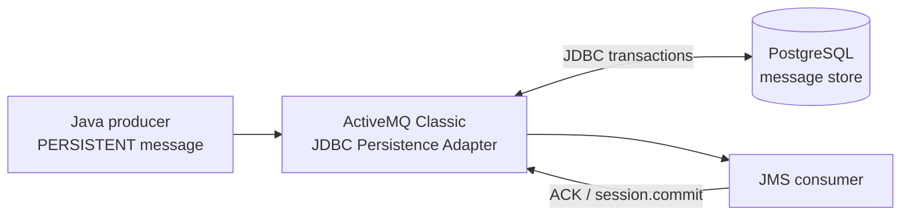
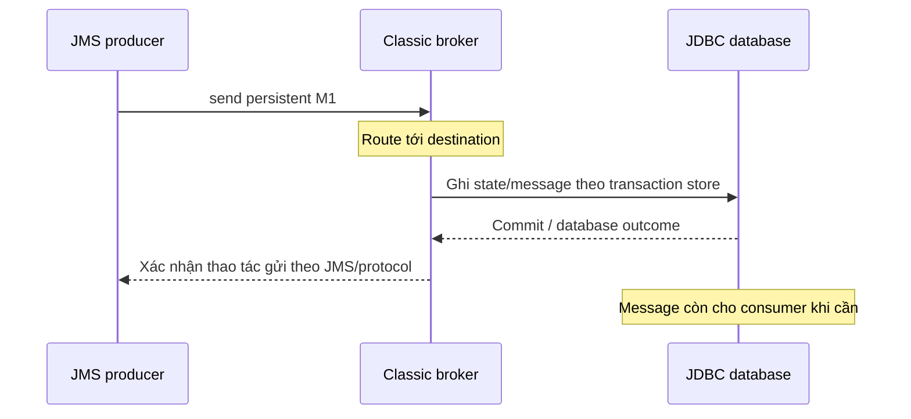
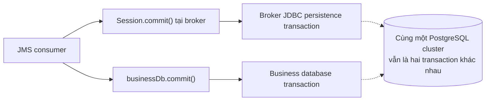
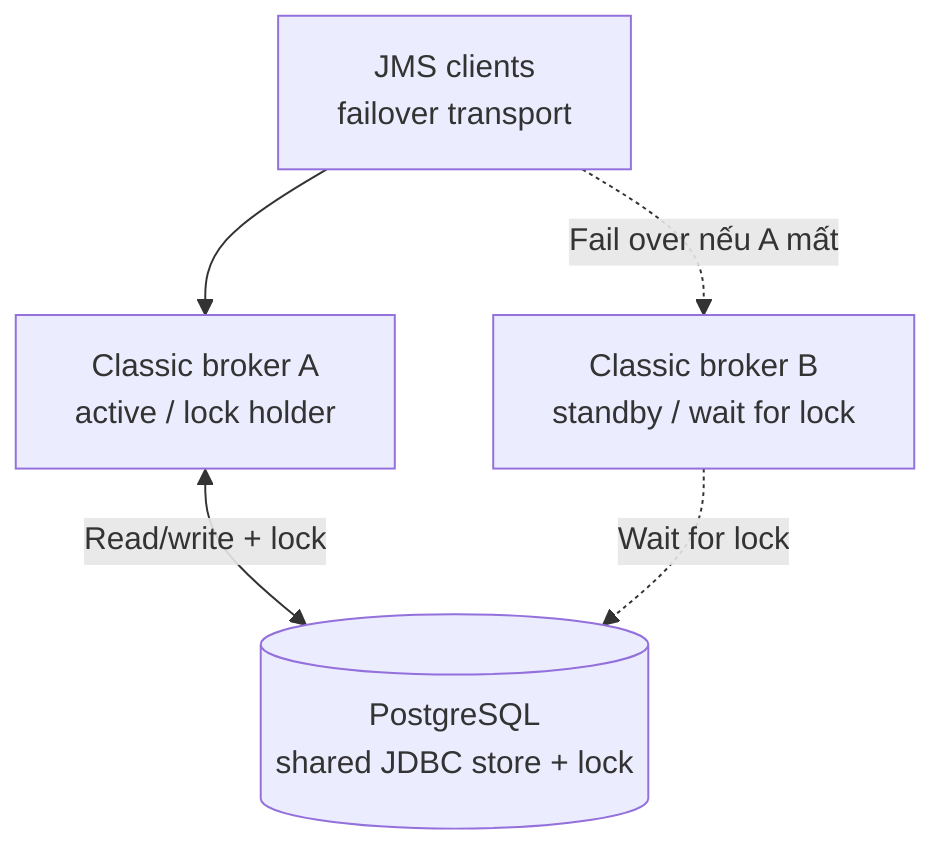

# JDBC persistence và phụ thuộc vào cơ sở dữ liệu trong ActiveMQ Classic

> **Chương:** Lưu trữ Classic  
> **Phạm vi:** Apache ActiveMQ **Classic 5.x**, JMS Java và một RDBMS dùng làm kho lưu trữ broker. Ví dụ sử dụng PostgreSQL, Spring XML trong `activemq.xml` và OpenWire client. Không áp dụng các thẻ cấu hình này cho ActiveMQ Artemis.

## 1. Khi nào dùng JDBC Persistence Adapter?

Đội vận hành muốn các message **persistent** của queue `billing.requests` tồn tại sau khi broker restart, đồng thời muốn sử dụng một cơ sở dữ liệu SQL được quản lý tập trung thay vì kho file cục bộ. ActiveMQ Classic hỗ trợ **JDBC Persistence Adapter** để lưu trạng thái bền vững vào database thông qua JDBC.

Sơ đồ luồng chính:



**Điểm đánh đổi quan trọng:** Khi chọn JDBC, database trở thành một thành phần **trên đường xử lý message của broker**. Broker không chỉ cần DB lúc khởi động mà còn phụ thuộc vào kết nối, transaction, disk, lock và khả năng phục hồi của DB trong suốt quá trình lưu/gỡ message.

JDBC store hữu ích khi tổ chức có hạ tầng SQL phù hợp, muốn kiểm soát vận hành tập trung hoặc cần mô hình **shared-database active/standby** của Classic. Tuy nhiên, **không mặc định JDBC tốt hơn KahaDB**: đường đi qua SQL thường tăng round trip, contention và yêu cầu quản trị database. Đánh giá dựa trên throughput, latency, dung lượng, yêu cầu HA và kịch bản phục hồi thực tế.

### Kết quả cần nắm

- Message nào được ghi bền vững qua JDBC và message nào không.
- Những gì broker lưu trong các bảng SQL và vai trò của transaction/locking.
- Cách cấu hình `jdbcPersistenceAdapter` với `DataSource` PostgreSQL.
- Cách xác minh message sống qua restart bằng Java JMS.
- Những failure mode do DB outage, connection pool, lock contention và HA.
- Giới hạn về bảo đảm dữ liệu: **JDBC broker store không tự biến transaction của consumer database thành một transaction với JMS**.

## 2. Cơ chế lưu: từ JMS PERSISTENT tới JDBC transaction

### 2.1. Điều kiện để một message có đường lưu bền vững

Một producer gửi message:

```java
producer.setDeliveryMode(DeliveryMode.PERSISTENT);
producer.send(session.createTextMessage("InvoiceRequested: INV-100"));
```

Để message được lưu theo đúng kỳ vọng, cần đồng thời:

1. Broker được cấu hình `persistent="true"`.
2. Persistence adapter được chọn thực sự là **JDBC**, trỏ tới database đúng.
3. Message được gửi với `DeliveryMode.PERSISTENT`, và giao dịch gửi (nếu dùng JMS transacted session) được **commit thành công**.
4. RDBMS có storage/transaction log đủ bền vững và không gặp sự cố làm mất dữ liệu đã commit theo mức bảo đảm của nó.
5. Queue hoặc durable topic subscription có tồn tại và đủ điều kiện giữ message; một non-durable topic subscriber đã ngắt kết nối không được bảo đảm giữ lại backlog chỉ vì message là persistent.

**Không có bảo đảm tuyệt đối “không bao giờ mất tin” chỉ nhờ một dòng `jdbcPersistenceAdapter`.** Độ bền end-to-end còn phụ thuộc producer confirmation, transaction, durability configuration của RDBMS, lưu trữ vật lý, backup/replication và quy trình recovery.

Ngược lại, `DeliveryMode.NON_PERSISTENT` **không cam kết** sống qua broker restart. Không được kỳ vọng broker tự nâng mọi message thành persistent chỉ vì JDBC store đã bật.

### 2.2. Đường ghi và xác nhận khi producer gửi



Sơ đồ minh họa **mối phụ thuộc**, không hàm ý mọi frame hay lệnh SQL thực hiện đúng một bước trong mọi phiên bản. Cách broker batch write, phản hồi send và thực thi transaction tùy JMS mode, transport, cấu hình và phiên bản.

Với **JMS transacted session**, `send()` thành công chưa đủ: producer còn phải gọi `session.commit()`. Nếu `commit()` thất bại hoặc không xác định kết quả do mất mạng, ứng dụng không thể tự khẳng định message chắc chắn đã được nhận hay chưa. Sử dụng `eventId` ổn định khi retry để đối soát duplicate.

### 2.3. Đường nhận và xác nhận

Khi consumer nhận message đã được lưu:

```text
Persistent message trong database
       |
Broker dispatch -> consumer nhận -> xử lý
       |
       +-- ACK / JMS commit thành công
       |      -> broker cập nhật trạng thái lưu
       |      -> không cần giao lại từ queue đó
       |
       +-- Chưa ACK / rollback / connection mất
              -> message có thể redeliver theo policy
```

**Đã dispatch không phải đã xóa khỏi kho bền vững.** Khi consumer chưa xác nhận, broker cần giữ đủ trạng thái để quyết định phát lại. Khi ACK/commit hợp lệ, broker cập nhật trạng thái message/subscription theo persistence adapter. Việc các row/byte vật lý biến mất ngay tức thì hay được tái sử dụng theo cơ chế nội bộ không nên suy ra chỉ từ một metric ACK.

## 3. Database thực sự lưu gì?

Ở ActiveMQ Classic JDBC store, các bảng thường được tạo theo tên:

| Bảng thường gặp | Vai trò khái niệm | Không nên hiểu nhầm |
|---|---|---|
| `ACTIVEMQ_MSGS` | Lưu message hoặc dữ liệu/cột tham chiếu cần để phục hồi persistent message | Một row không nhất thiết tương đương một đơn hàng nghiệp vụ duy nhất |
| `ACTIVEMQ_ACKS` | Trạng thái liên quan acknowledgment, đặc biệt cho durable topic subscriptions | Không phải bảng “mọi consumer đã xử lý nghiệp vụ thành công” |
| `ACTIVEMQ_LOCK` | Hỗ trợ khóa database khi broker dùng shared JDBC store | Không phải khóa nghiệp vụ của ứng dụng và không nên tự sửa thủ công |

**Lưu ý:** Tên bảng, schema, cột, index và SQL adapter có thể thay đổi theo version/cấu hình dialect. PostgreSQL thường chuyển tên identifier **không đặt dấu nháy** sang chữ thường trong catalog. Không tự viết DML để sửa `ACTIVEMQ_MSGS`/`ACKS`/`LOCK` hoặc tạo trigger vào các bảng này: broker sở hữu logic schema/store.

Một message gửi tới queue khác với message multicast có nhiều durable topic subscription: trạng thái lưu và acknowledgment phải phản ánh queue/subscription phù hợp. Vì vậy, **đếm row SQL không đồng nghĩa số message ready hoặc in-flight** trên console. Để vận hành, ưu tiên JMX/Web Console cho queue metrics và dùng SQL cho sức khỏe database.

### 3.1. Vì sao transaction database quan trọng?

JDBC adapter phải giữ các thay đổi store nhất quán khi send, ACK, transaction hoặc broker crash. RDBMS chịu trách nhiệm về atomicity và durability theo cấu hình của nó.

Ví dụ đơn giản:

```text
T1: Broker gửi persistent M1
    -> database ghi dữ liệu
    -> DB COMMIT thành công
    -> broker restart
    -> M1 phải còn nếu chưa ACK và store phục hồi đúng

T2: Broker ghi trạng thái ACK M1
    -> DB COMMIT thành công
    -> broker restart
    -> không được phát lại M1 chỉ vì restart bình thường
```

Đây là mục tiêu logic của persistence; tình huống “DB commit xong nhưng broker hoặc client chưa thấy kết quả” vẫn cần phân tích **uncertain outcome**. Nếu client gửi lại, có thể sinh **message vật lý mới**, ngay cả khi store không mất dữ liệu.

## 4. Cấu hình JDBC persistence trong `activemq.xml`

Ví dụ cụ thể cho **Classic broker** dùng PostgreSQL. Hai phần Spring `DataSource` và broker `persistenceAdapter` cần được đặt đúng vị trí trong `activemq.xml` đang dùng. Không đọc hay sửa cấu hình thực tế của môi trường trong bài học này.

### 4.1. Chuẩn bị DB và driver

DBA chuẩn bị database riêng, ví dụ `activemq_store`, cùng tài khoản `amq_store_user`. Tài khoản cần quyền tạo bảng/index trong giai đoạn **bootstrap** nếu broker tự tạo schema, sau đó cân nhắc quyền DML/locking cần cho runtime theo chính sách tổ chức.

Chuẩn bị cho **process broker**, không chỉ cho máy producer:

- JDBC driver PostgreSQL tương thích với Java runtime, ví dụ class `org.postgresql.Driver`.
- Thư viện pool DataSource `org.apache.commons.dbcp2.BasicDataSource` nếu dùng cấu hình dưới.
- Driver/pool JAR phải nằm trong **classpath của Classic broker** (không phải chỉ trong classpath của Java consumer).
- Database URL, DNS, firewall, TLS, credentials/secret rotation và giới hạn connection đã được cấu hình.

Nếu broker khởi động báo `ClassNotFoundException: org.postgresql.Driver` hoặc `CannotLoadJdbcDriverClassException`, trước hết kiểm tra **classpath broker**. Thêm dependency vào Maven của ứng dụng JMS **không** giúp broker nạp JDBC driver.

### 4.2. Định nghĩa Spring DataSource

Trong phần Spring `<beans>` của `activemq.xml`, tạo bean tương tự:

```xml
<bean id="pgDataSource"
      class="org.apache.commons.dbcp2.BasicDataSource"
      destroy-method="close">
  <property name="driverClassName" value="org.postgresql.Driver"/>
  <property name="url"
            value="jdbc:postgresql://db.internal:5432/activemq_store"/>
  <property name="username" value="${broker.db.user}"/>
  <property name="password" value="${broker.db.password}"/>

  <property name="initialSize" value="2"/>
  <property name="maxTotal" value="20"/>
  <property name="maxIdle" value="10"/>
  <property name="maxWaitMillis" value="30000"/>
  <property name="testOnBorrow" value="true"/>
  <property name="validationQuery" value="SELECT 1"/>
</bean>
```

Ở đây `${broker.db.user}` và `${broker.db.password}` là **placeholder** cho cấu hình Spring đã được thiết lập của broker. Ví dụ, có thể khai báo nguồn thuộc tính ở cùng cấp Spring beans:

```xml
<bean class="org.springframework.beans.factory.config.PropertyPlaceholderConfigurer">
  <property name="location"
            value="file:/etc/activemq/jdbc-store.properties"/>
</bean>
```

File thuộc tính cần được cấp phát ngoài repository hoặc qua cơ chế secret management phù hợp; không đưa credentials thật vào tài liệu/code. Ví dụ nội dung khái niệm:

```properties
broker.db.user=amq_store_user
broker.db.password=REPLACE_WITH_SECRET
```

Không tạo file cấu hình bên ngoài phạm vi bài học. Trong production, dùng kho bí mật/quy trình cấp phát credential được tổ chức hỗ trợ, hạn chế quyền đọc file và cân nhắc JDBC/TLS phù hợp. `maxTotal=20` chỉ là **tham số thí nghiệm**; phải sizing theo số broker/session, hoạt động SQL, monitoring và giới hạn `max_connections` thực tế.

### 4.3. Khai báo JDBC Persistence Adapter

Trong **một** phần tử broker Classic (không khai báo thêm broker trùng) thay phần persistence adapter hiện hành bằng:

```xml
<broker xmlns="http://activemq.apache.org/schema/core"
        brokerName="classic-jdbc"
        persistent="true"
        useJmx="true">

  <persistenceAdapter>
    <jdbcPersistenceAdapter
        dataSource="#pgDataSource"
        createTablesOnStartup="true"
        useDatabaseLock="true"/>
  </persistenceAdapter>

  <transportConnectors>
    <transportConnector
        name="openwire"
        uri="tcp://0.0.0.0:61616"/>
  </transportConnectors>
</broker>
```

**Đây là ví dụ cấu hình một broker Classic độc lập**. Khi áp dụng vào `activemq.xml` hiện có, giữ các thành phần `plugins`, `destinationPolicy`, `systemUsage`, security và transport connectors cần thiết của hệ thống. Không tạo thêm một `<broker>` nếu đã có.

Diễn giải từng phần:

- `persistent="true"` bật hoạt động lưu bền vững của broker.
- `jdbcPersistenceAdapter` chọn JDBC làm persistence store, khác với `kahaDB`.
- `dataSource="#pgDataSource"` tham chiếu Spring bean đã định nghĩa.
- `createTablesOnStartup="true"` cho phép adapter kiểm tra/tạo schema cần thiết khi khởi động theo quy tắc phiên bản. Trong môi trường quản trị schema chặt, có thể bootstrap trước và đặt `false` **sau khi xác nhận schema đầy đủ**, tránh cấp quyền DDL rộng ở runtime.
- `useDatabaseLock="true"` cho phép cơ chế DB lock của JDBC store, quan trọng khi nhiều broker chia sẻ một store theo active/standby.
- `transportConnector` là cổng client OpenWire, **không phải JDBC connection**. Broker dùng riêng JDBC URL để nói chuyện với PostgreSQL.

Nếu cùng cổng `61616` đã có listener, không thêm connector thứ hai trên cổng đó. Broker cần kiểm thử startup và version trước khi triển khai.

### 4.4. Kiểm tra adapter đã dùng đúng database

Sau khi cấu hình, xác minh theo thứ tự:

1. Broker startup logs cho thấy đã khởi tạo **JDBC persistence adapter**, không phải KahaDB fallback.
2. Database thấy kết nối từ đúng tài khoản/host broker.
3. Schema có các bảng phục vụ store của phiên bản đang chạy.
4. Message `PERSISTENT` đã commit vẫn tồn tại qua broker restart khi chưa ACK.
5. ACK/commit consumer làm message không còn được giao lại sau lần restart bình thường.
6. Thử ngắt DB trong môi trường staging để biết ứng dụng/broker hành xử ra sao; không chờ đến sự cố thật.

Không lấy duy nhất việc “broker trả về `Connected`” làm bằng chứng persistence đã đúng.

## 5. Phụ thuộc database: một failure domain mới của broker

### 5.1. Nếu PostgreSQL chậm hoặc hết connection

JDBC store đưa các chi phí DB vào độ trễ broker:

```text
Producer -> Broker -> connection pool -> SQL transaction -> DB WAL/disk
                                                |
                                                +-- contention / lock
                                                +-- slow checkpoint / I/O
                                                +-- max_connections exhausted
                                                +-- DB network timeout
```

Biểu hiện có thể gồm:

- `send()` hoặc `Session.commit()` mất nhiều thời gian hơn, báo lỗi hay có kết quả không chắc chắn.
- Consumer acknowledgment/commit có thể bị chặn hoặc lỗi nếu broker không ghi được trạng thái store.
- Queue backlog tăng vì tốc độ ghi/gỡ chậm; producer chịu backpressure.
- Broker startup bị chậm, chưa hoạt động hoặc không lấy được DB lock.
- Mức sử dụng CPU trên broker thấp nhưng throughput vẫn giảm vì chờ DB.

Vì vậy, **giám sát broker mà không giám sát DB là chưa đủ** khi dùng JDBC store.

### 5.2. Nếu database không sẵn sàng

Không giả định rằng broker vẫn có thể tiếp nhận message bền vững an toàn khi database đã mất kết nối. Hành vi cụ thể phụ thuộc lỗi, phiên bản và cấu hình: broker có thể từ chối/block operation, lỗi giao dịch, khởi động thất bại hoặc mất khả năng giữ master lock.

Quan trọng hơn, khi client không biết commit đã thành công:

```text
Client send M1
   -> Broker DB commit M1 thành công
   -> Socket lỗi trước khi client nhận confirmation
   -> Client retry M1
   -> Broker có thể lưu M1 lần thứ hai
```

Đây là **duplicate do kết quả gửi không xác định**, không giải quyết được bằng việc đổi từ KahaDB sang JDBC. Gắn `eventId` nghiệp vụ ổn định, dùng idempotent consumer hoặc cơ chế duplicate detection đã kiểm thử.

### 5.3. DB replication và durability configuration

JDBC store bền vững ở mức nào phụ thuộc cấu hình database:

- PostgreSQL transaction log/WAL có được flush theo chính sách durability phù hợp không.
- Storage có bộ nhớ đệm không an toàn khi mất điện không.
- Replication là synchronous hay asynchronous; khi failover, standby có thể đã nhận đủ mọi transaction **đã được client xác nhận** chưa.
- Backup/PITR có bảo vệ được database store và được thử restore không.
- Có chạy hai broker cùng dùng **hai bản DB đã tách nhánh** (split brain) không.

Không tuyên bố “PostgreSQL có replication nên broker không mất dữ liệu” nếu chưa xác định replication commit acknowledgment và bài kiểm thử failover. Dữ liệu được khôi phục từ backup cũ có thể làm mất message/ACK mới hơn backup; kế hoạch redrive và đối soát nghiệp vụ phải tính tới điều này.

### 5.4. Không trộn transaction broker và transaction nghiệp vụ

Giả sử ứng dụng Java dùng PostgreSQL cũng là server đang lưu ActiveMQ JDBC store:



**Dùng cùng một DB server không tự ghép hai transaction thành một.** `Session.commit()` và `Connection.commit()` của JDBC nghiệp vụ vẫn là hai ranh giới. Nếu consumer commit dữ liệu rồi chết trước ACK, broker có thể redeliver. Các thiết kế **inbox/idempotency** hoặc XA được cấu hình đúng mới giải quyết bài toán ở mức cần thiết.

## 6. Database locking và shared-store active/standby

JDBC store của Classic có thể được dùng cho **shared-database master/slave** (tùy phiên bản và cấu hình). Hai broker được cấu hình trỏ tới **cùng một database/store**, nhưng chỉ **một broker đang giữ quyền sở hữu/khóa cần thiết** được phép làm active broker. Broker còn lại chờ cơ hội tiếp quản.



### 6.1. Những bất biến vận hành

1. **Chỉ một active writer** sử dụng cùng message store ở một thời điểm. Nếu cả hai cùng ghi độc lập, có nguy cơ hỏng logic lưu trữ và giao nhận.
2. **DB lock là một thành phần của cơ chế election**. Không tắt `useDatabaseLock` rồi giả định hai broker an toàn khi cùng dùng store.
3. Standby chỉ có thể tiếp quản khi DB còn hoạt động và cơ chế khóa cho phép.
4. **Database vẫn là điểm phụ thuộc chung**: hai broker không loại bỏ DB outage; HA broker không phải HA database.
5. Client phải có cơ chế kết nối tới broker còn active, ví dụ **Failover Transport** của ActiveMQ Classic OpenWire.

Ví dụ URI ở client Classic:

```text
failover:(tcp://broker-a.example:61616,tcp://broker-b.example:61616)?randomize=false
```

Tính đúng đắn còn phụ thuộc thời gian mất lock/khôi phục DB, khả năng phát hiện broker chết, DNS, network partition và phiên bản; không nên công bố RTO/RPO trước khi thử nghiệm.

### 6.2. Các ca failure phải thực nghiệm

| Sự cố | Câu hỏi bắt buộc |
|---|---|
| Broker A chết nhưng DB bình thường | B có lấy được lock và nhận kết nối không? Message còn đúng không? |
| Broker A mất kết nối DB | A có dừng vai trò active không? Có nguy cơ A tiếp tục nhận writes khi mất lock? |
| Cả hai broker còn nhưng mất kết nối đến DB | Cả hai có từ chối writes an toàn không, hay client thấy kết quả không xác định? |
| DB failover sang replica | Lock/transaction state được duy trì ra sao? Hai broker có tránh split-brain không? |
| Client failover giữa lúc `send()/commit()` | Có gửi lặp message không? Ứng dụng có dùng `eventId` ổn định không? |
| Khôi phục backup cũ | Message/ACK thiếu so với trước restore được đối soát thế nào? |

**Đừng trộn JDBC shared-store active/standby với network of brokers hoặc replication nghiệp vụ**. Chúng giải quyết các bài toán khác nhau. Mô hình shared-store không tạo hai bản sao persistence độc lập ở hai broker.

## 7. Thực hành Java: gửi PERSISTENT, restart broker, rồi nhận

Thí nghiệm sử dụng một queue cố định `demo.jdbc.restart` để kiểm tra **message tồn tại qua broker restart**, không chỉ qua connection reconnect.

### 7.1. Maven dependency

```xml
<dependency>
  <groupId>org.apache.activemq</groupId>
  <artifactId>activemq-client</artifactId>
  <version>5.18.5</version>
</dependency>
```

Dùng client `javax.jms` và OpenWire; broker Classic có connector lắng nghe `tcp://localhost:61616`. Phiên bản là ví dụ, cần chọn bản được dự án hỗ trợ.

### 7.2. Java `ClassicJdbcRestartProbe.java`

```java
import java.util.UUID;

import javax.jms.Connection;
import javax.jms.DeliveryMode;
import javax.jms.JMSException;
import javax.jms.Message;
import javax.jms.MessageConsumer;
import javax.jms.MessageProducer;
import javax.jms.Queue;
import javax.jms.Session;
import javax.jms.TextMessage;

import org.apache.activemq.ActiveMQConnectionFactory;

public final class ClassicJdbcRestartProbe {
    private static final String QUEUE = "demo.jdbc.restart";

    public static void main(String[] args) throws JMSException {
        if (args.length < 1 ||
            (!"send".equals(args[0]) && !"receive".equals(args[0]))) {
            System.err.println("Usage: java ... ClassicJdbcRestartProbe "
                    + "send|receive [tcp://localhost:61616]");
            System.exit(2);
        }

        String url = args.length > 1
                ? args[1] : "tcp://localhost:61616";

        ActiveMQConnectionFactory factory =
                new ActiveMQConnectionFactory(url);

        String user = System.getenv("BROKER_USER");
        String pass = System.getenv("BROKER_PASSWORD");
        Connection connection = user == null || user.isEmpty()
                ? factory.createConnection()
                : factory.createConnection(user, pass);

        try {
            // Hai mode chạy trong hai tiến trình độc lập.
            // Mỗi mode dùng JMS transacted Session.
            Session session = connection.createSession(
                    true, Session.SESSION_TRANSACTED);

            try {
                Queue queue = session.createQueue(QUEUE);

                if ("send".equals(args[0])) {
                    send(session, queue);
                } else {
                    connection.start();
                    receive(session, queue);
                }
            } finally {
                session.close();
            }
        } finally {
            connection.close();
        }
    }

    private static void send(Session session, Queue queue)
            throws JMSException {
        MessageProducer producer = session.createProducer(queue);

        try {
            producer.setDeliveryMode(DeliveryMode.PERSISTENT);

            String eventId = UUID.randomUUID().toString();
            TextMessage message = session.createTextMessage(
                    "InvoiceRequested: " + eventId);
            message.setStringProperty("eventId", eventId);

            producer.send(message);
            session.commit();

            System.out.printf(
                    "SEND COMMITTED: eventId=%s, JMSMessageID=%s%n",
                    eventId, message.getJMSMessageID());
        } catch (JMSException | RuntimeException e) {
            session.rollback();
            throw e;
        } finally {
            producer.close();
        }
    }

    private static void receive(Session session, Queue queue)
            throws JMSException {
        MessageConsumer consumer = session.createConsumer(queue);
        try {
            Message msg = consumer.receive(10_000L);
            if (!(msg instanceof TextMessage)) {
                session.rollback();
                throw new IllegalStateException(
                        "Expected durable TextMessage after restart");
            }

            TextMessage text = (TextMessage) msg;
            System.out.printf(
                    "RECEIVED: eventId=%s, body=%s, JMSRedelivered=%s%n",
                    text.getStringProperty("eventId"),
                    text.getText(),
                    text.getJMSRedelivered());

            // Bài thử ACK/commit; production phải xử lý business trước.
            session.commit();
            System.out.println("RECEIVE COMMITTED");
        } catch (JMSException | RuntimeException e) {
            session.rollback();
            throw e;
        } finally {
            consumer.close();
        }
    }
}
```

**Phạm vi kiểm chứng của code:** sender commit một persistent message; receiver chỉ được chạy **sau khi broker thực sự stop/start**. `connection.start()` không phải restart broker. Consumer không có nghiệp vụ DB trong demo; khi áp dụng thực tế phải commit side effect và idempotency trước JMS ACK.

### 7.3. Kịch bản thực hành

1. Khởi động PostgreSQL và một Classic broker có JDBC adapter; xác minh broker đang dùng database mong muốn.
2. Chạy chương trình ở mode **`send`**; ghi lại `eventId` và `JMSMessageID`. Đảm bảo có dòng `SEND COMMITTED`.
3. **Dừng broker** trong môi trường thử nghiệm. Tốt nhất thực hiện thêm một vòng **kill process/crash** thay vì chỉ graceful shutdown, nhưng không làm trên broker production.
4. Khởi động lại **cùng broker configuration và cùng JDBC store**; xác minh broker lấy được DB lock và startup thành công.
5. Chạy chương trình ở mode **`receive`**; kiểm tra `eventId` khớp và có dòng `RECEIVE COMMITTED`.
6. Chạy lại mode `receive`: với queue sạch và không còn message khác, nên timeout do không có message đã ACK.
7. Thử biến thể `DeliveryMode.NON_PERSISTENT`: **không kỳ vọng** message sống qua restart. Đây là đối chứng nhằm làm rõ delivery mode, không phải phép chứng minh DB chắc chắn không còn row nào.

Ví dụ gọi chương trình (sau khi đã build classpath của ứng dụng):

```bash
# Trước khi stop broker
java -cp "target/classes:target/dependency/*" \
  ClassicJdbcRestartProbe send tcp://localhost:61616

# Stop rồi restart chính broker, sau đó:
java -cp "target/classes:target/dependency/*" \
  ClassicJdbcRestartProbe receive tcp://localhost:61616
```

Dấu `:` trong classpath ở đây dùng cho Unix; Windows dùng dấu `;` và quy trình chạy Maven phù hợp. Các dependency cần được sao chép vào `target/dependency` nếu dùng cách gọi này. Bài học không tự chạy lệnh hoặc sửa cấu hình ngoài hai file đã được giao.

### 7.4. Kiểm tra đúng nơi, không chỉ nhìn console

| Điểm đo | Trước restart, sau send | Sau restart, trước receive | Sau receive commit |
|---|---|---|---|
| `SEND COMMITTED` | Có | — | — |
| Queue message count | Có outstanding message trong queue thử nghiệm | Vẫn còn outstanding message | Không còn message thử nghiệm nếu đã ACK |
| Database tables | Có store state liên quan | Store còn và broker phục hồi được | Broker cập nhật state ACK/dequeue |
| Log consumer | Chưa chạy | Chưa chạy | Nhận đúng `eventId` |
| Lần `receive` tiếp theo | — | — | Không nhận lại message đã ACK trong điều kiện bình thường |

**Không yêu cầu truy vấn SQL phải thấy chính xác một row `ACTIVEMQ_MSGS`:** store có metadata, batch/transaction hoặc schema khác nhau; số liệu queue trên broker là thước đo giao nhận phù hợp hơn.

## 8. Tuning và dung lượng: điểm nghẽn nằm ở đâu?

### 8.1. Độ trễ message phụ thuộc đường đi SQL

Với persistent message, latency có thể gồm:

```text
broker routing
  + connection acquisition
  + SQL write/read/update
  + DB transaction commit & WAL/disk
  + network RTT giữa broker và DB
  + contention và queueing của DB/pool
```

Không nên suy đoán “JDBC store tăng throughput” chỉ vì DB mạnh: phép đo cần cố định message size, tỷ lệ persistent, số producer, session transactions, batch size, ACK rate và yêu cầu độ bền.

Một số nút thắt thường gặp:

- DB ở xa broker làm tăng RTT cho các hoạt động store.
- Pool quá nhỏ: thread broker chờ connection; pool quá lớn: DB quá tải và contention tăng.
- WAL/disk IOPS không đủ hoặc checkpoint gây spike latency.
- Message rất lớn làm tăng network I/O, row size, memory và chi phí backup.
- Durable topic subscriber offline lâu tích lũy backlog bền vững.
- Giao dịch gửi/ACK dài làm tăng thời gian giữ lock và thời gian phục hồi.

### 8.2. Ước lượng capacity sơ bộ

Ví dụ **100 message/giây**, mỗi payload trung bình **20 KiB**, được lưu cho một queue và ACK chậm trong **6 giờ**:

```text
100 msg/s × 6 h × 3.600 s/h = 2.160.000 messages
2.160.000 × 20 KiB ≈ 41,2 GiB payload thô
```

Số này **chưa** gồm row/index overhead, metadata, transaction log/WAL, bản sao replication, backup, temporary files, dead tuples, durable subscription references hay dung lượng dự phòng. Đây chỉ là upper-level estimate cho payload của lượng message tồn đọng theo giả định trên, không phải dự báo chính xác kích thước bảng JDBC.

Khi backlog liên tục tăng, phải tính cả **thời gian drain sau khi consumer phục hồi**:

```text
Backlog = 2.160.000 message
Producer vẫn gửi = 100 message/s
Consumer xử lý tối đa = 150 message/s
Net drain rate = 50 message/s
Thời gian xả lý tưởng = 43.200 s = 12 giờ
```

Thực tế có thể lâu hơn do DB load và retry. Nếu consumer throughput không lớn hơn producer arrival rate, backlog sẽ không được xả hết.

### 8.3. Nên cấu hình và giám sát gì?

| Thành phần | Chỉ số cần nhìn | Mục đích |
|---|---|---|
| Classic broker | Enqueue/dequeue rate, QueueSize, InFlightCount, store usage, producer/consumer count | Biết backlog và luồng giao nhận |
| JDBC pool | Active/idle connections, wait time, timeout, validation errors | Biết broker có đang chờ DB connection |
| PostgreSQL | Connection count, commit latency, WAL throughput, disk latency, lock waits, deadlocks | Biết nút thắt DB |
| DB storage | Kích thước tables/index, free disk, WAL space, backup/PITR health | Tránh đầy đĩa và mất khả năng phục hồi |
| Broker HA | DB lock ownership, master/standby transition, client reconnect time | Phát hiện nguy cơ split-brain hoặc failover chậm |

Tùy version, Classic có metric `storeUsage` không ánh xạ trực tiếp sang tổng byte chiếm trên PostgreSQL. **Đừng** chỉ dùng tỷ lệ store usage broker để dự đoán free disk của DB.

Có thể kiểm tra **ước lượng** kích thước/tình trạng bảng PostgreSQL bằng truy vấn chỉ đọc:

```sql
SELECT schemaname,
       relname,
       n_live_tup,
       n_dead_tup
FROM pg_stat_user_tables
WHERE lower(relname) LIKE 'activemq_%'
ORDER BY relname;
```

`n_live_tup` là **ước lượng thống kê**, không phải số message sẵn sàng tiêu thụ, không thay thế JMX. Với bảng lớn, tránh dùng `SELECT COUNT(*)` liên tục chỉ để làm dashboard.

## 9. Những ngộ nhận và lỗi cấu hình cần tránh

| Ngộ nhận / triệu chứng | Thực chất | Hướng xử lý |
|---|---|---|
| “Dùng JDBC là tự có HA” | DB vẫn là shared dependency; lock và DB HA là hai bài toán | Kiểm thử active/standby, DB failover, split-brain |
| Broker vẫn dùng KahaDB | `persistenceAdapter` chưa được áp dụng hoặc trỏ sai config | Kiểm tra startup log/JMX và đường cấu hình thực tế |
| Broker báo thiếu `org.postgresql.Driver` | JDBC driver không ở classpath **broker** | Cài driver vào đúng broker runtime |
| Broker không khởi động được schema | Thiếu quyền DDL, sai dialect hoặc bảng chưa tồn tại | Bootstrap/migrate schema theo version và chính sách quyền |
| JDBC connect timeout | DNS, firewall, pool, DB quá tải hoặc credentials sai | Đo độc lập kết nối DB từ broker host |
| Có hai broker ghi store cùng lúc | DB locking không đúng/mất lock | Ngừng rollout, xác minh chỉ một active writer |
| Message đã ACK nhưng tưởng SQL row còn là backlog | Row/metadata và queue metrics có semantics khác | Dùng destination metrics để đối soát |
| Gửi `NON_PERSISTENT` nhưng kỳ vọng restart còn | Delivery mode không cam kết durability | Sử dụng persistent mode và test restart |
| DB transaction ứng dụng commit là JMS đã commit | Hai transaction riêng, dù cùng server | ACK sau DB commit, idempotent consumer |
| Tăng số lượng DB connection vô hạn để tăng throughput | Vượt khả năng xử lý DB, contention nặng thêm | Load test và sizing pool theo toàn hệ thống |
| Đọc/ghi trực tiếp `ACTIVEMQ_MSGS` để “sửa lỗi” | Vi phạm invariants của persistence adapter | Dùng API/quản trị broker, backup/restore đúng quy trình |

### 9.1. Checklist đưa JDBC store lên production

- [ ] Thử nghiệm recovery với persistent message chưa ACK sau cả **graceful restart** lẫn **broker crash**.
- [ ] Thử tình huống DB down, DB chậm, DB failover, pool cạn connection, disk gần đầy.
- [ ] Broker/DB dùng TLS, quyền tối thiểu, credential không bị lưu ở repo hoặc log.
- [ ] DDL/bootstrap schema có kế hoạch nâng cấp khi đổi ActiveMQ Classic version.
- [ ] Backup/PITR và khôi phục thực tế đã được diễn tập; xác định RPO/RTO.
- [ ] Nếu có hai broker dùng shared JDBC store, cơ chế database lock và failover đã được thử nghiệm.
- [ ] Alert kết hợp queue backlog/ACK rate với pool wait, lock wait, WAL và disk free.
- [ ] Không kỳ vọng database store tự đồng bộ transaction với business DB ngoài broker.
- [ ] Có cơ chế idempotency cho producer retry và consumer redelivery.
- [ ] Đo throughput/latency với message size, persistent ratio, durable subscribers và tải gần production.

## 10. Câu hỏi vận dụng

1. Broker dùng `jdbcPersistenceAdapter` nhưng producer đặt `DeliveryMode.NON_PERSISTENT`. Có nên kỳ vọng message còn sau broker restart không? Vì sao?
2. Trong Classic, `ACTIVEMQ_MSGS`, `ACTIVEMQ_ACKS` và `ACTIVEMQ_LOCK` có vai trò khác nhau như thế nào?
3. Producer gọi `send()` rồi connection mất khi đang `Session.commit()`. Vì sao JDBC không tự bảo đảm producer biết message đã có trong store?
4. Hai broker trỏ tới cùng PostgreSQL và cùng bật JDBC store. Điều gì phải đúng về database lock để tránh ghi đồng thời?
5. Vì sao broker active/standby không giúp gì khi **database chung** bị mất truy cập?
6. Business DB và ActiveMQ JDBC store cùng chạy trên một PostgreSQL server. Tại sao `jdbcConnection.commit()` của consumer vẫn không phải `jmsSession.commit()`?
7. Một queue tồn 2 triệu message và database chỉ còn 10 GiB trống. Bạn sẽ kiểm tra những metric nào trước khi quyết định tăng connection pool?
8. Thiết kế một test crash sau producer commit nhưng trước consumer ACK; chỉ rõ dữ liệu và metric nào chứng minh message còn an toàn và không bị xử lý trùng.

## 11. Tài liệu tham khảo

- [ActiveMQ Classic — Persistence](https://activemq.apache.org/components/classic/documentation/persistence): các lựa chọn persistence store của Classic.
- [ActiveMQ Classic — JDBC Support](https://activemq.apache.org/components/classic/documentation/jdbc-support): JDBC Persistence Adapter và cấu hình DataSource/dialect.
- [ActiveMQ Classic — JDBC Master Slave](https://activemq.apache.org/components/classic/documentation/jdbc-master-slave): cơ chế dùng chung DB và locking cho active/standby.
- [ActiveMQ Classic — Failover Transport](https://activemq.apache.org/components/classic/documentation/failover-transport-reference): kết nối client tới broker có thể thay đổi active node.
- [PostgreSQL — Transaction Isolation](https://www.postgresql.org/docs/current/transaction-iso.html): transaction semantics; tham khảo thêm WAL, durability và monitoring của phiên bản triển khai.
- [Jakarta Messaging Specification](https://jakarta.ee/specifications/messaging/): JMS delivery mode, session transaction và acknowledgment.

**Kết luận:** Với ActiveMQ Classic, JDBC persistence chuyển phần lưu message bền vững sang RDBMS. Điều này giúp tận dụng hạ tầng SQL và một số mô hình shared-store, nhưng **đưa độ trễ, connection pool, lock, storage, durability và khả năng sẵn sàng của database vào đường sống của broker**. Muốn đáng tin cậy, phải kiểm tra cùng lúc **JMS PERSISTENT + broker JDBC configuration + database transaction/durability + recovery/HA**, đồng thời vẫn thiết kế producer/consumer chịu được kết quả commit không xác định và redelivery.
