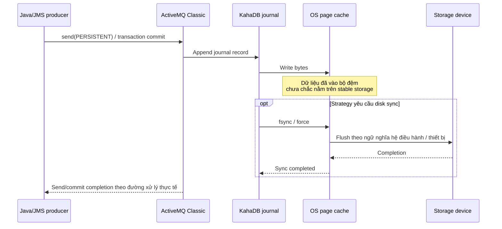
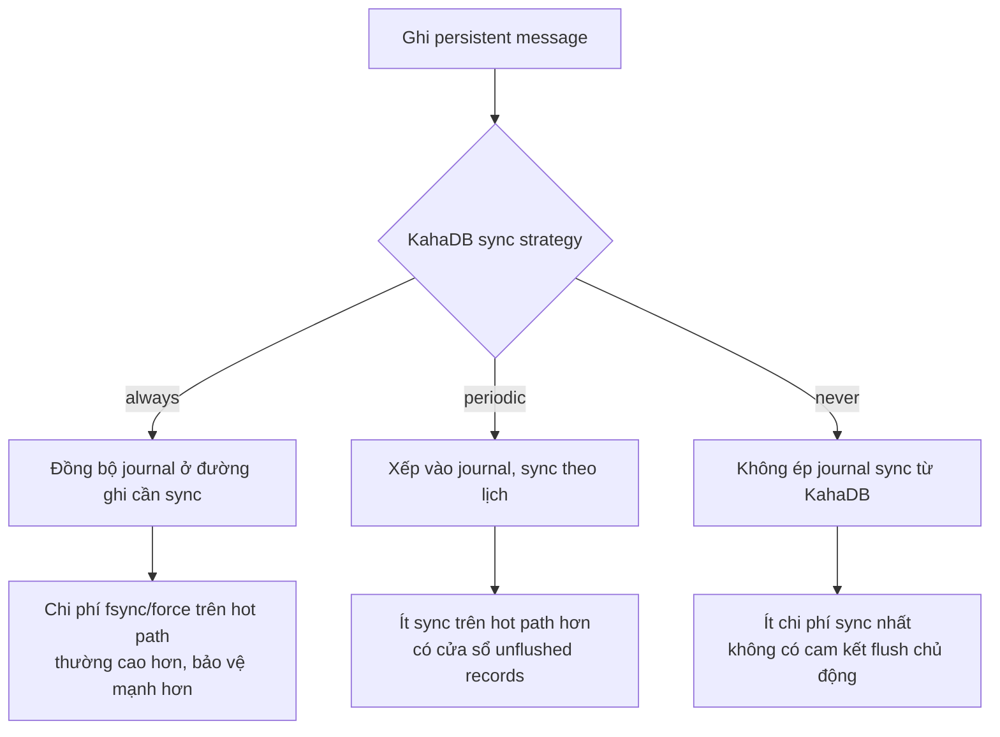
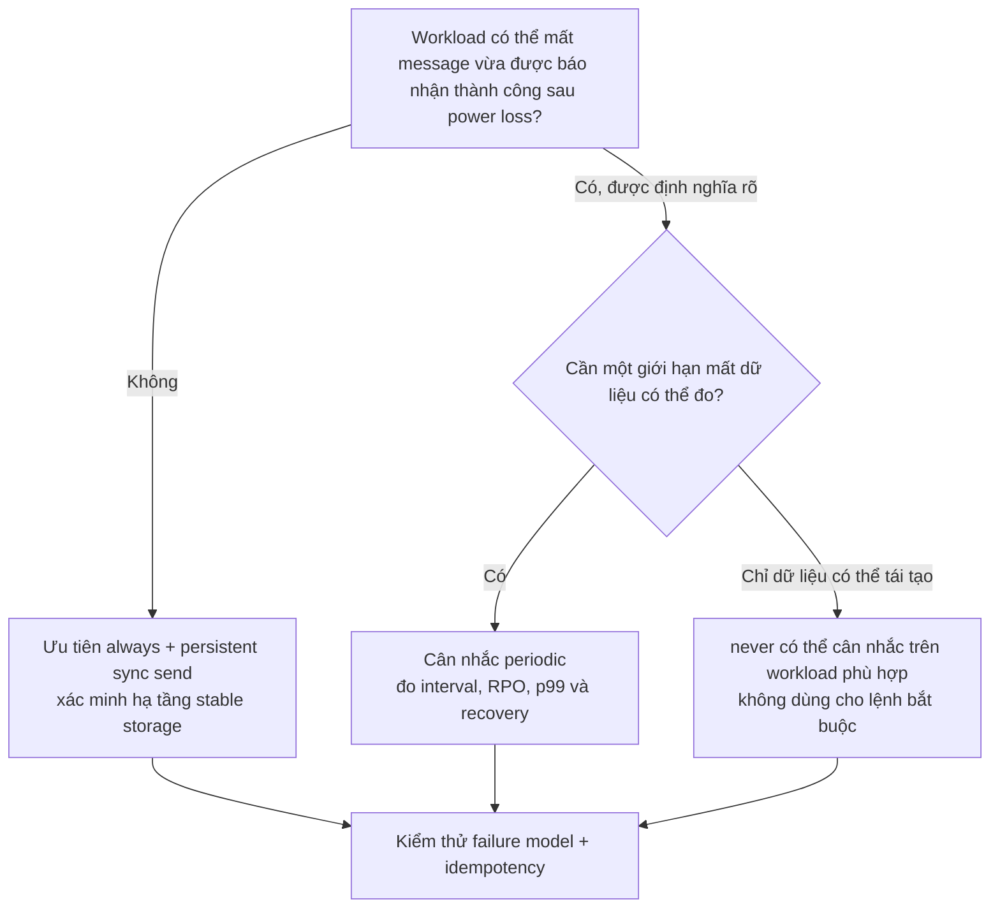

# Chính sách đồng bộ đĩa và đánh đổi độ trễ với độ bền

> **Chương:** Lưu trữ Classic  
> **Phạm vi:** Apache ActiveMQ **Classic** với persistence adapter **KahaDB**, tập trung vào chính sách đồng bộ journal xuống đĩa, chi phí trên đường gửi/commit và khả năng mất message khi sự cố xảy ra. Ví dụ cấu hình dành cho `activemq.xml` của Classic, **không áp dụng trực tiếp cho `broker.xml` của Artemis**.

Một producer gửi `PaymentRequested` ở chế độ `PERSISTENT`. Broker ghi dữ liệu vào journal và trả kết quả thành công. Ngay sau đó máy chủ mất điện, và sau restart có một số message không còn trong queue. Vậy là JMS `PERSISTENT` “không hoạt động” hay sao?

Để trả lời, phải phân biệt **ghi vào bộ đệm của tiến trình/OS**, **yêu cầu OS đồng bộ xuống thiết bị lưu trữ** và **dữ liệu thực sự bền vững trước loại lỗi đang xét**. Trong KahaDB, chính sách `journalDiskSyncStrategy` chính là một trong những nút điều chỉnh quan trọng nhất cho sự đánh đổi giữa **độ trễ ghi** và **khả năng phục hồi sau lỗi**.

Bài học này không bàn rộng về JMS hay toàn bộ kiến trúc storage; mục tiêu là biết **chính xác chính sách nào đang có hiệu lực, khoảng mất dữ liệu nằm ở đâu, cách đo và khi nào không được đánh đổi độ bền lấy tốc độ**.

## 1. Đường đi của một persistent message



**Đừng đọc sơ đồ như cam kết rằng mọi bản Classic đều dùng cùng một thứ tự nội bộ.** Việc producer nhận phản hồi trước hay sau một lệnh đồng bộ còn phụ thuộc chính sách KahaDB, cấu hình gửi đồng bộ/bất đồng bộ, giao dịch và version. Sơ đồ cho thấy **những ranh giới cần kiểm tra**, không phải trace gọi hàm cố định.

| Mốc | Thực chất | Điều chưa thể kết luận |
|---|---|---|
| JVM producer gọi `send()` | Ứng dụng yêu cầu gửi message. | Broker chắc chắn đã nhận, chưa nói đến lưu bền. |
| Broker append journal | KahaDB ghi record vào đường ghi journal; có thể qua buffer/cache. | Thiết bị đã ghi bền toàn bộ record sau mất điện. |
| OS nhận lệnh write | Các byte có thể nằm trong page cache. | Không còn khả năng mất nếu OS crash/mất điện. |
| Disk sync hoàn tất | Broker yêu cầu flush/sync theo cơ chế OS/storage. | Storage hoặc hypervisor luôn trung thực, RAID không có volatile cache, hay toàn cluster đã có replica. |
| Producer nhận kết quả thành công | Lời gọi gửi/commit đã hoàn tất theo **cơ chế client + broker đang dùng**. | Nghiệp vụ ở consumer đã chạy, không có duplicate hoặc không thể mất dưới mọi loại sự cố. |

Một lần `write()` nhanh thường chỉ phản ánh **đường ghi vào cache**. Chi phí `fsync()/force()` có thể cao hơn đáng kể vì phải chờ các tầng bên dưới xác nhận flush; khi thiết bị hoặc hệ thống ảo hóa còn bộ đệm không an toàn, ngay cả thông báo sync hoàn tất cũng phải được đặt trong giả định phần cứng phù hợp.

### 1.1. Journal, index và checkpoint không cùng vai trò

KahaDB ghi những thay đổi quan trọng vào **journal dạng append** và duy trì cấu trúc chỉ mục/phục hồi. Khi broker restart, nó dùng trạng thái đã lưu cùng journal để khôi phục các record và tham chiếu message phù hợp.

- **Journal disk sync:** quyết định thời điểm yêu cầu đồng bộ **dữ liệu journal** về stable storage; chủ đề chính của bài.
- **Index/checkpoint:** quản lý trạng thái chỉ mục, snapshot/checkpoint và công việc housekeeping; có thể ảnh hưởng hiệu năng và thời gian recovery, nhưng **không được xem là cùng một công tắc với journal disk sync**.
- **Journal cleanup/compaction:** thu hồi file journal không còn cần thiết theo trạng thái broker; không phải lựa chọn bảo đảm message luôn sống sót sau crash.

Việc thấy có file trong thư mục `kahadb` sau restart **không đủ** để chứng minh mọi message vừa được broker báo đã gửi thành công đều có record phục hồi hợp lệ.

## 2. Ba chiến lược `journalDiskSyncStrategy` của KahaDB

Các bản ActiveMQ Classic có hỗ trợ thuộc tính KahaDB `journalDiskSyncStrategy` nhận các giá trị thường dùng **`always`**, **`periodic`** và **`never`**. Cấu hình mặc định và mức hỗ trợ cụ thể phải được đối chiếu với **phiên bản Classic thực tế**; đừng suy từ một tài liệu phiên bản khác khi ra quyết định production.

| Strategy | Ý nghĩa đường ghi journal | Điểm mạnh | Đánh đổi/rủi ro |
|---|---|---|---|
| **`always`** | KahaDB yêu cầu đồng bộ journal trên đường ghi cần sync theo cơ chế của strategy, thay vì đợi một lịch sync nền. | Mức bảo vệ mạnh hơn cho các persistent journal record đã hoàn tất theo đường ghi đồng bộ, khi storage đáp ứng đúng sync. | Chịu chi phí đồng bộ đĩa, tăng latency nhất là với ghi nhỏ, fsync chậm và thiết bị bận. |
| **`periodic`** | Journal được sync theo chu kỳ cấu hình bởi `journalDiskSyncInterval`, thay vì ép sync cho mỗi đường ghi như `always`. | Giảm số lần phải đợi sync trong hot path, có thể tăng throughput và giảm latency. | Những record đã được broker xử lý thành công nhưng **chưa tới lần sync** có nguy cơ mất khi OS/storage crash. |
| **`never`** | KahaDB không chủ động yêu cầu disk sync cho journal theo strategy này. | Tối thiểu hóa overhead đồng bộ từ KahaDB. | Không thể dựa vào việc journal được flush kịp trước mất điện/kernel crash; độ bền phụ thuộc hoạt động flush khác của OS/storage. |

### 2.1. `always`: ưu tiên độ bền trên đường ghi

Với một persistent message gửi đồng bộ, KahaDB thường được dùng để **append journal và thực hiện disk sync theo strategy trước khi hoàn tất bước ghi cần được xác nhận**. Lựa chọn `always` phù hợp làm **mốc chuẩn cho workload không chấp nhận mất message đã được báo nhận thành công**, nhưng bảo đảm vẫn phụ thuộc vào:

1. Broker thật sự dùng KahaDB và đã bật persistence.
2. Client không bật một cơ chế **async send** khiến `send()` phía producer trả về trước khi biết broker chấp nhận message.
3. Storage/OS/hypervisor thực hiện đúng ý nghĩa flush, không xác nhận sớm trong volatile cache không được bảo vệ.
4. Dữ liệu không bị expiry, purge, DLQ, acknowledge hợp lệ hoặc thay thế do chính sách khác.
5. Kiểu failure đang xét nằm trong giả định của persistence; journal sync **không tự tạo HA/replication**.

**Đừng chuyển `always` thành tuyên bố “exactly-once”.** Nếu producer mất phản hồi hoặc consumer chết sau side effect trước ack, message vẫn có thể được gửi/giao lại. `always` bảo vệ một phần trạng thái lưu trữ, không phối hợp transaction với database hoặc hệ thống thanh toán bên ngoài.

### 2.2. `periodic`: độ trễ tốt hơn, cửa sổ rủi ro rõ ràng

Ví dụ cấu hình:

```xml
<kahaDB directory="/var/lib/activemq-lab/kahadb"
        journalDiskSyncStrategy="periodic"
        journalDiskSyncInterval="1000"/>
```

`journalDiskSyncInterval` được tính bằng **millisecond**; `1000` là một giây. Khoảng rủi ro không thể diễn giải đơn giản thành “chắc chắn mất đúng một giây message”: thời điểm write, timing của sync thread, I/O backlog, pause của JVM, trạng thái OS và thiết bị đều ảnh hưởng lượng record có thể mất.

**Trường hợp đáng chú ý:** Producer A thấy `send()` hoàn thành ở thời điểm T0, broker ở chế độ periodic. OS crash ở T0+200ms, trước lần sync journal phù hợp. Message vừa được báo thành công **có thể không được khôi phục**. Nếu hệ thống đã hứa “một send thành công là không mất trong mọi power failure”, thì `periodic` có thể **không đáp ứng** hợp đồng đó.

Giảm interval từ 1000ms xuống 100ms có thể thu hẹp cửa sổ không sync, nhưng thường tăng tần suất flush, cạnh tranh I/O và tail latency; không có lý do để kết luận nó “an toàn tương đương always”.

### 2.3. `never`: không phải “ghi bền nhưng nhanh hơn”

`never` không đồng nghĩa ghi vào RAM hoàn toàn; journal vẫn có thể được ghi qua hệ điều hành, và OS có thể chủ động flush cache theo chính sách riêng. Vì vậy **một lần restart sạch vẫn thấy message** là kết quả có thể xảy ra với `never`. Nó **không chứng minh** rằng dữ liệu sẽ sống sót sau kernel panic, mất điện hoặc sự cố hạ tầng.

Chỉ cân nhắc `never` trong **bài benchmark cô lập hoặc workload cho phép mất dữ liệu** và đã định nghĩa rõ phạm vi được phép mất; không dùng cho lệnh thanh toán, đơn hàng hay audit bắt buộc chỉ vì một phép đo throughput tăng.

### 2.4. Cấu hình cũ `enableJournalDiskSyncs`

Một số phiên bản/hướng dẫn Classic cũ sử dụng thuộc tính boolean `enableJournalDiskSyncs`. Ở các phiên bản hỗ trợ `journalDiskSyncStrategy`, thuộc tính boolean này đã được **thay thế/deprecate** trong cấu hình KahaDB; cần kiểm tra version và **không đặt lẫn hai kiểu với giả định thứ tự ưu tiên bất biến**.

Lựa chọn trong tài liệu thực hành này là dùng **`journalDiskSyncStrategy` tường minh**. Nếu đang nâng cấp từ file XML cũ, cần kiểm tra log và hiệu lực runtime; đừng chỉ thêm một attribute mới và mặc định bảo đảm cũ còn được giữ.

## 3. Đánh đổi latency, throughput và durability

Một producer có thể gửi được nhiều message/giây hơn khi tránh chờ disk sync, nhưng số đó **không thể so sánh công bằng** nếu hợp đồng về durability của hai cấu hình khác nhau.



| Metric | Cách đo đúng | Điểm cần tránh |
|---|---|---|
| **Send latency p50/p95/p99** | Tính `nanoTime` quanh lời gọi `send()` có cùng delivery mode và đường gửi. | So `send()` đồng bộ của `always` với async send của `periodic`; kết quả bị lệch về semantics. |
| **Commit latency** | Với transacted `Session`, đo riêng `session.commit()`. | Gán thời gian mỗi `producer.send()` trong transaction là thời gian durable commit. |
| **Throughput** | Số message đã được provider báo hoàn tất trên giây ở tải ổn định. | Đếm số `send()` được gọi trước khi connection mất hoặc transaction chưa commit. |
| **CPU/I/O/iowait** | Theo dõi latency của flush, journal disk utilization và throughput hệ thống file. | Kết luận chỉ từ CPU; bottleneck có thể nằm ở block device hoặc fsync queue. |
| **Recovery/result audit** | So các message đã được producer báo nhận và message còn khôi phục sau failure test cô lập. | Dùng mỗi một lần shutdown sạch làm bằng chứng chịu được power loss. |

Một vài nguyên nhân làm khác biệt giữa các lần đo:

- **Phần cứng:** SSD NVMe, SATA, SAN, RAID controller, cloud block device có latency flush khác nhau; throughput write tuần tự không đại diện trực tiếp cho latency fsync.
- **Tần suất và kích thước message:** 1.000 message 1KB khác với một message 1MB; batching có thể thay đổi số round-trip và tần suất commit.
- **JVM/OS:** GC pause, scheduler, filesystem, mount options và page-cache pressure ảnh hưởng p99.
- **Broker traffic:** Consumer ack, transaction, queue index và message paging cạnh tranh cùng persistence adapter/thiết bị.
- **Tình trạng warmed-up:** Khởi động lạnh/recovery khác steady-state; ghi ít message vào cache không đo được hành vi khi disk gần đầy.

**So sánh có giá trị** cần giữ cùng phiên bản Classic, KahaDB, producer mode, message size/count, storage device, số producer/consumer, queue, QoS, kiểu transaction, heap và CPU quota; chỉ thay strategy/interval theo từng lượt chạy.

## 4. Phạm vi bảo đảm từ producer đến consumer

### 4.1. Gửi đồng bộ hay bất đồng bộ là một trục độc lập

Classic JMS client có các tùy chọn mở rộng như `useAsyncSend` và `alwaysSyncSend`. Nếu muốn đo thời gian một `send()` hoàn tất **sau khi nhận phản hồi phù hợp từ broker**, hãy cấu hình theo hướng gửi đồng bộ và kiểm tra hành vi của đúng version/client. Ví dụ:

```java
ActiveMQConnectionFactory factory =
    new ActiveMQConnectionFactory("tcp://127.0.0.1:61616");
factory.setUseAsyncSend(false);
factory.setAlwaysSyncSend(true);
```

Hai setter trên là **extension của ActiveMQ Classic**, không phải method của JMS `ConnectionFactory` chung và **không ép KahaDB fsync**: chính sách flush vẫn nằm ở broker. Nếu bật async send, một lời gọi `send()` rất nhanh **không phải thước đo cho thời gian broker lưu bền**.

### 4.2. `PERSISTENT` khác journal sync

`DeliveryMode.PERSISTENT` là yêu cầu của JMS provider đối với lưu giữ message. `journalDiskSyncStrategy` là cách **KahaDB thực hiện đồng bộ journal** theo một chiến lược cụ thể. Chúng tác động ở hai tầng khác nhau:

| Tầng | Điều khiển | Ví dụ |
|---|---|---|
| **Producer** | `DeliveryMode.PERSISTENT` / `NON_PERSISTENT`. | `producer.setDeliveryMode(DeliveryMode.PERSISTENT)`. |
| **Broker persistence adapter** | KahaDB, JDBC hoặc lựa chọn khác. | `<persistenceAdapter><kahaDB .../></persistenceAdapter>`. |
| **Journal sync** | `always`/`periodic`/`never` cho KahaDB. | `journalDiskSyncStrategy="always"`. |
| **OS/storage** | Cache, flush, durable write, controller/battery, filesystem. | `fsync`, RAID protected write cache, block device semantics. |
| **Consumer** | Ack/transaction và nghiệp vụ. | `session.commit()` sau xử lý; bảo vệ idempotency. |

Một message `NON_PERSISTENT` không trở thành persistent chỉ vì KahaDB được đặt `always`. Ngược lại, một message gửi `PERSISTENT` **không tự bỏ qua** rủi ro do strategy `periodic`/`never` tạo ra trong điều kiện crash.

### 4.3. JMS transaction và thời điểm trả lời

Trong một transacted producer `Session`:

```java
Session session = connection.createSession(
    true, Session.SESSION_TRANSACTED);
MessageProducer producer = session.createProducer(
    session.createQueue("orders.work"));
producer.setDeliveryMode(DeliveryMode.PERSISTENT);

for (int i = 0; i < 50; i++) {
    producer.send(session.createTextMessage("order-" + i));
}
session.commit();  // Đây là ranh giới hoàn tất transaction gửi JMS.
```

Các lệnh `send()` trong transaction **chưa phải giao dịch được commit**. Nếu process hoặc broker lỗi trước `commit()`, đừng coi 50 message đã được chấp nhận hoàn tất. Ngược lại, khi `commit()` ném `JMSException` vì mất phản hồi, cần coi kết quả **có thể chưa xác định**: broker có thể đã commit và chỉ mất response.

**Batching** có thể giảm chi phí tính trên mỗi message do gom nhiều thao tác vào một transaction/round-trip, nhưng cũng tăng phạm vi một lần commit và khả năng phải xử lý duplicate sau lỗi. Phải đo cả latency của `commit()` và kích thước batch, không chỉ số message/giây.

## 5. Cấu hình KahaDB trong `activemq.xml`

Trong một bản cài ActiveMQ Classic độc lập, cấu hình broker thường được nạp từ `<instance>/conf/activemq.xml` hoặc đường dẫn được launcher chỉ định. Trước khi chỉnh, phải xác định **file runtime thực sự được nạp**; trên hệ thống dùng `ACTIVEMQ_BASE` khác `ACTIVEMQ_HOME`, sửa file trong thư mục cài đặt có thể không tác động đến broker đang chạy.

Tìm `<persistenceAdapter>` hiện hữu bên trong phần tử `<broker>`. Trong bản lab, chọn **một** cấu hình KahaDB; không thêm hai persistence adapter hoặc hai phần tử `<kahaDB>` cùng vận hành trên một store.

### 5.1. Phương án A — ưu tiên độ bền

Đây là điểm xuất phát cho pipeline xử lý đơn hàng, thanh toán hoặc event có yêu cầu lưu bền cao:

```xml
<!-- Đoạn con bên trong <broker> của activemq.xml (Classic). -->
<persistenceAdapter>
    <kahaDB directory="/var/lib/activemq-lab/kahadb"
            journalDiskSyncStrategy="always"/>
</persistenceAdapter>
```

Thay `/var/lib/activemq-lab/kahadb` bằng thư mục dữ liệu được phép ghi của **instance lab**. Trên Windows, dùng đường dẫn hợp lệ với launcher/Java đang chạy. Đường dẫn phải nằm trên volume phù hợp, có đủ dung lượng và không bị một broker khác dùng chung không kiểm soát.

**Không kết luận hiệu lực chỉ bằng file XML:** kiểm tra log startup, persistence adapter, data directory và thông số KahaDB của process đúng trước khi chạy benchmark.

### 5.2. Phương án B — đồng bộ theo chu kỳ

Chỉ dùng khi đã có quyết định rõ ràng về **mức rủi ro mất các record chưa được sync**:

```xml
<persistenceAdapter>
    <kahaDB directory="/var/lib/activemq-lab/kahadb"
            journalDiskSyncStrategy="periodic"
            journalDiskSyncInterval="500"/>
</persistenceAdapter>
```

Ví dụ `500` nghĩa là chu kỳ mục tiêu **500ms**. Đây là tham số lịch flush, **không** phải SLA bảo đảm “mất tối đa đúng 500ms dữ liệu”. Nếu broker/OS bị nghẽn, scheduling chậm, hoặc storage không tuân thủ flush semantics, cửa sổ thực tế có thể khác.

Khi thử nhiều strategy trên cùng một bộ dữ liệu, **dừng broker và restart đúng quy trình** sau khi thay XML. Nếu đang dùng nhiều instance để đo song song, dùng data directory và port riêng. Đừng thay strategy của một broker production đang chứa backlog quan trọng chỉ để quan sát số message/giây.

### 5.3. Phương án C — không chủ động sync journal

```xml
<persistenceAdapter>
    <kahaDB directory="/var/lib/activemq-lab/kahadb"
            journalDiskSyncStrategy="never"/>
</persistenceAdapter>
```

Đây là một phương án để **đo giới hạn hiệu năng** hoặc dùng khi nghiệp vụ chấp nhận mất message trong crash window. Không diễn giải `never` là tương đương `NON_PERSISTENT` ở JMS: persistent journal vẫn có thể được ghi, nhưng KahaDB không chủ động yêu cầu journal sync theo strategy này. Nếu ứng dụng buộc phải có bằng chứng lưu bền trước khi trả HTTP 200 cho một đơn hàng quan trọng, cấu hình này thường không phù hợp.

### 5.4. Ranh giới cấu hình: KahaDB, JDBC và Artemis

`journalDiskSyncStrategy` là cấu hình của **KahaDB**. Nó **không** điều khiển `COMMIT`/fsync của một RDBMS nếu Classic đang dùng **JDBC persistence adapter**. Với JDBC store, độ bền phụ thuộc transaction và chính sách flush/WAL của database phía sau; không thể áp attribute KahaDB lên JDBC rồi chờ database thay đổi.

Artemis sử dụng cơ chế journal và cấu hình storage riêng trong `broker.xml`. Đừng chuyển nguyên các thuộc tính KahaDB sang Artemis hay dùng kết quả benchmark KahaDB để kết luận Artemis có mức bảo đảm tương tự.

### 5.5. Các điều kiện trước khi thay đổi

| Kiểm tra | Câu hỏi cần trả lời |
|---|---|
| Instance | Process đang dùng đúng `activemq.xml` nào, `ACTIVEMQ_BASE`/`ACTIVEMQ_CONF` nào? |
| Persistence | Broker `persistent` có bật và đang sử dụng `kahaDB` thật không? |
| Store | Data directory nằm trên thiết bị nào, có thể dùng chung với instance khác không, còn bao nhiêu dung lượng? |
| Safety | Có sao lưu và khả năng khôi phục dữ liệu lab? Có message nghiệp vụ thật còn pending không? |
| Version | Release Classic có hỗ trợ `journalDiskSyncStrategy`/`journalDiskSyncInterval` không? Log báo giá trị hiệu lực nào? |
| Client | Producer đang dùng `PERSISTENT` và gửi đồng bộ hay async? Có transaction/commit batching không? |
| Observability | Có metric send/commit latency, disk latency, journal size và queue backlog để so sánh không? |

**Một lỗi dễ mắc:** thay `journalDiskSyncInterval` nhưng để `journalDiskSyncStrategy="always"`, rồi thấy số liệu không đổi. Interval chỉ có ý nghĩa khi strategy là **`periodic`**; nó không phải “độ trễ mặc định” cho tất cả đường ghi.

## 6. Phân biệt các loại sự cố trước khi đo “mất message”

Không phải mọi “tắt broker” đều thử được tính bền vững đối với disk sync.

| Cách broker ngừng hoạt động | OS page cache có thể còn? | Phép thử nói được điều gì? |
|---|---|---|
| **Shutdown sạch** của Classic | OS/broker thường có cơ hội flush và đóng store. | Kiểm tra startup/recovery bình thường; **không chứng minh** chịu mất điện khi chưa sync. |
| **Chết riêng process JVM** nhưng OS vẫn chạy | **Có**; page cache thường vẫn tồn tại và có thể được OS flush. | Kiểm tra recovery khỏi process crash; **không tương đương** power loss/kernel crash. |
| **Kernel crash / mất điện của host** | Page cache có thể mất; chỉ dữ liệu đã thực sự bền vững mới an toàn. | Phù hợp hơn để đánh giá rủi ro chưa sync, nhưng phải kiểm thử bằng môi trường riêng và phương pháp fault injection an toàn. |
| **Storage controller/volume fault** | Tùy hạ tầng, cache và replica. | KahaDB sync một mình không sửa được corruption, volume loss hoặc controller xác nhận flush sai. |
| **Network partition / client mất kết nối** | Broker có thể vẫn đang chạy và lưu dữ liệu. | Kết quả `send/commit` có thể **UNKNOWN** do mất response; không suy ra message đã mất. |

Đặc biệt, **đừng dùng một lần kết thúc process Java rồi thấy message vẫn còn để tuyên bố `periodic` hay `never` an toàn**. OS page cache vẫn có thể mang các record chưa được KahaDB yêu cầu sync và sau đó flush chúng khi broker đã chết.

Với một bài thử chịu power loss thật sự, chỉ thực hiện trên **VM/host thử nghiệm cô lập**, có snapshot/backup và không dùng dữ liệu người khác. Bài học này **không đưa lệnh ép tắt máy/volume**; thao tác đó cần quy trình kiểm thử hạ tầng riêng.

### 6.1. Ba cửa sổ không nên gộp

```text
Producer                     Broker                         Storage
   | send(PERSISTENT)            |                               |
   +---------------------------> |                               |
   |                             | append journal                |
   |                             +-----------> OS page cache     |
   |                             |                               |
   |                             | [strategy: always / periodic] |
   |                             |     sync tới stable storage   |
   |                             |                               |
   | <---- success response ----- |                               |
   |                             |                               |
   |      (a) broker accepted    (b) in OS cache     (c) durably flushed
```

Ở `always`, mục tiêu là rút ngắn/kết thúc khoảng (b) chưa bền vững **trước khi broker hoàn tất những đường ghi cần sync**. Ở `periodic` và `never`, phản hồi thành công không nhất thiết là bằng chứng đã đi tới mốc (c). Thời điểm phản hồi cũng phụ thuộc việc client sử dụng gửi đồng bộ hay bất đồng bộ.

## 7. Java/JMS: phép đo độ trễ send và kiểm tra tồn tại message

Để tập trung vào KahaDB, bài lab dùng **ActiveMQ Classic client 5.x**, `javax.jms` và một queue riêng `lab.classic.sync`. Java client có hai việc:

- `send N`: gửi **N persistent messages** theo đường gửi đồng bộ, ghi nhận latency từng lần `send()` và in `runId`, `sequence` cho phép đối chiếu.
- `browse`: duyệt message còn tồn tại trên queue **không consume/ack**, phân nhóm theo `runId` để chuẩn bị đối chiếu sau recovery.

**Giới hạn benchmark:** Code có ghi console từng message gửi thành công để lưu vết acceptance; console I/O và kích thước mẫu nhỏ ảnh hưởng throughput. Các số latency từ `nanoTime` chỉ là phép đo client-side **của cấu hình trong bài**, không thay thế benchmark chuyên dụng dưới tải ổn định.

### 7.1. `pom.xml`

```xml
<project xmlns="http://maven.apache.org/POM/4.0.0"
         xmlns:xsi="http://www.w3.org/2001/XMLSchema-instance"
         xsi:schemaLocation="http://maven.apache.org/POM/4.0.0
                             https://maven.apache.org/xsd/maven-4.0.0.xsd">
  <modelVersion>4.0.0</modelVersion>
  <groupId>lab.activemq</groupId>
  <artifactId>kahadb-sync-lab</artifactId>
  <version>1.0-SNAPSHOT</version>
  <properties>
    <maven.compiler.release>11</maven.compiler.release>
    <project.build.sourceEncoding>UTF-8</project.build.sourceEncoding>
  </properties>
  <dependencies>
    <dependency>
      <groupId>org.apache.activemq</groupId>
      <artifactId>activemq-client</artifactId>
      <version>5.18.4</version>
    </dependency>
  </dependencies>
  <build>
    <plugins>
      <plugin>
        <groupId>org.apache.maven.plugins</groupId>
        <artifactId>maven-compiler-plugin</artifactId>
        <version>3.11.0</version>
      </plugin>
      <plugin>
        <groupId>org.codehaus.mojo</groupId>
        <artifactId>exec-maven-plugin</artifactId>
        <version>3.2.0</version>
      </plugin>
    </plugins>
  </build>
</project>
```

Version `5.18.4` ở đây chỉ minh họa API trong nhánh Classic 5.x, không phải tuyên bố là phiên bản hiện hành hoặc production-safe. Với môi trường thật, chọn bản đã được vá, kiểm tra compatibility và JVM trước khi đưa vào vận hành.

### 7.2. `KahaDbSyncProbe.java`

Tạo `src/main/java/lab/KahaDbSyncProbe.java`:

```java
package lab;

import java.util.Arrays;
import java.util.Enumeration;
import java.util.UUID;
import javax.jms.Connection;
import javax.jms.DeliveryMode;
import javax.jms.JMSException;
import javax.jms.Message;
import javax.jms.MessageProducer;
import javax.jms.Queue;
import javax.jms.QueueBrowser;
import javax.jms.Session;
import javax.jms.TextMessage;
import org.apache.activemq.ActiveMQConnectionFactory;

public final class KahaDbSyncProbe {
    private static final String QUEUE = "lab.classic.sync";

    private KahaDbSyncProbe() {
    }

    public static void main(String[] args) throws Exception {
        if (args.length == 0) {
            throw new IllegalArgumentException(
                "Dùng: send [messageCount] | browse");
        }

        String url = System.getenv("ACTIVEMQ_BROKER_URL");
        if (url == null || url.trim().isEmpty()) {
            url = "tcp://127.0.0.1:61616";
        }

        // Các tùy chọn này là extension của Classic client.
        // Mục tiêu: không đo nhầm latency của async send phía client.
        ActiveMQConnectionFactory factory =
                new ActiveMQConnectionFactory(url);
        factory.setUseAsyncSend(false);
        factory.setAlwaysSyncSend(true);

        String user = System.getenv("ACTIVEMQ_USER");
        String password = System.getenv("ACTIVEMQ_PASSWORD");
        Connection connection = (user == null || user.trim().isEmpty())
                ? factory.createConnection()
                : factory.createConnection(user, password);

        try {
            Session session = connection.createSession(
                    false, Session.AUTO_ACKNOWLEDGE);
            try {
                connection.start();
                switch (args[0]) {
                    case "send":
                        int n = args.length > 1
                                ? Integer.parseInt(args[1]) : 100;
                        if (n <= 0 || n > 10000) {
                            throw new IllegalArgumentException(
                                "messageCount từ 1 đến 10000");
                        }
                        sendAndMeasure(session, n);
                        break;
                    case "browse":
                        browse(session);
                        break;
                    default:
                        throw new IllegalArgumentException(
                            "Mode không hợp lệ: " + args[0]);
                }
            } finally {
                session.close();
            }
        } finally {
            connection.close();
        }
    }

    private static void sendAndMeasure(Session session, int n)
            throws JMSException {
        Queue queue = session.createQueue(QUEUE);
        MessageProducer producer = session.createProducer(queue);
        long[] durations = new long[n];
        String runId = UUID.randomUUID().toString();
        try {
            producer.setDeliveryMode(DeliveryMode.PERSISTENT);
            for (int i = 1; i <= n; i++) {
                TextMessage message = session.createTextMessage(
                        "sync-test " + runId + " #" + i);
                message.setStringProperty("runId", runId);
                message.setIntProperty("sequence", i);

                long start = System.nanoTime();
                producer.send(message);
                durations[i - 1] = System.nanoTime() - start;

                // Ghi sau send() thành công; lưu log trên máy client.
                System.out.println("SEND_OK run=" + runId
                        + " seq=" + i
                        + " jmsId=" + message.getJMSMessageID());
            }
        } finally {
            producer.close();
        }

        Arrays.sort(durations);
        double sumMs = 0.0;
        for (long elapsed : durations) {
            sumMs += elapsed / 1_000_000.0;
        }
        System.out.println("SUMMARY run=" + runId + " n=" + n);
        System.out.printf("send_ms mean=%.3f p50=%.3f "
                        + "p95=%.3f p99=%.3f max=%.3f%n",
                sumMs / n,
                percentileMs(durations, 0.50),
                percentileMs(durations, 0.95),
                percentileMs(durations, 0.99),
                durations[n - 1] / 1_000_000.0);
    }

    private static double percentileMs(long[] sorted, double p) {
        int index = (int) Math.ceil(p * sorted.length) - 1;
        index = Math.max(0, Math.min(index, sorted.length - 1));
        return sorted[index] / 1_000_000.0;
    }

    private static void browse(Session session) throws JMSException {
        Queue queue = session.createQueue(QUEUE);
        QueueBrowser browser = session.createBrowser(queue);
        int total = 0;
        try {
            Enumeration<?> records = browser.getEnumeration();
            while (records.hasMoreElements()) {
                Message message = (Message) records.nextElement();
                total++;
                String runId = message.getStringProperty("runId");
                int seq = message.propertyExists("sequence")
                        ? message.getIntProperty("sequence") : -1;
                System.out.println("IN_QUEUE run=" + runId
                        + " seq=" + seq
                        + " jmsId=" + message.getJMSMessageID());
            }
        } finally {
            browser.close();
        }
        System.out.println("BROWSED total=" + total);
        // QueueBrowser không acknowledge hoặc consume message.
    }
}
```

**Vì sao phép đo này có ý nghĩa và vẫn có giới hạn?**

- Producer đặt `DeliveryMode.PERSISTENT` và chủ động yêu cầu Classic client dùng đường `send` đồng bộ. `SEND_OK` có nghĩa **lời gọi gửi hoàn tất theo đường JMS đang cấu hình**, không phải lời hứa universal về power-loss recovery.
- `System.nanoTime()` chỉ bao lấy lời gọi `producer.send()`; in console diễn ra **sau** phép đo. Tuy nhiên việc in từng message vẫn ảnh hưởng khoảng cách giữa các lần gửi và tải tổng thể.
- Queue `lab.classic.sync` phải được dùng riêng, không có consumer khác, không TTL/expiry/purge; nếu không, `browse` không thể đối chiếu “còn/không còn” theo từng `runId` một cách đơn giản.
- `QueueBrowser` cho phép quan sát message chưa tiêu thụ, **không chứng minh chúng đã được fsync**. Một message trong page cache cũng có thể được broker browse thành công trước crash.
- Với một failure test nghiêm túc, bảng `SEND_OK` phải được lưu **ngoài host/volume của broker**, có quy trình ghi log đáng tin cậy; stdout đơn lẻ không tự tạo sổ cái audit bền vững.

### 7.3. Đo độ trễ của JMS transaction tách khỏi send

Khi ứng dụng dùng transacted session, đừng gán từng `send()` là một giao dịch hoàn tất. Một phép đo riêng cần bao lấy `commit()`:

```java
Session tx = connection.createSession(
        true, Session.SESSION_TRANSACTED);
MessageProducer p = tx.createProducer(
        tx.createQueue("lab.classic.sync.tx"));
p.setDeliveryMode(DeliveryMode.PERSISTENT);

for (int i = 0; i < 25; i++) {
    p.send(tx.createTextMessage("batch-" + i));
}
long startedAt = System.nanoTime();
tx.commit();
long commitMsNanos = System.nanoTime() - startedAt;
System.out.println("JMS_COMMIT_TIME_MS="
        + commitMsNanos / 1_000_000.0);

p.close();
tx.close();
```

Đây là **đoạn code tách riêng** giả định `connection` đã được tạo và broker có queue tương ứng. Trong ứng dụng thật, sử dụng `try/finally` cho tài nguyên và xử lý `JMSException`, nhất là khi commit trả trạng thái chưa xác định. So sánh `batch size=25` với `batch size=1` phải báo cả **số lần commit, latency p99 của commit và thời gian chờ từ message đầu tiên trong batch đến commit**.

## 8. Quy trình benchmark và diễn giải kết quả

### 8.1. Chạy một cấu hình trước

1. Chuẩn bị broker Classic **chỉ dùng cho lab**, với KahaDB, disk/volume xác định, message queue sạch và logging phù hợp.
2. Đặt `journalDiskSyncStrategy="always"` trong file `activemq.xml` **đang có hiệu lực**; restart broker theo quy trình an toàn.
3. Kiểm tra broker đã load đúng persistence adapter và client dùng đường `send` đồng bộ.
4. Từ thư mục dự án Maven, chạy:

```bash
mvn -q compile exec:java "-Dexec.mainClass=lab.KahaDbSyncProbe" "-Dexec.args=send 200"
mvn -q compile exec:java "-Dexec.mainClass=lab.KahaDbSyncProbe" "-Dexec.args=browse"
```

5. Ghi `runId`, p50/p95/p99, trạng thái disk và số message. Nếu có consumer nào đó đang đọc queue, không dùng lần đo đó để kết luận persistence.
6. Thay lần lượt `periodic` (với interval được công bố rõ) và `never` **trên bản thử nghiệm cho phép mất dữ liệu**, khởi động lại và lặp lại cùng workload. Để số liệu có ý nghĩa hơn, chạy nhiều lần, có warm-up và so sánh cùng điều kiện thiết bị.

**Không chạy cả ba cấu hình trong cùng một process đang hoạt động rồi giả định attribute tự hot-reload.** Cần xác minh broker thực sự dùng strategy mới sau mỗi lần restart/đổi instance.

### 8.2. Bảng ghi nhận nên có

| Trial | KahaDB strategy | Interval | Client mode | Send p50 | Send p99 | Throughput | Nhận xét |
|---|---|---|---|---|---|---|---|
| A | `always` | Không áp dụng | `PERSISTENT` + sync send | Đo thực tế | Đo thực tế | Đo thực tế | Mốc độ bền ưu tiên. |
| B | `periodic` | 500ms | `PERSISTENT` + sync send | Đo thực tế | Đo thực tế | Đo thực tế | Có rủi ro unflushed window. |
| C | `never` | Không áp dụng | `PERSISTENT` + sync send | Đo thực tế | Đo thực tế | Đo thực tế | Không yêu cầu journal sync từ KahaDB. |

Các ô “Đo thực tế” **không có số benchmark giả định**: hiệu năng phụ thuộc storage và tải. Để so sánh công bằng, không đổi đồng thời message size, số producer, transaction mode hoặc queue topology.

### 8.3. Phép thử recovery hợp lệ

Trong môi trường fault injection **cô lập và được cho phép**, nếu muốn đo mất dữ liệu do sync:

1. Tạo danh sách `(runId, sequence)` các send được client **báo thành công**, giữ bằng phương tiện audit đáng tin cậy **khác host/volume** của broker.
2. Đảm bảo queue không có consumer, không TTL, không purge và không có chính sách evict.
3. Phát sinh failure bằng công cụ kiểm thử hạ tầng có kế hoạch phục hồi và backup, **phân biệt process crash, OS crash và power loss**.
4. Khởi động lại cùng store, chờ KahaDB recovery hoàn tất, browse queue bằng `runId`.
5. Đối chiếu tập message đã được client xác nhận với tập còn tồn tại sau recovery; tách riêng các send/commit có kết quả **UNKNOWN**.

Chỉ có thể rút kết luận từ **loại lỗi đã thử** và storage đã dùng. Một bài test graceful shutdown hoặc dừng riêng JVM **không** định lượng được độ mất dữ liệu do OS page cache chưa flush.

### 8.4. Khi số liệu “quá đẹp”

Nếu cả ba strategy có latency gần bằng nhau, không tự suy ra `always` miễn phí. Có thể:

- Benchmark chưa tạo đủ áp lực; filesystem/device flush vốn rất nhanh.
- Producer đang async hoặc transacted, và bạn đang đo `send()` thay vì `commit()`.
- Một số lần `send` không phải persistent hoặc broker không dùng KahaDB.
- Config đang sửa không phải file runtime, strategy không thay đổi như tưởng.
- Console output, network RTT hoặc một bottleneck khác đang che chi phí disk sync.

Nếu `periodic` nhanh hơn nhưng không mất message sau một lần restart sạch, đó **không bác bỏ** cửa sổ mất dữ liệu. Cần kiểm tra đúng failure model và thời điểm sync.

## 9. Không chỉ message mới bị mất: trạng thái acknowledge cũng quan trọng

KahaDB phải lưu các thay đổi liên quan tới **vòng đời message**, không chỉ bản ghi gửi ban đầu. Nếu các thay đổi chưa được sync đúng lúc, sau crash trạng thái được phục hồi có thể khác trạng thái đã nhìn thấy trước đó.

### 9.1. Message mới chưa được journal sync

```text
T0: Producer send M1, broker append journal.
T1: Producer nhận phản hồi thành công.
T2: OS/power failure trước khi journal record liên quan được sync.
T3: Broker restart, KahaDB recovery.

Rủi ro của periodic/never: M1 có thể không còn trong trạng thái khôi phục.
```

Đây là rủi ro **mất một message đã được producer báo hoàn tất**, trong trường hợp client dùng đường phản hồi mà strategy chưa yêu cầu durable flush. Với `always` và thiết bị tuân thủ fsync, rủi ro cụ thể này được giảm mạnh; không vì thế mà tuyên bố bất khả xâm phạm trước hỏng volume hoặc thao tác quản trị.

### 9.2. Acknowledgment chưa được journal sync

```text
T0: M2 đã được lưu bền trong queue.
T1: Consumer xử lý và xác nhận M2; broker cập nhật journal.
T2: OS/power failure trước khi trạng thái ACK được đồng bộ bền vững.
T3: Broker restart.

Rủi ro: trạng thái đã ACK có thể không được phục hồi đầy đủ;
        M2 có thể xuất hiện lại và được consumer xử lý thêm một lần.
```

Điều này lý giải vì sao đánh đổi sync có thể dẫn tới **cả mất message mới lẫn giao lại message tưởng đã hoàn tất**. Không chỉ đếm số message bị thiếu sau recovery; còn phải kiểm tra **duplicate business effects** khi consumer đã hoạt động trước failure.

Ngay cả với `always`, duplicate vẫn có thể xảy ra nếu **ack/commit đã được broker ghi nhận nhưng phản hồi không về tới client**, hoặc nếu producer retry một yêu cầu nghiệp vụ thành message mới. Chính sách disk sync **không thay thế idempotency**.

### 9.3. Dữ liệu journal và nghiệp vụ bên ngoài

Một JMS local transaction gom các thao tác gửi/nhận JMS trong một ranh giới provider; nó không tự bao gồm transaction JDBC hay REST service. Nếu consumer đã ghi database rồi mới `session.commit()`, khoảng lỗi giữa hai hệ thống vẫn tồn tại cho dù KahaDB là `always`.

Vì vậy một hợp đồng “không được mất đơn hàng và không được tính tiền hai lần” thường cần:

- Producer gửi persistent theo đường hoàn tất có thể giám sát.
- Store KahaDB và hạ tầng lưu trữ đáp ứng RPO đã cam kết.
- Consumer ack/commit sau xử lý, redelivery/DLQ có giới hạn và cảnh báo.
- Khóa idempotency của nghiệp vụ, hoặc inbox/outbox/transaction phối hợp thích hợp.

Đó là **bốn phần bổ trợ**, không thể thay bằng một thuộc tính XML.

## 10. Chọn chính sách theo yêu cầu nghiệp vụ và SLO

Đi từ **điều được phép mất** tới chiến lược sync, thay vì bắt đầu từ bảng benchmark:

| Workload | Mục tiêu dữ liệu | Hướng mặc định cần cân nhắc | Việc phải xác minh |
|---|---|---|---|
| Thanh toán, tạo đơn hàng, lệnh kho | Không chấp nhận mất message đã được broker xác nhận trong failure model quy định. | **`always`**, persistent send, lưu trữ tin cậy; xem xét HA/replication. | SLO send/commit p99, sync latency của volume, recovery, idempotency. |
| Audit bắt buộc, sự kiện kế toán | Cần giữ record chưa tiêu thụ ngay cả sau host failure. | **`always`** và retention/backup riêng. | Quyền purge, TTL, store health, khả năng kiểm toán sau recovery. |
| Telemetry có thể lấy mẫu lại | Có thể mất một số sample gần đây, ưu tiên ingest. | `periodic` **chỉ sau khi** có chính sách chấp nhận rủi ro rõ. | Khoảng mất dữ liệu tối đa chấp nhận (RPO), thời gian sync thực tế, backlog và drop rate. |
| Dữ liệu cache được tạo lại | Mất message sau crash có thể phục hồi từ source of truth. | `periodic` hoặc `never` có thể cân nhắc trong môi trường cô lập phù hợp. | Phương án rebuild, thời gian phục hồi, dữ liệu nhạy cảm, tác động đến downstream. |
| Test throughput/giới hạn thiết bị | Không dùng như bằng chứng durability production. | So sánh `always`, `periodic`, `never` ở lab. | Cố định workload và đo cả RPO/recovery lẫn throughput. |

**RPO (Recovery Point Objective)** là mức mất dữ liệu tối đa chấp nhận trong một kịch bản thảm họa được định nghĩa. Cấu hình `journalDiskSyncInterval=500` không tự chuyển thành “RPO bảo đảm = 500ms”. Mỗi cam kết RPO phải xét failover, ổ đĩa, file system, disk controller và cơ chế recovery thực tế.

### 10.1. Một sơ đồ quyết định ngắn



Lựa chọn cuối cùng không chỉ là hiệu năng mà còn là **hợp đồng với producer**: nếu API của bạn trả “đơn hàng đã được tiếp nhận an toàn”, cần xác định trạng thái nào của broker/storage làm căn cứ để trả câu đó.

## 11. Vận hành: khi disk sync làm hệ thống chậm hoặc có lỗi

### 11.1. Dấu hiệu bottleneck và cách xử lý

| Triệu chứng | Nguyên nhân có thể | Việc nên kiểm tra |
|---|---|---|
| `send()` p99 tăng mạnh khi đặt `always` | Flush latency cao; storage bị I/O contention hoặc queue trên device chậm. | Device p99 flush latency, iowait, journal disk metrics, throughput và commit size. |
| `periodic` nhanh hơn nhiều nhưng tail latency thất thường | Background sync cạnh tranh I/O, GC/scheduler, page-cache pressure. | Lịch sync, OS metrics, tài nguyên chung và tình trạng device. |
| Broker báo đã start nhưng persistent send treo | Disk full, volume chậm/không sẵn sàng, store lock, flow control hoặc broker I/O errors. | Broker log, filesystem free space, permissions, KahaDB lock và store health. |
| Producer báo timeout/exception khi broker vẫn chạy | Queue/persistence bị nghẽn, TCP timeout, broker failover, backpressure. | Tách lỗi network, send/commit outcome UNKNOWN và disk path. |
| Thấy message sau graceful restart với `never` | OS đã flush cache trong lúc chạy hoặc shutdown. | Không suy ra khả năng chịu power failure. |
| Sau crash có duplicate nhưng không thiếu message | Trạng thái ACK/commit chưa khôi phục, producer retry hoặc business effect chưa idempotent. | Dựa trên business key, JMSMessageID, log commit/ack và recovery journal. |
| Sửa XML nhưng latency không đổi | Sai instance/config, client dùng async send, benchmark đo sai stage. | Xác nhận KahaDB runtime, launcher, sync strategy và client mode. |

Đừng “chữa” disk latency bằng cách đổi thẳng sang `never` khi chưa xác định vì sao disk sync chậm. Những lựa chọn an toàn hơn có thể là:

- Dùng thiết bị lưu trữ có **flush latency** thấp và đủ IOPS cho workload.
- Tách workload không quan trọng sang broker/store khác để bảo vệ latency của hàng đợi quan trọng.
- Cân nhắc transaction batching có giới hạn nếu thay đổi semantics được chấp nhận; theo dõi p99 của commit.
- Giảm message size hoặc chuyển blob lớn ra object storage, giữ tham chiếu/idempotency key trong JMS message khi phù hợp.
- Kiểm tra quota, filesystem health, free space và storage contention trước khi tăng timeout.

### 11.2. Đừng tin hoàn toàn vào “fsync completed” nếu phần cứng không an toàn

Hệ điều hành có thể báo thành công sau khi bộ điều khiển thiết bị/hypervisor xác nhận ghi. Nếu bộ điều khiển có write-back cache không được bảo vệ hoặc thiết bị không tôn trọng flush/barrier, vẫn có thể mất dữ liệu khi mất điện dù broker đã yêu cầu sync. Ở hệ thống cần độ bền cao, hãy làm rõ:

1. Volume có nằm trên thiết bị/RAID/SAN/cloud block với **stable-write semantics** đã được nhà cung cấp cam kết không?
2. Write cache của controller có nguồn điện dự phòng hay được cấu hình an toàn không?
3. Hệ thống backup/snapshot có kế hoạch khôi phục thử nghiệm và không làm mất các journal file liên quan không?
4. Một failure của cả host/availability zone có thể làm mất volume dù journal đã sync không? Có cần HA/replication?

**Journal sync ≠ backup ≠ replication.** Một journal đã sync trên đúng một volume vẫn không chống lại mất toàn bộ volume hoặc xóa nhầm dữ liệu.

### 11.3. Quy trình thay đổi policy production

Nếu business owner đã duyệt đánh đổi RPO/latency:

1. Ghi nhận cấu hình hiện tại, client send mode, p50/p95/p99, backlog, disk health và failure model.
2. Kiểm thử trên broker **tương đương production nhưng tách dữ liệu**, đo cả recovery, duplicate và message loss trong điều kiện fault injection thích hợp.
3. Xác định rollback plan về `always` và khả năng khôi phục message đã mất — **đổi lại config không làm dữ liệu đã mất xuất hiện trở lại**.
4. Triển khai có kiểm soát, ghi log version/config, theo dõi error rate và send/commit tail latency.
5. Nếu có dấu hiệu bất thường, ưu tiên dừng đường ghi không tin cậy và điều tra store health trước khi tiếp tục gửi.

Không dùng môi trường production làm nơi chạy những phép thử cố tình mất điện, xóa journal hoặc kill storage để “xem có mất message không”.

## 12. Bài tập tư duy và đáp án ngắn

**1. Đã đặt `DeliveryMode.PERSISTENT` nhưng KahaDB dùng `journalDiskSyncStrategy="periodic"`. Client nhận `send()` thành công, sau đó host mất điện trước lần sync tiếp theo. Có thể mất message không?**

**Có thể.** `PERSISTENT` và journal sync strategy tác động ở hai tầng khác nhau. Trong một đường gửi đồng bộ, broker có thể đã chấp nhận bản ghi nhưng journal chưa được buộc flush bền vững theo strategy periodic. Rủi ro phải được đánh giá theo bản Classic và storage cụ thể.

**2. Chạy `never`, gọi shutdown broker sạch rồi restart; toàn bộ 10.000 message còn nguyên. Có thể kết luận hệ thống chịu được mất điện không?**

**Không.** Shutdown sạch và OS page cache có thể flush dữ liệu. Muốn kiểm tra power-loss durability cần kịch bản lỗi liên quan host/storage và bằng chứng bên ngoài broker.

**3. Với `always`, một consumer xử lý thanh toán thành công rồi `session.commit()` báo lỗi do mất mạng. Có thể xử lý lại mà không kiểm tra nghiệp vụ không?**

**Không.** Kết quả JMS commit có thể chưa xác định; ngay cả khi storage an toàn, duplicate processing vẫn có thể xảy ra. Dùng business idempotency key và đối soát.

**4. Chạy `periodic` với interval 200ms nghĩa là broker bảo đảm không mất quá đúng 200ms message?**

**Không.** Interval là mục tiêu thời gian chạy sync; lượng dữ liệu có thể mất phụ thuộc scheduling, thời điểm write, I/O và thiết bị. Không phải RPO được broker chứng thực.

**5. Producer dùng `useAsyncSend=true`; đo `producer.send()` trên `always` chỉ 0,1ms. Đó có phải latency disk sync không?**

**Không.** Lời gọi ở client có thể trả về trước khi broker hoàn tất lưu giữ. Phải xác định đường đồng bộ và đo `send/commit` ở đúng ranh giới provider.

**6. Sau crash, source queue có lại một message consumer đã ack trước đó. Đó có luôn là lỗi broker “sinh thêm message” không?**

**Không nhất thiết.** Trạng thái ack chưa bền vững, response commit bị mất hoặc transaction khác đang pending có thể dẫn đến redelivery. Cần đối chiếu JMS ID, business key, journal recovery và policy sync; consumer phải idempotent.

**7. Classic dùng JDBC persistence adapter. Có nên thêm `journalDiskSyncStrategy="always"` vào `<jdbcPersistenceAdapter>` không?**

**Không.** Thuộc tính thuộc KahaDB. Với JDBC, phải đánh giá transaction và WAL/durability setting của database.

## 13. Ghi nhớ

**`always`, `periodic` và `never` không phải ba mức “tốc độ” đơn thuần; chúng thay đổi cách KahaDB yêu cầu đồng bộ journal, từ đó thay đổi mức tin cậy của trạng thái lưu trữ sau sự cố.** `always` ưu tiên flush trên đường ghi cần bảo vệ; `periodic` giảm số lần sync và chấp nhận cửa sổ chưa flush; `never` không chủ động sync journal theo strategy. Không suy mức mất dữ liệu chỉ từ một lần shutdown sạch hay một phép đo `send()` rất nhanh.

Muốn lựa chọn đúng cho ActiveMQ Classic, cần xác nhận **đúng file `activemq.xml`, đúng KahaDB store, đúng đường gửi JMS, loại lỗi cần chống và đặc tính stable storage**. Sau đó đo **latency p95/p99, throughput, recovery outcome và duplicate processing**. Với lệnh nghiệp vụ bắt buộc, thường ưu tiên `PERSISTENT` + sync strategy mạnh + acknowledgment có kiểm soát + idempotency, thay vì đánh đổi độ bền lấy throughput mà không có cam kết RPO được phê duyệt.
