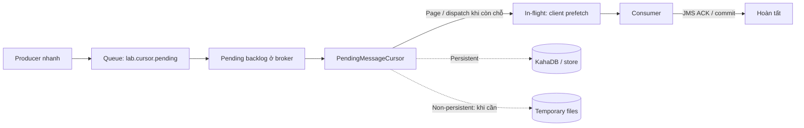

# Message cursor, pending message và lưu tạm khi backlog tăng

> **Chương:** Lưu trữ Classic  
> **Phạm vi:** Apache ActiveMQ **Classic** (không phải Artemis) trong mô-đun `INTEGRATION_MESSAGING_MESSAGE_BROKER_ACTIVEMQ`. Tập trung vào pending cursor, phân trang backlog vào/ra RAM và temporary store, quản lý quota và producer flow control.  
> **Kết quả mong đợi:** Phân biệt `storeCursor`, `vmQueueCursor`, `fileQueueCursor`; hiểu mối quan hệ giữa `PERSISTENT`/`NON_PERSISTENT` và KahaDB/temp files; cấu hình cursor đúng cho queue/topic; tạo backlog bằng Java/JMS và dùng JMX đo hiện tượng thực.

## 1. Backlog tăng không có nghĩa mọi message đều nằm trên JVM heap

Giả sử một producer gửi 2.000 message/giây, trong khi các consumer chỉ hoàn tất và ACK 500 message/giây. Backlog tăng khoảng **1.500 message/giây**. Nếu tình trạng đó kéo dài 10 phút, hệ thống có thể tích lũy **900.000 message chưa hoàn tất**. Với payload 4 KiB, riêng dữ liệu thô đã khoảng 3,43 GiB, chưa tính header, index và journal.

ActiveMQ Classic không bắt buộc giữ toàn bộ hàng trăm nghìn message này dưới dạng object Java trên heap. **Message cursor** là cơ chế điều tiết **message đang chờ dispatch**: cho phép broker đọc/phân trang từng phần backlog từ memory, persistence store hoặc temporary file storage để chuyển cho consumer khi còn khả năng nhận.



Có ba khái niệm phải tách bạch:

| Khái niệm | Nơi/ý nghĩa | Dễ hiểu nhầm |
| --- | --- | --- |
| **Pending** | Message còn thuộc trách nhiệm destination, chưa có đủ khả năng dispatch hoặc đang chờ trong cursor/store | Không đồng nghĩa mọi message có object/payload trong heap |
| **Dispatched / in-flight** | Broker đã cấp message cho JMS consumer, có thể đã nằm trong **prefetch buffer** dù code chưa xử lý xong | Không đồng nghĩa đã được ACK |
| **Dequeue / ACK** | Broker đã ghi nhận xác nhận nhận/xử lý hợp lệ theo Session mode | Không suy trực tiếp từ số message được dispatch |

Một message có thể di chuyển qua pending cursor và client buffer mà **vẫn chưa ACK**. Do đó đọc chỉ số `QueueSize` đơn lẻ dễ dẫn đến kết luận sai khi backlog lớn và prefetch đang hoạt động.

### 1.1. Hai đường đi của message

**Đường nhanh, consumer theo kịp:**

```text
Producer -> broker -> lưu bền nếu PERSISTENT -> dispatch -> consumer -> ACK
                  (rất ít pending nên có thể đi gần như liên tục)
```

**Đường backlog, consumer chậm hoặc offline:**

```text
Producer -> broker -> persistent store / file-backed pending
                           |
                           v
                        cursor
                           |
                    page một lô nhỏ
                           |
                           v
                       dispatch -> consumer -> ACK
```

Tài liệu Classic mô tả cơ chế lai: khi consumer nhanh, broker có thể dispatch thuận tiện sau khi persist; khi chậm, cursor lấy message theo lô từ vùng lưu trữ. **Cursor là bộ điều khiển cửa sổ dispatch**, không phải cơ chế tạo durability mới.

## 2. Phân biệt cursor với prefetch, KahaDB và flow control

Trong vận hành dễ nhầm ba bộ đệm:

1. **Pending cursor trong broker**: chọn các message còn chờ chuyển tới consumer; chỉ có phần đang page/cached cần giữ trong RAM.
2. **Consumer prefetch**: giới hạn message đã được broker dispatch trước tới client nhưng chưa hoàn tất; cấu hình bằng `consumer.prefetchSize` trên Classic OpenWire client.
3. **KahaDB / temporary store**: chỗ lưu nội dung hoặc phần backlog phía disk, **không** phải queue prefetch của client.

```text
                 BROKER CLASSIC                         JVM CONSUMER
   +--------------------------------------+    +------------------------+
   | Pending cursor                       |    | Prefetch buffer        |
   |   chưa sẵn sàng dispatch             |--->| đã dispatch, chưa ACK  |
   |   page từ KahaDB/temp khi cần         |    +------------------------+
   +--------------------------------------+                 |
                ^                                           v
        backing store/temp                              receive()
                                                           |
                                                           v
                                                      ACK / commit
```

**Prefetch nhỏ không xóa backlog.** Nó hạn chế số message một client giữ trước. **Store cursor không làm consumer nhanh hơn.** Nó giúp broker tránh giữ toàn bộ message pending trên heap. **Flow control không làm tăng storage.** Nó khiến producer chờ/báo lỗi khi tài nguyên đạt giới hạn, ngăn quá tải nghiêm trọng hơn.

Với ActiveMQ Classic queue, prefetch có thể cấu hình như sau:

```java
Queue queue = session.createQueue(
        "lab.cursor.pending?consumer.prefetchSize=1");
MessageConsumer consumer = session.createConsumer(queue);
```

Phần `?consumer.prefetchSize=1` là **destination option của Classic/OpenWire** chứ không phải tên queue vật lý. Tránh sao chép nguyên cấu hình này cho Artemis; Artemis Core có cơ chế consumer window/credits riêng.

## 3. Các loại message cursor

### 3.1. `storeCursor` — nạp dần từ store

`storeCursor` là cursor dựa trên **message store**, được tài liệu Classic 5.x mô tả là lựa chọn mặc định cho queue. Đối với `DeliveryMode.PERSISTENT`, message đã được ghi bền vào persistence adapter (điển hình KahaDB); cursor lấy một phần message từ đó để dispatch.

```text
PERSISTENT message
  -> KahaDB / persistence adapter (durable)
  -> Store cursor (page khi cần)
  -> Dispatch / prefetch
  -> ACK
```

**Ưu điểm:** Chịu được backlog lớn hơn heap, vì payload persistent không cần giữ toàn bộ trong memory để chờ. **Đánh đổi:** Phụ thuộc tốc độ đọc/ghi, index và journal store, số message/page, tốc độ ACK và disk throughput.

Điểm rất quan trọng: `storeCursor` **không chỉ xử lý persistent messages**. Với **`NON_PERSISTENT`**, message không có bản durable trong KahaDB. Classic có đường **file-based cursor nhúng trong store cursor** cho non-persistent messages khi cần buffer/paging. Vì vậy có thể thấy `TempPercentUsage` tăng dù policy của queue đang là `storeCursor`.

### 3.2. `vmQueueCursor` — giữ pending references ở RAM

VM cursor giữ message references trong memory cho tới khi dispatch. Hữu ích khi backlog có giới hạn nhỏ, consumer luôn theo kịp và độ trễ thấp quan trọng. Với backlog quá lớn, broker sẽ chạm giới hạn memory/destination, có thể gây producer flow control hoặc resource exception.

```text
Broker heap:
    ref(M1)  ref(M2)  ref(M3)  ... ref(Mn)
       \        |        /
         pending dispatch
```

Nhìn thấy chỉ “reference” không có nghĩa mỗi entry chiếm 0 byte: object graph, cached payload, header và metadata đều có chi phí. **`vmQueueCursor` không tự chuyển sang temporary file cursor** khi memory đầy.

### 3.3. `fileQueueCursor` — lưu tạm backlog xuống disk

File cursor dùng memory khi còn chỗ, rồi có thể **spool pending messages vào temporary files** khi broker chạm ngưỡng buffer. Khi consumer có khả năng nhận thêm, cursor đọc/đẩy message từ file tạm về đường dispatch.

```text
Producer -> File cursor ----> RAM chưa tới ngưỡng ----> dispatch
                   |
                   +--------> temporary disk file
                                    |
                                    +--> page lại khi có chỗ
```

**Ưu điểm:** Giảm áp lực heap và hấp thụ được burst mà consumer không theo kịp. **Đánh đổi:** Cần temp disk, disk I/O và policy cleanup; khi `tempUsage` đầy, producer cũng có thể bị throttle hoặc báo lỗi.

**Không đánh đồng spool-to-disk và durable delivery.** Temporary file storage là phương tiện đệm trong lúc broker đang chạy. Message **NON_PERSISTENT** đã được spool vào đĩa tạm vẫn **không có cam kết được phục hồi sau broker restart/crash**.

### 3.4. Bảng chọn cursor cho queue

| Cursor | Nơi giữ pending backlog chủ yếu | Tình huống phù hợp | Rủi ro |
| --- | --- | --- | --- |
| `storeCursor` | Persistence store cho persistent, đường file-backed khi cần cho non-persistent | Queue bền và backlog lớn; lựa chọn mặc định đáng tin cậy | Store/temp I/O và quota |
| `vmQueueCursor` | Memory broker | Queue backlog ngắn, latency cần đo rất thấp | Dễ đạt memory high-water mark, block producer |
| `fileQueueCursor` | RAM rồi temporary files | Burst mạnh, cần spool non-persistent backlog | Temp disk đầy, I/O cao; không bảo đảm durability |
| `storeDurableSubscriberCursor` | Message store cho durable topic subscriber | Durable subscription có backlog khi offline | Vẫn cần store quota, TTL và ACK |

Các cursor này **không phải những công tắc “một message có được ACK hay không”**. ACK vẫn chịu quy tắc JMS Session, giao dịch và redelivery.

## 4. Vì sao queue và topic subscriber không dùng chung một policy?

Classic chia cấu hình theo vị trí pending:

- **Queue:** Có pending/dispatch ở mức destination; các consumer tranh nhau một tập công việc. Cấu hình `pendingQueuePolicy`.
- **Non-durable topic subscriber:** Mỗi subscription đang hoạt động có pending/dispatch riêng. Cấu hình `pendingSubscriberPolicy`.
- **Durable topic subscriber:** Có subscription state bền, có thể nhận backlog khi offline theo điều kiện persistent delivery; cấu hình `pendingDurableSubscriberPolicy`.

Các phần tử XML có tên khác nhau:

```xml
<!-- Queue: chọn một trong storeCursor/vmQueueCursor/fileQueueCursor -->
<pendingQueuePolicy>
    <storeCursor/>
</pendingQueuePolicy>

<!-- Topic subscriber không durable -->
<pendingSubscriberPolicy>
    <fileCursor/>
</pendingSubscriberPolicy>

<!-- Topic subscriber durable -->
<pendingDurableSubscriberPolicy>
    <storeDurableSubscriberCursor/>
</pendingDurableSubscriberPolicy>
```

Đoạn trên **chỉ minh họa các phần tử**, **không** chèn cả ba trực tiếp vào một `policyEntry` của cùng destination. Từng phần tử cần nằm trong `policyEntry queue="..."` hoặc `policyEntry topic="..."` tương ứng.

### 4.1. Slow non-durable topic subscriber có chính sách bỏ message

Đối với dữ liệu kiểu giá thị trường cập nhật liên tục, subscriber chậm có thể chấp nhận mất các giá cũ. Classic có `pendingMessageLimitStrategy` để giới hạn số message **matched và chờ dispatch** cho **non-durable topic subscriber**, **ngoài mức prefetch**.

```xml
<policyEntry topic="lab.prices.>">
  <pendingMessageLimitStrategy>
    <constantPendingMessageLimitStrategy limit="10"/>
  </pendingMessageLimitStrategy>
</policyEntry>
```

`limit="10"` nghĩa là tối đa 10 pending messages thêm ngoài prefetch của mỗi subscriber theo strategy; khi vượt, các message cũ có thể bị **evict/discard**. `limit="0"` ở broker strategy nghĩa là không giữ pending thêm ngoài prefetch; `-1` tắt cơ chế discard. Lưu ý tùy chọn `consumer.maximumPendingMessageLimit` phía client lại có quy tắc riêng về giá trị 0.

**Đừng dùng chiến lược discard này cho sự kiện tài chính/đơn hàng bắt buộc xử lý đủ**. Việc chuyển message sang temporary cursor **khác** với việc chủ động bỏ message khi vượt pending limit. Với topic cần replay đủ, dùng durable subscription và chính sách lưu/retention thích hợp.

## 5. KahaDB khác temp storage: disk có hai vai trò

### 5.1. Persistent store — dữ liệu cần sống sót qua restart

ActiveMQ Classic thường dùng **KahaDB** làm persistence adapter. Khi producer gửi `PERSISTENT` và broker persistence bật, message được ghi vào message store theo chính sách durability. Cursor dùng phần lưu này để page mà không cần toàn bộ backlog trong heap.

Ví dụ bên trong `<broker>` hiện có:

```xml
<persistenceAdapter>
    <kahaDB directory="data/kahadb"/>
</persistenceAdapter>
```

Đường dẫn `data/kahadb` là minh họa tương đối; trong hệ thống triển khai thật phải cấu hình path theo instance/broker phù hợp. Không thêm một `<persistenceAdapter>` thứ hai nếu cấu hình đã có. Không xóa trực tiếp các file KahaDB đang được broker sử dụng.

### 5.2. Temporary file store — bộ đệm, không phải hợp đồng durability

Khi backlog của **NON_PERSISTENT** không thể giữ trong bộ nhớ, file cursor có thể dùng temp store trên disk. Dù đang tồn tại trên disk vật lý, những file đó **không phải** nơi khôi phục message non-persistent sau crash.

| Hành vi | Persistent + KahaDB | Non-persistent + temp cursor |
| --- | --- | --- |
| Sử dụng disk khi backlog lớn | Có | Có thể có |
| Cơ chế lưu bền được thiết kế cho restart | **Có**, tùy cấu hình/commit/expiry | **Không** |
| Bị điều tiết bởi | `storeUsage`, disk và store policy | `tempUsage`, disk và cursor policy |
| Có thể mất sau broker crash | Vẫn có rủi ro từ sync/persistence/config lỗi, nhưng mục tiêu là bền | **Có**, theo đúng semantics NON_PERSISTENT |
| Xóa từng file ngay sau mỗi ACK | Không phải cam kết | Cũng không phải cam kết |

**Không suy luận** từ tên thư mục hoặc việc “file còn tồn tại” rằng broker cam kết phục hồi non-persistent message. Khi kiểm thử restart phải phân biệt **send mode**, **broker persistence**, **transaction commit**, **TTL** và **store health**.

## 6. Cấu hình lab ActiveMQ Classic: cursor và quota

Các trích đoạn dưới đây đặt trong **`<broker>` đã tồn tại** của `conf/activemq.xml`. Chúng có thể cần được **gộp** vào `<destinationPolicy>`, `<systemUsage>` và `<persistenceAdapter>` đang có. Không tạo hai section cùng loại nếu file hiện đã định nghĩa chúng.

### 6.1. Policy queue: Store cursor và ngưỡng paging

```xml
<destinationPolicy>
  <policyMap>
    <policyEntries>
      <policyEntry queue="lab.cursor.>"
                   memoryLimit="2mb"
                   cursorMemoryHighWaterMark="70"
                   maxPageSize="100"
                   producerFlowControl="true">
        <pendingQueuePolicy>
          <storeCursor/>
        </pendingQueuePolicy>
      </policyEntry>
    </policyEntries>
  </policyMap>
</destinationPolicy>
```

Ý nghĩa chính xác:

- `queue="lab.cursor.>"` là wildcard destination policy cho queue có prefix `lab.cursor.`.
- `memoryLimit="2mb"` hạn chế budget bộ nhớ của destination/cursor, **không phải giới hạn tổng backlog trên disk**.
- `cursorMemoryHighWaterMark="70"` kích hoạt hành vi block/page tùy cursor khi memory đạt ngưỡng khoảng 70% limit được áp dụng.
- `maxPageSize="100"` là giới hạn số message cho một lần page từ store, **không** phải giới hạn 100 message toàn queue.
- `producerFlowControl="true"` bật chính sách gây backpressure khi broker gặp memory/store/temp resource pressure.
- `storeCursor` cho phép phân trang persistent message từ store; non-persistent có thể dùng buffer file-backed theo cơ chế nội bộ.

**Đổi cursor để so sánh:** Thay **duy nhất phần tử con** của `pendingQueuePolicy`:

```xml
<!-- Biến thể A — chỉ cho lab backlog nhỏ -->
<pendingQueuePolicy><vmQueueCursor/></pendingQueuePolicy>

<!-- Biến thể B — lab spool temporary disk -->
<pendingQueuePolicy><fileQueueCursor/></pendingQueuePolicy>
```

**Hai biến thể là các lựa chọn thay thế, không bật đồng thời.** Dừng broker đúng quy trình khi đổi policy và không làm trên queue production có message tồn đọng cần bảo toàn mà chưa có kế hoạch.

### 6.2. Quota toàn broker và phản ứng khi đầy

```xml
<systemUsage>
  <systemUsage sendFailIfNoSpaceAfterTimeout="4000">
    <memoryUsage>
      <memoryUsage limit="64 mb"/>
    </memoryUsage>
    <storeUsage>
      <storeUsage limit="256 mb"/>
    </storeUsage>
    <tempUsage>
      <tempUsage limit="64 mb"/>
    </tempUsage>
  </systemUsage>
</systemUsage>
```

| Tham số | Kiểm soát | Đừng nhầm với |
| --- | --- | --- |
| `memoryUsage` | Memory resources dùng chung trong broker | JVM `-Xmx` thực tế hoặc tổng backlog được lưu |
| `storeUsage` | Giới hạn persistent message store | Temporary file store |
| `tempUsage` | Giới hạn lưu trữ tạm, bao gồm file cursor | KahaDB durable journal |
| `sendFailIfNoSpaceAfterTimeout="4000"` | Khi thiếu tài nguyên, chờ khoảng 4 giây rồi có thể trả lỗi nếu vẫn hết chỗ | TTL của message hoặc consumer ACK timeout |

Theo cấu hình mặc định thường gặp, **producer có thể block khi broker đầy**, chứ không luôn ném lỗi ngay. Producer dùng **async send** có khác biệt về feedback/backpressure; khi thử nghiệm quota nên chọn synchronous send để nhìn rõ độ trễ và ngoại lệ.

**Cảnh báo:** Broker quota không cấp thêm dung lượng đĩa vật lý. Giữ khoảng trống cho journal/index/temp và log; không đặt các giới hạn bằng đúng 100% dung lượng volume.

### 6.3. Topic policy là cấu hình khác

Ví dụ đặt bên trong `<policyEntries>` hiện có, bên cạnh queue policy:

```xml
<policyEntry topic="lab.prices.>"
             memoryLimit="2mb">
  <pendingSubscriberPolicy>
    <fileCursor/>
  </pendingSubscriberPolicy>
  <pendingMessageLimitStrategy>
    <constantPendingMessageLimitStrategy limit="10"/>
  </pendingMessageLimitStrategy>
</policyEntry>
```

Đây là **loss-tolerant topic** minh họa. Với durable topic subscriber, dùng `pendingDurableSubscriberPolicy` và `storeDurableSubscriberCursor` tương ứng; không nghĩ `fileCursor` tự làm subscription durable.

## 7. Java/JMS thực nghiệm: producer nhanh và consumer chậm

### 7.1. Yêu cầu

- JDK 17 và Maven.
- Broker **Apache ActiveMQ Classic 5.18.x** chạy riêng tại `tcp://127.0.0.1:61616` với chính sách lab ở mục 6.
- Client `org.apache.activemq:activemq-client:5.18.3`, sử dụng namespace **`javax.jms`**.
- Tài khoản có quyền gửi/nhận queue `lab.cursor.pending`. Nếu broker cần authentication, đặt `BROKER_USER` và `BROKER_PASSWORD` trong environment.

Dùng `BytesMessage` để chủ động kích thước payload, không phải để tối ưu serialization. Code chỉ làm bài học về backlog/cursor, không gửi dữ liệu nghiệp vụ thật.

```xml
<!-- pom.xml -->
<project xmlns="http://maven.apache.org/POM/4.0.0"
         xmlns:xsi="http://www.w3.org/2001/XMLSchema-instance"
         xsi:schemaLocation="http://maven.apache.org/POM/4.0.0 https://maven.apache.org/xsd/maven-4.0.0.xsd">
  <modelVersion>4.0.0</modelVersion>
  <groupId>example.activemq</groupId>
  <artifactId>classic-cursor-demo</artifactId>
  <version>1.0.0</version>
  <properties>
    <maven.compiler.release>17</maven.compiler.release>
  </properties>
  <dependencies>
    <dependency>
      <groupId>org.apache.activemq</groupId>
      <artifactId>activemq-client</artifactId>
      <version>5.18.3</version>
    </dependency>
  </dependencies>
  <build>
    <plugins>
      <plugin>
        <groupId>org.apache.maven.plugins</groupId>
        <artifactId>maven-compiler-plugin</artifactId>
        <version>3.13.0</version>
      </plugin>
      <plugin>
        <groupId>org.codehaus.mojo</groupId>
        <artifactId>exec-maven-plugin</artifactId>
        <version>3.5.0</version>
      </plugin>
    </plugins>
  </build>
</project>
```

### 7.2. Chương trình `CursorLab.java`

Tạo `src/main/java/example/activemq/CursorLab.java`:

```java
package example.activemq;

import java.util.Arrays;
import java.util.UUID;

import javax.jms.BytesMessage;
import javax.jms.Connection;
import javax.jms.DeliveryMode;
import javax.jms.JMSException;
import javax.jms.Message;
import javax.jms.MessageConsumer;
import javax.jms.MessageProducer;
import javax.jms.Queue;
import javax.jms.Session;

import org.apache.activemq.ActiveMQConnectionFactory;

public final class CursorLab {
    private static final String NAME = "lab.cursor.pending";

    private CursorLab() {}

    public static void main(String[] args) throws Exception {
        if (args.length < 1) {
            throw new IllegalArgumentException(
                    "Usage: send <count> <bytes> persistent|nonpersistent "
                    + "| consume <maxCount> <delayMs>");
        }

        String url = System.getenv().getOrDefault(
                "BROKER_URL", "tcp://127.0.0.1:61616");
        String user = System.getenv("BROKER_USER");
        String pass = System.getenv("BROKER_PASSWORD");
        ActiveMQConnectionFactory factory = new ActiveMQConnectionFactory(url);

        // Để thấy rõ broker feedback khi chạm resource limits.
        factory.setAlwaysSyncSend(true);

        Connection connection = user == null || user.isBlank()
                ? factory.createConnection()
                : factory.createConnection(user, pass);
        try {
            connection.start();

            if ("send".equals(args[0])) {
                if (args.length != 4) {
                    throw new IllegalArgumentException("send <count> <bytes> "
                            + "persistent|nonpersistent");
                }
                int count = Integer.parseInt(args[1]);
                int bytes = Integer.parseInt(args[2]);
                boolean persistent = switch (args[3]) {
                    case "persistent" -> true;
                    case "nonpersistent" -> false;
                    default -> throw new IllegalArgumentException(
                            "Delivery mode must be persistent|nonpersistent");
                };
                if (count < 1 || count > 100_000 ||
                        bytes < 1 || bytes > 1_048_576) {
                    throw new IllegalArgumentException("Invalid send args");
                }
                send(connection, count, bytes, persistent);

            } else if ("consume".equals(args[0])) {
                if (args.length != 3) {
                    throw new IllegalArgumentException(
                            "consume <maxCount> <delayMs>");
                }
                int maxCount = Integer.parseInt(args[1]);
                long delayMs = Long.parseLong(args[2]);
                if (maxCount < 1 || delayMs < 0 || delayMs > 60000) {
                    throw new IllegalArgumentException("Invalid consumer args");
                }
                consume(connection, maxCount, delayMs);
            } else {
                throw new IllegalArgumentException(
                        "Unknown mode: " + args[0]);
            }
        } finally {
            connection.close();
        }
    }

    private static void send(Connection connection, int count,
                             int bytes, boolean persistent)
            throws JMSException {
        Session session = connection.createSession(
                true, Session.SESSION_TRANSACTED);
        try {
            Queue q = session.createQueue(NAME);
            MessageProducer producer = session.createProducer(q);
            try {
                producer.setDeliveryMode(
                        persistent ? DeliveryMode.PERSISTENT
                                   : DeliveryMode.NON_PERSISTENT);
                producer.setTimeToLive(0); // lab: không tự expire
                byte[] payload = new byte[bytes];
                Arrays.fill(payload, (byte) 'X');
                String runId = UUID.randomUUID().toString();

                for (int i = 1; i <= count; i++) {
                    BytesMessage msg = session.createBytesMessage();
                    msg.writeBytes(payload);
                    msg.setStringProperty("runId", runId);
                    msg.setIntProperty("sequence", i);
                    producer.send(msg);

                    if (i % 100 == 0) {
                        session.commit();
                        System.out.printf(
                                "SEND COMMIT run=%s count=%d%n", runId, i);
                    }
                }

                if (count % 100 != 0) {
                    session.commit();
                }
                System.out.printf("SEND DONE run=%s count=%d "
                                + "payloadBytes=%d persistent=%s%n",
                        runId, count, bytes, persistent);
            } catch (JMSException failure) {
                session.rollback();
                throw failure;
            } finally {
                producer.close();
            }
        } finally {
            session.close();
        }
    }

    private static void consume(Connection connection, int maxCount,
                                long delayMs) throws Exception {
        Session session = connection.createSession(
                true, Session.SESSION_TRANSACTED);
        try {
            Queue q = session.createQueue(
                    NAME + "?consumer.prefetchSize=1");
            MessageConsumer consumer = session.createConsumer(q);
            try {
                for (int i = 0; i < maxCount; i++) {
                    Message received = consumer.receive(2000);
                    if (received == null) {
                        System.out.println("No message in 2s");
                        break;
                    }
                    try {
                        if (!(received instanceof BytesMessage)) {
                            throw new IllegalStateException(
                                    "Expected BytesMessage");
                        }
                        String runId =
                                received.getStringProperty("runId");
                        int seq = received.getIntProperty("sequence");

                        Thread.sleep(delayMs); // chưa ACK trong lúc xử lý
                        session.commit();      // ACK sau khi xử lý
                        System.out.printf("ACK run=%s seq=%d%n", runId, seq);
                    } catch (InterruptedException interrupted) {
                        session.rollback();
                        Thread.currentThread().interrupt();
                        break;
                    } catch (Exception failure) {
                        session.rollback();
                        throw failure;
                    }
                }
            } finally {
                consumer.close();
            }
        } finally {
            session.close();
        }
    }
}
```

**Tại sao chọn những thiết lập này?**

- `setAlwaysSyncSend(true)` buộc client Classic chờ broker feedback thay vì dựa vào đường async có thể che đi tắc nghẽn non-persistent; demo đo send latency/backpressure rõ hơn.
- `PERSISTENT` và `NON_PERSISTENT` là **thuộc tính của message**, độc lập với tên queue. Đổi chế độ mà không đổi queue giúp so sánh store/temp.
- Producer `commit()` **mỗi 100 message**. Nếu một commit thất bại, các lô đã commit trước đó **không rollback theo lô hiện tại**.
- `consumer.prefetchSize=1` làm số message giữ sẵn ở client nhỏ, để dễ quan sát cursor pending ở broker.
- `Session.SESSION_TRANSACTED` khiến consumer ACK bằng `commit()` **sau** khi giả lập xử lý. Đây không phải mô hình xử lý nghiệp vụ có database; nếu dùng thật vẫn cần idempotency.
- `runId` và `sequence` giúp phân biệt message của các lượt chạy, không dùng số đếm JMX tích lũy để kết luận chính xác về một lần test.

### 7.3. Thực hành với ba giai đoạn

**Giai đoạn A — pending persistent, chưa có consumer:**

```bash
mvn -q compile exec:java -Dexec.mainClass=example.activemq.CursorLab -Dexec.args="send 5000 4096 persistent"
```

5.000 message × 4 KiB ≈ **19,5 MiB payload**. Khi producer kết thúc và consumer chưa chạy, kiểm tra `QueueSize`, `StorePercentUsage`, `CursorSize` và `MemoryPercentUsage`. Với store cursor, backlog persistent có thể nằm trong KahaDB trong khi memory usage của queue chỉ chiếm một phần.

Sau đó consume tuần tự:

```bash
mvn -q compile exec:java -Dexec.mainClass=example.activemq.CursorLab -Dexec.args="consume 5000 10"
```

Theo dõi `DequeueCount` tăng khi worker ACK, `QueueSize` giảm và cursor tiếp tục page. Nếu đã có backlog từ lần trước, kết quả `QueueSize=0` chưa chắc đạt đúng khi gọi hết 5.000; dùng `runId` để đối soát.

**Giai đoạn B — non-persistent và temporary store:**

Khi đã hoàn tất giai đoạn A, không còn message cần giữ trên queue thử:

```bash
mvn -q compile exec:java -Dexec.mainClass=example.activemq.CursorLab -Dexec.args="send 5000 4096 nonpersistent"
```

Quan sát **TempPercentUsage** so với StorePercentUsage. Trong store/file cursor khi RAM chạm ngưỡng, non-persistent backlog có thể sử dụng temporary files. Nếu chưa thấy temp tăng, kiểm tra cursor policy, kích thước backlog và các tối ưu của broker; không mặc định mọi byte non-persistent đều phải được spool.

**Giai đoạn C — đổi cursor và producer flow control:**

- Đợi queue lab được xử lý hết, dừng broker đúng quy trình và đổi policy từ `storeCursor` sang `vmQueueCursor`.
- Chạy lại workload **non-persistent** cùng kích thước/số lượng. Với memory quota nhỏ, producer có thể chậm hoặc lỗi vì VM cursor không spool giống file cursor.
- Đổi sang `fileQueueCursor` và chạy lại với điều kiện tương đương. Ghi send latency, memory usage, temp usage và throughput.
- Nếu muốn quan sát `sendFailIfNoSpaceAfterTimeout`, dùng broker lab riêng và quota nhỏ **có kiểm soát**, không ép broker production đầy ổ.

**Giai đoạn D — restart và độ bền:**

Gửi persistent message, chưa ACK, dừng sạch/khởi động lại broker, sau đó consume phần còn tồn. Tiếp tục với non-persistent message trên queue thử riêng: **không kỳ vọng** backlog non-persistent được khôi phục, dù trước restart `TempPercentUsage` từng tăng. Ghi rõ trạng thái persistence/TTL và dữ liệu baseline khi kết luận.

## 8. JMX và dấu hiệu chẩn đoán đúng

Classic cung cấp broker/queue MBeans; các version mới của `QueueViewMBean` có thêm các phép đo cursor. Trong môi trường demo, dùng Web Console hoặc JConsole có xác thực; **không mở remote JMX không bảo vệ**.

| Chỉ số | Ý nghĩa | Cần kết hợp |
| --- | --- | --- |
| `EnqueueCount` | Tổng số message vào queue | So với `DequeueCount` theo delta |
| `DequeueCount` | Tổng message được xử lý khỏi queue theo broker | ACK throughput thực |
| `QueueSize` | Số message còn ở queue theo cách broker thống kê | `InFlightCount`, cursor và thời điểm snapshot |
| `InFlightCount` | Message đã dispatch mà chưa ACK | Client prefetch, xử lý chậm |
| `CursorSize` | Message có thể được page trong cursor theo implementation | Queue backlog, memory usage |
| `CursorMemoryUsage` / `CursorPercentUsage` | Memory dùng bởi cursor | `memoryLimit`, high-water mark |
| `isCursorFull` / `doesCursorHaveSpace` | Cursor đã đạt memory threshold/chỗ cho paging? | Producer block, tốc độ ACK |
| `MemoryPercentUsage` | Memory pressure tại broker hoặc destination | Heap, policy và `maxPageSize` |
| `StorePercentUsage` | Pressure ở persistent store | Dung lượng/IOPS KahaDB |
| `TempPercentUsage` | Pressure ở temporary store | Non-persistent backlog, file cursor |
| `ExpiredCount` | Message hết TTL | Tránh nhầm expiry với consumer ACK |

**Không cộng cơ học `QueueSize + InFlightCount + CursorSize`** để ra tổng message chưa hoàn tất: các bộ đếm có thể mô tả phần giao nhau hoặc snapshot khác nhau tùy phiên bản và implementation.

### 8.1. Bốn mẫu dấu hiệu

```text
1) QueueSize tăng + StorePercentUsage tăng + Memory ổn định
   -> Có thể persistent backlog được page từ KahaDB qua store cursor.

2) QueueSize tăng + TempPercentUsage tăng + Store gần như không tăng
   -> Kiểm tra non-persistent file-backed buffering.

3) QueueSize thấp hoặc ổn định + InFlightCount cao + ACK rate thấp
   -> Message có thể đã nằm ở client prefetch và chưa xử lý.

4) Producer send latency tăng + Store/TempPercentUsage gần quota
   -> Resource flow control đang hoạt động, không chỉ do mạng.
```

Đây là **giả thuyết cần kiểm tra bằng log và delta metric**, không phải bằng chứng duy nhất. Trong production phải thêm thông số oldest message age, disk I/O, JVM GC, thời gian ACK và trạng thái slow consumers.

### 8.2. Vì sao file chưa được xóa ngay sau ACK?

KahaDB journal và temporary files có vòng đời theo reference/cleanup/checkpoint, không cam kết xóa từng file ngay sau mỗi ACK. Khi disk chưa giảm:

1. Xác định còn message pending/in-flight hay subscriber khác giữ reference không.
2. Kiểm tra queue/topic và storage khác sử dụng chung broker/volume.
3. Cho broker thời gian cleanup hợp lý, theo dõi xu hướng thay vì một snapshot.
4. Không xóa thủ công journal hoặc temporary file của broker đang chạy để “dọn disk” vì có thể làm hỏng trạng thái lưu trữ.
5. Nếu quota gần đầy dù backlog đã xử lý xong, cần điều tra lỗi retention/cleanup trên **phiên bản chính xác**.

## 9. Các sai lầm cần tránh

| Nhầm lẫn | Hậu quả | Cách đúng |
| --- | --- | --- |
| Queue có 100.000 message thì RAM phải giữ 100.000 object | Sizing heap quá mức hoặc đọc sai metric | Cursor có thể page từ store/temp |
| `memoryLimit=2mb` là giới hạn 2 MiB tổng queue | Tin sai về dung lượng backlog | Là memory budget cho cursor/destination |
| File cursor làm `NON_PERSISTENT` trở thành durable | Mất message sau restart dù thấy file temp | Dùng persistent delivery và persistence store |
| `storeCursor` nghĩa không dùng temp file | Không đo `tempUsage`, dễ đầy temp disk | Non-persistent có thể đi qua file-backed path |
| `vmQueueCursor` xử lý được backlog vô hạn | Memory pressure hoặc producer block | Giới hạn tốc độ hoặc dùng store/file cursor |
| Tăng prefetch để “consume nhanh hơn” | Chuyển backlog thành in-flight ở client chậm | Đo ACK throughput và xử lý nghiệp vụ |
| Chỉ xem `QueueSize`, bỏ `InFlightCount` | Nhầm message chưa ACK là đã hoàn tất | Theo dõi nhiều chỉ số đồng thời |
| Tắt producer flow control để tránh send bị chậm | Có thể nhanh chóng làm đầy disk/heap | Giữ giới hạn và backpressure, scale consumer hợp lý |
| Dùng pending limit discard cho topic tài chính | Có thể cố ý mất event ở subscriber chậm | Chỉ discard cho dữ liệu loss-tolerant |
| Xóa file KahaDB/temp để giải phóng dung lượng | Có nguy cơ hỏng store hoặc mất dữ liệu | Vận hành qua cơ chế cleanup/broker chính thức |

## 10. Bài tập kiểm chứng

### Bài tập A — Đọc cursor khi consumer offline

Producer gửi 300.000 message persistent, consumer ngắt kết nối. Bộ nhớ broker không tăng tương ứng nhưng KahaDB lớn dần.

**Yêu cầu:** Giải thích vai trò `storeCursor`; khi consumer trở lại broker cấp message theo cách nào?

*Đáp án định hướng:* KahaDB giữ bản persistent, store cursor page dần khi dispatch có chỗ, không cần heap chứa toàn bộ backlog.

### Bài tập B — Lưu tạm không có nghĩa lưu bền

Producer gửi 10.000 message non-persistent, `TempPercentUsage` tăng. Sau đó broker restart trước khi consumer ACK hết.

**Yêu cầu:** Có thể tuyên bố khôi phục 100% message không? Vì sao temp files không tạo durability?

*Đáp án định hướng:* Không. File cursor là buffer tạm, message vẫn mang semantics `NON_PERSISTENT`.

### Bài tập C — So sánh cursor bằng cùng workload

Đặt `memoryLimit=2mb`, chạy cùng `send 5000 4096 nonpersistent` khi consumer chưa chạy. Đổi lần lượt `storeCursor`, `vmQueueCursor`, `fileQueueCursor` trên broker lab.

**Yêu cầu:** So sánh memory/temp usage, send latency, queue size, throughput, GC và disk I/O.

*Đáp án định hướng:* VM có thể gây memory pressure và block sớm; store/file có thể page/spool giúp giữ backlog lớn hơn trong temp disk. Dùng số đo thực, không kết luận bằng tên cursor.

### Bài tập D — Prefetch và in-flight

Một consumer có `prefetchSize=1000` nhận trước nhiều message rồi xử lý rất chậm. Worker khác nhanh hơn nhưng nhận ít việc.

**Yêu cầu:** Vì sao `QueueSize` có thể không phản ánh đúng số job chưa xử lý? Nên đo gì và đổi cấu hình gì?

*Đáp án định hướng:* Message đã dispatch nằm trong client prefetch/in-flight; đo `InFlightCount`, ACK rate, delay; thử prefetch nhỏ để giảm giữ trước message.

### Bài tập E — Ước lượng backlog

Producer 900 message/giây, consumer ACK 600 message/giây, payload trung bình 8 KiB. Sau 15 phút, backlog tăng bao nhiêu message và tối thiểu bao nhiêu GiB payload?

*Đáp án định hướng:* 300 × 900 = **270.000 message**; 270.000 × 8192 byte ≈ **2,06 GiB** payload chưa tính metadata/index/journal.

### Bài tập F — Slow subscriber có được bỏ event?

Topic cập nhật giá có thể bỏ giá cũ khi client chậm; topic `PaymentCaptured` không được bỏ event.

**Yêu cầu:** Có nên dùng `pendingMessageLimitStrategy` giống nhau không? Cần quan sát metric nào?

*Đáp án định hướng:* Có thể dùng hạn mức/discard cho giá loss-tolerant; không cho payment event bắt buộc xử lý đủ. Kiểm tra `discarded`/`matched` của topic subscriptions.

## 11. Tài liệu tham khảo

1. Apache ActiveMQ Classic — [Message Cursors](https://activemq.apache.org/components/classic/documentation/message-cursors): Store, VM, File cursors; queue/topic subscriber cursor policies.
2. Apache ActiveMQ Classic — [Producer Flow Control](https://activemq.apache.org/components/classic/documentation/producer-flow-control): temp/store/memory quota, send blocking, `sendFailIfNoSpaceAfterTimeout` và non-persistent paging.
3. Apache ActiveMQ Classic — [Per Destination Policies](https://activemq.apache.org/components/classic/documentation/per-destination-policies): `cursorMemoryHighWaterMark`, `maxPageSize` và `memoryLimit`.
4. Apache ActiveMQ Classic — [Slow Consumer Handling](https://activemq.apache.org/components/classic/documentation/slow-consumer-handling): `PendingMessageLimitStrategy`, eviction, `discarded` và `matched`.
5. Apache ActiveMQ Classic — [QueueViewMBean](https://activemq.apache.org/components/classic/documentation/maven/apidocs/org/apache/activemq/broker/jmx/QueueViewMBean.html): `cursorSize`, `getCursorPercentUsage`, `isCursorFull`.
6. Apache ActiveMQ Classic — [JMX](https://activemq.apache.org/components/classic/documentation/jmx): Broker/Queue MBeans và điều kiện bảo mật.
7. Apache ActiveMQ Classic — [KahaDB](https://activemq.apache.org/components/classic/documentation/kahadb): persistence adapter và journal.
8. Apache ActiveMQ Classic — [Persistent vs Non-Persistent Delivery](https://activemq.apache.org/components/classic/documentation/what-is-the-difference-between-persistent-and-non-persistent-delivery): durability theo JMS delivery mode.

> **Kết luận:** `storeCursor`, `vmQueueCursor` và `fileQueueCursor` quyết định **cách broker giữ và page pending messages** khi backlog tăng. `KahaDB` và `temp files` đều có thể dùng disk nhưng khác **bảo đảm độ bền**: temp spool **không** biến non-persistent message thành persistent. Quản trị đúng cần đo pending, prefetch/in-flight, ACK throughput, cursor memory, store/temp quota và producer latency. Cursor chỉ giúp broker chịu tải và bảo vệ tài nguyên, **không tự xóa chênh lệch giữa tốc độ gửi và tốc độ xử lý**.
