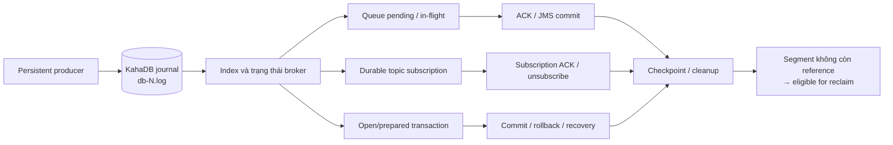
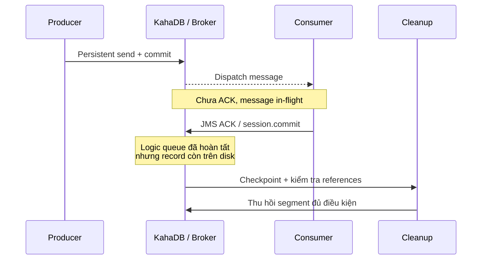
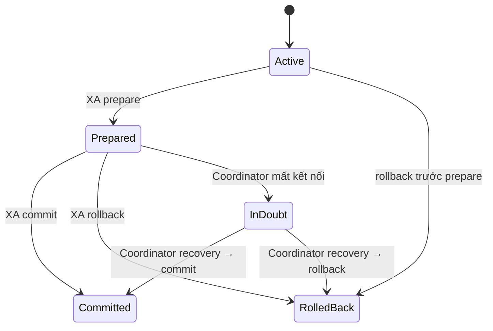

# Thu hồi journal, giao dịch còn mở và subscription giữ dữ liệu

> **Chương:** Lưu trữ Classic  
> **Phạm vi:** Cơ chế KahaDB journal/checkpoint/cleanup của **Apache ActiveMQ Classic 5.x**; lý do message chưa ACK, durable topic subscription hoặc giao dịch chưa giải quyết có thể giữ lại dữ liệu trên đĩa. Bài có đoạn cấu hình Classic và ví dụ Java JMS với `javax.jms`; **không dùng XML KahaDB cho ActiveMQ Artemis**.

## 1. Hiện tượng: queue đã trống mà thư mục KahaDB vẫn tăng

Một broker Classic tiếp nhận hàng triệu persistent message. Cuối ca, web console hiển thị `QueueSize=0`, nhưng thư mục `data/kahadb` vẫn có nhiều file `db-N.log` và dung lượng đĩa không giảm. Đây **chưa phải bằng chứng store bị rò rỉ**.

KahaDB là **log-structured persistent store**. Các thao tác enqueue, ACK, subscription state và transaction được ghi tuần tự vào journal. Khi consumer ACK thành công, một message không còn cần giao nữa, nhưng byte chứa bản ghi cũ **không được xóa tại chỗ**. Một journal segment chỉ đủ điều kiện thu hồi sau khi broker xác định không còn trạng thái sống nào cần những bản ghi trong đó, và cơ chế checkpoint/cleanup phù hợp đã chạy.

Ba nhóm đáng kiểm tra trước tiên là:

1. **Queue pending hoặc message đã dispatch nhưng chưa ACK**: worker có thể đang giữ message ở trạng thái in-flight.
2. **Durable topic subscription còn tồn tại**: một subscriber đã offline vẫn có thể giữ backlog persistent topic messages.
3. **Giao dịch chưa hoàn tất**: local JMS session chưa commit hoặc, đặc biệt, **XA transaction đã prepare nhưng chưa resolve**.



**Mục tiêu:** giải thích điều kiện journal được thu hồi, tìm đúng chủ thể giữ dữ liệu, thử ba tình huống bằng JMS, và xử lý disk pressure mà **không xóa thủ công journal/index**.

## 2. Bốn lớp trạng thái cần phân biệt

| Thành phần | Vai trò | Hệ quả khi điều tra |
|---|---|---|
| **Journal segments** (`db-*.log`) | Các bản ghi persistent message, ACK và trạng thái transaction được append tuần tự | Một segment có thể chứa cả bản ghi đã xử lý lẫn bản ghi vẫn cần giữ |
| **Index/page file** | Tra cứu trạng thái destination, message/subscription để broker phục hồi và dispatch | Không được coi index là “file cache vô hại” và xóa riêng |
| **Checkpoint** | Chốt/đồng bộ trạng thái index cần thiết cho khả năng khôi phục | Checkpoint xong **không có nghĩa** một segment sẽ bị xóa |
| **Cleanup/GC** | Xác định các segment cũ không còn reference và thu hồi hoặc archive theo cấu hình | Quản lý **theo file**, không trừ byte theo từng ACK |

### 2.1 Ví dụ một message giữ lại cả journal segment

```text
db-1.log:
    M1 enqueue → ACK            (đã hoàn tất)
    M2 enqueue → ACK            (đã hoàn tất)
    M3 enqueue                  (chưa ACK)

db-2.log:
    M4 enqueue → ACK
    M5 enqueue → ACK

db-3.log:
    segment đang nhận ghi mới
```

Nếu M3 vẫn cần giao, segment chứa M3 có thể chưa đủ điều kiện xóa. **Không suy rằng một message cũ nhất luôn giữ toàn bộ các segment mới hơn**: KahaDB theo dõi trạng thái/tham chiếu phức tạp hơn ví dụ, và mức giữ file còn phụ thuộc ACK, giao dịch, subscription cùng phiên bản implementation.

### 2.2 Enqueue, dispatch, ACK và cleanup không phải cùng một thời điểm



Do đó:

- `QueueSize=0` **không đủ** để xác nhận tất cả message đã ACK; còn phải xem in-flight và cách metric được tính ở bản Classic đó.
- `DequeueCount` tăng chứng tỏ broker ghi nhận hoàn tất tiêu thụ theo metric tương ứng, **không** chứng minh journal segment đã được GC.
- `StorePercentUsage` và kích thước filesystem/KahaDB có thể khác nhau; index, archive, file hiện hành và những thứ không do queue chính quản lý đều có thể ảnh hưởng.

## 3. Cấu hình Classic KahaDB ảnh hưởng đến quan sát thu hồi

Một **đoạn** `activemq.xml` của ActiveMQ Classic:

```xml
<!-- Ghép vào cấu hình broker XBean hiện hữu.
     Chỉ duy trì một persistenceAdapter đúng với môi trường. -->
<persistenceAdapter>
    <kahaDB directory="data/kahadb"
            journalMaxFileLength="32mb"
            checkpointInterval="5000"
            cleanupInterval="30000"
            archiveDataLogs="false"/>
</persistenceAdapter>
```

`directory="data/kahadb"` là **đường dẫn minh họa** có thể được phân giải theo nơi broker chạy. Hệ thống thật có thể dùng biến cấu hình `activemq.data`, volume/container mount hoặc đường dẫn tuyệt đối. **Không thay đường dẫn trong khi broker hoạt động rồi coi data store sẽ tự chuyển sang đó.**

| Thuộc tính | Mục đích | Điều **không** bảo đảm |
|---|---|---|
| `directory` | Nơi đặt KahaDB; phải có dung lượng và quyền ghi thích hợp | Đổi path sẽ tự copy hoặc di trú store cũ |
| `journalMaxFileLength` | Kích thước mục tiêu của journal segments được tạo mới | Segment cũ sẽ lập tức co lại sau thay đổi |
| `checkpointInterval` | Chu kỳ checkpoint định kỳ, thường tính mili giây | Mỗi checkpoint chắc chắn xóa một số file |
| `cleanupInterval` | Nhịp lên lịch kiểm tra và thu hồi dữ liệu đủ điều kiện, thường mili giây | Cứ đến nhịp là dung lượng disk phải giảm |
| `archiveDataLogs` | Điều khiển archive các journal segment đủ điều kiện | Archive trên cùng filesystem sẽ giải phóng disk |

Những thuộc tính và ý nghĩa trên dành cho **KahaDB Classic** trong các phiên bản hỗ trợ; cần xác minh schema/config effective của bản triển khai. Nếu tồn tại `persistenceAdapter` khác, **không thêm block mới song song**. Tối ưu interval khi còn live references chỉ khiến broker kiểm tra nhiều lần mà không giải quyết nguyên nhân.

### 3.1 Đừng nhầm giới hạn store với cơ chế xóa

Classic cũng có `storeUsage` trong `systemUsage`, ví dụ snippet:

```xml
<!-- Ghép vào systemUsage đã tồn tại, không tạo cấu hình trùng. -->
<storeUsage>
    <storeUsage limit="10 gb"/>
</storeUsage>
```

Đây là **ngân sách tài nguyên của broker**, không phải lệnh xóa các message cũ hay xóa journal khi chạm mốc 10 GiB. Khi broker gặp giới hạn, producer có thể bị chặn hoặc gặp lỗi theo transport/flow control. Ứng dụng cần timeout, retry có backoff và monitoring; không dùng giảm `storeUsage` để ép GC.

### 3.2 Dung lượng thực tế phải xem ở ba nơi

1. **Kích thước file KahaDB**: journal, index và các file khác trong thư mục store; có thể gồm archive nếu lưu tại đó.
2. **Store usage được Classic theo dõi**: metric/JMX broker theo cách đếm và chính sách riêng.
3. **Free space của filesystem thực tế**: còn bị dùng bởi backup, snapshot, ứng dụng khác và log broker.

Đừng kết luận “store còn tốt” chỉ vì `StorePercentUsage` thấp nếu ổ đĩa thực tế sắp đầy. Ngược lại, KahaDB directory lớn chưa chắc chứng minh queue chính đang còn backlog.

## 4. Ba nguyên nhân giữ dữ liệu cần điều tra sâu

### 4.1 Queue message chưa được ACK

Consumer đã gọi `receive()` hoặc nhận callback `onMessage()` nhưng chưa ACK/commit. Một số message có thể đang được **prefetch** về client. Theo cách broker theo dõi, những message này vẫn là phần delivery chưa được xác nhận và cần khả năng **redelivery** sau rollback/disconnect.

```text
queue pending:       2 messages
consumer in-flight:  8 messages
broker dequeue:      chưa tăng tương ứng 8 message

Nhìn chỉ QueueSize có thể đánh giá sai backlog thực tế.
```

Khi debug, xem `QueueSize`, `InFlightCount`, consumer count, enqueue/dequeue và worker logs có `START`, `DB COMMIT`, `JMS COMMIT`. **Không coi một consumer vẫn TCP-connected là bằng chứng nó đang xử lý tiến triển**. Deadlock database, thread pool kẹt hoặc lỗi network có thể khiến in-flight kéo dài.

### 4.2 Durable topic subscription offline

Giả sử dịch vụ báo cáo tạo durable topic subscription với `clientID=report-service` và `subscriptionName=daily-report`. Dịch vụ này dừng, nhưng topic producer vẫn publish persistent messages. Broker phải giữ backlog tương ứng cho **subscription đã đăng ký trước khi offline**, nếu message còn hợp lệ và chính sách store cho phép.

```mermaid
sequenceDiagram
    participant D as Durable subscriber
    participant P as Topic producer
    participant B as Classic / KahaDB
    D->>B: Tạo durable subscription
    D--xB: Disconnect; subscription vẫn tồn tại
    P->>B: Persistent publish T1, T2, T3
    Note over B: Giữ pending topic messages cho D
    D->>B: Reconnect cùng clientID và subscriptionName
    B-->>D: Giao backlog còn hợp lệ
    D->>B: ACK / commit
    Note over B: Segment đủ điều kiện GC khi<br/>mọi live reference đã hết
```

Một durable subscriber **inactive** có thể giữ dữ liệu trong journal ngay cả khi tất cả queue nghiệp vụ đang chạy đều đã drain. Cần xem danh sách **active/inactive durable subscriptions**, topic, selector, lượng pending, tuổi backlog và chủ sở hữu.

**Phân biệt:** persistent topic message **không** tự tạo backlog dành cho mọi subscriber đến trong tương lai; durable subscription phải tồn tại **trước khoảng offline** cần được phục hồi. Khi một consumer đã bị loại khỏi hệ thống nhưng durable subscription chưa bị hủy, broker có thể tiếp tục giữ dữ liệu **không còn ai nhận**.

Để giải phóng backlog bằng `unsubscribe`, phải xác định subscription **thực sự không còn cần** và không active. Đây là thao tác có thể **mất vĩnh viễn** các message pending của subscription đó. Không thực hiện chỉ vì dashboard disk đang báo đỏ; cần owner, đánh giá SLA/audit, phê duyệt và kế hoạch thay thế/replay.

### 4.3 Local JMS transaction chưa kết thúc

Với `SESSION_TRANSACTED`:

- **Consumer receive rồi chưa commit**: delivery đang được xử lý, message không được coi là ACK; sau rollback hoặc mất session có thể giao lại.
- **Producer send rồi chưa commit**: message **chưa được publish hoàn tất** theo JMS transaction. Không dùng log `send() returned` để chứng minh message đã có mặt bền vững trong queue.
- **Long-running local transaction** làm trạng thái delivery/send treo lâu, nhưng không được suy từ việc mở một session rằng nó chắc chắn “pin chính xác db-10.log”. Cần quan sát reference và behavior thực tế.

Giảm thời gian mở transaction, tránh giữ JMS transaction xuyên lời gọi HTTP/DB kéo dài không có timeout, đặt retry đúng policy và đóng session khi worker bị lỗi. Tuy nhiên thao tác rollback/đóng session cần tuân thủ logic nghiệp vụ, không dùng như “GC button”.

### 4.4 XA prepared/in-doubt transaction cần recovery

Tình huống nhạy cảm hơn là **XA two-phase commit**: transaction manager đã yêu cầu resource `prepare` thành công, rồi chết trước khi quyết định `commit` hoặc `rollback` được gửi đến broker.



XA prepared branch là trạng thái cần khả năng phục hồi sau restart. Thao tác gửi/nhận trong branch và metadata recovery **có thể giữ journal references**. Không giống local transaction chưa commit, XA prepared thường **không thể đơn giản coi là rollback an toàn**.

Quy trình:

1. Xác định application và **transaction manager** chịu trách nhiệm.
2. Xem recovery log và danh sách Xid/branch của các XA resources liên quan; đối chiếu trạng thái database và broker.
3. Cho transaction manager thực hiện **XA recovery** theo quy trình hỗ trợ; nếu cần quyết định thủ công phải có bằng chứng và phê duyệt.
4. Sau khi branch resolved, quan sát thay đổi store/JMX qua checkpoint/cleanup.

**Không xóa journal, không tùy tiện rollback prepared XA** chỉ để giải phóng disk: có thể làm trạng thái JMS và database lệch nhau, hoặc phá khả năng khôi phục transaction.

### 4.5 ACK compaction và các tham chiếu ít được chú ý

Ở một số phiên bản KahaDB, phụ thuộc giữa record ACK, checkpoint và journal segments có thể làm GC lâu hơn dự tính. Một số phiên bản Classic hỗ trợ tối ưu **ACK compaction**, nhưng đây là cơ chế **phụ thuộc version/workload**, không phải cách thay thế xử lý subscription hoặc transaction thực sự vẫn còn pending.

Trước khi thay các thuộc tính tối ưu nâng cao:

- Xác định bản ActiveMQ Classic, KahaDB config effective và vấn đề cụ thể từ log/metric.
- Thử nghiệm với workload đại diện trong staging; đo disk I/O, journal segment count, recovery after crash.
- Có backup và rollback configuration.
- **Không dùng một config tối ưu chưa kiểm chứng** để cố xóa pending message đang còn quyền được giao.

Ngoài ra, các destination khác trong cùng store (DLQ, queue bỏ quên, durable topic khác), TTL/expiry forwarding, archive/snapshot và cleanup gặp lỗi filesystem cũng có thể khiến disk không giảm.

## 5. Runbook: tìm nguyên nhân journal chưa thu hồi

### Bước 1 — Xác minh đúng broker, đúng volume

Ghi lại broker ID, phiên bản, persistence adapter, đường dẫn KahaDB, mount/container volume, dung lượng free và thời điểm journal tăng. Một cluster có nhiều node có thể có store riêng; đừng lấy metric của node A để suy ra disk của node B.

Trên Linux, kiểm tra **chỉ đọc**:

```bash
# Thay bằng thư mục KahaDB thật trong môi trường được phép kiểm tra.
du -sh /path/to/actual/kahadb
ls -lh /path/to/actual/kahadb/db-*.log
df -h /path/to/actual/kahadb
```

Kết quả cho biết dung lượng và số segment, **không cho biết segment nào an toàn để xóa**. Đừng dựa vào “file rất cũ” để kết luận nó không còn live references.

### Bước 2 — Thu thập metric broker và trạng thái subscription

Ở Classic, dùng console/JMX/monitoring exporter phù hợp. Các chỉ số thường liên quan:

| Chỉ số / danh sách | Cần trả lời |
|---|---|
| QueueSize, InFlightCount | Queue nào pending, consumer nào giữ message chưa ACK? |
| EnqueueCount, DequeueCount | Message có tiếp tục tích lũy hay ACK rate đủ nhanh? |
| DurableTopicSubscribers (active) | Subscription nào hiện đang có consumer? |
| InactiveDurableTopicSubscribers | Subscription nào offline nhưng vẫn tồn tại? |
| Pending count và oldest message age theo subscription | Ai đang giữ message lâu nhất? |
| Broker StorePercentUsage và disk free | Store budget và filesystem có đang gần ngưỡng? |
| XA recovery/in-doubt Xids | Có branch nào chưa được coordinator giải quyết? |
| KahaDB checkpoint/cleanup warnings | GC có chạy và có lỗi I/O/index/permission không? |

**Tên thuộc tính/JMX object có thể khác theo bản Classic và exporter**; không suy luận một counter tên giống nhau ở Classic/Artemis có cùng cách đếm. Đặc biệt, console queue chính **không thay thế** danh sách durable topic subscriptions.

### Bước 3 — Đối chiếu tuổi dữ liệu và owner

| Nguồn giữ | Bằng chứng cần có | Hành động đúng |
|---|---|---|
| Queue persistent pending | Queue size tăng, consumer rate thấp | Tăng năng lực xử lý có kiểm soát, điều tiết producer |
| In-flight kéo dài | Consumer có message chưa ACK, DB/API chậm | Sửa lỗi worker, timeout/recover session, tránh mất nghiệp vụ |
| Inactive durable topic | Subscription name/clientID, backlog, owner | Drain nếu còn cần, hoặc unsubscribe **có phê duyệt** |
| XA prepared | Xid, coordinator log, trạng thái XA resource | XA recovery theo quyết định coordinator |
| DLQ/expired forwarding | DLQ backlog, policy expiry/dead-letter | Phân loại, đối soát, replay/xóa theo retention được duyệt |
| Cleanup/GC không tiến triển | Broker warning, lỗi disk/permission, file references chưa hết | Khắc phục nguyên nhân, thử kiểm chứng checkpoint/cleanup |
| Archive/snapshot | Dung lượng ở archive/backup cùng filesystem | Retention/rotation của archive, không đụng journal active |

### Bước 4 — Giải quyết trạng thái sống trước, rồi quan sát GC

Sau khi worker ACK, durable backlog được drain/owner cho phép unsubscribe, hoặc XA branch được resolve, quan sát số `db-*.log` qua **một số chu kỳ** checkpoint/cleanup. Không đòi số byte trên đĩa giảm chính xác bằng tổng body vừa ACK vì cơ chế thu hồi theo segment.

Nếu không thấy disk giảm, tiếp tục kiểm tra **tất cả references** và các lỗi cleanup. Chỉ escalate/tune KahaDB sau khi đã chứng minh không còn backlog/in-doubt/điều kiện lưu giữ hợp lệ.

## 6. Lab Java JMS Classic: tạo và gỡ các tình huống giữ dữ liệu

**Mục tiêu lab:** quan sát (A) queue message nhận nhưng chưa commit, (B) durable subscription offline tích lũy persistent messages, (C) producer `send` trong local JMS transaction chưa commit. **Trường hợp XA prepared không được giả lập bằng local transaction**, vì có semantics khác.

Môi trường: ActiveMQ Classic 5.x sử dụng KahaDB, JDK 17, Gradle 8.x, OpenWire `tcp://127.0.0.1:61616` và queue/topic **chỉ dành riêng cho lab** `lab.store.queue` / `lab.store.topic`. Cần quyền publish, consume và tạo durable subscriber. Nếu broker có authentication, đặt `BROKER_USER` và `BROKER_PASSWORD` cho các terminal.

### 6.1 Dự án Gradle tối thiểu

```text
classic-journal-lab/
├── settings.gradle
├── build.gradle
└── src/main/java/lab/JournalRetentionLab.java
```

`settings.gradle`:

```groovy
rootProject.name = 'classic-journal-lab'
```

`build.gradle`:

```groovy
plugins {
    id 'java'
    id 'application'
}

repositories {
    mavenCentral()
}

java {
    toolchain {
        languageVersion = JavaLanguageVersion.of(17)
    }
}

dependencies {
    implementation 'org.apache.activemq:activemq-client:5.18.3'
    runtimeOnly 'org.slf4j:slf4j-simple:1.7.36'
}

application {
    mainClass = 'lab.JournalRetentionLab'
}
```

Dependency là **phiên bản minh họa API**, không khẳng định bản mới nhất hoặc đã được duyệt production. Bài dùng `javax.jms` của Classic 5.x; **không đổi import sang `jakarta.jms` khi chưa đổi đúng client dependency**.

### 6.2 Mã Java producer/consumer/durable subscriber

Tạo `src/main/java/lab/JournalRetentionLab.java`:

```java
package lab;

import javax.jms.Connection;
import javax.jms.DeliveryMode;
import javax.jms.Destination;
import javax.jms.JMSException;
import javax.jms.Message;
import javax.jms.MessageConsumer;
import javax.jms.MessageProducer;
import javax.jms.Queue;
import javax.jms.Session;
import javax.jms.TextMessage;
import javax.jms.Topic;
import javax.jms.TopicSubscriber;
import org.apache.activemq.ActiveMQConnectionFactory;

public final class JournalRetentionLab {
    private static final String QUEUE_NAME = "lab.store.queue";
    private static final String TOPIC_NAME = "lab.store.topic";
    private static final String CLIENT_ID = "lab-journal-reporting";
    private static final String SUB_NAME = "offline-report";

    private JournalRetentionLab() { }

    public static void main(String[] args) throws Exception {
        if (args.length < 1 || args.length > 2) {
            help();
            return;
        }
        String mode = args[0];
        String url = env("BROKER_URL", "tcp://127.0.0.1:61616");
        String user = System.getenv("BROKER_USER");
        String password = System.getenv("BROKER_PASSWORD");
        ActiveMQConnectionFactory factory =
                new ActiveMQConnectionFactory(url);

        Connection connection = user == null || user.isBlank()
                ? factory.createConnection()
                : factory.createConnection(user, password);
        try {
            if (mode.startsWith("durable-")) {
                connection.setClientID(CLIENT_ID);
            }
            Session session = connection.createSession(
                    true, Session.SESSION_TRANSACTED);
            try {
                Queue queue = session.createQueue(QUEUE_NAME);
                Topic topic = session.createTopic(TOPIC_NAME);
                switch (mode) {
                    case "queue-send":
                        sendBatch(session, queue, count(args));
                        break;
                    case "topic-send":
                        sendBatch(session, topic, count(args));
                        break;
                    case "queue-drain":
                        connection.start();
                        drain(session, session.createConsumer(queue));
                        break;
                    case "queue-hold":
                        connection.start();
                        holdReceive(session, queue);
                        break;
                    case "tx-send-hold":
                        holdSend(session, queue);
                        break;
                    case "durable-create":
                        TopicSubscriber sub =
                                session.createDurableSubscriber(topic, SUB_NAME);
                        try {
                            System.out.println("Durable subscription created");
                        } finally {
                            sub.close();
                        }
                        break;
                    case "durable-drain":
                        connection.start();
                        drain(session, session.createDurableSubscriber(
                                topic, SUB_NAME));
                        break;
                    case "durable-unsubscribe":
                        // Chỉ dùng khi subscription thuộc lab không active.
                        session.unsubscribe(SUB_NAME);
                        System.out.println("UNSUBSCRIBED " + SUB_NAME);
                        break;
                    default:
                        help();
                }
            } finally {
                session.close();
            }
        } finally {
            connection.close();
        }
    }

    private static int count(String[] args) {
        if (args.length != 2) {
            throw new IllegalArgumentException(
                    "Usage: queue-send|topic-send <count>");
        }
        int result = Integer.parseInt(args[1]);
        if (result < 1 || result > 5000) {
            throw new IllegalArgumentException("count must be 1..5000");
        }
        return result;
    }

    private static void sendBatch(
            Session session, Destination destination, int count)
            throws Exception {
        MessageProducer producer = session.createProducer(destination);
        try {
            producer.setDeliveryMode(DeliveryMode.PERSISTENT);
            String body = "x".repeat(8 * 1024);
            for (int i = 1; i <= count; i++) {
                TextMessage message = session.createTextMessage(
                        "id-" + i + ":" + body);
                message.setIntProperty("labSequence", i);
                producer.send(message);
            }
            session.commit();
            System.out.println("PERSISTENT COMMIT count=" + count);
        } finally {
            producer.close();
        }
    }

    private static void drain(Session session, MessageConsumer consumer)
            throws Exception {
        int received = 0;
        try {
            while (true) {
                Message message = consumer.receive(1500);
                if (message == null) {
                    break;
                }
                if (!(message instanceof TextMessage)) {
                    session.rollback();
                    throw new IllegalArgumentException(
                            "Unexpected message type");
                }
                session.commit(); // ACK JMS transacted receive.
                received++;
            }
            System.out.println("DRAINED " + received);
        } finally {
            consumer.close();
        }
    }

    private static void holdReceive(Session session, Queue queue)
            throws Exception {
        MessageConsumer consumer = session.createConsumer(queue);
        try {
            Message message = consumer.receive(10000);
            if (message == null) {
                System.out.println("No message to hold");
                return;
            }
            System.out.println("RECEIVED but NOT COMMITTED: "
                    + message.getJMSMessageID());
            Thread.sleep(60000); // Quan sát in-flight trong console/JMX.
            session.rollback();  // Message có thể giao lại.
            System.out.println("ROLLED BACK receive");
        } finally {
            consumer.close();
        }
    }

    private static void holdSend(Session session, Queue queue)
            throws Exception {
        MessageProducer producer = session.createProducer(queue);
        try {
            producer.setDeliveryMode(DeliveryMode.PERSISTENT);
            producer.send(session.createTextMessage("uncommitted-send"));
            System.out.println("SEND called; transaction still open");
            Thread.sleep(60000);
            session.rollback();
            System.out.println("ROLLED BACK uncommitted send");
        } finally {
            producer.close();
        }
    }

    private static String env(String name, String fallback) {
        String value = System.getenv(name);
        return value == null || value.isBlank() ? fallback : value;
    }

    private static void help() {
        System.out.println("Usage:");
        System.out.println(" queue-send <count> | queue-hold | queue-drain");
        System.out.println(" topic-send <count>");
        System.out.println(" durable-create | durable-drain | durable-unsubscribe");
        System.out.println(" tx-send-hold");
    }
}
```

**Mục đích code:** `sendBatch` gửi persistent và commit trước khi báo thành công; `queue-hold` nhận nhưng chưa commit trong 60 giây, rồi rollback; `durable-create` đăng ký offline backlog; `durable-drain` ACK từng message; `tx-send-hold` chứng minh `send()` chưa commit không đồng nghĩa message đã được xuất bản hoàn tất.

**Lưu ý:** `durable-unsubscribe` có thể loại toàn bộ message chưa xử lý của durable subscription. Chỉ chạy với subscription **chính bạn tạo trên broker lab**, không active và không còn dữ liệu cần giữ. Local JMS transaction ở ví dụ **không phải** XA prepared.

### 6.3 Thí nghiệm A — queue receive chưa commit

```bash
# Chạy trong thư mục dự án, sau khi có Gradle và broker Classic.
gradle run --args="queue-send 200"
gradle run --args="queue-hold"
```

Trong 60 giây khi console in `RECEIVED but NOT COMMITTED`, xem metric in-flight của `lab.store.queue`. Sau rollback, message chưa ACK có thể được redeliver. Kế tiếp:

```bash
gradle run --args="queue-drain"
```

Quan sát số pending/in-flight, dequeue và journal segment count sau một số chu kỳ cleanup. **Không dự đoán chính xác file nào sẽ bị xóa** chỉ vì vừa ACK một message.

### 6.4 Thí nghiệm B — durable topic subscription offline

Tạo subscription **trước** khi producer publish:

```bash
gradle run --args="durable-create"
gradle run --args="topic-send 200"
```

Subscription `(lab-journal-reporting, offline-report)` lúc này không active nhưng có thể có backlog. Xem danh sách inactive durable subscription; đừng chỉ nhìn queue `lab.store.queue`. Sau đó:

```bash
gradle run --args="durable-drain"
```

ACK xong thì backlog của subscription giảm, nhưng **subscription vẫn tồn tại** và có thể tích lũy message trong lần offline tiếp theo. Nếu thực sự kết thúc bài lab và subscription không còn cần:

```bash
# Chỉ dành cho durable subscription do lab tạo.
gradle run --args="durable-unsubscribe"
```

Broker có thể thu hồi các segment đủ điều kiện **sau** checkpoint/cleanup; `unsubscribe` không phải lệnh xóa tệp journal ngay lập tức.

### 6.5 Thí nghiệm C — local transaction chưa commit

```bash
gradle run --args="tx-send-hold"
```

Producer đã gọi `send`, nhưng transaction JMS vẫn mở trong 60 giây. Sau `rollback`, message chưa được commit không trở thành công việc đã xuất bản. **Không suy từ thí nghiệm này rằng local transaction pin một file KahaDB xác định**. Để thử XA prepared thật cần XA connection/resources, transaction coordinator và recovery log phù hợp.

### 6.6 Bảng quan sát qua từng bước

| Mốc | Queue pending | In-flight | Durable pending | Journal segments | Free disk |
|---|---:|---:|---:|---:|---:|
| Trước test | … | … | … | … | … |
| Sau queue-send | … | … | … | … | … |
| Khi queue-hold | … | … | … | … | … |
| Sau queue-drain | … | … | … | … | … |
| Sau topic-send khi durable offline | … | … | … | … | … |
| Sau durable-drain | … | … | … | … | … |
| Sau vài chu kỳ cleanup | … | … | … | … | … |

Với 200 message, tổng payload có thể chưa làm journal rotate nếu `journalMaxFileLength=32mb`. Có thể tăng số message **chỉ trên lab đủ dung lượng**, tối đa 5000 theo code; không cần tạo backlog lớn để chứng minh nguyên lý. Nếu segment không giảm ngay, đó chưa phải lỗi GC.

## 7. Khi disk áp lực: thứ tự xử lý an toàn

1. **Không đụng tay vào file journal/index**. Thu thập log, JMX và trạng thái filesystem.
2. Xác nhận dung lượng volume thực và đối tượng đang giữ message: queue pending/in-flight, durable subscription, DLQ, transaction in-doubt.
3. Nếu nguy cơ disk full, giảm áp lực producer bằng flow control/rate limit hoặc mở rộng volume theo runbook; không cố xóa bản ghi đang cần recovery.
4. Giải quyết backlog **đúng nghiệp vụ**: sửa consumer, drain subscription còn cần, owner xác nhận unsubscribe nếu không còn cần; XA recovery qua transaction manager.
5. Đợi broker tiến hành checkpoint/cleanup theo chính sách; đo journal segment count, store usage và free disk.
6. Chỉ sau khi đã xác minh không còn references hợp lệ mới xem xét config/performance tuning hoặc liên hệ hỗ trợ phiên bản Classic cụ thể.

### 7.1 Các thao tác tuyệt đối không sử dụng như “giải pháp nhanh”

- Xóa hoặc đổi tên `db-N.log` vì nó “đã cũ”.
- Xóa index KahaDB riêng lẻ để thử ép broker rebuild khi chưa có quy trình khôi phục được kiểm chứng.
- Unsubscribe một durable subscriber không rõ chủ sở hữu.
- Tự ý rollback/commit prepared XA branch mà không đối soát coordinator.
- Restart broker nhiều lần và kỳ vọng stale reference tự biến mất.
- Bật archive vô hạn trên cùng filesystem rồi kết luận đã tiết kiệm dung lượng.

Nếu phải di trú store, dùng quy trình **dừng broker đúng cách, tạo bản sao store nhất quán và thử khả năng phục hồi**, không copy/xóa từng journal segment trong khi broker đang ghi.

## 8. Các tình huống dễ chẩn đoán sai

| Triệu chứng | Nguyên nhân có thể | Cách xác minh |
|---|---|---|
| QueueSize = 0, journal vẫn lớn | Durable topic offline, XA prepared, file active, cleanup chưa chạy | Xem durable subscribers, XA state, journal count/log |
| DequeueCount tăng nhưng disk không giảm ngay | Segment còn record sống; chờ checkpoint/cleanup | Theo dõi qua nhiều chu kỳ, xem in-flight và subscription |
| In-flight lớn, queue pending nhỏ | Prefetch/consumer chưa commit hoặc worker chậm | Consumer state, ACK rate, DB/API latency |
| Inactive durable subscription tăng đều | Client không quay lại nhưng subscription còn backlog | ClientID/subName/owner và pending age |
| Transaction manager chết, broker restart không giải phóng journal | XA branch prepared/in-doubt | Recovery log/Xid tại coordinator |
| Disk full dù broker StorePercentUsage còn thấp | Các file/backup/archive khác hoặc sai volume đo | Filesystem free + đường dẫn store thật |
| TTL ngắn nhưng store vẫn phình | Expired message chuyển DLQ, bản lưu khác hoặc cleanup chưa tới | DLQ/expiry policy, archive/backup |
| Dọn hết queue nhưng số journal log không về 0 | Segment hiện hành, index và dữ liệu của destination khác | Xem toàn broker, không chỉ một queue |

### 8.1 TTL không phải lệnh xóa vật lý

Message hết `JMSExpiration` sẽ không còn được giao theo ngữ nghĩa message còn hiệu lực, nhưng dữ liệu có thể được chuyển sang DLQ tùy **deadLetterStrategy/processExpired** của Classic, hoặc còn tồn tại trong journal/backup cho đến cleanup. Chỉ đặt producer TTL không đáp ứng đầy đủ yêu cầu xóa dữ liệu và retention. Đối chiếu **DLQ, expiry và backup rotation**.

### 8.2 ACK compaction là tối ưu, không phải cách xóa dữ liệu hợp lệ

Một số bản Classic có cơ chế **ACK compaction** để hỗ trợ GC khi ACK reference giữ các segment lâu. Tính năng này cần kiểm chứng trên đúng version và workload. Nếu durable subscription còn cần pending messages hoặc XA branch vẫn prepared, ACK compaction **không xóa được trách nhiệm lưu trữ của broker**. Không tự thêm tuning nâng cao chỉ vì thấy nhiều `db-N.log`; hãy thử trong staging, đo I/O/GC và có rollback.

## 9. Bài tập kiểm chứng và checklist

### Câu hỏi tình huống

1. Broker có `QueueSize=0` nhưng 20 GiB KahaDB. Có hai durable topic subscriptions inactive 14 ngày. Bạn cần thu thập những số liệu và ý kiến owner nào trước khi unsubscribe?
2. Vì sao việc nhận và ACK một message không đồng nghĩa broker có thể xóa ngay một phần file `db-1.log`?
3. Một consumer nhận qua `SESSION_TRANSACTED` nhưng bị treo ở lời gọi HTTP. Message ở trạng thái logic nào và điều gì xảy ra khi session bị mất?
4. Một XA transaction đã `prepare` nhưng coordinator chưa quyết định commit/rollback. Vì sao xóa journal để “thoát lock” là cách xử lý sai?
5. Đã drain hết một queue, journal count không đổi sau 10 giây. Hãy nêu ít nhất bốn nguyên nhân có thể khác ngoài “GC bị lỗi”.
6. Trong lab, vì sao `durable-create` phải được chạy trước `topic-send` nếu muốn subscription có backlog offline?
7. Nếu `archiveDataLogs=true`, vì sao việc GC eligible có thể không làm filesystem free tăng?
8. Phân biệt `checkpointInterval`, `cleanupInterval` và `journalMaxFileLength`; thông số nào trong ba cái trực tiếp xác định owner của message pending?

### Checklist vận hành

- [ ] Xác định được broker dùng **ActiveMQ Classic KahaDB** và đúng directory/volume.
- [ ] Kiểm tra pending, in-flight, dequeue; không dùng duy nhất queue depth.
- [ ] Kiểm tra active/inactive durable topic subscriptions và backlog theo owner.
- [ ] Phân biệt local JMS transaction chưa commit với XA prepared/in-doubt.
- [ ] XA unresolved được giao cho đúng transaction coordinator để recovery.
- [ ] Theo dõi journal segment count, KahaDB size, store usage và **filesystem free**.
- [ ] Hiểu checkpoint/cleanup xử lý theo file và không thu hồi message còn tham chiếu.
- [ ] Có quy trình phê duyệt khi unsubscribe durable subscription hoặc xử lý DLQ.
- [ ] Không xóa journal/index KahaDB thủ công và không dùng restart như GC button.
- [ ] Đã thử các lab queue hold, durable offline và uncommitted send; ghi lại metric trước/sau.

**Kết luận:** ActiveMQ Classic KahaDB thu hồi journal theo **segment đủ điều kiện**, không phải xóa byte của từng message ngay khi consumer ACK. **Message chưa ACK, durable topic subscription còn backlog hoặc giao dịch chưa được giải quyết, đặc biệt XA prepared**, có thể giữ lại dữ liệu mà queue chính không thể hiện. Chẩn đoán đúng là **tìm live references, hoàn tất ACK/subscription/transaction theo quy trình an toàn, rồi quan sát checkpoint/cleanup** — không xóa thủ công journal để giải phóng disk.
