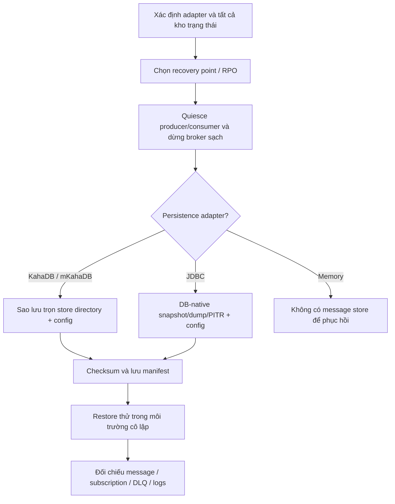

# Sao lưu và phục hồi nhất quán theo loại persistence adapter

> **Chương:** Lưu trữ Classic  
> **Phạm vi:** Apache **ActiveMQ Classic** và cách bảo vệ message store theo **KahaDB**, **mKahaDB** hoặc **JDBC persistence adapter**. Tập trung vào điểm nhất quán của backup, các tệp/bảng phải giữ, cách phục hồi độc lập và kiểm chứng bằng JMS. Đường dẫn/cú pháp dưới đây là ví dụ lab; đối chiếu với instance và phiên bản Classic đang chạy trước khi dùng.

## 1. Cùng gọi là “backup broker” nhưng cách làm phụ thuộc persistence adapter

Một broker Classic đang chứa message `OrderCreated(O-1001)` đã gửi ở chế độ `PERSISTENT`, backlog của durable topic subscriber, các message trên DLQ và một số message được hẹn giờ. Sau khi server hỏng, đội vận hành dựng lại broker từ bản sao. Nếu chỉ copy `activemq.xml` hoặc chỉ copy một tệp journal, broker mới có thể khởi động nhưng **không khôi phục được message**, mất subscription hoặc dữ liệu bị lệch với trạng thái ACK.

Câu hỏi đầu tiên phải là: **Classic đang sử dụng persistence adapter nào, và trạng thái nằm ở đâu?**

| Adapter/trường hợp | Nơi giữ dữ liệu chính | Chiến lược ưu tiên để có backup nhất quán | Lỗi thường gặp |
|---|---|---|---|
| **KahaDB** | Thư mục KahaDB của broker: journal segments, index, redo/metadata | **Cold backup** sau khi dừng broker sạch; sao chép **toàn bộ** store directory | Copy riêng `db-*.log` lúc broker đang ghi hoặc bỏ sót index |
| **mKahaDB** | Nhiều KahaDB stores được quản lý theo filter/destination dưới thư mục parent | Dừng broker, sao lưu **toàn bộ cây store**, không chỉ thư mục của một queue | Quên các sub-store hoặc metadata của multi-store |
| **JDBC persistence** | Các bảng và metadata trong database do JDBC adapter sử dụng | DB-native consistent backup/snapshot, tốt nhất khi broker đã quiesce/dừng; dùng PITR nếu có | Copy vài bảng rời rạc bằng `SELECT` trong lúc broker ghi, hoặc chỉ copy filesystem broker |
| **Memory / non-persistent** | Trạng thái trong RAM, message không được giữ bền vững | Không có bản sao message đáng tin cậy qua restart từ RAM | Xem “persistent producer” là đủ dù broker không bật persistence |
| **Legacy LevelDB/replicated LevelDB** | Store và cơ chế replication riêng của phiên bản Classic cũ | Kế hoạch sao lưu/phục hồi **theo đúng phiên bản**, kiểm tra topology/format | Dùng thủ tục KahaDB hay copy một replica rồi coi là cluster snapshot |

**Không có lệnh duy nhất sao lưu mọi adapter.** Đây cũng là lý do phải lưu **cấu hình adapter, phiên bản broker, đường dẫn dữ liệu và điểm thời gian** cùng artifact backup.

### 1.1. Tính “nhất quán” cần đạt ở mức nào?

Có ít nhất ba tầng:

1. **File/DB consistency:** dữ liệu được chụp ở một điểm mà store có thể mở và recovery không gặp kết hợp trạng thái file/bảng không hợp lệ.
2. **Broker transaction consistency:** message gửi/ACK trong transaction chưa commit không bị biến thành committed một cách tùy tiện sau restore; journal hoặc DB snapshot phản ánh một trạng thái transaction được hỗ trợ.
3. **Application consistency:** event trong broker khớp kỳ vọng của producer/consumer và database nghiệp vụ khác. **Backup chỉ broker không tạo checkpoint nguyên tử với database ứng dụng**.

Ví dụ: tại thời điểm backup message `O-1001` đang chờ ACK. Sau đó consumer commit DB và ACK. Nếu restore backup cũ, message có thể xuất hiện lại **dù database đã ghi xử lý**. Đây là hệ quả bình thường của phục hồi về thời điểm cũ, không chứng minh broker bị lỗi. Phía consumer vẫn phải idempotent.



**RPO** (Recovery Point Objective) là khoảng mất dữ liệu tối đa có thể chấp nhận, còn **RTO** (Recovery Time Objective) là thời gian cần để hệ thống hoạt động lại. Cold backup một lần mỗi ngày có thể cho bản sao nhất quán nhưng **không đáp ứng RPO vài phút**. Muốn giảm RPO cần chiến lược snapshot/WAL/replication phù hợp, không chỉ chạy tar thường xuyên hơn khi broker đang ghi.

## 2. Trước khi sao lưu: xác định đúng instance, store và trạng thái

Với Classic, file `conf/activemq.xml` thường chứa `<persistenceAdapter>` trong broker configuration. Đừng kết luận adapter từ tên image Docker, thư mục còn sót trên đĩa hoặc phiên bản client Java. Một broker có thể đã đổi adapter từ KahaDB sang JDBC nhưng thư mục KahaDB cũ vẫn còn.

Ví dụ **KahaDB** (đoạn đặt trong node `<broker>` hiện có):

```xml
<persistenceAdapter>
    <kahaDB directory="${activemq.data}/kahadb"
            journalMaxFileLength="32mb"/>
</persistenceAdapter>
```

Ví dụ **JDBC** (bean `brokerDataSource` phải được khai báo riêng và trỏ tới DB đã cấu hình):

```xml
<persistenceAdapter>
    <jdbcPersistenceAdapter dataSource="#brokerDataSource"/>
</persistenceAdapter>
```

Nếu dùng **mKahaDB**, có thể thấy hình thức:

```xml
<persistenceAdapter>
    <mKahaDB directory="${activemq.data}/mKahaDB">
        <filteredPersistenceAdapters>
            <filteredKahaDB perDestination="true">
                <persistenceAdapter>
                    <kahaDB journalMaxFileLength="32mb"/>
                </persistenceAdapter>
            </filteredKahaDB>
        </filteredPersistenceAdapters>
    </mKahaDB>
</persistenceAdapter>
```

Những đoạn XML trên là **các phương án độc lập**, không đặt cả ba adapter song song trong cùng broker. `${activemq.data}` là biến cấu hình của Classic được resolve tại runtime; cần xác định **đường dẫn thực** trước khi backup.

### 2.1. Lập bản kê trạng thái trước khi dừng

| Đối tượng | Điều cần ghi |
|---|---|
| Broker | Classic version/build, broker name, node hiện active, file `activemq.xml` đang dùng |
| Persistence adapter | KahaDB/mKahaDB/JDBC, thư mục thực hoặc DB/schema/table prefix |
| Destinations | Queue, DLQ, durable topic subscriptions, số message pending/delivering |
| Scheduler | Có bật `schedulerSupport` không; job scheduler store có nằm **ngoài** KahaDB directory hay không |
| Transaction | Session đang giao dịch, pending ACK, prepared/in-doubt XA transactions (nếu hệ thống dùng XA) |
| Nền tảng | Docker named volume/bind mount, service account, file ownership, filesystem, database version |
| Khôi phục | RPO/RTO, thời điểm backup, artifact checksum, cấu hình TLS/secret được quản lý ngoài |

Scheduler đáng chú ý: ActiveMQ Classic hỗ trợ delayed/scheduled delivery bằng job scheduler; khi được bật, dữ liệu lịch hẹn có thể dùng **job scheduler store riêng** với message store chính. **Sao lưu KahaDB nhưng bỏ quên scheduler store** có thể khiến sự kiện được đặt lịch không trở lại sau restore. Cần xác minh đường dẫn thực tế theo broker config/phiên bản.

### 2.2. Quiesce không có nghĩa “bỏ hết message đang chờ”

Trình tự khuyến nghị với **cold backup**:

1. Dừng producer/job/scheduler ứng dụng đang gửi thêm message; không tạo công việc mới.
2. Để consumer đang xử lý hoàn thành/commit những nghiệp vụ cần thiết. Với delivery chưa rõ kết quả, đóng/rollback theo thiết kế; **không ACK bừa** chỉ để queue về 0.
3. Chụp các mốc kiểm chứng: message ID/event ID, queue depth, durable subscription backlog, DLQ, số scheduled jobs và trạng thái giao dịch.
4. Yêu cầu **broker dừng graceful** bằng service manager của đúng instance (service/systemd, script của Classic hoặc Docker stop với grace period đủ).
5. **Xác minh JVM/process đã thoát hoàn toàn**, không còn broker/standby khác ghi lên store trước khi copy dữ liệu.

Với bộ phân phối Classic có script phù hợp, có thể dùng:

```bash
# Ví dụ trên host cài ActiveMQ Classic trực tiếp:
./bin/activemq stop

# Xác minh process thật đã dừng bằng service manager / process monitor.
# Đừng chỉ dựa vào lệnh stop đã trả về mã 0.
```

Với Docker Compose, có thể dùng `docker compose -p classic-lab stop -t 90 broker` **nếu service trong Compose thật sự tên là `broker`**. Đây là ví dụ tên, không phải lời khẳng định image nào cũng dùng như vậy. Tránh `docker kill` ngay nếu broker còn đang flush journal, trừ khi bạn đang cố ý kiểm thử crash recovery.

**Chỉ sao lưu dữ liệu khi broker dừng sạch** là cách đơn giản nhất để có checkpoint có thể kiểm chứng. Với hệ thống production cần backup online, dùng snapshot ở cấp storage/DB có cơ chế **atomic/consistent** được hỗ trợ và đã kiểm thử recovery; thao tác copy lần lượt các file đang biến động không được xem là hot backup nhất quán.

## 3. KahaDB: sao lưu toàn bộ store, không chỉ journal

KahaDB là persistence adapter phổ biến của ActiveMQ Classic. Tùy cấu hình/version, thư mục store thường có journal segments như `db-*.log`, index/metadata như `db.data` và các file phục vụ recovery. Broker ghi, xoay segment và dọn journal theo hoạt động message/ACK/transaction.

**Vì sao không chỉ copy `db-*.log`?** Một checkpoint cần nhất quán giữa log, index, vị trí journal, transaction metadata và trạng thái broker. Copy lần lượt khi broker đang chạy có thể chứa **index từ t1** nhưng **journal từ t2**. Dù một số phần có khả năng rebuild khi khởi động, **không** nên coi khả năng tự phục hồi thành một phương pháp backup.

### 3.1. Tối thiểu phải giữ gì?

- **Toàn bộ thư mục** KahaDB được chỉ định trong `<kahaDB directory="...">`, bao gồm các file/subdirectory liên quan, không tự chọn từng segment.
- **Cấu hình broker** sử dụng KahaDB và cấu hình destinations, policies, durable subscriptions/security nếu chúng nằm ngoài store.
- **Scheduler store** nếu dùng scheduled messages và nó nằm trên path khác.
- Version Java, ActiveMQ Classic, plugins/customizations, quyền filesystem, mount/volume mapping.
- Checksum của archive và manifest để người khôi phục xác định đúng bản nào tương thích với instance nào.

Tùy khởi tạo mà các thư mục tạm/`tmp_storage` có thể khác nhau; **không hứa** sẽ khôi phục non-persistent message nhờ copy tệp tạm. `PERSISTENT` và broker persistence là những điều kiện cần cho dữ liệu có thể phục hồi, và message đã ACK thành công có thể không còn trong snapshot.

### 3.2. Cold backup trên máy Linux

Giả sử đã xác minh **đường dẫn thực** của KahaDB là `/srv/activemq/data/kahadb`, broker đã dừng hoàn toàn, user backup có quyền đọc store. Ví dụ dưới đây tạo archive ở thư mục bên ngoài store:

```bash
# Chạy SAU khi broker đã dừng và đường dẫn được xác minh.
STORE=/srv/activemq/data/kahadb
BACKUP=/srv/activemq/backups
STAMP=2026-11-17T-backup01

test -d "$STORE" || { echo "Store path not found"; exit 1; }
mkdir -p "$BACKUP"

tar -C "$STORE" -czpf "$BACKUP/classic-kahadb-$STAMP.tar.gz" .
tar -tzf "$BACKUP/classic-kahadb-$STAMP.tar.gz" >/dev/null
sha256sum "$BACKUP/classic-kahadb-$STAMP.tar.gz" \
  > "$BACKUP/classic-kahadb-$STAMP.tar.gz.sha256"
```

**Lưu ý:** đây là ví dụ lệnh Bash, không phải lệnh tùy ý chạy trên bất kỳ máy nào. Thư mục `/srv/activemq/data/kahadb` có thể **không** tồn tại trong cài đặt thật; lấy path từ broker config/runtime trước khi chạy. Nếu backup nằm cùng ổ đĩa đang hỏng, archive cũng có thể mất; lưu thêm bản ở storage độc lập với phân quyền bảo vệ.

Nếu scheduler store dùng đường dẫn `/srv/activemq/data/scheduler`, cần **sao lưu riêng toàn bộ scheduler store** tại cùng điểm dừng broker, và ghi rõ hai archive thuộc cùng checkpoint. Không giả định chỉ archive KahaDB là đủ cho delayed jobs.

`tar -tzf` chỉ kiểm tra có thể liệt kê nội dung archive; **chưa chứng minh broker mở được**. `sha256sum` giúp phát hiện file backup bị thay đổi/hỏng trong quá trình truyền/lưu, nhưng cũng không thay thế restore test.

### 3.3. Khôi phục KahaDB vào một broker cô lập

1. Dựng **instance Classic cùng version tương thích** với bản backup; không để nó cùng chạy trên store live.
2. Cấu hình listener/port khác hoặc tắt ingress; **không** cho production clients vô tình kết nối và tiêu thụ message khôi phục.
3. Dừng broker test, chuẩn bị **một data directory rỗng** được cấp quyền cho user service, xác minh không còn tiến trình đang giữ file lock.
4. Giải nén **trọn archive** vào đúng KahaDB directory; khôi phục scheduler store cùng checkpoint nếu có.
5. Áp cấu hình đã lưu, kiểm tra ownership/permission, mount path, broker version, plugin và credential.
6. Khởi động broker test, đọc logs store recovery; quan sát queue/backlog/durable subscriptions/scheduled jobs và đối chiếu message ID.
7. Chỉ khi restore độc lập đạt mới dùng cùng quy trình cho mục tiêu disaster recovery. **Không giải nén đè trực tiếp vào store đang mở.**

Ví dụ khôi phục trọn archive trên **instance lab đã dừng**:

```bash
# Dữ liệu đích đã được tạo rỗng, broker test đang STOPPED.
RESTORE=/srv/activemq-test/data/kahadb
ARCHIVE=/srv/activemq/backups/classic-kahadb-2026-11-17T-backup01.tar.gz

mkdir -p "$RESTORE"
tar -C "$RESTORE" -xzpf "$ARCHIVE"
# Kiểm tra lại quyền sở hữu file theo service account của broker test.
# Không start instance test trước khi restore scheduler/config tương ứng.
```

Đừng tự xóa các file index hoặc lock chỉ vì xuất hiện sau restore. Cần phân biệt **file lock đang bị tiến trình giữ thật** với file tồn tại trên đĩa; dừng và xác minh có broker khác đang dùng store hay không trước khi can thiệp.

## 4. mKahaDB: tính nhất quán nằm ở **toàn bộ cây các store**

**Multi KahaDB** có thể phân chia dữ liệu ra nhiều KahaDB stores, ví dụ theo destination hoặc theo các bộ lọc trong `filteredPersistenceAdapters`. Thực tế này làm thay đổi đơn vị backup:

```text
Broker Classic (minh họa cấu trúc logic)
└── mKahaDB parent
    ├── metadata liên quan multi-store
    ├── store / filter A  -> KahaDB journal + index
    ├── store / filter B  -> KahaDB journal + index
    └── store / filter C  -> KahaDB journal + index
```

Tên các directory con do implementation/phiên bản quyết định, **không suy ra chính xác tên thư mục từ tên queue**. Khi thay filter hoặc cấu hình `perDestination`, broker có thể bố trí store khác với dự đoán.

**Nguyên tắc:** dừng broker và sao lưu **thư mục parent của mKahaDB cùng mọi store con**, không chỉ những queue đang có message, vì còn durable subscriptions, metadata ACK và trạng thái quản lý store. Nếu có nhiều mount cho nhiều store, cần bảo đảm các mount đều ở cùng checkpoint; copy từ mount A lúc đang ghi và từ B vài phút sau không phải snapshot nhất quán toàn broker.

### 4.1. Ví dụ backup mKahaDB

Nếu cấu hình thực tế resolve parent thành `/srv/activemq/data/mKahaDB`:

```bash
# Broker Classic đã STOPPED. Parent path là ví dụ.
STORE=/srv/activemq/data/mKahaDB
BACKUP=/srv/activemq/backups
mkdir -p "$BACKUP"
test -d "$STORE" || { echo "Missing mKahaDB parent"; exit 1; }

tar -C "$STORE" -czpf "$BACKUP/classic-mkahadb-checkpoint01.tar.gz" .
tar -tzf "$BACKUP/classic-mkahadb-checkpoint01.tar.gz" >/dev/null
sha256sum "$BACKUP/classic-mkahadb-checkpoint01.tar.gz"
```

Restore cần **cùng cấu hình mapping/filter** và parent directory đúng, trước khi cho broker chạy. Không chỉ chuyển một sub-store của queue `orders` từ snapshot này sang sub-store `billing` của snapshot khác; việc trộn checkpoint có thể phá quan hệ giữa messages, ACKs và transaction metadata.

### 4.2. Tình huống restore “có một queue mà mất queue khác”

Nếu broker khởi động nhưng chỉ thấy backlog của một số destination, kiểm tra:

1. Backup có chứa **tất cả** store con hay bị giới hạn bởi script chỉ archive một subfolder?
2. Cấu hình `filteredKahaDB`, `perDestination`, directory prefix và broker version có được giữ đúng?
3. Parent path của runtime test có trỏ đến backup đã giải nén, hay broker tự tạo store mới ở nơi khác?
4. Những destination còn lại đã được consumer nhận/ACK hoặc hết TTL trong checkpoint chưa?

Không sửa config filter một cách ngẫu nhiên rồi khởi động lại nhiều lần để “thử xem queue xuất hiện”: ưu tiên giữ nguyên bản backup và làm việc trên **bản sao phục hồi độc lập**.

## 5. JDBC persistence: dùng snapshot của **database**, không copy file KahaDB

Khi Classic dùng `jdbcPersistenceAdapter`, thông tin message/ACK và metadata nằm trong DB được cấu hình qua `dataSource`. Thường thấy các bảng thuộc nhóm tên như `ACTIVEMQ_MSGS`, `ACTIVEMQ_ACKS`, `ACTIVEMQ_LOCK`, nhưng **tên thực tế có thể đổi vì tablePrefix, schema hoặc phiên bản**. Không hardcode danh sách ba bảng rồi kết luận đã backup đầy đủ.

### 5.1. Đơn vị nhất quán của JDBC là transaction snapshot

Một lệnh kiểu:

```sql
-- CHỈ MINH HỌA CÁCH LÀM KHÔNG AN TOÀN, KHÔNG DÙNG LÀM BACKUP:
SELECT * FROM ACTIVEMQ_MSGS;  -- chụp lúc t1
SELECT * FROM ACTIVEMQ_ACKS;  -- chụp lúc t2
```

không tạo một điểm thời gian duy nhất. Broker có thể đã ACK hoặc thêm message giữa hai `SELECT`. Backup phải dùng **cơ chế dump/backup/snapshot nhất quán do RDBMS hỗ trợ**, bao trùm đầy đủ schema/metadata cần thiết.

**Phương án ưu tiên cho lab:** dừng broker Classic sạch, xác nhận không có broker/standby hay job khác đang ghi các bảng persistence, sau đó tạo **database-native backup**. Database server **có thể vẫn chạy** để công cụ backup hoạt động; “cold backup broker” **không** buộc phải tắt database.

**Nếu cần online backup:** sử dụng snapshot giao dịch hoặc physical backup có WAL/redo theo tài liệu DB và kiểm tra tính nhất quán ứng dụng. Với PostgreSQL, `pg_dump` cho logical dump nhất quán ở một snapshot MVCC khi chạy; với backup vật lý, dùng `pg_basebackup` và WAL theo quy trình hỗ trợ. **Không copy thẳng PostgreSQL data directory đang hoạt động** bằng một vòng `cp -r`.

### 5.2. Ví dụ PostgreSQL: logical backup của database dành riêng cho Classic

Giả sử broker lưu dữ liệu trong **database riêng** `classic_broker` trên PostgreSQL. Đã xác nhận service Classic dừng, tài khoản backup có quyền cần thiết. Ví dụ với Bash, xác thực DB qua `.pgpass`/`PGPASSFILE` hoặc cơ chế bảo mật khác; không nhúng mật khẩu vào lệnh, URL hoặc bản thảo:

```bash
export PGHOST='db.internal.example'
export PGPORT='5432'
export PGUSER='broker_backup'
export PGDATABASE='classic_broker'

mkdir -p backup
pg_dump --format=custom \
  --file=backup/classic-jdbc-checkpoint01.dump

# Kiểm tra archive có thể đọc TOC.
pg_restore --list backup/classic-jdbc-checkpoint01.dump \
  > backup/classic-jdbc-checkpoint01.contents.txt
sha256sum backup/classic-jdbc-checkpoint01.dump
```

`pg_dump` tạo logical snapshot nhất quán theo cơ chế PostgreSQL. Sau khi broker đã dừng và không còn writer vào các bảng message store, điểm backup cũng dễ giải thích hơn về mặt nghiệp vụ. Khi online, PostgreSQL vẫn có thể dump nhất quán, nhưng trạng thái đó có thể cũ hơn lúc client cuối nhận confirmation; **cần công bố recovery point và RPO**, không hứa khôi phục mọi message đã gửi trong lúc backup chạy.

**Không chỉ sao lưu vài bảng bằng tên đoán.** Với DB dành riêng cho Classic, backup **toàn database** đơn giản hơn; nếu broker chia sẻ database với ứng dụng khác, cần kiến trúc schema/snapshot và ownership rõ ràng. Sao lưu cả các schema objects liên quan và cấu hình `tablePrefix`, datasource/pool, transaction boundaries.

### 5.3. Khôi phục JDBC vào DB riêng của môi trường test

Khôi phục thử vào **một database trống, độc lập**, ví dụ `classic_broker_restore`, với một broker test dùng **JDBC URL khác** production. Lệnh dưới đây giả định database đích đã được tạo và cấu hình roles/privileges phù hợp:

```bash
# Chạy khi test broker chưa khởi động, đích là DB test riêng.
export PGHOST='db-test.internal.example'
export PGPORT='5432'
export PGUSER='restore_operator'

pg_restore \
  --dbname=classic_broker_restore \
  --no-owner --no-privileges \
  backup/classic-jdbc-checkpoint01.dump

# Kiểm tra exit status và log restore, không chỉ xem lệnh chạy xong.
```

`--no-owner --no-privileges` có ích khi restore bằng role khác trong **lab**, nhưng **không tự tái tạo** quyền cho broker service account. Sau restore phải cấp quyền cần thiết trên schema/tables/sequences và kiểm tra datasource/lock strategy trước khi khởi động Classic. Với production, nên áp kế hoạch backup/restore của DBA, không chạy đè lên DB đang dùng bởi broker.

**PITR (Point-In-Time Recovery):** khi dùng backup vật lý + WAL/redo của database, có thể chọn mốc khôi phục giao dịch DB theo khả năng engine, với điều kiện các log liên quan còn đủ. Thời điểm PITR phải gắn với log sản xuất message, commit/ACK, công việc scheduler và bản kê state ứng dụng; chọn PITR “giống lúc broker chạy ổn” không tự bảo đảm khôi phục nhất quán toàn hệ.

### 5.4. JDBC lock table và hai broker không được cùng active

Một triển khai Classic có thể dùng DB-based locking/master–slave để bảo đảm chỉ một broker active dùng store. Những bảng như `ACTIVEMQ_LOCK` có liên quan cơ chế sở hữu/lease theo cấu hình. Sau restore:

- Broker test không được kết nối **cùng database production** rồi tranh lock với broker live.
- Không tự xóa/chỉnh hàng trong lock table vì thấy giá trị cũ; phải hiểu đúng loại locker/lease và quyền sở hữu instance.
- Xác minh broker test giành quyền hoạt động trên **DB test**, không có standby khác cùng thời điểm ghi dữ liệu test ngoài kế hoạch.
- Khi đổi DB endpoint/credentials, kiểm tra broker thật sự dùng DB đã restore, không phải âm thầm tạo bảng trống trong schema khác.

Nếu dùng DB của ứng dụng và broker trong cùng một RDBMS, **một snapshot DB chung** có thể bảo vệ giao dịch trong phạm vi engine đó; nhưng các producer/consumer hoặc dịch vụ ngoài DB vẫn có trạng thái độc lập. Không đồng nhất “cùng DB server” với “mọi thay đổi JMS và business đều atomic” nếu không dùng transaction phối hợp thực sự.

## 6. Adapter cũ, memory store và các trường hợp đặc biệt

### 6.1. Memory persistence

Với broker được cấu hình không lưu bền vững, trạng thái message nằm trong bộ nhớ có thể mất khi restart. `DeliveryMode.PERSISTENT` của producer **không thể tự tạo** một durable store khi broker hoạt động ở chế độ không persistence. Trong trường hợp đó, mục tiêu backup là **cấu hình và môi trường**, không hứa phục hồi queue backlog.

### 6.2. LevelDB/replicated LevelDB ở triển khai Classic cũ

Một số triển khai Classic cũ sử dụng LevelDB hoặc replicated LevelDB. Chúng có cơ chế lưu trữ và/hoặc topology khác KahaDB; khả năng hỗ trợ phụ thuộc phiên bản. **Không áp dụng mù quáng** script tar KahaDB hoặc coi snapshot một replica là ảnh nhất quán của toàn cụm.

Cách làm:

1. Xác định chính xác broker version, store implementation, node đang active và cơ chế đồng bộ/replication.
2. Dùng quy trình snapshot/recovery do bản phân phối và kiến trúc đó hỗ trợ; thử fault recovery trên môi trường tách biệt.
3. Bảo toàn metadata cluster, quorum/identity, storage và cấu hình tương ứng; không khởi động hai node cùng sở hữu một dữ liệu sao chép.
4. Xem xét **migration được kiểm soát** sang adapter còn được hỗ trợ trong phiên bản mục tiêu, thay vì tin rằng đổi tên adapter rồi trỏ vào store cũ sẽ tự chuyển đổi format.

### 6.3. Prepared XA transactions và scheduler là dữ liệu ngoài “message body”

Nếu Classic tham gia XA/JTA, một bản backup có thể chứa các giao dịch **prepared/in-doubt**. Restore một nhánh trong khi transaction manager giữ quyết định ở checkpoint khác có thể gây bất nhất. Phải lưu/khôi phục **transaction manager recovery log** và các resource participants theo một kế hoạch nhất quán, hoặc xử lý từng Xid theo quyết định được ghi lại.

Với scheduled messages, cần nhận diện job scheduler store và đồng bộ điểm dừng/copy với main store. Một queue có thể trống khi chụp ảnh nhưng còn lịch hẹn chưa tới thời điểm dispatch: nếu mất scheduler store, những message đó không xuất hiện sau restore dù KahaDB message queue được sao lưu đủ.

## 7. Kiểm chứng khôi phục bằng Java/JMS mà không làm mất message

Chỉ thấy broker khởi động và mở được web console **chưa đủ** để kết luận backup đúng. Một phép thử cần đối chiếu **message ở checkpoint** sau restore mà không ACK/tiêu thụ nó. Với ActiveMQ Classic 5.x, có thể dùng JMS `QueueBrowser` để duyệt message đang ở queue **mà không xác nhận tiêu thụ**.

### 7.1. Ví dụ Maven cho Classic

Đây là Java 17 và **Classic JMS client dòng `javax.jms`** (không dùng `jakarta.jms` của Artemis). Ví dụ ghim `5.18.4` để minh họa cách tích hợp; chọn version phù hợp broker và hệ đang chạy. Lưu `pom.xml` trong project lab riêng:

```xml
<project xmlns="http://maven.apache.org/POM/4.0.0"
         xmlns:xsi="http://www.w3.org/2001/XMLSchema-instance"
         xsi:schemaLocation="http://maven.apache.org/POM/4.0.0
           https://maven.apache.org/xsd/maven-4.0.0.xsd">
    <modelVersion>4.0.0</modelVersion>
    <groupId>lab.messaging</groupId>
    <artifactId>classic-backup-probe</artifactId>
    <version>1.0.0</version>
    <properties>
        <maven.compiler.release>17</maven.compiler.release>
        <project.build.sourceEncoding>UTF-8</project.build.sourceEncoding>
    </properties>
    <dependencies>
        <dependency>
            <groupId>org.apache.activemq</groupId>
            <artifactId>activemq-client</artifactId>
            <version>5.18.4</version>
        </dependency>
    </dependencies>
    <build>
        <plugins>
            <plugin>
                <groupId>org.apache.maven.plugins</groupId>
                <artifactId>maven-compiler-plugin</artifactId>
                <version>3.13.0</version>
            </plugin>
            <plugin>
                <groupId>org.codehaus.mojo</groupId>
                <artifactId>exec-maven-plugin</artifactId>
                <version>3.3.0</version>
            </plugin>
        </plugins>
    </build>
</project>
```

### 7.2. Một probe gửi persistent message và browse read-only

Tạo `src/main/java/ClassicBackupProbe.java`:

```java
import javax.jms.Connection;
import javax.jms.DeliveryMode;
import javax.jms.JMSException;
import javax.jms.Message;
import javax.jms.MessageProducer;
import javax.jms.Queue;
import javax.jms.QueueBrowser;
import javax.jms.Session;
import javax.jms.TextMessage;
import org.apache.activemq.ActiveMQConnectionFactory;

import java.util.Enumeration;

public final class ClassicBackupProbe {
    private static final String QUEUE = "lab.backup.check";

    public static void main(String[] args) throws Exception {
        boolean send = args.length == 2 && "send".equals(args[0]);
        boolean browse = args.length == 1 && "browse".equals(args[0]);
        if (!send && !browse) {
            throw new IllegalArgumentException(
                    "Usage: send <checkpointId> | browse");
        }

        String url = System.getenv().getOrDefault(
                "BROKER_URL", "tcp://localhost:61616");
        String user = System.getenv().getOrDefault("BROKER_USER", "lab");
        String password = System.getenv("BROKER_PASSWORD");
        if (password == null || password.isBlank()) {
            throw new IllegalStateException("Set BROKER_PASSWORD");
        }

        ActiveMQConnectionFactory factory =
                new ActiveMQConnectionFactory(url);
        Connection connection = factory.createConnection(user, password);
        try {
            Session session = connection.createSession(
                    false, Session.AUTO_ACKNOWLEDGE);
            try {
                Queue queue = session.createQueue(QUEUE);
                if (send) {
                    sendOne(session, queue, args[1]);
                } else {
                    browseWithoutAck(connection, session, queue);
                }
            } finally {
                session.close();
            }
        } finally {
            connection.close();
        }
    }

    private static void sendOne(Session session, Queue queue, String id)
            throws JMSException {
        MessageProducer producer = session.createProducer(queue);
        try {
            producer.setDeliveryMode(DeliveryMode.PERSISTENT);
            producer.setTimeToLive(0L);
            TextMessage message = session.createTextMessage(
                    "backup-probe:" + id);
            message.setStringProperty("checkpointId", id);
            producer.send(message);
            System.out.printf("SENT checkpointId=%s jmsId=%s%n",
                    id, message.getJMSMessageID());
        } finally {
            producer.close();
        }
    }

    private static void browseWithoutAck(Connection connection,
                                         Session session, Queue queue)
            throws JMSException {
        QueueBrowser browser = session.createBrowser(queue);
        try {
            connection.start();
            Enumeration<?> items = browser.getEnumeration();
            int count = 0;
            while (items.hasMoreElements()) {
                Message message = (Message) items.nextElement();
                System.out.printf(
                    "VISIBLE checkpointId=%s jmsId=%s persistent=%s%n",
                    message.getStringProperty("checkpointId"),
                    message.getJMSMessageID(),
                    message.getJMSDeliveryMode()
                            == DeliveryMode.PERSISTENT);
                count++;
            }
            System.out.println("BROWSED_COUNT=" + count);
        } finally {
            browser.close();
        }
    }
}
```

**Điều kiện thử:** queue `lab.backup.check` phải tồn tại, hoặc Classic được cấu hình tạo destination phù hợp; user có quyền `send` và `browse`/`consume` tương ứng theo security policy. Dừng consumer khác khi dùng probe để số lượng không thay đổi. `QueueBrowser` là thao tác duyệt **không ACK**, nhưng kết quả browse có thể không đại diện cho một snapshot bất biến nếu broker đang ghi/dispatch đồng thời.

### 7.3. Thực hành “send → checkpoint → restore → browse”

Trên broker Classic **lab gốc**, trước thời điểm sao lưu:

```bash
export BROKER_URL='tcp://localhost:61616'
export BROKER_USER='lab'
export BROKER_PASSWORD='replace-with-local-lab-secret'

mvn -q compile exec:java \
  -Dexec.mainClass=ClassicBackupProbe \
  -Dexec.args="send checkpoint-001"

mvn -q compile exec:java \
  -Dexec.mainClass=ClassicBackupProbe \
  -Dexec.args="browse"
```

Ghi `checkpointId=checkpoint-001` và `JMSMessageID`. Sau đó:

1. Dừng producer/consumer, dừng broker sạch và tạo **backup theo đúng adapter** như mục 3–5.
2. Khởi động broker gốc nếu muốn tiếp tục lab; **đừng thay thế broker gốc bằng dữ liệu từ bản copy thử**.
3. Khôi phục artifact vào broker test **độc lập** dùng port khác (ví dụ `tcp://localhost:61626`) hoặc network tách riêng. Nếu dùng JDBC, test broker phải trỏ vào DB đã restore, không phải DB live.
4. Trên terminal test, đặt `BROKER_URL=tcp://localhost:61626`, chạy lại chế độ `browse`.
5. Xác nhận vẫn thấy `checkpoint-001` và message ID/body phù hợp, cùng dữ liệu DLQ/durable subscription cần giữ.
6. Chạy browse lần nữa: số lượng message **không giảm do thao tác browse**. Để test consumer recovery, có thể tạo consumer riêng, nhưng khi ACK/commit message sẽ bị tiêu thụ.

Nếu broker test khởi động sau restore mà **không có checkpoint-001**, kiểm tra đường dẫn store/DB/schema, adapter đang active, queue name, version, thao tác của consumer test và thời điểm checkpoint. Không vội kết luận archive hỏng chỉ vì queue depth bằng 0.

## 8. Ma trận lỗi thường gặp khi backup/restore

| Tình huống | Hậu quả | Cách xác minh và xử lý |
|---|---|---|
| Copy KahaDB khi broker đang ghi | Journal/index từ nhiều thời điểm, có thể lỗi recovery hoặc thiếu state | Dùng cold backup; nếu buộc online, snapshot nhất quán đã kiểm thử |
| Chỉ sao lưu `db-*.log` | Thiếu metadata/index và có thể thiếu thành phần store | Sao lưu **nguyên directory** KahaDB |
| mKahaDB chỉ copy thư mục một queue | Những store con khác và metadata không được giữ | Backup parent và toàn bộ mapping stores dưới cùng checkpoint |
| Restore sang instance dùng **JDBC** thay vì KahaDB | Broker mở DB trống, không đọc archive KahaDB | Khớp adapter, data directory, version và config |
| Copy một số JDBC tables bằng nhiều lệnh rời | Snapshot không nhất quán giữa messages/ACKs | DB-native transactional backup hoặc backup vật lý đúng engine |
| Restore JDBC vào DB còn đang dùng bởi production broker | Tranh DB lock hoặc phá state/availability | Chỉ restore vào database tách biệt và đổi datasource test |
| Quên job scheduler store | Scheduled messages không trở lại | Định vị và sao lưu scheduler theo cùng checkpoint |
| Quên durable subscription metadata | Topic backlog không khôi phục như kỳ vọng | Restore toàn bộ persistence store và config liên quan |
| Quên TLS/roles/plugins ngoài store | Broker mở được nhưng client không kết nối/khác routing | Lưu manifest cấu hình, version và bí mật qua secret manager |
| Message “xuất hiện lại” sau restore cũ | Snapshot cũ hơn lần consumer ACK/DB commit | Kiểm tra checkpoint time, idempotency; đây có thể là replay hợp lệ |
| Message đã ACK không thấy trong backup | ACK commit trước checkpoint | Chỉ kỳ vọng dữ liệu còn tồn tại ở **recovery point** |
| Có XA prepared transaction | Thiếu quyết định TM hoặc lệch checkpoint với DB bên ngoài | Khôi phục theo Xid/TM recovery log; không heuristic rollback tùy tiện |
| Broker test không lên vì lock/store permissions | Store vẫn bị broker khác sở hữu hoặc user sai quyền | Dừng tất cả writer, xác minh lock thực và quyền tệp; không ép xóa journal |

### 8.1. Backup lấy từ broker nào trong active/passive setup?

Trong Classic dùng shared filesystem hoặc JDBC shared database, một node thường giữ vai trò **active owner** của persistence store. Không cho bản restore test đồng thời mở **cùng store** với broker live. Khi chụp checkpoint cold, phải xác nhận cả active và standby **không còn writer**, tránh tự động failover sang standby rồi tiếp tục ghi đúng lúc backup.

Một standby còn sống không đồng nghĩa dữ liệu đã nhất quán ở hai thiết bị khác nhau: cần xác định **store thật sự được chia sẻ hoặc được replication**, fencing/quorum/locking và checkpoint được backup từ tài nguyên nào. Nếu system failover trong khi sao lưu, cần hủy/đánh dấu snapshot chưa chắc chắn và thực hiện lại quy trình có kiểm soát.

## 9. Kế hoạch khôi phục production: không dùng backup để ghi đè mù

Mục tiêu của disaster recovery không chỉ “broker start được”. Phải khôi phục đúng điểm dữ liệu với quyền sở hữu rõ ràng và tránh consumer xử lý lặp:

1. **Tuyên bố sự cố và cô lập broker cũ:** đảm bảo broker production lỗi không thể hồi sinh và ghi vào store sau khi restore. Áp dụng fencing theo topology.
2. **Chọn recovery point:** lấy archive/snapshot có timestamp, checksum, adapter, broker version và logs đầy đủ. Xác định những message sau checkpoint có thể không có trong backup.
3. **Chuẩn bị môi trường restore:** broker version tương thích, cùng adapter, đúng filesystem/DB schema, config, credentials/roles, plugin và scheduler store.
4. **Khôi phục dữ liệu đúng phương pháp:** KahaDB/mKahaDB giải nén toàn store vào target rỗng khi broker tắt; JDBC dùng restore/recovery của RDBMS vào DB đích; không trộn hai cách.
5. **Kiểm tra trước khi mở ingress:** đọc broker logs/recovery, queue counts, durable subscriptions, DLQ, scheduled jobs, pending XA nếu có và event ID mẫu.
6. **Bật producer/consumer theo từng nhóm:** giới hạn tốc độ, dùng idempotency/inbox, tránh storm do backlog được replay; quan sát error, redelivery, DLQ và DB side effects.
7. **Đối soát:** so event đã gửi, event đang tồn và event đã xử lý theo mốc backup; xử lý gap/duplicates theo runbook nghiệp vụ.
8. **Ghi nhận RPO/RTO thực tế:** có mất những message sau checkpoint không, thời gian khôi phục đến khi service hoạt động ổn định bao lâu, cơ chế nào cần sửa?

### 9.1. Manifest nên lưu cùng từng bản backup

```text
Backup ID: classic-storage-checkpoint01
Timestamp/timezone: <ISO-8601>
Broker name / Classic version / Java version: <actual values>
Adapter: KahaDB | mKahaDB | JDBC
Store path OR DB endpoint/schema/table prefix: <verified>
Scheduler enabled / scheduler store path: <verified>
HA active owner / fencing state: <verified>
Archive names and SHA-256: <actual checksums>
Config/TLS/plugin references: <controlled locations>
RPO expected / snapshot recovery point: <actual>
Probe checkpointId + JMSMessageID: <actual>
Queue count / durable subscriber / DLQ snapshot: <actual>
XA prepared transactions / TM reference: <if relevant>
Restore test date, target and result: <actual>
```

Không lưu mật khẩu/khóa TLS dạng plaintext trong manifest. Với dữ liệu giao dịch hoặc PII, backup cần mã hóa, phân quyền, retention và quy trình xóa an toàn. **Backup không kiểm thử phục hồi chỉ mới là giả thuyết.**

## 10. Bài tập thực hành và tự đánh giá

**Bài 1 — Chọn adapter:** Broker A dùng `<kahaDB>`; broker B dùng `<jdbcPersistenceAdapter>`; broker C dùng `<mKahaDB>`. Hãy lập bảng cho từng broker: state nằm ở đâu, backup nhất quán bằng phương pháp nào, cần khôi phục file/schema nào và không được làm gì khi broker vẫn đang chạy.

**Bài 2 — Sai lệch checkpoint:** Consumer nhận `O-1001` nhưng chưa ACK khi backup. Sau backup, consumer commit DB và ACK. Khi khôi phục, `O-1001` xuất hiện lại. Hãy giải thích nguyên nhân và mô tả cơ chế idempotency theo `orderId`/`eventId`.

**Bài 3 — mKahaDB thiếu sub-store:** Script backup chỉ chọn directory có tên queue `orders`. Sau restore, queue `billing` trống. Hãy xác định cách lập scope backup chính xác và bằng chứng cần có từ runtime config, không dựa vào tên thư mục đoán.

**Bài 4 — JDBC online snapshot:** PostgreSQL đang phục vụ broker, `pg_dump` chạy khi còn producer/consumer. Snapshot DB có tính nhất quán thế nào? Vì sao ứng dụng vẫn có thể thấy khoảng thiếu message so với các `send()` diễn ra **sau** snapshot? Nếu muốn RPO 5 phút, cần thiết kế backup/WAL như thế nào?

**Bài 5 — Scheduler:** Broker có delayed messages đã đặt lịch nhưng queue chưa hiện message. Khôi phục riêng KahaDB main store thì những message nào có thể thiếu? Tìm cấu hình scheduler store và thiết kế checkpoint bảo toàn cả hai.

**Bài 6 — Phục hồi có bằng chứng:** Gửi persistent event `checkpoint-001` bằng `ClassicBackupProbe`, dừng broker, tạo bản KahaDB backup, restore vào instance test, chạy `browse` hai lần. Ghi JMSMessageID, queue depth, logs recovery và kiểm chứng rằng browse không ACK. Thực hiện tương tự bằng backup/restore JDBC trong môi trường riêng.

**Bài 7 — Sự cố hai broker:** Active broker bị dừng để backup nhưng standby tự chiếm quyền shared store và tiếp tục nhận message. Bản copy có thể không nhất quán vì sao? Đề xuất fencing và thứ tự dừng/backup/khởi động an toàn.

### Checklist nghiệm thu

- [ ] Xác nhận adapter **thực sự đang chạy** cùng đường dẫn store hoặc DB/schema.
- [ ] Xác định RPO/RTO và phạm vi message, durable subscriptions, DLQ, scheduler, XA liên quan.
- [ ] Quiesce clients, dừng broker sạch và xác nhận **không còn writer/standby** trước cold backup.
- [ ] KahaDB/mKahaDB: copy toàn store tree; JDBC: DB-native consistent snapshot/backup.
- [ ] Giữ config, version, plugin, quyền và secret references cùng manifest; không copy secret tràn lan.
- [ ] Kiểm tra archive/checksum và khôi phục vào môi trường **cô lập, không đụng live store/DB**.
- [ ] Đọc logs recovery, đối chiếu event IDs, queue/durable subscription/DLQ/scheduler và prepared transactions nếu có.
- [ ] Kiểm chứng consumer idempotent, xử lý replay/gap sau restore và ghi nhận RPO/RTO thực tế.

**Kết luận:** với ActiveMQ Classic, **tính nhất quán của sao lưu phụ thuộc persistence adapter**: KahaDB cần toàn bộ directory, mKahaDB cần cả cây multi-store, còn JDBC cần snapshot/backup giao dịch của database. Dù dùng adapter nào, vẫn phải bảo toàn config/scheduler/recovery state, dừng hoặc snapshot có kiểm soát, khôi phục **trên bản sao độc lập** và đối chiếu bằng message ID cùng trạng thái nghiệp vụ; một file archive có thể đọc được chưa đủ chứng minh backup đáng tin cậy.
