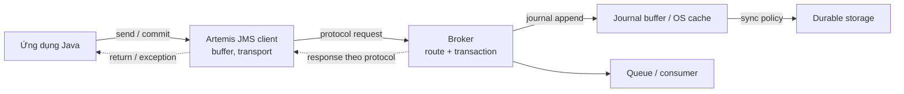
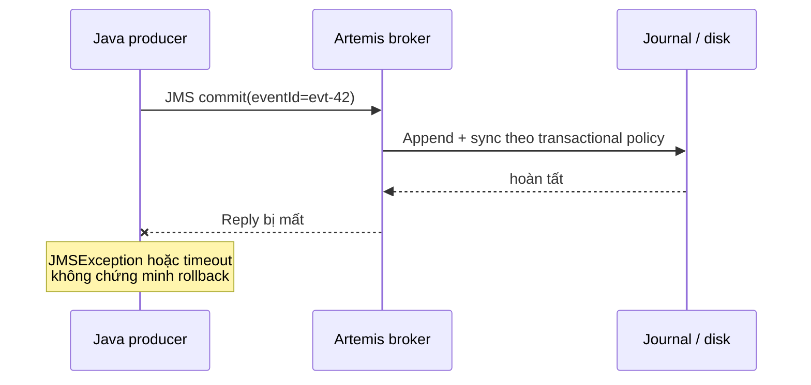

# Độ bền của send, commit và chính sách đồng bộ journal

> **Chương:** Lưu trữ Artemis  
> **Phạm vi:** Apache ActiveMQ **Artemis**, producer/consumer Java JMS và Core journal. Bài tập trung vào ranh giới xác nhận gửi, commit transaction, đồng bộ storage và phục hồi sau sự cố; không áp trực tiếp các tham số này cho ActiveMQ Classic.  
> **Mục tiêu:** Phân biệt `send()` thành công, `session.commit()` thành công và journal thực sự được đồng bộ; cấu hình `journal-sync-transactional`, `journal-sync-non-transactional` và `blockOnDurableSend` có chủ đích; xây kịch bản đo và kiểm chứng crash recovery.

## 1. Gửi thành công chưa chắc là dữ liệu đã nằm bền vững trên đĩa

Một dịch vụ thanh toán phát message `PaymentCaptured`:

```java
producer.send(message);
System.out.println("Message sent");
```

Dòng log này không thể tự trả lời: nếu broker Artemis bị crash ngay sau đó, message có tồn tại khi restart không? Câu trả lời phụ thuộc vào **toàn bộ đường đi** từ JMS client tới journal:



Ba mốc phải phân biệt:

1. **API completion:** `send()` hoặc `commit()` đã trở về mà không ném lỗi.
2. **Broker confirmation:** client đã đợi và nhận phản hồi từ broker cho thao tác tương ứng.
3. **Durability boundary:** broker đã yêu cầu đồng bộ các journal records thích hợp xuống storage theo cấu hình.

Chúng chỉ gắn với nhau bằng một bảo đảm có ý nghĩa khi biết rõ **delivery mode, transaction mode, kiểu client confirmation, journal synchronization và trạng thái persistent storage**. Một phương thức Java trả về nhanh không thể thay cho bằng chứng sync.

## 2. Hai đường ghi khác nhau: non-transactional và transactional

### 2.1. Persistent send không transaction

```java
Session session = connection.createSession(
    false, Session.AUTO_ACKNOWLEDGE);
Queue queue = session.createQueue("payments.events");
MessageProducer producer = session.createProducer(queue);
producer.setDeliveryMode(DeliveryMode.PERSISTENT);

producer.send(session.createTextMessage("payment-42"));
```

Với Session không transacted, lần gửi là một thao tác JMS độc lập. Khi broker ghi persistent message qua đường này, cờ liên quan trực tiếp tới sync là:

```xml
<journal-sync-non-transactional>true</journal-sync-non-transactional>
```

Vẫn phải hỏi: Artemis client có **đợi server xác nhận durable send** hay không? Nếu sử dụng kiểu gửi không blocking, `send()` có thể trả về trước khi broker hoàn tất xử lý, bất kể broker được cấu hình sync cẩn thận đến đâu.

### 2.2. Persistent send trong JMS transaction

```java
Session session = connection.createSession(
    true, Session.SESSION_TRANSACTED);
Queue queue = session.createQueue("payments.events");
MessageProducer producer = session.createProducer(queue);
producer.setDeliveryMode(DeliveryMode.PERSISTENT);

producer.send(session.createTextMessage("payment-42"));
// Gửi trong transaction chưa phải publish được commit.
session.commit();
```

`send()` chỉ thêm hoạt động vào transaction của Session; **`session.commit()`** mới là ranh giới hoàn tất transaction. Nếu `rollback()`, message từ transaction đó không trở thành một message đã commit để consumer xử lý.

Artemis lưu các operation records và transaction records cần cho recovery; ranh giới sync của transaction do:

```xml
<journal-sync-transactional>true</journal-sync-transactional>
```

quy định. `journal-sync-transactional` ảnh hưởng commit của JMS transaction chứa message persistent, không phải là thuộc tính để tăng độ bền cho riêng lệnh `send()` trước commit.

### 2.3. Bảng trạng thái cần ghi nhớ

| Tình huống | Message được coi là committed? | Điều kiện để kỳ vọng recovery |
|---|---|---|
| Non-transacted `NON_PERSISTENT` send | Có thể được dispatch ngay | Không có bảo đảm lưu sau crash như persistent |
| Non-transacted `PERSISTENT` send | Khi broker chấp nhận thao tác | Client confirmation + `journal-sync-non-transactional` + persistence/storage |
| Transacted send đã gọi `send`, chưa `commit` | **Chưa** | Không được giả định có message committed |
| Transacted send rồi `rollback` | **Không** | Message của transaction được rollback |
| Transacted `commit` đã được xác nhận thành công | Có | `journal-sync-transactional` + storage đúng |
| `commit` bị timeout/mất connection trước reply | **Không rõ** đối với producer | Cần đối soát, retry an toàn cùng business event ID |

**Không có ô nào trong bảng chứng minh consumer đã xử lý nghiệp vụ.** Producer commit chỉ chứng minh việc broker chấp nhận/giao dịch gửi theo hợp đồng; nhận/ack của consumer là bước khác.

## 3. Journal append khác journal sync như thế nào?

Artemis lưu trạng thái bền vững của messaging bằng journal và những khu vực storage liên quan. Journal lưu các bản ghi cần để phục hồi message, references, transaction operations, commit và acknowledgment theo cách Artemis triển khai.

```text
Producer -> broker nhận persistent message
                |
                +--> append journal record
                |      |
                |      +-- record có thể đang trong buffer/page cache
                |      |
                |      +-- đồng bộ journal theo policy
                |                 |
                |                 +-- storage nhận yêu cầu durable flush
                |
                +--> broker gửi response theo protocol/client mode
```

**Append** có thể chỉ cho thấy dữ liệu đã ghi vào bộ đệm hoặc OS page cache. **Sync** buộc broker chờ ranh giới đồng bộ của những record liên quan trước khi coi chúng đã đáp ứng cấu hình độ bền. Nếu broker không yêu cầu sync mà vẫn gửi confirmation, dữ liệu có thể chưa qua ranh giới bền vững tại thời điểm client nhận phản hồi.

### 3.1. Hai cờ sync không thay cho nhau

| Tùy chọn `broker.xml` | Nhóm ghi áp dụng | Khi `true` | Khi `false` |
|---|---|---|---|
| `journal-sync-non-transactional` | Persistent journal writes **không dùng transaction** | Yêu cầu đồng bộ phù hợp với đường non-tx | Có rủi ro mất record chưa kịp flush sau sự cố đột ngột |
| `journal-sync-transactional` | Transaction journal boundaries, đặc biệt prepare/commit | Yêu cầu đồng bộ transaction state cần phục hồi | Có rủi ro mất transaction records chưa kịp sync sau sự cố |

Hai setting thường được bật mặc định trong các bản Artemis phổ biến, nhưng nên cấu hình **tường minh** với yêu cầu độ bền của hệ thống và đối chiếu đúng bản đang triển khai. Nếu hệ thống có cả non-tx producer và transacted consumer, **cả hai đường** đều có ý nghĩa.

### 3.2. Đồng bộ journal có phải bảo đảm tuyệt đối?

Không. Sync dựa trên hợp đồng và hành vi thực tế của OS, filesystem, disk/controller và thiết bị lưu trữ. Các trường hợp nằm ngoài bảo đảm đơn giản “journal đã sync” gồm:

- Disk/controller hỏng vật lý hoặc thiết bị nói đã flush nhưng thực tế không bền vững.
- Broker mất hẳn node/disk trước khi state được backup/replicate đủ.
- Mount nhầm data volume khi khởi động lại.
- Message expired, bị purge hoặc đã được consumer ack hợp lệ.
- HA/failover chuyển sang node không có cùng dữ liệu.

**Crash recovery trên cùng storage** khác **disaster recovery khi mất storage**. Đừng đồng nhất sync journal với replication/backup hoặc exactly-once business processing.

## 4. Ví dụ `broker.xml`: cấu hình nhấn mạnh độ bền

Các phần tử dưới đây thuộc `<core>` của Artemis `broker.xml`. Đây là **đoạn cấu hình**, không phải toàn bộ file; cần ghép vào cấu hình đang chạy thay vì thêm một `<core>` thứ hai.

```xml
<!-- Trong <core> của broker.xml Artemis -->
<persistence-enabled>true</persistence-enabled>

<!-- NIO chạy được trên nhiều môi trường thử nghiệm. -->
<journal-type>NIO</journal-type>

<journal-sync-non-transactional>true</journal-sync-non-transactional>
<journal-sync-transactional>true</journal-sync-transactional>

<addresses>
  <address name="payments.events">
    <anycast>
      <queue name="payments.events" durable="true"/>
    </anycast>
  </address>
</addresses>
```

Giải thích:

1. `persistence-enabled=true` cho phép broker sử dụng persistence. Khi đã tắt persistence, không lấy `PERSISTENT` và hai cờ sync làm bằng chứng message sống qua restart.
2. `journal-type=NIO` chọn Java NIO. Artemis còn hỗ trợ `ASYNCIO` trên hệ thống có native AIO phù hợp và `MAPPED` trên phiên bản triển khai hỗ trợ; mỗi backend có đặc tính I/O/tuning khác nhau.
3. `journal-sync-non-transactional=true` và `journal-sync-transactional=true` đặt ưu tiên bền vững ở cả hai loại đường ghi.
4. `durable=true` mô tả **queue definition** bền vững. Nó **không tự biến** `DeliveryMode.NON_PERSISTENT` thành persistent message.
5. `ANYCAST` và queue tên `payments.events` khớp với Java `Session.createQueue("payments.events")`. Đừng dùng JMS Topic cùng tên rồi suy ra routing giống queue.

Bài kiểm thử nên provision **durable queue** trước, tránh để việc auto-create/auto-delete gây sai kết luận “journal mất message”.

### 4.1. Cấu hình thử nghiệm ưu tiên tốc độ, chỉ trong staging

```xml
<journal-sync-non-transactional>false</journal-sync-non-transactional>
<journal-sync-transactional>false</journal-sync-transactional>
```

Đổi thành `false` là **thay đổi độ bền được bảo đảm**, không chỉ một mẹo tăng tốc. Khi xảy ra crash đột ngột, những records chưa được đồng bộ có thể mất; điều này có thể dẫn tới mất message hoặc mất transaction đã được ứng dụng tưởng là commit thành công.

Không dùng cấu hình này cho message tài chính/audit hoặc lệnh nghiệp vụ không thể tái tạo chỉ vì một benchmark cho throughput cao hơn.

### 4.2. Đừng chỉ lưu mỗi journal

Storage Artemis có thể có:

- **Message journal** và **bindings journal**.
- **Page files** nếu address đi vào paging.
- **Large-message files** với message đủ lớn.
- Dữ liệu scheduler/HA/replication tùy tính năng và topology.

Khi chuyển volume, backup/restore hay chạy failover, phải quản lý **toàn bộ vùng state cần phục hồi**, không chỉ copy một vài journal files rồi kết luận dữ liệu đã đầy đủ.

## 5. Client `blockOnDurableSend`: xác nhận giao thức hay đồng bộ đĩa?

Artemis Core/JMS client có tùy chọn `blockOnDurableSend` (tên trong các cách cấu hình khác nhau có thể thay đổi). Nó điều khiển việc client gửi **durable message** có **chờ phản hồi của broker** hay không.

```java
import org.apache.activemq.artemis.jms.client.ActiveMQConnectionFactory;

ActiveMQConnectionFactory factory =
    new ActiveMQConnectionFactory("tcp://127.0.0.1:61616");

factory.setBlockOnDurableSend(true);
```

Đây là API **Artemis client-specific**, không phải method trên JMS chuẩn `ConnectionFactory` và không phải thuộc tính của ActiveMQ Classic.

### 5.1. Ma trận gửi persistent không transaction

| `blockOnDurableSend` | `journal-sync-non-transactional` | Diễn giải `send()` trả thành công |
|---|---|---|
| true | true | Client đợi xác nhận broker; với store hoạt động đúng, xác nhận được gắn với đường journal sync của non-tx durable send |
| true | false | Client nhận phản hồi xử lý, **không chứng minh** record đã được sync xuống durable storage |
| false | true | `send()` có thể trả trước phản hồi; broker có thể hoàn tất sync sau đó, nhưng lời gọi **chưa chứng minh kết quả** |
| false | false | Có cả cửa sổ gửi không blocking và ghi không sync; cần chấp nhận rõ nguy cơ mất data |

**Không dùng ma trận này cho transacted Session.** Khi transacted, phải xem `session.commit()`, transaction journal records và `journal-sync-transactional`.

Một tùy chọn tương tự `blockOnNonDurableSend` chỉ điều chỉnh việc chờ xác nhận của **non-durable sends**; nó **không** tạo bảo đảm persistent recovery. Tương tự, bật TLS hoặc transaction ở ứng dụng không thể làm broker fsync nếu journal sync đã tắt.

### 5.2. Thư viện/framework có thể che cấu hình thực tế

Trong Spring, `JmsTemplate` hoặc pooled `ConnectionFactory` có thể dùng connection đã được tạo từ trước; thay config của underlying factory không nhất thiết ảnh hưởng ngay các pooled connections. Cần kiểm tra:

- Artemis client artifact và namespace `javax.jms`/`jakarta.jms` thực tế.
- `DeliveryMode` của message do producer/template áp dụng.
- Có JMS transaction do listener/container quản lý không?
- `blockOnDurableSend` và các tùy chọn send/transport đang có hiệu lực?
- Lời gọi `convertAndSend` có nằm trong callback transaction chưa commit không?

**Đợi broker confirm** không đồng nghĩa **consumer đã xử lý message**. Hai điều đó xảy ra ở hai transaction/lifecycle khác nhau.

## 6. Java JMS: producer non-transacted để đo durable send

Các đoạn Java sau dùng `javax.jms` với một bản Artemis JMS client tương thích. Khi dự án dùng Jakarta Messaging, chọn `jakarta.jms` và artifact client phù hợp; không ghép import giữa hai namespace.

```java
import javax.jms.Connection;
import javax.jms.DeliveryMode;
import javax.jms.JMSException;
import javax.jms.MessageProducer;
import javax.jms.Queue;
import javax.jms.Session;
import javax.jms.TextMessage;
import org.apache.activemq.artemis.jms.client.ActiveMQConnectionFactory;

public final class NonTransactionalSender {
    public static void send(String eventId) throws JMSException {
        ActiveMQConnectionFactory factory =
            new ActiveMQConnectionFactory("tcp://127.0.0.1:61616");
        factory.setBlockOnDurableSend(true);

        Connection connection = factory.createConnection();
        try {
            Session session = connection.createSession(
                false, Session.AUTO_ACKNOWLEDGE);
            try {
                Queue queue = session.createQueue("payments.events");
                MessageProducer producer = session.createProducer(queue);
                try {
                    producer.setDeliveryMode(DeliveryMode.PERSISTENT);

                    TextMessage message =
                        session.createTextMessage("PaymentCaptured");
                    message.setStringProperty("eventId", eventId);
                    message.setIntProperty("schemaVersion", 1);

                    producer.send(message);
                    System.out.println("send returned; eventId=" + eventId
                        + "; JMSMessageID=" + message.getJMSMessageID());
                } finally {
                    producer.close();
                }
            } finally {
                session.close();
            }
        } finally {
            connection.close();
            // Production: quản lý factory/connection theo app/pool lifecycle.
        }
    }
}
```

Trong cấu hình broker sync nontransactional=true, `blockOnDurableSend(true)` giúp chương trình đợi confirmation phù hợp. **Nếu kết nối mất trong send**, producer có thể không biết liệu broker đã lưu message chưa; không retry với `eventId` mới cho cùng một business event.

### 6.1. Gửi không transaction không cần `Connection.start()`

`Connection.start()` phục vụ bật message delivery tới consumer. Producer chỉ gửi không cần start để gửi. Không đặt `start/stop` trong mỗi send worker nếu Connection dùng chung cho cả consumer và producer.

### 6.2. Đo send latency, không giả định nó bằng fsync duration

```java
long started = System.nanoTime();
producer.send(message);
long elapsedNanos = System.nanoTime() - started;
System.out.println("sendLatencyMs=" + elapsedNanos / 1_000_000.0);
```

Nếu `blockOnDurableSend=false`, latency thấp có thể chỉ phản ánh thao tác ở client; nếu true và sync true, nó còn chứa broker/journal/response path. So sánh trong **cùng cấu hình, cùng network và cùng loại message**.

## 7. Java JMS: transaction, send và commit tách biệt

```java
import javax.jms.Connection;
import javax.jms.DeliveryMode;
import javax.jms.JMSException;
import javax.jms.MessageProducer;
import javax.jms.Queue;
import javax.jms.Session;
import javax.jms.TextMessage;
import org.apache.activemq.artemis.jms.client.ActiveMQConnectionFactory;

public final class TransactionalSender {

    public static void send(String eventId, boolean shouldCommit)
            throws JMSException {
        ActiveMQConnectionFactory factory =
            new ActiveMQConnectionFactory("tcp://127.0.0.1:61616");

        Connection connection = factory.createConnection();
        try {
            Session session = connection.createSession(
                true, Session.SESSION_TRANSACTED);
            try {
                Queue queue = session.createQueue("payments.events");
                MessageProducer producer = session.createProducer(queue);
                try {
                    producer.setDeliveryMode(DeliveryMode.PERSISTENT);
                    TextMessage message =
                        session.createTextMessage("PaymentCaptured");
                    message.setStringProperty("eventId", eventId);

                    try {
                        producer.send(message);
                        System.out.println("sent inside transaction");

                        if (shouldCommit) {
                            session.commit();
                            System.out.println("transaction committed");
                        } else {
                            session.rollback();
                            System.out.println("transaction rolled back");
                        }
                    } catch (JMSException | RuntimeException ex) {
                        try {
                            session.rollback();
                        } catch (JMSException rollbackError) {
                            ex.addSuppressed(rollbackError);
                        }
                        throw ex;
                    }
                } finally {
                    producer.close();
                }
            } finally {
                session.close();
            }
        } finally {
            connection.close();
        }
    }
}
```

**Phép kiểm chứng quan trọng:**

- `send("evt-rollback", false)` không được tạo một **committed delivery**.
- `send("evt-commit", true)` được broker xem là transaction đã commit, với độ bền qua recovery chịu chi phối bởi `journal-sync-transactional` và storage.
- Nếu `commit()` timeout, **không** được kết luận transaction chắc chắn rollback; broker có thể đã commit rồi mất reply.

### 7.1. Transaction batch không đồng nghĩa mỗi send đã bền ngay

Một producer gửi 100 messages trong một JMS transaction:

```java
for (int i = 0; i < 100; i++) {
    TextMessage m = session.createTextMessage("batch-" + i);
    m.setStringProperty("eventId", "batch-42:" + i);
    producer.send(m);
}
session.commit();
```

Trước commit, 100 lệnh gửi vẫn là các operation thuộc **cùng transaction**. Nếu rollback, không publish chúng như một transaction thành công. Nếu commit được broker xác nhận và journal sync transactional=true, đây là **một ranh giới durability cho transaction**, không phải 100 “cam kết” riêng tương ứng từng lần `send()`.

Batch giúp giảm overhead nhưng có các đánh đổi: latency chờ commit, dung lượng in-flight, lỗi trả về cho cả batch, và khả năng retry tạo duplicate nếu commit outcome chưa rõ. Gắn ID từng message và ID batch để đối soát.

## 8. Consumer acknowledgment cũng có ranh giới journal

Producer commit là **lệnh phát message**, còn consumer commit/ack là **lệnh kết thúc việc nhận message**. Một durable message đã ghi xuống journal có thể được consumer xử lý rồi ack hợp lệ và không còn pending khi broker restart.

Ví dụ consumer transacted:

```java
Connection connection = factory.createConnection();
try {
    Session session = connection.createSession(
        true, Session.SESSION_TRANSACTED);
    try {
        Queue q = session.createQueue("payments.events");
        MessageConsumer consumer = session.createConsumer(q);
        try {
            connection.start();

            Message m = consumer.receive(5_000L);
            if (m != null) {
                // Ghi business DB effect idempotent trước.
                processPaymentOnce(m.getStringProperty("eventId"));

                session.commit(); // Xác nhận nhận message trong JMS transaction.
            }
        } catch (JMSException | RuntimeException e) {
            try { session.rollback(); }
            catch (JMSException rollbackError) {
                e.addSuppressed(rollbackError);
            }
            throw e;
        } finally {
            consumer.close();
        }
    } finally {
        session.close();
    }
} finally {
    connection.close();
}
```

Đoạn này là **minh họa luồng xử lý**, giả định `factory`, `processPaymentOnce(...)`, `MessageConsumer` và các import đã có trong ứng dụng. DB transaction từ `processPaymentOnce` **không tự nằm trong local JMS Session transaction**.

Nếu DB commit thành công nhưng crash trước JMS commit, broker có thể redeliver. Nếu ack/transaction đã commit thành công, không mong message còn pending chỉ vì storage vẫn hoạt động tốt. Do đó một phép thử durability của producer phải **tắt consumer cho tới khi broker phục hồi**.

### 8.1. Unknown outcome ở phía consumer

Khi `session.commit()` ném exception do mất kết nối, consumer không biết broker đã ghi nhận ack hay chưa. Nếu message redeliver, consumer phải sử dụng **idempotency key** trong DB để không thực hiện side effect trùng. Độ bền của producer **không** giải quyết vấn đề transaction phân tán giữa JMS và database.

## 9. Bảng cửa sổ sự cố: lúc nào có thể mất hoặc lặp message?

| Case | Điểm xảy ra lỗi | Kết quả phải dự trù |
|---|---|---|
| N1 | Non-tx `send` chưa đến broker | Không kỳ vọng có message |
| N2 | Non-tx `send` đang chạy, connection mất trước phản hồi | Producer **không biết** broker đã lưu hay chưa |
| N3 | Non-tx persistent send được confirm, client block=true, non-tx sync=true | Kỳ vọng recovery trên cùng storage nếu chưa ack/expire |
| N4 | Non-tx sync=false, crash đột ngột khi record chưa flush | **Có nguy cơ mất** message đã được xác nhận |
| T1 | Transactional `send` đã chạy, chưa commit | Không coi message là committed |
| T2 | Transactional `rollback` | Không publish message từ transaction đó |
| T3 | Commit được confirm, transactional sync=true | Kỳ vọng committed transaction sống qua crash trên cùng storage |
| T4 | Commit đã xử lý nhưng reply mất | Client **không biết outcome**; retry cần giữ event ID |
| T5 | Transactional sync=false, crash trước journal flush | **Có nguy cơ mất** committed transaction |
| C1 | Consumer receive rồi crash trước ack/commit | Có thể redelivery theo broker policy |
| C2 | DB commit rồi consumer crash trước JMS commit | Redelivery có thể dẫn tới duplicate side effect nếu không idempotent |
| C3 | Consumer JMS ack/commit thành công, queue rỗng sau restart | Có thể là **hành vi đúng**, không phải mất persistence |

**Bảo đảm đồng bộ và crash-recovery** có giả định: broker khởi động lại trên đúng data volume, storage không hỏng và message không bị thay đổi trạng thái theo policy. Không kết luận rằng `journal-sync=true` ngăn mất dữ liệu khi mất hoàn toàn disk hoặc node chưa có bản sao.

### 9.1. Graceful shutdown không mô phỏng mất điện

Một lệnh dừng broker sạch thường có cơ hội flush và hoàn tất housekeeping. Vì vậy phép thử:

```text
stop broker gracefully -> start -> message còn
```

**không** đủ chứng minh dữ liệu sống qua power loss. Cần phân biệt:

- **Graceful shutdown:** ứng dụng/broker có thời gian hoàn tất flush.
- **Kill broker process:** kiểm thử crash/recovery của tiến trình; OS và page cache có thể vẫn sống.
- **Host/power/storage failure:** có thể mất cache chưa sync, disk/controller lỗi; cần môi trường lab riêng, không thử trên production.

Quan trọng: nếu thử `sync=false` hàng chục lần mà không mất message, điều đó **không chứng minh cấu hình an toàn**. OS có thể flush kịp ngẫu nhiên.

## 10. Journal không bao trùm mọi storage path

Artemis còn có:

- **Bindings journal**: metadata queue/bindings.
- **Paging files**: nơi giữ message/page khi address đi vào paging theo chính sách.
- **Large message files**: dữ liệu lớn theo threshold.
- **HA/replication storage**: phục vụ topology dự phòng, tùy loại HA.

Do đó kiểm thử chỉ bằng một queue nhỏ chưa đi vào paging là **chưa đủ** nếu production có large messages/paging. Khi phục hồi, cần dùng đúng cả tập data directories và điều kiện HA.

### 10.1. Queue durable không tự đồng nghĩa message persistent

```xml
<address name="payments.events">
  <anycast>
    <queue name="payments.events" durable="true"/>
  </anycast>
</address>
```

Queue durable giúp broker khôi phục queue definition theo cấu hình; muốn giữ message qua crash phải có **persistent message**, transaction/ack status hợp lệ và storage bền vững. Ngược lại, persistent message gửi tới destination có lifecycle ngắn/non-durable không tự bảo đảm queue đó còn sau restart.

Với JMS Topic, cần subscription queue tương ứng đã tồn tại đúng thời điểm publish; persistent publish khi chưa có durable subscriber phù hợp không tạo kho replay lịch sử.

### 10.2. Journal backend, batching và sync latency

Artemis hỗ trợ `NIO`, `ASYNCIO` và một số phiên bản có `MAPPED`. Các cài đặt buffer như `journal-buffer-timeout`, `journal-buffer-size`, `journal-max-io` liên quan hiệu năng và cần được dùng đúng theo journal backend. Không coi tuning buffer là cách thay thế an toàn cho `journal-sync-*`.

Chi phí xử lý một send/commit có thể gồm encode, network, routing, journal write, sync và server response. **Không phải mỗi lệnh gửi đều chờ hết những phần này** nếu client không blocking hay transaction chưa commit. Khi benchmark cần đo riêng **send latency** và **commit latency**, kèm số message mỗi transaction.

## 11. Retry khi commit outcome không rõ: bảo toàn event ID

Giả sử:



Kết quả thực tế có thể là message đã tồn tại ở broker mặc dù producer nghĩ send thất bại.

**Mẫu an toàn:**

1. Sinh `eventId` khi nghiệp vụ tạo event, không sinh mới mỗi lần retry.
2. Nếu send/commit lỗi trước khi biết kết quả, ghi outcome là **UNKNOWN**.
3. Retry hoặc điều tra sau đó bằng **cùng `eventId`**.
4. Consumer lưu `eventId` với unique constraint trong **cùng DB transaction với business effect**.
5. Ghi `eventId`, `JMSMessageID`, destination, commit phase, retry count và trace ID để đối soát.
6. Với luồng DB update rồi publish event, áp **transactional outbox** hoặc giải pháp phối hợp giao dịch phù hợp; journal sync không gộp DB transaction với JMS.

Bảo đảm “message đã được ghi durable” và “một lần side effect nghiệp vụ” là hai mục tiêu khác nhau.

## 12. Phép thử có tiêu chí kiểm chứng

Chuẩn bị broker Artemis **staging tách biệt** với queue durable `payments.events`, đúng data volume; cấu hình persistence và sync như phần 4. Tắt consumer trong các phép thử kiểm chứng gửi để tránh message bị ack trước khi crash.

### Bài A — Non-transacted persistent send và restart

1. Đặt `journal-sync-non-transactional=true`, `blockOnDurableSend=true`.
2. Gửi 20 `eventId` riêng bằng `NonTransactionalSender`; ghi thành công từng lời gọi.
3. Crash/restart broker test trên **cùng data volume**.
4. Khởi động consumer transacted, đọc rồi ghi nhận event ID trước khi commit ack.
5. Đối chiếu đủ 20 IDs, queue và log recovery.

**PASS:** những message đã được xác nhận theo hợp đồng gửi bền vững còn có thể đọc sau recovery; không có consumer/expiration làm lệch kết quả.

### Bài B — Transactional rollback so với commit

1. `TransactionalSender.send("evt-rollback", false)`.
2. `TransactionalSender.send("evt-commit", true)`.
3. Restart broker, không có consumer trước đó.
4. Đọc queue và phân biệt message nào tồn tại.

**PASS:** rollback không publish, commit đúng trong điều kiện sync transactional=true và storage hợp lệ.

### Bài C — Ngắt kết nối khi commit đang chạy

1. Gửi nhiều transactions persistent, `eventId` khác nhau.
2. Tại ranh giới commit, mô phỏng mất connection **trong staging**.
3. Ghi nhận outcome không rõ của phía producer; không kết luận rollback.
4. Phục hồi broker, đọc và đối soát `eventId`.
5. Retry cùng `eventId` cho những case cần retry; consumer idempotent kiểm soát business effect.

**PASS:** ứng dụng không mất khả năng đối soát và không nhân đôi side effect.

### Bài D — So sánh bốn cấu hình sync

| Case | Non-tx sync | Tx sync | Test trọng tâm | Rủi ro lý thuyết |
|---|---|---|---|---|
| D1 | true | true | Hai đường | Có sync boundary theo cả hai mode |
| D2 | false | true | Non-tx | Có thể mất record non-tx chưa flush |
| D3 | true | false | Tx | Có thể mất transaction record chưa flush |
| D4 | false | false | Cả hai | Có cả hai lớp rủi ro |

Đo throughput, p50/p95/p99 send và commit, disk latency, sau đó thử restart/crash **đúng failure model**. **Không** đặt điều kiện PASS là `false` bắt buộc phải làm mất message: thiết bị có thể flush kịp; PASS là phân tích được mức bảo đảm giảm đi.

### Bài E — Consumer rollback/ack không phản ánh độ bền của send

1. Producer commit 5 persistent messages.
2. Consumer transacted nhận một message, ghi log rồi rollback.
3. Quan sát redelivery và các chỉ số queue.
4. Consumer nhận lại rồi commit.
5. Restart broker và kiểm tra message đã ack không còn pending.

**PASS:** phân biệt crash recovery của message với trạng thái delivery/ack đã được ghi nhận.

### Bài F — Hai volume có cùng queue name nhưng khác dữ liệu

1. Gửi 5 persistent messages vào broker test dùng data directory A.
2. Restart cùng directory A và xác nhận đủ messages.
3. Trong một broker test khác dùng data directory B trống, tạo cùng queue `payments.events`.
4. Quan sát B không tự có lịch sử message của A.

**PASS:** không suy luận queue name/XML đồng nghĩa tồn tại dữ liệu đã lưu ở volume khác.

### Bài G — Paging/large messages khi workload thực sử dụng

Gửi message persistent đủ đi vào paging hoặc large-message path trong test. Ghi `eventId` và checksum body, restart broker với **đúng tất cả data directories**, đọc lại checksum. Nếu chưa kích hoạt paging/large message thực tế, không đánh dấu đã kiểm thử đường đó.

### Bảng bằng chứng

| Case | Mode | Client blocking | Tx sync | Non-tx sync | Crash point | Số event recovered |
|---|---|---|---|---|---|---|
| A | PERSISTENT, non-tx | true | true | true | Sau send confirmed | |
| B1 | PERSISTENT, tx | commit path | true | true | Sau rollback | |
| B2 | PERSISTENT, tx | commit path | true | true | Sau commit | |
| C | PERSISTENT, tx | commit path | true | true | Mất reply commit | |
| D2 | PERSISTENT, non-tx | true | true | false | Crash đột ngột | |
| D3 | PERSISTENT, tx | commit path | false | true | Crash đột ngột | |

Ghi cả **Artemis version, client version/namespace, journal-type, OS/filesystem, data directory, disk/volume, message sizes, queue status, eventId inventory và broker recovery logs**. Những biến này cần thiết để giải thích kết quả.

## 13. Những lỗi triển khai dễ gây nhầm lẫn

| Triệu chứng | Khả năng nguyên nhân | Kiểm tra thực tế |
|---|---|---|
| Non-tx `send()` trả rất nhanh, nhưng message mất sau crash | Client không block, broker non-tx sync false, sai volume | Đọc effective client config, journal sync và storage |
| Tx `send()` thành công nhưng consumer không thấy message | Chưa `session.commit()` hoặc đã rollback | Theo dõi tx commit phase |
| `commit()` báo timeout, message vẫn có trong queue | Reply mất sau broker commit | Đánh dấu UNKNOWN, retry cùng eventId, consumer idempotent |
| Message persistent không có sau restart | Đã ack/expire, queue auto-delete, sai address type hoặc volume | Đối chiếu queue metadata, journal recovery, DLQ và expiry |
| Producer p99 tăng khi bật sync | Disk fsync chậm, journal backend, batch size, workload | Đo I/O, commit latency, throughput, tuning an toàn |
| Failover sang node khác nhưng thiếu message | HA replication/shared storage chưa đáp ứng | Kiểm tra topology, synchronization/failover state |
| Queue durable nhưng message non-persistent không hồi phục | Nhầm queue durability với message delivery mode | Gửi PERSISTENT và test lại |
| Sync=false qua 100 lần restart vẫn giữ đủ data | OS flush kịp, đặc biệt khi stop sạch | Không suy ra power-loss guarantee từ test đó |
| Consumer tác động DB hai lần dù sync=true | DB commit trước JMS ack; redelivery hợp lệ | Unique eventId và DB idempotency |
| Chỉ backup journal, mất large-message data | Backup thiếu storage path | Sao lưu/khôi phục trọn bộ data directories |

## 14. Checklist trước production

- [ ] Mọi luồng quan trọng phân biệt `send` returned, broker confirmation, JMS transaction commit và journal sync.
- [ ] Đã bật persistence; message cần lưu dùng `DeliveryMode.PERSISTENT` và destination/queue bền vững phù hợp.
- [ ] `journal-sync-non-transactional` có giá trị rõ theo mục tiêu non-tx send.
- [ ] `journal-sync-transactional` có giá trị rõ theo mục tiêu tx commit/ack.
- [ ] Artemis client effective `blockOnDurableSend` đáp ứng chính sách xác nhận non-tx persistent send.
- [ ] Chọn đúng Artemis client artifact và namespace `javax.jms` hoặc `jakarta.jms`; không trộn với Classic client.
- [ ] Không xem `send()` trong transacted Session là publish thành công khi chưa commit.
- [ ] Khi commit outcome không rõ, retry với `eventId` ổn định và downstream idempotent.
- [ ] Không nhầm transaction JMS với transaction database; đã kiểm tra outbox/idempotency nếu cần.
- [ ] Data directories cho journal/bindings/pages/large messages tồn tại qua restart và phù hợp HA/backup.
- [ ] Đã thử crash/recovery với failure model được ghi rõ, không chỉ graceful stop.
- [ ] Đã đo send/commit latency, disk/journal sync và throughput theo cùng workload.
- [ ] Không giảm bảo đảm durability để tối ưu performance mà chưa đánh giá hậu quả nghiệp vụ.

## 15. Tài liệu tham khảo

1. [Apache ActiveMQ Artemis — Persistence](https://artemis.apache.org/components/artemis/documentation/latest/persistence.html): journal types, persistent store và `journal-sync-*`.
2. [Apache ActiveMQ Artemis — Configuration Reference](https://artemis.apache.org/components/artemis/documentation/latest/configuration-index.html): thuộc tính journal và broker.
3. [Apache ActiveMQ Artemis — Using JMS](https://artemis.apache.org/components/artemis/documentation/latest/using-jms.html): JMS producer/consumer và connection factory.
4. [Apache ActiveMQ Artemis — Flow Control](https://artemis.apache.org/components/artemis/documentation/latest/flow-control.html): producer buffering/confirmation và flow control.
5. [JMS `Session` API](https://docs.oracle.com/javaee/7/api/javax/jms/Session.html): `SESSION_TRANSACTED`, `commit` và `rollback`.
6. [JMS `DeliveryMode` API](https://docs.oracle.com/javaee/7/api/javax/jms/DeliveryMode.html): semantics `PERSISTENT`/`NON_PERSISTENT`.

> **Ghi nhớ:** `PERSISTENT` nói message **cần được lưu**, `session.commit()` xác nhận **transaction JMS**, hai thuộc tính `journal-sync-transactional`/`journal-sync-non-transactional` quyết định **điểm broker yêu cầu đồng bộ journal**, còn `blockOnDurableSend` quyết định **client có đợi phản hồi gửi**. Ghép đúng các ranh giới đó, kiểm tra recovery trên storage thực và luôn chuẩn bị idempotency cho kết quả commit không rõ.
