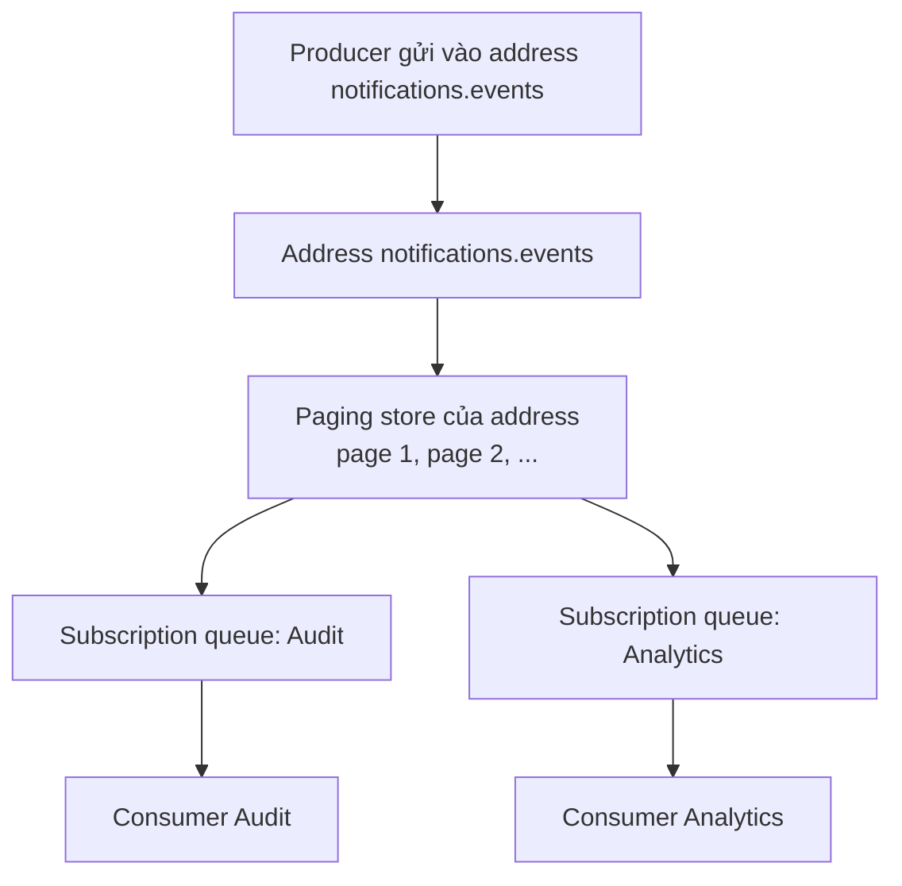
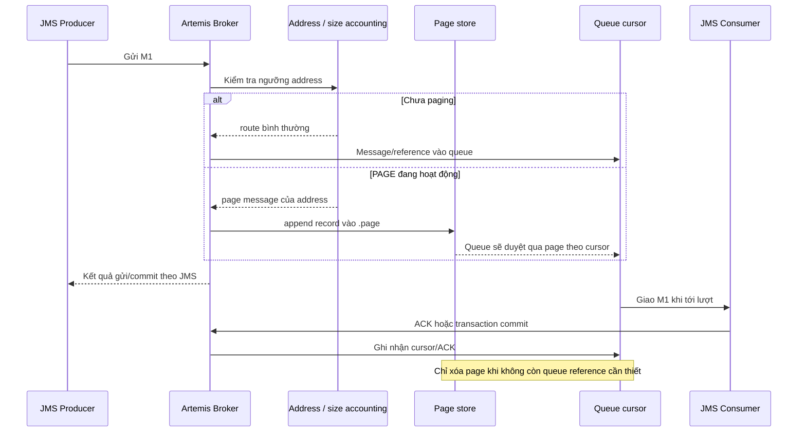

# Paging khi thông điệp vượt giới hạn bộ nhớ

> **Chương:** Lưu trữ Artemis  
> **Phạm vi:** Apache ActiveMQ **Artemis**; cơ chế paging theo **address** trên broker khi lượng message gây áp lực bộ nhớ.  
> **Mục tiêu:** Hiểu ngưỡng kích hoạt paging, cách message đi vào **page store** và được các queue tiêu thụ, vòng đời page file sau ACK, cách cấu hình `address-full-policy=PAGE`, kiểm chứng bằng Java/JMS và nhận biết giới hạn disk/throughput.

## 1. Tình huống: producer gửi nhanh hơn consumer

Một hệ thống có queue `lab.paging.orders`. Producer liên tục đưa message vào broker, trong khi consumer tạm dừng hoặc xử lý chậm. Nếu broker cố giữ toàn bộ backlog trong RAM, bộ nhớ sẽ cạn và ảnh hưởng cả những queue khác.

**Artemis paging** cho phép broker chuyển các message mới của một **address** sang **page files trên disk** khi address đạt giới hạn bộ nhớ được cấu hình. Producer có thể tiếp tục gửi theo chính sách `PAGE`, còn queue đọc dần message từ các page khi consumer tiến lên.

```text
Trước khi đầy:
Producer -> Artemis address -> queue (message có thể ở bộ nhớ/
                                     journal theo persistence)

Khi address đạt max-size-bytes và full-policy=PAGE:
Producer -> Artemis address -> paging store (.page files trên disk)
                                        |
                                 page subscription/cursor
                                        |
                                     queue
                                        |
                                    consumer -> ACK
                                        |
                               broker có thể thu hồi page
                               khi không còn tham chiếu
```

**Không nên hiểu paging là cách “tăng RAM ảo vô hạn”.** Nó đổi áp lực giữ message trong memory thành **disk I/O, dung lượng disk và độ trễ khi đọc backlog**. Nếu tốc độ tạo backlog vẫn vượt tốc độ xử lý, disk cuối cùng vẫn có thể đầy.

Ba câu hỏi cốt lõi của bài:

1. **Khi nào** address đi vào trạng thái paging?
2. **Message được lưu và giao lại ra sao** khi đang paging, sau restart và sau ACK?
3. **Khi nào** page file được xóa, và vì sao queue ít message nhưng page directory vẫn lớn?

## 2. Đơn vị áp dụng là **address**, không phải từng Java consumer

Artemis có khái niệm **address** để nhận message và **queue** để giữ các reference phục vụ consumer. Một address có thể có một queue ANYCAST, nhiều subscription queue MULTICAST, hoặc kết hợp theo cấu hình.



Khi kích hoạt paging trên `notifications.events`, cơ chế diễn ra **theo address**. Các queue nhận message từ address đó có thể tiến qua các page với tốc độ khác nhau. Vì vậy **một subscription chậm** có thể khiến page cũ chưa thể thu hồi ngay cả khi subscription khác đã ACK xong.

### 2.1. Các ngưỡng và chính sách quan trọng

| Thuộc tính Artemis | Vai trò | Không nên hiểu nhầm |
| --- | --- | --- |
| `max-size-bytes` | Ngưỡng kích thước bộ nhớ của **address** để xét hành vi khi đầy | Không phải quota disk cho cả queue hoặc kích thước một message |
| `address-full-policy=PAGE` | Khi address đạt ngưỡng, broker **page** các message vào disk | Không phải cam kết nhận vô hạn khi disk đầy |
| `page-size-bytes` | Kích thước mục tiêu của **mỗi page file** | Không phải ngưỡng quyết định khi nào bắt đầu paging |
| `paging-directory` | Thư mục gốc chứa page stores trên broker | Không phải journal directory |
| `global-max-size` | Ngân sách bộ nhớ chung của broker có thể tương tác với giới hạn address | Không thay thế việc xem effective policy theo address |

**Điểm phân biệt quan trọng nhất:**

- `max-size-bytes`: **khi nào** address cần đối phó áp lực bộ nhớ.
- `page-size-bytes`: **mỗi file** trong page store có kích thước mục tiêu bao nhiêu.
- `address-full-policy`: broker **làm gì** khi đạt giới hạn.

Một address có `max-size-bytes=128KiB` và `page-size-bytes=1MiB` hoàn toàn có ý nghĩa: sau khi bộ nhớ vượt ngưỡng thấp, broker ghi các message paged vào những page file có mục tiêu kích thước lớn hơn. Không chia backlog 128KiB thành các file 128KiB chỉ vì memory threshold bằng 128KiB.

### 2.2. Kích thước đang được tính là gì?

Artemis theo dõi **memory/address size** theo cách quản lý bộ nhớ nội bộ, không đơn giản là `sum(JSON body.length)`. Header/properties, queue references, encoding, consumer dispatch, flow control và giới hạn toàn cục có thể làm điểm chuyển trạng thái khác phép tính thô.

Vì thế khi lab gửi 2MiB payload vào address có ngưỡng 128KiB, ta **kỳ vọng tạo áp lực đủ lớn để paging**, nhưng thời điểm chính xác và số page file phải được xác nhận bằng **broker management metrics** trên phiên bản đang chạy, không suy từ Java `String.length()`.

## 3. Điều gì xảy ra bên trong khi address bắt đầu paging?

### 3.1. Đường ghi khi chưa paging và khi đang paging



Các bước logic:

1. Producer gửi message đến address, thường qua JMS queue/topic abstraction hoặc giao thức khác.
2. Broker thực hiện routing đến queue phù hợp; kiểm tra trạng thái và ngưỡng bộ nhớ của address.
3. Khi `PAGE` được kích hoạt, message mới được ghi theo thứ tự vào **page file** của address, thay vì tiếp tục tích lũy toàn bộ message trong RAM.
4. Mỗi queue liên quan duy trì **page subscription/page cursor** để biết các record trên page nào còn thuộc phần pending/đã ACK.
5. Consumer tiếp tục nhận dần; broker đọc/đưa message từ page store vào luồng dispatch khi thích hợp.
6. Khi mọi reference cần thiết của một page đã được tiêu thụ/ACK và các điều kiện quản lý khác thỏa, broker có thể **xóa page file cũ**.

**Không có chuyện “page file được đưa toàn bộ vào RAM để consumer đọc một lần”.** Paging được thiết kế để làm việc với dữ liệu lớn hơn ngưỡng memory; broker quản lý cursor/cache/đọc theo lô tùy phiên bản và tải.

### 3.2. Tại sao cần page cursor và ACK state?

Xét một address MULTICAST với hai subscription queue:

```text
Page 12 chứa: M100, M101, M102

Audit queue:     đã ACK M100, M101, M102
Analytics queue: đã ACK M100, còn M101, M102
```

Dù Audit hoàn tất, broker **không được xóa Page 12** nếu Analytics vẫn cần các message còn lại. Page cursor/ACK state theo queue giúp broker xác định tiến độ và khả năng thu hồi.

Một trang cũ có thể giữ nhiều byte dù chỉ còn **một** message chưa được ACK. Do đó:

> Dung lượng paging directory không giảm tuyến tính theo số message đã ACK.

Khi nhiều queue cùng nhận thông điệp MULTICAST, cần giám sát cả **consumer lag theo subscription** và page store của address. Một subscription đã ngừng chạy nhưng vẫn còn queue bền vững có thể giữ backlog/pages trong thời gian dài.

### 3.3. Khi nào broker thoát khỏi paging mode?

Paging không tắt ngay chỉ vì một lần `receive()` giải phóng vài KiB trong RAM. Broker còn phải xử lý **backlog được ghi trong page files**, các cursor/ACK, và điều kiện kích thước địa chỉ. Khi phần page store không còn dữ liệu cần giữ và ngưỡng cho phép, broker có thể trở lại routing bình thường.

Nếu producer vẫn gửi nhanh hơn tốc độ ACK, hệ thống có thể duy trì paging kéo dài. Đây là tín hiệu **mất cân bằng công suất**, không phải “paging làm mọi thứ chậm đi” đơn thuần.

## 4. Phân biệt paging, journal, large message và DLQ

Đây là bốn khái niệm rất dễ bị dùng thay nhau:

| Cơ chế | Giải quyết vấn đề gì? | Lưu trữ/đặc điểm |
| --- | --- | --- |
| **Paging** | Address đang vượt ngân sách bộ nhớ vì backlog | **Page files** trong `paging-directory`; có cursor/ACK theo queue |
| **Message journal** | Lưu bền vững trạng thái/message/transaction theo mô hình journal của Artemis | `journal-directory` và metadata liên quan; không phải page file |
| **Large-message storage** | Một **message đơn lẻ** quá lớn để xử lý thuận tiện như message thông thường | `large-messages-directory`; phụ thuộc ngưỡng/chức năng client & broker |
| **DLQ** | Message thất bại xử lý sau chính sách redelivery hoặc bị cách ly | Một **address/queue** nhận dead-letter; bản thân DLQ cũng có thể bị paging nếu đầy |

### 4.1. Paging không đồng nghĩa persistence

Một message JMS `PERSISTENT` cần được broker xử lý theo bảo đảm durable/transaction được cấu hình, dù nó hiện nằm ở journal hay được đưa vào page store. Paging **không tự biến** `NON_PERSISTENT` thành message phải sống qua crash theo hợp đồng JMS.

Sau restart, Artemis cần khôi phục queue, cursor và trạng thái record phù hợp từ **journal/bindings/paging metadata**. Không lấy việc tồn tại một file `.page` làm bằng chứng mọi message trong đó đều đã được producer commit hoặc sẽ được giao thành công.

### 4.2. Paging không phải “large message”

- **Nhiều message nhỏ** có thể khiến address paging nếu tổng áp lực bộ nhớ lớn.
- **Một message rất lớn** có thể dùng cơ chế large message ngay cả khi broker không ở paging mode.
- Hai cơ chế **có thể cùng xuất hiện** trong một workload; một message lớn được tham chiếu từ queue/page theo quy tắc store của broker.

Nếu backlog toàn message 4KiB thì tuning `min-large-message-size` sẽ **không tự giải quyết** vấn đề queue lớn gây paging. Ngược lại tăng `max-size-bytes` không phải cách tối ưu đường truyền một payload 500MiB.

### 4.3. Paging không tự chuyển message sang DLQ

PAGE là phản ứng với **áp lực bộ nhớ**; DLQ là kết quả của **chính sách xử lý lỗi/redelivery**. Một message hoàn toàn hợp lệ vẫn có thể nằm trong page file vì consumer chậm. Một poison message trên DLQ vẫn có thể khiến **địa chỉ DLQ** paging nếu backlog lớn.

**Không** dùng tăng retry count để giảm paging: nó có thể khiến backlog tăng thêm.

## 5. Cấu hình Artemis `broker.xml` để tái hiện paging

Ví dụ broker **lab** có address ANYCAST `lab.paging.orders` và một queue bền vững cùng tên. Bật paging khi address dùng khoảng 128KiB bộ nhớ; mỗi page file có kích thước mục tiêu 1MiB.

### 5.1. `address-settings`

Đặt fragment này **bên trong `<address-settings>`** của `broker.xml`:

```xml
<address-setting match="lab.paging.orders">
    <address-full-policy>PAGE</address-full-policy>
    <max-size-bytes>131072</max-size-bytes>
    <page-size-bytes>1048576</page-size-bytes>
</address-setting>
```

Trong đó:

- `131072 = 128KiB`: ngưỡng thấp cho lab, để có thể kích hoạt với ít MB payload.
- `1048576 = 1MiB`: target page file size; file có thể vượt target một chút tùy record boundary.
- `PAGE`: khi đạt ngưỡng, broker ghi message vào paging store thay vì mặc định từ chối hoặc block producer.

Nếu cấu hình thực tế còn có `address-setting match="#"`, hãy chắc chắn quy tắc **effective address setting** cho `lab.paging.orders` là cái bạn dự tính. Không mặc định đoạn XML vừa thêm có hiệu lực nếu broker đang dùng file cấu hình khác hoặc bị policy cụ thể hơn ghi đè.

### 5.2. Khai báo queue ANYCAST

Đặt fragment này **bên trong `<addresses>`**:

```xml
<address name="lab.paging.orders">
    <anycast>
        <queue name="lab.paging.orders" durable="true"/>
    </anycast>
</address>
```

`QueueSession.createQueue("lab.paging.orders")` ở Java (hoặc `Session.createQueue`) chỉ tạo JMS destination object; với lab cần kiểm soát trạng thái store, hãy **provision queue trước**, không dựa vào auto-create.

### 5.3. Paging directory

Artemis có thuộc tính cấu hình cấp broker:

```xml
<!-- Phần tử cấp broker/core, KHÔNG nằm trong <address-setting> -->
<paging-directory>data/paging</paging-directory>
```

`data/paging` là ví dụ path tương đối trong instance broker; môi trường của bạn có thể dùng path tuyệt đối hoặc đường dẫn container volume. Broker sẽ quản lý cấu trúc con của page store; **không tạo, di chuyển, sửa hoặc xóa file .page bằng tay** trong lúc broker chạy.

Để không mất dữ liệu sau khi container bị thay thế, dữ liệu Artemis cần **persistent volume**, bao gồm paging, journal, bindings và large messages phù hợp cấu hình. Mount mỗi `paging-directory` mà bỏ journal/bindings **không đủ** để restore trạng thái broker nhất quán.

### 5.4. Phải restart/reload cấu hình đúng cách

Sau khi thay `broker.xml`, dùng phương thức quản trị được hỗ trợ bởi bản Artemis cụ thể để áp dụng cấu hình. Với lab, dừng broker sạch rồi khởi động bằng **cùng instance/data directory** là cách dễ kiểm chứng. Sau khi khởi động, xác nhận:

- Address và queue đã được khai báo, routing type `ANYCAST`.
- `address-full-policy` hiệu lực là `PAGE`.
- `max-size-bytes` và `page-size-bytes` như dự kiến.
- `paging-directory` nằm ở volume bạn quan sát.

Không chỉ kiểm tra XML tồn tại; một broker dùng cấu hình cũ sẽ khiến toàn bộ bài thử kết luận sai.

## 6. Điều gì xảy ra nếu không chọn `PAGE`?

Artemis hỗ trợ các chính sách address-full để phản ứng với ngưỡng bộ nhớ. Các lựa chọn điển hình:

| `address-full-policy` | Hành vi chính | Hệ quả ứng dụng |
| --- | --- | --- |
| `PAGE` | Chuyển backlog sang page files | Ít phụ thuộc RAM cho backlog, nhưng dùng disk và có độ trễ khi drain |
| `BLOCK` | Gây **producer backpressure** khi address đầy | Producer có thể chờ; tránh chờ vô hạn trong workflow giao dịch |
| `FAIL` | Từ chối message khi không thể nhận theo policy | Producer phải xử lý lỗi gửi/commit rõ ràng |
| `DROP` | Bỏ message khi đạt giới hạn | Có nguy cơ mất dữ liệu; không dùng cho giao dịch quan trọng |

Các policy ngoài PAGE phải được kiểm thử trên **giao thức và bản broker cụ thể**; ví dụ một client AMQP 1.0 có tín hiệu flow control/credit khác JMS Core client. Số bytes được client buffer và thời điểm `send` báo lỗi/chờ còn phụ thuộc provider.

**PAGE không đồng nghĩa “không bao giờ block producer”.** Nếu disk đạt giới hạn, storage bị lỗi, transaction không commit được hoặc broker có giới hạn chung, gửi message vẫn có thể thất bại/chậm. Đặc biệt không dùng PAGE như một phương án thay thế monitoring disk usage.

## 7. Thực hành Java/JMS: làm address paging rồi drain an toàn

Mục tiêu lab:

1. Tạo **backlog nhiều hơn `max-size-bytes`** trên queue `lab.paging.orders`, chưa chạy consumer.
2. Quan sát broker address bắt đầu paging và có page files.
3. Dừng/khởi động broker bằng **cùng data directory**, xác nhận message vẫn còn.
4. Chạy consumer nhận/kiểm tra nội dung và **commit ACK** đầy đủ.
5. Quan sát page files được xử lý/thu hồi theo điều kiện cleanup.

### 7.1. Điều kiện và Maven dependency

Dùng ActiveMQ Artemis có Core acceptor tại `tcp://localhost:61616`; ví dụ Java 17, JMS 2.0 namespace `javax.jms` và Artemis native JMS client:

```xml
<properties>
    <maven.compiler.release>17</maven.compiler.release>
</properties>
<dependencies>
    <dependency>
        <groupId>org.apache.artemis</groupId>
        <artifactId>artemis-jms-client</artifactId>
        <version>2.50.0</version>
    </dependency>
</dependencies>
```

Đây là phiên bản/artifact **minh họa cho nhánh client `javax.jms`**; kiểm tra dependency thực tế của release đang triển khai. Artemis cũ có Maven groupId `org.apache.activemq`; dự án dùng `jakarta.jms` cần client/import tương ứng, không trộn hai namespace.

Nếu broker bật authentication, chương trình dùng biến môi trường `ARTEMIS_USER`/`ARTEMIS_PASSWORD`. Cấp quyền `send`/`consume` trên queue lab; không dùng credential sản xuất. Queue phải **không có message của lần chạy cũ** và không có consumer khác trong lúc lab.

### 7.2. Chương trình Java hoàn chỉnh

Chương trình có hai mode chạy trong **hai tiến trình độc lập**. `seed` tạo 256 persistent message, mỗi message 8KiB: tổng payload thô **2MiB**. `drain` chạy sau khi đã kiểm tra paging/restart, nhận và ACK toàn bộ trong các JMS transaction.

```java
import org.apache.activemq.artemis.jms.client.ActiveMQConnectionFactory;

import javax.jms.BytesMessage;
import javax.jms.Connection;
import javax.jms.DeliveryMode;
import javax.jms.Message;
import javax.jms.MessageConsumer;
import javax.jms.MessageProducer;
import javax.jms.Queue;
import javax.jms.Session;

import java.security.MessageDigest;
import java.util.Arrays;
import java.util.HashSet;
import java.util.HexFormat;
import java.util.Random;
import java.util.Set;

public final class ArtemisPagingProbe {
    private static final String QUEUE = "lab.paging.orders";
    private static final int COUNT = 256;
    private static final int BODY_BYTES = 8192;
    private static final int TX_BATCH = 32;

    private static void require(boolean ok, String reason) {
        if (!ok) throw new IllegalStateException(reason);
    }

    private static String sha256(byte[] data) throws Exception {
        byte[] digest = MessageDigest.getInstance("SHA-256")
                .digest(data);
        return HexFormat.of().formatHex(digest);
    }

    private static void seed(Session tx, Queue queue, String runId)
            throws Exception {
        MessageProducer producer = tx.createProducer(queue);
        producer.setDeliveryMode(DeliveryMode.PERSISTENT);

        Random random = new Random(2048L);
        for (int i = 0; i < COUNT; i++) {
            byte[] payload = new byte[BODY_BYTES];
            random.nextBytes(payload);

            BytesMessage message = tx.createBytesMessage();
            message.writeBytes(payload);
            message.setStringProperty("runId", runId);
            message.setIntProperty("sequence", i);
            message.setStringProperty("sha256", sha256(payload));

            producer.send(message);

            if ((i + 1) % TX_BATCH == 0) {
                tx.commit();
                System.out.println("SEND COMMIT: " + (i + 1));
            }
        }

        producer.close();
        System.out.println("SEED PASS: " + COUNT + " messages");
    }

    private static byte[] readBody(BytesMessage message)
            throws Exception {
        require(message.getBodyLength() == BODY_BYTES,
                "Sai kích thước payload");

        byte[] result = new byte[BODY_BYTES];
        int offset = 0;
        while (offset < result.length) {
            byte[] chunk = new byte[Math.min(
                    2048, result.length - offset)];
            int n = message.readBytes(chunk);
            require(n > 0, "BytesMessage thiếu byte");
            System.arraycopy(chunk, 0, result, offset, n);
            offset += n;
        }

        require(message.readBytes(new byte[1]) == -1,
                "Message còn byte ngoài payload dự kiến");
        return result;
    }

    private static void drain(Session tx, Connection connection,
                              Queue queue, String runId) throws Exception {
        MessageConsumer consumer = tx.createConsumer(queue);
        connection.start();

        Set<Integer> seen = new HashSet<>();
        try {
            for (int i = 0; i < COUNT; i++) {
                Message message = consumer.receive(10_000);
                require(message instanceof BytesMessage,
                        "Timeout hoặc sai JMS message type");

                require(runId.equals(
                        message.getStringProperty("runId")),
                        "Queue chứa dữ liệu từ run khác");

                int sequence = message.getIntProperty("sequence");
                require(sequence >= 0 && sequence < COUNT
                        && seen.add(sequence),
                        "Thiếu/trùng sequence: " + sequence);

                byte[] actual = readBody((BytesMessage) message);
                require(sha256(actual).equals(
                        message.getStringProperty("sha256")),
                        "Sai checksum message " + sequence);

                if ((i + 1) % TX_BATCH == 0) {
                    tx.commit();   // ACK batch vừa kiểm tra.
                    System.out.println("ACK COMMIT: " + (i + 1));
                }
            }
        } catch (Exception failure) {
            tx.rollback();         // Phần chưa commit còn cơ hội redeliver.
            throw failure;
        } finally {
            consumer.close();
        }

        require(seen.size() == COUNT, "Chưa nhận đủ message");
        System.out.println("DRAIN PASS: " + seen.size());
    }

    public static void main(String[] args) throws Exception {
        require(args.length >= 2 && args.length <= 3,
                "Usage: <seed|drain> <runId> [brokerURL]");

        String mode = args[0];
        String runId = args[1];
        String url = args.length == 3
                ? args[2] : "tcp://localhost:61616";

        ActiveMQConnectionFactory factory =
                new ActiveMQConnectionFactory(url);

        String user = System.getenv("ARTEMIS_USER");
        String password = System.getenv("ARTEMIS_PASSWORD");

        try (Connection connection = user == null
                ? factory.createConnection()
                : factory.createConnection(user, password)) {

            Session tx = connection.createSession(
                    true, Session.SESSION_TRANSACTED);
            Queue queue = tx.createQueue(QUEUE);

            if ("seed".equals(mode)) {
                seed(tx, queue, runId);
            } else if ("drain".equals(mode)) {
                drain(tx, connection, queue, runId);
            } else {
                throw new IllegalArgumentException(
                        "Unknown mode: " + mode);
            }
        }
    }
}
```

**Vì sao dùng `BytesMessage` và payload giả ngẫu nhiên?** Dữ liệu 8KiB không quá lớn riêng lẻ; tổng 256 message tạo backlog. Payload ít lặp hơn một chuỗi `"AAAA..."` nên không phụ thuộc các hiệu ứng nén dễ gây hiểu nhầm. `SHA-256` ở đây phục vụ **kiểm chứng toàn vẹn của bài lab**, không thay thế checksum/journal và không phải phương pháp xác thực nguồn message.

**Vì sao commit từng 32 message?** Để bảo đảm mỗi batch đã được transaction producer commit trước khi đánh giá store, và consumer ACK theo batch đã validate. Trong một session transacted, `send()` trước `commit()` chưa đủ để kết luận message đã được chấp nhận bền vững.

**Lưu ý về lỗi giữa các batch:** Nếu `drain` thất bại sau một vài commit, các batch đã commit sẽ không còn trong queue, còn batch hiện hành được rollback. Không chạy lại `drain` với kỳ vọng đủ 256 message trên cùng run; tạo queue lab sạch hoặc xây logic resume riêng. Đây là probe có chủ đích, không phải một reprocessing application.

### 7.3. Quy trình chạy và quan sát

| Bước | Hành động | Kết quả cần thấy |
| --- | --- | --- |
| 1 | Khởi động broker lab có cấu hình phần 5; kiểm tra queue trống | Address `lab.paging.orders` ở trạng thái bình thường, không có backlog |
| 2 | Chạy `ArtemisPagingProbe seed test001` | Các dòng `SEND COMMIT` đến `256` và `SEED PASS` |
| 3 | Chưa mở consumer; xem Artemis Console/JMX/management | `isPaging` hoặc trạng thái paging true; số page/page store tăng |
| 4 | Kiểm tra `paging-directory` **chỉ đọc** | Có các page files đang được broker quản lý |
| 5 | **Dừng broker sạch rồi khởi động lại** với cùng data volume | Queue vẫn có message persistent; paging/cursor phục hồi |
| 6 | Chạy `ArtemisPagingProbe drain test001` | `ACK COMMIT` đến `256`, `DRAIN PASS` |
| 7 | Quan sát broker sau khi consumer hoàn tất | Queue pending giảm về 0, page files dần đủ điều kiện cleanup, paging kết thúc khi điều kiện thỏa |

`test001` chỉ là ví dụ **runId**; phải dùng **cùng runId** cho `seed` và `drain`. Cú pháp chạy Java main thực tế phụ thuộc Maven/IDE của dự án; ở đây các đối số đưa vào `main` là phần cần kiểm chứng. Không chạy với queue đang có message sản xuất.

Để kiểm thử **crash** chứ không phải restart sạch, lặp lại trên queue lab được tạo mới; sau seed/commit, dừng **process broker không graceful** trong môi trường cô lập rồi khởi động lại bằng đúng data volume. Xác minh đủ business IDs/checksums thay vì chỉ nhìn queue depth.

**Tiêu chí thực chất:** số message còn trong queue sau restart đúng như số đã commit, dữ liệu đọc lại có checksum đúng và sau ACK/commit broker có thể giải phóng page store. Không tự xoá `.page` để làm bài test “PASS”.

## 8. Quan sát paging chính xác trên broker

### 8.1. Metric nào cần nhìn?

Artemis Console, JMX và management API có thông tin về address/queue/paging. Tên metric/operation cụ thể phụ thuộc phiên bản; nên đối chiếu phiên bản đang chạy. Những nhóm số liệu cần ghi:

| Nhóm | Chỉ số | Dùng để kiểm chứng |
| --- | --- | --- |
| Address | Paging đang hoạt động hay không (`isPaging` hoặc chỉ số tương đương) | `PAGE` đã được kích hoạt thực sự |
| Address/page store | Số page, dung lượng paging, tốc độ ghi/đọc pages | Backlog đã chuyển sang disk chưa |
| Address memory | Address size, giới hạn `max-size-bytes`, global memory usage | Vì sao đạt ngưỡng |
| Queue | Message count, delivering count, messages added/acknowledged | Backlog và tốc độ drain |
| Disk | Free space, sử dụng filesystem, I/O wait, disk latency | PAGE có đe dọa làm đầy disk không |
| Consumer | Consumer count, rate xử lý, commit/rollback | Vì sao page file chậm được thu hồi |

**Không dùng duy nhất kích thước thư mục paging để kết luận queue đã có bao nhiêu message.** Một page có metadata/record overhead, một address có thể có nhiều queue, các page đã ACK có thể chờ cleanup, và backlog có thể nằm ở cả vị trí chưa paged lẫn page files.

### 8.2. Quan sát file như thế nào?

Có thể kiểm tra **chỉ đọc** các file mà broker tạo trong `paging-directory` khi lab đang chạy. File page thường mang định dạng nhị phân/nội bộ và tên tùy phiên bản. Không dùng `cat`/text editor để giải mã body; không sửa timestamp/rename file vì broker đang giữ cursor tới chúng.

**Một số tình huống quan sát hay gặp:**

- Page file đang tăng khi consumer tắt: producer đang tạo backlog; bình thường với PAGE.
- Producer dừng nhưng page file chưa giảm: chưa có ACK, page chưa đủ điều kiện cleanup.
- Consumer chạy lại nhưng file vẫn còn: còn queue/subscription tham chiếu tới page, hoặc cleanup chưa diễn ra; cần xem queue metrics.
- Disk tăng nhưng page store không tăng: có thể journal, large-message files, log hoặc DLQ; cần đo từng thư mục.
- Sau restart số page khác trước: broker có thể phục hồi/cleanup metadata; quan trọng là **message committed còn đủ**, không phải số file giống hệt.

### 8.3. Bằng chứng paging khác bằng chứng persistence

Hai phép kiểm chứng phải tách:

1. **Paging proof:** trước khi drain, broker thực sự báo paging và có các page file.
2. **Durability proof:** sau restart, consumer nhận đủ persistent message đã commit.

Chỉ thấy message sau restart **không chứng minh paging** — một queue nhỏ có thể sống qua restart nhờ journal mà chưa từng page. Ngược lại chỉ thấy nhiều `.page` **không chứng minh transaction đã commit**.

## 9. Bài toán chậm tiêu thụ và tốc độ tăng disk

Đặt:

- \(\lambda\): tốc độ producer đưa message vào address, đơn vị message/giây.
- \(\mu\): tốc độ consumer ACK có hiệu lực, đơn vị message/giây.
- \(s\): kích thước bình quân một message đã lưu, tính cả overhead ước lượng.
- \(t\): thời gian mất cân bằng, tính bằng giây.

Khi \(\lambda > \mu\), backlog tăng gần đúng:

\[
\Delta N \approx (\lambda - \mu)\,t
\]

Dung lượng bổ sung cần dùng ước tính:

\[
\Delta D \approx (\lambda - \mu)\,s\,t
\]

Ví dụ producer đưa **600 message/giây**, consumer chỉ ACK được **400 message/giây**, kích thước lưu bình quân khoảng **4KiB/message**. Backlog tăng 200 message/giây, tương đương khoảng **800KiB/giây**, xấp xỉ **2,75GiB mỗi giờ** nếu kéo dài, chưa gồm overhead store, journal, metadata và filesystem.

**PAGE không làm \(\mu\) tăng.** Nó giúp broker chịu backlog lớn hơn RAM với điều kiện còn disk, nhưng chỉ **tăng năng lực xử lý, giảm ingress hoặc rút ngắn outage** mới khiến backlog thực sự giảm.

### 9.1. Vì sao paging có thể làm throughput giảm?

- Việc **ghi page** cạnh tranh I/O với journal/ACK/transaction.
- Consumer phải **đọc page**, phát sinh disk read và quản lý cursor.
- Cache/page prefetch có giới hạn; consumer đọc theo nhịp khác với producer ghi.
- Các durable subscription chậm giữ page lâu, tăng disk footprint và công việc cleanup.
- Disk latency cao làm tăng p99 send/commit/receive dù CPU còn rảnh.

Khi benchmark, so sánh cùng workload và cùng disk: message size, durable flag, consumer count, journal sync, filesystem, page size và tốc độ producer. Không đánh giá tối ưu paging chỉ bằng một con số messages/sec trong lab RAM trống.

## 10. Tuning để paging không biến thành sự cố disk

### 10.1. Chọn `max-size-bytes`

Đây là **memory threshold** của address, không phải “backlog được phép tối đa”. Khi đặt:

- Quá thấp: address bắt đầu paging thường xuyên, phát sinh I/O ngay cả khi traffic chỉ burst nhỏ.
- Quá cao: backlog chiếm nhiều RAM, gây áp lực GC/heap/native memory, làm ảnh hưởng các address khác.
- Nhiều address có giới hạn riêng nhưng vẫn chia sẻ **global memory budget** của broker.

Nên dựa vào **message size distribution**, peak burst, số queue trên address, consumer rate và giới hạn toàn cục. Với production, bắt đầu từ số liệu thay vì copy `128KiB` của lab.

### 10.2. Chọn `page-size-bytes`

- Page nhỏ có thể làm tăng số file/metadata và tần suất thao tác quản lý.
- Page lớn có thể tăng lượng dữ liệu lưu trong một đơn vị cleanup, khiến các message chậm ACK giữ nhiều disk và phát sinh I/O theo lô.
- Page size là **target**; message lớn và record boundary có thể khiến file thực tế không đúng bằng target.

Thử nhiều mức trong môi trường tải tương đương, đo p95/p99 consumer latency, file count, disk I/O và thời gian thu hồi pages. Không giảm page size đến cực nhỏ chỉ để thấy nhiều file trong lab.

### 10.3. Dung lượng paging là ngân sách có giới hạn

Trong môi trường thật phải có:

- Disk/volume độc lập hoặc đủ IOPS và dung lượng cho **paging + journal + bindings + large messages + logs**.
- Alert theo free space, tốc độ tăng backlog và **time to full**.
- Chính sách address/page limit phù hợp **phiên bản Artemis**, nếu có sử dụng.
- Runbook điều tiết producer, pause listener lỗi, mở rộng consumer hoặc giảm ingress.
- Backup/snapshot/HA ở mức hệ thống, không dựa vào một thư mục page độc lập.

**Cảnh báo:** Tính năng giới hạn dung lượng trang như `page-limit-bytes`, `page-limit-messages` hoặc chính sách khi page store đầy có thể khác nhau theo release. Chỉ bật các thuộc tính cụ thể sau khi đối chiếu schema/tài liệu **đúng phiên bản** và thử hành vi với client đang dùng; đừng giả định `max-size-bytes` là một disk quota.

### 10.4. Đừng dùng cleanup thủ công để “giải phóng nhanh”

Nếu disk sắp đầy:

**Sai:** dừng một consumer và xóa bớt các file `.page` theo ngày/size; việc này phá cấu trúc tham chiếu/cursor và làm mất message.

**Đúng:** xác định queue/subscription giữ backlog, đo tuổi message và tốc độ ACK; khôi phục consumer, xử lý poison/DLQ đúng cách, mở rộng storage hoặc tạm giảm tốc độ producer. Nếu cần xóa message theo chính sách nghiệp vụ, dùng **broker management operation hợp lệ** với sự phê duyệt, chấp nhận tác động dữ liệu và ghi nhận audit.

## 11. Một subscription MULTICAST chậm giữ pages như thế nào?

Giả sử address `sales.events` có hai durable subscription:

```text
sales.events (MULTICAST)
  |
  +-- queue Audit.Q        -> consumer rất nhanh
  |
  +-- queue Reporting.Q    -> consumer offline 6 giờ
```

Sau khi address paging:

- Audit có thể ACK phần lớn event.
- Reporting vẫn còn pending trên cùng page store của address.
- Broker chưa thể thu hồi những page còn record mà Reporting cần.
- Disk usage tiếp tục tăng nếu producer còn gửi.

**Không kết luận “Audit không ACK” chỉ vì page chưa xóa.** Cần xem **mọi queue** liên quan tới address, trong đó có durable subscription không còn consumer hiện hành.

Nếu thực tế không còn cần subscription cũ, phải có quy trình unsubscribe/delete queue đúng quyền và retention, không xóa thẳng file. Xóa durable subscription có thể làm mất backlog chưa xử lý; quyết định này là thay đổi nghiệp vụ, không đơn thuần là “dọn disk”.

## 12. Paging và độ tin cậy khi crash/failover

### 12.1. Khi broker bị kill giữa quá trình ghi page

Với durable message đã được commit và store nằm trên disk đáng tin cậy, Artemis khôi phục dữ liệu cần thiết từ persistence state của broker, bao gồm page store và các cursor/ACK metadata liên quan. Nhưng **không có bất kỳ lời hứa exactly-once end-to-end chỉ từ việc bật PAGE**.

Các cửa sổ lỗi cần kiểm tra riêng:

1. Producer gửi nhưng chưa nhận phản hồi commit: kết quả **có thể không xác định**, cần event ID/idempotency.
2. Consumer đã xử lý DB nhưng JMS commit chưa được broker xác nhận: message có thể redeliver.
3. Consumer rollback khi message nằm trong page store: message vẫn cần được retry/định tuyến theo redelivery policy, không bị xóa chỉ vì đã được đọc vào memory.
4. Broker khởi động lại với **thiếu paging directory** hoặc thiếu journal/bindings: không thể coi store là nhất quán.
5. Disk lỗi toàn bộ: paging đơn node không tạo bản sao; cần HA/backup/replay nguồn theo SLA.

### 12.2. Mô hình file system đúng

```text
data/
├── journal/          # Journal và trạng thái persistence
├── bindings/         # Bindings/metadata
├── paging/           # Address paging stores, page files
└── largemessages/    # Large-message bodies (nếu sử dụng)
```

Tên và vị trí thư mục có thể thay đổi theo cấu hình phiên bản/container. Khi cần snapshot/restore, chọn phương pháp **nhất quán** (dừng broker sạch hoặc snapshot filesystem phù hợp) cho toàn bộ vùng dữ liệu liên quan. Không backup riêng `paging/` rồi kỳ vọng broker có thể tái dựng đầy đủ queue và transaction state.

## 13. Lỗi thường gặp trong triển khai

| Dấu hiệu | Chẩn đoán ưu tiên | Hành động hợp lý |
| --- | --- | --- |
| Không thấy paging dù queue có nhiều message | Effective `address-setting`, `max-size-bytes`, global memory, page policy, dữ liệu thực nằm ở đâu | Xác minh broker metrics, đừng chỉ nhìn số message |
| Thấy paging nhưng không có page file ở path dự kiến | `paging-directory` thực tế/volume của container, quyền truy cập, broker instance | Xác minh runtime path |
| Queue count về 0 nhưng disk chưa giảm | Page còn queue reference khác, cleanup chưa hoàn tất, journal/large-message đang dùng disk | Xem mọi queue/subscription và các thư mục khác |
| Page files tăng không ngừng | \(\lambda > \mu\), consumer offline/chậm, poison/retry | Phân tích backlog growth, khôi phục/scale consumer hoặc giảm ingress |
| Producer chậm sau khi paging | Disk I/O, fsync, paging writes, global limits | Đo latency/IOPS, không chỉ tăng `max-size-bytes` |
| Producer gửi lỗi khi disk đầy | Disk limit/failure, page store limit hoặc policy tương ứng | Alert, giảm ingress, mở rộng storage; không xóa page bằng tay |
| Message nhận lại sau crash | ACK/transaction không chắc chắn | Idempotency, kiểm tra DB/JMS commit |
| Mất message sau khi chỉ mount `paging/` | Thiếu journal/bindings/large messages hoặc persistence policy sai | Restore từ backup nhất quán; sửa volume mapping |
| Một durable subscriber đã tắt giữ disk lâu | Page cursor của subscription chưa ACK | Xác minh ownership, retention, xử lý backlog/huỷ subscription theo runbook |

### 13.1. Những nhận định sai cần sửa

**“Paging bắt đầu khi disk đầy.”** Sai. PAGE thường được kích hoạt do **giới hạn bộ nhớ của address**. Disk đầy là sự cố có thể xuất hiện **sau** khi backlog paged tăng dài hạn.

**“`page-size-bytes` là ngưỡng RAM cho queue.”** Sai. Nó xác định target kích thước file page; ngưỡng address thường là `max-size-bytes`.

**“Artemis paging chính là KahaDB journal.”** Sai. Artemis có paging store và journal riêng; KahaDB là persistence adapter của **ActiveMQ Classic**.

**“Bật PAGE đảm bảo mất điện không mất message.”** Sai. Độ bền phụ thuộc durable flag, JMS commit, broker persistence, disk sync và miền lỗi.

**“ACK xong một message là broker xóa ngay page file chứa message đó.”** Sai. File chỉ được thu hồi khi toàn bộ reference cần thiết được giải phóng.

**“Tăng `max-size-bytes` sẽ giải quyết backlog không ngừng tăng.”** Sai. Tăng ngưỡng chỉ trì hoãn thời điểm paging, không đổi chênh lệch \(\lambda - \mu\).

**“Đã thấy message sau restart thì chắc chắn có paging.”** Sai. Phải quan sát trạng thái paging/page files **trước restart hoặc trong quá trình test**.

## 14. Ma trận kiểm thử chấp nhận

| Test | Thao tác | Kỳ vọng |
| --- | --- | --- |
| P1 — Trigger | Producer gửi 256 × 8KiB vào queue trống, không có consumer | Address bật paging và page files xuất hiện |
| P2 — Persistence | Seed persistent rồi stop/start broker cùng data volume | Vẫn nhận đủ message đã commit |
| P3 — Integrity | `drain` kiểm tra `sequence`, `runId`, SHA-256 | Không thiếu/trùng/sai payload |
| P4 — Cleanup | ACK hết rồi đợi broker cleanup hợp lệ | Pending về 0, page store đủ điều kiện thu hồi |
| P5 — Slow consumer | Producer tiếp tục, consumer chạy chậm | Page growth tăng, latency/IOPS tăng có thể đo |
| P6 — Multicast lag | Hai subscription, một subscription offline | Page còn được giữ cho queue đang pending |
| P7 — BLOCK thay PAGE (lab khác) | Cấu hình `BLOCK`, producer vẫn gửi | Quan sát backpressure/thời gian `send/commit` |
| P8 — Disk pressure (lab cô lập) | Giới hạn dung lượng thử nghiệm, không phá volume production | Cảnh báo và hành vi lỗi/backpressure theo cấu hình |
| P9 — Crash | Kill process broker trong lab sau commit | Persistent message đủ điều kiện phục hồi; ACK/transaction kiểm tra riêng |
| P10 — Version/upgrade | Restart với bản client/broker được hỗ trợ | Paging/management metrics và routing đúng theo release |

**PASS của P1 không được đánh giá chỉ bằng số file**: cần broker report paging thực sự; PASS của P2/P3 phải dựa vào **business IDs và payload validation**, không chỉ queue-count. P8 tuyệt đối không chạy trên volume dùng chung hoặc production.

## 15. Checklist cấu hình production

- [ ] Xác định address nào có nguy cơ backlog, không nhầm address với queue.
- [ ] Đã đo throughput producer/consumer và phân bố message size theo address.
- [ ] Đặt `address-full-policy` có chủ đích; hiểu rõ `PAGE` khác `BLOCK`/`FAIL`/`DROP`.
- [ ] Đặt `max-size-bytes` phù hợp memory budget của broker, `global-max-size` và tải thực tế.
- [ ] `page-size-bytes` được chọn dựa trên số file, I/O và cleanup, không dựa vào RAM threshold.
- [ ] `paging-directory` nằm trên volume có đủ dung lượng/IOPS và được backup/HA cùng store liên quan.
- [ ] Có cảnh báo theo free disk, page growth, address paging, queue backlog và consumer lag.
- [ ] Đã kiểm tra trường hợp **durable subscription MULTICAST chậm** giữ pages.
- [ ] Không xóa/rename `.page` hay journal/bindings để “dọn backlog”.
- [ ] Consumer có transaction/ACK/idempotency; paging không thay thế redelivery/DLQ.
- [ ] Kiểm thử seed → paging → restart → drain → cleanup bằng đúng client/broker/version.
- [ ] Nếu dùng per-page disk limit mới của Artemis, đối chiếu schema/version và kiểm thử phản ứng khi đầy.
- [ ] Có runbook giảm ingress, scale consumer, xử lý poison và bổ sung disk khi backlog tăng liên tục.

## 16. Câu hỏi tự kiểm tra

1. Vì sao paging được kích hoạt bởi áp lực **memory/address** chứ không phải đợi disk đầy?
2. `max-size-bytes` và `page-size-bytes` khác nhau ở đâu? Đơn vị áp dụng của từng giá trị?
3. Khi address có hai subscription queue, tại sao một subscriber đã ACK hết vẫn có thể chưa xóa được page file?
4. Paging có tự biến một `NON_PERSISTENT` message thành durable sau restart không?
5. Cùng queue có 10.000 message, cách nào chứng minh chắc chắn broker **đang paging**?
6. Vì sao một message lớn đơn lẻ không có nghĩa address phải chuyển sang paging?
7. Khi producer tốc độ 600/s nhưng consumer chỉ ACK 400/s, tại sao tăng memory threshold chỉ trì hoãn disk usage?
8. Nếu chỉ backup `paging/` rồi restore lên broker mới, vì sao không thể cam kết queue/ACK/transaction nhất quán?
9. `BLOCK` khác `PAGE` về tác động tới producer thế nào?
10. Bài lab chứng minh những điều gì bằng `seed` và `drain` qua broker restart?

**Gợi ý:** (1) address memory budget; (2) ngưỡng memory của address so với target mỗi page file; (3) queue khác còn cursor/reference; (4) không; (5) dùng broker management + page store; (6) large-message mechanism là vấn đề khác; (7) \(\lambda>\mu\) không đổi; (8) thiếu journal/bindings/metadata; (9) backpressure so với ghi ra page store; (10) paging được kích hoạt, message persistent đã commit sống qua restart, payload và ACK được kiểm chứng.

## 17. Tài liệu đối chiếu

- [Apache ActiveMQ Artemis — Paging](https://artemis.apache.org/components/artemis/documentation/latest/paging.html): `max-size-bytes`, `address-full-policy`, `page-size-bytes`, page cursors và vòng đời page store.
- [Apache ActiveMQ Artemis — Address Model](https://artemis.apache.org/components/artemis/documentation/latest/address-model.html): address, queue, ANYCAST/MULTICAST và routing.
- [Apache ActiveMQ Artemis — Persistence](https://artemis.apache.org/components/artemis/documentation/latest/persistence.html): journal, bindings, large messages và sự khác biệt với paging.
- [Apache ActiveMQ Artemis — Large Messages](https://artemis.apache.org/components/artemis/documentation/latest/large-messages.html): xử lý một message lớn, không nhầm với address paging.
- [Apache ActiveMQ Artemis — Management](https://artemis.apache.org/components/artemis/documentation/latest/management.html): console/JMX/management cho address, queue và paging metrics.
- [Apache ActiveMQ Artemis — Configuration Index](https://artemis.apache.org/components/artemis/documentation/latest/configuration-index.html): đối chiếu schema/khả năng hỗ trợ thuộc tính theo release.

> **Kết luận:** Paging của Artemis là **cơ chế bảo vệ bộ nhớ theo address**: khi address vượt ngưỡng và `address-full-policy=PAGE`, message mới được ghi vào page files để queue đọc dần. Mỗi queue theo dõi tiến độ qua page cursor/ACK; page file chỉ được thu hồi khi không còn tham chiếu cần thiết. Nó giải quyết áp lực **RAM**, chứ không tạo thêm **disk**, không tự tăng throughput và không thay thế **journal, durable commit, idempotency hoặc backup/HA**.
