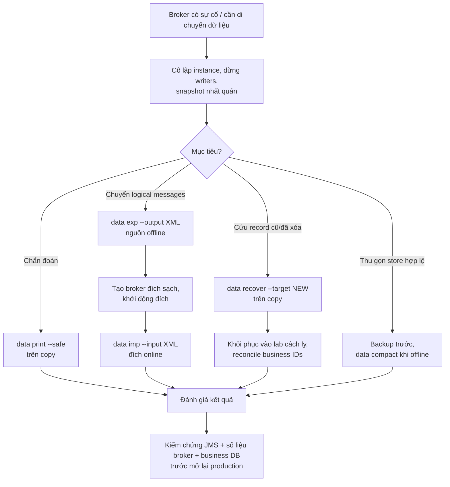

# Công cụ kiểm tra, xuất nhập và phục hồi dữ liệu khi broker ngoại tuyến

> **Chương:** Lưu trữ Artemis  
> **Phạm vi:** Apache ActiveMQ Artemis dùng **file journal** (khác KahaDB của ActiveMQ Classic). Bài tập trung vào CLI `artemis data` để kiểm tra, xuất, nhập, compact và cố gắng khôi phục dữ liệu, cùng quy trình tránh hỏng thêm dữ liệu khi broker ngừng chạy.

## 1. Phân biệt ba việc: kiểm tra, chuyển dữ liệu và cứu dữ liệu

Một broker Artemis không khởi động được sau sự cố ổ đĩa, hoặc cần di chuyển các message chưa xử lý sang môi trường cô lập. Người vận hành thường nói chung là “restore journal”, nhưng có **ba mục tiêu khác nhau**:

- **Kiểm tra (*inspect*):** đọc cấu trúc/bản ghi hiện có để xác định message và metadata còn gì, không chủ ý thay đổi dữ liệu gốc.
- **Xuất/nhập (*logical export/import*):** trích xuất dữ liệu message ra định dạng trung gian XML rồi đưa vào broker đích. Đây không phải bản sao byte-for-byte của toàn bộ instance.
- **Phục hồi (*forensic recovery*):** thử tái dựng message từ các record journal còn sót, **kể cả record đã bị ACK/rollback** nếu chúng chưa bị ghi đè. Kết quả có thể chứa message trùng, đã xử lý hoặc thiếu dữ liệu.

Trong CLI Artemis, tên lệnh thực tế là **`data print`, `data exp`, `data imp`, `data compact`, `data recover`**; **không** phải `data export` hay `data import`.

| Lệnh | Mục đích | Trạng thái broker liên quan |
| --- | --- | --- |
| `artemis data print` | Đọc/report các journal records | **Offline**: broker nguồn phải dừng |
| `artemis data exp` | Xuất message data thành XML độc lập với journal | **Offline**: broker nguồn phải dừng |
| `artemis data imp` | Đọc XML và gửi dữ liệu tới broker đích | **Online**: broker đích phải **đang chạy** |
| `artemis data compact` | Thu gọn journal bằng công cụ bảo trì | **Offline**, có khả năng thay đổi file nguồn |
| `artemis data recover` | Cố gắng cứu message vào **journal đầu ra mới** | **Offline**, thực hiện trên snapshot/copy |
| `artemis data encode` / `decode` | Biểu diễn/tái tạo định dạng journal nội bộ | Công cụ kỹ thuật thấp tầng; **không** thay cho `exp`/`imp` |

**Mấu chốt của tiêu đề “khi broker ngoại tuyến”:** phần **đọc journal, export, compact, recover** thực hiện lúc broker nguồn không chạy. Riêng **`imp` phải kết nối một broker đích đang chạy**. Không được cố dùng `imp` như công cụ chép file vào một broker đã dừng.

## 2. Các phần dữ liệu cần bảo toàn cùng nhau

Artemis dùng nhiều vùng lưu trữ có quan hệ logic:

```text
BROKER_INSTANCE/
├── etc/
│   ├── broker.xml             # địa chỉ, queue, persistence, security...
│   └── ...                    # cấu hình liên quan theo instance
└── data/
    ├── bindings/              # bindings journal: queue/address metadata
    ├── journal/               # message journal và transaction records
    ├── paging/                # các page file khi address paging
    └── large-messages/        # body của large messages
```

Mỗi đường dẫn trên có thể được điều chỉnh và đặt trên volume khác trong `broker.xml`; **không** mặc định mọi instance sử dụng đúng cấu trúc thư mục minh họa.

Ví dụ các property xác định vị trí file-store (trích đoạn trong phần `<core>`, không phải một `broker.xml` hoàn chỉnh):

```xml
<bindings-directory>data/bindings</bindings-directory>
<journal-directory>data/journal</journal-directory>
<paging-directory>data/paging</paging-directory>
<large-messages-directory>data/large-messages</large-messages-directory>
```

### Vì sao chỉ copy `journal/` có thể làm hỏng kết quả?

- **Bindings** giữ queue/address bindings và metadata định danh. Nếu thiếu hoặc lệch phiên bản, journal message có thể còn nhưng broker không tái dựng đúng vị trí nhận.
- **Message journal** giữ message/transaction records và trạng thái lưu bền theo cấu hình.
- **Paging** có thể chứa message đã được page khỏi bộ nhớ; chỉ đọc message journal không chứng minh backlog đã đầy đủ.
- **Large-message directory** chứa dữ liệu body cho large message; có header journal mà thiếu file body vẫn là restore **không toàn vẹn**.
- **Cấu hình** quyết định đường dẫn storage và cách server diễn giải. Khôi phục sai broker instance, sai đường dẫn hoặc môi trường HA có thể gây hậu quả dù byte dữ liệu được copy đúng.

Vì vậy một **physical backup/restore** phải bảo toàn **một bộ trạng thái nhất quán** của toàn bộ store, các volume và cấu hình cần thiết. Logical XML export chỉ đáp ứng phần dữ liệu được công cụ export hỗ trợ; không được xem nó là bản backup đầy đủ để khôi phục mọi metadata, security, topology hoặc trạng thái HA.

## 3. Preflight bắt buộc trước khi chạy offline data tools

### 3.1. Đảm bảo broker nguồn thực sự dừng

Quy trình bảo toàn chứng cứ khi broker nghi bị hỏng:

1. **Dừng ingress/producer** hoặc chuyển lưu lượng theo runbook HA; xác định chính xác instance, node và volume cần điều tra.
2. **Dừng broker nguồn có kiểm soát** nếu còn chạy được. Kiểm tra service/process và socket; không chỉ dựa vào việc trang web console không truy cập được.
3. Đảm bảo **không có process Artemis thứ hai** đang ghi cùng journal hoặc một node HA vừa mount cùng volume. Không có hai writer cùng sử dụng một bộ file-store.
4. Tạo **snapshot/backup nhất quán, bất biến** của bindings, journal, paging, large-messages và file cấu hình liên quan. Nếu chúng nằm trên nhiều volume, cần snapshot được phối hợp; snapshot rời rạc có thể không nhất quán.
5. Chỉ chạy các công cụ **đọc** trên bản copy trước; các công cụ có tính chất thay đổi hoặc thử recovery nên làm trên **copy thứ hai**.
6. Ghi hash, dung lượng, tên instance, phiên bản Artemis, thời gian dừng, đường dẫn nguồn/đích và người thực hiện. Không tự xóa “file lạ” trong journal để thử khởi động.

**Không dùng cờ `--f` để vượt cơ chế bảo vệ kiểm tra broker đang chạy** chỉ vì thao tác bị từ chối. CLI có tùy chọn này cho một số tác vụ, nhưng thao tác đồng thời với broker live có thể tạo snapshot không đáng tin cậy hoặc phá dữ liệu.

Ví dụ minh họa trên Linux sau khi đã **xác minh broker dừng**:

```bash
# Chỉ là đường dẫn ví dụ; không chạy nếu chưa xác minh volume/HA.
export ARTEMIS_INSTANCE=/srv/artemis/instance-a

# Sao lưu toàn bộ data và cấu hình trên một bộ file nhất quán.
mkdir -p /safe-backups/artemis-a-20261117
cp -a "$ARTEMIS_INSTANCE/data" /safe-backups/artemis-a-20261117/
cp -a "$ARTEMIS_INSTANCE/etc"  /safe-backups/artemis-a-20261117/
```

`cp -a` sau shutdown phù hợp cho ví dụ **file store trên cùng máy**. Nếu data nằm trên volume khác hoặc broker dùng **JDBC store**, phải dùng phương pháp snapshot/database backup tương ứng; copy folder `data` không phải backup JDBC.

### 3.2. Chạy CLI từ **broker instance**, không nhầm distribution

Các lệnh sau chạy từ script `bin/artemis` thuộc instance đã được tạo bằng `artemis create`. Ví dụ:

```bash
"$ARTEMIS_INSTANCE/bin/artemis" help data
"$ARTEMIS_INSTANCE/bin/artemis" help data print
"$ARTEMIS_INSTANCE/bin/artemis" help data exp
"$ARTEMIS_INSTANCE/bin/artemis" help data imp
"$ARTEMIS_INSTANCE/bin/artemis" help data recover
```

Trên Windows/PowerShell, script instance thường là:

```powershell
$env:ARTEMIS_INSTANCE = 'C:\brokers\artemis-a'
& "$env:ARTEMIS_INSTANCE\bin\artemis.cmd" help data
& "$env:ARTEMIS_INSTANCE\bin\artemis.cmd" data print --safe
```

Dùng **CLI của phiên bản Artemis tương thích với journal nguồn** và kiểm tra cú pháp bằng `help data <subcommand>` của chính instance. Ví dụ trong bài dùng lệnh CLI được tài liệu Artemis hiện đại hỗ trợ; option có thể khác ở phiên bản cũ.

## 4. Kiểm tra journal ngoại tuyến với `data print`

Chạy `print` khi **broker nguồn dừng**, ưu tiên trên bản copy/snapshot. Nếu không truyền path, CLI đọc đường dẫn từ cấu hình broker instance:

```bash
# Không sửa journal; tránh hiển thị payload nhạy cảm.
"$ARTEMIS_INSTANCE/bin/artemis" data print --safe
```

`--safe` hữu ích khi cần xem **cấu trúc dữ liệu** mà không để lộ nội dung message trong log/terminal. Với phân tích sâu trên môi trường cách ly và có thẩm quyền, có thể bổ sung:

```bash
"$ARTEMIS_INSTANCE/bin/artemis" data print --safe --verbose

# Ví dụ chỉ định các đường dẫn của snapshot đã được chuẩn bị:
"$ARTEMIS_INSTANCE/bin/artemis" data print --safe \
  --bindings /forensics/copy/data/bindings \
  --journal /forensics/copy/data/journal \
  --paging /forensics/copy/data/paging \
  --large-messages /forensics/copy/data/large-messages
```

Trong PowerShell, các tham số tương tự nhưng dùng đường dẫn Windows. Tham số `--bindings`, `--journal`, `--paging` và `--large-messages` **ghi đè path mặc định** cho lần chạy đó; không chỉnh sửa đường dẫn trong `broker.xml` production chỉ để điều tra.

### Có thể và không thể kết luận gì?

| Quan sát từ `print` | Kết luận hợp lý | **Không** được suy ra |
| --- | --- | --- |
| Có bản ghi add message | Journal từng ghi nhận message | Message còn trong queue **hiện tại** hoặc chưa ACK |
| Có record ACK/delete/transaction | Có hoạt động thay đổi trạng thái | Có thể phát lại record đó mà không cần giải mã quan hệ |
| Có record giao dịch chưa hoàn tất | Cần kiểm tra trạng thái recovery/commit | Giao dịch chắc chắn đã commit hoặc rollback |
| In ra record không lỗi ngay lập tức | Dữ liệu đọc được ở mức công cụ | **Toàn bộ** storage không có corruption |
| Không thấy nội dung mong muốn | Cần xét path, paging, large messages, compaction | Message chưa từng tồn tại |

`data print` là **công cụ quan sát cấu trúc/record**, không phải một câu truy vấn JMS queue hiện tại, không tự chạy business replay và không thay cho kiểm chứng khởi động broker trên môi trường restore.

**Tùy chọn `--reclaimed`** có thể cố đọc thêm record ở các file journal đã thu hồi. Nó phục vụ forensic, **không** bảo đảm lấy lại dữ liệu đã bị ghi đè; kết quả có thể có record cũ không còn hợp lệ ở trạng thái queue hiện tại. Việc in message nội bộ có thể tiết lộ thông tin nhạy cảm, nên hạn chế output và quyền truy cập.

## 5. Xuất XML ngoại tuyến: `data exp`

Khi cần **logical export** message data từ source file store:

```bash
# Nguồn đã dừng, chạy ở instance tương ứng.
"$ARTEMIS_INSTANCE/bin/artemis" data exp \
  --output /safe-backups/artemis-a-20261117/messages.xml
```

Lệnh `exp` tạo file XML theo **định dạng riêng được Artemis hỗ trợ**, tương đối độc lập với bố cục journal nhị phân để đưa dữ liệu qua công cụ `imp`. Nó không phải JSON, CSV, bản dump SQL hoặc bản nén vật lý toàn bộ thư mục broker.

### 5.1. Chỉ xuất một queue — kiểm tra phiên bản

Ở **Artemis 2.55.0 trở lên**, `data exp` hỗ trợ tùy chọn lặp lại `--queue` để chọn queue cần xuất:

```bash
"$ARTEMIS_INSTANCE/bin/artemis" data exp \
  --queue orders.pending \
  --output /safe-backups/artemis-a-20261117/orders-pending.xml
```

Tính năng chọn queue đã được bổ sung trong Artemis 2.55.0; nếu chạy bản cũ, đừng giả định `--queue` tồn tại. Dùng `help data exp` để kiểm tra. Một số message có thể có quan hệ tới nhiều queue/subscription; vẫn phải nghiệm thu kết quả thực tế trên instance đích thay vì mặc định một file xuất queue tương đương toàn broker.

### 5.2. Những giới hạn của export

- Export phản ánh **dữ liệu mà công cụ có thể đọc và xuất**, không chứng minh mọi record/cấu trúc bị hỏng đều được cứu.
- XML có thể chứa **payload, property và dữ liệu nhạy cảm**. Lưu ở thư mục bảo vệ, mã hóa và quy định retention; không đưa lên chat/log không cần thiết.
- File XML có thể **rất lớn** khi backlog hoặc large messages nhiều; cần ước lượng disk và thời gian xử lý.
- Export không thay thế snapshot nhất quán của **bindings + journal + paging + large messages + cấu hình** khi cần phục hồi nguyên trạng.
- Không vừa export từ journal vừa để broker nguồn tiếp tục ghi; dữ liệu có thể không nhất quán và công cụ có bảo vệ chống truy cập sai trạng thái.

**Quyết định nên dùng:** `exp` khi muốn **chuyển logical message data** sang broker khác hoặc giữ bản dễ phân tích hơn journal gốc. Nếu cần rollback chính xác một instance sau sự cố, **physical snapshot nhất quán** vẫn là điểm bắt đầu an toàn hơn.

## 6. Nhập XML: `data imp` yêu cầu broker **đích online**

Điểm dễ nhầm nhất: `data imp` **không ghi trực tiếp vào một thư mục journal ngoại tuyến**. Nó nhận XML từ `data exp` và **nạp dữ liệu qua kết nối đến broker đích đang chạy**.

Một quy trình an toàn:

1. Giữ nguyên **broker nguồn offline/snapshot**, không làm thay đổi dữ liệu gốc.
2. Tạo instance Artemis **đích tách biệt**, cấu hình address/queue, security, paging/storage và dung lượng theo mục tiêu khôi phục.
3. Khởi động **broker đích** và xác minh listener có thể kết nối từ nơi chạy CLI.
4. Chạy `imp` với file XML đã xác minh; dùng tài khoản chỉ có các quyền cần thiết.
5. Kiểm tra queue count, một số `eventId`/body, durable subscription, TTL và khả năng consumer nhận/commit.
6. Chỉ chuyển traffic production sau khi nghiệm thu. Nếu nạp lại vào queue đã có dữ liệu, phải có kế hoạch **tránh duplicate**.

Ví dụ (dữ liệu lab):

```bash
# Broker ĐÍCH đang chạy ở 127.0.0.1:61616.
# Không ghi secret vào script/repository; CLI arguments có thể lộ qua process list.
"$ARTEMIS_INSTANCE/bin/artemis" data imp \
  --input /safe-backups/artemis-a-20261117/messages.xml \
  --host 127.0.0.1 \
  --port 61616 \
  --user "$IMPORT_USER" \
  --password "$IMPORT_PASSWORD"
```

Các option `--input`, `--host`, `--port`, `--user`, `--password` thuộc **`imp`**, không phải `exp`. CLI có thêm `--transaction`, `--sort`, `--legacy-prefixes` cho các tình huống cụ thể; không bật tùy tiện nếu chưa hiểu tác động tới giao dịch, thứ tự và tên destination từ dữ liệu cũ.

**Cảnh báo bảo mật:** Biến môi trường tránh hardcode mật khẩu trong file nhưng khi mở rộng ra `--password`, giá trị vẫn có thể lộ qua danh sách process hoặc command history của hệ thống. Với dữ liệu thật, dùng credential tạm, host cách ly, cách bảo vệ command line/secret manager được tổ chức phê duyệt và thu hồi credential sau migration.

### Import có phải “restore 1:1” không?

**Không mặc nhiên.** Khi nhập vào broker đang chạy, message được broker xử lý lại qua code path import; có thể phát sinh ID/metadata hoặc khác biệt trạng thái so với journal nguồn, tùy công cụ/phiên bản. Đặc biệt phải kiểm tra:

- Số queue, message và subscription thực sự được tái tạo hoặc yêu cầu khai báo sẵn.
- Thứ tự nghiệp vụ, selector, TTL/expiration, scheduled delivery và message group.
- Message đã xử lý/ACK không được tự suy ra từ mọi record journal còn sót.
- Duplicate khi import vào destination đã có message hoặc khi chạy import nhiều lần.
- Khả năng import dừng giữa chừng: không được mặc nhiên xem lần import sau là **idempotent**.

**Ưu tiên broker đích sạch và có snapshot trước import** để việc rollback đơn giản: bỏ instance đích thử nghiệm và làm lại từ nguồn XML bất biến.

## 7. `data recover`: cứu message từ journal, không phải phục hồi backup toàn vẹn

Khi journal chứa record cũ hoặc có khả năng đã xóa nhưng chưa bị ghi đè, Artemis cung cấp:

```bash
# Nguồn OFFLINE; làm trên bản copy đã sao lưu.
# TARGET phải là thư mục đầu ra MỚI, không trùng thư mục journal nguồn.
"$ARTEMIS_INSTANCE/bin/artemis" data recover \
  --journal /forensics/copy/data/journal \
  --bindings /forensics/copy/data/bindings \
  --paging /forensics/copy/data/paging \
  --large-messages /forensics/copy/data/large-messages \
  --target /forensics/output/recovered-journal
```

Mục tiêu của `recover` là cố tái tạo một **journal đầu ra mới** với các message có thể trích được từ journal còn lại. Theo đặc tính công cụ, những message đã **ACK** hoặc **rollback** cũng có thể được tái tạo nếu record chưa bị thu hồi/ghi đè.

Điều này tạo một khác biệt cực lớn giữa:

- **Restore đúng trạng thái hợp lệ tại một thời điểm:** chỉ những message còn phải xử lý khi snapshot được tạo.
- **Forensic recovery:** nhặt lại tối đa record có thể đọc, kể cả message đáng lẽ đã **hoàn tất**.

Vì vậy **không** đưa `recovered-journal` vào production rồi cho consumer chạy ngay. Trước tiên phải mở trên **instance cách ly**, đánh giá payload, message IDs, trùng lặp và trạng thái nghiệp vụ bằng database/outbox. Một số record có thể không có full body nếu large-message file hoặc paging file đã mất.

### Tùy chọn `--reclaimed`

```bash
"$ARTEMIS_INSTANCE/bin/artemis" data recover \
  --journal /forensics/copy/data/journal \
  --target /forensics/output/recovered-with-reclaimed \
  --reclaimed
```

`--reclaimed` cố khai thác thêm dữ liệu từ file journal đã được reclaim, **không** đảm bảo cứu hết. Nếu khu vực đã bị ghi đè, không có công cụ nào có thể dựng lại toàn bộ byte đã mất. Đường dẫn `--target` phải tách biệt; không ghi kết quả vào journal hiện hành.

### Recovery là forensic, không phải HA

`recover` không thay thế:

- Broker replication/shared-store HA đã được thiết kế.
- Snapshot nhất quán và backup thử restore định kỳ.
- Transactional outbox và consumer idempotency.
- Hợp đồng vận hành với storage bị lỗi vật lý.

Nên thu thập bằng chứng về sự cố và backup nguyên trạng **trước khi thử cứu dữ liệu**. Khi có lỗi filesystem hoặc disk thật sự, thao tác đọc/ghi kéo dài trên thiết bị lỗi có thể làm hỏng thêm; cân nhắc tạo image/copy bằng quy trình chuyên trách rồi thao tác trên bản sao.

## 8. `data compact`: bảo trì journal khi broker dừng

`compact` là công cụ **thu gọn journal** ngoại tuyến, khác với `recover`:

```bash
# CHỈ thực hiện trên bản copy thử nghiệm hoặc sau khi đã có backup được kiểm chứng.
"$ARTEMIS_INSTANCE/bin/artemis" data compact
```

Đặc điểm cần hiểu:

- Dùng khi broker **không chạy**, trên đúng file journal và bindings tương ứng.
- Có thể **thay đổi các file trong store**; **không phải** công cụ read-only như `print`.
- Có thể giúp thu gọn journal/loại những record không còn cần giữ theo cấu trúc hợp lệ, nhưng **không** đồng nghĩa sửa corruption hay “undelete” message.
- Không nên compact trước khi forensic recovery trên bản gốc: việc thay đổi journal có thể khiến record cũ không còn cơ hội đọc lại.
- Không compact một bộ journal đang được cluster/live broker khác sử dụng.

Khi mục tiêu là điều tra/salvage, trình tự hợp lý là **snapshot nguyên trạng → print/exp trên copy → thử recover trên copy độc lập → nghiệm thu → cân nhắc compact trên bản copy thứ ba**.

## 9. `encode`/`decode` và lưu giữ journal lịch sử

Artemis còn có `data encode` và `data decode` để biểu diễn/tái lập **định dạng journal nội bộ**. Chúng phục vụ chẩn đoán/chuyển đổi mức thấp; không dùng thay thế `data exp`/`data imp` khi mục tiêu là di chuyển **message data qua broker**. Một bản encode text không có cùng ý nghĩa với file XML logical export.

Nếu hệ thống có nhu cầu điều tra **record đã bị cleanup**, Artemis có thể cấu hình **journal retention** để giữ bản sao các journal file theo thời gian:

```xml
<!-- Trích đoạn trong cấu hình core; cân nhắc dung lượng và phiên bản. -->
<journal-retention-directory unit="DAYS"
                             period="7"
                             storage-limit="5G">history</journal-retention-directory>
```

Retention **khác backup**: nó lưu lịch sử journal theo giới hạn thời gian/dung lượng, không mặc nhiên giữ đủ bindings, paging, large-message body, broker configuration và tất cả dữ liệu cần cho restore nhất quán. Khi cấu hình giữ lịch sử, luôn theo dõi dung lượng `history`; quota/retention có thể dọn file cũ, còn disk full có thể làm broker dừng do critical I/O.

Khi cần forensic, có thể chỉ định `--journal` trỏ vào thư mục retention **trên bản copy**, sau đó dùng `data print` hoặc `data recover`; không nên thay đổi trực tiếp file history khi broker production còn hoạt động.

## 10. Quy trình khôi phục theo mục tiêu



### Ma trận quyết định

| Tình trạng | Ưu tiên | Tránh |
| --- | --- | --- |
| Broker tắt có kiểm soát, muốn chuyển backlog | `data exp` → broker đích sạch → `data imp` | Copy journal rời rạc từ một volume |
| Broker không khởi động được, cần chẩn đoán | Snapshot → `data print --safe` và log/error | Xóa journal/paging file để “thử lại” |
| Nghi file journal còn record cũ | Snapshot → `data recover --target` | Đưa recovered journal vào production mà không đối soát |
| Broker khỏe nhưng journal cần bảo trì | Backup → offline `data compact` theo runbook | Compact khi broker đang ghi |
| Cần giữ nguyên mọi trạng thái ở thời điểm backup | Restore **physical snapshot nhất quán** trên instance cách ly | Coi XML export như full physical backup |
| Broker dùng JDBC persistence | Kế hoạch DB backup/recovery phù hợp; CLI có tùy chọn `--jdbc` cần cấu hình | Coi `data/journal` là nguồn dữ liệu duy nhất |

## 11. Ví dụ Java JMS kiểm chứng **sau import**, không phá queue

Một lỗi thường gặp là chạy consumer test để kiểm tra rồi vô tình **ACK và xóa message** khỏi backlog đã cứu. Nên bước đầu chỉ **browse** trên broker đích cách ly; sau đó mới thực hiện test consume có kiểm soát trên bản copy.

Ví dụ với Artemis 2.50+ dùng Jakarta Messaging, Java 17+, Maven:

```xml
<dependency>
    <groupId>org.apache.artemis</groupId>
    <artifactId>artemis-jakarta-client</artifactId>
    <version>2.57.0</version>
</dependency>
```

File `RestoreBrowseCheck.java`:

```java
import java.util.Enumeration;

import jakarta.jms.JMSContext;
import jakarta.jms.Message;
import jakarta.jms.Queue;
import jakarta.jms.QueueBrowser;

import org.apache.activemq.artemis.jms.client.ActiveMQConnectionFactory;

public final class RestoreBrowseCheck {
    public static void main(String[] args) throws Exception {
        String url = required("ARTEMIS_URL");
        String user = required("ARTEMIS_USER");
        String password = required("ARTEMIS_PASSWORD");

        ActiveMQConnectionFactory factory =
                new ActiveMQConnectionFactory(url);

        try (JMSContext context = factory.createContext(user, password)) {
            Queue queue = context.createQueue("orders.pending");
            QueueBrowser browser = context.createBrowser(queue);

            int samples = 0;
            try {
                Enumeration<?> messages = browser.getEnumeration();
                while (messages.hasMoreElements() && samples < 20) {
                    Message message = (Message) messages.nextElement();
                    System.out.println("eventId="
                            + message.getStringProperty("eventId")
                            + ", JMSMessageID=" + message.getJMSMessageID()
                            + ", expiration=" + message.getJMSExpiration());
                    samples++;
                }
            } finally {
                browser.close(); // Không consume hay ACK.
            }

            System.out.println("Browsed sample count=" + samples);
        }
    }

    private static String required(String name) {
        String value = System.getenv(name);
        if (value == null || value.isBlank()) {
            throw new IllegalStateException("Missing env: " + name);
        }
        return value;
    }
}
```

**Kiểm chứng:** đối chiếu `eventId` trong một số message đã browse với manifest/nguồn outbox; so sánh queue count, bindings, expected durable subscription và nghiệp vụ. `QueueBrowser` có thể chỉ cung cấp một **ảnh chụp/duyệt mẫu** tùy provider và mức paging; “browse được 20 message” **không** chứng minh rằng cả vài triệu message đều hợp lệ. Không dùng một lần `receive()` để đếm vì sẽ thay đổi trạng thái queue nếu đã ACK.

## 12. Lab: thử xuất/nhập và khôi phục trên broker test

**Điều kiện:** hai instance Artemis test A/B khác data directories; queue `orders.pending` tồn tại, có message persistent mang property `eventId`; một máy đủ dung lượng để chứa snapshot và XML export.

### Lab A — Offline export / online import

1. Trên A, gửi 100 persistent message khác `eventId`, commit rồi ngừng producer.
2. Ghi queue count và danh sách event ID kỳ vọng; dừng **A** sạch, tạo snapshot nhất quán.
3. Chạy `A/bin/artemis data print --safe`, sau đó `data exp --output /safe/messages.xml`.
4. Tạo B với storage **rỗng, tách A**, cấu hình queue/address và quyền phù hợp, rồi **khởi động B**.
5. Từ CLI, chạy `data imp --input /safe/messages.xml --host ... --port ...` vào **B online**.
6. Dùng `QueueBrowser` ở B lấy mẫu ID; đối chiếu message count, schema, properties và bắt đầu nhận test trên bản copy.

**PASS:** B nhận được đúng các message mong muốn theo dữ liệu kiểm chứng và không có duplicate ngoài kế hoạch. **Không** yêu cầu `JMSMessageID` phải byte-for-byte giống journal A.

### Lab B — Chẩn đoán file-store

1. Dừng A, snapshot lần nữa trước mọi thử nghiệm.
2. Chạy `data print --safe` trên bản copy, có chỉ định rõ `--bindings --journal --paging --large-messages`.
3. So sánh journal records với backlog mà queue metrics đã ghi trước khi dừng; giải thích vì sao không thể lấy số bản ghi “add message” để suy trực tiếp queue depth.
4. Thử thiếu **bản copy** của `large-messages/` hoặc `paging/` trong môi trường tách biệt để quan sát giới hạn recovery, rồi khôi phục snapshot nguyên vẹn. **Không** xóa file gốc.

### Lab C — Forensic recover và compact

1. Trên A test, gửi/ACK một số message rồi dừng broker, chụp snapshot.
2. Trên **copy**, chạy `data recover --target /forensics/recovered-journal`, không ghi vào thư mục journal ban đầu.
3. So sánh event IDs trích được, xác định message nào đã ACK trước đó và nguy cơ replay gây duplicate.
4. Với **copy khác**, chạy `data compact`, so sánh kích thước journal và khả năng broker test đọc được sau restore; không kỳ vọng compact “cứu” message đã xóa.
5. Lập checklist restore và phản hồi khi gặp corrupted record; tuyệt đối không bật production consumer trên recovered store trước khi đối soát.

## 13. Các lỗi và ngộ nhận thường gặp

| Triệu chứng / thao tác | Vấn đề | Hành động đúng |
| --- | --- | --- |
| `artemis data export` báo unknown subcommand | Tên CLI đúng là `exp` | Dùng `data exp --output ...` |
| `artemis data import` không tồn tại | Tên CLI đúng là `imp` | Dùng `data imp --input ...` |
| `data imp` lỗi connection refused khi broker đã tắt | Import **cần broker đích online** | Khởi động instance **đích**, không chạy import trên data directory offline |
| `data print` bị từ chối vì broker đang chạy | Cơ chế bảo vệ tránh truy cập đồng thời | Dừng broker nguồn; không lạm dụng `--f` |
| Export file rất nhỏ hoặc không có queue cần tìm | Sai instance/đường dẫn, queue đã ACK, paging/large messages, phiên bản | Kiểm tra bindings/journal/paging/large path và dữ liệu nguồn |
| Sau restore chỉ có queue nhưng thiếu message lớn | Thiếu file `large-messages` hoặc paging | Dùng snapshot đầy đủ; đối chiếu body/metadata |
| Recover thấy message đã xử lý rồi | `recover` có thể cứu cả ACK/rollback records | Đối soát `eventId` và business DB trước replay |
| Import chạy lại làm số message tăng | Import không mặc nhiên idempotent | Dùng broker đích sạch/snapshot, kiểm tra dedup |
| Compact xong forensic không còn record cũ | Compact thay đổi journal | Đặt forensic trước compact, luôn giữ bản gốc |
| Data folder chỉ có journal nhưng broker dùng JDBC | Sai loại persistence | Xác định JDBC store và backup DB nhất quán |
| Broker restore vào cluster rồi gây xung đột node | Trùng state/node identity hoặc HA topology | Thử trên instance cách ly; làm theo runbook HA/replication |
| XML export chứa thông tin cá nhân | Logical dump chứa payload/properties | Mã hóa, kiểm soát ACL và retention |

## 14. Checklist thực thi an toàn

- [ ] Đã xác định **đúng instance/phiên bản Artemis, loại file journal hay JDBC store**, mọi storage path/volume và topology HA.
- [ ] Đã **dừng broker nguồn** và kiểm chứng không còn writer dùng journal.
- [ ] Có snapshot nhất quán, bất biến của **bindings, journal, paging, large-messages, cấu hình**; có checksum/manifest.
- [ ] Chạy các lệnh offline trên **copy** trước; không dùng `--f` để bỏ qua cảnh báo server running.
- [ ] Phân biệt `data print` (inspect), `exp` (XML export), `recover` (salvage), `compact` (mutate offline).
- [ ] Nhớ `data imp` kết nối **broker đích đang chạy**, không sửa journal ngoại tuyến.
- [ ] Đã xác nhận option `--queue` chỉ dùng khi phiên bản export hỗ trợ (Artemis 2.55.0+).
- [ ] Không đưa journal recovered thẳng vào production; đối soát event IDs và message đã ACK/rollback.
- [ ] Bảo vệ payload/credentials trong XML, CLI logs và backup.
- [ ] Đã thử đọc trên instance cách ly, xem queue counts, browse/consume có kiểm soát, message body và durable subscriptions.
- [ ] Có kế hoạch rollback, giới hạn redrive, idempotency và monitoring khi mở lại traffic.
- [ ] Không nhầm Artemis data tools với KahaDB/MultiKahaDB của ActiveMQ Classic.

## Tài liệu tham khảo

- [Apache ActiveMQ Artemis — Data Tools](https://artemis.apache.org/components/artemis/documentation/latest/data-tools.html): tên lệnh, options `print`/`exp`/`imp`/`recover`/`compact`.
- [Apache ActiveMQ Artemis — Command Line Interface](https://artemis.apache.org/components/artemis/documentation/latest/using-cli.html): script broker instance và trợ giúp lệnh.
- [Apache ActiveMQ Artemis — Persistence](https://artemis.apache.org/components/artemis/documentation/latest/persistence.html): bindings journal, message journal, paging, large messages.
- [Apache ActiveMQ Artemis — Data Retention](https://artemis.apache.org/components/artemis/documentation/latest/data-retention.html): lưu bản sao file journal để điều tra lịch sử.
- [Apache ActiveMQ Artemis — Version History](https://artemis.apache.org/components/artemis/documentation/latest/versions.html): `exp --queue` từ 2.55.0.
