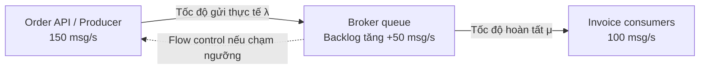
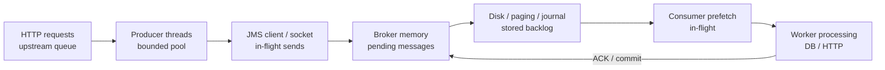

# Backpressure và quan hệ tốc độ gửi, tốc độ xử lý với backlog

> **Chương:** Điều tiết lưu lượng  
> **Phạm vi:** ActiveMQ Classic và ActiveMQ Artemis trong hệ thống Java/JMS. Trọng tâm là **tốc độ thực tế, lượng message tồn đọng, khả năng làm chậm producer và giới hạn tài nguyên broker**. Các cơ chế ACK, transaction và DLQ chỉ được nhắc ở mức cần thiết để giải thích dòng chảy.

## 1. Backpressure xuất hiện khi tốc độ vào vượt khả năng xử lý

Giả sử dịch vụ `order-api` gửi lệnh `GenerateInvoice` vào queue. Ban ngày producer gửi trung bình **150 message/giây**, nhưng nhóm invoice worker chỉ xử lý và xác nhận được **100 message/giây**. Broker vẫn có thể tiếp nhận trong một thời gian, nhưng **50 message/giây** bắt đầu tích lũy.



Đây là điểm xuất phát của **backpressure**: thay vì để backlog và mức tiêu thụ tài nguyên tăng không giới hạn, hệ thống **phản hồi sự quá tải về phía nguồn phát** bằng cách chờ, giảm credit, từ chối, giới hạn tốc độ hoặc áp dụng một chính sách có chủ đích.

**Không đồng nhất backpressure với mất message.** Một producer bị chặn vì broker đầy không có nghĩa message đã biến mất. Ngược lại, một broker vẫn nhận message vào đĩa chưa chắc hệ thống ổn định: backlog có thể tiếp tục tăng đến khi hết dung lượng.

### 1.1. Các biến phải đo đúng

| Ký hiệu | Ý nghĩa | Nguồn số liệu nên dùng |
|---|---|---|
| `λ_requested` | Tốc độ ứng dụng **muốn** gửi (message/s) | Request đến API, số lần producer cố gửi |
| `λ_admitted` | Tốc độ message **được broker chấp nhận/commit** (message/s) | Producer commit thành công và enqueue rate ở broker |
| `μ_completed` | Tốc độ message được consumer xử lý thành công và **ACK/commit** (message/s) | Dequeue/ACK rate và business success metric |
| `B` | Backlog/outstanding message của luồng công việc | Queue metrics, phân biệt ready với in-flight |
| `C` | Số worker hoặc mức xử lý song song thực tế | Consumer count, concurrency limit |
| `S` | Thời gian xử lý một message | Handler latency + DB/network dependencies |

Khi broker đang chịu backpressure, `λ_requested` có thể tiếp tục tăng, trong khi `λ_admitted` giảm xuống vì producer chờ. Nếu chỉ nhìn enqueue rate, bạn có thể tưởng tải đã giảm dù thực tế **caller đang xếp hàng hoặc timeout**.

## 2. Phương trình backlog: con số cần tính trước khi chỉnh cấu hình

Trong một khoảng đo đủ ngắn và cùng một queue, giả sử không có message hết hạn, bị loại hoặc được chuyển DLQ, ta có:

\[
\Delta B \approx (\lambda_{\mathrm{admitted}}-\mu_{\mathrm{completed}})\Delta t
\]

hoặc:

\[
\frac{dB}{dt}\approx \lambda_{\mathrm{admitted}}-\mu_{\mathrm{completed}}
\]

khi backlog dương; `B` không thể âm. Khi tính chính xác theo broker, cần hiệu chỉnh những luồng rời queue **không phải business ACK** (expiration, DLQ, quản trị viên xóa message), và không cộng trùng message đang dispatch nếu metric đã bao gồm chúng.

### 2.1. Bài toán quá tải 30 phút

Ví dụ producer được nhận ở **150 msg/s**, consumer xử lý thành công **100 msg/s** liên tục trong 30 phút.

\[
\Delta B=(150-100)\times30\times60=90\,000\ \text{messages}
\]

Nếu mỗi message có payload khoảng **2 KiB**, riêng dữ liệu payload đã xấp xỉ:

\[
90\,000\times2\,048\ \text{bytes}\approx175.8\ \text{MiB}
\]

Đó **chưa phải** số byte broker thực sự tiêu thụ: metadata, index, journal/WAL, page files, replication, transaction và queue/subscription references làm footprint khác đáng kể.

### 2.2. Khi lưu lượng giảm, mất bao lâu để xả backlog?

Sau đợt cao điểm, producer còn **60 msg/s**, consumer vẫn xử lý **100 msg/s**. Tốc độ giảm backlog lý tưởng là:

\[
100-60=40\ \text{messages/s}
\]

Với `B_0=90\,000`:

\[
T_{\mathrm{drain}}\approx \frac{90\,000}{100-60}=2\,250\ \text{s}=37.5\ \text{phút}
\]

Công thức **chỉ có ý nghĩa nếu `μ > λ_admitted`** trong giai đoạn xả, tốc độ tương đối ổn định và không có công việc đặc biệt như retry storm.

Nếu `μ \le \lambda`, backlog **không thể được xả hết bằng cách chờ**. Tăng dung lượng đĩa có thể kéo dài thời gian trước sự cố, nhưng không sửa được bất cân bằng tốc độ.

### 2.3. Tốc độ xử lý không chỉ bằng số worker

Một ước lượng thô cho workload đồng nhất:

\[
\mu_{\mathrm{ideal}}\approx \frac{C}{E[S]}
\]

với `E[S]` tính bằng giây/message. Ví dụ bốn worker, mỗi worker tốn trung bình 40 ms thì năng lực lý tưởng khoảng 100 msg/s. Tuy nhiên, nếu PostgreSQL downstream chỉ chịu được 70 cập nhật/giây, **năng lực thực tế không vượt qua nút thắt đó**.

```text
4 workers × (1 / 0.04 s) = 100 msg/s lý tưởng
Database giới hạn           =  70 commits/s
Throughput thực tế          ≤  70 msg/s
```

Tăng consumer count từ 4 lên 12 trong trường hợp này có thể khiến DB lock contention và retry tăng, làm throughput **tệ hơn**.

### 2.4. Little's Law không áp dụng bừa cho hệ đang tích lũy mãi

Khi hệ thống **ổn định** trong thời gian dài, có thể tham khảo:

\[
L=\lambda W
\]

trong đó `L` là số message trung bình trong phạm vi đo, `λ` là throughput trung bình và `W` là thời gian trung bình ở trong phạm vi đó. Muốn ước tính **thời gian chờ queue**, dùng số message **đang chờ**, không lấy tùy tiện cả in-flight/processing để ra latency queue.

Nếu `λ > μ` kéo dài, backlog đang tăng và hệ thống **không ở steady state**: không áp công thức này như thể đã có thời gian chờ trung bình cố định.

## 3. Backpressure đi qua những tầng nào?

Một hệ thống thường có nhiều “vùng đệm” nối tiếp. Nếu chỉ giới hạn một vùng, hàng đợi có thể chuyển sang vùng khác.



### 3.1. Backpressure phía producer

Khi broker chặn hoặc báo lỗi gửi vì chạm giới hạn, thời gian `send()` hoặc `Session.commit()` có thể tăng, hoặc call thất bại, tùy JMS client/transport và cấu hình.

**Không giả định mọi `send()` luôn block trực tiếp:** client có thể buffer/asynchronous send, còn thao tác đồng bộ hoặc transaction commit mới là nơi lộ ra giới hạn. Vì vậy cần đo **cả send latency và commit latency**.

### 3.2. Giới hạn bộ nhớ broker khác giới hạn đĩa

Broker có thể kiểm soát:

- Bộ nhớ giữ message đang chờ dispatch.
- Kho lưu trữ persistent hoặc journal.
- Khu vực temporary storage/paging.
- Số kết nối, session, producer/consumer và credit/window.

Cho phép spill-to-disk hoặc paging thường chỉ **dịch áp lực từ RAM sang disk**, không xóa chênh lệch `λ-μ`. Khi disk hoặc I/O cạn, thời gian gửi/ACK tăng mạnh và broker có nguy cơ không còn phục vụ bình thường.

### 3.3. Prefetch và consumer credit chưa phải kiểm soát tốc độ producer

ActiveMQ Classic có prefetch; Artemis có consumer window/credit theo client và protocol. Chúng giới hạn lượng message **đã giao cho consumer nhưng chưa hoàn tất**, hữu ích khi consumer chậm.

Giảm prefetch từ 1000 xuống 10 có thể giảm message giữ ở client và cải thiện chia tải, nhưng nếu producer vẫn gửi 150 msg/s còn consumer chỉ ACK 100 msg/s, backlog **vẫn tăng 50 msg/s** ở broker. Prefetch không tạo thêm năng lực xử lý.

### 3.4. Phải phản hồi tới upstream mới gọi là điều tiết đầu-cuối

Nếu thread HTTP giữ request trong lúc `JMS send` bị block, nhưng server cho phép tạo thêm vô hạn thread/requests, hàng đợi chỉ chuyển từ broker sang app server.

Thiết kế tốt hơn:

1. Giới hạn số request đang xử lý và số send đang in-flight.
2. Đặt timeout rõ ràng cho việc gửi/commit và cho HTTP caller.
3. Khi hết capacity, trả `429 Too Many Requests` hoặc `503 Service Unavailable` theo hợp đồng API (không tùy tiện retry vô hạn).
4. Nếu cần retry, dùng exponential backoff + jitter + giới hạn tổng số lần/độ tuổi.
5. Đo số request bị từ chối, độ trễ gửi và độ dài queue, không chỉ số message được broker nhận.

**Không ACK HTTP thành công “đã nhận đơn hàng” khi không chắc JMS message đã được broker chấp nhận**, trừ khi có durable outbox hoặc một cơ chế lưu chờ được thiết kế riêng.

## 4. ActiveMQ Classic: `producerFlowControl` và `systemUsage`

ActiveMQ Classic có cơ chế **producer flow control** để làm chậm hoặc chặn producer khi destination/store sử dụng đến ngưỡng tài nguyên. Ví dụ trong `activemq.xml`, đặt cấu hình ở **broker hiện có**, không tạo một broker thứ hai:

```xml
<destinationPolicy>
  <policyMap>
    <policyEntries>
      <policyEntry
          queue="flow.test"
          producerFlowControl="true"
          memoryLimit="1mb"/>
    </policyEntries>
  </policyMap>
</destinationPolicy>

<systemUsage>
  <systemUsage>
    <memoryUsage>
      <memoryUsage limit="32 mb"/>
    </memoryUsage>
    <storeUsage>
      <storeUsage limit="16 gb"/>
    </storeUsage>
    <tempUsage>
      <tempUsage limit="1 gb"/>
    </tempUsage>
  </systemUsage>
</systemUsage>
```

Đây là **mảnh cấu hình minh họa**, phải gộp vào đúng phần `destinationPolicy`/`systemUsage` sẵn có. Đặc biệt, giới hạn `storeUsage` phải phù hợp dung lượng store **đang sử dụng**, và tuyệt đối không copy các giá trị nhỏ này nguyên xi vào broker production.

### 4.1. Các giới hạn tác động khác nhau

| Thành phần Classic | Chức năng chính | Sai lầm thường gặp |
|---|---|---|
| `producerFlowControl=true` | Cho phép broker điều tiết producer khi destination chạm giới hạn phù hợp | Nghĩ rằng bật lên thì producer luôn bị chặn ở một tốc độ cố định |
| `policyEntry memoryLimit` | Ngưỡng usage bộ nhớ cho destination | Nghĩa là “queue chỉ chứa tối đa 1 MiB message vật lý” |
| `systemUsage.memoryUsage` | Ngân sách sử dụng bộ nhớ broker | Không đồng nghĩa heap JVM tối đa |
| `systemUsage.storeUsage` | Giới hạn phần persistence store được hạch toán theo broker | Không đồng nhất với kích thước payload hoặc free disk thật |
| `systemUsage.tempUsage` | Giới hạn vùng lưu tạm khi broker cần | Không phải giới hạn kích thước một message |

Với queue persistent, broker có thể sử dụng **persistent store** thay vì giữ toàn bộ backlog trong RAM; cách các giới hạn kích hoạt flow control phụ thuộc memory cursor, store usage và version. Do đó, muốn thử tình trạng producer bị chặn, cần **quan sát ngưỡng usage thực sự được chạm**, không chỉ đặt `memoryLimit` rồi mặc định chắc chắn `send()` block.

### 4.2. Nếu producer bị chặn thì điều gì xảy ra?

Một luồng khả dĩ:

```text
Producer gửi nhanh -> Destination/store usage tăng
                    -> Chạm resource limit
                    -> Broker ngừng cấp capacity hoặc điều tiết send
                    -> send()/commit() chậm, có thể timeout/fail
                    -> Consumer ACK làm tài nguyên được giải phóng
                    -> Producer tiếp tục
```

Thời điểm gửi được unblock có thể phụ thuộc store cleanup, cursor, transaction và tình trạng các queue khác. **Không nên** sử dụng call `send()` bị block như semaphore đáng tin cậy giữa các thread ứng dụng. Ứng dụng vẫn cần giới hạn concurrency/timeout của chính nó.

### 4.3. Tùy chọn chặn, trả lỗi và timeout

Classic có các tùy chọn về xử lý khi hết tài nguyên và producer flow control, ví dụ cấu hình `sendFailIfNoSpace` hoặc các chính sách timeout thích hợp theo phiên bản. Hành vi **chờ** và **trả lỗi** khác nhau về mặt hợp đồng ứng dụng:

- **Chờ:** giữ producer/thread và kéo dài latency; cần deadline upstream rõ ràng.
- **Trả lỗi:** producer biết request chưa được chấp nhận bình thường; cần có chiến lược retry an toàn.
- **Không có kết quả rõ ràng do mất kết nối:** producer có thể không biết message đã được broker nhận chưa; cần `eventId` ổn định/idempotency.

Trước khi đổi các thuộc tính nâng cao, kiểm tra tài liệu schema/config của **phiên bản Classic đang vận hành**. Đừng áp tên field hay mặc định của Artemis vào Classic.

## 5. ActiveMQ Artemis: `address-full-policy` quyết định điều gì?

Artemis kiểm soát bộ nhớ address và xử lý khi address đạt ngưỡng `max-size-bytes`. Trong `etc/broker.xml`, ví dụ address `flow.test`:

```xml
<address-settings>
  <address-setting match="flow.test">
    <max-size-bytes>8388608</max-size-bytes>
    <address-full-policy>BLOCK</address-full-policy>
  </address-setting>
</address-settings>
```

Đặt vào phần `<address-settings>` hiện có, không tạo mục trùng không chủ đích. Với ví dụ này, threshold là **8 MiB bộ nhớ address được hạch toán theo cơ chế Artemis**, **không phải** cam kết kích thước tối đa của journal trên đĩa.

### 5.1. Bốn hướng xử lý khi address full

| Chính sách | Hành vi chính | Hệ quả vận hành |
|---|---|---|
| `BLOCK` | Điều tiết/chặn producer khi address vượt ngưỡng | **Backpressure thực sự** hướng về nguồn, nhưng có thể làm sender chậm hoặc timeout |
| `PAGE` | Chuyển message sang page files trên disk | Hấp thụ burst và mở rộng backlog trên disk; **không** tự giới hạn `λ_requested` |
| `FAIL` | Từ chối message mới khi address full | Ứng dụng phải xử lý lỗi và chính sách retry |
| `DROP` | Bỏ message mới theo policy | **Không phù hợp** khi nghiệp vụ không chấp nhận mất message |

Artemis thường được triển khai với **paging** cho nhiều workload. `PAGE` không phải vô hạn: disk usage, page limits (nếu được cấu hình), I/O và các cơ chế bảo vệ khác vẫn có giới hạn.

**Cần kiểm tra protocol:** cách chặn/đẩy kết quả về `JMS send` hoặc AMQP producer có thể khác giữa Artemis Core, OpenWire và AMQP 1.0; buffer/credit ở client có thể làm việc “block” hiển lộ muộn. Không khẳng định chỉ cần `BLOCK` là mọi phương thức `send()` đều block đồng bộ ngay.

### 5.2. Khi dùng multicast

Một address MULTICAST có thể có nhiều queue/subscription. Mỗi subscription có backlog riêng nhưng tài nguyên address và disk vẫn có thể được chia sẻ. Một durable subscription offline nhiều giờ có thể giữ nhiều message, làm address memory/paging/store chịu áp lực dù những consumer khác ACK nhanh.

Với fan-out, đừng chỉ theo dõi tổng số producer message: phải nhìn từng subscription queue, số message đang chờ, số đang giao, tuổi backlog và các giới hạn tài nguyên liên quan.

### 5.3. Phân biệt cấu hình address và consumer window

- `max-size-bytes` cùng `address-full-policy`: điều khiển **khi nào broker bắt đầu phản ứng với memory usage của address**.
- Consumer window/credit: điều khiển **broker cấp bao nhiêu delivery cho consumer**.
- Application worker limit: điều khiển **bao nhiêu nghiệp vụ được xử lý đồng thời**.

Điều chỉnh một thông số không tự động thay thế hai thông số còn lại.

## 6. Ví dụ Java JMS: đo tốc độ gửi, thời gian commit và tốc độ xử lý

Mục đích bài thực hành là đo **đường đi của áp lực** khi producer nhanh hơn consumer, sau đó điều chỉnh giới hạn broker để quan sát throttling.

Ví dụ dùng **ActiveMQ Classic OpenWire JMS client** và `javax.jms`, chạy trên Classic hoặc Artemis có **OpenWire acceptor**. Cấu hình `flow.test` ở hai broker ở mục trước là **hai phương án riêng**, không phải cấu hình cùng một broker.

### 6.1. Maven dependency

```xml
<dependency>
  <groupId>org.apache.activemq</groupId>
  <artifactId>activemq-client</artifactId>
  <version>5.18.5</version>
</dependency>
```

Phiên bản chỉ để minh họa. Client/broker, JDK và policy thực tế cần được kiểm thử tương thích.

### 6.2. Chương trình đo: `FlowControlProbe.java`

Chạy **hai tiến trình** trên cùng queue `flow.test`:

- Producer `produce 150 120`: cố gắng gửi khoảng 150 msg/s trong 120 giây; mỗi message khoảng 2 KiB, commit mỗi 20 message.
- Consumer `consume 20 120`: giả lập thời gian xử lý tối thiểu 20 ms/message, commit từng message; năng lực lý tưởng dưới 50 msg/s vì còn chi phí JMS/broker.

```java
import java.util.concurrent.locks.LockSupport;
import javax.jms.Connection;
import javax.jms.DeliveryMode;
import javax.jms.Message;
import javax.jms.MessageConsumer;
import javax.jms.MessageProducer;
import javax.jms.Queue;
import javax.jms.Session;
import javax.jms.TextMessage;

import org.apache.activemq.ActiveMQConnectionFactory;

public final class FlowControlProbe {
    private static final String QUEUE = "flow.test";
    private static final int BATCH = 20;

    public static void main(String[] args) throws Exception {
        if (args.length != 3
                || (!"produce".equals(args[0])
                    && !"consume".equals(args[0]))) {
            System.err.println(
                "Usage: FlowControlProbe produce <ratePerSec> <seconds>");
            System.err.println(
                "   or: FlowControlProbe consume <workMs> <seconds>");
            return;
        }
        int parameter = Integer.parseInt(args[1]);
        int seconds = Integer.parseInt(args[2]);
        if (parameter <= 0 || seconds <= 0) {
            throw new IllegalArgumentException(
                    "Rate/workMs and seconds must be positive");
        }

        String url = System.getenv().getOrDefault(
                "BROKER_URL", "tcp://localhost:61616");
        ActiveMQConnectionFactory factory =
                new ActiveMQConnectionFactory(url);
        String user = System.getenv("BROKER_USER");
        String password = System.getenv("BROKER_PASSWORD");

        Connection connection =
                (user == null || user.isEmpty())
                ? factory.createConnection()
                : factory.createConnection(user, password);

        try {
            // Mỗi process có Session riêng, không chia sẻ giữa thread.
            Session session = connection.createSession(
                    true, Session.SESSION_TRANSACTED);
            try {
                Queue queue = session.createQueue(QUEUE);
                if ("produce".equals(args[0])) {
                    produce(session, queue, parameter, seconds);
                } else {
                    connection.start();
                    consume(session, queue, parameter, seconds);
                }
            } finally {
                session.close();
            }
        } finally {
            connection.close();
        }
    }

    private static void produce(
            Session session, Queue queue, int ratePerSecond, int seconds)
            throws Exception {
        MessageProducer producer = session.createProducer(queue);
        producer.setDeliveryMode(DeliveryMode.PERSISTENT);

        String payload = "x".repeat(2048); // Java 11+
        long begin = System.nanoTime();
        long deadline = begin + seconds * 1_000_000_000L;
        long interval = Math.max(
                1L, 1_000_000_000L / ratePerSecond);
        long next = begin;
        long sent = 0L;
        long sendNanos = 0L;
        long commitNanos = 0L;
        long maxSendNanos = 0L;
        long maxCommitNanos = 0L;

        try {
            while (System.nanoTime() < deadline) {
                long wait = next - System.nanoTime();
                if (wait > 0) {
                    LockSupport.parkNanos(wait);
                }

                TextMessage m = session.createTextMessage(payload);
                m.setLongProperty("sequence", sent + 1);

                long beforeSend = System.nanoTime();
                producer.send(m);
                long sendCost = System.nanoTime() - beforeSend;
                sendNanos += sendCost;
                maxSendNanos = Math.max(maxSendNanos, sendCost);
                sent++;

                if (sent % BATCH == 0) {
                    long beforeCommit = System.nanoTime();
                    session.commit();
                    long commitCost = System.nanoTime() - beforeCommit;
                    commitNanos += commitCost;
                    maxCommitNanos =
                            Math.max(maxCommitNanos, commitCost);
                }

                // Không cố "bù" backlog send bằng burst khi vừa bị block.
                next = Math.max(next + interval, System.nanoTime());
            }

            if (sent % BATCH != 0) {
                long beforeCommit = System.nanoTime();
                session.commit();
                long commitCost = System.nanoTime() - beforeCommit;
                commitNanos += commitCost;
                maxCommitNanos = Math.max(maxCommitNanos, commitCost);
            }
        } catch (Exception e) {
            try {
                session.rollback(); // Chỉ rollback batch chưa commit.
            } catch (Exception rollback) {
                e.addSuppressed(rollback);
            }
            throw e;
        } finally {
            producer.close();
        }

        double actualSeconds =
                (System.nanoTime() - begin) / 1_000_000_000.0;
        System.out.printf(
                "sent=%d, admittedRateApprox=%.1f msg/s%n",
                sent, sent / actualSeconds);
        System.out.printf(
                "sendTotalMs=%.1f, maxSendMs=%.1f%n",
                sendNanos / 1_000_000.0,
                maxSendNanos / 1_000_000.0);
        System.out.printf(
                "commitTotalMs=%.1f, maxCommitMs=%.1f%n",
                commitNanos / 1_000_000.0,
                maxCommitNanos / 1_000_000.0);
    }

    private static void consume(
            Session session, Queue queue, int workMs, int seconds)
            throws Exception {
        MessageConsumer consumer = session.createConsumer(queue);
        long begin = System.nanoTime();
        long deadline = begin + seconds * 1_000_000_000L;
        long processed = 0L;

        try {
            while (System.nanoTime() < deadline) {
                Message m = consumer.receive(500L);
                if (m == null) {
                    continue;
                }

                try {
                    // Giả lập thời gian nghiệp vụ; production không sleep.
                    Thread.sleep(workMs);
                    session.commit(); // ACK sau xử lý thành công.
                    processed++;
                } catch (Exception e) {
                    try {
                        session.rollback();
                    } catch (Exception rollback) {
                        e.addSuppressed(rollback);
                    }
                    throw e;
                }
            }
        } finally {
            consumer.close();
        }

        double actualSeconds =
                (System.nanoTime() - begin) / 1_000_000_000.0;
        System.out.printf(
                "processed=%d, ackRateApprox=%.1f msg/s%n",
                processed, processed / actualSeconds);
    }
}
```

**Giới hạn đo lường phải hiểu:**

- `sent` tăng sau `send()`, nhưng **chưa chắc tất cả batch đã commit** nếu chương trình lỗi giữa chừng. Con số `admittedRateApprox` chỉ là tốc độ gửi thành công **trong lần chạy kết thúc bình thường**, sau khi commit phần còn lại; **broker enqueue rate** vẫn là nguồn đối chiếu.
- Đo cả `sendTotalMs` lẫn `commitTotalMs` vì flow control/DB journal có thể thể hiện chủ yếu ở bước commit.
- `workMs=20` đưa trần lý thuyết dưới 50 message/giây với một consumer; thời gian commit JMS khiến tốc độ thực tế thấp hơn.
- `Thread.sleep` mô phỏng service time, **không** dùng làm cách điều tiết consumer production.
- Khi quá tải, call `send` hoặc `commit` có thể chờ lâu hơn thời gian `seconds`. Đây là điều quan sát cần ghi nhận, không phải lỗi bộ đo.
- Bài test chỉ chạy trên queue thử nghiệm. Không bắn hàng chục nghìn message vào broker đang phục vụ khách hàng.

### 6.3. Cách chạy và đối chiếu

Chạy hai process đã build classpath theo cấu hình của dự án:

```bash
# Terminal 1: một consumer xử lý chậm
java -cp "target/classes:target/dependency/*" \
  FlowControlProbe consume 20 180

# Terminal 2: producer cố gửi 150 msg/s
java -cp "target/classes:target/dependency/*" \
  FlowControlProbe produce 150 120
```

Trên Unix classpath tách phần tử bằng `:`, trên Windows dùng `;`. Ví dụ giả định dependency JAR đã nằm trong `target/dependency`; bài này không chạy build/test thật.

**Lượt A:** Broker có giới hạn tài nguyên đủ lớn để chưa block. So sánh tốc độ producer và consumer; queue backlog tăng.

**Lượt B:** Trên **broker thử nghiệm**, hạ ngưỡng tài nguyên phù hợp và áp policy `BLOCK` (Artemis) hoặc bật flow control/giới hạn usage phù hợp (Classic). Quan sát send/commit latency tăng, tốc độ admitted giảm hoặc producer báo lỗi/timeout theo chính sách.

**Lượt C:** Thêm một consumer process nữa; đo xem `μ_completed` có tăng tương ứng không. Nếu downstream DB là bottleneck, việc thêm consumer không nhất thiết tăng hiệu suất.

Mỗi lượt phải dùng queue sạch hoặc ghi nhận **backlog ban đầu**, tránh kết luận sai vì còn message từ lượt trước.

## 7. Dùng metric nào để biết hệ thống đang được điều tiết?

Nên xem ba nhóm thông số trong cùng một time window, ví dụ 10 giây/60 giây:

### 7.1. Broker rate: enqueue, dequeue/ACK, backlog

| Metric | ActiveMQ Classic | ActiveMQ Artemis | Cách diễn giải |
|---|---|---|---|
| Message được broker nhận | `EnqueueCount/Enqueue rate` của destination | `MessagesAdded` hoặc rate suy ra | `λ_admitted`, không phải toàn bộ request cố gửi |
| Message được hoàn tất/ACK | `DequeueCount`/rate; chú ý metric loại destination | `MessagesAcknowledged` hoặc rate suy ra | Proxy của `μ_completed`, cần so với business success |
| Message tồn đọng | `QueueSize` và số liệu pending theo MBean | `MessageCount` và queue statistics | Phải hiểu metric có bao gồm delivering không |
| Đang giao chưa ACK | `InFlightCount` | `DeliveringCount` | Công việc ở consumer/client buffer |
| Áp lực bộ nhớ/store | `MemoryPercentUsage`, `StorePercentUsage`, `TempPercentUsage` | Address size, paging, journal/disk usage | Biết ngưỡng tài nguyên nào đang chạm |
| Producer bị nghẽn | Send/commit latency, timeout/error ở client | Send/commit latency, blocked/rate/timeout | Broker nhận chậm có thể là flow control chủ đích |

**Chú ý về tên metric:** API/JMX version có thể khác nhau. `QueueSize`/`MessageCount` không nhất thiết cùng nghĩa chính xác với “ready”; một số bộ đếm có thể đã bao gồm in-flight, scheduled hoặc paged message. **Không cộng QueueSize + InFlightCount máy móc** khi chưa biết định nghĩa metric.

### 7.2. Bộ chỉ báo cảnh báo sớm

- `λ_admitted > μ_completed` liên tục trong nhiều cửa sổ: backlog sẽ tăng.
- Backlog tăng cùng **tuổi message cũ nhất** tăng: ứng dụng đang chậm dần so với nhu cầu.
- `λ_admitted` giảm nhưng `λ_requested` không giảm, send latency/timeout tăng: flow control đã lan đến producer.
- Paging/storage tăng liên tục: broker đang “mượn đĩa” để đệm burst, không phải workload đã ổn định.
- Consumer count tăng nhưng ACK rate đứng yên: downstream bottleneck hoặc contention.
- Ready queue thấp nhưng delivering/unsettled cao: prefetch/credit hoặc handler đã giữ quá nhiều message ở client.

Chỉ có queue depth không đủ để đánh giá SLO. Một queue có 50.000 message có thể bình thường khi có capacity và thời gian xử lý rõ ràng; ngược lại, queue 500 message với một consumer chậm và deadline ngắn có thể đã quá hạn.

### 7.3. Phân biệt queue delay với end-to-end latency

Ghi ba timestamp nghiệp vụ khi có thể:

```text
createdAt (producer tạo event)
brokerAcceptedAt (quan sát ở broker nếu có nguồn đáng tin)
businessCommittedAt (consumer hoàn tất side effect)
```

Không dựa mù vào đồng hồ của hai máy để tính microsecond latency nếu chưa đồng bộ thời gian. Kết hợp histogram `send/commit latency`, `queue waiting age` và `handler latency`. Message TTL, scheduled delivery hoặc redelivery khiến một con số `JMSTimestamp` không đủ giải thích toàn bộ.

## 8. Thiết kế điều tiết theo mục tiêu SLO, không theo cảm tính

Giả sử dịch vụ cam kết 95% hóa đơn hoàn thành trong **2 phút**. Không nên chỉ đặt `max-size-bytes` thật lớn để tránh block; backlog dài có thể khiến message vẫn an toàn trên đĩa nhưng **trễ SLO**.

### 8.1. Tính budget backlog

Nếu năng lực xử lý ổn định là **100 msg/s**, với tối đa **120 giây** chờ ở queue, một ước lượng sơ bộ về backlog chấp nhận được là:

\[
B_{\mathrm{budget}}\approx100\times120=12\,000\ \text{messages}
\]

Đây là budget cho **thời gian chờ ở queue trong điều kiện năng lực xử lý duy trì**, không phải bảo đảm 95th percentile delay; cần trừ thêm thời gian xử lý, retry, downstream jitter và safety margin. Với `λ_requested` có burst, dùng phân phối độ trễ chứ không chỉ trung bình.

### 8.2. Hai chiến lược khác nhau

**Chiến lược A — ưu tiên giữ message, chấp nhận tăng latency tạm thời:**

- Dùng persistent delivery và lưu trữ/paging có giám sát.
- Có giới hạn backlog/tuổi tồn và alert trước khi cạn disk.
- Có khả năng tăng throughput consumer hoặc hạ tốc độ upstream.
- Rõ ràng với caller rằng request có thể đang ở trạng thái `ACCEPTED` chứ chưa `COMPLETED`.

**Chiến lược B — ưu tiên deadline/capacity:**

- Đặt ngưỡng in-flight và backlog phù hợp với SLO.
- Khi hết capacity, trả lỗi có thể retry (`429/503`) hoặc circuit-break sớm.
- Không dùng `DROP` cho message tài chính/đơn hàng trừ khi hợp đồng nghiệp vụ cho phép.
- Có timeout và idempotency key, tránh retry storm khi service hồi phục.

### 8.3. Không dùng DLQ hoặc retry như bộ điều tiết tốc độ

DLQ dành cho trường hợp không xử lý được message theo policy, không phải cách “xả bớt” workload hợp lệ khi consumer chậm. Retry không có backoff có thể **tăng tải xử lý** đúng lúc hệ thống đang yếu nhất. Nếu nguồn xử lý được 100/s mà gửi 150/s, chuyển 50/s vào retry queue không làm workload biến mất — chỉ thay thời điểm và vị trí backlog.

## 9. Ma trận thử nghiệm backpressure

| Ca thử | Thiết lập | Kỳ vọng cần kiểm chứng |
|---|---|---|
| **λ dưới μ** | Producer 50/s, consumer 100/s | Backlog không tăng kéo dài |
| **λ trên μ** | Producer 150/s, consumer 100/s | Backlog tăng xấp xỉ 50/s trước khi có flow control |
| **Thay đổi λ** | Sau 30 phút đổi 150/s → 60/s | Backlog giảm nếu consumer duy trì 100/s |
| **Classic flow control** | Usage chạm ngưỡng với `producerFlowControl=true` | Producer latency/timeout thay đổi; xác minh usage thực sự chạm |
| **Artemis BLOCK** | `address-full-policy=BLOCK`, áp lực address tăng | Tốc độ accepted bị điều tiết, kiểm tra sender/commit behavior |
| **Artemis PAGE** | `address-full-policy=PAGE` | Backlog dịch sang disk, đo page count/disk và send latency |
| **Artemis FAIL** | Address full với FAIL | Ứng dụng nhận lỗi, không retry nóng |
| **Artemis DROP** | Chỉ trong môi trường test không chứa dữ liệu thật | Thấy rủi ro mất message và dấu hiệu giám sát |
| **Thêm consumer** | 1 → 2 → 4 consumer | ACK rate tăng tới điểm bottleneck; không mặc định tuyến tính |
| **DB slowdown** | Tăng handler latency gấp đôi | `μ` giảm, backlog tăng; circuit breaker/alert hoạt động |
| **Prefetch thấp/cao** | Thay giới hạn dispatch | Khác in-flight và fairness; không thay quy luật λ−μ |
| **Producer timeout** | Broker chậm/block vượt deadline | Upstream fail fast, không tạo thread/requests vô hạn |
| **Khôi phục sau overload** | Hạ λ hoặc nâng μ | Đo thời gian drain và độ tuổi message đến khi hết lag |

## 10. Những nhầm lẫn thường gặp

**“Queue vẫn nhận được message nên hệ thống khỏe.”** Chưa chắc. Nếu `λ > μ`, backlog đang tiêu thụ bộ nhớ/đĩa và message mới ngày càng chờ lâu.

**“Tăng prefetch sẽ xử lý được nhiều message hơn.”** Chưa chắc. Nó có thể tăng số delivery in-flight nhưng không tăng sức mạnh database hoặc CPU xử lý.

**“PAGE là backpressure.”** PAGE chủ yếu lưu trữ backlog ra disk. Cần cơ chế điều tiết/từ chối rõ ràng nếu muốn nguồn phát biết hệ thống đã quá khả năng.

**“BLOCK bảo đảm không mất message trong mọi lỗi.”** Không. Broker có thể hỏng disk, producer mất connection khi commit không rõ trạng thái, hoặc client retry gây duplicate. Cần delivery mode, HA và idempotency đúng.

**“Thêm 10 consumer thì throughput tăng 10 lần.”** Chỉ khi bottleneck ở worker và downstream đủ năng lực. Nếu database/API là nút thắt, nhiều consumer có thể tăng lock contention và timeout.

**“Backlog = queue size + in-flight.”** Chỉ đúng khi định nghĩa metric của broker bảo đảm hai số không giao nhau. Xác minh API/JMX trước khi cộng.

**“DLQ giải quyết quá tải.”** DLQ là cơ chế cô lập thất bại, không giảm số sự kiện nghiệp vụ hợp lệ phải xử lý.

## 11. Câu hỏi vận dụng

1. Producer được broker nhận 240 message/s, consumer ACK 180 message/s liên tục 15 phút. Backlog tăng bao nhiêu? Nếu message trung bình 4 KiB, payload thô là bao nhiêu MiB?
2. Backlog ban đầu 60.000 message; producer giảm xuống 80/s, consumer xử lý 200/s. Ước lượng thời gian xả hết nếu tốc độ ổn định.
3. Vì sao phải đo **λ_requested** và **λ_admitted** riêng, nhất là khi Classic đang bật `producerFlowControl`?
4. Artemis dùng `PAGE` và disk còn trống. Có thể kết luận hệ thống không cần backpressure ở upstream không? Vì sao?
5. Classic có prefetch=1000 và consumer chỉ ACK 10/s. Hãy giải thích vì sao queue ready có thể giảm mà business completion vẫn chậm.
6. API dùng thread-per-request, khi `send()` block thì số thread tăng không giới hạn. Thiết kế lại giới hạn concurrency, timeout, trả `429/503` và idempotency như thế nào?
7. Có 8 consumer, mỗi consumer lý tưởng 25/s, nhưng database chỉ chịu 120 commits/s. Nếu producer gửi 170/s thì backlog tăng tối thiểu theo xấp xỉ bao nhiêu message/s?
8. Một queue đang backlog 8.000 message, worker ACK 100/s, SLO queue waiting 90 giây. Bạn sẽ xem những metric nào để quyết định có phải giảm tốc nguồn phát ngay?

## 12. Tài liệu tham khảo

- [ActiveMQ Classic — Producer Flow Control](https://activemq.apache.org/components/classic/documentation/producer-flow-control): giới hạn tài nguyên và điều tiết producer của Classic.
- [ActiveMQ Classic — Prefetch Policy](https://activemq.apache.org/components/classic/documentation/what-is-the-prefetch-limit-for): phân phối trước và giới hạn in-flight ở client.
- [ActiveMQ Classic — Performance Tuning](https://activemq.apache.org/components/classic/documentation/performance-tuning): các lựa chọn cấu hình có ảnh hưởng throughput/latency.
- [ActiveMQ Artemis — Flow Control](https://artemis.apache.org/components/artemis/documentation/latest/flow-control.html): address-full-policy, producer và consumer flow control.
- [ActiveMQ Artemis — Paging](https://artemis.apache.org/components/artemis/documentation/latest/paging.html): hành vi PAGE và giới hạn lưu trữ.
- [ActiveMQ Artemis — Management](https://artemis.apache.org/components/artemis/documentation/latest/management.html): queue/address metrics và vận hành.
- [Jakarta Messaging Specification](https://jakarta.ee/specifications/messaging/): định nghĩa `Session`, `MessageProducer`, `commit` và ACK semantics.

**Kết luận:** Backpressure không làm message tự biến mất; nó **chuyển tín hiệu thiếu năng lực xử lý trở lại phía producer/upstream** thay vì cho backlog tăng không giới hạn. Hãy đo riêng `λ_requested`, `λ_admitted` và `μ_completed`; dùng chênh lệch tốc độ để dự đoán backlog và thời gian xả; sau đó chọn chính sách Classic/Artemis dựa trên **SLO, dung lượng thực và hành vi thất bại của client**, chứ không chỉ tăng bộ nhớ hoặc số consumer.
