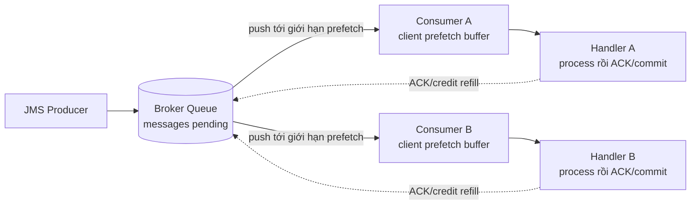

# Prefetch của ActiveMQ Classic và ảnh hưởng đến phân phối tải

> **Chương:** Điều tiết lưu lượng  
> **Module:** `INTEGRATION_MESSAGING_MESSAGE_BROKER_ACTIVEMQ` — tìm hiểu ActiveMQ Classic và Artemis trong giao tiếp bất đồng bộ bằng queue, topic, routing và JMS; thực hành producer/consumer Java, acknowledgment, transaction, redelivery, DLQ, bảo mật và vận hành broker đáng tin cậy.  
> **Trọng tâm:** Cơ chế **consumer prefetch của ActiveMQ Classic**, cách broker **push trước** message tới bộ đệm của từng consumer, sự đánh đổi giữa **throughput** và **công bằng phân phối tải**, ảnh hưởng của acknowledgment/transaction, và cách cấu hình/đo bằng Java JMS. Các đoạn Artemis chỉ dùng để xác định **ranh giới tương thích**, không đánh đồng hai broker.

## 1. Hiện tượng: có hai worker nhưng chỉ một worker bận

Một queue `payments.jobs` có 40 message; mỗi message cần khoảng 2 giây gọi dịch vụ bên ngoài. Ứng dụng chạy hai instance consumer:

- **Worker A** kết nối trước, nhận message đầu tiên và xử lý chậm.
- **Worker B** kết nối sau, khỏe và sẵn sàng nhận việc nhưng gần như không có message nào.
- Dashboard vẫn có thể cho thấy nhiều message chưa được ack hoặc số lượng *in-flight* lớn.

Người vận hành dễ hỏi: “Đã có **hai competing consumers**, sao broker không chia 20/20?”

Trong ActiveMQ Classic, nguyên nhân thường là **prefetch**. Một consumer không nhất thiết chỉ được broker cấp message ngay khi mã Java gọi `receive()`. Broker có thể **đẩy trước một lô** message tới client, lô đó đã được **gán cho consumer A** để nằm trong bộ đệm, dù handler A chưa xử lý. Consumer B đến sau không thể tự ý lấy message đang nằm trong bộ đệm của A.

Ví dụ minh họa, giả định A khởi động trước khi B và chưa có consumer khác:

```text
Queue: [M01, M02, M03, ... M40]

t0: A kết nối, prefetch=100
    Broker ──── dispatch trước nhiều message ────► A
    A đã nhận quyền xử lý M01..M40 (một số có thể chỉ nằm trong buffer)
    B chưa kết nối

t1: B kết nối, prefetch=100
    Broker không còn message khả dụng để dispatch sang B
    A đang xử lý M01, B rảnh

t2: A vẫn chậm
    A local buffer [M02..M40] còn lớn
    B vẫn có thể rảnh

t3: A đóng kết nối / process chết
    Broker thu hồi những delivery chưa ack theo chính sách
    Sau recovery/redelivery, B mới có cơ hội nhận
```

**Không được suy ra thứ tự/khối lượng chính xác trong mọi lượt chạy.** Classic có policy dispatch, consumer priority, prefetch extension, prefetch refill và các trạng thái broker/client khác. Tuy nhiên, nguyên lý gây mất cân bằng là đúng: **dispatch trước khác xử lý xong**, và consumer đến sau không có quyền cướp ngay các message đã dispatch cho consumer khác.

### 1.1. Mục tiêu của bài

Sau khi học, bạn cần:

1. Giải thích **prefetch là giới hạn message broker có thể push tới từng consumer mà chưa được ack**, không phải số thread, số batch DB hoặc cấu hình producer.
2. Biết vì sao mặc định queue prefetch lớn mang lại throughput nhưng dễ gây **worker starvation/imbalance** khi công việc ít và xử lý lâu.
3. Phân biệt message `pending` trên broker, `dispatched/in-flight`, `prefetched` ở client, `processing` và `acknowledged`.
4. Cấu hình `queuePrefetch` ở Classic ConnectionFactory, URI, từng consumer và broker queue policy.
5. Đo được phân phối cho hai worker nhanh/chậm ở `prefetch=100` so với `prefetch=1`; hiểu vì sao kết quả không buộc 50/50.
6. Nhìn đúng tác động của `CLIENT_ACKNOWLEDGE`, `SESSION_TRANSACTED`, prefetch/transaction batching, redelivery và pool consumer.
7. Chọn giá trị dựa trên **SLO, tốc độ xử lý, message size, memory, fairness và throughput**, thay vì áp một ngưỡng cho mọi queue.

## 2. Prefetch là cơ chế credit trên đường dispatch

### 2.1. Push trước để giảm độ trễ mạng

ActiveMQ Classic ưu tiên mô hình **push**: khi một consumer đăng ký nhận, broker có thể chuyển trước nhiều message qua OpenWire để consumer có sẵn trong RAM. Khi handler hoàn thành một message, nó thường có thể lấy ngay message tiếp theo trong local buffer mà không phải đợi một chuyến request–response tới broker.



| Thuật ngữ | Nằm ở đâu? | Đã xử lý nghiệp vụ chưa? |
|---|---|---|
| `Pending/available` | Message còn chờ broker chọn consumer | **Chưa** |
| `Dispatched/in-flight` | Broker đã cấp message cho consumer, vẫn chờ ack | **Chưa chắc** |
| `Prefetched buffer` | Message có thể đang trong bộ đệm client/JMS dispatch pipeline | **Chưa chắc**, có thể handler chưa nhìn thấy |
| `Processing` | Handler đang thực thi logic nghiệp vụ | **Chưa chắc đã hoàn tất** |
| `Acked/committed` | Broker đã nhận xác nhận theo session mode | JMS đã hoàn tất delivery đó; **không tự chứng minh DB/API đúng** |

Một message có thể **đang in-flight** nhưng chưa được `MessageConsumer.receive()` trong code trả ra. Vì vậy, tổng message “đang thuộc về consumer A” không thể suy ra từ `count of handlerStarted` của worker A.

### 2.2. Giới hạn prefetch và cơ chế refill 50%

Tài liệu Classic mô tả cơ chế cơ bản: khi đã đẩy đến giới hạn `prefetch=P` của consumer, broker chờ nhận acknowledgment của **ít nhất khoảng một nửa** lô trước khi bổ sung tiếp, rồi *top-up* thêm một lượng tương ứng.

Ví dụ mô hình với `P=10`:

```text
                       Client A           Broker credit/dispatch
Kết nối                buffer nhận tới 10  ── push 10 ──────►
Xử lý và ACK 1..4      còn 6 chưa ack      chưa top-up đủ ngưỡng
ACK message thứ 5      còn khoảng 5       có thể đẩy thêm ~5
Lặp lại                buffer được nạp    bớt round trip mạng
```

**Đây là mô hình giải thích, không phải công thức tính số in-flight chính xác cho mọi cấu hình.** Các tùy chọn như optimized acknowledgment, transacted batch, `usePrefetchExtension`, network reconnect và thiết lập dispatch khác có thể làm số đo thực tế khác với cách cộng đơn giản này.

Giới hạn prefetch **áp dụng trên từng consumer subscription**, không phải “mỗi queue chỉ cho tối đa P message chờ”. Nếu có 10 consumers, mỗi consumer `P=100`, tổng message đã dispatch chưa ack trong hệ thống **có thể** rất lớn so với một consumer; không được diễn giải thành queue có “prefetch tổng cộng 100”.

### 2.3. Giá trị mặc định phải xác định theo loại consumer

Theo trang tham chiếu **What is the Prefetch Limit For?** của ActiveMQ Classic, default tiêu biểu:

| Kiểu consumer | Default được tài liệu này nêu | Cách liên hệ với bài |
|---|---:|---|
| Queue, cả persistent và non-persistent | **1000** | **Trọng tâm:** nhiều message có thể được cấp trước cho một queue consumer |
| Topic persistent / durable subscription | **100** | Cùng cơ chế buffer, nhưng nghĩa vụ nhận theo subscription khác queue competing consumers |
| Topic non-persistent | **`Short.MAX_VALUE - 1`** | Có thể prefetch lớn trong mô hình pub/sub |

Một số tài liệu performance cũ hoặc phiên bản cụ thể ghi con số topic/durable topic khác. **Không đóng đinh toàn bộ giá trị mặc định cho mọi phiên bản hoặc transport**. Khi cần chẩn đoán, phải đọc `ActiveMQPrefetchPolicy` thực tế và broker policy đang chạy; ưu tiên test trên bản Classic client/broker bạn đã pin.

**Queue default 1000 là nguồn gốc của nhiều tình huống consumer đến sau bị đói việc.** Nếu queue chỉ có 40 message, một consumer đến trước với prefetch đủ lớn có khả năng được broker cấp toàn bộ số message đó.

## 3. Prefetch lớn hay nhỏ: hiểu bằng một bài toán có số

Xét queue gồm **40 message**, mỗi message xử lý **2 giây**:

### 3.1. Prefetch lớn, consumer đến lệch thời điểm

```text
40 messages đã có trên queue
     │
     ▼
A kết nối trước, queuePrefetch=100
     │
     ├── Broker cấp tới A phần lớn hoặc toàn bộ 40 message
     ├── A xử lý tuần tự, mỗi message 2s
     │
     └── B kết nối sau, không được cấp message còn pending
```

Nếu A thực sự giữ cả 40, một worker duy nhất có thể mất gần **80 giây** xử lý, dù B rảnh. Kết quả đó là một **khả năng xảy ra dưới điều kiện đã nêu**, không phải mặc định chắc chắn ActiveMQ luôn phân toàn bộ message về A.

### 3.2. Prefetch=1: trao cơ hội cho worker khác sau mỗi lần ack

```text
40 messages đã có trên queue
     │
     ├─► A (prefetch=1) ─► xử lý 2s ─► commit ─► xin thêm/có credit
     │
     └─► B (prefetch=1) ─► xử lý 0.2s ─► commit ─► xin thêm/có credit
```

Với `prefetch=1`, broker ít có cơ hội “khóa” nhiều message chưa xử lý vào A. Khi B ack nhanh, nó thường đủ điều kiện được cấp message mới nhiều lần và có thể xử lý **nhiều message hơn A**.

Đây thường là **phân phối theo năng lực xử lý** (*work-conserving/demand-driven*), **không phải chia đều 20/20**. Một worker nhanh nhận 35 message và worker chậm nhận 5 có thể **tốt hơn** chia đều nếu cả hai đều rảnh khi chờ công việc.

### 3.3. Công bằng nào đang được nói tới?

| Mục tiêu | Câu hỏi | Prefetch thấp giúp tới đâu? |
|---|---|---|
| **Không bỏ đói worker rảnh** | Worker B có thể lấy việc khi A đang chậm không? | Thường cải thiện mạnh |
| **Chia đều số lượng** | Mỗi instance có đúng 50% message không? | **Không bảo đảm**; tốc độ khác nhau thì chia lệch là hợp lý |
| **Tối ưu tổng throughput** | Xử lý được nhiều message/giây nhất không? | Có thể giảm nếu quá thấp khiến phí mạng/ACK tăng |
| **Giữ thứ tự nghiêm ngặt** | Message `M1` luôn hoàn tất trước `M2` không? | **Không** khi có nhiều worker, rollback, retry |
| **Giới hạn tải lên hệ ngoài** | Có tối đa N request DB/API cùng lúc không? | **Không trực tiếp**; cần worker concurrency/bulkhead/rate limit |
| **Bảo toàn dữ liệu** | Message có biến mất khi worker crash không? | Prefetch không thay thế persistence và ack/transaction |

Đừng dùng prefetch để thực hiện **weighted routing**, **affinity** hay **global concurrency limit**. Nó là giới hạn **dispatch buffer/credit**.

## 4. Cấu hình prefetch của ActiveMQ Classic

Các cách sau là cấu hình **client và broker Classic**, không phải tham số JMS tiêu chuẩn. Trước khi chỉnh, xác định ứng dụng đang dùng `org.apache.activemq.ActiveMQConnectionFactory` của Classic OpenWire, phiên bản thư viện và broker thực tế.

### 4.1. ConnectionFactory: cấu hình cho mọi consumer queue tạo từ factory

```java
import org.apache.activemq.ActiveMQConnectionFactory;
import org.apache.activemq.ActiveMQPrefetchPolicy;

ActiveMQConnectionFactory factory =
    new ActiveMQConnectionFactory("tcp://127.0.0.1:61616");

ActiveMQPrefetchPolicy policy = factory.getPrefetchPolicy();
policy.setQueuePrefetch(1);

// Tạo Connection/Session/Consumer SAU khi đã cấu hình factory.
```

- `setQueuePrefetch(1)` áp dụng giá trị cơ bản cho **queue consumers** tạo bởi các connection từ factory này.
- Nếu bạn có nhiều `ConnectionFactory` hoặc connection pool, sửa một factory không đảm bảo mọi worker đều dùng nó.
- Chỉnh prefetch **trước khi tạo consumer**. Đừng kỳ vọng thay policy của factory sau đó sẽ tự thu hồi message đã dispatch cho consumer đang sống.
- Các consumer Topic/QueueBrowser có policy riêng. Không đổi `setAll(1)` nếu chỉ cần queue, vì sẽ vô tình đổi hành vi của các subscriber khác.

Ví dụ so sánh hai policy:

```java
ActiveMQPrefetchPolicy fastLane = new ActiveMQPrefetchPolicy();
fastLane.setQueuePrefetch(100);

ActiveMQPrefetchPolicy slowLane = new ActiveMQPrefetchPolicy();
slowLane.setQueuePrefetch(1);
```

Hai factory tương ứng chỉ nên được dùng khi bạn biết workload: không phải ứng dụng nào cũng nên dùng `1`.

### 4.2. Connection URI: dễ quản lý bằng deployment config

Khi ứng dụng lấy kết nối từ URI, Classic hỗ trợ nested option:

```text
tcp://127.0.0.1:61616?jms.prefetchPolicy.queuePrefetch=1
```

Nếu muốn áp dụng mọi kiểu consumer:

```text
tcp://127.0.0.1:61616?jms.prefetchPolicy.all=50
```

**Khuyến nghị:** Với bài toán queue competing consumers, dùng `queuePrefetch` thay vì `all` để không tác động ngoài chủ đích tới topic. Kết nối TLS và failover có cú pháp transport khác; kiểm tra URI option đặt ở **đúng tầng** của Classic FailoverTransport, không ghép mù query string khi có nhiều dấu `?`/`&`.

Lưu ý: `queuePrefetch` ở đây là **tùy chọn của Classic JMS client**, không phải tham số chung cho mọi driver AMQP, STOMP hay Artemis native.

### 4.3. Chỉ cấu hình một consumer qua Destination Options

Nếu cùng ứng dụng cần consumer A prefetch thấp, consumer B prefetch khác, có thể dùng destination URI option:

```java
import org.apache.activemq.command.ActiveMQQueue;
import javax.jms.MessageConsumer;

ActiveMQQueue tuned =
    new ActiveMQQueue("lab.prefetch.jobs?consumer.prefetchSize=1");

MessageConsumer consumer = session.createConsumer(tuned);
```

`consumer.prefetchSize` là **destination option của Classic**. Đây không phải tên physical queue mới có dấu `?` do broker lưu; client Classic diễn giải option khi tạo consumer.

Đừng sửa tên destination bằng cách nối option vào mọi nơi rồi để hệ khác coi đó là tên queue thật. Nếu hệ thống dùng JNDI, Spring JMS hoặc queue name có escaping, xác minh option có được client hiểu và consumer thực sự nhận đúng destination.

### 4.4. Broker destination policy: áp dụng cho queue consumers dùng default

Trong `conf/activemq.xml`, có thể định nghĩa prefetch ở **policyEntry** cho queue. Fragment đặt **trong `<policyEntries>` hiện hữu**:

```xml
<policyEntry queue="lab.prefetch.>"
             queuePrefetch="10"
             strictOrderDispatch="false" />
```

- `queuePrefetch="10"` đặt prefetch ở phía broker cho queue consumers **đang dùng giá trị mặc định** theo policy của Classic.
- Consumer đã yêu cầu một giá trị **explicit** qua client factory/destination có thể có hành vi ưu tiên cấu hình khác; đừng coi policyEntry là một lệnh cưỡng ép toàn bộ consumers bất kể setting client.
- `strictOrderDispatch="false"` là default queue dispatch policy thường dùng và phù hợp hơn với competing consumers khi cần trao cơ hội cho nhiều worker.
- Trong file XML có sẵn nhiều `policyEntry`, phải xét **destination wildcard match, độ ưu tiên entry và cấu hình hiện hữu**; không tạo nhiều `<destinationPolicy>` một cách tùy tiện.

**Một nhầm lẫn phổ biến:** Các class `<roundRobinDispatchPolicy/>` và `<strictOrderDispatchPolicy/>` dạng plug-in dùng chủ yếu trong dispatch policy dành cho **topic**. Với **queue** Classic, cơ chế static queue dispatch có thuộc tính `strictOrderDispatch` trên `policyEntry`. Đừng ghép `<roundRobinDispatchPolicy/>` vào một queue policy rồi tin rằng sẽ sửa được prefetch imbalance.

### 4.5. Prefetch 0: chuyển từ push sang pull

Prefetch có thể đặt `0`:

```text
tcp://127.0.0.1:61616?jms.prefetchPolicy.queuePrefetch=0
```

Ý nghĩa: consumer **poll từ broker cho từng lần receive**, thay vì được broker push trước một buffer. Đây là hành vi khác với `prefetch=1`:

| Giá trị | Cách nhận cơ bản | Đánh đổi |
|---|---|---|
| **0** | Consumer pull khi cần message | Giảm giữ message ở client, nhưng tăng request/latency/chi phí mạng |
| **1** | Broker push tối đa rất ít message outstanding | Thường cân bằng giữa fairness và chi phí mạng cho handler chậm |
| **10–100** | Buffer vừa, refill khi ACK | Hữu ích cho throughput vừa/cao, vẫn có nguy cơ giữ message trong client |
| **1000** (queue default phổ biến) | Buffer lớn, tối ưu khi xử lý rất nhanh | Có thể bị chiếm lô lớn nếu ít message/worker đến lệch thời điểm |

Không suy `0` “luôn công bằng nhất” hoặc “luôn an toàn nhất”: poll có overhead lớn, phụ thuộc xử lý timeout/transport, và các yếu tố như selector/consumer priority/transaction vẫn có thể ảnh hưởng phân phối.

## 5. Prefetch tương tác với acknowledgment và transaction như thế nào?

### 5.1. ACK là thứ trả credit để broker có thể tiếp tục dispatch

Ở consumer **`AUTO_ACKNOWLEDGE` đồng bộ**, khi `receive()` trả thành công, provider có thể coi message đã ack theo JMS semantics; việc xử lý nghiệp vụ xảy ra sau đó **không nằm trong JMS transaction**. Prefetch vẫn ảnh hưởng lượng message được push trước lúc gọi `receive()`.

Ở **`CLIENT_ACKNOWLEDGE`**, `message.acknowledge()` xác nhận **mọi message đã tiêu thụ trong session** theo semantics JMS, không chỉ message bạn vừa đưa vào handler. Nếu application nhận 10 message rồi chỉ ack message thứ 10, có thể đã ack cả batch và giải phóng credit; đừng thiết kế như ack riêng từng message.

Ở **`SESSION_TRANSACTED`**, `session.commit()` vừa xác nhận các receive vừa chốt các send của **cùng transaction**. Nếu một handler chưa commit, message đã dispatch vẫn chưa được ack; broker có thể giữ credit ở consumer đó.

```text
Broker             Client A (prefetch=10)
  |                        |
  |----- dispatch 10 ----->|  buffer up to 10
  |                        |  receive M1
  |                        |  process M1 (slow)
  |                        |  session.commit()
  |<--------- ACK ---------|  broker biết một delivery đã hoàn tất
  |                        |  (sau khi đủ ngưỡng/top-up theo policy)
  |----- dispatch thêm --->|  client lại có message
```

### 5.2. Prefetch=1 KHÔNG là semaphore “tối đa một side effect”

Một transaction có thể nhận nhiều message trong một Session trước khi commit; Classic có cơ chế `usePrefetchExtension` và các tương tác riêng với batch transaction. Ngoài ra, ứng dụng có thể mở 20 consumers/threads, **mỗi consumer prefetch=1**: hệ ngoài vẫn có thể chịu 20 requests đồng thời.

Vì vậy:

- Để giới hạn xử lý tới **N nghiệp vụ đồng thời**, đặt số worker/bulkhead/semaphore/rate limit riêng.
- Để tối ưu công bằng phân phối message, chỉnh **prefetch**.
- Để ack an toàn, dùng **session mode và commit/rollback**.
- Để bảo vệ DB/gateway khỏi duplicate, dùng **business idempotency key**.

Đừng bật/tắt `usePrefetchExtension` theo suy đoán: đây là setting broker-level tinh vi có tương tác transaction batching; chỉ điều chỉnh khi có test chứng minh hành vi mong muốn trên broker version cụ thể.

### 5.3. Vì sao batch commit có thể làm prefetch còn “đáng ngại” hơn?

Nếu worker đọc 100 message rồi cuối batch mới commit:

- Nhiều message ở trạng thái dispatched/in-flight trong lúc transaction đang mở.
- Worker crash làm các receive chưa ack có thể redeliver, kể cả khi một số tác vụ bên ngoài đã chạy.
- Broker thiếu acknowledgement để tiếp tục refill cho consumer đó theo mô hình credit thông thường, trong khi consumer khác có thể nhận lượng message khác.
- Giới hạn prefetch không thay thế việc chọn **transaction batch size**.

Với công việc lâu và có side effect, **nhận → xử lý idempotent → commit từng message** thường dễ hiểu và đo hơn batch 100 message trong một transaction. Khi throughput cao và side effect an toàn theo batch, benchmark batch size riêng thay vì chỉ tăng prefetch.

## 6. Lab có thể chạy: chứng minh “worker đến sau bị đói việc”

Dùng **Java 17, Maven 3.9+, ActiveMQ Classic 5.19.x** qua OpenWire. Bài test tạo các queue riêng cho mỗi `runId` để không đụng dữ liệu nghiệp vụ; consumer dùng **transacted Session**, commit sau từng message hoặc rollback khi mô phỏng giữ message chưa ack.

**Tiền đề môi trường:**

- Broker Classic đang chạy ở `tcp://127.0.0.1:61616`, có quyền tạo/gửi/nhận queue `lab.prefetch.<runId>`.
- Broker cho phép gửi persistent messages và không có consumer khác trên queue thử nghiệm.
- Không có `exclusive consumer`, `consumer priority` hay message groups cài riêng làm sai mục tiêu so sánh.
- Nếu broker đã áp đặt queue policy hoặc client connection options khác, ghi lại để tránh nhiễu.
- Để hai Java process chạy đồng thời, mở các terminal riêng và giữ broker ổn định trong thời gian test.

### 6.1. Maven dependency

```xml
<project xmlns="http://maven.apache.org/POM/4.0.0"
         xmlns:xsi="http://www.w3.org/2001/XMLSchema-instance"
         xsi:schemaLocation="http://maven.apache.org/POM/4.0.0
              https://maven.apache.org/xsd/maven-4.0.0.xsd">
  <modelVersion>4.0.0</modelVersion>
  <groupId>demo.activemq</groupId>
  <artifactId>classic-prefetch-lab</artifactId>
  <version>1.0-SNAPSHOT</version>
  <properties>
    <maven.compiler.release>17</maven.compiler.release>
    <project.build.sourceEncoding>UTF-8</project.build.sourceEncoding>
  </properties>
  <dependencies>
    <dependency>
      <groupId>org.apache.activemq</groupId>
      <artifactId>activemq-client</artifactId>
      <version>5.19.12</version>
    </dependency>
  </dependencies>
  <build>
    <plugins>
      <plugin>
        <groupId>org.apache.maven.plugins</groupId>
        <artifactId>maven-compiler-plugin</artifactId>
        <version>3.14.1</version>
      </plugin>
      <plugin>
        <groupId>org.codehaus.mojo</groupId>
        <artifactId>exec-maven-plugin</artifactId>
        <version>3.5.1</version>
      </plugin>
    </plugins>
  </build>
</project>
```

### 6.2. Chương trình `PrefetchBalanceLab.java`

Tạo `src/main/java/demo/PrefetchBalanceLab.java`:

```java
package demo;

import org.apache.activemq.ActiveMQConnectionFactory;
import org.apache.activemq.ActiveMQPrefetchPolicy;

import javax.jms.Connection;
import javax.jms.DeliveryMode;
import javax.jms.JMSException;
import javax.jms.Message;
import javax.jms.MessageConsumer;
import javax.jms.MessageProducer;
import javax.jms.Queue;
import javax.jms.Session;
import javax.jms.TextMessage;

import java.util.concurrent.TimeUnit;

public final class PrefetchBalanceLab {
    private static final String PREFIX = "lab.prefetch.";

    public static void main(String[] args) throws Exception {
        if (args.length < 3) {
            usage();
            return;
        }

        String command = args[0];
        String queueName = PREFIX + validateName(args[1]);
        int prefetch;

        switch (command) {
            case "publish" -> {
                if (args.length != 3) {
                    usage();
                    return;
                }
                prefetch = 1;  // Publisher không có consumer.
            }
            case "hold" -> {
                if (args.length != 4) {
                    usage();
                    return;
                }
                prefetch = parseRange(args[2], "prefetch", 0, 1000);
            }
            case "work" -> {
                if (args.length != 6) {
                    usage();
                    return;
                }
                validateName(args[2]); // workerId chỉ để log.
                prefetch = parseRange(args[3], "prefetch", 0, 1000);
            }
            default -> {
                usage();
                return;
            }
        }

        Connection connection = connect(prefetch);
        try {
            connection.start();

            switch (command) {
                case "publish" -> publish(
                        connection, queueName,
                        parseRange(args[2], "count", 1, 1000));
                case "hold" -> hold(
                        connection, queueName, prefetch,
                        parseRange(args[3], "seconds", 1, 120));
                case "work" -> work(
                        connection, queueName, args[2], prefetch,
                        parseRange(args[4], "processMs", 0, 10000),
                        parseRange(args[5], "durationSec", 1, 120));
                default -> throw new IllegalStateException(command);
            }
        } finally {
            connection.close();
        }
    }

    private static Connection connect(int prefetch) throws JMSException {
        String url = System.getenv().getOrDefault(
                "BROKER_URL", "tcp://127.0.0.1:61616");
        String user = System.getenv("BROKER_USER");
        String password = System.getenv("BROKER_PASSWORD");

        ActiveMQConnectionFactory factory =
                new ActiveMQConnectionFactory(url);
        ActiveMQPrefetchPolicy policy =
                factory.getPrefetchPolicy();
        policy.setQueuePrefetch(prefetch);

        // Trong lab dùng transacted Session, commit từng message.
        // Không cần optimized AUTO_ACK; tắt để tránh cấu hình
        // factory từ môi trường khiến test khó diễn giải.
        factory.setOptimizeAcknowledge(false);

        return user == null || user.isBlank()
                ? factory.createConnection()
                : factory.createConnection(user, password);
    }

    // Gửi cả batch trước khi consumer khởi chạy để
    // tạo ra backlog đã commit, dễ so sánh phân phối.
    private static void publish(Connection connection,
                                String queueName, int count)
            throws JMSException {
        Session session = connection.createSession(
                true, Session.SESSION_TRANSACTED);
        try {
            Queue queue = session.createQueue(queueName);
            MessageProducer producer = session.createProducer(queue);
            try {
                producer.setDeliveryMode(DeliveryMode.PERSISTENT);
                for (int seq = 1; seq <= count; seq++) {
                    TextMessage message = session.createTextMessage(
                            "work-item-" + seq);
                    message.setIntProperty("sequence", seq);
                    message.setStringProperty("testQueue", queueName);
                    producer.send(message);
                }
                session.commit();
                System.out.println("PUBLISHED queue=" + queueName
                        + " count=" + count);
            } finally {
                producer.close();
            }
        } catch (JMSException | RuntimeException error) {
            rollbackWithSuppression(session, error);
            throw error;
        } finally {
            session.close();
        }
    }

    // Nhận đúng một message và GIỮ transaction chưa ack.
    // Với prefetch lớn, nhiều message khác có thể đã nằm
    // trong client buffer của consumer này.
    private static void hold(Connection connection, String queueName,
                             int prefetch, int seconds)
            throws Exception {
        Session session = connection.createSession(
                true, Session.SESSION_TRANSACTED);
        try {
            MessageConsumer consumer = session.createConsumer(
                    session.createQueue(queueName));
            try {
                Message first = consumer.receive(10000L);
                if (first == null) {
                    session.rollback();
                    System.out.println("HOLD_NO_MESSAGE");
                    return;
                }

                System.out.println("HOLDING firstSequence="
                        + first.getIntProperty("sequence")
                        + " prefetch=" + prefetch
                        + " seconds=" + seconds);
                System.out.println("HOLD_START: start the other worker now");
                Thread.sleep(TimeUnit.SECONDS.toMillis(seconds));

                // Chưa có side effect nào, không ack message.
                session.rollback();
                System.out.println("HOLD_ROLLBACK_AND_EXIT");
            } finally {
                consumer.close();
            }
        } catch (Exception error) {
            rollbackWithSuppression(session, error);
            throw error;
        } finally {
            session.close();
        }
    }

    // Worker xử lý/commit TỪNG message, không chia Session
    // cho các thread. processMs mô phỏng handler chậm/nhanh.
    private static void work(Connection connection, String queueName,
                             String workerId, int prefetch,
                             int processMs, int durationSec)
            throws Exception {
        Session session = connection.createSession(
                true, Session.SESSION_TRANSACTED);
        int committed = 0;
        int timeouts = 0;
        long deadline = System.nanoTime()
                + TimeUnit.SECONDS.toNanos(durationSec);

        try {
            MessageConsumer consumer = session.createConsumer(
                    session.createQueue(queueName));
            try {
                System.out.printf(
                        "WORK_START worker=%s prefetch=%d processMs=%d%n",
                        workerId, prefetch, processMs);

                while (System.nanoTime() < deadline) {
                    Message message = consumer.receive(1000L);
                    if (message == null) {
                        timeouts++;
                        continue;
                    }

                    int seq = message.getIntProperty("sequence");
                    Thread.sleep(processMs);
                    // Đây là điểm ack của transaction JMS.
                    session.commit();
                    committed++;

                    System.out.printf(
                        "ACK worker=%s sequence=%d count=%d"
                        + " redelivered=%s%n",
                        workerId, seq, committed,
                        message.getJMSRedelivered());
                }
                System.out.printf(
                        "WORK_END worker=%s committed=%d"
                        + " receiveTimeouts=%d%n",
                        workerId, committed, timeouts);
            } finally {
                consumer.close();
            }
        } catch (Exception error) {
            rollbackWithSuppression(session, error);
            throw error;
        } finally {
            session.close();
        }
    }

    private static void rollbackWithSuppression(
            Session session, Exception primary) {
        try {
            session.rollback();
        } catch (JMSException rollbackError) {
            primary.addSuppressed(rollbackError);
        }
    }

    private static String validateName(String name) {
        if (!name.matches("[A-Za-z0-9_-]{1,40}")) {
            throw new IllegalArgumentException(
                    "Use 1..40 letters/digits/_/- only: " + name);
        }
        return name;
    }

    private static int parseRange(String text, String label,
                                  int min, int max) {
        int value = Integer.parseInt(text);
        if (value < min || value > max) {
            throw new IllegalArgumentException(
                    label + " must be " + min + ".." + max);
        }
        return value;
    }

    private static void usage() {
        System.out.println("publish <runId> <count:1..1000>");
        System.out.println("hold <runId> <prefetch:0..1000>"
                + " <seconds:1..120>");
        System.out.println("work <runId> <workerId>"
                + " <prefetch:0..1000> <processMs:0..10000>"
                + " <durationSec:1..120>");
    }
}
```

**Những đặc điểm chủ đích của code:**

- `publish` commit cả batch trước khi consumer đến; mỗi lần test dùng **runId khác nhau**, tạo queue `lab.prefetch.<runId>` riêng. Không dùng queue nghiệp vụ.
- `hold` chỉ gọi `receive()` một lần rồi giữ transaction chưa commit. Với prefetch cao, nhiều message khác có thể được push vào local buffer của chính consumer đó, dù không có thêm lần `receive()` trong Java.
- `hold` gọi `rollback()` sau thời gian ngủ và đóng consumer; broker có thể cấp lại các message chưa ack cho consumer khác. Thời gian và cờ `JMSRedelivered` phụ thuộc policy thực tế.
- `work` xử lý tuần tự rồi **`session.commit()` cho từng message**, để quan sát số message thực sự được chốt ở từng worker.
- `processMs` mô phỏng thời gian business handler **trong cùng JVM**, không tạo thread và không đẩy thêm message mới.
- `getPrefetchPolicy().setQueuePrefetch(prefetch)` đặt policy **trước** `createConnection()`; không cần sửa broker giữa các lượt thử.
- `count` trong log của worker là **số message đã commit bởi worker**; không phải số message broker đã dispatch/prefetch tới worker. So sánh thêm JMX để thấy chênh lệch.
- `Session.SESSION_TRANSACTED` được chọn để tách rõ “handler nhận” và “JMS ack”; với `AUTO_ACKNOWLEDGE`, timing ack khác khiến phân tích prefetch khó hơn.

### 6.3. Chuẩn bị biến môi trường

Bash:

```bash
export BROKER_URL='tcp://127.0.0.1:61616'
export BROKER_USER='labuser'
export BROKER_PASSWORD='lab-only-password'
```

PowerShell:

```powershell
$env:BROKER_URL = 'tcp://127.0.0.1:61616'
$env:BROKER_USER = 'labuser'
$env:BROKER_PASSWORD = 'lab-only-password'
```

Thay username/password bằng tài khoản broker lab thực tế; nếu broker demo cho phép anonymous, có thể bỏ `BROKER_USER`. Tránh lưu credential production trong source, shell history hoặc báo cáo gửi đi.

Tất cả các terminal tham gia lab phải trỏ **cùng một broker và cùng một queue `runId`**. Nếu Docker host mapping khác, khai báo lại `BROKER_URL` ở từng terminal.

### 6.4. Thí nghiệm A: prefetch cao “giữ” một lô message

**Bước 1 — Publisher (Terminal P):** tạo queue mới `lab.prefetch.largeA` với 40 message.

```bash
mvn -q compile exec:java '-Dexec.mainClass=demo.PrefetchBalanceLab' '-Dexec.args=publish largeA 40'
```

**Bước 2 — Consumer A (Terminal A):** nhận một message rồi giữ kết nối/transaction trong 30 giây, prefetch=100:

```bash
mvn -q compile exec:java '-Dexec.mainClass=demo.PrefetchBalanceLab' '-Dexec.args=hold largeA 100 30'
```

Khi thấy `HOLD_START`, **để Terminal A tiếp tục chạy**, sau đó mở Terminal B trong khi A vẫn đang giữ message.

**Bước 3 — Worker B (Terminal B):**

```bash
mvn -q compile exec:java '-Dexec.mainClass=demo.PrefetchBalanceLab' '-Dexec.args=work largeA B 100 100 10'
```

Kết quả có thể quan sát dưới điều kiện A thực sự đã nhận prefetch buffer trước khi B kết nối:

```text
Terminal A:
  HOLDING firstSequence=1 prefetch=100 seconds=30
  HOLD_START: start the other worker now
  ... (chưa commit, chưa rollback)

Terminal B:
  WORK_START worker=B prefetch=100 processMs=100
  WORK_END worker=B committed=0 receiveTimeouts=...

Terminal A, sau 30 giây:
  HOLD_ROLLBACK_AND_EXIT
```

**Kết luận đúng:** `committed=0` ở B trong lúc A giữ kết nối là bằng chứng B **không nhận được message để xử lý trong khoảng đo**, phù hợp với giả thuyết prefetch monopoly. Để biết broker thực sự đã dispatch bao nhiêu tới A, **xem JMX subscription/in-flight metrics**, không suy đúng 40 chỉ từ log `HOLDING`.

Nếu B nhận được vài message, đó không tự động làm bài test thất bại. Kiểm tra A có thật sự được dispatch đủ 40 trước B hay không, quyền ưu tiên consumer, broker memory/store cursor, policy queue, thời điểm kết nối và prefetch setting thực tế.

Sau khi A đóng và các unacked deliveries được thu hồi, có thể chạy B lần nữa để drain queue lab:

```bash
mvn -q compile exec:java '-Dexec.mainClass=demo.PrefetchBalanceLab' '-Dexec.args=work largeA B 1 100 15'
```

Đừng kỳ vọng lúc B bắt đầu đợt hai thì tất cả message lập tức sẵn sàng: redelivery delay, tình trạng connection và broker policy có thể tạo trễ.

### 6.5. Thí nghiệm B: prefetch=1 và worker nhanh/chậm

Tạo runId mới `fairB`, **khởi động cả hai worker trước khi publish**:

**Terminal A — worker chậm:**

```bash
mvn -q compile exec:java '-Dexec.mainClass=demo.PrefetchBalanceLab' '-Dexec.args=work fairB A 1 800 25'
```

**Terminal B — worker nhanh:**

```bash
mvn -q compile exec:java '-Dexec.mainClass=demo.PrefetchBalanceLab' '-Dexec.args=work fairB B 1 100 25'
```

Đợi hai terminal đều in `WORK_START`, rồi **Terminal P**:

```bash
mvn -q compile exec:java '-Dexec.mainClass=demo.PrefetchBalanceLab' '-Dexec.args=publish fairB 40'
```

Nếu broker và network bình thường, worker B thường commit **nhiều message hơn** A vì nó trả credit nhanh hơn. Tổng commit của cả hai **có thể** đạt 40 trong 25 giây nếu không bị chậm bất thường; nếu chưa đủ, chạy thêm consumer để drain phần còn lại.

Không cố ép phải có kết quả 20/20: **chia việc theo năng lực là mục tiêu thực tế**. Người học phải ghi:

```text
runId=fairB
prefetchA=1, processA=800ms, committedA=...
prefetchB=1, processB=100ms, committedB=...
totalCommitted=...
remainingQueue=...
brokerInFlight=...
```

Lưu ý: nếu bạn publish **trước khi khởi chạy workers**, hoặc một worker kết nối muộn đáng kể, phân phối có thể khác. Vì vậy luôn lưu **thứ tự khởi động**, không chỉ số message cuối cùng.

### 6.6. Thí nghiệm C: đổi riêng prefetch, giữ nguyên tốc độ

Với runId mới `equalC`, cho hai worker cùng `processMs=300`, chạy lần lượt hai cấu hình trong hai lượt test **khác queue**:

- Lượt 1: cả hai `prefetch=100`, publish 100 messages sau khi cả hai start.
- Lượt 2: cả hai `prefetch=1`, publish 100 messages sau khi cả hai start.

Đo `committedA/B`, tổng throughput và thời gian oldest message age. Kết quả có thể không khác rõ trên máy localhost với handler 300 ms; sự khác biệt fairness thường **rõ nhất khi workers đến lệch thời điểm hoặc có một worker rất chậm**. Đừng kết luận “prefetch=1 luôn nhanh hơn” từ một thử nghiệm ngắn.

### 6.7. Thí nghiệm D: prefetch=0 là pull

Tạo `pullD`, publish 50 message, khởi chạy hai worker `prefetch=0` trước/sau nhau với thời gian xử lý khác nhau. Quan sát mỗi lời gọi `receive(timeout)` có thể phải chờ broker trả message, thay vì lấy từ local buffer đã push.

Ghi thêm throughput và latency trong môi trường có RTT cao. Prefetch 0 có thể giảm việc một consumer giữ backlog nhưng tăng số chuyến giao tiếp. **So sánh trực tiếp với `prefetch=1`**, không chỉ so với default 1000.

## 7. Đọc dashboard đúng: tại sao “queue có 40 message” nhưng B vẫn rảnh?

Không có một phép đếm duy nhất có thể thay tất cả metric sau:

| Nhóm số liệu | Ý nghĩa | Điểm hay bị hiểu nhầm |
|---|---|---|
| `EnqueueCount` | Broker đã enqueue tổng số message | Có thể tăng ngay cả khi consumer không xử lý |
| `DispatchCount` | Broker đã dispatch tổng số lượt | **Không** tương đương `receive()` của app hoặc ack |
| `InFlightCount` | Message đã dispatch mà chưa được ack theo cách broker thống kê | Có thể gồm buffer prefetch, không chỉ handler đang xử lý |
| `DequeueCount` | Message đã rời queue/được xử lý xác nhận theo semantics broker | Đối chiếu với commit log và trường hợp DLQ/expiry |
| `QueueSize` / pending count | Cần kiểm tra định nghĩa chính xác của MBean và phiên bản broker | Không lấy queue size thấp để tuyên bố mọi message đã ack |
| `ConsumerCount` | Có bao nhiêu subscriptions đang nối | Hai consumers có mặt **không** chứng minh chia tải |
| Per-subscription dispatched/pending | Mỗi consumer đang được broker cấp/chờ bao nhiêu | Hữu ích nhất khi điều tra starvation |
| `OldestMessageAge` / end-to-end latency | Message đang chờ bao lâu trước khi xử lý xong | Thước đo tác động lên SLO thực |

**Ví dụ đối chiếu theo thời điểm:** Broker đã enqueue 40, dispatch 40 cho A, nhưng A chỉ gọi handler cho một message, chưa commit. Dashboard có thể phản ánh **in-flight cao** ở A trong khi B `ConsumerCount=1` nhưng không được dispatch. Khi A disconnect, những message chưa ack được thu hồi và tái phân phối; `DispatchCount` có thể tăng thêm do redelivery, không phải producer gửi thêm 40 message.

### 7.1. Quy trình chẩn đoán một queue mất cân bằng

1. Xác nhận **cùng physical queue name**, không phải hai group khác nhau, VirtualTopic khác nhau hoặc selector tách message.
2. Lấy connection factory config của từng worker: `queuePrefetch`, destination `consumer.prefetchSize`, client/broker version.
3. Kiểm tra thứ tự startup và lúc producer publish so với lúc consumers register.
4. So sánh `ConsumerCount`, per-subscription dispatch, broker `InFlightCount` và log `handlerStarted/commit`.
5. Kiểm tra một consumer có giữ transaction lâu, dùng batch ack lớn, prefetch cao hoặc đã dừng handler mà connection vẫn còn không.
6. Kiểm tra `consumer.exclusive`, `consumer.priority`, `strictOrderDispatch`, `JMSXGroupID` và selector vì chúng có thể chủ động lệch tải.
7. Thử **giảm prefetch có kiểm soát trên queue lab/canary**, giữ nguyên các yếu tố khác; đo throughput, p95/p99 latency và sự cân bằng khi một worker chậm/chết.

**Không thay đổi prefetch production chỉ dựa trên một ảnh chụp Web Console.** Nên thu metric và kết quả thực của handler trên một cửa sổ đủ dài, kể cả giờ cao điểm và lúc consumer autoscale.

## 8. Những tính năng Classic làm kết quả khác với ví dụ đơn giản

### 8.1. Queue dispatch policy: round-robin không lấy lại message đã prefetch

ActiveMQ Classic queue dispatch thường có `strictOrderDispatch=false` (round-robin style). Nhưng round-robin trong quyết định **dispatch** không bắt buộc mỗi worker hoàn tất số message bằng nhau. Nếu một consumer đến sớm và đã được dispatch đầy buffer, consumer mới không “cướp” được buffer đó.

`strictOrderDispatch=true` có thể làm queue ưu tiên dispatch tới một consumer cho đến khi prefetch của nó đầy, khiến hiện tượng lệch tải càng rõ. Đây là công cụ có mục đích riêng, **không phải tuning mặc định để đạt fairness**.

### 8.2. Consumer priority và exclusive consumer

Một consumer có priority cao hơn có thể được cấp message trước consumer ưu tiên thấp, tùy cấu hình. `consumer.exclusive=true` hoặc broker exclusive consumer setting có thể làm **chỉ một consumer active** nhận message — đây là thiết kế có chủ đích cho use case đơn consumer chủ đạo.

Vì vậy trước khi đổi prefetch, kiểm tra có cấu hình:

```text
consumer.priority=<value>
consumer.exclusive=true
```

trong destination URI/JNDI/code hay không. **Giảm prefetch không thể tự làm hai exclusive consumers cùng xử lý cạnh tranh bình thường.**

### 8.3. Message Groups (`JMSXGroupID`)

Nếu message có `JMSXGroupID=order-101`, broker có thể giữ các message cùng group tại một consumer để bảo toàn affinity trong queue. Hai workers với prefetch=1 vẫn có thể chia tải rất lệch nếu phần lớn message thuộc **một group lớn**.

```text
1000 messages:
  950 messages: JMSXGroupID="tenant-big"
   50 messages: JMSXGroupID="tenant-small"

→ Có thể hợp lệ khi một consumer xử lý gần như toàn bộ tenant-big.
```

Đây là **group affinity**, không nhất thiết là prefetch bug. Muốn tăng song song cho một group, phải cân nhắc thay đổi khóa phân nhóm và kiểm tra yêu cầu thứ tự/idempotency; không đơn thuần tăng worker count.

### 8.4. Selectors và heterogeneous workloads

Nếu worker A nhận selector `kind='billing'` còn B nhận `kind='reporting'`, message gửi vào cùng queue nhưng hai worker **không cạnh tranh trên cùng một tập message**. So sánh tổng count như 50/50 là sai.

Tương tự, khi một worker nhận message nặng (mất 10 giây), worker khác nhận message nhẹ (20 ms), **số message đã commit** không phải thước đo duy nhất của phân phối công việc. Đo **processing time/cost** theo class và completion latency để nhận biết fairness thật.

### 8.5. Consumer cache/pooling có thể giữ prefetch lâu bất ngờ

Một framework có thể gọi “close” ở logic ứng dụng nhưng thực tế **cache consumer** để dùng lại. Message đã prefetch chưa xử lý có thể bị giữ trong client pool cho tới khi consumer thật sự đóng hoặc được tái sử dụng. Tài liệu Classic nhấn mạnh:

- Không nên pool nhiều consumer cho các thread khác nhau một cách mù quáng nếu prefetch lớn.
- `org.apache.activemq.pool.PooledConnectionFactory` **không pool consumers** theo cách đó.
- Spring `CachingConnectionFactory` có tùy chọn cache consumer và có thể gây bất ngờ nếu tái sử dụng không phù hợp.
- Spring `DefaultMessageListenerContainer` với `CACHE_CONSUMER` thường tái sử dụng cùng một consumer cho vòng đời một listener, **không giống** pool consumer tùy ý cho nhiều threads.

Nếu application dùng Spring/Camel, hãy xác định chính xác **ai sở hữu consumer/session** trước khi chỉnh prefetch và session cache. `prefetch=0` có thể giúp khi một mô hình consumer pooling không thể thay đổi, nhưng giải pháp dài hạn thường là **quản lý lifecycle consumer rõ ràng**.

### 8.6. Slow consumer / producer flow control là hai vấn đề khác

**Consumer prefetch** là giới hạn broker push message tới từng consumer. **Producer flow control** là cơ chế chặn/hạn chế producer gửi khi broker chạm memory/store/temp limits. Cả hai cùng có thể làm throughput giảm, nhưng không phải cùng một setting.

```text
Producer ── producer flow control ──► Broker persistent store
                                          │
                                          └─ consumer prefetch/credit ──► Worker
```

Nếu broker store gần đầy vì queue backlog, hạ prefetch xuống 1 **không tự tăng disk capacity**. Nếu hai consumers không chia tải do A giữ buffer, tăng producer credits **không giúp B lấy được** các message A đang giữ.

### 8.7. Topic và Virtual Topic

- **Một queue + hai consumers:** message thường chỉ được **một consumer** xử lý thành công trong competing-consumer model. Prefetch ảnh hưởng cách hai consumers chia lô.
- **Một JMS topic + hai non-durable subscriptions:** mỗi subscriber có thể nhận **bản riêng** của message; không dùng con số hai consumer để suy ra chia tải.
- **Virtual Topic Classic:** mỗi group có **queue vật lý** riêng như `Consumer.Billing.VirtualTopic.Orders`. Nhiều workers trong cùng group cùng cạnh tranh trên **queue đó**, và queue prefetch ảnh hưởng phân phối **trong nhóm**. Workers của hai group khác nhau không chia chung backlog.
- **Durable topic subscriptions:** prefetch và sự bảo toàn backlog có semantics subscription khác queue; đừng áp mọi kết luận queue balancing cho topic.

## 9. Tuning trên production: chọn theo workload và SLO

Không có một giá trị prefetch “tốt nhất”. Đề xuất cách thử theo đặc tính công việc:

| Kiểu công việc | Giá trị khởi đầu để benchmark | Điều quan trọng cần đo |
|---|---|---|
| Handler chậm (DB/API 500 ms–vài giây), mỗi instance ít threads | **1** | Worker starvation, oldest message age, thời gian khôi phục sau crash |
| Handler nhanh nhưng vẫn cần cân bằng nhiều workers | **10 hoặc 20** | Throughput, p95 delivery-to-commit, in-flight per consumer |
| Xử lý CPU nhẹ, message nhỏ, throughput rất cao | **100 hoặc cao hơn** | Chuyến mạng/ACK, RAM client, heap/GC, broker dispatch |
| Consumer chạy trên mạng RTT cao | Test **10–100** trước khi tăng | RTT, throughput, stop/rebalance time |
| Consumer không thể giữ local buffer hoặc pool consumers bất thường | **0 hoặc 1** sau khi kiểm thử | Poll latency, memory, phân phối khi consumer close |
| Message rất lớn (MB mỗi message) | Bắt đầu thấp | Heap/client memory, GC pauses, OOM, producer backpressure |

**Các giá trị chỉ là điểm bắt đầu cho phép thử**, không phải tiêu chuẩn cố định. Với mỗi queue, ghi rõ tỷ lệ message/giây, kích thước message, thời gian handler, phân phối message theo consumer và kịch bản một worker chậm/đột ngột mất kết nối.

### 9.1. Ước lượng áp lực RAM do prefetch

Nếu có `C` consumers, mỗi consumer prefetch `P` message, payload trung bình `S` bytes:

```text
Ước lượng payload bytes đã có thể nằm phía client ≈ C × P × S
```

Ví dụ `C=8`, `P=1000`, `S=32 KiB`:

```text
8 × 1000 × 32 KiB ≈ 250 MiB payload
```

Đây **chỉ là ước lượng bậc độ lớn**, không phải upper bound chính xác cho JVM heap:

- Message có headers/properties, object graph và bản sao serialization.
- Có message đang in-flight ngoài bộ đệm theo implementation.
- Payload size phân phối lệch và có large messages.
- GC, compression, memory limits và transaction extensions ảnh hưởng thực.
- Message trong broker store không đồng nghĩa toàn bộ payload đang ở client heap.

Với payload không đồng đều, dùng **p95/p99 size** để test OOM thay vì chỉ average.

### 9.2. Chi phí throughput khi giảm prefetch

Với message rất nhỏ và handler chạy vài trăm microseconds, `prefetch=1` có thể khiến thời gian chờ refill/ACK chiếm tỷ trọng đáng kể; `prefetch=0` còn có thể thêm một chuyến poll cho mỗi receive. Mức giảm throughput tùy network RTT, batch ACK, transaction boundaries, broker dispatch và phiên bản client.

Ngược lại, với một handler mất 2 giây và RTT 2 ms, chi phí mạng của `prefetch=1` thường nhỏ so với thời gian nghiệp vụ, trong khi lợi ích không để A giữ hàng trăm message có thể rất lớn. Đo **service time / RTT ratio** trước khi quyết định.

### 9.3. Đừng đổi nhiều biến cùng lúc

Nếu một thử nghiệm vừa đổi `prefetch 1000→1`, vừa tăng workers từ 2→10, vừa bật optimized ACK, vừa đổi transaction batch size, bạn không thể biết yếu tố nào tạo khác biệt.

Một phương án benchmark có ý nghĩa:

1. Giữ broker/client version, queue, payload và worker count cố định.
2. Dùng workload riêng cho **handler nhanh**, **handler chậm**, và **mixed slow/fast**.
3. Chạy tuần tự `prefetch=0, 1, 10, 100, 1000` trong cùng điều kiện.
4. Đo tổng commit/sec, p50/p95/p99 processing age, worker utilization, per-consumer in-flight và heap.
5. Thử **late-joining worker** và **worker crash** ở từng cấu hình.
6. Chọn theo SLO nghiệp vụ, không chỉ điểm throughput lớn nhất.

## 10. ActiveMQ Artemis: không sao chép queuePrefetch của Classic

ActiveMQ Artemis có cơ chế **consumer credits/flow control** và các tham số như `consumerWindowSize` (đối với Artemis Core client) với cách tính/đơn vị và triển khai **khác** Classic OpenWire queue prefetch. Không sao chép nguyên:

```java
ActiveMQPrefetchPolicy policy = new ActiveMQPrefetchPolicy();
policy.setQueuePrefetch(1);
```

sang **Artemis native client** rồi cho rằng vẫn dùng cùng API; đây là class của **Classic client**. Khi Classic client kết nối Artemis bằng OpenWire, Artemis có lớp compatibility cho giao thức, nhưng không được mặc định mọi chi tiết dispatch/credit, broker queue policy và fairness đều giống Classic.

Nếu đang đánh giá migration Classic → Artemis:

1. Ghi lại behavior Classic thật: số worker, handler latency, in-flight, prefetch, redelivery khi crash.
2. Chọn đúng client protocol của Artemis (Core/JMS native hoặc OpenWire compatibility).
3. Xác định đơn vị và cách cấu hình **consumer window/credits** của client tương ứng.
4. Chạy lại **hai lab slow/fast và late join** trên Artemis.
5. Chỉ kết luận tương đương khi throughput, memory, fairness và recovery đều đạt tiêu chí.

**Nội dung bài này là prefetch Classic**, không phải hướng dẫn tuning Artemis Core; nhắc Artemis để ngăn nhầm khái niệm khi dùng hai broker trong cùng module.

## 11. Lỗi phổ biến và cách tìm nguyên nhân

| Triệu chứng | Giả thuyết | Kiểm chứng/khắc phục |
|---|---|---|
| B idle dù A rất chậm | A đã giữ lô prefetch trước khi B đến | JMX per-subscription dispatched/in-flight; hạ prefetch có kiểm chứng |
| Queue size thấp mà handler chưa xử lý hết | Messages đang **in-flight** trong buffer client | So sánh QueueSize, InFlightCount, DispatchCount, commit log |
| Hai worker nhận lệch dù cùng prefetch=1 | Chênh tốc độ, startup, group affinity, priority | So sánh processing time, `JMSXGroupID`, selectors, connection order |
| `prefetch=1` nhưng có nhiều request DB | Có nhiều consumers/threads hoặc batching | Đo concurrency tại handler; đặt semaphore/bulkhead riêng |
| `prefetch=0` giảm throughput mạnh | Poll trên network mỗi lượt | Benchmark RTT; thử 1/10 nếu fairness cho phép |
| Worker A chết, B nhận message cũ | Unacked prefetched messages được broker thu hồi/redeliver | Log `JMSRedelivered`, delivery count, redelivery policy |
| Worker A đóng rồi nhưng B vẫn không thấy message | Consumer đang được framework cache, hoặc redelivery delay | Kiểm tra lifecycle consumer, reconnect và DLQ/expiry |
| B chỉ nhận message sau khi có publish mới | Backlog cũ đã nằm ở buffer A | Late join test; chọn prefetch nhỏ/start consumers trước |
| `queuePrefetch` client không có tác dụng | URI override, destination option, broker policy, đang dùng client khác | Xem effective configuration và broker/client protocol |
| `strictOrderDispatch=true` khiến một worker nhận nhiều | Queue policy ưu tiên fill buffer của một consumer | Kiểm tra `policyEntry`, thử default false theo yêu cầu |
| Thêm `roundRobinDispatchPolicy` không sửa queue | Đây không phải cơ chế queue policy phù hợp | Dùng queue `strictOrderDispatch` và prefetch |
| Khi slow consumer có hiện tượng mất dữ liệu topic | Pending message eviction trên non-durable topic | Kiểm tra pending strategy; đừng áp giả định queue |
| Consumer có nhiều `JMSXDeliveryCount` nhưng handler ít chạy | Prefetch/connection crash trước handler | Đo handlerStarted tách khỏi broker dispatch attempts |
| RAM client tăng khi tăng prefetch | Nhiều message/object trong client buffer | Ước lượng payload, inspect heap và GC, giảm prefetch |
| Tăng prefetch mà producer vẫn bị block | Broker store/resource producer flow control | Điều tra store/temp/memory limits, không chỉ prefetch |

### 11.1. Checklist review trước khi merge cấu hình

- [ ] Tôi biết consumer này là **queue** hay **topic**, dùng Classic client OpenWire hay Artemis native.
- [ ] Tôi đã ghi **effective queuePrefetch** của từng worker và phát hiện config override.
- [ ] Tôi hiểu `prefetch=0` là pull, `1` là buffer push nhỏ, `1000` là queue default phổ biến của Classic.
- [ ] Tôi phân biệt broker dispatch/in-flight với app `receive()` và JMS commit/ack.
- [ ] Tôi có kết quả lab **late join** (worker đến sau) và **mixed slow/fast**.
- [ ] Tôi không nhầm `strictOrderDispatch`, consumer priority/exclusive, `JMSXGroupID` với tác động của prefetch.
- [ ] Tôi đã kiểm tra transaction mode, acknowledgment, consumer pooling và redelivery.
- [ ] Tôi đo throughput, p95/p99 latency, backlog age, heap và DLQ trước/sau thay đổi.
- [ ] Tôi không dùng prefetch làm limit cho concurrent API/DB operations hoặc làm bảo đảm ordering/exactly once.
- [ ] Tôi có kế hoạch rollback cấu hình và chạy canary trước khi áp dụng rộng.

## 12. Bài tập tự kiểm chứng

### Bài 1 — Vì sao B không nhận message?

Queue có 60 messages, worker A đến trước, `queuePrefetch=100` và mất 2 giây xử lý mỗi message; worker B đến sau 2 giây. B gần như idle trong khi A vẫn bận.

**Lời giải:** Nhiều message có thể đã được broker dispatch/prefetch cho A. Việc A chỉ xử lý một message không có nghĩa 59 message còn pending cho B. Kiểm tra per-consumer in-flight và thử `prefetch=1`/late join lab.

### Bài 2 — Prefetch=1 có bảo đảm 50/50 không?

Worker A mất 1 giây/message, B mất 50 ms/message. Cả hai cùng đọc một queue với prefetch=1.

**Lời giải:** Không. B trả credit nhanh, thường nhận nhiều message hơn. Đó có thể là **phân phối tối ưu throughput**, không phải lỗi fairness. Mục tiêu là tránh message bị giữ vô ích, không chia count ngang nhau.

### Bài 3 — “QueueSize=0 nghĩa là xử lý xong hết?”

QueueSize trên dashboard giảm mạnh ngay khi consumer A kết nối, nhưng A chỉ commit hai message.

**Lời giải:** Không. Hãy kiểm tra in-flight/dispatched và broker metric definition; message có thể đang nằm trong prefetch buffer chưa ack. Đối chiếu `DequeueCount` và app commit log.

### Bài 4 — Hai workers thực ra thuộc hai Virtual Topic groups

Billing A nghe `Consumer.Billing.VirtualTopic.Orders`; Billing B nghe `Consumer.BillingB.VirtualTopic.Orders`. Cả hai đều nhận từng event dù prefetch=1.

**Lời giải:** Chúng là **hai physical queues**, mỗi queue có một bản event riêng. Đây không phải competing consumers trên cùng queue; prefetch không giải thích việc cả hai nhận event.

### Bài 5 — Prefetch=0 là gì?

Một consumer có `queuePrefetch=0` và gọi `receive(1000)` mỗi lần. Có phải broker giữ sẵn một local buffer với size 0 nhưng không cần network nữa không?

**Lời giải:** Không. Đây là **pull/poll** từng lần, cần request tới broker khi nhận message. Có thể giảm buffer và cải thiện một số tình huống pooling, đổi lại latency/throughput overhead.

### Bài 6 — Tăng prefetch để tăng throughput nhưng RAM hết

20 workers, mỗi worker prefetch 1000, message trung bình 256 KiB. Ước lượng payload có thể cấp tới client lớn cỡ nào?

**Lời giải:** `20×1000×256KiB ≈ 4.88 GiB` payload lý thuyết trước overhead. Số thực phụ thuộc lượng message có sẵn, broker/credit behavior và serialization; không lấy con số đó làm upper bound cố định của heap. Cần giảm prefetch hoặc cân nhắc message size/lifecycle.

### Bài 7 — Prefetch và FIFO

A nhận M1, B nhận M2, B hoàn thành M2 trước M1. Hạ prefetch A/B từ 100 về 1 có buộc M1 hoàn thành trước M2 không?

**Lời giải:** Không. Multi-consumer/processing times/rollback vẫn làm completion order khác publish order. Nếu có yêu cầu thứ tự theo orderId, dùng message groups/partition hoặc một worker cho group, kết hợp idempotency.

## 13. Tóm tắt quyết định kỹ thuật

- **Prefetch là số message broker có thể push trước vào mỗi consumer**, không phải số message đã được handler xử lý. Classic queue default phổ biến là **1000**.
- **Prefetch lớn** tối ưu throughput bằng giảm chờ mạng, nhưng có thể khiến **consumer đến sau bị đói việc** nếu consumer đầu giữ nhiều message trong local buffer.
- **Prefetch=1** thường là điểm bắt đầu tốt cho công việc ít/tốn thời gian, giúp broker có thêm cơ hội cấp việc cho consumer đang rảnh; **không bảo đảm chia đều count hay strict order**.
- **Prefetch=0** là mô hình pull và có chi phí network/poll riêng. Không đặt 0 chỉ vì nghĩ “ít nhất = tốt nhất”.
- **ACK/commit** quyết định khi nào delivery được chốt. Prefetch không thay transaction, redelivery/DLQ, persistence, idempotency hoặc global concurrency control.
- **Tuning phải dựa trên workload:** đo per-subscription dispatch/in-flight và thời gian xử lý, thử late join, slow/fast, failover, và tách tác động Classic khỏi client native Artemis.

## 14. Tài liệu tham khảo chính thức

1. [ActiveMQ Classic — What is the Prefetch Limit For?](https://activemq.apache.org/components/classic/documentation/what-is-the-prefetch-limit-for) — push/credit, refill, default values, prefetch 0/1, pooled consumers.
2. [ActiveMQ Classic — I do not receive messages in my second consumer](https://activemq.apache.org/components/classic/documentation/i-do-not-receive-messages-in-my-second-consumer) — case worker đến sau bị đói việc.
3. [ActiveMQ Classic — Dispatch Policies](https://activemq.apache.org/components/classic/documentation/dispatch-policies) — queue strictOrderDispatch, consumer priorities và ranh giới topic dispatch policies.
4. [ActiveMQ Classic — Destination Options](https://activemq.apache.org/components/classic/documentation/destination-options) — `consumer.prefetchSize` và các tùy chọn per-consumer.
5. [ActiveMQ Classic — Connection Configuration URI](https://activemq.apache.org/components/classic/documentation/connection-configuration-uri) — `jms.prefetchPolicy.*`.
6. [ActiveMQ Classic — Per Destination Policies](https://activemq.apache.org/components/classic/documentation/per-destination-policies) — `queuePrefetch`, `strictOrderDispatch` và `usePrefetchExtension`.
7. [ActiveMQ Classic — Consumer Dispatch Async](https://activemq.apache.org/components/classic/documentation/consumer-dispatch-async) — đặc điểm dispatch synchronous/asynchronous.
8. [ActiveMQ Classic — Slow Consumer Handling](https://activemq.apache.org/components/classic/documentation/slow-consumer-handling) — pending/eviction và monitoring, đặc biệt với non-durable topics.
