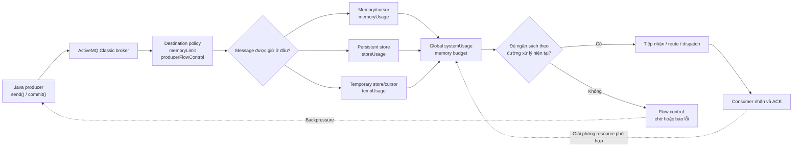
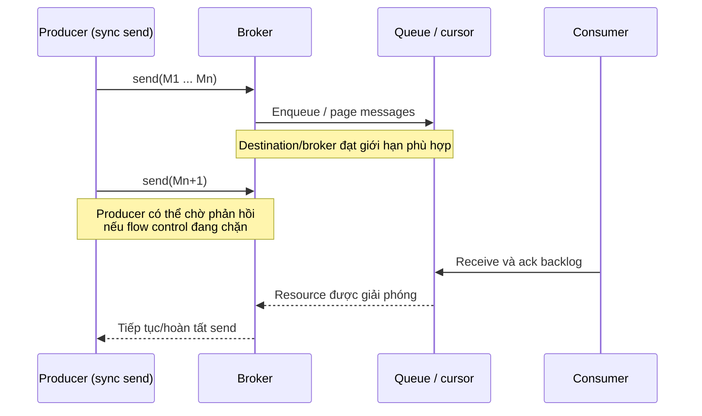
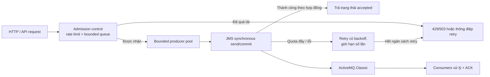

# Producer flow control với memoryUsage, storeUsage và tempUsage của Classic

> **Chương:** Điều tiết lưu lượng  
> **Phạm vi:** **Apache ActiveMQ Classic** và Java/JMS; trọng tâm là các giới hạn tài nguyên của broker, chính sách `producerFlowControl`, thời điểm producer bị chặn hoặc nhận lỗi, cùng cách kiểm chứng bằng cấu hình và chỉ số vận hành. Các ví dụ XML thuộc `activemq.xml` của **Classic**, không phải `broker.xml` của Artemis.

Producer có thể gửi hàng chục nghìn message mỗi giây, trong khi consumer chỉ xử lý được vài trăm. Nếu broker cứ tiếp nhận vô hạn, nó sẽ cạn bộ nhớ hoặc dung lượng lưu trữ. **Producer flow control** là cách ActiveMQ Classic tạo *backpressure*: khi tài nguyên hoặc destination bị giới hạn, broker có thể làm chậm/chặn producer hoặc trả lỗi thay vì tiếp tục tích dữ liệu không kiểm soát.

Điểm khó là Classic có **nhiều giới hạn khác nhau**, không phải một “quota queue” duy nhất:

- `memoryUsage`: ngân sách bộ nhớ do broker theo dõi cho message và cơ chế dispatch/cursor; có giới hạn toàn broker và có thể có `memoryLimit` riêng cho destination.
- `storeUsage`: giới hạn phần lưu trữ **persistent message store**, ví dụ KahaDB.
- `tempUsage`: giới hạn **temporary message store** dùng trong các tình huống paging/cursor, đặc biệt khi message không persistent phải rời bộ nhớ.

Việc nâng `memoryUsage` không làm tăng dung lượng KahaDB; nâng `storeUsage` không tạo thêm RAM; một volume còn nhiều dung lượng nhưng `tempUsage` chạm quota vẫn có thể gây producer backpressure. Bài này giải thích cách ba giới hạn phối hợp và cách cấu hình an toàn, **không lặp lại toàn bộ lý thuyết producer/consumer hoặc độ bền JMS**.

## 1. Mô hình tài nguyên: destination và broker-wide



Đây là **mô hình logic**, không có nghĩa mỗi message đồng thời chiếm trọn cả ba vùng memory/store/temp. Đường đi thực tế phụ thuộc `PERSISTENT`/`NON_PERSISTENT`, queue/topic, pending cursor, prefetch và phiên bản broker. Một persistent message có thể được lưu trên đĩa nhưng chỉ một phần dữ liệu/metadata nằm trong bộ nhớ. Một non-persistent message có thể được chuyển vào temp store khi cần paging.

| Giới hạn | Phạm vi thông thường | Đơn vị/đối tượng được tính | Khi gần/chạm giới hạn |
|---|---|---|---|
| **`memoryUsage`** trong `systemUsage` | Tổng ngân sách memory do broker quản lý. | Bộ nhớ được các destination/cursor ghi nhận; **không phải toàn bộ Java heap**. | Điều tiết producer theo destination/đường dispatch; có thể đẩy pending message xuống store phù hợp. |
| **`memoryLimit`** của `policyEntry` | Một queue/topic cụ thể hoặc tập destination match pattern. | Ngân sách memory của destination, là phần nằm dưới giới hạn broker-wide. | Với `producerFlowControl=true`, có thể gây chặn producer khi đích thiếu chỗ; phụ thuộc khả năng paging/cursor. |
| **`storeUsage`** | Tổng persistent store của broker. | Không gian KahaDB/JDBC persistence được adapter báo cáo, thường phản ánh file/physical usage chứ không chỉ tổng byte payload. | Broker có thể chặn hoặc từ chối thêm persistent messages theo policy; consumer ACK/cleanup có thể giúp giải phóng dần. |
| **`tempUsage`** | Tổng temporary store của broker. | Dữ liệu/đĩa tạm để spool các pending messages/cursor khi cần. | Có thể chặn/từ chối đường gửi cần temp store, kể cả khi persistent store vẫn còn chỗ. |

**Hai nguyên tắc:** (1) `memoryUsage` là quota **nội bộ của broker**, không phải `-Xmx`; broker vẫn cần heap cho threads, connections, objects, GC và các phần khác. (2) `storeUsage`/`tempUsage` là quota logic; **chúng không tạo dung lượng đĩa vật lý**, và cũng không thay thế kiểm tra disk free.

### 1.1. Hai tầng memory limit

Ví dụ:

```text
Broker systemUsage.memoryUsage = 64 MiB (ngân sách tổng)
├── queue orders.work      memoryLimit = 1 MiB
├── queue notifications    memoryLimit = 8 MiB
└── topic live.events      memoryLimit = 4 MiB
    ... các destination/cursor khác cũng dùng ngân sách chung
```

Không cộng ba `memoryLimit` rồi kết luận broker sẽ chiếm chính xác 13 MiB. Đây là các **ngưỡng**, mức sử dụng thay đổi theo message được lưu, page in/out, dispatch, prefetch và broker code. Nếu các destination cộng lại vượt `systemUsage.memoryUsage`, quota tổng có thể thành điểm nghẽn ngay cả khi từng destination chưa chạm ngưỡng riêng.

### 1.2. Một message có thể chuyển tầng lưu trữ

Với queue chứa message persistent, broker có thể để các pending messages trên KahaDB và chỉ giữ một phần trong memory/cursor. Với non-persistent message, khi memory không đủ và policy/cursor cho phép, Classic có thể dùng **temporary file cursor/store** để tránh giữ toàn bộ payload trong RAM.

Do đó câu “queue vượt 1 MiB memoryLimit thì message thứ 65 chắc chắn bị block” **không chính xác**. Broker có thể page dữ liệu; khi không còn nguồn tài nguyên phù hợp hoặc flow control kích hoạt theo policy, producer mới chờ/lỗi. Muốn hiểu ngưỡng thật cần quan sát **memory percent, store/temp percent và cursor configuration** cùng lúc.

## 2. Cơ chế backpressure: chặn, tiếp tục, hoặc trả lỗi

### 2.1. `producerFlowControl=true` trên destination

Trong Classic, `producerFlowControl` là một thuộc tính của **destination policy**. Khi bật, broker có thể ngăn producer tiếp tục đẩy message nếu destination không còn ngân sách phù hợp. Một publisher gọi `MessageProducer.send()` **đồng bộ** có thể thấy lời gọi kéo dài trong lúc broker chờ resource được giải phóng.

Khi consumer tiếp tục nhận và ack message hoặc broker thực hiện paging/store cleanup, resource có thể được giải phóng, từ đó broker **đánh thức producer đang chờ**. Điều này truyền áp lực trở lại upstream, thay vì để queue tăng vô hạn.



Điểm cần phân biệt: **flow control không phải redelivery**, cũng không phải `DLQ`. Nó diễn ra ở **đường gửi** khi broker thiếu tài nguyên để nhận thêm; DLQ diễn ra khi message đã được nhận/route nhưng xử lý không thành công theo chính sách.

### 2.2. Fail-fast thay vì chờ không giới hạn

Ở cấu hình `systemUsage` của Classic có hỗ trợ `sendFailIfNoSpace`, broker có thể **trả lỗi thiếu tài nguyên** thay vì chặn producer vô thời hạn:

```xml
<systemUsage sendFailIfNoSpace="true">
    ...
</systemUsage>
```

Đoạn trên chỉ minh họa **thuộc tính**, chưa phải XML có thể chèn độc lập. Khi đặt trong `activemq.xml` phải nằm đúng cấu trúc `<systemUsage>` lồng nhau như mục 5. Với đường gửi JMS đồng bộ, lỗi tài nguyên có thể xuất hiện dưới dạng `ResourceAllocationException` (một dạng `JMSException`). **Không giả định lỗi sẽ xuất hiện ngay trong lời gọi `send()` khi dùng client asynchronous send**.

So sánh chiến lược:

| Chính sách thực tế | Producer nhìn thấy | Rủi ro cần quản lý |
|---|---|---|
| **Block/wait** (đường gửi đồng bộ) | `send()` hoặc `commit()` tăng latency; thread có thể bị chặn. | Cạn thread pool upstream, request timeout, retry storm hoặc deadlock giữa các thành phần. |
| **Fail-fast** với `sendFailIfNoSpace` khi điều kiện áp dụng | `JMSException`/`ResourceAllocationException` thay vì tiếp tục chờ. | Ứng dụng cần trả 429/503 hay enqueue lại có giới hạn; gửi lặp không được làm side effect trùng. |
| **Async send** của client | Lời gọi có thể trả nhanh trước khi broker xác nhận; lỗi xuất hiện không giống sync send. | Benchmark “send rất nhanh” không phản ánh backpressure hay mức chấp nhận message tại broker. |

Một số release Classic có thêm tùy chọn timeout khi không còn space, nhưng tên field, hành vi và default phải được xác minh trên đúng phiên bản đang chạy. Bài lab sử dụng **hai phương án dễ quan sát**: chờ khi `sendFailIfNoSpace=false`, hoặc lỗi tài nguyên khi `sendFailIfNoSpace=true`.

### 2.3. `producerFlowControl=false` không có nghĩa quota biến mất

Nếu đặt `producerFlowControl="false"` trên một destination, bạn tắt một **cơ chế điều tiết trên destination**, **không vô hiệu hóa** `systemUsage.storeUsage`/`tempUsage` và **không tạo RAM hay disk vô hạn**.

Với pending messages có thể page sang disk/temp, broker có thể cho producer tiếp tục trong lúc backlog tăng ở vùng lưu trữ khác. Khi store/temp cũng đến giới hạn, hoặc hạ tầng thật hết chỗ, producer vẫn có thể bị chặn, trả lỗi hoặc broker gặp sự cố tùy policy. Vì thế **đừng dùng `producerFlowControl=false` như “cách sửa” mặc định cho sender đang treo**.

## 3. Memory, persistent store và temp store: ba đường tắc riêng

### 3.1. Trường hợp memory-bound

Consumer xử lý chậm, destination tiếp nhận message nhanh hơn khả năng giải phóng pending/in-flight. `memoryLimit` thấp làm destination memory pressure tăng. Nếu broker/cursor có thể page dữ liệu xuống KahaDB hoặc temp store, message có thể tiếp tục đi vào các tầng đó; nếu không hoặc chính sách buộc chờ, producer bị flow control.

**Điều cần đo:** `Destination.MemoryPercentUsage`, `Broker.MemoryPercentUsage`, pending/delivering counts, prefetch và cursor policy. Chỉ nhìn `QueueSize` không cho biết memory threshold đã chạm hay chưa.

### 3.2. Trường hợp persistent-store-bound

Producer gửi `DeliveryMode.PERSISTENT` vào queue không có consumer; KahaDB journal/store tăng. Khi `storeUsage` chạm giới hạn, broker có thể chặn hoặc từ chối đường ghi thêm **ngay cả khi heap/memory usage đang thấp** vì các message cũ đã được page khỏi RAM.

**Điều cần đo:** `Broker.StorePercentUsage`, file size của KahaDB, giới hạn `storeUsage`, broker log về store-full/producer blocking, cùng tốc độ dequeue/ACK. `storeUsage` tính dựa trên báo cáo của persistence adapter, có thể bị ảnh hưởng bởi journal file/preallocation/cleanup; **không suy rằng N byte payload sẽ tiêu đúng N byte quota**.

### 3.3. Trường hợp temporary-store-bound

Với message `NON_PERSISTENT` hoặc các cursor cần spool ra file, `tempUsage` có thể tăng. Nếu `tempUsage` đã hết, broker có thể chặn/từ chối đường gửi cần temp store dù KahaDB vẫn còn nhiều chỗ.

**Điều cần đo:** `Broker.TempPercentUsage`, vị trí temporary store (data/temp directory theo cấu hình instance), file cursor policy và backlog message không persistent. Không phải **mọi non-persistent message luôn nằm trong temp store**; với consumer nhanh và đủ memory, message có thể được dispatch mà không cần spool xuống file.

### 3.4. Một bảng tổng hợp triệu chứng

| Memory% | Store% | Temp% | Tình huống có thể xảy ra | Hướng kiểm tra |
|---:|---:|---:|---|---|
| Cao | Thấp | Thấp | Destination/dispatch dùng nhiều broker-managed memory. | `memoryLimit`, cursor và consumer speed. |
| Thấp/trung bình | Cao | Thấp | Persistent backlog chiếm KahaDB. | `storeUsage`, journal cleanup, persistent send và ACK. |
| Trung bình | Thấp | Cao | Temporary cursor/store tích non-persistent backlog. | `tempUsage`, `fileQueueCursor`, consumer lag. |
| Cao | Cao | Cao | Nhiều tài nguyên cùng nghẽn hoặc hệ thống chưa giải phóng đủ. | Dừng tăng tải, bảo vệ disk headroom, đọc log và xác định bottleneck chính. |
| Thấp | Thấp | Thấp | Producer chậm do nguyên nhân khác. | Network, đồng bộ JMS send, disk flush, transaction, auth/locks. |

Các phần trăm là **chỉ báo**, không phải nguyên nhân duy nhất. Một destination chạm `memoryLimit` riêng có thể chặn publisher ngay cả khi broker-wide memory percentage chưa cao. Ngược lại, 100% store quota không có nghĩa filesystem đã thật sự hết dung lượng; vẫn phải kiểm tra cả hai.

## 4. `producerFlowControl` và `systemUsage` không thay thế nhau

Classic sử dụng chính sách destination (`destinationPolicy`) và ngân sách broker (`systemUsage`) để giải quyết hai câu hỏi khác nhau:

**Destination policy:**

```xml
<policyEntry queue="lab.flow.memory"
             producerFlowControl="true"
             memoryLimit="1mb"/>
```

Áp dụng đối với **queue `lab.flow.memory`**: điều tiết khi memory usage liên quan đến destination đạt ngưỡng, kết hợp khả năng cursor/paging và trạng thái broker. Cấu hình này không đặt giới hạn KahaDB là 1 MiB.

**System usage:**

```xml
<systemUsage sendFailIfNoSpace="false">
    <memoryUsage>
        <memoryUsage limit="64 mb"/>
    </memoryUsage>
    <storeUsage>
        <storeUsage limit="256 mb"/>
    </storeUsage>
    <tempUsage>
        <tempUsage limit="64 mb"/>
    </tempUsage>
</systemUsage>
```

Đây là cấu hình ngân sách **toàn broker**; cũng không có nghĩa Classic sẽ đặt heap JVM bằng 64 MiB. Các kích thước ở trên chỉ dùng cho broker **lab cô lập**. Trong một triển khai thật phải lựa chọn theo `-Xmx`, kích thước volume, message profile, SLO và dung lượng dự phòng.

### 4.1. Mỗi giới hạn ảnh hưởng nhóm message nào?

```text
Producer
  |
  +-- PERSISTENT --> Destination queue
  |                    |--> memory/cursor
  |                    +--> KahaDB store --> storeUsage
  |
  +-- NON_PERSISTENT --> Destination queue
                       |--> memory/cursor
                       +--> (khi cần file spool) temp store --> tempUsage
```

Không phải lúc nào broker cũng ghi non-persistent vào temp hoặc giữ mọi persistent message trong memory. Phân phối và cursor quyết định đường đi thực tế. **Cùng một producer** có thể bị chặn do memory hôm nay, nhưng do store sau khi tồn đọng persistent backlog nhiều giờ.

### 4.2. Khi quota tài nguyên và policy xung đột

Một destination bật `producerFlowControl=false` vẫn có thể gây nghẽn **global storeUsage** nếu producer gửi persistent. Một destination có memoryLimit lớn vẫn chịu **global memoryUsage** nếu nhiều queue khác sử dụng hết ngân sách. Và một temp store có dung lượng trống nhưng KahaDB đầy không giúp một persistent queue tiếp tục ghi bền vô hạn.

Do vậy, khi thấy producer bị chặn, câu hỏi đầu tiên không phải “tăng `memoryLimit` bao nhiêu?” mà là **quota nào chạm trước và message đang dùng tầng lưu trữ nào?**.

## 5. Cấu hình đầy đủ từng phần trong `activemq.xml` của Classic

Mở đúng **file cấu hình runtime** của broker Classic; ở một số instance, `ACTIVEMQ_BASE/conf/activemq.xml` khác với file trong thư mục cài đặt `ACTIVEMQ_HOME`. Nội dung sau là **những đoạn con** để lồng vào các khối hiện hữu bên trong phần tử `<broker>`, **không phải toàn bộ file XML**. Không tạo thêm các phần tử cấu hình trùng lặp với những khối đã có.

### 5.1. `destinationPolicy` cho ba queue lab

```xml
<!-- Đặt bên trong <broker> của Classic activemq.xml -->
<destinationPolicy>
    <policyMap>
        <policyEntries>
            <!-- Kiểm tra memory limit ở cấp destination -->
            <policyEntry queue="lab.flow.memory"
                         producerFlowControl="true"
                         memoryLimit="1mb"/>

            <!-- Persistent backlog sẽ chiếm KahaDB store -->
            <policyEntry queue="lab.flow.store"
                         producerFlowControl="true"
                         memoryLimit="2mb"/>

            <!-- Non-persistent backlog có thể spool ra temp store -->
            <policyEntry queue="lab.flow.temp"
                         producerFlowControl="false"
                         memoryLimit="1mb">
                <pendingQueuePolicy>
                    <fileQueueCursor/>
                </pendingQueuePolicy>
            </policyEntry>
        </policyEntries>
    </policyMap>
</destinationPolicy>
```

**Tại sao queue temp có `producerFlowControl=false`?** Đây là **thí nghiệm riêng** cho phép broker sử dụng pending file cursor để quan sát temp store khi message non-persistent vượt memory. **Không đề xuất** tắt flow control như một mặc định production: nếu cursor không page được hoặc temp store đầy, broker vẫn có thể nghẽn/thiếu tài nguyên. `fileQueueCursor` là lựa chọn cursor của **ActiveMQ Classic**, không phải cách viết Artemis.

Chỉ một vài queue lab được match, để không áp một `memoryLimit` nhỏ lên mọi queue của broker. Nếu `activemq.xml` đã có `destinationPolicy`, hãy **chèn/điều chỉnh policy entry trong khối hiện hữu**, không khai báo hai policy map cạnh nhau rồi dự đoán cơ chế ưu tiên.

### 5.2. `systemUsage` cho bộ nhớ, KahaDB và temp store

Classic thường có cấu trúc **hai lớp `<systemUsage>`**: lớp ngoài là phần tử cấu hình broker, lớp trong là bean `SystemUsage` mang các thuộc tính:

```xml
<!-- Đặt bên trong <broker>, thay thế khối systemUsage hiện hữu -->
<systemUsage>
    <systemUsage sendFailIfNoSpace="false">
        <memoryUsage>
            <memoryUsage limit="64 mb"/>
        </memoryUsage>
        <storeUsage>
            <storeUsage limit="256 mb"/>
        </storeUsage>
        <tempUsage>
            <tempUsage limit="64 mb"/>
        </tempUsage>
    </systemUsage>
</systemUsage>
```

**Lưu ý triển khai:**

- `64 mb`/`256 mb` là giá trị **lab**, không phải sizing gợi ý cho production. Hãy giữ đủ headroom và đảm bảo KahaDB directory/temp directory còn dung lượng vật lý thực sự.
- Để quan sát producer **chờ**, giữ `sendFailIfNoSpace="false"`; lời gọi gửi đồng bộ có thể kéo dài khi quota chạm ngưỡng.
- Để quan sát **fail-fast**, ở **lần thử riêng**, đổi chính xác thuộc tính trên **thành `true`** và restart broker theo quy trình áp dụng config. Khi quota liên quan không còn chỗ, producer đồng bộ có thể nhận `ResourceAllocationException`. Hành vi cụ thể còn phụ thuộc điều kiện quota và phiên bản Classic.
- Nếu broker đang dùng KahaDB mặc định, giới hạn `storeUsage` phải đủ lớn so với file journal đã tạo/được cấp phát. Một quota vài MiB có thể bị coi đầy **ngay lúc start** vì journal files có kích thước tối thiểu/khả năng preallocation.
- Không suy rằng ACK một message sẽ làm `StorePercentUsage` giảm tức thì: KahaDB thu hồi file journal theo granularity và quan hệ tham chiếu, có thể phải đợi cleanup.

### 5.3. Kiểm tra chéo với `-Xmx` và ổ đĩa

Ví dụ JVM chạy với `-Xmx512m`, Classic `systemUsage.memoryUsage=64mb` và đang giữ nhiều connections, pending dispatch, indexes, threads; **64 MiB không phải tổng memory RSS của broker**, nên không thể lấy `512 - 64 = 448 MiB` làm số heap chắc chắn còn rảnh. Ngược lại đặt broker memory limit vượt heap một cách thiếu cân nhắc sẽ tăng nguy cơ GC/OOM.

Nếu `storeUsage=256mb` nhưng ổ chứa KahaDB chỉ còn 30 MiB trống, broker có thể gặp **disk-full thực tế trước khi quota logic 100%**. Cần cảnh báo song song cả **StorePercentUsage** và **filesystem free space**. Nếu KahaDB và temp store cùng nằm một filesystem, hai quota độc lập vẫn cạnh tranh một dung lượng vật lý.

### 5.4. Cấu hình có hiệu lực sau khi nào?

Quy trình lab:

1. Xác nhận **đúng Classic instance** và file `activemq.xml` được launcher nạp.
2. Sao lưu file cấu hình và chỉ chỉnh những khối tương ứng trong **broker lab**.
3. Dừng/khởi động lại broker theo quy trình bình thường; đọc log để xác nhận XML được nạp, policy khớp và persistence/temp store hợp lệ.
4. Kiểm tra các queue lab thực sự nhận đúng policy; nếu có policy wildcard khác, kiểm tra thứ tự/matching hiệu lực bằng JMX/console và broker logs.
5. Chạy phép thử từng queue, không chạy đồng thời để tránh gây nhiễu quota toàn broker.

Đừng coi việc sửa một file XML bất kỳ trên đĩa đồng nghĩa broker đang chạy đã dùng giá trị mới. Hạn mức toàn broker có thể được expose qua JMX, nhưng chính xác thuộc tính writable và hành vi hot-update phụ thuộc version. Bài lab dùng restart để tránh mơ hồ.

## 6. Đường gửi JMS quyết định producer nhìn thấy backpressure thế nào

**Flow control nằm ở broker**, nhưng khả năng quan sát của application phụ thuộc client gửi đồng bộ hay bất đồng bộ:

```java
ActiveMQConnectionFactory factory =
        new ActiveMQConnectionFactory("tcp://127.0.0.1:61616");
factory.setUseAsyncSend(false);
factory.setAlwaysSyncSend(true);  // Classic-specific extension
```

Ví dụ dùng đường gửi đồng bộ để **lời gọi `send()` phải chờ phản hồi broker phù hợp** thay vì hoàn tất ngay trong buffer của client. Nếu producer gửi trong **transacted `Session`**, một số sự cố/bảo đảm chỉ rõ ở **`session.commit()`**; phải đo commit riêng và không suy từ thời gian `send()` trong transaction.

**Một chi tiết dễ gây hiểu nhầm:** Khi producer dùng async send, việc `producer.send()` trả nhanh chưa chứng minh broker còn tài nguyên hay đã chấp nhận message. Ngược lại, trong sync send, khi broker áp flow control kiểu chờ, producer thread có thể bị block **trước khi ném exception**; không nên thiết kế toàn bộ HTTP request pool lệ thuộc một call như thế mà không có giới hạn thời gian và cách giảm tải.

### 6.1. Ba kết quả cần được phân loại

| Kết quả từ producer | Ý nghĩa đúng | Phản ứng ứng dụng |
|---|---|---|
| `send()` trở về bình thường | Client hoàn tất đường gửi theo semantics đang dùng. | Chỉ tuyên bố đã gửi theo contract đó; chưa có bằng chứng consumer đã xử lý. |
| `send()` chờ lâu | Có thể broker flow control, nhưng cũng có thể network, store flush hoặc transaction contention. | Đo stage, xem broker resource metrics, áp deadline upstream có kiểm soát. |
| `ResourceAllocationException` / `JMSException` | Broker/client báo không thể hoàn tất gửi theo điều kiện hiện tại. | Ghi nhận nguyên nhân, áp retry/backoff có giới hạn, dùng idempotency key; không tự xem message chắc chắn chưa được broker chấp nhận nếu lỗi xảy ra ở boundary không rõ. |

**Không retry vô hạn tức thì:** nếu hàng nghìn producers cùng nhận fail-fast rồi retry trong mili-giây, bạn vừa tạo **retry storm** lên broker đang đầy. Tốt hơn là circuit breaker/bulkhead và exponential backoff có jitter, giới hạn số tác vụ đang chờ.

## 7. Lab Java/JMS: quan sát sender chờ, sender lỗi và consumer giải phóng backlog

Ví dụ sử dụng **ActiveMQ Classic 5.x** với OpenWire `tcp://127.0.0.1:61616`, Java 11 và dependency `activemq-client` chứa API `javax.jms`. Chương trình có hai lệnh:

```text
send  <memory|store|temp> <messageCount> <payloadKiB>
drain <memory|store|temp> <maxMessages>
```

- `send memory` và `send store` gửi **PERSISTENT** để quan sát destination memory và KahaDB store.
- `send temp` gửi **NON_PERSISTENT** tới queue đã cấu hình `fileQueueCursor`.
- `drain` nhận/ack từ đúng queue, giúp quan sát resource giảm và producer đang chờ có cơ hội tiếp tục.

Chương trình giới hạn số message và kích thước payload để tránh vô tình tạo tải vô hạn. **Không dùng code này trên broker dùng chung**: ngay cả một script test có bound vẫn có thể đẩy một queue đến quota.

### 7.1. `pom.xml`

```xml
<project xmlns="http://maven.apache.org/POM/4.0.0"
         xmlns:xsi="http://www.w3.org/2001/XMLSchema-instance"
         xsi:schemaLocation="http://maven.apache.org/POM/4.0.0
                             https://maven.apache.org/xsd/maven-4.0.0.xsd">
  <modelVersion>4.0.0</modelVersion>
  <groupId>lab.activemq</groupId>
  <artifactId>classic-producer-flow-control</artifactId>
  <version>1.0-SNAPSHOT</version>

  <properties>
    <maven.compiler.release>11</maven.compiler.release>
    <project.build.sourceEncoding>UTF-8</project.build.sourceEncoding>
  </properties>

  <dependencies>
    <dependency>
      <groupId>org.apache.activemq</groupId>
      <artifactId>activemq-client</artifactId>
      <version>5.18.4</version>
    </dependency>
  </dependencies>

  <build>
    <plugins>
      <plugin>
        <groupId>org.apache.maven.plugins</groupId>
        <artifactId>maven-compiler-plugin</artifactId>
        <version>3.11.0</version>
      </plugin>
      <plugin>
        <groupId>org.codehaus.mojo</groupId>
        <artifactId>exec-maven-plugin</artifactId>
        <version>3.2.0</version>
      </plugin>
    </plugins>
  </build>
</project>
```

`5.18.4` là **phiên bản minh họa cho API**, không phải khẳng định đây là bản Classic mới nhất hoặc được khuyến nghị cho production. Khi nâng cấp hãy kiểm tra JDK, client/broker compatibility và security patches. Ví dụ **không** dành cho client Artemis `jakarta.jms`.

### 7.2. `FlowControlProbe.java`

Tạo `src/main/java/lab/FlowControlProbe.java`:

```java
package lab;

import java.util.Arrays;
import java.util.Locale;
import java.util.UUID;
import javax.jms.Connection;
import javax.jms.DeliveryMode;
import javax.jms.JMSException;
import javax.jms.Message;
import javax.jms.MessageConsumer;
import javax.jms.MessageProducer;
import javax.jms.Queue;
import javax.jms.ResourceAllocationException;
import javax.jms.Session;
import javax.jms.TextMessage;
import org.apache.activemq.ActiveMQConnectionFactory;

public final class FlowControlProbe {
    private static final String PREFIX = "lab.flow.";

    private FlowControlProbe() {
    }

    public static void main(String[] args) throws Exception {
        if (args.length < 3) {
            throw new IllegalArgumentException(
                "send <memory|store|temp> <count> <KiB> "
                + "| drain <memory|store|temp> <max>");
        }

        String mode = args[0];
        String alias = args[1];
        String queueName = queueFor(alias);

        String url = System.getenv("ACTIVEMQ_BROKER_URL");
        if (url == null || url.trim().isEmpty()) {
            url = "tcp://127.0.0.1:61616";
        }
        ActiveMQConnectionFactory factory =
                new ActiveMQConnectionFactory(url);

        // ActiveMQ Classic-specific: đo phản hồi broker thay vì async enqueue.
        factory.setUseAsyncSend(false);
        factory.setAlwaysSyncSend(true);

        String username = System.getenv("ACTIVEMQ_USER");
        String password = System.getenv("ACTIVEMQ_PASSWORD");
        Connection connection = username == null || username.isBlank()
                ? factory.createConnection()
                : factory.createConnection(username, password);
        try {
            if ("send".equals(mode)) {
                if (args.length != 4) {
                    throw new IllegalArgumentException(
                        "send cần <alias> <count> <KiB>");
                }
                int count = Integer.parseInt(args[2]);
                int kib = Integer.parseInt(args[3]);
                if (count < 1 || count > 30000 ||
                        kib < 1 || kib > 64) {
                    throw new IllegalArgumentException(
                        "Giới hạn lab: count=1..30000, KiB=1..64");
                }
                send(connection, queueName, alias, count, kib);
            } else if ("drain".equals(mode)) {
                if (args.length != 3) {
                    throw new IllegalArgumentException(
                        "drain cần <alias> <maxMessages>");
                }
                int max = Integer.parseInt(args[2]);
                if (max < 1 || max > 30000) {
                    throw new IllegalArgumentException(
                        "maxMessages=1..30000");
                }
                drain(connection, queueName, max);
            } else {
                throw new IllegalArgumentException("Mode không hợp lệ");
            }
        } catch (ResourceAllocationException exhausted) {
            System.err.println(
                "BROKER_RESOURCE_LIMIT: " + exhausted.getMessage());
            // Application thật cần retry/backoff có giới hạn.
            throw exhausted;
        } catch (JMSException otherJmsError) {
            System.err.println(
                "JMS_FAILURE: " + otherJmsError.getMessage()
                + " code=" + otherJmsError.getErrorCode());
            throw otherJmsError;
        } finally {
            connection.close();
        }
    }

    private static String queueFor(String alias) {
        if (!"memory".equals(alias) &&
                !"store".equals(alias) &&
                !"temp".equals(alias)) {
            throw new IllegalArgumentException(
                "Chỉ chấp nhận memory, store hoặc temp");
        }
        return PREFIX + alias;
    }

    private static void send(
            Connection connection, String queueName,
            String alias, int count, int payloadKiB)
            throws JMSException {
        Session session = connection.createSession(
                false, Session.AUTO_ACKNOWLEDGE);
        try {
            Queue queue = session.createQueue(queueName);
            MessageProducer producer = session.createProducer(queue);
            long[] durations = new long[count];
            int completed = 0;
            String runId = UUID.randomUUID().toString();
            String body = "X".repeat(payloadKiB * 1024);
            int deliveryMode = "temp".equals(alias)
                    ? DeliveryMode.NON_PERSISTENT
                    : DeliveryMode.PERSISTENT;
            try {
                for (int seq = 1; seq <= count; seq++) {
                    TextMessage message = session.createTextMessage(body);
                    message.setStringProperty("runId", runId);
                    message.setIntProperty("seq", seq);

                    long start = System.nanoTime();
                    // TTL=0: không đặt hạn sử dụng qua producer.
                    producer.send(message, deliveryMode, 4, 0L);
                    long elapsed = System.nanoTime() - start;
                    durations[completed++] = elapsed;

                    if (seq == 1 || seq % 100 == 0 || seq == count) {
                        System.out.printf(Locale.ROOT,
                            "SEND_OK queue=%s seq=%d/%d ms=%.3f%n",
                            queueName, seq, count,
                            elapsed / 1_000_000.0);
                    }
                }
            } finally {
                showLatency(runId, durations, completed);
                producer.close();
            }
        } finally {
            session.close();
        }
    }

    private static void showLatency(
            String runId, long[] durations, int completed) {
        System.out.println("COMPLETED runId=" + runId
                + " sends=" + completed);
        if (completed == 0) {
            return;
        }
        long[] sorted = Arrays.copyOf(durations, completed);
        Arrays.sort(sorted);
        System.out.printf(Locale.ROOT,
                "send_ms p50=%.3f p95=%.3f p99=%.3f%n",
                quantileMs(sorted, 0.50),
                quantileMs(sorted, 0.95),
                quantileMs(sorted, 0.99));
    }

    private static double quantileMs(long[] sorted, double q) {
        int index = (int) Math.ceil(q * sorted.length) - 1;
        index = Math.max(0, Math.min(index, sorted.length - 1));
        return sorted[index] / 1_000_000.0;
    }

    private static void drain(
            Connection connection, String queueName, int max)
            throws JMSException {
        Session session = connection.createSession(
                false, Session.CLIENT_ACKNOWLEDGE);
        try {
            MessageConsumer consumer =
                    session.createConsumer(session.createQueue(queueName));
            try {
                connection.start();
                int received = 0;
                while (received < max) {
                    Message message = consumer.receive(2000);
                    if (message == null) {
                        break;
                    }
                    // Trong lab: coi nhận thành công là "xử lý".
                    // Production: ACK sau khi nghiệp vụ thật sự hoàn tất.
                    message.acknowledge();
                    received++;
                    if (received == 1 || received % 100 == 0) {
                        System.out.println("ACKED queue=" + queueName
                                + " count=" + received);
                    }
                }
                System.out.println("DRAINED " + queueName
                        + " messages=" + received);
            } finally {
                consumer.close();
            }
        } finally {
            session.close();
        }
    }
}
```

### 7.3. Ranh giới của chương trình

**Chỉ để stress broker lab, không để gửi job thật.** Lệnh `drain` acknowledge và loại message như dữ liệu thử nghiệm, không thực hiện business processing; vì vậy **không dùng nó để “dọn” một queue production**. Cả producer lẫn consumer chỉ thao tác các queue tên `lab.flow.*` đã được whitelist.

**Nếu `send()` bị chặn do flow control**, thread có thể **chưa đi tới `finally`**, nên không xuất hiện summary latency ngay. Đây là tín hiệu quan sát hợp lệ; đừng hiểu thiếu dòng summary là thành công. Hãy nhìn `SEND_OK` cuối cùng, thread state và broker metrics. Nếu bật fail-fast, chương trình có thể in `BROKER_RESOURCE_LIMIT` và summary cho **các lần send đã hoàn tất**, không phải toàn bộ số lần được yêu cầu.

**Dùng một message body lặp lại** để đo tải gần ổn định; số byte lưu vào KahaDB/temp không nhất thiết bằng `count × payloadKiB` do header, encoding, page/cursor, file allocation và journal metadata. Đặc biệt, `send temp` có thể bị ảnh hưởng bởi file cursor policy; nếu queue không spool vì consumer vẫn đang chạy, `TempPercentUsage` có thể không tăng như mong muốn.

**Không đo `SESSION_TRANSACTED` trong code này.** Với transacted sender, cần đo cả `session.commit()` và điểm kết quả unknown khi broker lỗi. Bài lab cố tình dùng non-transacted synchronous send để dễ nhìn thời gian producer chịu backpressure.

## 8. Chạy ba phép thử độc lập: memory, KahaDB store và temp

**Điều kiện:** Broker Classic **lab riêng**, có KahaDB/persistence hoạt động, đã nạp cấu hình ở mục 5, các queue `lab.flow.*` không có backlog từ lần thử trước và không có consumer ngoài lab. Nếu broker có authentication, đặt `ACTIVEMQ_USER` và `ACTIVEMQ_PASSWORD`; nếu endpoint khác mặc định, đặt `ACTIVEMQ_BROKER_URL`.

Trong các lệnh sau, dấu nháy kép quanh `-D` dùng được trên PowerShell và Bash. Khi một sender bị chặn ở quota, hãy chạy `drain` trong **terminal khác**; không dừng cưỡng bức broker hoặc xóa store để “giải phóng chỗ”.

### 8.1. Baseline: sender và consumer cùng hoạt động

**Terminal A** gửi tải nhỏ để xác minh routing, credential và đường gửi:

```bash
mvn -q compile exec:java "-Dexec.mainClass=lab.FlowControlProbe" "-Dexec.args=send memory 100 4"
```

**Terminal B** drain dữ liệu thử nghiệm:

```bash
mvn -q compile exec:java "-Dexec.mainClass=lab.FlowControlProbe" "-Dexec.args=drain memory 100"
```

Khi không có quota đầy, `send()` thường hoàn tất với độ trễ thấp hơn stress test; số liệu thực tế phụ thuộc thiết bị, network và KahaDB flush. Nếu baseline đã lỗi, hãy kiểm tra broker readiness, quyền gửi/consume, endpoint và config trước khi điều tra producer flow control.

### 8.2. Destination memory pressure

Đảm bảo source queue `lab.flow.memory` đang rỗng, không có consumer. Dùng:

```bash
mvn -q compile exec:java "-Dexec.mainClass=lab.FlowControlProbe" "-Dexec.args=send memory 10000 16"
```

Mỗi message chứa khoảng 16 KiB body text; tổng **payload yêu cầu gửi** là khoảng 160.000 KiB, **không phải dự báo dung lượng KahaDB thực tế**. Queue có `memoryLimit="1mb"` và `producerFlowControl="true"`.

**Cần quan sát:** destination `MemoryPercentUsage`, broker-wide `MemoryPercentUsage`, `StorePercentUsage` và độ trễ những `SEND_OK` liên tiếp. Tùy cursor/paging, broker có thể:

- Chặn một số `send()` khi memory ở destination không còn chỗ;
- Page persistent backlog xuống KahaDB, để producer tiếp tục cho đến khi **store** hoặc một giới hạn khác thành bottleneck;
- Đạt ngưỡng vào những thời điểm không trùng chính xác số byte payload do overhead và dispatch state.

**Không mặc định** gửi 1 MiB payload là `send()` tiếp theo chắc chắn bị chặn; một giới hạn **memory** không phải tổng sức chứa của queue persistent. Nếu sender bị chặn, terminal khác có thể chạy:

```bash
mvn -q compile exec:java "-Dexec.mainClass=lab.FlowControlProbe" "-Dexec.args=drain memory 5000"
```

Đợi broker cập nhật pending/cursor usage, quan sát sender có thể tiến triển tiếp hay không. Nếu không, xem **quota nào còn đầy**; có thể tài nguyên chưa được thu hồi hoặc blocker là store chứ không chỉ memory.

### 8.3. Persistent store pressure: `storeUsage`

Dùng queue `lab.flow.store` tách biệt, không có consumer:

```bash
mvn -q compile exec:java "-Dexec.mainClass=lab.FlowControlProbe" "-Dexec.args=send store 20000 16"
```

Khối lượng payload dự kiến khoảng 312,5 MiB, lớn hơn `storeUsage=256 mb` trong cấu hình lab. Nếu persistence adapter đang dùng KahaDB và không có policy loại bỏ/purge, **broker có thể chạm store quota trước khi gửi hết**. Thời điểm cụ thể phụ thuộc journal files, overhead, free space và trạng thái store đã có.

Theo dõi **broker StorePercentUsage**. Khi chạm giới hạn, producer đồng bộ có thể bị chặn hoặc nhận lỗi tùy `sendFailIfNoSpace`. Memory% lúc đó **không nhất thiết cao**, vì queue có thể để pending persistent messages trên KahaDB.

Để giúp giải phóng:

```bash
mvn -q compile exec:java "-Dexec.mainClass=lab.FlowControlProbe" "-Dexec.args=drain store 12000"
```

Nếu sender vẫn chờ dù consumer đã ack hàng nghìn message, đừng vội tăng quota. **KahaDB reclaim journal files theo granularity và chu kỳ cleanup**, nên file size/StorePercentUsage không giảm ngay sau mỗi ack. Kiểm tra journal cleanup, log của broker, consumer backlog và giới hạn thiết bị; không xóa journal files thủ công khi broker còn chạy.

### 8.4. Temporary store pressure: `tempUsage`

Đảm bảo `lab.flow.temp` đang rỗng, không có consumer. Queue này đã được cấu hình `fileQueueCursor` và `producerFlowControl=false` để quan sát hành vi spool khi memory không đủ:

```bash
mvn -q compile exec:java "-Dexec.mainClass=lab.FlowControlProbe" "-Dexec.args=send temp 10000 16"
```

Message trong mode này được gửi `NON_PERSISTENT`. Khi broker bắt đầu dùng file cursor/temporary store cho pending backlog, `TempPercentUsage` có thể tăng đến giới hạn `64 mb` và gây điều tiết ở tầng temp. Đường spool thực tế phụ thuộc cấu hình cursor và broker version; **không được giả định mọi NON_PERSISTENT send đều ngay lập tức ghi temp**.

Nếu thấy `TempPercentUsage` không tăng, kiểm tra các điều kiện sau trước khi kết luận `tempUsage` vô tác dụng:

1. `fileQueueCursor` có thực sự được nạp cho `lab.flow.temp` không?
2. Message đang được giữ trong memory hay dispatch tới consumer khác?
3. `TempPercentUsage` đang được đọc từ đúng broker và đúng tài nguyên chưa?
4. Tải đã đủ vượt memory budget/cursor threshold chưa?

Để drain:

```bash
mvn -q compile exec:java "-Dexec.mainClass=lab.FlowControlProbe" "-Dexec.args=drain temp 10000"
```

Nếu message non-persistent đã bị mất do broker restart, **không** xem đó là hành vi flow control: `NON_PERSISTENT` không có cùng bảo đảm phục hồi như persistent message. Muốn kiểm tra temp pressure, giữ broker đang chạy và tránh restart giữa hai bước.

### 8.5. Đổi từ block sang fail-fast một cách có kiểm soát

Thực hiện **trong một lần thử mới**, sau khi đã ghi nhận và dọn backlog cũ:

1. Trong **systemUsage nội bộ** (mục 5.2), đổi `sendFailIfNoSpace="false"` thành `sendFailIfNoSpace="true"`.
2. Restart broker lab và xác nhận giá trị hiệu lực.
3. Dùng một trong những tải đủ lớn để chạm **quota global**; quan sát phản hồi từ `send()`.
4. Khi đủ điều kiện, `ResourceAllocationException` có thể xuất hiện, producer in `BROKER_RESOURCE_LIMIT` rồi kết thúc thay vì chờ không giới hạn.
5. So sánh `StorePercentUsage`/`TempPercentUsage`, send failure count và độ trễ với mode block.

**Chú ý:** `sendFailIfNoSpace` không có nghĩa mọi lần queue riêng chạm `memoryLimit` đều nhất định ném `ResourceAllocationException`. Thuộc tính này thuộc **SystemUsage** và chỉ có tác dụng khi broker gặp điều kiện thiếu tài nguyên liên quan theo cơ chế hỗ trợ của phiên bản. Cần xem log, metric và nguyên nhân cụ thể.

### 8.6. Bảng kết quả mong đợi

| Test | Broker setting nổi bật | Chỉ số cần tăng | Producer có thể thấy |
|---|---|---|---|
| Baseline | Không quota nào chạm | Enqueue/Dequeue | `send()` hoàn tất, consumer ACK. |
| Memory | `memoryLimit=1mb`, `producerFlowControl=true` | Destination MemoryPercentUsage hoặc store do paging. | Latency tăng/chờ **hoặc** tiếp tục nhờ paging. |
| Store | `storeUsage=256mb`, persistent backlog | Broker StorePercentUsage | Chặn hoặc lỗi khi store quota đầy. |
| Temp | `tempUsage=64mb`, file cursor, NON_PERSISTENT | Broker TempPercentUsage | Chặn/lỗi khi temp store cần thêm chỗ. |
| Fail-fast | `sendFailIfNoSpace=true` | Một quota SystemUsage đạt giới hạn | `ResourceAllocationException` trong đường gửi đồng bộ khi điều kiện áp dụng. |

Không có số throughput/latency **bịa sẵn** trong bảng vì việc đó phụ thuộc phần cứng và cấu hình. Nếu một test không chạm quota như dự kiến, **không tiếp tục tăng tải vô hạn**; kiểm tra policy, cursor, broker version và disk headroom trước.

## 9. JMX và log: xác định thứ gì đang chặn producer

ActiveMQ Classic có các MBean về broker/system usage và destination. Các tên attribute hiển thị có thể khác theo bản Classic hoặc công cụ JMX, nhưng những nhóm chỉ số sau đặc biệt hữu ích:

| Tầng | Nhóm metric | Cách đọc |
|---|---|---|
| **Broker/system usage** | `MemoryPercentUsage`, `StorePercentUsage`, `TempPercentUsage` và limit tương ứng nếu được expose. | Chỉ ra áp lực trên quota toàn broker; phải đối chiếu memory/store/temp riêng. |
| **Destination queue** | `MemoryPercentUsage`, `QueueSize`, `EnqueueCount`, `DequeueCount`. | Queue có backlog, dispatch/ACK có tiến triển hay không; destination memory có đầy không. |
| **Consumer/in-flight** | `ConsumerCount`, `InFlightCount`, `DispatchCount` nếu có. | Message có thể đã dispatch nhưng chưa ack, dù pending queue count thay đổi. |
| **Broker resource/flow** | Producer blocked warnings, usage limit warnings, send failure/timeout trong log. | Xác nhận dấu hiệu backpressure và loại quota bị chạm. |
| **OS/JVM** | Disk free, I/O latency, heap/GC, process threads, socket backlog. | Tách quota logic khỏi disk-full, GC pause, network hoặc hệ thống phụ thuộc nghẽn. |

Trong một số bản Classic có **advisory** liên quan producer bị block hoặc destination full; chúng có thể giúp quan sát, nhưng **không dựa duy nhất vào advisory** để ra quyết định nghiệp vụ. JMX/log và trạng thái client đang gọi `send()` là bằng chứng bổ trợ.

### 9.1. Mẫu timeline cần thu thập

```text
T0  Producer SEND_OK seq=1200, p95 còn thấp
T1  Destination MemoryPercentUsage tiến sát 100%
T2  Queue backlog tăng, cursor bắt đầu page (nếu hỗ trợ)
T3  Broker StorePercentUsage tăng; send latency p99 tăng mạnh
T4  Producer không có SEND_OK mới (send() đang chờ)
T5  Consumer chạy drain, dequeue/ACK tăng
T6  Broker giải phóng resource hoặc cleanup hoàn tất
T7  Producer có SEND_OK mới / send() trở về
```

Đây là **một chuỗi khả dĩ**, không phải trace bắt buộc của mọi queue. Một broker có thể chạm store quota trước memory; ở queue non-persistent, áp lực có thể đi vào temp. Mục tiêu của logging là liên kết **từng lần sender chờ** với **resource pressure thực tế**.

### 9.2. Ba câu hỏi khi gặp `send()` rất chậm

1. **Client có gửi đồng bộ hay async?** Nếu sync, thời gian chờ có thể bao gồm flow control, network, persistent store sync và transaction. Nếu async, lời gọi nhanh không chứng minh broker đã tiếp nhận.
2. **Quota nào đang đầy?** So destination memory với broker-wide memory, store và temp. Đừng chỉ xem queue depth.
3. **Có đường giải phóng resource không?** Consumer ACK, journal cleanup, temp cursor removal hoặc quản trị hạn mức có tiến triển không? Nếu không, backpressure có thể kéo dài vô thời hạn.

Một producer bị chặn trên `send()` không nhất thiết có Java exception ngay lập tức. Thread dump có thể cho thấy thread chờ response/producer flow control hoặc IO; kết hợp với broker metrics để phân biệt nghẽn quota với lỗi mạng.

## 10. Thiết kế upstream chịu được backpressure

Producer flow control giúp broker **không phải nhận vô hạn**, nhưng **không tự làm cho ứng dụng upstream an toàn**. Nếu 200 HTTP request threads cùng gọi synchronous `send()` và tất cả bị chặn vì `storeUsage` đầy, web server có thể cạn worker threads trong khi consumer cần tài nguyên từ cùng hệ thống để giải phóng backlog. Vì thế điểm nhận backpressure phải được thiết kế, không chỉ bật trong XML.

### 10.1. Tách đường nhận request khỏi đường gửi có giới hạn



**Ba ranh giới cần tường minh:**

1. **Admission limit:** Số yêu cầu mà upstream được phép giữ in-flight và chờ broker; không biến thread pool thành một “queue thứ hai” không giới hạn.
2. **Delivery contract:** API trả `202 Accepted` khi nào? Khi ghi vào hàng chờ nội bộ, khi JMS `send/commit` trả thành công, hay khi nghiệp vụ consumer hoàn tất? Không trộn ba thời điểm.
3. **Retry contract:** Lỗi resource có thể retry, nhưng phải có backoff/jitter và một **business idempotency key**. Khi mất kết nối ở ranh giới gửi, kết quả có thể chưa xác định; producer gửi lại có thể tạo message mới mang cùng yêu cầu nghiệp vụ.

Không mặc định mọi `ResourceAllocationException` có thể được “sửa” bằng retry ngay lập tức. Nếu queue đầy do consumer outage kéo dài, retry storm chỉ tăng CPU/network và đẩy thời gian hồi phục xa hơn.

### 10.2. Tránh vòng chờ tài nguyên

Một lỗi thiết kế dễ gây deadlock ở tầng ứng dụng:

```text
Thread A: producer.send() bị chặn vì queue đầy.
Thread A: sau send() mới chạy consumer.receive() để dọn queue.
Nhưng Thread A không bao giờ tới receive() khi send() còn đang chờ.
```

Luôn có **consumer độc lập** có thể tiếp tục tiến triển khi producer bị chặn. Nếu producer và consumer cùng process, để chúng trên thread/session độc lập và bảo đảm consumer không phải đợi mutex, transaction, DB pool hoặc tài nguyên mà blocked producer đang giữ.

### 10.3. Deadline, cancellation và lỗi chưa xác định

Ứng dụng thật cần deadline hợp lý cho đường gửi, nhưng deadline ở tầng HTTP **không có nghĩa broker tự hủy send đang chờ**. Một thread bị request timeout ở gateway có thể vẫn đang chờ JMS provider phản hồi. Trước khi dựa vào send timeout/reconnect, cần xác minh **API timeout cụ thể của Classic client version**, cơ chế đóng connection và trạng thái transaction.

Phân biệt:

- **Broker chủ động từ chối vì đầy:** có cơ sở để phân loại lỗi tài nguyên, retry khi đã có chỗ.
- **Client hết thời gian chờ hoặc transport đứt:** message có thể đã được broker chấp nhận; cần phân loại **outcome unknown** nếu chưa có bằng chứng.
- **Producer đang block:** chưa có kết quả; không đồng thời chạy một retry khác cho cùng business request vô hạn.

### 10.4. Sizing theo tốc độ đến và tiêu thụ

Nếu producer gửi trung bình `λ_in` message/giây và consumers xử lý `λ_out` message/giây, tốc độ backlog xấp xỉ:

\[
\Delta Q \approx \max(0,\lambda_{\mathrm{in}}-\lambda_{\mathrm{out}})\times T
\]

Tổng dữ liệu payload tích lũy trong một khoảng `T` giây xấp xỉ `ΔQ × S`, với `S` là kích thước message trung bình. **Đây mới chỉ là payload**: store/temp usage còn có headers, journal granularity, index/cursor và cleanup. Với burst, cần tính p95/p99 arrival rate thay vì chỉ average.

Giới hạn tài nguyên không chữa được bất đẳng thức `λ_in > λ_out` kéo dài: nếu producer nhanh hơn consumer liên tục, queue **sớm muộn cũng đầy** dù tăng store từ vài GB lên hàng trăm GB. Lời giải có thể là tăng năng lực consumer, giảm input rate, điều chỉnh batch/side effect hoặc thay đổi mục tiêu giữ dữ liệu, không chỉ tăng XML limit.

## 11. Runbook khi producer đang bị chặn hoặc liên tục nhận lỗi

### 11.1. Quy trình chẩn đoán

1. **Xác nhận điểm nghẽn:** `send()`, `Session.commit()` hay chỗ khác? Xem thread dump/client logs và cấu hình sync/async send.
2. **Kiểm tra quota broker-wide:** `MemoryPercentUsage`, `StorePercentUsage`, `TempPercentUsage`, giới hạn hiệu lực; song song xem free disk/IO latency/heap.
3. **Kiểm tra destination:** Queue cụ thể có `producerFlowControl`, `memoryLimit` nào? `QueueSize`, `InFlightCount`, consumer count, enqueue/dequeue có tiến triển không?
4. **Xác định message path:** `PERSISTENT` vào KahaDB hay `NON_PERSISTENT` dùng pending file cursor? Có scheduled/delayed/selector khiến backlog không tiêu được không?
5. **Tìm nguyên nhân gốc:** Consumer chết, xử lý chậm, DLQ/expiry pipeline lỗi, journal cleanup chưa thu hồi, filesystem đầy, hay quota đặt quá thấp cho workload hợp lệ?
6. **Khôi phục an toàn:** Giảm/rate-limit producer, phục hồi consumer, bảo đảm hệ thống có free disk, theo dõi giải phóng store/temp; chỉ tăng quota nếu có headroom và sự phê duyệt.
7. **Ngăn tái phát:** Alert trên độ dốc backlog, resource%, message age, send/commit p99, fail-fast rate và downstream capacity.

### 11.2. Ma trận sự cố và cách xử lý

| Triệu chứng | Nguyên nhân khả dĩ | Cách xác minh / hành động |
|---|---|---|
| `send()` treo khi queue không có consumer | Flow control do destination memory hoặc global store/temp pressure. | Xem quota%, queue backlog và thread dump; chạy consumer **lab độc lập** để giải phóng. |
| `MemoryPercentUsage` toàn broker thấp nhưng queue bị block | Destination `memoryLimit` đã chạm hoặc cursor/dispatch state nghẽn. | Xem `MemoryPercentUsage` của destination và policy match. |
| `StorePercentUsage` 100% còn JVM heap thấp | Persistent KahaDB store quota đầy. | Xem journal file usage, disk free, cleanup, ACK và persistent queue backlog. |
| `TempPercentUsage` 100% còn store% thấp | Temporary cursor/store đã đầy. | Xem file cursor, non-persistent backlog, temp directory và policy; tiêu thụ/giảm tải đúng queue. |
| Sau drain hàng nghìn message Store% vẫn cao | KahaDB chưa thể reclaim journal files ngay, còn references hoặc cleanup chưa chạy. | Kiểm tra KahaDB cleanup/log; không xóa journal thủ công. |
| `ResourceAllocationException` sau thay config | `sendFailIfNoSpace=true` và một quota liên quan hết chỗ. | Ghi nhận loại quota, dùng bounded retry/backoff; không lập vòng gửi nhanh. |
| Producer async vẫn in “gửi OK” nhưng broker không tăng enqueue | Async send chưa xác nhận, lỗi transport/resource bất đồng bộ hoặc wrong destination. | Dùng sync send để test, so JMS ID/ACK broker metrics và logs. |
| Broker chưa đầy quota nhưng gửi chậm | Disk sync, network latency, GC, transaction contention, thread pool. | Xem p99 disk I/O, heap/GC và commit latency, không tăng `memoryUsage` mù quáng. |
| Broker thiếu chỗ vật lý dù Store% chưa 100% | Volume shared với temp/log/OS files, quota logic lớn hơn free disk. | Kiểm tra filesystem headroom, tách volume/log khi cần. |
| Sender chờ mãi dù consumer đã bật lại | Consumer không ack/commit, đang in-flight, selector sai, còn quota khác đầy. | Xem dequeue/ACK rate, in-flight, temp/store cùng lúc. |
| Thay `producerFlowControl=false` thì tạm hết chặn nhưng disk tăng mạnh | Backpressure bị đẩy sang tầng store/temp. | Khôi phục chính sách phù hợp, xem nguyên nhân backlog và capacity downstream. |

### 11.3. Cảnh báo an toàn khi điều chỉnh production

**Không** trực tiếp xóa file KahaDB/temp đang được broker sử dụng, không purge queue không thuộc quyền sở hữu và không mở rộng `storeUsage` vượt disk free. Khi disk thực sự đầy, thao tác ghi tiếp có thể làm broker lỗi thêm, ảnh hưởng những queue khác. Cần kế hoạch dừng nhận tải, backup và khôi phục đúng quy trình vận hành.

Trước khi thay policy production, ghi lại cấu hình hiện tại, broker version, SLO, lượng backlog, consumer throughput, giới hạn heap và dung lượng volume. Nếu tăng quota chỉ để giải phóng chặn tạm thời, phải có ngưỡng cảnh báo mới và kế hoạch xử lý backlog; nếu không, bạn chỉ chuyển ngày gặp sự cố sang một thời điểm khác.

## 12. Bài tập tình huống

**1.** Producer gửi persistent messages; broker `MemoryPercentUsage=35%`, `StorePercentUsage=100%` và `TempPercentUsage=2%`. Nên tăng destination `memoryLimit` không?

**Đáp án:** Không phải cách chữa trực tiếp. Bottleneck nằm ở **persistent store**; kiểm tra KahaDB quota, journal cleanup, queue ACK và disk free. Nâng memory limit không tạo thêm dung lượng KahaDB.

**2.** Queue `lab.flow.temp` nhận non-persistent message, dùng `fileQueueCursor`. `TempPercentUsage` tăng nhưng `StorePercentUsage` gần như không đổi. Có hợp lý không?

**Đáp án:** Có. Message non-persistent được spool qua temporary cursor/store theo đường xử lý hiện tại, không nhất thiết vào persistent KahaDB store.

**3.** Đổi `producerFlowControl=false` khiến tốc độ gọi `send()` trở lại bình thường. Có thể kết luận hệ thống đã hết rủi ro OOM/disk-full không?

**Đáp án:** Không. Bạn có thể chỉ bỏ một chốt backpressure tại destination; global memory, store, temp và dung lượng vật lý vẫn giới hạn. Phải quan sát nơi backlog chuyển sang.

**4.** `sendFailIfNoSpace=true` và producer đồng bộ nhận `ResourceAllocationException`. Có nên retry liên tục trong vòng lặp không ngủ?

**Đáp án:** Không. Chọn exponential backoff/jitter, giới hạn in-flight và retry count; cho downstream cơ hội giải phóng tài nguyên. Luôn gắn business idempotency key vì những loại lỗi gửi khác có thể cho outcome unknown.

**5.** Một sender transacted gọi 1.000 lần `send()` rất nhanh rồi `commit()` mất 15 giây. Có thể dùng latency `send()` để kết luận broker không bị flow control không?

**Đáp án:** Không. Với JMS transaction, ranh giới hoàn tất là `commit()`; cần đo và xử lý timeout/error ở đó, cũng như đối chiếu resource metrics của broker.

**6.** Consumer vừa ACK 10.000 persistent messages nhưng KahaDB file size chưa giảm. Có chắc policy flow control bị lỗi không?

**Đáp án:** Không. Journal cleanup/compaction và file granularity khiến việc thu hồi không luôn tức thời. Kiểm tra references, cleanup interval/log, file allocation và StorePercentUsage thay vì xóa journal bằng tay.

**7.** Broker có `storeUsage=1gb`, nhưng filesystem chứa cả KahaDB, temp và logs chỉ còn 50 MiB. Có nên đợi StorePercentUsage=100% mới cảnh báo không?

**Đáp án:** Không. Quota logic độc lập với dung lượng vật lý; filesystem có thể hết chỗ trước. Alert theo disk free, projected backlog growth và store/temp usage cùng lúc.

**8.** Producer chỉ xuất hiện lỗi sau khi gửi bất đồng bộ; `producer.send()` vẫn nhanh. Tại sao?

**Đáp án:** Async send có thể trở về trước khi broker xác nhận resource/acceptance. Muốn kiểm tra backpressure, dùng đường sync send trên đúng Classic client hoặc cơ chế callback/confirmation mà ứng dụng thực sự dựa vào.

## 13. Tổng kết quyết định

Ở **ActiveMQ Classic**, `memoryUsage`, `storeUsage` và `tempUsage` là **ba ngân sách tài nguyên khác nhau** trong `systemUsage`. `memoryLimit` và `producerFlowControl` điều tiết tại destination; `storeUsage` bảo vệ persistent store; `tempUsage` bảo vệ temporary cursor/store. Khi một tầng không còn chỗ, broker có thể **backpressure producer** hoặc trả lỗi theo `sendFailIfNoSpace` và đường JMS client sử dụng.

Muốn giải quyết đúng, cần xác định **tài nguyên nào đầy, vì sao backlog tăng, message đang dùng cursor/store nào và producer nhận kết quả đồng bộ hay bất đồng bộ**. Dùng JMX, log, client send latency và trạng thái tiêu thụ/ACK để quyết định **giảm tốc độ gửi, tăng năng lực consumer, điều chỉnh cursor/quota có headroom hay fail-fast có kiểm soát**. Đừng tắt flow control hoặc tăng giới hạn vô hạn chỉ để một phép thử `send()` hết chờ.
