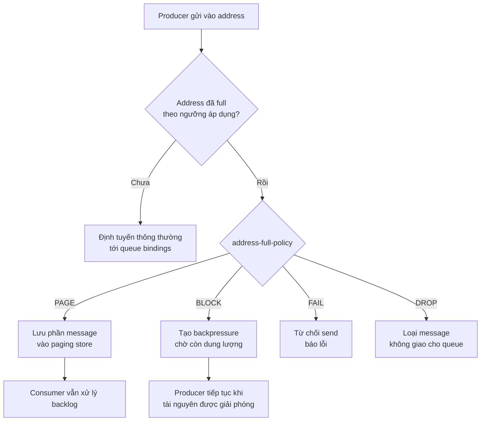
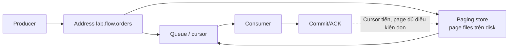
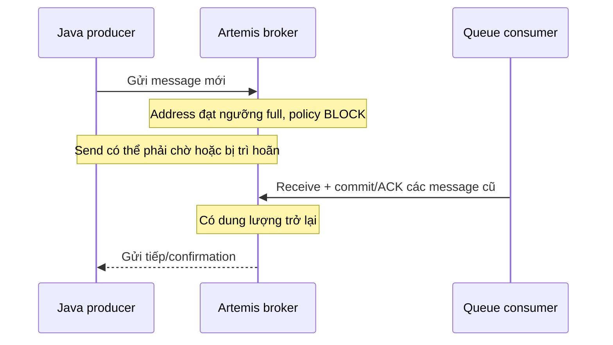
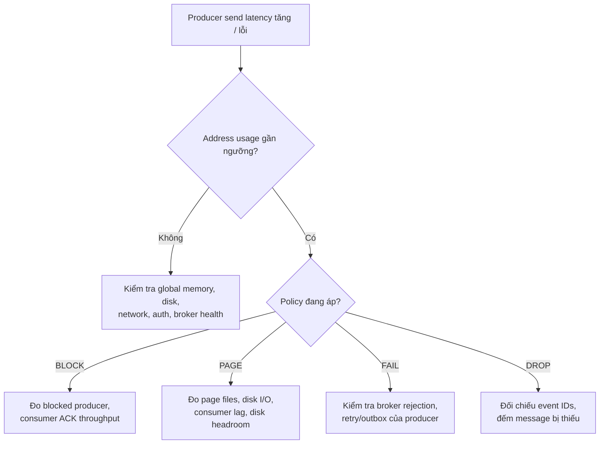

# Address full policy PAGE, BLOCK, FAIL và DROP của Artemis

> **Chương:** Điều tiết lưu lượng  
> **Phạm vi:** Apache ActiveMQ **Artemis**: cách broker xử lý message gửi tới một **address đã chạm ngưỡng dung lượng** bằng `address-full-policy`. Bài tập trung vào `PAGE`, `BLOCK`, `FAIL`, `DROP`, điều kiện kích hoạt, hệ quả với producer Java/JMS, độ bền message và cách kiểm chứng trên broker; không đồng nhất các cơ chế này với flow control của ActiveMQ Classic.

## 1. Khi producer nhanh hơn consumer, broker phải chọn một hành vi

Giả sử producer gửi 500 thông điệp/giây tới address anycast `lab.flow.orders`, nhưng consumer chỉ xử lý 100 thông điệp/giây. Backlog tăng, message và cấu trúc quản lý queue tiêu thụ thêm bộ nhớ. Nếu không có cơ chế bảo vệ, broker có thể cạn heap hoặc tài nguyên trước khi consumer bắt kịp.

Artemis cho phép đặt **address full policy** để quyết định chuyện gì xảy ra khi dung lượng message do address sử dụng đạt ngưỡng áp dụng. Bốn lựa chọn phản ánh bốn cách chấp nhận rủi ro khác nhau:

- **`PAGE`:** đưa message ra **paging store trên đĩa** để hạn chế áp lực bộ nhớ; backlog có thể tiếp tục tăng trên đĩa.
- **`BLOCK`:** áp **backpressure** lên producer; thao tác gửi có thể bị chặn hoặc chậm cho tới khi có tài nguyên trống.
- **`FAIL`:** **từ chối** message mới vượt ngưỡng, để phía gửi nhận lỗi theo giao thức/chế độ xác nhận phù hợp.
- **`DROP`:** **bỏ** message mới vượt ngưỡng; việc gửi có thể trông như thành công dù message không được định tuyến vào queue.



**Quan trọng:** chữ *full* ở đây chủ yếu nói về **ngưỡng dung lượng message áp cho address**, không đồng nghĩa partition lưu trữ đã dùng hết 100% đĩa. Với `PAGE`, đĩa còn trống vẫn có thể được sử dụng tiếp; vì vậy PAGE bảo vệ heap tốt hơn nhưng **không** tự bảo đảm capacity vô hạn.

### 1.1. Bốn câu hỏi phải quyết định trước khi chọn policy

| Câu hỏi nghiệp vụ | Nếu câu trả lời là… | Hướng cân nhắc |
|---|---|---|
| Có chấp nhận tăng độ trễ xử lý backlog không? | Có, ưu tiên giữ event | `PAGE` với dung lượng đĩa và retention được quản lý |
| Có thể làm chậm/đợi producer khi downstream nghẽn không? | Có, producer có deadline phù hợp | `BLOCK` với timeout và capacity planning |
| Có cần ứng dụng biết chắc message không được nhận để retry? | Có, muốn **fail fast** | `FAIL`, producer phải xử lý exception và durable retry |
| Có chấp nhận mất event khi tải cao không? | Chỉ với telemetry/best-effort | `DROP` sau khi đã đo mất mát và chấp nhận rõ |

Không chọn `DROP` cho lệnh thanh toán, đặt hàng hoặc các event cần đảm bảo **không bỏ sót**. Cũng không chọn `BLOCK` cho thread HTTP mà không thiết kế timeout, giới hạn thread và phản ứng với backpressure.

## 2. Address full khác với queue đầy, đĩa đầy và producer window

Artemis định tuyến message tới **address**; một address có thể gắn một hoặc nhiều queue với `ANYCAST`/`MULTICAST`. `address-full-policy` nằm trong **address settings**, tác động vào cách broker tiếp nhận và quản lý message của address, chứ không phải nút cấu hình ở từng `MessageConsumer`.

Các giới hạn dễ bị nhầm:

| Giới hạn/cơ chế | Áp dụng ở đâu? | Ý nghĩa |
|---|---|---|
| `max-size-bytes` | `address-setting` | Ngưỡng dung lượng message của address dùng để kích hoạt hành vi full; **không phải quota đĩa** |
| `page-size-bytes` | `address-setting` | Kích thước mục tiêu của một page file khi broker paging; không phải tổng dung lượng được dùng |
| `address-full-policy` | `address-setting` | Quy tắc `PAGE`, `BLOCK`, `FAIL` hoặc `DROP` khi address đầy |
| `global-max-size` | Broker-level | Ngưỡng tổng dung lượng message memory trên broker; có thể ảnh hưởng trạng thái paging/flow control của các address |
| Producer credits/window | Artemis Core client/transport | Điều tiết message/buffer đang gửi; **không thay** chính sách address full |
| JVM heap/GC | Tiến trình broker | Vẫn có thể cạn vì các thành phần khác; đặt `max-size-bytes` không phải bảo hiểm chống mọi OOM |
| Disk usage/paging storage | Filesystem/volume của broker | PAGE cần đủ không gian và I/O; disk-full có hành vi bảo vệ khác address-full |

**Tính theo address, không suy theo từng message đơn lẻ.** Broker có thể vượt nhẹ ngưỡng vì message lớn, giao đồng thời/batch và thời điểm cập nhật thống kê. `max-size-bytes=65536` không có nghĩa byte thứ 65.537 lập tức bị chặn với độ chính xác tuyệt đối.

**Trường hợp MULTICAST:** cùng một address có thể định tuyến message tới nhiều subscription queues. Một consumer chậm có thể giữ backlog, page files hoặc cursor state lâu hơn dù các subscriber khác đã xử lý nhanh. Để debug chính sách full, quan sát **address lẫn tất cả queue bindings**; chỉ nhìn queue của consumer nhanh có thể gây kết luận sai.

### 2.1. Cấu hình broker.xml cho lab

Giả sử broker Artemis có endpoint native JMS `tcp://localhost:61616` và account lab có quyền `send`/`consume`. Ta dùng một **address ANYCAST** với một queue cùng tên để loại bỏ nhiễu từ routing.

Thêm phần tử sau vào khối `<addresses>` **đang tồn tại** dưới `<core>` của `broker.xml`:

```xml
<address name="lab.flow.orders">
    <anycast>
        <queue name="lab.flow.orders"/>
    </anycast>
</address>
```

Thêm phần tử sau vào khối `<address-settings>` **đang tồn tại** (nếu đã có pattern trùng tên, chỉnh chính sách đã có thay vì tạo bản trùng):

```xml
<address-setting match="lab.flow.orders">
    <max-size-bytes>65536</max-size-bytes>
    <page-size-bytes>16384</page-size-bytes>
    <address-full-policy>PAGE</address-full-policy>
</address-setting>
```

Giải nghĩa: `65536` byte ≈ 64 KiB là **ngưỡng rất nhỏ chỉ để tạo áp lực nhanh trong lab**; `16384` byte ≈ 16 KiB là kích thước page file mục tiêu. Trong production, kích thước phải được chọn theo tốc độ gửi/nhận, số queue, kích thước message, bộ nhớ, throughput disk và SLA. Không lấy hai con số này làm khuyến nghị triển khai thật.

**Thay giữa bốn policy:** chỉ đổi **một dòng** `<address-full-policy>PAGE</address-full-policy>` sang `BLOCK`, `FAIL` hoặc `DROP` trên **broker lab**, rồi áp cấu hình theo cơ chế của phiên bản/runtime đang dùng. Một số thay đổi có thể reload, số khác cần restart; luôn xác minh policy **đang có hiệu lực** qua management/log/test. Không assume sửa file trên host sẽ tự vào container.

Với thử nghiệm so sánh công bằng, phải làm sạch **chỉ dữ liệu của queue/address lab** và kiểm soát state paging trước mỗi ca; **không** xóa page directory khi broker còn chạy, không xóa store của address khác. Cách đơn giản là tạo instance thử riêng hoặc tái tạo broker lab từ snapshot rỗng.

## 3. PAGE: đưa backlog ra paging store để giảm áp lực bộ nhớ

`PAGE` phù hợp khi **không muốn từ chối message chỉ vì backlog dùng nhiều memory**, nhưng chấp nhận lưu dữ liệu đang chờ ở paging store và trả giá bằng I/O, dung lượng đĩa và thời gian xả backlog.

Khi ngưỡng áp dụng bị vượt, Artemis bắt đầu **paging**: message/các biểu diễn cần thiết được ghi vào các page files của address. Broker quản lý các queue cursors để biết mỗi queue đã tiêu thụ những message nào. Khi consumer bắt kịp, những page không còn được queue nào cần giữ có thể được dọn theo cơ chế broker.



### 3.1. PAGE **không** làm mất message ngay khi full, nhưng có các điều kiện

- Broker vẫn cần **disk capacity**; page files có thể tăng liên tục nếu ingress vượt egress trong nhiều giờ.
- Message `PERSISTENT` và broker persistence/journal quyết định khả năng phục hồi khi broker restart/crash. **Page ra disk không tự biến message NON_PERSISTENT thành một sự kiện được đảm bảo bền vững.**
- `TTL`/expiry, giao dịch và ACK vẫn tác động vòng đời message. Page không phải nơi giữ lịch sử đã ACK mãi mãi.
- Trong lúc paging, thêm chi phí page read/write, cache, cursor, disk latency; consumer có thể thấy độ trễ cao hơn khi backlog sâu.
- Một slow subscriber của cùng address multicast có thể trì hoãn việc thu hồi page files. Khi thấy page file không giảm, kiểm tra **tất cả queue/subscription**, không chỉ queue mình đang quan sát.

### 3.2. Nhầm lẫn phổ biến: `max-size-bytes` không phải disk quota

Ví dụ producer gửi 10.000 message, mỗi message khoảng 4 KiB, trong khi `max-size-bytes=64 KiB`. Nếu policy là PAGE, message sau ngưỡng **không mặc nhiên bị xóa ở 64 KiB**; broker có thể ghi phần lớn backlog ra paging store. Dữ liệu có thể chiếm hàng chục MiB trên đĩa, chưa kể journal/metadata và các yếu tố khác.

Khi muốn ngăn paging ăn hết đĩa, cần kết hợp **giám sát/giới hạn ở tầng storage** và các chính sách page capacity tương ứng với **phiên bản Artemis sử dụng**. Một số bản hỗ trợ thêm giới hạn page và hành vi khi page store đầy; đó là **cơ chế khác `address-full-policy`**. Không tự bịa rằng `max-size-bytes` đã giới hạn đĩa.

### 3.3. PAGE phù hợp và không phù hợp khi nào?

| Trường hợp | Đánh giá |
|---|---|
| Consumer tạm ngừng vài phút; có disk reserve đủ | Thường phù hợp để hấp thu burst mà không làm producer dừng ngay |
| Producer nhanh hơn consumer **liên tục** | Chỉ trì hoãn vấn đề; cần scale consumer/giảm input, nếu không disk vẫn tăng |
| Nhiều durable topic subscriptions; một subscriber rất chậm | PAGE vẫn dùng được nhưng phải dự trù page retention và theo dõi mỗi queue |
| Latency thấp nhất là yêu cầu cứng trong mọi tình huống | Paging I/O có thể làm độ trễ biến động; cần đo, không chỉ bật PAGE |
| Disk gần đầy hoặc volume không persistent | Không nên dựa vào PAGE như cơ chế bảo toàn dữ liệu |

## 4. BLOCK: chuyển áp lực từ broker về producer

Với `address-full-policy=BLOCK`, Artemis cố gắng **ngăn producer đẩy thêm message vào một address đã full** cho tới khi áp lực giảm. Khi consumer ACK/commit và tài nguyên được thu hồi, send có thể tiếp tục. Đây là **backpressure**, không phải retry tự động có vô hạn lần ở application.



### 4.1. BLOCK trên broker không đồng nghĩa mọi `send()` Java chắc chắn block ngay

Artemis native client có producer credits/buffer và tùy chọn gửi chờ xác nhận. Một message có thể đã được xếp trong **client buffer** khi method Java return, trong khi broker đang tạo backpressure. Do đó, nếu muốn đo chính xác độ trễ producer, phải xác định **cấu hình client và loại confirmation**.

Với JMS client Artemis và persistent messages, có thể minh họa factory:

```java
ActiveMQConnectionFactory factory =
        new ActiveMQConnectionFactory("tcp://localhost:61616");
factory.setBlockOnDurableSend(true);
// Kết hợp với producer DeliveryMode.PERSISTENT và kết nối đã xác thực.
```

`setBlockOnDurableSend(true)` là tùy chọn Artemis-specific nhằm yêu cầu chờ server confirmation cho durable send theo cơ chế client. Điều này giúp thí nghiệm nhìn thấy backpressure rõ hơn; các tình huống/phiên bản và protocol khác vẫn cần xác minh. **Không** coi flag này là guarantee consumer đã xử lý message.

### 4.2. BLOCK có thể làm cạn HTTP thread pool

Ví dụ một REST endpoint tạo đơn, trên mỗi request gọi `producer.send` và đợi hàng chờ được giải phóng. Khi consumer dừng, 200 request cùng lúc có thể treo trong send, làm cạn servlet worker threads và kéo theo các endpoint không liên quan bị chậm.

Thiết kế an toàn hơn gồm **deadline tổng**, giới hạn số request/send in-flight, circuit breaker, trả kết quả quá tải rõ ràng và lưu trạng thái gửi bền vững nếu cần. Không đặt BLOCK rồi mặc định toàn bộ chuỗi “producer → HTTP client → database” tự nhận được timeout phù hợp.

Nếu mục tiêu là *fail fast*, `FAIL` có thể thích hợp hơn khi ứng dụng có cơ chế ghi nhận lỗi và retry. Nếu mục tiêu là *không từ chối nhưng chấp nhận backlog trên disk*, `PAGE` có thể thích hợp hơn khi storage được quản trị.

### 4.3. Điều gì giải phóng BLOCK?

Không phải cứ có consumer kết nối là đủ. Consumer phải **tiến triển thật sự**: nhận, hoàn tất công việc rồi ACK/commit; nếu nó nhận nhiều message nhưng giữ chúng ở trạng thái delivering chưa ack, broker vẫn có thể chịu áp lực. Kiểm tra queue ready, delivering, messages acknowledged, memory usage và producer latency. Khi không có consumer hoặc tất cả consumer rollback liên tục, BLOCK có thể kéo dài cho tới khi hệ thống xử lý áp lực.

**Cảnh báo thao tác lab:** không chạy một lệnh gửi BLOCK không có đường thoát trên broker production. Dùng tiến trình lab riêng, terminal riêng để drain queue, và cơ chế giới hạn thời gian/interrupt ở lớp vận hành. Một send bị block không nên bị “sửa” bằng cách xóa journal hoặc purge dữ liệu chưa được phép bỏ.

## 5. FAIL: báo rõ việc không tiếp nhận message mới

Với `FAIL`, khi address đạt ngưỡng, broker **từ chối message mới** thay vì dùng paging hoặc chờ đến khi còn tài nguyên. Ứng dụng gửi có thể nhận exception/error tương ứng. Trong JMS với producer đồng bộ và client được cấu hình chờ phản hồi broker, lỗi thường biểu hiện ở lời gọi `send(...)`; với transport/buffering, asynchronous API hoặc transaction, lỗi có thể xuất hiện ở callback/`commit()` hay bước xử lý tiếp theo.

**FAIL không phải DLQ.** DLQ dùng cho message đã được broker tiếp nhận rồi xử lý/redelivery thất bại theo policy; một send bị FAIL **chưa trở thành message đang chờ trong queue**, nên không kỳ vọng nó tự xuất hiện trong DLQ.

Producer cần:

1. Phân biệt **address full (capacity)** với lỗi auth, payload invalid, timeout, mất kết nối.
2. Không coi `send()` thất bại là chắc chắn broker chưa từng nhận bản message nào khi có sự cố transport; thiết kế retry với **eventId ổn định** và idempotency.
3. Sử dụng retry có backoff/jitter hoặc outbox bền vững khi phải phát event đáng tin cậy; không retry tức thì vòng nóng, càng làm address nghẽn.
4. Có giới hạn nỗ lực, đo error rate và cảnh báo; nếu không có durable retry state, application có thể mất event sau khi process crash.

`FAIL` hữu ích khi downstream producer **có khả năng phản ứng rõ ràng với quá tải**: trả 429/503 cho upstream, giữ công việc trong outbox hoặc đẩy sang một kênh xử lý chịu được backpressure.

## 6. DROP: chấp nhận mất message mới một cách có chủ đích

Với `DROP`, khi address đã full, broker có thể **bỏ qua message mới** thay vì đưa vào queue hay trả lỗi đầy đủ cho producer. Producer chỉ thấy send kết thúc bình thường **không đủ chứng minh queue đã nhận message**.

```text
Producer: send(eventId=E-9001) -> không thấy lỗi
Broker:   address full, policy DROP -> message không được route vào queue
Consumer: không bao giờ nhận E-9001
```

Với một queue lab **không có consumer** và gửi N message, số message đang chờ có thể nhỏ hơn N khi DROP được kích hoạt. Đừng mong chính xác nó dừng ở bao nhiêu message: message metadata, batching, client buffers và ngưỡng đo lường có thể thay đổi điểm kích hoạt.

`DROP` chỉ hợp lý cho những trường hợp có **quyết định sản phẩm rõ ràng về mất dữ liệu**, như bản tin telemetry thay thế được, sự kiện có thể tổng hợp lại, hoặc dữ liệu best-effort mà tốc độ quan trọng hơn độ đầy đủ. Không sử dụng DROP cho message liên quan tính tiền, giao dịch, đơn hàng hoặc các sự kiện bắt buộc audit.

**DROP không giống sampling:** broker không bảo đảm phân phối mẫu đại diện. Nó loại các message tới khi đang full, có thể thiên lệch mạnh theo thời điểm tải. Nếu cần lấy mẫu ngẫu nhiên/tỷ lệ xác định, hãy thực hiện sampling ở ứng dụng hoặc pipeline được thiết kế riêng.

### 6.1. So sánh bốn policy tại đúng một ngưỡng

| Tiêu chí | `PAGE` | `BLOCK` | `FAIL` | `DROP` |
|---|---|---|---|---|
| Message mới khi address full | Chuyển sang paging path | Chờ/cản producer | Bị từ chối với error | Bị bỏ |
| Tín hiệu cho producer | Có thể tiếp tục gửi; theo dõi paging | Latency/backpressure tăng | Error rõ nếu client nhận đủ feedback | Có thể không báo mất message |
| Rủi ro chính | Disk đầy, I/O và backlog tăng | Cạn producer threads/timeout | Retry storm nếu ứng dụng retry mù | Silent data loss |
| Message đang có từ trước | Tiếp tục tồn tại theo vòng đời/policy | Không bị xóa chỉ do BLOCK | Không bị xóa chỉ do FAIL | Không bị xóa chỉ do DROP |
| Đòi hỏi ở application | Capacity planning, alert lag/disk | Deadline, flow control, backpressure handling | Retry bền vững, error classification | Chấp nhận mất dữ liệu, telemetry đo loss |
| Trường hợp ưu tiên | Burst có thể đệm trên disk | Có thể làm chậm phía gửi | Cần từ chối rõ ràng | Best-effort có thể mất event |

## 7. Lab Java/JMS: tạo áp lực và chứng minh hành vi từng policy

Mục tiêu của lab là **không chỉ đọc cấu hình mà còn quan sát kết quả**:

- Không có consumer khi producer gửi đủ nhanh để vượt `max-size-bytes`.
- Gửi `PERSISTENT`, dùng client Artemis native và yêu cầu chờ broker confirmation để giảm nhiễu từ buffering.
- Gắn `runId` và `sequence` để đối chiếu tổng message đã được gửi, message được queue tiếp nhận, message đọc ra.
- Sau mỗi lần đổi policy, thử với broker/queue **lab sạch** và xem metric server trước khi khởi động consumer.

### 7.1. Project Maven

Ví dụ JDK 17, Jakarta Messaging (`jakarta.jms`), Artemis client dòng tương thích. Version `2.38.0` chỉ dùng để ghim dependency trong ví dụ; môi trường thực tế cần chọn client/server đã được kiểm thử cùng nhau.

Tạo `pom.xml`:

```xml
<project xmlns="http://maven.apache.org/POM/4.0.0"
         xmlns:xsi="http://www.w3.org/2001/XMLSchema-instance"
         xsi:schemaLocation="http://maven.apache.org/POM/4.0.0
                             https://maven.apache.org/xsd/maven-4.0.0.xsd">
    <modelVersion>4.0.0</modelVersion>
    <groupId>lab.messaging</groupId>
    <artifactId>artemis-address-full-lab</artifactId>
    <version>1.0.0</version>
    <properties>
        <maven.compiler.release>17</maven.compiler.release>
        <project.build.sourceEncoding>UTF-8</project.build.sourceEncoding>
        <artemis.version>2.38.0</artemis.version>
    </properties>
    <dependencies>
        <dependency>
            <groupId>org.apache.activemq</groupId>
            <artifactId>artemis-jakarta-client</artifactId>
            <version>${artemis.version}</version>
        </dependency>
    </dependencies>
    <build>
        <plugins>
            <plugin>
                <groupId>org.apache.maven.plugins</groupId>
                <artifactId>maven-compiler-plugin</artifactId>
                <version>3.13.0</version>
            </plugin>
            <plugin>
                <groupId>org.codehaus.mojo</groupId>
                <artifactId>exec-maven-plugin</artifactId>
                <version>3.3.0</version>
            </plugin>
        </plugins>
    </build>
</project>
```

### 7.2. Một chương trình cho cả gửi và tiêu thụ

Tạo `src/main/java/AddressFullProbe.java`:

```java
import jakarta.jms.BytesMessage;
import jakarta.jms.Connection;
import jakarta.jms.DeliveryMode;
import jakarta.jms.JMSException;
import jakarta.jms.Message;
import jakarta.jms.MessageConsumer;
import jakarta.jms.MessageProducer;
import jakarta.jms.Queue;
import jakarta.jms.Session;
import org.apache.activemq.artemis.jms.client.ActiveMQConnectionFactory;

import java.util.Arrays;
import java.util.concurrent.TimeUnit;

public final class AddressFullProbe {
    private static final String ADDRESS = "lab.flow.orders";

    public static void main(String[] args) throws Exception {
        boolean isSend = args.length == 4 && "send".equals(args[0]);
        boolean isDrain = args.length == 2 && "drain".equals(args[0]);
        if (!isSend && !isDrain) {
            throw new IllegalArgumentException(
                "Usage: send <runId> <count> <bodyBytes> | drain <maxCount>");
        }

        String url = System.getenv().getOrDefault(
                "BROKER_URL", "tcp://localhost:61616");
        String user = System.getenv().getOrDefault("BROKER_USER", "lab");
        String password = System.getenv("BROKER_PASSWORD");
        if (password == null || password.isBlank()) {
            throw new IllegalStateException("Set BROKER_PASSWORD");
        }

        ActiveMQConnectionFactory factory =
                new ActiveMQConnectionFactory(url);
        // Giup client quan sat xac nhan durable send tu server.
        factory.setBlockOnDurableSend(true);

        Connection connection = factory.createConnection(user, password);
        try {
            if (isSend) {
                int count = Integer.parseInt(args[2]);
                int bytes = Integer.parseInt(args[3]);
                if (count < 1 || count > 10000 ||
                        bytes < 1 || bytes > 1048576) {
                    throw new IllegalArgumentException(
                        "count in 1..10000; bodyBytes in 1..1048576");
                }
                sendBatch(connection, args[1], count, bytes);
            } else {
                int limit = Integer.parseInt(args[1]);
                if (limit < 1 || limit > 10000) {
                    throw new IllegalArgumentException("maxCount in 1..10000");
                }
                drain(connection, limit);
            }
        } finally {
            connection.close();
            factory.close();
        }
    }

    private static void sendBatch(Connection connection, String runId,
                                  int count, int bodyBytes)
            throws JMSException {
        Session session = connection.createSession(
                false, Session.AUTO_ACKNOWLEDGE);
        try {
            Queue destination = session.createQueue(ADDRESS);
            MessageProducer producer = session.createProducer(destination);
            try {
                producer.setDeliveryMode(DeliveryMode.PERSISTENT);
                producer.setTimeToLive(0L);
                byte[] payload = new byte[bodyBytes];
                Arrays.fill(payload, (byte) 0x41); // 'A'

                for (int i = 1; i <= count; i++) {
                    BytesMessage message = session.createBytesMessage();
                    message.writeBytes(payload);
                    message.setStringProperty("runId", runId);
                    message.setIntProperty("sequence", i);

                    long started = System.nanoTime();
                    try {
                        producer.send(message);
                    } catch (JMSException failure) {
                        System.err.printf(
                            "SEND_ERROR runId=%s seq=%d type=%s detail=%s%n",
                            runId, i, failure.getClass().getSimpleName(),
                            failure.getMessage());
                        throw failure;
                    }
                    long elapsedMs = TimeUnit.NANOSECONDS.toMillis(
                            System.nanoTime() - started);
                    if (i == 1 || i % 10 == 0 || i == count) {
                        System.out.printf(
                            "SEND_CALL_RETURNED runId=%s seq=%d callMs=%d%n",
                            runId, i, elapsedMs);
                    }
                }
            } finally {
                producer.close();
            }
        } finally {
            session.close();
        }
    }

    private static void drain(Connection connection, int maxCount)
            throws JMSException {
        Session session = connection.createSession(
                true, Session.SESSION_TRANSACTED);
        try {
            Queue queue = session.createQueue(ADDRESS);
            MessageConsumer consumer = session.createConsumer(queue);
            try {
                connection.start();
                int processed = 0;
                while (processed < maxCount) {
                    Message message = consumer.receive(2000L);
                    if (message == null) {
                        break;
                    }
                    // Lab: commit ngay; production chi commit khi xu ly
                    // nghiep vu da thanh cong va co idempotency.
                    session.commit();
                    processed++;
                    if (processed <= 5 || processed % 10 == 0) {
                        System.out.printf(
                            "DRAINED runId=%s seq=%d count=%d%n",
                            message.getStringProperty("runId"),
                            message.getIntProperty("sequence"),
                            processed);
                    }
                }
                System.out.println("DRAIN_TOTAL=" + processed);
            } finally {
                consumer.close();
            }
        } finally {
            session.close();
        }
    }
}
```

**Vì sao in `SEND_CALL_RETURNED` thay vì `PERSISTED`?** Để không tuyên bố quá mức về dữ liệu. Java send trả về theo provider/settings; các policy, protocol, disk và transaction vẫn quyết định message có thực sự nằm trong backlog và sống qua failure hay không. Riêng `DROP` còn có thể khiến ứng dụng không thấy exception dù message không được route.

**Vì sao `drain` commit ngay?** Đây là phép thử giải phóng queue pressure; nó **không mô phỏng business processing**. Khi chạy `drain`, message được xác nhận đã tiêu thụ, nên phải dùng queue lab và không áp dụng lệnh này cho production backlog.

### 7.3. Chuẩn bị lệnh chạy

Trên Bash/WSL:

```bash
export BROKER_URL='tcp://localhost:61616'
export BROKER_USER='lab'
export BROKER_PASSWORD='replace-with-your-lab-password'

# Một lần gửi thử, ở queue lab trống:
mvn -q compile exec:java \
  -Dexec.mainClass=AddressFullProbe \
  -Dexec.args="send page-01 200 4096"

# Chỉ chạy khi muốn tiêu thụ backlog lab:
mvn -q compile exec:java \
  -Dexec.mainClass=AddressFullProbe \
  -Dexec.args="drain 200"
```

PowerShell:

```powershell
$env:BROKER_URL = 'tcp://localhost:61616'
$env:BROKER_USER = 'lab'
$env:BROKER_PASSWORD = 'replace-with-your-lab-password'

mvn -q compile exec:java -Dexec.mainClass=AddressFullProbe -Dexec.args="send page-01 200 4096"
mvn -q compile exec:java -Dexec.mainClass=AddressFullProbe -Dexec.args="drain 200"
```

**Lưu ý trước khi thử BLOCK:** lệnh `send ... 200 4096` có thể giữ tiến trình trong trạng thái chờ vì address đã full. Phải chạy producer ở **Terminal A**, chủ động mở **Terminal B** để chạy `drain 200` giải phóng áp lực; không xem việc process im lặng là đã gửi xong. Dùng môi trường lab cô lập; nếu không có consumer/đường thoát, thao tác gửi có thể chờ lâu.

### 7.4. Bốn kịch bản kiểm chứng

| Policy đang có hiệu lực | Thao tác khi queue lab ban đầu rỗng | Quan sát ở producer | Quan sát ở broker |
|---|---|---|---|
| **PAGE** | Không bật consumer; gửi 200 × 4096 byte | `send` tiếp tục hoàn tất nếu disk/resources đủ | Address vào trạng thái paging; page files có thể xuất hiện/tăng; queue có backlog |
| **BLOCK** | Không bật consumer; gửi 200 × 4096 byte, sau đó cho Terminal B drain | Gửi có thể chậm/đứng ở một `send`; tiếp tục khi consumer commit | Address usage cao rồi giảm; queue nhận các message đã được giải phóng cho phép gửi tiếp |
| **FAIL** | Không bật consumer; gửi 200 × 4096 byte | Có `SEND_ERROR`/JMSException khi đạt full, với đường gửi chờ feedback | Message bị từ chối không vào queue; message trước đó vẫn còn |
| **DROP** | Không bật consumer; gửi 200 × 4096 byte | Nhiều hoặc tất cả lời gọi có thể return không exception | Số message lưu ở queue **nhỏ hơn** số lần gửi khi drop kích hoạt |

Đây là **kết quả định tính**, không khẳng định đúng bao nhiêu message được giữ ở mỗi chính sách. Overhead message, byte accounting, batching, global policy, transport và phiên bản broker đều ảnh hưởng điểm bắt đầu full. Nếu test không đạt, kiểm tra address setting đã áp đúng, queue còn sạch, global limit có kích hoạt trước, người khác có đang tiêu thụ và policy hiện hành là gì.

#### Ca PAGE: quan sát paging và xả backlog

1. Chọn `PAGE`; đảm bảo paging storage có dung lượng và policy đã được nạp.
2. Gửi `send page-01 200 4096` khi không có consumer.
3. Qua Artemis console/JMX/API quản trị, xem trạng thái **paging**, số page files, address memory usage và message count của `lab.flow.orders`.
4. Chạy `drain 200` và theo dõi backlog giảm, cursor tiến, page files được giải phóng dần khi không còn queue nào cần chúng.
5. Nếu page files không giảm, xem có queue/subscription khác, pending ACK/delivering hoặc tác vụ cleanup đang diễn ra không; **không xóa file thủ công**.

#### Ca BLOCK: chứng minh backpressure

1. Chọn `BLOCK`, khởi động một broker/queue lab sạch.
2. Terminal A: `send block-01 200 4096`. Ghi lại số thứ tự `seq` cuối in được và thời gian mỗi `send`.
3. Khi producer dừng tiến triển, Terminal B: chạy `drain 200`; nếu `drain` kết thúc sớm khi publisher vẫn còn, chạy tiếp để giải phóng backlog.
4. Producer có thể tiếp tục in `SEND_CALL_RETURNED` sau khi queue giảm sử dụng; so sánh latency trước và sau full.
5. Nếu producer vẫn không tiến triển, kiểm tra delivering nhưng chưa ACK, các giới hạn global, disk-full và trạng thái connection, không vội xóa message.

#### Ca FAIL: lỗi phải được ghi nhận để ứng dụng xử lý

1. Chọn `FAIL`; không bật consumer.
2. Gửi `send fail-01 200 4096`.
3. Với cấu hình producer chờ broker confirmation, dự kiến code ném `JMSException` tại/đến khi gửi vượt ngưỡng. Ghi lại `seq` thất bại, thông báo lỗi và message count phía broker.
4. Xác minh message được gửi thành công **trước** lỗi còn trong queue; message bị broker từ chối không được lấy từ DLQ.
5. Thiết kế publisher có outbox/retry backoff với ID ổn định cho `seq` chưa xác nhận; không lập vòng `catch → send lại ngay`.

#### Ca DROP: phát hiện “send thành công giả”

1. Chọn `DROP`, đảm bảo queue thử sạch và producer không bị các giới hạn khác chặn.
2. Gửi `send drop-01 200 4096`; ghi tổng số `send` đã return.
3. Dùng Artemis queue browser/management để lấy các property `runId`/`sequence` hiện còn; đối chiếu các sequence bị thiếu.
4. Không dùng `drain` trước khi browse nếu cần bằng chứng về những sequence bị drop.
5. Giải thích vì sao không thể dùng `send()` return như cam kết giao đầy đủ với policy này.

### 7.5. Lỗi của phép thử cần phân loại đúng

**`JMSException` không nhất thiết đồng nghĩa `FAIL` đã kích hoạt.** Nó cũng có thể do sai user/password, mạng mất, queue không tồn tại, journal bị lỗi hoặc server từ chối khi disk gần đầy. Đối chiếu log broker và mã lỗi/exception cùng trạng thái address. Tương tự, một `send` treo không chứng minh `BLOCK`: có thể broker down, network unreachable, connection pool cạn hoặc transaction đang đợi.

Thử nghiệm tạo nhiều message có thể để lại backlog và paging files. Sau khi thử, dùng `drain` chỉ trên queue lab, theo dõi việc broker dọn page data, hoặc reset **instance lab** bằng quy trình dừng/backup/cleanup có kiểm soát; không dùng `docker volume rm` hay xóa journal cho một broker đang lưu dữ liệu cần bảo toàn.

## 8. Quan sát đúng ba thứ: memory, paging/storage và tín hiệu producer

Một hệ thống có thể đang paging thành công nhưng sắp đầy đĩa, hoặc chưa chạm ngưỡng address nhưng vẫn nghẽn do global resource. Vì vậy **không đủ nếu chỉ xem queue length**.

| Nhóm quan sát | Metric/trạng thái cần tìm trong Artemis management (tên có thể khác theo phiên bản) | Diễn giải |
|---|---|---|
| **Address** | Address size/memory usage, paging flag, page count và queue bindings | Có chạm ngưỡng không, PAGE đã hoạt động chưa, những queue nào giữ backlog |
| **Queue** | Message count/ready, delivering count, consumer count, messages added/acknowledged | Tải đến có vượt tải xử lý không, ACK có giải phóng tài nguyên không |
| **Paging store** | Dung lượng/số page files, disk I/O, page read/write latency | PAGE có đang chuyển áp lực từ RAM sang disk không |
| **Broker chung** | Global memory usage, JVM heap/GC, paging directory disk usage, storage limits | Cổ chai có thể nằm ngoài một address |
| **Producer** | `send` p50/p95/p99 latency, gửi thành công/thất bại, pending/in-flight, timeout, callback errors | Phân biệt BLOCK, FAIL, transport và client buffer |
| **Consumer** | Throughput commit/ACK, processing latency, rollback/redelivery, DLQ/expiry | Xác nhận backlog có thể giảm thực sự |
| **Nghiệp vụ** | Số event phát, số event đến queue, số event xử lý, thiếu sequence/event ID | Cần thiết khi dùng DROP hoặc có retry tạo bản trùng |

### 8.1. Chẩn đoán khi broker đột nhiên chậm



#### Cảnh báo và hành động khuyến nghị

- **PAGE:** cảnh báo theo tốc độ tăng page storage và **thời gian còn lại trước khi đầy volume**, không chỉ tổng bytes. Có thể cần tăng capacity, scale consumer, throttle producer hoặc cách ly subscriber chậm. Không tự xóa page files đang được broker sử dụng.
- **BLOCK:** cảnh báo số thread/send đang chờ, p99 send latency và số request HTTP còn in-flight. Nếu broker chưa giải phóng áp lực, cần điều tiết ingress chứ không mở thêm vô hạn producers.
- **FAIL:** cảnh báo rejection rate và độ trễ outbox/retry. Retry phải có backoff/jitter và bền vững; xử lý như một loại quá tải có thể phục hồi, không ghi “message đã phát” rồi bỏ lỗi.
- **DROP:** cảnh báo dựa trên đối chiếu **producer event ID/counter với queue/consumer counter**. Chỉ báo send exception có thể bằng 0 dù dữ liệu đã bị loại.

**Không đánh đồng queue ready với tổng backlog:** message đang delivering, scheduled/redelivery hoặc paged có thể có cách hiển thị riêng tùy công cụ quản trị. Khi page count cao mà ready count nhỏ, kiểm tra cursor/queue bindings/ACK và consistency giữa metric trước khi kết luận dữ liệu đã mất.

## 9. Khi nhiều cấu hình cùng tác động: lỗi thường bị chẩn đoán sai

### 9.1. Global memory limit có thể kích hoạt áp lực trước ngưỡng address

Nếu broker có nhiều address, `global-max-size` có thể tạo áp lực tổng **trước khi** `lab.flow.orders` chạm `max-size-bytes` của riêng nó. Khi thí nghiệm không có kết quả như bảng, hãy xem global usage và những address khác đang giữ message. Tránh so sánh hai policy trên cùng một broker đang chịu tải bên ngoài lab.

### 9.2. Disk full là sự cố khác address full

PAGE có thể tiếp tục ghi page files tới khi disk safeguards hoặc storage limits can thiệp. Khi disk chạm ngưỡng, broker có thể chặn/từ chối xử lý hoặc phát lỗi khác tùy cấu hình. **Không khẳng định PAGE bảo đảm send luôn thành công.** Việc disk chật cũng có thể ảnh hưởng journal/transaction của cả broker, không chỉ address đang paging.

### 9.3. Send return/callback và transaction commit là các mốc khác nhau

Với gửi bất đồng bộ và client buffering, có thể quan sát return từ API **trước khi broker thực sự hoàn tất tiếp nhận**; errors có thể được báo sau. Với producer dùng `SESSION_TRANSACTED`, kết quả của `send` còn phụ thuộc `commit()`. Vì thế bảng so sánh trong bài dùng **producer non-transacted, persistent, chờ durable confirmation** để tăng khả năng quan sát phản ứng của broker.

Không tự giả định `DROP` khiến `JMSException`, cũng không coi `FAIL` luôn xuất hiện tại đúng một dòng Java trên mọi protocol/provider. Khi sử dụng AMQP/OpenWire/STOMP hoặc phiên bản client khác, xác minh **cách lỗi/backpressure được chuyển về client**; chính sách broker ở address vẫn là trung tâm nhưng bề mặt API có thể khác.

### 9.4. Broker có thể có nhiều queue trên một address

Với multicast hoặc nhiều bindings, message không chỉ tạo một đơn vị công việc; tốc độ ACK giữa các queues khác nhau. Một subscriber offline có thể khiến paging lâu hơn, gây tác động với producer và các subscribers còn online. Đừng cấu hình address full dựa trên throughput của consumer nhanh nhất; tính cả subscriber chậm nhất và khả năng loại bỏ subscription cũ có chủ đích.

### 9.5. Đổi policy trên address đang có backlog

Từ PAGE sang BLOCK/FAIL/DROP **không tự làm mất hết** những message đã được nhận trước đó, nhưng có thể thay đổi cách xử lý **message mới** và việc thu hồi paging data. Nếu có backlog đang paged, không được suy luận file paging lập tức biến mất khi đổi policy. Cần kiểm thử trên bản sao môi trường hoặc kế hoạch change window với theo dõi backpressure, page cursor và recovery.

## 10. Quyết định thiết kế dựa trên mục tiêu nghiệp vụ

| Kiểu luồng | Ưu tiên | Policy nên cân nhắc | Bảo vệ bổ sung bắt buộc |
|---|---|---|---|
| Thanh toán, đơn hàng cần giữ đủ message | Không được mất event; có thể chịu trễ | `PAGE` khi disk/persistence đủ; hoặc `BLOCK/FAIL` nếu upstream/outbox xử lý tốt | Event ID ổn định, idempotency, disk/paging alerts, retry bền vững |
| Dịch vụ front-end cần timeout nhanh | Không được giữ request HTTP vô hạn | `FAIL` nếu có cơ chế phản hồi/ghi outbox | Quota, retry backoff, circuit breaker, 429/503 hoặc trạng thái pending |
| Batch producer kiểm soát được tốc độ | Có thể chờ consumer bắt kịp | `BLOCK` | Deadline hợp lý, giới hạn concurrency, đo latency |
| Event ingestion biến động lớn, storage đáng tin cậy | Hấp thụ burst mà không bắt producer fail ngay | `PAGE` | Dung lượng đĩa, I/O và thời gian xử lý backlog |
| Telemetry best-effort có thể tái tạo | Ưu tiên tốc độ hơn độ đầy đủ | `DROP` chỉ nếu thật sự được cho phép | Chỉ số mất dữ liệu, sampling upstream, nhãn data quality |

### 10.1. Đối chiếu ngắn với ActiveMQ Classic

**Artemis `address-full-policy` không phải một thuộc tính dùng trực tiếp trên ActiveMQ Classic.** Classic có cơ chế `systemUsage`, `memoryUsage`, `storeUsage`, `tempUsage` và `producerFlowControl`/destination policies riêng. Dù hai broker đều có khả năng backpressure, cấu hình và ngữ nghĩa của chúng khác nhau.

Ví dụ dạng cấu hình **Classic** (chỉ minh họa một khía cạnh flow control, không tương đương đầy đủ với bốn policy Artemis):

```xml
<destinationPolicy>
    <policyMap>
        <policyEntries>
            <policyEntry queue=">" producerFlowControl="true"/>
        </policyEntries>
    </policyMap>
</destinationPolicy>
```

Nếu migration Classic → Artemis, hãy chuyển **yêu cầu chức năng** (chặn, từ chối, page, chấp nhận mất) và test matrix, **không sao chép tên setting**. Classic `producerFlowControl=true` không có nghĩa đây là `PAGE` của Artemis; Classic `storeUsage` cũng không phải `max-size-bytes` của Artemis.

## 11. Bài tập thực hành có tiêu chí kiểm chứng

1. **PAGE và disk headroom:** chọn `PAGE`, gửi 200 message 4 KiB vào queue lab trống. Ghi số page files và disk usage trước/sau khi gửi, rồi drain. Vì sao `max-size-bytes=64 KiB` không giới hạn tổng disk usage ở 64 KiB?
2. **BLOCK và drain:** chọn `BLOCK`, chạy producer ở Terminal A, consumer ở Terminal B. Đo p95 latency của `send` trước và sau khi consumer commit. Giải thích vì sao `consumer.connect()` mà không ACK chưa chắc đã giải phóng pressure.
3. **FAIL và retry bền vững:** chọn `FAIL`. Khi producer nhận `JMSException` do full, thiết kế cơ chế outbox giữ event ID và retry exponential backoff. Làm sao phân biệt lỗi capacity với lỗi auth/connection?
4. **DROP và đối chiếu sequence:** chọn `DROP`, lưu `runId`/`sequence` cho 200 lần send. Đọc queue bằng management browser (không ACK) và tìm những sequence vắng mặt. Vì sao số lần `send` return không phản ánh đủ số message thực sự được lưu?
5. **Multicast chậm:** giả lập một address với hai subscription queues, tạm dừng một consumer. Theo dõi paging khi consumer còn lại xử lý hết. Vì sao page files có thể được giữ lâu?
6. **Global threshold:** cấu hình một broker lab có hai address gửi tải đồng thời; thay đổi `global-max-size` trong phạm vi test. Vì sao chính sách address-full có thể biểu hiện khác so với ca một address cô lập?
7. **Đánh giá production:** ingress 5.000 message/giây, consumer bình thường xử lý 4.500/giây, mỗi message trung bình 2 KiB. Tính tốc độ backlog tăng về payload **xấp xỉ 1.000 KiB/s**, chưa tính metadata/copy/journal. Với outage 30 phút, ước lượng lượng payload tích tụ và đề xuất PAGE/BLOCK/FAIL cùng alert/storage reserve; giải thích vì sao không nên lấy kết quả này như kích thước file thật tuyệt đối.

### Checklist nghiệm thu bài

- [ ] Phân biệt được address memory threshold, page file size, global memory limit và disk capacity.
- [ ] Giải thích được từng chính sách `PAGE`, `BLOCK`, `FAIL`, `DROP` và rủi ro nghiệp vụ của nó.
- [ ] Biết cấu hình `<address-setting>` trong Artemis `broker.xml` và xác minh cấu hình hiệu lực.
- [ ] Có kết quả thử gửi `PERSISTENT`, đo latency/exception và quan sát queue/paging metrics với từng policy.
- [ ] Không suy `send()` returned = consumer đã nhận hoặc dữ liệu chắc chắn tồn tại khi dùng `DROP`.
- [ ] Thiết kế được biện pháp bảo vệ producer và broker: timeout, backpressure, retry bền vững, idempotency, disk alarms.
- [ ] Biết phân biệt cơ chế Artemis address full với ActiveMQ Classic producer flow control.

**Kết luận:** `PAGE` chuyển backlog sang disk chứ không xóa giới hạn tài nguyên; `BLOCK` yêu cầu phía gửi chịu backpressure; `FAIL` từ chối rõ để ứng dụng có thể phản ứng; `DROP` chủ động đánh đổi tính đầy đủ dữ liệu. Quyết định đúng không chỉ là chọn một giá trị trong `broker.xml` mà phải có **mục tiêu nghiệp vụ, cách producer nhận tín hiệu, giới hạn capacity và phép kiểm chứng end-to-end**.
