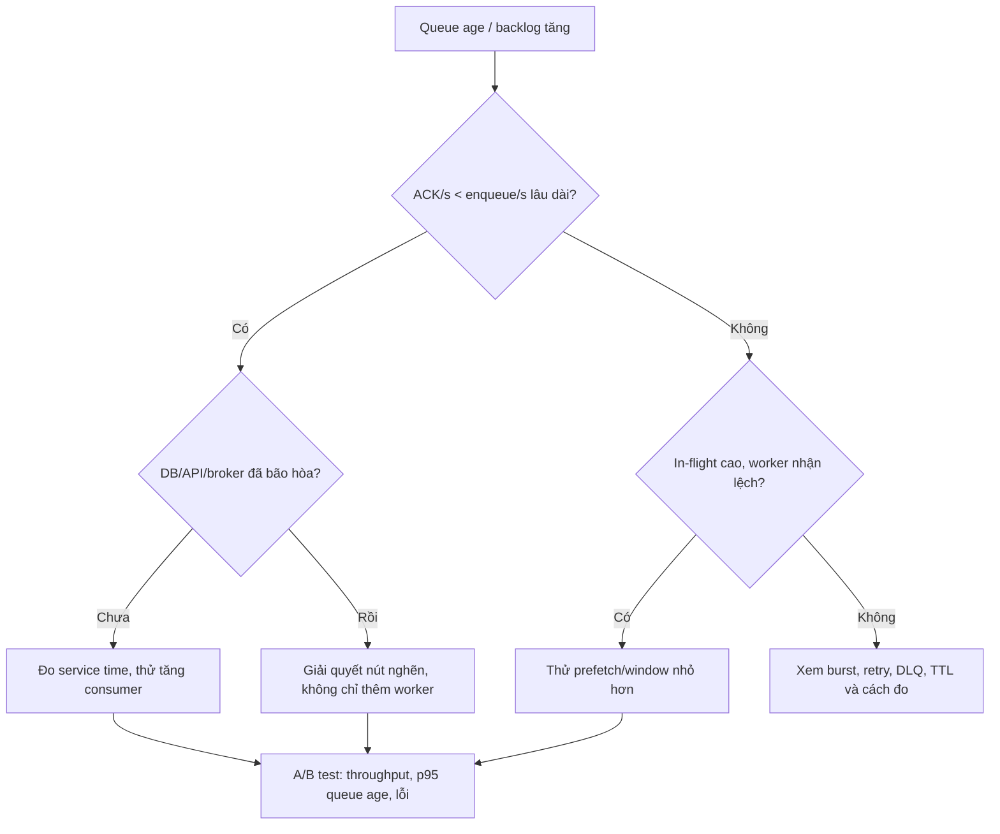

# Điều chỉnh timeout, số consumer và mức lấy trước bằng số đo thực tế

> **Chương:** Điều tiết lưu lượng  
> **Phạm vi:** ActiveMQ Classic và ActiveMQ Artemis, tập trung vào **tuning dựa trên đo lường** đối với JMS queue có nhiều consumer. Bài áp dụng cho mô-đun `INTEGRATION_MESSAGING_MESSAGE_BROKER_ACTIVEMQ` với producer/consumer Java, ACK, transaction, redelivery, DLQ và vận hành broker đáng tin cậy.  
> **Mục tiêu:** Xác định timeout nào đang gây vấn đề, tính số consumer từ tốc độ đến và thời gian xử lý, phân biệt Classic prefetch với Artemis consumer window, thiết lập thí nghiệm A/B có số liệu trước/sau và chọn cấu hình theo latency/throughput/fairness thay vì cảm tính.

## 1. Bài toán thực tế: queue tăng nhưng worker chưa chắc thiếu

Dịch vụ Invoice nhận các job trên queue `lab.tuning.jobs`. Vào giờ cao điểm, số message đến tăng từ 50 lên 120 message/giây. Có bốn worker đang chạy nhưng queue age p95 tăng từ 2 giây lên 40 giây, trong khi một worker gần như rảnh.

Có thể có **ít nhất bốn nguyên nhân khác nhau**:

1. **Năng lực xử lý thực tế không đủ:** Tổng số ACK/giây thấp hơn số enqueue/giây trong thời gian dài.
2. **Phân phối không đều:** Worker chậm giữ nhiều message đã được dispatch trước trong prefetch/consumer buffer; worker nhanh không lấy được phần đang bị giữ.
3. **Tài nguyên chung nghẽn:** DB pool, API downstream, disk journal hoặc broker paging đã chạm giới hạn. Thêm consumer có thể khiến throughput **giảm**.
4. **Timeout được đặt sai:** Worker coi `receive(100)` trả về `null` là connection lỗi, hoặc timeout gửi quá nhỏ gây retry trùng, hoặc thời gian chờ HTTP vô hạn giữ JMS transaction không ACK.



**Không có cấu hình “prefetch=1, 10 worker, timeout=30 giây” luôn tối ưu.** Mỗi thay đổi phải có: giả thuyết, workload tái lập được, chỉ số baseline, một biến thay đổi, ngưỡng chấp nhận và cách rollback.

## 2. Bộ số đo tối thiểu trước khi sửa cấu hình

### 2.1. Đo đúng bốn loại thời gian

Một job đi qua các mốc:

```text
Producer tạo job
  |---- queue waiting ----> Broker dispatch
  |---- client buffered --> Consumer receive/onMessage
  |---- processing ------> Business logic xong
  |---- ACK/commit ------> Broker xác nhận hoàn tất
```

| Đại lượng | Đo từ đâu? | Dùng để quyết định |
| --- | --- | --- |
| **Queue age / end-to-end lag** | Thời gian từ event được enqueue/created đến khi xử lý/ACK; broker management hoặc job timestamp | Có đáp ứng SLA hay đang tích lũy tồn đọng? |
| **Receive wait** | `receive(timeout)` bắt đầu đến khi trả message/null | Worker thực sự đói việc hay đang chờ vì buffer/selector/connection? |
| **Processing time** | Bắt đầu logic nghiệp vụ đến khi logic hoàn tất (chưa tính ACK) | Năng lực từng worker và bottleneck downstream |
| **JMS commit/ACK latency** | Trước `context.commit()` đến lúc trả về hoặc ném lỗi | Broker storage, network, flow control và trạng thái không chắc chắn khi lỗi |

Đo **p50, p95, p99** của từng đại lượng. **Throughput (ACK/s)** và **queue age** quan trọng hơn chỉ có số message queue đang giữ; latency của job dài thường bị che bởi trung bình.

**Cảnh báo đo timestamp:** Nếu producer và consumer nằm trên nhiều máy không đồng bộ thời gian, chênh lệch `System.currentTimeMillis()` có thể sai. Ưu tiên metric queue residency từ broker hoặc đồng bộ clock (NTP); thời gian đo trong **cùng JVM** nên dùng `System.nanoTime()`. `JMSTimestamp` là thời điểm provider gắn vào message, không tự chứng minh thời gian tạo nghiệp vụ gốc.

### 2.2. Đo rate bằng delta, không suy từ counter tích lũy

Ví dụ từ broker:

```text
Thời điểm t0: messagesAdded=200.000; messagesAcknowledged=180.000
Thời điểm t1 sau 60 giây:
             messagesAdded=207.200; messagesAcknowledged=184.800

λ_in  = (207.200 - 200.000) / 60 = 120 msg/s
λ_ack = (184.800 - 180.000) / 60 =  80 msg/s
Backlog tăng gần (120 - 80) × 60 = 2.400 message
```

Đây là tính toán **trong cửa sổ đo**, bỏ qua expiry, move, DLQ, auto-delete và các nguồn khác. Trong production phải đối chiếu thêm các counter đó. Đặc biệt, `QueueSize` và `DeliveringCount`/`InFlightCount` không nhất thiết là hai tập rời nhau để cộng máy móc.

### 2.3. Metrics nào tương ứng Classic và Artemis?

| Câu hỏi | ActiveMQ Classic — Web Console/JMX | Artemis — Console/JMX/Micrometer |
| --- | --- | --- |
| Có bao nhiêu consumer kết nối? | `ConsumerCount` | `consumerCount` / `consumer.count` |
| Message thêm vào so với ACK? | `EnqueueCount`, `DequeueCount` | `messagesAdded`, `messagesAcknowledged` / `messages.added`, `messages.acknowledged` |
| Bao nhiêu message đã dispatch chưa ACK? | `InFlightCount` | `deliveringCount` / `delivering.message.count` |
| Backlog hiện tại? | `QueueSize` | `messageCount` / `message.count` |
| Bao nhiêu message chờ retry? | Broker scheduled/redelivery metrics tùy phiên bản | `scheduledCount` |
| Có lỗi poison? | DLQ queue metrics, `ExpiredCount` | `messagesKilled`, DLQ, expiry metrics |
| Resource bị nghẽn? | `MemoryPercentUsage`, `StorePercentUsage`, `TempPercentUsage` | Address size/pages, disk, journal, paging và address-full policy |
| Worker chia việc thế nào? | Consumer subscriptions, dispatch/in-flight, log worker | `listConsumers`: `messagesDelivered`, `messagesAcknowledged`, `messagesInTransit` |

Đọc metric **mỗi 5–15 giây** trong một khoảng đủ dài, ghi các phiên bản broker/client và điều kiện tải. Broker reset counter hoặc restart thì không lấy hiệu số cắt qua thời điểm reset.

## 3. Timeout: tên giống nhau nhưng kiểm soát những việc khác nhau

Điều chỉnh timeout chỉ đúng khi biết **đang chờ cái gì**. Các timeout sau không thay thế nhau.

| Timeout / cơ chế | Điểm áp dụng | Khi hết hạn | Không có nghĩa là |
| --- | --- | --- | --- |
| **`receive(2000)`** | JMS consumer đồng bộ | Nếu không có message trong khoảng chờ, trả về `null` | Broker mất kết nối; job đã thất bại; phải rollback |
| **Send/blocked-call timeout** | Client đang chờ broker phản hồi send/commit | Có thể ném exception hoặc báo kết quả không rõ | Broker chắc chắn chưa nhận/commit message |
| **Connection TTL/heartbeat** | Phát hiện peer/network chết | Dọn session, gọi listener, hoặc khởi động reconnect/failover tùy client | Giới hạn thời gian xử lý một job |
| **Business HTTP/DB timeout** | Gọi hệ thống ngoài trong consumer | Tác vụ nghiệp vụ có thể lỗi/chưa rõ kết quả | JMS tự ACK/rollback thay ứng dụng |
| **Redelivery delay** | Broker retry sau rollback | Hoãn lần giao kế tiếp | Timeout chờ `receive()` |
| **Message TTL** | Producer gửi message có expiration | Message có thể hết hạn trước khi xử lý | Timeout của lời gọi `send()` |

### 3.1. `receive(timeout)`: thời gian đợi message, không phải SLA xử lý

```java
Message message = consumer.receive(2000);
if (message == null) {
    // Không có delivery trong lần poll này.
    // Có thể chạy housekeeping, kiểm tra shutdown hoặc tiếp tục chờ.
    return;
}
process(message);
session.commit();
```

Nếu queue trống, trả về `null` sau khoảng 2 giây là hoạt động bình thường. Giảm `receive` từ 2.000 ms xuống 10 ms **không làm broker đẩy message nhanh hơn**, nhưng có thể làm worker thức dậy/log/poll rất nhiều lần, tiêu tốn CPU. Đặt `receive(timeout)` sao cho vừa cho phép shutdown/health check định kỳ, vừa không tạo vòng quay rỗng.

- `receiveNoWait()` trả ngay khi chưa có message; không thích hợp làm vòng lặp spin không sleep/backoff.
- `receive()` không timeout có thể phù hợp với listener/long-lived worker khi quy trình shutdown thực hiện đúng cách; với loop cần chủ động kiểm tra cờ dừng, dùng timeout hữu hạn sẽ dễ dừng sạch hơn.
- Nếu `receive(timeout)` vẫn trả `null` khi queue có backlog, kiểm tra selector, consumer start, ACL, message scheduled, routing và **message đang nằm trong prefetch của worker khác** trước khi tăng timeout.

### 3.2. Timeout gửi ở Classic

OpenWire client ActiveMQ Classic có phương thức:

```java
import org.apache.activemq.ActiveMQConnectionFactory;

ActiveMQConnectionFactory factory =
        new ActiveMQConnectionFactory("tcp://127.0.0.1:61616");

// Đơn vị mili-giây: giới hạn thời gian chờ phản hồi của lời gọi send phù hợp.
factory.setSendTimeout(10000);

// Để đo blocked producer rõ hơn khi lab, có thể chọn sync send.
factory.setAlwaysSyncSend(true);
```

`setSendTimeout(10000)` ở client **khác** `sendFailIfNoSpaceAfterTimeout` trong Classic broker `<systemUsage>`. Broker có thể block producer vì destination memory/store/temp usage đạt ngưỡng; client timeout có thể trả lỗi nếu quá lâu. Không sửa timeout để “chữa” disk đã đầy; kiểm tra ACK throughput, producer flow control và quota.

Với Classic `failover:(...)` transport, có tùy chọn `timeout` riêng để giới hạn thời gian đợi send khi broker chưa kết nối trong quá trình failover. Nó không thay thế JDBC/HTTP timeout và không tạo bảo đảm “gửi chắc chắn thất bại”. Chỉ cấu hình khi hiểu rõ chiến lược reconnect và transaction đang dùng.

### 3.3. Timeout phía Artemis Core client

Ví dụ connection URI của **Artemis Jakarta JMS client dùng Core protocol**:

```text
tcp://127.0.0.1:61616?consumerWindowSize=0&callTimeout=30000&connectionTTL=60000&clientFailureCheckPeriod=30000
```

Ý nghĩa:

- `callTimeout=30000`: giới hạn thời gian chờ một số lời gọi đồng bộ tới broker, gồm những trường hợp cần broker phản hồi. Khi lỗi, kết quả giao dịch có thể **không rõ**; không suy ra server chưa commit.
- `connectionTTL=60000`: khoảng broker giữ connection nếu không nhận dữ liệu/heartbeat hợp lệ; **không** phải thời gian tối đa một worker được xử lý message.
- `clientFailureCheckPeriod=30000`: nhịp kiểm tra/heartbeat và cơ chế phát hiện phía client; không nên đặt cao hơn TTL một cách tùy tiện.
- `consumerWindowSize=0`: độ lớn buffer nhận trước của client; **không** phải timeout.

Các giá trị trên là **ví dụ để phân biệt loại tham số**, không phải bộ default/tuning chung khuyến nghị cho production. Kiểm tra sự tương thích client 2.x, transport, SSL và version broker thực tế.

### 3.4. Chọn timeout dựa trên dấu phân phối độ trễ

Giả sử p95 commit JMS = 40 ms, p99 = 180 ms, nhưng 1% request có thể bị kẹt 5 giây khi disk flush. Một `callTimeout=100ms` có thể làm **rất nhiều giao dịch hợp lệ** bị coi là timeout; `callTimeout=5 phút` lại che giấu sự cố và giữ thread lâu.

Quy trình đúng:

1. Lấy **p99/p99.9**, maximum hợp lý và tỷ lệ timeout dưới tải bình thường lẫn cao điểm.
2. Xác định **ngân sách end-to-end**: ví dụ request API đầu vào chịu 5 giây không có nghĩa một job async bị giới hạn 5 giây; SLA queue age có thể là 60 giây.
3. Chọn timeout **vượt jitter hợp lệ nhưng đủ nhỏ để phát hiện lỗi**, dựa trên khả năng retry, circuit breaker và error budget.
4. Thử network delay/failover: ghi **kết quả không chắc chắn** của send/commit; retry với `eventId` ổn định và consumer idempotent.
5. Khi external HTTP/DB có timeout lâu hơn toàn bộ xử lý dự kiến, **điều chỉnh timeout ở lớp đó**, không chỉ tăng JMS `receive(timeout)`.

## 4. Số consumer: tính theo tốc độ xử lý và xác nhận bằng throughput thực

Gọi:

- `λ` là tốc độ message vào queue (message/giây) trong cửa sổ đo.
- `S` là **thời gian phục vụ trung bình của một message ở một worker**, gồm nghiệp vụ và phần JMS ACK/commit theo phép đo.
- `μ = 1/S` là khả năng lý thuyết của một worker tuần tự (message/giây).
- `N` là số consumer độc lập, mỗi consumer có Session/JMSContext riêng.
- `ρ_target` là mức sử dụng mục tiêu, ví dụ **0,7**, giữ dự phòng cho biến động.

Ước lượng ban đầu:

\[
N_{\mathrm{start}} = \left\lceil \frac{\lambda\, S}{\rho_{\mathrm{target}}}\right\rceil.
\]

**Ví dụ:** `λ = 120 msg/s`; trung bình một job cần 40 ms = 0,04 s; mục tiêu `ρ=0,7`:

\[
N_{\mathrm{start}}=\left\lceil\frac{120\times0.04}{0.7}\right\rceil=7.
\]

Bảy consumer chỉ là **giả thuyết xuất phát**, không phải chứng minh đủ SLA. Công thức giả định mỗi consumer xử lý tuần tự, tương đối độc lập; nếu cả bảy phải đợi một DB pool nhỏ hoặc khóa nóng, throughput không tăng tuyến tính. Không dùng **p95 service time** làm giá trị trung bình trong phép tính rồi coi kết quả là capacity chính xác; p95 dành cho tail-latency/SLA.

### 4.1. Khi nào thêm consumer giúp, và khi nào gây hại?

| Quan sát | Hành động có cơ sở |
| --- | --- |
| `ACK/s < enqueue/s`, DB/API/CPU còn dư, worker gần mức sử dụng cao | Tăng N từng bước (1 → 2 → 4 → 6), đo lại |
| ACK/s tăng khi tăng N và queue age p95 giảm | Tiếp tục cho đến điểm đạt SLA/chi phí |
| Tăng N nhưng ACK/s gần như không đổi, DB connection pool 100% | Dừng scale worker; xử lý nút nghẽn DB/pool/SQL |
| In-flight cao, worker nhanh vẫn nhàn | Thử giảm prefetch/window trước khi tăng N |
| Tỷ lệ redelivery, deadlock DB, timeout API tăng khi tăng N | Giảm N hoặc giảm concurrency ở downstream |
| Message được group theo `JMSXGroupID`, một group quá nóng | Thêm worker có thể không chia được hot group; xem lại partition/key |

**Một JMS Session không dùng đồng thời từ nhiều thread.** N consumer độc lập phải có N Session/JMSContext phù hợp (hoặc listener container quản lý đúng). Không chia một `JMSContext` cho tất cả Java threads và tưởng đã tăng consumer concurrency.

### 4.2. Little's Law: dùng đúng điều kiện

Khi hệ thống **ổn định**, Little's Law cho xấp xỉ:

\[
L=\lambda_{\mathrm{throughput}}\times W
\]

với `L` là số công việc trung bình ở một phạm vi nhất quán (queue + đang xử lý nếu đo end-to-end), `W` là thời gian trung bình trong **cùng phạm vi**, và `λ` là throughput hoàn tất thực tế. Không dùng công thức như bảo đảm khi backlog đang tăng không giới hạn hoặc khi trộn queue depth với chỉ có processing time.

Để dự báo một hệ thống quá tải kéo dài, dùng trực tiếp `dQ/dt ≈ enqueue/s - ACK/s` (đã tính các nguồn expiry/DLQ khi phù hợp).

## 5. Mức lấy trước: Classic đếm message, Artemis đếm byte

### 5.1. Classic OpenWire `consumer.prefetchSize`

ActiveMQ Classic mặc định thường có queue prefetch lớn (tài liệu 5.x mô tả `1000` message) để giảm round trip. Với worker nhanh và message nhỏ, prefetch lớn có thể tăng throughput; với worker chậm hoặc nhiều worker bất đối xứng, nó gây **message hoarding**.

```text
Queue còn 300 jobs
  |- Consumer A kết nối trước, prefetch=300 -> buffer giữ 300
  |- Consumer B xuất hiện sau -> không còn job ready cho B
  |- A xử lý 1 job/s, B 20 jobs/s -> toàn hệ thống vẫn đợi A
```

Một lựa chọn cho worker chậm:

```java
import org.apache.activemq.ActiveMQConnectionFactory;

ActiveMQConnectionFactory factory =
        new ActiveMQConnectionFactory("tcp://127.0.0.1:61616");
factory.getPrefetchPolicy().setQueuePrefetch(1);

// Consumer tạo từ Connection của factory này dùng queue prefetch=1.
```

Hoặc chỉ áp dụng trên một destination:

```java
Queue queue = session.createQueue(
        "lab.tuning.jobs?consumer.prefetchSize=1");
MessageConsumer consumer = session.createConsumer(queue);
```

Các giá trị tham khảo để **thử**, không phải preset chung:

- `prefetch=1`: worker chậm, công việc lâu, fairness thường tốt hơn; tăng giao tiếp broker/client.
- `prefetch=10` hoặc `50`: thỏa hiệp với việc giữ trước một ít message; đo thông lượng.
- `prefetch=1000`: có thể phù hợp với consumer rất nhanh, nhưng dễ gây giữ trước số lượng lớn và phân phối lệch.
- `prefetch=0`: chế độ **pull** trên Classic, tránh push buffering; có khác biệt dispatch/receive semantics và overhead, nên thử kỹ trước khi dùng trong production.

**Không có cam kết chia đều 50/50** chỉ nhờ `prefetch=1`. Worker nhanh thường xử lý nhiều message hơn, vì nó ACK và trở lại trạng thái nhận việc sớm hơn.

### 5.2. Artemis Core `consumerWindowSize`

Artemis Core client dùng **byte credits/window**, không phải số message:

```text
tcp://127.0.0.1:61616?consumerWindowSize=0
tcp://127.0.0.1:61616?consumerWindowSize=65536
tcp://127.0.0.1:61616?consumerWindowSize=1048576
```

- `0`: không buffer nhận trước ở client; message ở broker có thể được cấp cho consumer khác khi consumer này đang bận.
- `65536`: khoảng 64 KiB window; tương đương bao nhiêu message còn tùy kích thước message trên wire/broker.
- `1048576`: khoảng 1 MiB, là giá trị mặc định được tài liệu Artemis hiện đại mô tả cho Core consumer khi chưa override.
- `-1`: unbounded client-side buffering; **không khuyến nghị** dùng mặc định cho worker có xử lý lâu hoặc message có kích thước biến thiên lớn.

Đối chiếu đơn vị:

| Cấu hình | Đơn vị | Nếu message 4 KiB (chỉ ước lượng) | Ý nghĩa |
| --- | --- | --- | --- |
| Classic `prefetchSize=1` | message | Tối đa khoảng 1 delivery cấp trước | Thấp latency fairness, tốn round trip |
| Classic `prefetchSize=100` | message | Tối đa khoảng 100 delivery cấp trước | Throughput có thể tốt; hoarding cao hơn |
| Artemis `consumerWindowSize=65536` | byte | Cỡ hàng chục message tùy overhead | Window credits có tổng byte hạn chế |
| Artemis `consumerWindowSize=0` | chế độ đặc biệt | Không prebuffer | Thích hợp đối chứng worker chậm |

Số message tương đương trong bảng **không phải giá trị bảo đảm**: message size còn header/protocol, tiêu thụ credits, dispatch và ACK chính xác phụ thuộc provider.

### 5.3. Thay prefetch/window khi nào là đúng?

- **In-flight tăng cao và phân phối rất lệch** với worker chậm: thử giảm window/prefetch.
- **Broker round trip đáng kể nhưng processing cực nhanh, worker CPU thấp**: tăng window/prefetch từng bước có thể cải thiện throughput.
- **Message groups, exclusive consumers hoặc selector phức tạp**: việc phân phối không công bằng có thể do topology/routing, không chỉ do buffer.
- **Client RSS/heap tăng khi backlog lớn**: giảm buffer có thể giúp, đồng thời kiểm tra consumer memory leak.
- **ACK batch và transaction size lớn**: đo cùng nhau vì commit hiếm có thể giữ nhiều delivery chưa ACK, che tác động của window.

**Không đổi prefetch, số consumer và timeout trong cùng một thí nghiệm**, vì mất khả năng quy nguyên nhân cho biến nào.

## 6. Thiết kế một vòng tuning có thể lặp lại

### 6.1. Ghi rõ mục tiêu và điều kiện workload

Ví dụ yêu cầu dịch vụ Invoice:

```text
SLA:                   p95 end-to-end processing lag < 10 giây
Input burst:           120 job/s trong 5 phút
P95 business processing: 80 ms
Tỷ lệ lỗi thành công:  >= 99,9% trước khi hết retry
Không thay đổi:        payload schema, broker version, DB indexes, TLS
Tài nguyên giới hạn:   8 vCPU worker node, DB pool 32 connections
```

Ở mỗi phép thử, cần giữ cố định: message size distribution, producer rate pattern, ACK mode, số event, số JVM/cấu hình CPU/memory, DB load, retry policy và broker storage. Dọn backlog của **queue thử nghiệm** hoặc cấp runId/destination riêng để tránh message từ lần trước trộn vào phép đo.

### 6.2. Ma trận A/B và điều kiện dừng

Bảng sau là **số liệu giả định minh họa cách phân tích, không phải kết quả benchmark đã chạy**:

| Test | Consumer | Classic prefetch / Artemis window | ACK/s đo được | Queue age p95 | Delivering peak | DB pool usage | Nhận xét |
| --- | ---: | --- | ---: | ---: | ---: | ---: | --- |
| A | 1 | 1000 / 1 MiB | 31 | 18,2 s | 220 | 15% | Thiếu worker |
| B | 4 | 1000 / 1 MiB | 115 | 5,8 s | 550 | 58% | Nhanh nhưng giữ trước nhiều |
| C | 4 | 1 / 0 byte | 110 | 3,2 s | 5 | 55% | Fairness/queue age tốt hơn, throughput giảm nhẹ |
| D | 8 | 1 / 0 byte | 119 | 3,0 s | 9 | 97% | Gần ngưỡng DB; thêm worker ít tác dụng |
| E | 4 | 10 / 64 KiB | 118 | 3,4 s | 60 | 60% | Có thể là điểm cân bằng phù hợp |

**Cách đọc:** C so với B hy sinh vài phần trăm ACK/s nhưng giảm message bị giữ ở client; D không cải thiện đáng kể queue age mà tăng tranh chấp DB; E có thể đạt SLA với ít CPU hơn. **Không so sánh thẳng số prefetch 10 với byte window 64 KiB như một phép tương đương** — chúng chỉ là các giá trị thử khác đơn vị.

Chọn cấu hình theo **SLA p95/p99, throughput ổn định, lỗi, resource cost và độ an toàn khi failover**, không theo throughput cực đại riêng lẻ. Nếu dùng autoscaling, đặt khoảng chờ và ngưỡng hysteresis để tránh scale up/down liên tục vì burst vài giây.

### 6.3. Quy trình 7 bước

1. **Baseline:** Thu ít nhất vài cửa sổ cao điểm gồm enqueue/s, ACK/s, p95 lag, p99 processing, queue depth, in-flight, DLQ, CPU và DB connection wait.
2. **Xác định bottleneck:** Nếu CPU/DB đã cạn, ưu tiên sửa bottleneck; nếu ACK/s thấp nhưng worker dư năng lực, xem consumer count và dispatch.
3. **Thay một biến:** Ví dụ giữ N=4 và timeout cố định, chỉ đổi `consumerWindowSize=1MiB → 0`.
4. **Warm-up:** Đợi JVM/JIT, pool connection và broker buffer ổn định; đo lại các cửa sổ cùng tải.
5. **So sánh phân phối:** Không chỉ tổng throughput; xem per-worker ACK/s, p95 job age và số message đang delivering.
6. **Thử thất bại có kiểm soát:** Dừng một worker sau khi nhận, quan sát redelivery, queue age và lỗi commit. Giữ eventId ổn định để tránh duplicate side effect.
7. **Quyết định:** Chọn cấu hình đạt SLA với margin và chi phí hợp lý, ghi version/config; rollout canary và giữ phương án rollback.

## 7. Thực hành đo Artemis bằng Java 17/Jakarta JMS

Lab sử dụng queue **ANYCAST** `lab.tuning.jobs` trên Artemis. Producer phát theo rate điều chỉnh được; mỗi worker chạy ở **một JVM/terminal riêng**, xử lý tuần tự trong transacted JMSContext và in latency p50/p95/p99 sau một khoảng đo. Dùng cùng code rồi đổi số worker hoặc `consumerWindowSize`; **không tự sửa logic ACK** giữa các lần thử.

### 7.1. Broker Artemis

Đặt bên trong `<addresses>` **đã tồn tại** của `<core>` trong `broker.xml`:

```xml
<addresses>
    <address name="lab.tuning.jobs">
        <anycast>
            <queue name="lab.tuning.jobs">
                <durable>true</durable>
            </queue>
        </anycast>
    </address>
    <address name="lab.tuning.DLQ">
        <anycast>
            <queue name="lab.tuning.DLQ"/>
        </anycast>
    </address>
</addresses>
```

Thêm rule vào `<address-settings>` hiện có:

```xml
<address-settings>
    <address-setting match="lab.tuning.jobs">
        <redelivery-delay>1000</redelivery-delay>
        <max-delivery-attempts>5</max-delivery-attempts>
        <dead-letter-address>lab.tuning.DLQ</dead-letter-address>
    </address-setting>
</address-settings>
```

Hai XML block là **trích đoạn để gộp**. Không tạo hai section `<addresses>`/`<address-settings>` nếu chúng đã tồn tại, cũng không thêm vào broker production đang xử lý dữ liệu thật. Broker phải cho phép Core client kết nối `tcp://127.0.0.1:61616`; tài khoản lab cần SEND/CONSUME tương ứng, và broker persistence nên bật khi thử persistent send. Không cố tình giới hạn disk để làm lỗi trong vòng đo prefetch/concurrency.

### 7.2. `pom.xml`

```xml
<project xmlns="http://maven.apache.org/POM/4.0.0"
         xmlns:xsi="http://www.w3.org/2001/XMLSchema-instance"
         xsi:schemaLocation="http://maven.apache.org/POM/4.0.0
                             https://maven.apache.org/xsd/maven-4.0.0.xsd">
    <modelVersion>4.0.0</modelVersion>
    <groupId>example.messaging</groupId>
    <artifactId>artemis-tuning-lab</artifactId>
    <version>1.0.0</version>
    <properties>
        <maven.compiler.release>17</maven.compiler.release>
    </properties>
    <dependencies>
        <dependency>
            <groupId>org.apache.activemq</groupId>
            <artifactId>artemis-jakarta-client</artifactId>
            <version>2.38.0</version>
        </dependency>
    </dependencies>
    <build>
        <plugins>
            <plugin>
                <groupId>org.apache.maven.plugins</groupId>
                <artifactId>maven-compiler-plugin</artifactId>
                <version>3.13.0</version>
            </plugin>
            <plugin>
                <groupId>org.codehaus.mojo</groupId>
                <artifactId>exec-maven-plugin</artifactId>
                <version>3.5.0</version>
            </plugin>
        </plugins>
    </build>
</project>
```

Phiên bản là **mốc cụ thể cho ví dụ**, không hàm ý là bản mới nhất. Artemis Jakarta client dùng `jakarta.jms`; Classic 5.x trong mục 8 sử dụng `javax.jms`, không trộn import/dependency khi biên dịch.

### 7.3. Java: producer, worker và thống kê percentile

Tạo `src/main/java/example/messaging/TuningLab.java`:

```java
package example.messaging;

import java.util.ArrayList;
import java.util.Arrays;
import java.util.Collections;
import java.util.List;
import java.util.UUID;

import jakarta.jms.ConnectionFactory;
import jakarta.jms.DeliveryMode;
import jakarta.jms.JMSConsumer;
import jakarta.jms.JMSContext;
import jakarta.jms.JMSProducer;
import jakarta.jms.Message;
import jakarta.jms.Queue;

import org.apache.activemq.artemis.jms.client.ActiveMQConnectionFactory;

public final class TuningLab {
    private static final String QUEUE = "lab.tuning.jobs";
    private static final int SEND_BATCH = 50;

    private TuningLab() {}

    public static void main(String[] args) throws Exception {
        if (args.length == 0) {
            throw new IllegalArgumentException(
                    "Usage: seed <count> <payloadBytes> <pauseMs> | "
                    + "worker <id> <processMs> <durationSec> <receiveMs>");
        }

        String brokerUrl = System.getenv().getOrDefault(
                "BROKER_URL",
                "tcp://127.0.0.1:61616?consumerWindowSize=0");
        String user = required("BROKER_USER");
        String pass = required("BROKER_PASSWORD");
        ConnectionFactory factory = new ActiveMQConnectionFactory(brokerUrl);

        switch (args[0]) {
            case "seed" -> {
                if (args.length != 4) {
                    throw new IllegalArgumentException(
                            "seed <count> <payloadBytes> <pauseMs>");
                }
                int count = Integer.parseInt(args[1]);
                int payloadBytes = Integer.parseInt(args[2]);
                long pauseMs = Long.parseLong(args[3]);
                if (count < 1 || count > 100_000
                        || payloadBytes < 1 || payloadBytes > 65_536
                        || pauseMs < 0 || pauseMs > 10_000) {
                    throw new IllegalArgumentException("Invalid seed args");
                }
                seed(factory, user, pass, count, payloadBytes, pauseMs);
            }
            case "worker" -> {
                if (args.length != 5) {
                    throw new IllegalArgumentException(
                            "worker <id> <processMs> <durationSec> <receiveMs>");
                }
                String id = args[1];
                long processMs = Long.parseLong(args[2]);
                long durationSec = Long.parseLong(args[3]);
                long receiveMs = Long.parseLong(args[4]);
                if (id.isBlank() || processMs < 0 || processMs > 60_000
                        || durationSec < 1 || durationSec > 3600
                        || receiveMs < 1 || receiveMs > 30_000) {
                    throw new IllegalArgumentException("Invalid worker args");
                }
                worker(factory, user, pass, id, processMs,
                       durationSec, receiveMs);
            }
            default -> throw new IllegalArgumentException(
                    "Unknown mode: " + args[0]);
        }
    }

    private static String required(String key) {
        String value = System.getenv(key);
        if (value == null || value.isBlank()) {
            throw new IllegalStateException("Missing env: " + key);
        }
        return value;
    }

    private static void seed(ConnectionFactory factory, String user,
                             String pass, int count, int bytes, long pauseMs)
            throws Exception {
        try (JMSContext ctx = factory.createContext(
                user, pass, JMSContext.SESSION_TRANSACTED)) {
            Queue destination = ctx.createQueue(QUEUE);
            JMSProducer producer = ctx.createProducer()
                    .setDeliveryMode(DeliveryMode.PERSISTENT);
            byte[] payload = new byte[bytes];
            Arrays.fill(payload, (byte) 'x');
            String runId = UUID.randomUUID().toString();

            Samples sendTime = new Samples();
            Samples commitTime = new Samples();

            try {
                for (int i = 1; i <= count; i++) {
                    jakarta.jms.BytesMessage msg = ctx.createBytesMessage();
                    msg.writeBytes(payload);
                    msg.setStringProperty("runId", runId);
                    msg.setIntProperty("sequence", i);
                    msg.setLongProperty("sentAtEpochMs",
                                        System.currentTimeMillis());

                    long t0 = System.nanoTime();
                    producer.send(destination, msg);
                    sendTime.add(System.nanoTime() - t0);

                    if (i % SEND_BATCH == 0) {
                        long c0 = System.nanoTime();
                        ctx.commit();
                        commitTime.add(System.nanoTime() - c0);
                    }
                    if (pauseMs > 0) {
                        Thread.sleep(pauseMs);
                    }
                }
                if (count % SEND_BATCH != 0) {
                    long c0 = System.nanoTime();
                    ctx.commit();
                    commitTime.add(System.nanoTime() - c0);
                }
                System.out.printf(
                    "SEED DONE runId=%s count=%d bytes=%d pauseMs=%d%n",
                    runId, count, bytes, pauseMs);
                sendTime.print("producer.send latency");
                commitTime.print("producer.commit latency");
            } catch (Exception failure) {
                ctx.rollback(); // các batch đã commit trước vẫn tồn tại
                throw failure;
            }
        }
    }

    private static void worker(ConnectionFactory factory, String user,
                               String pass, String id, long processMs,
                               long durationSec, long receiveMs)
            throws Exception {
        try (JMSContext ctx = factory.createContext(
                user, pass, JMSContext.SESSION_TRANSACTED)) {
            JMSConsumer consumer = ctx.createConsumer(ctx.createQueue(QUEUE));

            Samples receiveWait = new Samples();
            Samples service = new Samples();
            Samples commit = new Samples();
            Samples age = new Samples();
            long processed = 0;
            long emptyPolls = 0;
            long start = System.nanoTime();
            long deadline = start + durationSec * 1_000_000_000L;

            System.out.printf("[%s] READY processMs=%d receiveMs=%d%n",
                              id, processMs, receiveMs);

            while (System.nanoTime() < deadline) {
                long r0 = System.nanoTime();
                Message msg = consumer.receive(receiveMs);
                receiveWait.add(System.nanoTime() - r0);

                if (msg == null) {
                    emptyPolls++;
                    continue; // timeout nhận không phải lỗi JMS
                }

                try {
                    String runId = msg.getStringProperty("runId");
                    int sequence = msg.getIntProperty("sequence");
                    long sent = msg.getLongProperty("sentAtEpochMs");

                    // Chỉ có ý nghĩa tuổi message khi clock được đồng bộ.
                    long ageMs = Math.max(0, System.currentTimeMillis() - sent);
                    age.add(ageMs * 1_000_000L);

                    long s0 = System.nanoTime();
                    Thread.sleep(processMs);  // mô phỏng business work
                    service.add(System.nanoTime() - s0);

                    long c0 = System.nanoTime();
                    ctx.commit(); // mỗi message một JMS transaction/ACK
                    commit.add(System.nanoTime() - c0);

                    processed++;
                    if (processed % 100 == 0) {
                        System.out.printf(
                            "[%s] committed=%d lastRun=%s seq=%d%n",
                            id, processed, runId, sequence);
                    }
                } catch (InterruptedException stop) {
                    ctx.rollback();
                    Thread.currentThread().interrupt();
                    break;
                } catch (Exception processingError) {
                    ctx.rollback();
                    System.err.printf("[%s] ROLLBACK: %s%n",
                            id, processingError.toString());
                }
            }

            double elapsedSec =
                    Math.max(0.001, (System.nanoTime() - start) / 1e9);
            System.out.printf(
                "[%s] RESULT acked=%d ackRate=%.2f/s emptyPolls=%d%n",
                id, processed, processed / elapsedSec, emptyPolls);
            receiveWait.print("receive wait");
            service.print("business service");
            commit.print("JMS commit");
            age.print("message age at receive (approx)");
        }
    }

    private static final class Samples {
        private final List<Long> nanos = new ArrayList<>();

        void add(long sampleNanos) {
            nanos.add(sampleNanos);
        }

        void print(String label) {
            if (nanos.isEmpty()) {
                System.out.println(label + ": n=0");
                return;
            }
            List<Long> sorted = new ArrayList<>(nanos);
            Collections.sort(sorted);
            System.out.printf(
                "%s: n=%d p50=%.3fms p95=%.3fms p99=%.3fms%n",
                label, sorted.size(), percentile(sorted, 50),
                percentile(sorted, 95), percentile(sorted, 99));
        }

        private static double percentile(List<Long> sorted, int pct) {
            int pos = (int) Math.ceil(sorted.size() * pct / 100.0) - 1;
            pos = Math.max(0, Math.min(pos, sorted.size() - 1));
            return sorted.get(pos) / 1_000_000.0;
        }
    }
}
```

**Giới hạn đo lường của demo:**

- Mỗi lệnh `worker` sử dụng một `JMSContext` transacted **trong một JVM riêng**, có đúng một consumer; nhiều terminal tạo nhiều consumer cạnh tranh cùng queue.
- `System.nanoTime()` đo *thời gian trong một process*. `sentAtEpochMs` dùng đồng hồ hệ thống ở producer/consumer, chỉ là xấp xỉ queue age khi clock giữa host có đồng bộ; thực tế còn cả client buffering.
- `receiveWait` gồm cả các lần timeout nhận `null`; **không** được cộng percentile này vào service time như một số liệu end-to-end trên mỗi job. Phân phối service chỉ ghi khi có message.
- `processMs` là sleep mô phỏng, **không** đo lock contention của DB. Kết quả sau đó phải thử lại với workload thật trước khi production tuning.
- Producer commit mỗi 50 message. `send()` và `commit()` có latency riêng; thay session mode hoặc batch size sẽ làm phép thử khác, nên giữ cố định khi A/B.
- Nếu `commit()` bị lỗi do network, không kết luận message chắc chắn chưa xử lý: thí nghiệm không có business side effect, còn ứng dụng thật cần `eventId` ổn định và idempotency.
- List `Samples` giữ toàn bộ mẫu trong memory chỉ để dễ học; bài load dài phải dùng histogram bounded như HdrHistogram/Micrometer thay vì lưu vô hạn từng sample.

### 7.4. Chạy các phép thử

Mỗi terminal có `BROKER_USER`/`BROKER_PASSWORD`. Trên Windows PowerShell nên chạy lệnh Maven **một dòng**; ví dụ dưới đây là lệnh một dòng đa nền tảng.

**Thử N=1, window 0:**

```bash
mvn -q compile exec:java -Dexec.mainClass=example.messaging.TuningLab -Dexec.args="worker A 40 45 2000"
mvn -q compile exec:java -Dexec.mainClass=example.messaging.TuningLab -Dexec.args="seed 3000 2048 5"
```

Hai dòng chạy ở **hai terminal khác nhau**: khởi chạy worker trước, rồi seed ở terminal khác để có tốc độ đến xấp xỉ 200 message/giây **trong điều kiện producer không bị giới hạn bởi send/commit**. Vì worker mất khoảng 40 ms/job, một worker lý thuyết khoảng 25 job/giây và backlog sẽ tăng đáng kể trong đợt phát.

**Thử N=4:** Khi đã dọn/ghi nhận backlog của thử N=1, mở bốn terminal worker A/B/C/D cùng `worker X 40 45 2000`, sau đó seed một run mới. Thu `ackRate` từng worker, tổng ACK/s từ broker, age p95 và deliveringCount theo thời gian.

**Thử window:** Giữ nguyên N=4, mỗi terminal đặt URL:

```text
BROKER_URL=tcp://127.0.0.1:61616?consumerWindowSize=1048576
```

Chạy lại workload tương đương rồi đổi về:

```text
BROKER_URL=tcp://127.0.0.1:61616?consumerWindowSize=0
```

**Nếu A/B khác biệt**, chưa vội kết luận window nào luôn nhanh hơn. So sánh cả per-worker distribution, ACK throughput, queue age và memory. Với `processMs=40` gần như bằng nhau, độ lệch do worker tốc độ khác nhau chưa bộc lộ rõ; có thể chủ động đặt A chậm `processMs=200` và B/C/D nhanh `processMs=20` để thấy tác động buffering.

**Thử receive timeout:** Giữ N/window/producer cố định, đổi `receiveMs=2000` thành `100`. Ghi `emptyPolls`, CPU của worker lúc không có message và shutdown responsiveness; **không kỳ vọng** throughput tăng chỉ vì poll ngắn. Với queue luôn đầy, ít lần nhận `null` nên khác biệt có thể rất nhỏ.

**Lưu ý để thí nghiệm công bằng:** Tạo queue lab riêng hoặc dọn message sau khi đã xác minh không còn consumer đang xử lý; không purge queue production. Nếu phép thử trước còn 2.000 message, kết quả của lần sau bị pha bởi backlog cũ; nhận diện theo `runId` và broker counters.

## 8. Áp dụng cùng nguyên tắc cho Classic

Không thể dùng nguyên code Jakarta JMS/Artemis ở trên với client Classic 5.x vì API/import khác nhau. Nhưng **cách đo và quy trình A/B** không đổi.

### 8.1. Java `javax.jms` và prefetch Classic

```java
import javax.jms.Connection;
import javax.jms.Message;
import javax.jms.MessageConsumer;
import javax.jms.Queue;
import javax.jms.Session;

import org.apache.activemq.ActiveMQConnectionFactory;

ActiveMQConnectionFactory cf =
        new ActiveMQConnectionFactory("tcp://127.0.0.1:61616");
cf.getPrefetchPolicy().setQueuePrefetch(1);
cf.setSendTimeout(10000);

try (Connection connection = cf.createConnection(user, password)) {
    Session session = connection.createSession(
            true, Session.SESSION_TRANSACTED);
    try {
        Queue queue = session.createQueue("lab.tuning.jobs");
        MessageConsumer consumer = session.createConsumer(queue);
        connection.start();
        try {
            Message msg = consumer.receive(2000);
            if (msg != null) {
                process(msg);  // method nghiệp vụ của ứng dụng
                session.commit();
            }
        } finally {
            consumer.close();
        }
    } finally {
        session.close();
    }
}
```

Đoạn trên là **snippet tích hợp**, hàm `process(Message)` cần do ứng dụng cung cấp. Nếu muốn chạy độc lập thay bằng `Thread.sleep(...)` và xử lý exception/rollback trong `catch` tương ứng. Trong production, không bỏ qua đường rollback khi business code ném lỗi.

### 8.2. Broker resource limit có thể là nguyên nhân producer timeout

Đoạn XBean XML **trong `<broker>` hiện có** của Classic:

```xml
<destinationPolicy>
  <policyMap>
    <policyEntries>
      <policyEntry queue="lab.tuning.>"
                   producerFlowControl="true"
                   memoryLimit="4mb"/>
    </policyEntries>
  </policyMap>
</destinationPolicy>

<systemUsage>
  <systemUsage sendFailIfNoSpaceAfterTimeout="10000">
    <memoryUsage><memoryUsage limit="64 mb"/></memoryUsage>
    <storeUsage><storeUsage limit="256 mb"/></storeUsage>
    <tempUsage><tempUsage limit="128 mb"/></tempUsage>
  </systemUsage>
</systemUsage>
```

Đây là **trích đoạn**, không chèn trùng `<destinationPolicy>`/`<systemUsage>` nếu file có sẵn. `sendFailIfNoSpaceAfterTimeout` là cách broker xử lý thiếu tài nguyên; **không đồng nghĩa** `cf.setSendTimeout(...)` của client. Nếu producer bị block vì store đầy hoặc consumer ACK quá chậm, tăng timeout chỉ trì hoãn lúc quan sát lỗi; phải giải quyết đúng resource/bottleneck.

## 9. Tuning có kiểm soát trong production

### 9.1. Thay đổi phải có điều kiện rollback

Ví dụ cấu hình canary:

```text
Thay đổi:          Artemis consumerWindowSize 1MiB -> 64KiB
Đối tượng:         10% instances của invoice-worker
Tải cần quan sát:  tối thiểu một đợt peak tương đương baseline
SLO giữ nguyên:    queue-age p95 < 10s
Ngưỡng rollback:   ACK/s giảm > 10% quá 10 phút,
                   p99 processing tăng > 20%,
                   redelivery/DLQ tăng bất thường
Đối chứng:         90% worker giữ cấu hình cũ
```

Canary trên **cùng queue** có thể không độc lập thống kê hoàn toàn vì các instance cạnh tranh message; khi cần so sánh chính xác, dùng hai queue thử có workload tương đồng hoặc load generator có thể tái lập. Tránh kết luận chỉ từ một đợt peak có kích thước message khác.

### 9.2. Graceful shutdown và scaling

Khi scale down hoặc rolling deploy:

1. Dừng nhận công việc mới khi ứng dụng nhận tín hiệu shutdown.
2. Chờ message đang xử lý hoàn tất, rồi JMS commit/ACK nếu thành công.
3. Nếu hết thời gian grace, rollback/close để broker có thể redeliver theo policy.
4. Đừng ACK trước khi commit DB; khi crash giữa DB commit và JMS ACK, consumer khác có thể nhận lại nên cần idempotency.
5. Cấu hình `terminationGracePeriodSeconds` (hoặc cơ chế tương đương) theo **p99 xử lý + commit** chứ không chỉ theo `receive(timeout)`; không làm grace dài vô hạn.

Việc tăng số consumer không bảo đảm giảm latency nếu chúng bị group theo `JMSXGroupID` hoặc downstream giới hạn concurrency. Theo dõi **số group thật sự active**, số consumer đang rảnh và độ lệch ACK per worker.

### 9.3. Không tối ưu bằng cách phá an toàn

- Không chuyển `SESSION_TRANSACTED` sang `AUTO_ACKNOWLEDGE` chỉ để tăng throughput mà không đánh giá cửa sổ mất message sau synchronous receive.
- Không dùng `consumerWindowSize=-1` cho workload xử lý chậm hoặc kích thước message không có giới hạn chỉ vì benchmark ngắn cho số đẹp.
- Không đặt send/call timeout rất ngắn để “tự retry nhanh” khi broker quá tải: có thể tạo bão retry và duplicate.
- Không tắt producer flow control hoặc tăng disk limit vượt khả năng lưu trữ thực tế.
- Không đổi số consumer mà bỏ qua max connections của DB, external API rate limit, DLQ và tác dụng phụ không idempotent.

## 10. Bài tập kiểm chứng có đáp án định hướng

### Bài tập 1 — Timeout nào phải sửa?

Một worker dùng `receive(100)`. Queue rỗng 15 phút, log “Connection lost” mỗi 100 ms và CPU cao. Broker vẫn khỏe.

**Yêu cầu:** Chỉ ra lỗi logic và cách đổi `receiveMs`/loop. Timeout mạng và redelivery-delay có liên quan không?

*Đáp án định hướng:* `receive(100)` trả `null` khi không có message là bình thường; không được log lỗi connection. Tăng receive timeout phù hợp (ví dụ 2 giây), thêm stop flag/backoff khi idle. Không cần sửa heartbeat hoặc redelivery delay.

### Bài tập 2 — Tính N consumer bắt đầu

Input `λ=120 msg/s`, mean service+commit `S=40ms`, mục tiêu sử dụng `ρ=70%`.

**Yêu cầu:** Tính số consumer bắt đầu và nêu ba lý do thực tế con số đó có thể không đủ.

*Đáp án định hướng:* `ceil(120×0,04/0,7)=7`. Chưa tính DB bottleneck, p99 latency, message grouping, prefetch hoarding và lỗi/retry.

### Bài tập 3 — Worker nhanh rảnh khi queue còn message

Classic có worker A prefetch=1000, xử lý 1 job/s; worker B khởi động muộn, 30 job/s, nhưng không nhận việc. Queue báo nhiều message đang in-flight.

**Yêu cầu:** Thử cấu hình nào trước, cần so sánh metric gì, có nên tăng `receive(timeout)` trên B không?

*Đáp án định hướng:* Giảm Classic queue prefetch về 1/10 cho worker xử lý chậm, khởi động hai worker trước producer trong bài test; đo in-flight, ACK/s per worker, queue age. Tăng receive timeout không giải phóng message đã prefetch ở A.

### Bài tập 4 — Artemis window tính theo byte

Worker Artemis xử lý message 4 KiB payload, `consumerWindowSize=65536`. Hỏi window tương ứng chính xác 16 message không?

*Đáp án định hướng:* Không; window đo byte credits, còn header/metadata/protocol và implementation ảnh hưởng mức tiêu thụ. 16 chỉ là ước lượng từ payload thô. Đo số message buffered và delivering thực.

### Bài tập 5 — Khi tăng N là sai

Từ N=4 lên N=8, ACK/s chỉ tăng 2%, DB pool usage tăng lên 100%, deadlock/timeout tăng và queue age p95 gần như không đổi.

**Yêu cầu:** Giữ tám worker hay rollback? Cần tìm điểm nghẽn nào?

*Đáp án định hướng:* Rollback hoặc ngừng tăng N, điều tra DB locks, pool size, SQL và downstream. Thêm worker sẽ tăng contention và redelivery.

### Bài tập 6 — Lỗi mạng lúc JMS commit

Producer gửi transacted JMS; `commit()` timeout. Ứng dụng lập tức tạo event ID khác và resend.

**Yêu cầu:** Vì sao đây là lỗi thiết kế? Timeout lớn hơn có bảo đảm không gửi trùng không?

*Đáp án định hướng:* Kết quả commit có thể không chắc chắn; event ID mới khiến consumer coi retry là sự kiện mới. Giữ eventId ổn định từ outbox, consumer idempotent; chọn timeout dựa trên p99/failover, không dựa vào niềm tin rằng timeout đồng nghĩa rollback.

### Bài tập 7 — Dựng ma trận A/B có thể kiểm chứng

Chạy lab trong mục 7 với N=1/2/4, `consumerWindowSize=0/65536/1048576` và cố định `receiveMs=2000`. Producer gửi `3000` message 2 KiB, pause 5 ms, worker delay 40 ms.

**Yêu cầu:** Thiết kế bảng gồm ACK/s, p95 queue age, per-worker count, empty polls, broker delivering count và CPU. Chọn cấu hình theo SLO thay vì thông lượng cực đại.

*Đáp án định hướng:* Thay từng biến với baseline sạch, lặp phép đo, chú ý clock/producer rate thực; chọn điểm đạt latency, throughput và resource budget, theo dõi khi worker bị kill trước ACK.

## 11. Checklist quyết định cuối cùng

Trước khi đưa tuning ra production, phải trả lời được:

1. Tốc độ enqueue, ACK và p95/p99 queue age **đo ở đâu, trong bao lâu**?
2. Worker thực sự bị bão hòa hay chỉ bị **prefetch/window giữ trước message**?
3. Timeout cần thay là **receive**, **send/call**, **connection TTL** hay **external API**?
4. Công thức ước tính N dựa trên **mean service time** đã gồm commit chưa?
5. N mới có làm DB/API pool, disk journal hoặc DLQ xấu đi không?
6. Cấu hình Classic prefetch tính theo **message**, Artemis window theo **byte** đã được tách rõ chưa?
7. Cùng một code/ACK mode, payload và producer rate có được giữ khi A/B không?
8. Có thử **worker crash, commit không rõ kết quả và redelivery** với business ID ổn định không?
9. Có canary, ngưỡng rollback và quy trình shutdown không làm mất message không?
10. Sau khi deploy, metric tiếp tục được theo dõi qua nhiều khoảng cao điểm chưa?

## 12. Tài liệu tham khảo chính thức

1. Apache ActiveMQ Classic — [What is the Prefetch Limit For?](https://activemq.apache.org/components/classic/documentation/what-is-the-prefetch-limit-for): prefetch theo số message, các mặc định Classic và xử lý slow consumer.
2. Apache ActiveMQ Classic — [I do not receive messages in my second consumer](https://activemq.apache.org/components/classic/documentation/i-do-not-receive-messages-in-my-second-consumer): prefetch lớn làm consumer vào sau không còn pending để dispatch.
3. Apache ActiveMQ Classic — [Producer Flow Control](https://activemq.apache.org/components/classic/documentation/producer-flow-control): memory/store/temp quotas, block producer, resource exceptions.
4. Apache ActiveMQ Classic — [ActiveMQConnectionFactory Javadoc](https://activemq.apache.org/components/classic/documentation/maven/apidocs/org/apache/activemq/ActiveMQConnectionFactory.html): `setSendTimeout`, `getPrefetchPolicy` và gửi đồng bộ/bất đồng bộ.
5. Apache ActiveMQ Classic — [Failover Transport Reference](https://activemq.apache.org/components/classic/documentation/failover-transport-reference): `timeout` trong failover send và retry.
6. Apache ActiveMQ Artemis — [Flow Control](https://artemis.apache.org/components/artemis/documentation/latest/flow-control.html): `consumerWindowSize`, byte credits, no-buffer 0 và producer credits.
7. Apache ActiveMQ Artemis — [Detecting Dead Connections](https://artemis.apache.org/components/artemis/documentation/latest/connection-ttl.html): `connectionTTL`, `clientFailureCheckPeriod` và liveness.
8. Apache ActiveMQ Artemis — [Management](https://artemis.apache.org/components/artemis/documentation/latest/management.html): queue/consumer attributes `messagesAdded`, `messagesAcknowledged`, `deliveringCount`.
9. Apache ActiveMQ Artemis — [Metrics](https://artemis.apache.org/components/artemis/documentation/latest/metrics.html): `message.count`, `delivering.message.count`, `messages.acknowledged`.
10. Jakarta Messaging — [Specification 3.1](https://jakarta.ee/specifications/messaging/3.1/): `receive(timeout)`, Session transaction, acknowledgment và message expiration.

> **Ghi nhớ:** Tuning điều tiết lưu lượng là **quá trình thử nghiệm dựa trên số đo**, không phải chọn con số “đẹp”. Timeout chỉ có ý nghĩa khi đúng lớp đang chờ; số consumer phụ thuộc **năng lực phục vụ và bottleneck thật**; Classic prefetch và Artemis consumer window điều khiển **số message vs byte credits khác nhau**. Quyết định tốt nhất là cấu hình đạt **queue age p95/p99, ACK throughput, mức công bằng, tài nguyên và an toàn redelivery** với chi phí chấp nhận được.
