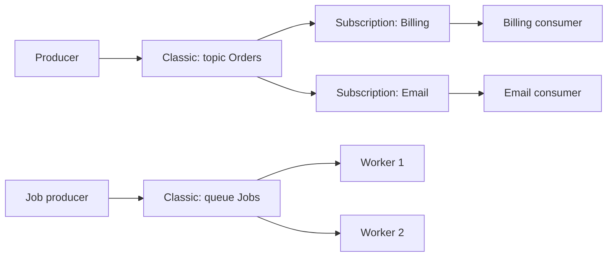
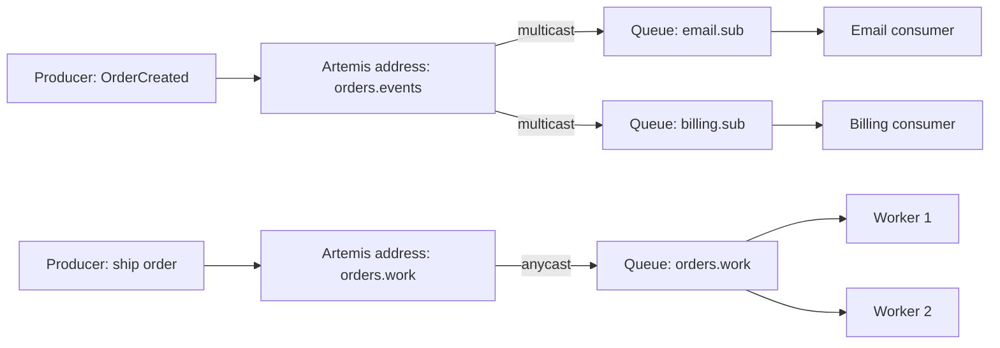

# Phân biệt ActiveMQ Classic và Artemis về kiến trúc, cấu hình và hệ sinh thái

> **Chương:** Classic và Artemis  
> **Phạm vi:** Apache ActiveMQ Classic và Apache ActiveMQ Artemis trong hệ thống giao tiếp bất đồng bộ bằng queue, topic và JMS. Trọng tâm của bài là hiểu sự khác nhau trong kiến trúc broker, cách khai báo đích nhận thông điệp, cấu hình, giao thức, công cụ quản trị và những hệ quả khi triển khai, vận hành hoặc chuyển đổi.

## 1. Mục tiêu học tập

Sau bài này, bạn có thể:

1. Giải thích vì sao ActiveMQ Classic và ActiveMQ Artemis là hai broker khác nhau trong cùng hệ sinh thái Apache ActiveMQ, không đơn thuần là hai chế độ của một phần mềm.
2. Mô tả đường đi của thông điệp qua mô hình **destination** trong Classic và mô hình **address → queue** trong Artemis.
3. Phân biệt **queue**, **topic**, **anycast**, **multicast** và **subscription**; chọn được cách định tuyến phù hợp cho một tình huống thực tế.
4. Nhận biết các tệp cấu hình, giao thức kết nối, cơ chế lưu bền, HA và công cụ quản trị thường gặp ở mỗi broker.
5. Viết producer/consumer Java bằng JMS và xác định những chỗ cần kiểm tra khi đổi broker hoặc phiên bản thư viện.
6. Lập phương án kiểm thử acknowledgment, transaction, redelivery, dead-letter queue (DLQ), bảo mật và migration.

## 2. Bối cảnh: hai nhánh, một bài toán messaging

Một message broker nhận thông điệp từ **producer**, giữ hoặc định tuyến thông điệp, rồi chuyển đến **consumer**. Nhờ đó, dịch vụ tạo đơn hàng không phải chờ trực tiếp dịch vụ gửi email, lập hóa đơn hay cập nhật kho.

**Apache ActiveMQ Classic** (thường được gọi là ActiveMQ 5.x hoặc Classic) là broker lâu đời, gắn chặt với mô hình **JMS destination** và hệ sinh thái ứng dụng Java/JMS, đặc biệt những ứng dụng sử dụng OpenWire, Spring và các cấu hình XML đã vận hành nhiều năm.

**Apache ActiveMQ Artemis** là broker khác, có nguồn gốc công nghệ từ HornetQ và được phát triển với mô hình lõi **address/queue/routing type**. Artemis cung cấp JMS cho ứng dụng Java, đồng thời hỗ trợ nhiều giao thức messaging khác. Từ “Artemis” không có nghĩa là bản nâng cấp nhị phân tương thích hoàn toàn với mọi cấu hình và hành vi của Classic.

Trong cả hai trường hợp, **JMS là API phía ứng dụng Java**: mã ứng dụng dùng `ConnectionFactory`, `Session` hoặc `JMSContext`, `MessageProducer` và `MessageConsumer`. Broker chịu trách nhiệm xử lý thông điệp, nhưng API chung không bảo đảm mọi tính năng mở rộng của từng broker sẽ hoạt động giống nhau.

Ví dụ: hệ thống thương mại điện tử nhận yêu cầu `OrderCreated`. Một queue phù hợp khi chỉ một worker cần xử lý một lần; một topic phù hợp khi cả dịch vụ email, phân tích và kho đều cần nhận sự kiện của riêng mình. Hai broker đều đáp ứng được, nhưng cách cấu hình nội bộ khác nhau.

## 3. So sánh nhanh trước khi đi vào chi tiết

| Khía cạnh | ActiveMQ Classic | ActiveMQ Artemis |
|---|---|---|
| Mô hình trung tâm | JMS **queue/topic destination**; broker triển khai các vùng destination và chuỗi xử lý broker | **Address**, **queue** và **routing type** ở lõi; JMS là một lớp ánh xạ lên mô hình đó |
| Cách fan-out | Topic phân phối cho các subscription; có **Virtual Topics** để kết hợp topic và các queue người nhận | Address **multicast** định tuyến một bản tin tới các queue subscription phù hợp |
| Cách cạnh tranh nhận việc | Nhiều consumer trên một queue | Address **anycast** chọn một queue đích; nhiều consumer trên cùng queue cạnh tranh nhận bản tin |
| Tệp cấu hình broker chính | Thường là `conf/activemq.xml` theo Spring/XBean cùng các tệp bổ trợ | Thường là `etc/broker.xml` trong **broker instance**, cùng tệp users/roles và bootstrap |
| Lưu bền thường gặp | KahaDB; một số triển khai dùng JDBC persistence | Journal riêng của Artemis, có triển khai dựa trên file I/O; paging và large-message storage |
| Giao thức tiêu biểu | OpenWire là giao thức truyền thống; có transport connector cho AMQP, STOMP, MQTT… tùy cấu hình/phiên bản | CORE, AMQP 1.0, OpenWire, STOMP, MQTT… qua acceptor tương ứng |
| Mở rộng/liên kết broker | Network of Brokers, các kiểu master/slave và cơ chế store/lock tùy phiên bản | Clustering, redistribution, grouping và HA primary/backup theo shared store hoặc replication |
| Quản trị | JMX, Web Console và các công cụ/scripts của Classic | Management API/JMX, Web Console, CLI của Artemis và metrics tích hợp |
| Tình huống phổ biến | Ứng dụng JMS/OpenWire hiện hữu, phụ thuộc Virtual Topics hoặc chính sách destination cụ thể | Triển khai mới cần phân tách địa chỉ–hàng đợi, nhiều giao thức, HA/clustering được thiết kế cho Artemis |

**Không suy ra hiệu năng chỉ từ tên broker.** Throughput, độ trễ, mức sử dụng RAM/disk và hành vi khi consumer chậm phụ thuộc kích thước message, độ bền, số consumer, acknowledgment, transaction, lưu trữ, mạng và cách đo tải. Muốn so sánh công bằng phải benchmark cùng một workload và yêu cầu bảo đảm dữ liệu.

## 4. Khác biệt quan trọng nhất: destination và address/queue

### 4.1. Classic nhìn message qua destination

Trong Classic, producer gửi tới một **queue** hoặc một **topic**:

- **Queue:** mỗi message được giao cho một consumer thuộc nhóm consumer cạnh tranh trên queue ấy; nếu consumer xử lý lỗi trước khi xác nhận, message có thể được giao lại.
- **Topic:** mỗi subscription đủ điều kiện nhận một bản sao; **non-durable subscription** thường chỉ nhận khi đang kết nối, còn **durable subscription** giữ quyền nhận thông điệp trong thời gian subscriber vắng mặt theo hợp đồng và giới hạn cấu hình.
- **Virtual Topic:** cơ chế riêng của Classic thường dùng một topic dạng `VirtualTopic.Orders` và các queue dạng `Consumer.Billing.VirtualTopic.Orders`, `Consumer.Email.VirtualTopic.Orders` để mỗi nhóm có backlog và competing consumers riêng.

Sơ đồ minh họa:



Hai worker đọc queue `Jobs` không được bảo đảm chia đều 50/50. Việc phân phối chịu ảnh hưởng prefetch, tốc độ xử lý, mức ưu tiên, selector và chính sách dispatch.

### 4.2. Artemis tách address khỏi queue

Trong Artemis, **producer gửi vào một address**. Broker áp dụng một **routing type** để đưa message tới queue phù hợp. Consumer **đọc từ queue**, trực tiếp hoặc thông qua ánh xạ JMS:

- **Anycast:** một message được định tuyến đến **một** queue anycast phù hợp trên address. Nếu chỉ có một queue, đó là kiểu queue công việc quen thuộc. Nếu có nhiều queue anycast trên cùng address, đây không phải broadcast.
- **Multicast:** một message được định tuyến đến **mọi** queue multicast phù hợp trên address; mỗi queue có thể phục vụ một subscription/nhóm consumer.
- Một address có thể có cả queue anycast và multicast, nhưng việc dùng chung tên và cơ chế định tuyến cần được kiểm soát rõ, nhất là khi nhiều giao thức cùng gửi vào address.
- Artemis hỗ trợ **Fully Qualified Queue Name (FQQN)** dạng `address::queue` trong các giao thức và ngữ cảnh phù hợp để chọn queue cụ thể; đừng mặc định mọi JMS client hay mọi protocol có cùng cú pháp và hành vi.



**Điểm dễ nhầm:** “anycast” ở Artemis mô tả cách **đưa message từ address vào queue**; “competing consumers” mô tả cách **consumer nhận từ cùng một queue**. Hai việc nằm ở hai tầng khác nhau.

### 4.3. Bảng ánh xạ theo nghiệp vụ

| Yêu cầu | Classic | Artemis | Điều phải kiểm thử |
|---|---|---|---|
| Một job được một worker xử lý | Queue `orders.work` | Address `orders.work`, một queue anycast `orders.work` | Retry, thứ tự xử lý, duplicate |
| Mỗi dịch vụ nhận một sự kiện | Topic `orders.events` và các subscription | Address multicast `orders.events`, mỗi subscription là một queue | Durable subscription, consumer offline |
| Mỗi dịch vụ có một nhóm worker | Virtual Topic và queue `Consumer.<group>.*`; hoặc topic subscription theo thiết kế | Multicast address, mỗi nhóm một durable queue, nhiều consumer/nhóm | Tên queue, consumer group, backlog |
| Chuyển message lỗi sang khu riêng | Redelivery policy và DLQ của Classic | `address-settings`, `dead-letter-address` và queue DLQ | Ngưỡng retry, metadata nguyên nhân, quyền truy cập |
| Nhiều kiểu client kết nối | Bật transport connector/giao thức cần dùng | Bật acceptor và protocol cần dùng | Client library, wire protocol, security |

## 5. Kiến trúc bên trong và lưu trữ

### 5.1. Classic: broker, destination, transport, persistence

Một broker Classic điển hình có các khối:

1. **Transport connector** nhận kết nối từ client: OpenWire thường được dùng cho Java client truyền thống; connector khác có thể phục vụ AMQP, MQTT, STOMP…
2. **Broker service và các lớp broker/interceptor** thực hiện điều phối destination, xác thực, policy và xử lý message.
3. **Queue/topic dispatch** chọn consumer hoặc subscription nhận message. Chính sách như prefetch, memory limit và producer flow control ảnh hưởng trực tiếp tới hành vi tải cao.
4. **Persistence adapter** lưu message bền. KahaDB dùng journal và index; giải pháp JDBC cũng có thể xuất hiện ở hệ thống cũ.
5. **Management** cung cấp trạng thái, thao tác và chỉ số qua JMX/Web Console.

**Điểm cần nhớ:** việc chọn KahaDB không tự tạo ra cơ chế high availability. Phải thiết kế thêm cách một broker khác khôi phục dữ liệu, giành quyền sở hữu store và chuyển client đến broker hoạt động.

### 5.2. Artemis: remoting, address manager, queues, journal

Một broker Artemis điển hình có các khối:

1. **Acceptor** tiếp nhận kết nối qua một hoặc nhiều protocol được cấu hình.
2. **Routing** nhận message theo address và routing type để chọn queue.
3. **Queue** duy trì các message chờ giao và trạng thái delivery/acknowledgment.
4. **Journal** lưu dữ liệu và giao dịch bền; tùy nền tảng và cấu hình có cơ chế I/O khác nhau, ví dụ NIO hoặc Linux AIO.
5. **Paging** đưa message ra disk khi address vượt giới hạn bộ nhớ đã cấu hình; **large-message storage** dành cho payload lớn.
6. **Cluster/HA/management** xử lý điều phối nhiều node, primary/backup và vận hành.

**Paging không đồng nghĩa với DLQ:** paging là cơ chế quản lý lưu trữ khi tích lũy nhiều thông điệp; DLQ dành cho thông điệp không thể xử lý sau chính sách redelivery.

**Journal không tương đương với “luôn fsync từng message”.** Độ bền phụ thuộc cờ durable/persistent, transaction, cấu hình đồng bộ ghi, phản hồi từ broker và tính chất hệ thống lưu trữ.

## 6. Cấu hình: cùng yêu cầu nghiệp vụ, cách biểu đạt khác nhau

Các ví dụ dưới đây minh họa **phần cấu hình liên quan**, không phải toàn bộ tệp sẵn sàng chạy. Khi triển khai, đặt chúng đúng vị trí trong bộ khung cấu hình đi kèm **phiên bản broker thực tế** và kiểm tra schema. Port `61616` được dùng làm ví dụ; không thể để hai broker chiếm cùng một port trên cùng máy.

### 6.1. Classic: `conf/activemq.xml`

Classic thường dùng XBean/Spring XML. Một đoạn cấu hình nằm **bên trong phần tử `broker`** có thể trông như sau:

```xml
<persistenceAdapter>
  <kahaDB directory="data/kahadb"/>
</persistenceAdapter>

<destinationPolicy>
  <policyMap>
    <policyEntries>
      <policyEntry queue=">"
                   producerFlowControl="true"
                   memoryLimit="64mb"/>
    </policyEntries>
  </policyMap>
</destinationPolicy>

<transportConnectors>
  <transportConnector name="openwire"
                      uri="tcp://0.0.0.0:61616"/>
</transportConnectors>
```

Ý nghĩa:

- `kahaDB`: adapter lưu trữ message bền; `data/kahadb` là đường dẫn ví dụ và cần kiểm tra theo working directory của instance.
- `policyEntry queue=">"`: chính sách khớp các queue theo cú pháp wildcard destination của Classic; không mặc định áp dụng cho topic.
- `producerFlowControl`: có thể tạo backpressure khi destination chạm giới hạn thay vì tiếp tục nhận vô hạn.
- `transportConnector`: điểm vào mạng. `0.0.0.0` có nghĩa lắng nghe trên các interface, chỉ dùng khi đã bảo vệ network/TLS/auth tương ứng.

Các chính sách **redelivery** của Classic có thể nằm phía client (ví dụ cấu hình của ActiveMQ Java client), và hành vi DLQ còn liên quan `deadLetterStrategy` phía broker. Đừng chỉ tìm một tham số broker tên “max-delivery-attempts” rồi giả định giống Artemis.

### 6.2. Artemis: `etc/broker.xml`

Artemis tách **broker installation** và **broker instance**; cấu hình vận hành thường thuộc instance, ví dụ `broker-instance/etc/broker.xml`. Một đoạn cấu hình bên trong phần tử `core` minh họa hai đường đi khác nhau:

```xml
<acceptors>
  <acceptor name="messaging">
    tcp://0.0.0.0:61616?protocols=CORE,AMQP,OPENWIRE
  </acceptor>
</acceptors>

<addresses>
  <address name="orders.work">
    <anycast>
      <queue name="orders.work" durable="true"/>
    </anycast>
  </address>
  <address name="orders.events">
    <multicast/>
  </address>
  <address name="DLQ">
    <anycast>
      <queue name="DLQ" durable="true"/>
    </anycast>
  </address>
</addresses>

<address-settings>
  <address-setting match="orders.work">
    <dead-letter-address>DLQ</dead-letter-address>
    <max-delivery-attempts>5</max-delivery-attempts>
    <redelivery-delay>2000</redelivery-delay>
  </address-setting>
</address-settings>
```

Ý nghĩa:

- `acceptor` công bố endpoint và danh sách protocol được chấp nhận; danh sách hỗ trợ thực tế tùy phiên bản, cấu hình và thư viện client.
- Address `orders.work` có **một queue anycast** cùng tên, vì thế JMS queue `orders.work` được ánh xạ một cách trực quan.
- Address `orders.events` dùng **multicast**; chỉ khai báo address chưa tự tạo sẵn một durable subscription cho từng ứng dụng. Subscription phải được thiết lập với tên/định danh phù hợp.
- `DLQ` được khai báo như một address có queue để consumer vận hành có nơi đọc message lỗi.
- `max-delivery-attempts=5` áp dụng cho message phù hợp với `address-setting`, sau khi vượt chính sách giao lại broker có thể định tuyến tới dead-letter address. Khoảng trễ ghi bằng mili giây.

Trong production, nên xem xét chủ động khai báo address/queue và hạn chế tự tạo đích. Tính năng **auto-create addresses/queues** tiện cho lab nhưng có thể che lỗi chính tả như `order.work` và `orders.work` trở thành hai đích khác nhau.

### 6.3. Không dịch XML theo kiểu thay tên thẻ

| Việc cần cấu hình | Classic | Artemis |
|---|---|---|
| Định nghĩa đầu vào mạng | `transportConnector` | `acceptor` |
| Định tuyến fan-out | Topic/subscription hoặc Virtual Topic | Multicast address + các subscription queues |
| Giới hạn backlog và bộ nhớ | `destinationPolicy` và `systemUsage` | `address-settings`, `address-full-policy`, `max-size-bytes`, paging |
| Retry/DLQ | Redelivery policy của client + `deadLetterStrategy`/destination policy | `max-delivery-attempts`, `redelivery-delay`, `dead-letter-address` |
| Xác thực và phân quyền | Plugin/security config, JAAS tùy triển khai | Security settings + users/roles/JAAS tùy instance |
| Cluster/HA | Network connectors và cơ chế master/slave riêng | Cluster connections và primary/backup HA policies |

Đặc biệt, **Network of Brokers trong Classic** và **Artemis cluster** không phải hai tên gọi thay thế cho cùng một thuật toán. Phải đánh giá lại cách message di chuyển, backlog, duplicate, HA và selector.

## 7. Giao thức, thư viện Java và hệ sinh thái

### 7.1. Phân biệt JMS API với wire protocol

JMS quy định cách **ứng dụng Java** tạo message, gửi, nhận, xác nhận và giao dịch. Một client cụ thể chuyển lời gọi JMS thành protocol trên mạng. Vì vậy:

- `javax.jms.*` và `jakarta.jms.*` là **hai namespace API khác nhau**, cần chọn theo phiên bản dependency và framework. Không trộn import hai họ trong cùng một ví dụ.
- **OpenWire** là protocol quen thuộc của ActiveMQ Classic. Artemis có hỗ trợ OpenWire, nhưng không được giả định mọi extension, cách chọn destination, client failover hay chi tiết serialization đều tương thích 100%.
- **AMQP 1.0** là protocol liên thông được nhiều client không phải Java sử dụng. Dùng AMQP không có nghĩa mọi API JMS đặc thù đều có tương đương.
- **CORE** là protocol gốc của Artemis; **STOMP** và **MQTT** phục vụ các kiểu client/hệ thống khác. Có protocol được hỗ trợ không đồng nghĩa đã bật listener hoặc đã cấp quyền.

| Nhu cầu client | Hướng tiếp cận |
|---|---|
| Ứng dụng Java JMS lâu năm đang dùng Classic client | Giữ đúng phiên bản client Classic tương thích và kiểm thử OpenWire nếu thử kết nối Artemis |
| Ứng dụng Java mới với Artemis | Chọn Artemis JMS client đúng namespace Jakarta/Javax và phiên bản broker tương thích |
| Client AMQP đa ngôn ngữ | Dùng AMQP 1.0 với address/routing và security đã cấu hình |
| IoT hoặc client tối giản | Đánh giá MQTT/STOMP theo semantics mong muốn, không suy diễn hành vi JMS |
| Spring, Jakarta EE hoặc Camel | Kiểm tra BOM, adapter, resource lifecycle, pooling và transaction manager của phiên bản framework |

**Tương thích wire protocol ≠ tương thích cấu hình ≠ tương thích nghiệp vụ.** Một kết nối TCP mở thành công không chứng minh Virtual Topics, selectors, durable subscriptions hay redelivery vận hành đúng như trước.

### 7.2. Producer và consumer Java với Artemis, Jakarta JMS

Ví dụ này dùng **Artemis Jakarta JMS client** có `org.apache.activemq.artemis.jms.client.ActiveMQConnectionFactory` và API `jakarta.jms`. Trong Maven, chọn dependency `org.apache.activemq:artemis-jakarta-client` với **phiên bản cụ thể phù hợp broker và JDK**. Đã tạo sẵn `orders.work` theo cấu hình ở mục 6.2; tài khoản `app` phải có quyền send/consume.

```java
import jakarta.jms.JMSContext;
import jakarta.jms.Message;
import jakarta.jms.Queue;
import jakarta.jms.TextMessage;
import org.apache.activemq.artemis.jms.client.ActiveMQConnectionFactory;

public final class ArtemisOrderDemo {
    private static final String URL = "tcp://localhost:61616";
    private static final String USER = "app";
    private static final String PASSWORD = "secret"; // Chỉ cho môi trường lab

    public static void main(String[] args) throws Exception {
        ActiveMQConnectionFactory factory =
                new ActiveMQConnectionFactory(URL, USER, PASSWORD);

        // Producer: gửi một message vào queue đã cấu hình.
        try (JMSContext context =
                     factory.createContext(JMSContext.AUTO_ACKNOWLEDGE)) {
            Queue queue = context.createQueue("orders.work");
            context.createProducer()
                   .setProperty("eventType", "OrderCreated")
                   .send(queue, "orderId=O-1001");
            System.out.println("Sent O-1001");
        }

        // Consumer: chỉ xác nhận sau khi xử lý nghiệp vụ thành công.
        try (JMSContext context =
                     factory.createContext(JMSContext.CLIENT_ACKNOWLEDGE)) {
            Queue queue = context.createQueue("orders.work");
            Message message = context.createConsumer(queue).receive(5000);

            if (message == null) {
                System.out.println("No message within 5 seconds");
                return;
            }
            if (!(message instanceof TextMessage)) {
                throw new IllegalStateException("Unexpected message type");
            }

            String payload = ((TextMessage) message).getText();
            processOrder(payload); // Có thể ném exception khi xử lý thất bại
            message.acknowledge();
            System.out.println("Acknowledged " + payload);
        }
    }

    private static void processOrder(String payload) {
        // Ví dụ: ghi đơn hàng theo khóa idempotency của thông điệp.
        System.out.println("Processed " + payload);
    }
}
```

Những điều phải hiểu trước khi chạy trong ứng dụng thực:

- `CLIENT_ACKNOWLEDGE` theo JMS xác nhận **tất cả message đã nhận trong session/context kể từ lần xác nhận trước**, không chỉ một message tùy ý. Với consumer song song, thường tạo context/session riêng cho từng worker.
- `receive(5000)` trả `null` nếu timeout; nó không có nghĩa queue mãi mãi rỗng.
- Nếu `processOrder` thất bại trước `acknowledge()`, việc đóng context/khôi phục session có thể khiến message được giao lại theo chính sách broker và client. Phải xử lý duplicate.
- Ví dụ dùng mật khẩu trong mã chỉ để minh họa. Thực tế lấy secret từ cơ chế quản lý bí mật, không commit vào repository.
- Trong ứng dụng chạy lâu dài, dùng pool/caching và quản lý lifecycle do framework hỗ trợ; không tạo connection mới cho từng message như chương trình demo.

### 7.3. Một đoạn Classic JMS 1.1 cho hệ thống hiện hữu

Với ứng dụng dùng **ActiveMQ Classic 5.x và thư viện `activemq-client` thuộc họ `javax.jms`**, API truyền thống có thể viết như sau. Đoạn này là ví dụ đối chiếu về **session transacted**, không được ghép chung classpath với ví dụ Jakarta ở trên:

```java
import javax.jms.Connection;
import javax.jms.MessageProducer;
import javax.jms.Queue;
import javax.jms.Session;
import org.apache.activemq.ActiveMQConnectionFactory;

public final class ClassicOrderProducer {
    public static void main(String[] args) throws Exception {
        ActiveMQConnectionFactory factory =
                new ActiveMQConnectionFactory("tcp://localhost:61616");

        Connection connection = factory.createConnection("app", "secret");
        try {
            Session session =
                    connection.createSession(true, Session.SESSION_TRANSACTED);
            try {
                Queue queue = session.createQueue("orders.work");
                MessageProducer producer = session.createProducer(queue);
                try {
                    producer.send(session.createTextMessage("orderId=O-1002"));
                    session.commit();  // Message thuộc local transaction
                } catch (Exception e) {
                    session.rollback();
                    throw e;
                } finally {
                    producer.close();
                }
            } finally {
                session.close();
            }
        } finally {
            connection.close();
        }
    }
}
```

Mã dùng `try/finally` để tương thích với `javax.jms.Connection` của JMS 1.1 (interface này không mở rộng `AutoCloseable`). Mã Classic cố ý làm rõ sự khác biệt về namespace và lifecycle; các bản Classic hoặc client mới hơn có thể dùng dependency/API khác, nên hãy kiểm tra tài liệu đúng phiên bản trước khi nâng cấp.

## 8. Delivery, acknowledgment, transaction, redelivery và DLQ

### 8.1. “Đã gửi”, “đã nhận” và “đã xử lý” là ba mốc khác nhau

Xét chuỗi:

```text
Producer -> Broker (durable queue) -> Consumer -> Database -> ACK
```

- Producer nhận phản hồi từ broker không có nghĩa database của consumer đã cập nhật.
- Consumer nhận message không có nghĩa công việc đã thành công.
- Nếu consumer ghi database thành công rồi crash **trước ACK**, broker có thể giao lại message. Vì vậy **at-least-once delivery** thường kéo theo việc xử lý trùng.
- Nếu consumer ACK trước khi ghi database và sau đó crash, công việc có thể bị mất ở tầng nghiệp vụ dù message đã rời queue.

Thiết kế đáng tin cậy thường sử dụng **idempotency key**, unique constraint, bảng inbox hoặc cơ chế tương đương. Ví dụ khóa `orderId=O-1001` giúp bỏ qua thao tác gửi hóa đơn lần thứ hai khi message được giao lại.

### 8.2. Các chế độ acknowledgment JMS

| Chế độ | Hành vi thường gặp | Khi nào dùng |
|---|---|---|
| `AUTO_ACKNOWLEDGE` | Session/context tự ACK theo quy tắc JMS; với synchronous receive, consumer dễ ACK trước khi hoàn tất xử lý ngoài broker | Tác vụ đơn giản, chấp nhận semantics tương ứng |
| `CLIENT_ACKNOWLEDGE` | Ứng dụng gọi `Message.acknowledge()`; ACK có phạm vi session | Cần xác nhận sau xử lý, hiểu rõ giới hạn session |
| `DUPS_OK_ACKNOWLEDGE` | Cho phép ACK trì hoãn, có thể có duplicate | Chấp nhận nhận trùng để giảm chi phí |
| Transacted session | `commit()` xác nhận các receive/send trong transaction JMS; `rollback()` khiến chúng được hoàn tác/giao lại | Xử lý một nhóm message hoặc publish/consume nguyên tử **trong broker** |

Một local JMS transaction **không tự động gom cả thao tác SQL vào cùng transaction**. Nếu yêu cầu atomically ghi database và xuất sự kiện, cân nhắc transactional outbox/inbox; XA chỉ phù hợp khi hiểu rõ transaction coordinator, hỗ trợ driver và đánh đổi vận hành.

### 8.3. Poison message và DLQ

**Poison message** là message luôn thất bại với cùng một consumer (ví dụ dữ liệu không hợp lệ), gây vòng lặp nhận–lỗi–giao lại. Quy trình thiết kế:

1. Consumer phân biệt lỗi tạm thời (network/database) với lỗi dữ liệu không thể xử lý.
2. Đặt giới hạn retry và backoff; tránh retry nóng làm quá tải hệ thống.
3. Sau ngưỡng cho phép, chuyển đến DLQ với đủ thông tin để điều tra.
4. Có công cụ quan sát, kiểm tra nội dung, sửa lỗi và **replay có kiểm soát**; replay phải giữ idempotency.

Trong **Classic**, ActiveMQ Java client có thể áp dụng `RedeliveryPolicy`, còn phía broker cấu hình `deadLetterStrategy` để quyết định xử lý message bị coi là poison. Trong **Artemis**, broker thường quản lý `max-delivery-attempts`, `redelivery-delay` và `dead-letter-address` qua `address-settings`. Chi tiết mặc định và điều kiện chuyển DLQ phụ thuộc phiên bản, message và protocol, vì thế phải kiểm thử với client thật.

**Bẫy:** ACK, rollback, `Session.recover()`, `JMSRedelivered` và delivery count có liên quan nhưng không thay thế được nhau. Delivery count/header chỉ là tín hiệu hỗ trợ; dữ liệu nghiệp vụ vẫn cần khóa chống xử lý trùng.

### 8.4. Thứ tự thông điệp

Queue không mặc nhiên bảo đảm “mọi đơn hàng được xử lý đúng thứ tự toàn cục” khi:

- có nhiều consumer và prefetch;
- một message bị rollback rồi redeliver;
- dùng priority, selector, message grouping hoặc scheduling;
- có HA failover và reconnect.

Nếu cần thứ tự **theo từng aggregate** như `orderId`, thiết kế partition/message group theo khóa nhất quán, kiểm tra mức hỗ trợ của client/broker và đo độ trễ khi một group bị chặn.

## 9. High availability, clustering và backpressure

### 9.1. Classic

Hệ thống Classic có thể kết nối các broker bằng **Network of Brokers** để chuyển message giữa các broker theo demand và subscription. Một số triển khai dùng kiến trúc master/slave dựa trên shared filesystem/store hoặc lock database; thiết kế và hỗ trợ thực tế tùy nhánh/phiên bản. Không nên diễn giải “hai broker có network connector” thành “dữ liệu tự được sao lưu HA”.

Với client OpenWire, cấu hình failover transport có thể sử dụng dạng `failover:(tcp://broker-a:61616,tcp://broker-b:61616)`. Cần kiểm tra timeout, reconnect, in-flight sends, replay và trường hợp producer không chắc broker đã nhận message hay chưa.

### 9.2. Artemis

Artemis phân biệt:

- **Clustering:** cho phép các node biết nhau, phân phối/redistribute message và hỗ trợ mở rộng theo thiết kế cluster.
- **HA primary/backup:** bảo vệ một broker instance bằng cơ chế **shared store** hoặc **replication**, với quy tắc kích hoạt/failover cụ thể.
- **Client reconnect/failover:** client phải được cấu hình đúng topology và kiểm thử hành vi khi node chết giữa transaction hoặc trong lúc ACK.

Một cluster không tự động nhân bản mọi message thành nhiều bản sao bền. Phải xác định queue thuộc node nào, replication của HA pair, policy khi address đầy, network partition và failback.

### 9.3. Backpressure là chức năng bắt buộc

Giả sử producer tạo 4.000 message/giây, consumer chỉ xử lý 2.500 message/giây. Backlog tăng khoảng 1.500 message/giây khi tải giữ nguyên; việc thêm RAM chỉ trì hoãn sự cố.

Cần giám sát độ sâu queue, tốc độ vào/ra, tuổi message, consumer lag, disk journal/paging và hành vi producer khi broker đầy. Classic có `systemUsage`/flow control; Artemis có `address-full-policy`, `max-size-bytes` và paging. Cấu hình **BLOCK**, **PAGE**, **FAIL** hoặc các policy tương ứng là quyết định nghiệp vụ: producer chờ, message đổ xuống disk hay request bị từ chối.

## 10. Bảo mật: quyền theo producer, consumer và quản trị

Một broker chạy được ở localhost chưa sẵn sàng đưa lên mạng. Với cả hai hệ:

1. **Bảo vệ transport:** dùng TLS, giới hạn interface và firewall; không mở broker port hay Web Console công khai khi chưa có bảo vệ.
2. **Xác thực:** sử dụng users/roles, JAAS hoặc cơ chế danh tính được hỗ trợ theo phiên bản. Tránh tài khoản mặc định và mật khẩu hard-code.
3. **Phân quyền:** phân biệt quyền gửi, đọc, duyệt, tạo/xóa destination và quyền quản trị. Producer của `orders.work` không cần quyền xóa queue hoặc đọc DLQ.
4. **Cô lập môi trường:** tách dev/test/prod hoặc dùng quy ước address và roles đủ chặt.
5. **Quản lý message nhạy cảm:** xem xét thông tin cá nhân, thời hạn lưu, quyền đọc DLQ, log và lịch sử replay.
6. **Cập nhật dependency:** theo dõi phiên bản broker, Java runtime, client và cảnh báo an ninh; kiểm tra tương thích trước khi nâng cấp.

Trong Classic, quyền thường được thiết lập thông qua authentication/authorization plugins và cấu hình đi kèm. Trong Artemis, ACL thường dùng `security-settings` ánh xạ quyền như `send`, `consume`, `browse`, `createDurableQueue`, `deleteDurableQueue` đến roles; thông tin user/role nằm ở cơ chế đăng nhập riêng của instance. Tên role và chính sách effective permissions phải được kiểm chứng bằng các bài thử **allow** và **deny**.

## 11. Vận hành: những metric và câu hỏi cần xem mỗi ngày

| Nhóm | Metric/quan sát | Câu hỏi vận hành |
|---|---|---|
| Độ trễ | Thời gian từ enqueue tới consumer ACK; tuổi message lớn nhất | Đơn hàng nào chờ lâu bất thường? |
| Backlog | Queue depth, enqueue/dequeue rate, số message paging | Consumer có theo kịp producer không? |
| Consumer | Số consumer, số in-flight, ACK rate, disconnect | Có worker chết, quá chậm hoặc prefetch quá lớn? |
| Retry/DLQ | Redelivery count, DLQ depth, nguyên nhân lỗi | Lỗi tạm thời hay payload hỏng? Có replay an toàn không? |
| Lưu trữ | Journal/KahaDB disk, write latency, free disk, compaction/checkpoint | Broker có đủ dung lượng và I/O không? |
| HA/network | Node state, replication sync, reconnect, network partition | Tình huống failover có làm duplicate hoặc mất khả năng ghi? |
| Bảo mật | Auth failures, denied operations, TLS expiry | Có client nào dùng sai quyền hoặc certificate hết hạn? |

Classic thường được giám sát qua JMX/Web Console và các exporter thích hợp. Artemis có management API/JMX/console và cơ chế metrics tương ứng. Tên metric, MBean và cách bật exporter **không giống nhau hoàn toàn**; hãy chuẩn hóa các **chỉ số nghiệp vụ** trước khi so sánh dashboard.

Tạo runbook tối thiểu: cách xác định queue tồn đọng; kiểm tra producer bị chặn; cách tạm dừng consumer; cách lấy message mẫu từ DLQ mà không làm mất bản gốc; cách khởi động lại broker; và cách xác minh hệ thống đã hồi phục sau failover.

## 12. Chiến lược lựa chọn và migration

### 12.1. Khi nào giữ Classic?

Giữ Classic thường hợp lý nếu hệ thống đang ổn định, đội vận hành có kinh nghiệm và ứng dụng phụ thuộc nhiều vào những hành vi cụ thể như Virtual Topics, OpenWire client cũ, destination policy, network connectors hoặc hệ thống giám sát hiện hữu. Quyết định phải tính đến **vòng đời hỗ trợ và phiên bản đang chạy**, chi phí vá bảo mật và nhu cầu tăng trưởng.

### 12.2. Khi nào đánh giá Artemis?

Artemis đáng đánh giá cho dự án mới hoặc đợt tái cấu trúc messaging khi cần mô hình address/queue rõ ràng, client đa protocol, các lựa chọn journal/paging/HA và cluster của Artemis. Tuy nhiên, không nên chuyển broker chỉ vì khẩu hiệu hiệu năng; hãy đo workload thật và giá trị vận hành.

### 12.3. Quy trình chuyển từ Classic sang Artemis

**Bước 1 — Kiểm kê hành vi hiện tại.** Liệt kê queue/topic, durable subscription, Virtual Topic, selector, message group, scheduled/delayed delivery, priority, TTL, DLQ, prefetch, transaction, ObjectMessage, producer/consumer count, protocol và cấu hình failover.

**Bước 2 — Vẽ lại routing.** Với mỗi điểm nhận, quyết định Artemis address, routing type, queue name, durable subscription, FQQN (nếu cần), cùng quy tắc auto-create. Ví dụ chuyển:

```text
Classic:
  VirtualTopic.Orders
  Consumer.Billing.VirtualTopic.Orders
  Consumer.Email.VirtualTopic.Orders

Artemis, mô hình tương đương về mục đích:
  address: orders.events [multicast]
  queue:   billing.events [multicast, durable]
  queue:   email.events   [multicast, durable]
```

Đây là **ánh xạ ý tưởng**, không phải phép đổi tên tự động. Phải kiểm tra bộ lọc, vòng đời subscription và client nhận.

**Bước 3 — Đổi/configure client có kiểm soát.** Xác định `javax.jms` hay `jakarta.jms`, thư viện Artemis hoặc client OpenWire phù hợp, cách tạo connection, transaction, reconnect và security. Không thay toàn bộ client một lúc nếu hệ thống có nhiều giao thức.

**Bước 4 — Chạy hợp đồng kiểm thử.** Gửi thông điệp mẫu và kiểm tra payload/header, selectors, durable offline, retry, DLQ, TTL, expiry, thứ tự theo khóa, transaction rollback, duplicate, HA failover. Đối chiếu cả hành vi **khi có lỗi**, không chỉ luồng thành công.

**Bước 5 — Lập kế hoạch dữ liệu đang tồn.** Chọn drain backlog, dual publish có idempotency, replay có kiểm soát hoặc công cụ chuyển message đã được kiểm chứng. Không giả định có thể copy trực tiếp tệp KahaDB sang Artemis journal.

**Bước 6 — Cutover theo từng luồng.** Chuyển producer/consumer theo nhóm có metrics, điều kiện dừng và phương án rollback rõ; ghi nhận lượng message đang in-flight và những request có kết quả gửi chưa chắc chắn.

**Bước 7 — Xác minh sau chuyển đổi.** Theo dõi throughput, queue lag, DLQ, lỗi kết nối, độ trễ end-to-end và lượng message được xử lý đúng một lần **ở tầng nghiệp vụ** nhờ cơ chế idempotency.

## 13. Bài thực hành đề xuất

Dùng môi trường lab tách biệt. Chỉ bật một broker trên `localhost:61616` mỗi lần, hoặc đặt Artemis trên `61617` nếu cần chạy song song. Chuẩn bị tài khoản lab với quyền send và consume; cấu hình persistent store và địa chỉ phù hợp.

### Thực hành A — Queue và competing consumers

**Mục đích:** nhìn thấy queue là một luồng công việc dùng chung.

1. Tạo queue `orders.work`. Với Artemis, cấu hình address `orders.work` và queue anycast cùng tên.
2. Mở hai consumer độc lập và gửi 10 message có ID `O-1` đến `O-10`.
3. Quan sát mỗi message được một consumer xử lý thành công, nhưng phân phối không nhất thiết đều nhau; ghi nhận thứ tự thực tế.
4. Đóng một consumer giữa chừng, thử gửi thêm message và kiểm tra consumer còn lại.
5. Chạy lại sau khi khởi động broker, kiểm tra message persistent chưa ACK có tồn tại hay không.

**Kết quả mong đợi:** không có thông điệp được “broadcast” sang cả hai worker như hai subscription độc lập; danh sách ID thành công cộng lại bao phủ đủ 10 ID, với giả định không có lỗi và không gửi trùng.

### Thực hành B — Topic/Multicast và durable subscription

**Mục đích:** hai hệ thống độc lập đều nhận sự kiện.

1. Trong Classic, tạo topic `orders.events` và hai subscription với định danh khác nhau; trong Artemis, tạo address multicast và hai durable queues/subscriptions.
2. Gửi message `OrderCreated(O-21)` rồi kiểm tra email và billing đều nhận.
3. Dừng consumer billing, tiếp tục gửi ba sự kiện; khởi động lại và xem backlog của subscription durable.
4. Lặp lại với non-durable subscription để thấy khác biệt về message gửi khi subscriber vắng mặt.

**Kết quả mong đợi:** hai subscription durable có tiến độ tiêu thụ riêng; mô hình fan-out không làm một dịch vụ “cướp” message của dịch vụ khác.

### Thực hành C — Rollback, retry và DLQ

**Mục đích:** kiểm tra semantics khi business logic gặp lỗi.

1. Cấu hình Artemis `max-delivery-attempts=3`, `redelivery-delay=1000` cho queue lab, cùng dead-letter address và queue `DLQ`; hoặc cấu hình redelivery/DLQ tương ứng của Classic.
2. Tạo consumer transacted, với message có payload `orderId=BAD` thì cố ý `rollback()`; message bình thường thì `commit()`.
3. Gửi `O-OK` và `BAD`. Ghi log số lần delivery, thời điểm retry và nội dung DLQ.
4. Đọc message ở DLQ để điều tra; sau khi sửa nguyên nhân, replay một bản có kiểm soát, dùng idempotency key để tránh cập nhật trùng.

**Kết quả mong đợi:** message tốt được commit; message hỏng không tạo vòng lặp retry vô tận và có thể điều tra qua DLQ. Số lần giao thực tế cần đo theo đúng cấu hình/phiên bản đang thử.

## 14. Những nhầm lẫn thường gặp

| Nhận định sai | Điều đúng cần nhớ |
|---|---|
| “Artemis là Classic đổi tên.” | Hai codebase và mô hình cấu hình khác nhau; phải kiểm thử tương thích. |
| “Anycast nghĩa là gửi cho mọi consumer.” | Anycast chọn một queue đích; multicast mới fan-out tới các queue tương ứng. |
| “Bật cluster tức là có HA và bản sao dữ liệu.” | Cluster và HA primary/backup giải quyết hai nhóm vấn đề khác nhau. |
| “JMS giống nhau thì wire protocol và feature cũng giống nhau.” | JMS chỉ quy định API/hợp đồng; vendor extensions, mapping và client behavior vẫn khác. |
| “Persistent message bảo đảm nghiệp vụ đúng một lần.” | Cần xác định lúc ACK và dùng idempotency/outbox/inbox khi có database. |
| “DLQ là nơi lưu toàn bộ message bị chậm.” | Message chậm tích ở queue hoặc paging; DLQ dành cho lỗi theo chính sách chuyển thư chết. |
| “Message gửi thành công nghĩa là consumer xử lý thành công.” | Gửi tới broker và xử lý business là hai mốc độc lập. |
| “Chuyển Classic sang Artemis chỉ cần đổi URL.” | Routing, quyền, client, retry, durable subscription, HA và dữ liệu tồn phải được đối chiếu. |

## 15. Checklist thiết kế thực tế

Trước khi chọn broker hoặc chấp nhận một migration, hãy trả lời được:

- **Luồng:** Message thuộc **lệnh công việc** (một nhóm xử lý) hay **sự kiện** (nhiều nhóm nhận)?
- **Routing:** Với Artemis, address nào, anycast/multicast nào, queue nào và ai sở hữu subscription? Với Classic, destination và chính sách nào?
- **Delivery:** Message nào durable, ai ACK, retry tối đa bao nhiêu, DLQ ở đâu, replay do ai phụ trách?
- **Consistency:** Idempotency key là gì? Nếu database commit xong nhưng ACK thất bại thì làm sao?
- **Capacity:** Producer peak rate, consumer service time, message size, backlog cho phép, giới hạn RAM/disk và backpressure?
- **Recovery:** Broker/node chết trong lúc producer gửi hoặc consumer commit thì quan sát được gì, phục hồi ra sao?
- **Security:** Ai được send/consume/browse/manage, dùng TLS chưa, secret và quyền DLQ được bảo vệ chưa?
- **Observability:** Có dashboard và cảnh báo trên queue lag, DLQ, disk, reconnect, HA status không?
- **Compatibility:** Đã kiểm thử trên đúng phiên bản broker, JDK, JMS namespace, client và protocol sẽ đưa vào production chưa?

## 16. Tóm tắt các khái niệm cốt lõi

**ActiveMQ Classic** phù hợp để hiểu broker theo **destination queue/topic**, destination policies, KahaDB, OpenWire và hệ sinh thái JMS lâu đời. **ActiveMQ Artemis** mô hình hóa message theo **address → routing → queue**; **anycast** phục vụ một đường nhận, **multicast** phục vụ fan-out qua các queue subscription. Cả hai có thể dùng JMS, nhưng cách quản lý cấu hình, protocol, lưu trữ, retry, DLQ, HA và quyền truy cập phải được học và kiểm thử riêng.

Khi xây dựng giao tiếp bất đồng bộ đáng tin cậy, quyết định quan trọng nhất không nằm ở tên broker: đó là **message đi tới ai, còn tồn tại khi nào, được ACK ở thời điểm nào, xử lý trùng ra sao và vận hành thế nào khi một thành phần thất bại**. Hiểu rõ những câu hỏi đó sẽ giúp bạn chọn giữa Classic và Artemis dựa trên yêu cầu hệ thống thay vì dựa vào kỳ vọng mơ hồ về tốc độ hay khả năng tương thích.
