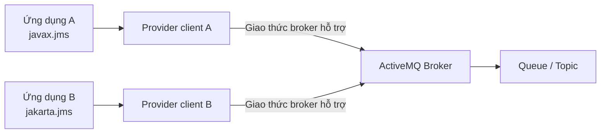

# Phân biệt namespace `javax.jms` và `jakarta.jms` khi chọn thư viện

> **Chương:** Classic và Artemis  
> **Bối cảnh:** Apache ActiveMQ Classic và Apache ActiveMQ Artemis cung cấp message broker cho giao tiếp bất đồng bộ qua queue, topic và các giao thức mạng. Java producer/consumer có thể dùng JMS hoặc Jakarta Messaging để gửi thông điệp, xác nhận nhận, thực hiện giao dịch, xử lý gửi lại và dead-letter queue (DLQ).

## 1. Tình huống thực tế

Một ứng dụng đặt hàng gửi sự kiện `order.created` vào queue; dịch vụ thanh toán nhận thông điệp, ghi dữ liệu rồi xác nhận đã xử lý. Trong dự án Java cũ, bạn thấy:

```java
import javax.jms.ConnectionFactory;
import javax.jms.Message;
import javax.jms.Queue;
```

Trong một dự án mới dùng Spring Framework 6, bạn lại thấy:

```java
import jakarta.jms.ConnectionFactory;
import jakarta.jms.Message;
import jakarta.jms.Queue;
```

Tên interface giống nhau, nhưng `javax.jms.ConnectionFactory` và `jakarta.jms.ConnectionFactory` là **hai kiểu Java khác nhau**. Compiler và JVM nhận diện kiểu theo tên package đầy đủ; chúng không thể tự gán, cast hoặc liên kết nhị phân thay thế cho nhau. Khi chọn sai client library, bạn có thể gặp lỗi biên dịch, `NoClassDefFoundError`, `ClassCastException` hoặc lỗi khởi tạo bean Spring.

**Mục tiêu bài học:** nhận biết thế hệ API, chọn đúng thư viện client cho Classic/Artemis, viết ví dụ producer/consumer, sửa lỗi trộn namespace và chuẩn bị một lần di chuyển `javax` → `jakarta` có kiểm thử.

## 2. Hai namespace ra đời như thế nào?

JMS (Java Message Service) là giao diện tiêu chuẩn để ứng dụng Java giao tiếp với hệ thống messaging. Khi nền tảng Java EE chuyển sang Jakarta EE, đặc tả JMS được đổi tên thành **Jakarta Messaging**; mốc quan trọng nhất đối với source code là lần đổi package ở Jakarta Messaging **3.0**.

| Nền tảng / đặc tả | Package của các interface JMS | Lưu ý |
| --- | --- | --- |
| Java EE, JMS 1.1 / 2.0 | `javax.jms.*` | Nhiều ứng dụng Java EE và Spring cũ sử dụng |
| Jakarta EE 8, Jakarta Messaging 2.0 | **Vẫn** `javax.jms.*` | Tên tiêu chuẩn đổi nhưng namespace chưa đổi |
| Jakarta EE 9, Jakarta Messaging 3.0 | `jakarta.jms.*` | Mốc thay `javax` bằng `jakarta` |
| Jakarta EE 10, Jakarta Messaging 3.1 | `jakarta.jms.*` | API được các stack Jakarta hiện đại sử dụng |

Cần phân biệt **tên Maven artifact** với **package Java bên trong JAR**:

- `jakarta.jms:jakarta.jms-api:2.0.3` **vẫn chứa** `javax.jms.*`. Đừng đoán namespace từ chữ “jakarta” trong `groupId`.
- `jakarta.jms:jakarta.jms-api:3.1.0` chứa `jakarta.jms.*`.
- JAR API chỉ định nghĩa giao diện như `ConnectionFactory`, `Queue`, `Message`. Để kết nối broker, ứng dụng còn cần **provider client** tương thích.

Ví dụ, đoạn sau **không tương đương** về kiểu Java:

```java
javax.jms.ConnectionFactory oldFactory;
jakarta.jms.ConnectionFactory newFactory;

// Sai về mặt kiểu, dù tên interface cuối cùng giống nhau:
// newFactory = oldFactory;
```

Đổi namespace không tự thay đổi semantics của queue/topic, acknowledgment, transaction, redelivery hay DLQ. Những hành vi đó đến từ đặc tả, phiên bản provider và cấu hình broker; vẫn phải thử nghiệm riêng khi nâng cấp.

### API Java không đồng nghĩa với giao thức mạng



Ứng dụng A và B **có thể** dùng hai namespace khác nhau khi chạy ở hai JVM, kết nối đến cùng broker, và mỗi client tương thích với giao thức, destination, định dạng message. Ví dụ hai dịch vụ truyền JSON trong `TextMessage` qua queue không nhất thiết phải sử dụng cùng namespace Java. Ngược lại, **trong cùng JVM**, các class `javax.jms.*` không tự đáp ứng nơi yêu cầu `jakarta.jms.*`.

Ba yếu tố cần kiểm tra riêng:

1. **API compile/runtime:** code và framework dùng `javax.jms` hay `jakarta.jms`?
2. **Thư viện client:** artifact cung cấp implementation `ConnectionFactory` nào?
3. **Broker/protocol:** client dùng OpenWire, Artemis Core, AMQP hoặc giao thức tương ứng có kết nối được broker không?

## 3. Bảng chọn thư viện cho Classic và Artemis

Bảng sử dụng các phiên bản **minh họa đã phát hành tính đến tháng 11/2026**. Trong dự án thật, giữ phiên bản khớp với BOM, JDK, broker và release notes đang triển khai.

| Broker / mục đích | Maven dependency cho client | Namespace Java | Điểm cần nhớ |
| --- | --- | --- | --- |
| **Classic 5.19.x**, ứng dụng truyền thống | `org.apache.activemq:activemq-client:5.19.12` | `javax.jms` | Client Classic 5.x |
| **Classic 5.19.x**, ứng dụng Jakarta | `org.apache.activemq:activemq-client-jakarta:5.19.12` | `jakarta.jms` | Client chuyển tiếp, kết nối **broker từ xa** |
| **Classic 6.4.x** | `org.apache.activemq:activemq-client:6.4.0` | `jakarta.jms` | Tên artifact `activemq-client` được giữ, namespace đã đổi |
| **Artemis 2.57.0**, JMS truyền thống | `org.apache.artemis:artemis-jms-client:2.57.0` | `javax.jms` | Client JMS 2.0 |
| **Artemis 2.57.0**, Jakarta | `org.apache.artemis:artemis-jakarta-client:2.57.0` | `jakarta.jms` | Client Jakarta Messaging 3.x |

### 3.1. ActiveMQ Classic 5.x: có client chuyển tiếp riêng

Với Classic 5.x, `activemq-client` dùng namespace `javax.jms`. Apache cung cấp `activemq-client-jakarta` từ **5.18.1+** cho ứng dụng đã chuyển sang `jakarta.jms` nhưng vẫn cần kết nối đến broker Classic thế hệ 5.x.

**Hạn chế quan trọng:** `activemq-client-jakarta` là client cho **remote broker**. Theo tài liệu Apache, không dùng nó trong cùng JVM với `activemq-client` hoặc embedded Classic broker còn dựa trên `javax.jms`; do đó nó không hỗ trợ kịch bản embedded broker/`vm://` tương ứng. Hãy chạy broker thành tiến trình riêng và kết nối qua TCP.

Cấu hình Maven với Classic 5.19.12 khi code dùng `javax.jms`:

```xml
<dependency>
    <groupId>org.apache.activemq</groupId>
    <artifactId>activemq-client</artifactId>
    <version>5.19.12</version>
</dependency>
```

Nếu code dùng `jakarta.jms` và broker Classic 5.x chạy **remote**, **thay** dependency ở trên bằng:

```xml
<dependency>
    <groupId>org.apache.activemq</groupId>
    <artifactId>activemq-client-jakarta</artifactId>
    <version>5.19.12</version>
</dependency>
```

**Không đặt cả hai biến thể 5.x vào một module** chỉ để có đủ namespace: chúng có class triển khai trùng tên và đường dùng không tương thích.

### 3.2. ActiveMQ Classic 6.x: artifact quen thuộc, namespace mới

Ở Classic 6.x, `activemq-client` dùng `jakarta.jms`:

```xml
<dependency>
    <groupId>org.apache.activemq</groupId>
    <artifactId>activemq-client</artifactId>
    <version>6.4.0</version>
</dependency>
```

Module `activemq-client-jakarta` chuyển tiếp không còn được phát hành trong Classic 6.x. Vì vậy **chỉ nhìn tên `activemq-client` là không đủ**: phải nhìn cả major version.

Apache công bố Classic hỗ trợ JMS 2.0/Jakarta Messaging 3.1 **một phần**. Một số API nâng cao như gửi bất đồng bộ bằng `CompletionListener`, delivery delay hoặc shared topic consumer có tiến độ phát triển theo từng bản. Nếu cần các API đó, kiểm tra bảng *Implementation Progress* và chạy integration test với đúng phiên bản đang dùng, thay vì suy ra sự hỗ trợ đầy đủ từ tên namespace.

### 3.3. Artemis: chọn một trong hai client

Artemis cung cấp riêng hai artifact:

```xml
<!-- Dự án dùng javax.jms -->
<dependency>
    <groupId>org.apache.artemis</groupId>
    <artifactId>artemis-jms-client</artifactId>
    <version>2.57.0</version>
</dependency>
```

```xml
<!-- Dự án dùng jakarta.jms: thay dependency ở trên bằng dependency này -->
<dependency>
    <groupId>org.apache.artemis</groupId>
    <artifactId>artemis-jakarta-client</artifactId>
    <version>2.57.0</version>
</dependency>
```

**Lưu ý về Maven groupId:** Artemis đã trở thành dự án Apache độc lập. Từ bản **2.50.0**, groupId thay từ `org.apache.activemq` thành **`org.apache.artemis`**. Với bản cũ hơn, tài liệu và POM có thể còn dùng `org.apache.activemq:artemis-jms-client` hoặc `org.apache.activemq:artemis-jakarta-client`. Với 2.50.0 trở lên, nên dùng groupId mới; các relocation POM cũ chỉ nhằm hỗ trợ chuyển tiếp.

Việc đổi groupId **không đồng nghĩa đổi tên Java class** của Artemis provider:

```java
import org.apache.activemq.artemis.jms.client.ActiveMQConnectionFactory;
```

Bạn vẫn dùng class trên nhưng **kiểu interface mà class triển khai** phụ thuộc vào việc build chọn `artemis-jms-client` hay `artemis-jakarta-client`.

## 4. Ví dụ producer/consumer Java theo từng namespace

Giả định một broker **Artemis** đã chạy và cho phép kết nối đến `tcp://localhost:61616`. Queue `demo.orders` đã được cấu hình hoặc được phép tự tạo trên broker. Hai ví dụ sau dùng **hai Maven project độc lập**, mỗi project chỉ sử dụng đúng một dependency Artemis tương ứng ở mục 3.3.

Để minh họa acknowledgment theo giao dịch, mỗi ví dụ:

1. Tạo transacted `JMSContext`.
2. Gửi `TextMessage` persistent vào queue.
3. `commit()` giao dịch gửi.
4. Nhận một message với timeout 5 giây.
5. `commit()` để chốt giao dịch nhận.

### 4.1. Dự án A: `javax.jms` + `artemis-jms-client`

File `JavaxArtemisDemo.java`:

```java
import javax.jms.ConnectionFactory;
import javax.jms.DeliveryMode;
import javax.jms.JMSContext;
import javax.jms.Message;
import javax.jms.Queue;

import org.apache.activemq.artemis.jms.client.ActiveMQConnectionFactory;

public class JavaxArtemisDemo {
    public static void main(String[] args) {
        ConnectionFactory factory =
                new ActiveMQConnectionFactory("tcp://localhost:61616");

        try (JMSContext context =
                     factory.createContext(JMSContext.SESSION_TRANSACTED)) {

            Queue orders = context.createQueue("demo.orders");

            context.createProducer()
                   .setDeliveryMode(DeliveryMode.PERSISTENT)
                   .send(orders, "ORDER-1001");
            context.commit(); // Chốt giao dịch gửi

            Message message = context.createConsumer(orders).receive(5000);
            if (message == null) {
                System.out.println("Queue chưa có thông điệp trong 5 giây");
                return;
            }

            System.out.println("Đã nhận: " + message.getBody(String.class));
            context.commit(); // Chốt giao dịch nhận
        }
    }
}
```

`JMSContext`, `Queue` và `Message` ở đây là kiểu **`javax.jms`**. Ví dụ sử dụng JMS 2.0, không phụ thuộc vào tính năng chỉ có ở Jakarta Messaging 3.x.

### 4.2. Dự án B: `jakarta.jms` + `artemis-jakarta-client`

File `JakartaArtemisDemo.java`:

```java
import jakarta.jms.ConnectionFactory;
import jakarta.jms.DeliveryMode;
import jakarta.jms.JMSContext;
import jakarta.jms.Message;
import jakarta.jms.Queue;

import org.apache.activemq.artemis.jms.client.ActiveMQConnectionFactory;

public class JakartaArtemisDemo {
    public static void main(String[] args) {
        ConnectionFactory factory =
                new ActiveMQConnectionFactory("tcp://localhost:61616");

        try (JMSContext context =
                     factory.createContext(JMSContext.SESSION_TRANSACTED)) {

            Queue orders = context.createQueue("demo.orders");

            context.createProducer()
                   .setDeliveryMode(DeliveryMode.PERSISTENT)
                   .send(orders, "ORDER-2002");
            context.commit();

            Message message = context.createConsumer(orders).receive(5000);
            if (message == null) {
                System.out.println("Queue chưa có thông điệp trong 5 giây");
                return;
            }

            System.out.println("Đã nhận: " + message.getBody(String.class));
            context.commit();
        }
    }
}
```

**Nhận xét:** Phần lớn logic gửi/nhận giống hệt nhau. Sự lựa chọn namespace ở **import JMS** phải đi kèm artifact provider client thích hợp; tên class `ActiveMQConnectionFactory` của Artemis không thay đổi.

Ví dụ dùng `SESSION_TRANSACTED` nên xác nhận nhận message bằng `commit()`, không gọi `message.acknowledge()`. Nếu xử lý lỗi trước `commit()`, có thể gọi `context.rollback()`; broker sẽ quyết định redelivery và DLQ theo chính sách cấu hình. Cần viết consumer **idempotent** vì thông điệp có thể được xử lý lại. Namespace `javax` hoặc `jakarta` không tự quyết định số lần gửi lại hay tên DLQ.

**Khi dùng Classic:** thay class factory thành `org.apache.activemq.ActiveMQConnectionFactory` và chọn artifact Classic theo bảng mục 3. Chú ý mức hỗ trợ JMS 2.0 của Classic theo từng tính năng. Trong môi trường yêu cầu tương thích với mã JMS 1.1, có thể sử dụng API truyền thống `Connection` → `Session` → `MessageProducer` / `MessageConsumer` thay vì `JMSContext`.

## 5. Các lỗi đặc trưng và cách sửa

### 5.1. Sai kiểu `ConnectionFactory` ngay khi biên dịch

```java
import javax.jms.ConnectionFactory;
import org.apache.activemq.artemis.jms.client.ActiveMQConnectionFactory;

public class WrongClient {
    ConnectionFactory factory =
            new ActiveMQConnectionFactory("tcp://localhost:61616");
}
```

Đoạn này **không hợp lệ** nếu Maven đang chỉ chọn `artemis-jakarta-client`, vì provider implement `jakarta.jms.ConnectionFactory`, không phải `javax.jms.ConnectionFactory`. Compiler có thể báo `incompatible types`.

**Sửa:** chọn một trong hai hướng hoàn chỉnh: (a) `javax.jms` + `artemis-jms-client`, hoặc (b) `jakarta.jms` + `artemis-jakarta-client`. Đổi import riêng lẻ mà không đổi dependency là chưa đủ.

### 5.2. Chỉ có API JAR, thiếu provider

```xml
<dependency>
    <groupId>jakarta.jms</groupId>
    <artifactId>jakarta.jms-api</artifactId>
    <version>3.1.0</version>
</dependency>
```

Dependency này cung cấp **interface**, không tự tạo provider kết nối ActiveMQ. Cần thêm client Artemis/Classic đúng loại hoặc dùng Spring Boot starter có quản lý client.

### 5.3. Nhầm `jakarta.jms-api:2.0.3` với `jakarta.jms`

Maven tọa độ `jakarta.jms:jakarta.jms-api:2.0.3` vẫn có package **`javax.jms`**. Khi code import `jakarta.jms`, compiler có thể báo `package jakarta.jms does not exist`. Đọc đúng phiên bản, kiểm tra JAR thật trong dependency tree hoặc với `jar tf`.

### 5.4. Lỗi runtime do classpath không đồng bộ

| Triệu chứng | Nguyên nhân cần kiểm tra | Hướng xử lý |
| --- | --- | --- |
| `NoClassDefFoundError: jakarta/jms/ConnectionFactory` | Runtime không có API `jakarta.jms` hoặc dependency bị exclude | Xem runtime dependency tree và file đóng gói |
| `NoClassDefFoundError: javax/jms/ConnectionFactory` | Module cũ cần `javax.jms` nhưng classpath thiếu | Đồng bộ lại provider/API/framework |
| `ClassCastException` / `LinkageError` | Thành phần Java được compile theo namespace khác hoặc provider xung đột | Dùng cùng namespace trong một integration boundary |
| `NoSuchMethodError` | Lệch phiên bản API/provider/framework hoặc JAR cũ còn tồn tại | Xác định class/JAR thực sự được JVM load |
| Khởi tạo bean `ConnectionFactory` thất bại trong Spring | Spring cần `jakarta.jms` nhưng client cung cấp `javax.jms`, hoặc ngược lại | Chọn client đúng với thế hệ Spring |
| Không tạo được embedded broker Classic 5.x cùng Jakarta client | Hạn chế `activemq-client-jakarta` chuyển tiếp | Chạy Classic 5.x broker remote và kết nối TCP |

**Không sửa sai kiểu bằng cách tự thêm cả hai biến thể provider vào classpath.** Hai API package khác nhau có thể tồn tại đồng thời về tên Java, nhưng những provider có class trùng tên hoặc framework chỉ chấp nhận một kiểu `ConnectionFactory` vẫn có thể xung đột.

## 6. Đặt trong bối cảnh Spring và dependency management

| Stack ứng dụng | Namespace JMS thường dùng | Lựa chọn |
| --- | --- | --- |
| Spring Framework 5 / Spring Boot 2.x | `javax.jms` | Chọn client Javax, ví dụ Artemis `artemis-jms-client` |
| Spring Framework 6 / Spring Boot 3.x trở lên | `jakarta.jms` | Chọn client Jakarta, ví dụ Artemis `artemis-jakarta-client` |
| Java SE không dùng Spring | Do project quyết định | Chọn theo API đang compile và provider cần dùng |

Ví dụ Spring Boot kết nối **Artemis**, để BOM/starter quản lý phiên bản phụ thuộc:

```xml
<dependency>
    <groupId>org.springframework.boot</groupId>
    <artifactId>spring-boot-starter-artemis</artifactId>
</dependency>
```

Cấu hình kết nối ví dụ:

```yaml
spring:
  artemis:
    mode: native
    broker-url: tcp://localhost:61616
    user: app_user
    # Cấu hình password qua biến môi trường/secret của môi trường triển khai.
```

Với Spring Framework 6, `JmsTemplate` vẫn thuộc package `org.springframework.jms.core`, nhưng bean factory sử dụng `jakarta.jms.ConnectionFactory`:

```java
import jakarta.jms.ConnectionFactory;

import org.springframework.jms.core.JmsTemplate;

public class OrderPublisher {
    private final JmsTemplate jms;

    public OrderPublisher(ConnectionFactory connectionFactory) {
        this.jms = new JmsTemplate(connectionFactory);
    }

    public void publish(String orderId) {
        jms.convertAndSend("demo.orders", orderId);
    }
}
```

Nếu dùng starter, tránh ép một bản client bất kỳ khác với BOM khi chưa kiểm tra tương thích. Với Classic 5.x và Spring Jakarta, cần lưu ý hạn chế remote-only của client chuyển tiếp. Với embedded broker, xem kỹ dòng Classic được framework hỗ trợ.

Kiểm tra các phụ thuộc bằng Maven:

```bash
mvn dependency:tree
mvn dependency:tree -Dincludes=jakarta.jms:jakarta.jms-api
mvn dependency:tree -Dincludes=org.apache.activemq:activemq-client
mvn dependency:tree -Dincludes=org.apache.artemis:artemis-jakarta-client
```

Kiểm tra package thực tế trong JAR (ví dụ dùng shell có `grep`):

```bash
jar tf path/to/jakarta.jms-api-2.0.3.jar | grep 'javax/jms/ConnectionFactory'
jar tf path/to/jakarta.jms-api-3.1.0.jar | grep 'jakarta/jms/ConnectionFactory'
```

Trên PowerShell có thể thay `grep` bằng `Select-String`. `path/to/...` là placeholder; phải dùng đường dẫn JAR mà Maven đã tải. Với ứng dụng đóng gói Docker, fat JAR hoặc chạy trên application server, cần xem **runtime classpath** thực tế, không chỉ dependency compile.

## 7. Lộ trình chuyển từ `javax.jms` sang `jakarta.jms`

Giả sử dịch vụ order-processing đang dùng Spring Boot 2 + Artemis client `javax.jms` và muốn chuyển sang Spring Boot 3+.

1. **Kiểm kê code và dependency:** tìm `javax.jms.*`, `ConnectionFactory`, `JmsTemplate`, `@JmsListener`, transaction manager, pooling, message converter và test fixtures.
2. **Chốt stack đích:** xác định JDK, Spring version và client provider tương ứng. Với Artemis chọn `artemis-jakarta-client`; với Classic 5.19.x chọn client chuyển tiếp nếu broker remote; với Classic 6.x dùng `activemq-client` 6.x.
3. **Đổi dependency rồi import:** cập nhật API package cùng provider client, giải quyết thư viện kéo theo. Đừng đổi hàng loạt `javax.naming.*` thành `jakarta.naming.*`: JNDI `javax.naming` thuộc Java SE, không phải phần namespace JMS vừa chuyển.
4. **Rà soát Maven groupId khi dùng Artemis:** nếu từ Artemis 2.49 hoặc cũ hơn lên 2.50+, cập nhật `org.apache.activemq` sang `org.apache.artemis` cho các Artemis module liên quan.
5. **Kiểm tra contract qua broker:** producer/consumer phải dùng queue/topic, routing, serialization và quyền truy cập tương thích. Ưu tiên message payload dạng JSON/Avro/Protobuf có schema rõ ràng khi tích hợp nhiều service; hạn chế `ObjectMessage` dùng Java serialization do vấn đề classloader, tương thích class và an toàn giải tuần tự hóa.
6. **Thử nghiệm lỗi và vận hành:** gửi message persistent, xác nhận đúng thời điểm, thử `commit`/`rollback`, redelivery, DLQ, restart broker, phân quyền tài khoản, backlog queue và log reconnect. Chuyển từng service nếu giao thức broker cho phép, theo dõi lỗi trước khi mở rộng rollout.

**Điều không đổi:** đổi namespace không đồng nghĩa phải xóa queue/topic, thay toàn bộ broker hay thay routing key. **Điều phải kiểm chứng:** nhà cung cấp client có hỗ trợ đúng môi trường và tính năng thực sự sử dụng hay không.

## 8. Bài thực hành và câu hỏi kiểm tra

**Bài thực hành:** tạo hai Maven project Java (ví dụ JDK 17), kết nối đến broker Artemis chạy tại `localhost:61616` và được cấp quyền send/consume queue `demo.orders`.

1. Project A dùng `org.apache.artemis:artemis-jms-client:2.57.0` và `JavaxArtemisDemo`; xác nhận nhận `ORDER-1001`.
2. Project B dùng `org.apache.artemis:artemis-jakarta-client:2.57.0` và `JakartaArtemisDemo`; xác nhận nhận `ORDER-2002`.
3. Cố ý đổi import trong project B sang `javax.jms` nhưng giữ dependency Jakarta; giải thích lỗi kiểu mà compiler báo.
4. Thử gọi `rollback()` thay vì `commit()` sau khi nhận; quan sát broker redelivery theo policy và số lần xử lý lại. Không thử trong queue production.
5. Dùng `mvn dependency:tree`, chỉ ra JAR chứa API và JAR cung cấp provider implementation.

**Tự kiểm tra:**

- `jakarta.jms-api:2.0.3` có cung cấp `jakarta.jms.ConnectionFactory` không? **Không**; bản 2.0.x vẫn dùng `javax.jms`.
- Classic 5.19.x muốn dùng `jakarta.jms` chọn gì? **`activemq-client-jakarta`**, với broker chạy **remote**.
- Classic 6.4.x muốn dùng `jakarta.jms` chọn gì? **`activemq-client`** dòng 6.x.
- Artemis 2.57.0 muốn dùng `javax.jms` chọn gì? **`org.apache.artemis:artemis-jms-client`**.
- Hai dịch vụ khác namespace có thể trao đổi message không? **Có thể**, nếu client tương thích broker/protocol và message contract.
- Thay `javax.jms` bằng `jakarta.jms` có tự thay policy redelivery/DLQ không? **Không**.

## 9. Checklist trước khi chốt dependency

- [ ] Đã xác định framework yêu cầu `javax.jms` hay `jakarta.jms`.
- [ ] Đã xác định rõ Classic **5.x**, Classic **6.x** hay Artemis.
- [ ] Đã chọn đúng client artifact và **phiên bản** tương thích.
- [ ] Nếu Artemis >= 2.50.0, đã kiểm tra Maven `groupId=org.apache.artemis`.
- [ ] Đã kiểm tra API JAR và provider JAR trong dependency tree.
- [ ] Không đặt hai client provider xung đột trong cùng classpath.
- [ ] Với Classic, đã kiểm tra giới hạn hỗ trợ JMS 2.0/3.1 và điều kiện embedded/remote.
- [ ] Đã kiểm thử gửi/nhận queue/topic, acknowledgment, transaction, redelivery, DLQ và phân quyền broker.

## Nguồn tham khảo

1. [Jakarta Messaging 3.1 Specification — phụ lục thay đổi namespace ở 3.0](https://jakarta.ee/specifications/messaging/3.1/jakarta-messaging-spec-3.1.html).
2. [Jakarta Messaging 2.0 API — `javax.jms`](https://jakarta.ee/specifications/messaging/2.0/apidocs/javax/jms/package-summary).
3. [ActiveMQ Classic — Jakarta Messaging 3.1 & JMS 2.0 Support](https://activemq.apache.org/components/classic/documentation/jms2).
4. [ActiveMQ Classic — các dòng phát hành và khả năng hỗ trợ](https://activemq.apache.org/components/classic/download/).
5. [ActiveMQ Artemis — Client Classpath và hai loại client](https://artemis.apache.org/components/artemis/documentation/latest/client-classpath).
6. [Artemis — thay đổi Maven groupId từ bản 2.50.0](https://artemis.apache.org/artemis-tlp-groupid-migration).
7. [Spring Boot — JMS, Classic và Artemis](https://docs.spring.io/spring-boot/reference/messaging/jms.html).
