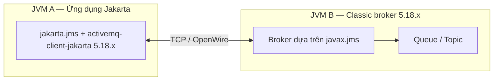

# Giới hạn của Classic Jakarta transition client đối với embedded broker và VM transport

> **Chương:** Classic và Artemis  
> **Phạm vi:** Apache ActiveMQ Classic, đặc biệt là `activemq-client-jakarta` của dòng **5.18.x**, trong quá trình chuyển API từ `javax.jms` sang `jakarta.jms`. Bài học cũng đối chiếu với Classic 6.x và hướng lựa chọn Artemis.  
> **Kết luận cốt lõi:** Khi dùng **ActiveMQ Classic 5.18.x + `activemq-client-jakarta`**, ứng dụng **chỉ nên kết nối đến broker chạy ở JVM khác qua network transport** (chẳng hạn `tcp://`). Cấu hình **embedded broker** hoặc kết nối **`vm://`** trong cùng JVM **không được hỗ trợ**.

## 1. Bối cảnh: chuyển sang Jakarta Messaging thay đổi điều gì?

ActiveMQ là message broker giúp các thành phần trao đổi thông điệp bất đồng bộ bằng **queue** (một thông điệp được một consumer trong nhóm xử lý), **topic** (phân phối đến các subscription phù hợp) và API JMS. Một hệ thống có thể có ứng dụng gửi sự kiện đặt hàng, broker lưu/chuyển tiếp thông điệp và ứng dụng khác tiêu thụ thông điệp.

Trong hệ sinh thái Java, việc chuyển từ Java EE sang Jakarta EE dẫn đến thay đổi namespace của API messaging:

```java
// Ứng dụng dùng JMS theo hệ sinh thái Java EE:
import javax.jms.Connection;
import javax.jms.Message;

// Ứng dụng dùng Jakarta Messaging theo hệ sinh thái Jakarta EE:
import jakarta.jms.Connection;
import jakarta.jms.Message;
```

Điểm dễ nhầm: lớp triển khai của ActiveMQ vẫn mang tên `org.apache.activemq.ActiveMQConnectionFactory`. Vì vậy, **tên lớp ActiveMQ nhìn giống nhau không có nghĩa hai bản client dùng hai namespace JMS khác nhau có thể cùng tồn tại trong một classpath**.

ActiveMQ Classic 5.18 giới thiệu các bước hỗ trợ JMS 2.0 và Jakarta Messaging 3.1; tuy nhiên nhánh 5.18 vẫn có broker và client truyền thống dựa trên `javax.jms`. Để ứng dụng dùng `jakarta.jms` (ví dụ ứng dụng Spring Framework 6) giao tiếp với broker Classic 5.18 đang chạy, dự án cung cấp artifact chuyển tiếp `activemq-client-jakarta`. Đây là **bản client chuyển tiếp**, không phải bản broker Jakarta hoàn chỉnh.

### Bảng nhận diện nhanh

| Dòng ActiveMQ Classic | Artifact phía ứng dụng | Namespace JMS | Embedded broker trong cùng JVM | `vm://` |
| --- | --- | --- | --- | --- |
| 5.18.x | `org.apache.activemq:activemq-client` | `javax.jms` | Có, khi ghép với broker tương thích | Có |
| 5.18.1–5.18.x | `org.apache.activemq:activemq-client-jakarta` | `jakarta.jms` | **Không** | **Không** |
| 6.x | `org.apache.activemq:activemq-client` | `jakarta.jms` | Có, với broker và dependencies 6.x phù hợp | Có |

**Lưu ý phiên bản:** `activemq-client-jakarta` là artifact chuyển tiếp được tài liệu chính thức xác nhận từ **5.18.1** trở đi trong dòng 5.18; không tiếp tục dùng artifact này khi chuyển sang **Classic 6.x**. Tài liệu dự án ghi rõ artifact chuyển tiếp đã được bỏ ở 6.x vì `activemq-client` chính đã chuyển sang Jakarta.

## 2. Hiểu đúng embedded broker và VM transport

**Embedded broker** là broker chạy *bên trong cùng tiến trình JVM* của ứng dụng. Ví dụ, một chương trình có thể khởi tạo `org.apache.activemq.broker.BrokerService` để chạy broker ngay trong ứng dụng hoặc trong bộ kiểm thử.

**VM transport** (URI dạng `vm://brokerName`) là cơ chế truyền thông *nội bộ cùng JVM* của ActiveMQ Classic. Nó tránh socket mạng và chuyển lệnh giữa các thành phần thông qua lời gọi trực tiếp trong tiến trình. Với cấu hình phù hợp, kết nối VM đầu tiên còn có thể tự khởi tạo broker nếu broker tương ứng chưa tồn tại.

Ví dụ trong một cấu hình **Classic 5.18 thuần `javax.jms`**:

```java
// Ví dụ minh họa cho stack 5.18 dùng javax.jms;
// KHÔNG đưa đoạn này vào ứng dụng dùng activemq-client-jakarta.
BrokerService broker = new BrokerService();
broker.setBrokerName("orders");
broker.setPersistent(false);  // chỉ phù hợp cho demo/test
broker.start();

// Client javax.jms tương thích trong cùng JVM có thể dùng:
// new ActiveMQConnectionFactory("vm://orders?create=false");
```

Trong môi trường này, `vm://orders` yêu cầu ứng dụng và broker chia sẻ cùng tiến trình và các lớp cần thiết. URI `create=false` chỉ ngăn VM transport tự tạo broker mới; nó **không biến VM transport thành kết nối mạng** và cũng không giải quyết xung đột `javax.jms`/`jakarta.jms`.

## 3. Vì sao Jakarta transition client 5.18.x không dùng được embedded hoặc VM?

Giới hạn đến từ **ranh giới tương thích bên trong JVM**, không phải do queue hay topic thiếu tính năng.

1. **Broker Classic 5.18.x thuộc thế hệ `javax.jms`.** Khi nhúng broker vào ứng dụng, các thư viện server và client phải cùng tồn tại trong classpath của một JVM.
2. **`activemq-client-jakarta` được đóng gói cho API `jakarta.jms`.** Nó được dự định dùng như client kết nối từ xa. Dự án ActiveMQ nêu rõ artifact này không thể sử dụng trong cùng JVM với `activemq-client` hoặc broker dựa trên `javax.jms`.
3. **`vm://` đòi hỏi client tương tác trực tiếp với broker trong JVM.** Vì trường hợp nhúng broker 5.18 vào JVM của transition client đã không được hỗ trợ, `vm://` cũng không phải lựa chọn hợp lệ.

Có thể gặp lỗi khi cố ghép dependencies, ví dụ lỗi nạp lớp (`NoClassDefFoundError`), lỗi không tương thích kiểu (`ClassCastException`), lỗi liên kết phương thức (`NoSuchMethodError`) hoặc lỗi khởi tạo transport. **Thông báo lỗi thực tế phụ thuộc classpath và điểm khởi tạo**; không nên xem một chuỗi exception cụ thể là dấu hiệu bắt buộc.

### Kiến trúc được hỗ trợ



Hai JVM có thể ở **hai máy khác nhau** hoặc **cùng một máy**. Ví dụ `tcp://127.0.0.1:61616` hợp lệ khi ứng dụng và broker là hai **tiến trình JVM độc lập** trên cùng host. Địa chỉ loopback **không** có nghĩa là VM transport. Ngược lại, bật TCP connector cho broker **vẫn không hợp thức hóa** việc nhúng chính broker 5.18 vào JVM có `activemq-client-jakarta`.

### Kiến trúc cần tránh trong Classic 5.18.x

```text
JVM duy nhất
├── Ứng dụng dùng jakarta.jms
├── activemq-client-jakarta:5.18.x
├── activemq-broker:5.18.x       <-- yêu cầu stack javax.jms
└── ConnectionFactory("vm://orders")  <-- không được hỗ trợ
```

Việc thêm `activemq-broker`, `activemq-all` hoặc `activemq-client` 5.18 vào classpath để làm cho `vm://` “chạy được” là sai hướng: các artifact này làm phát sinh đúng tổ hợp không tương thích mà transition client được yêu cầu tránh.

## 4. Thực hành: Java dùng Jakarta Messaging kết nối broker Classic 5.18 từ xa

Mục tiêu: một ứng dụng độc lập gửi thông điệp vào queue `demo.orders` rồi nhận lại thông điệp đó. **Broker Classic 5.18 chạy trong một JVM riêng**. Ví dụ cố ý chỉ dùng các thao tác JMS cơ bản vốn phù hợp với giai đoạn chuyển tiếp.

### 4.1. Khởi chạy broker tách biệt

Cài bản phân phối **ActiveMQ Classic 5.18.x** và chạy broker từ thư mục cài đặt (ví dụ trên Linux/macOS):

```bash
# Terminal 1 — trong thư mục cài đặt ActiveMQ Classic:
bin/activemq console
```

Trên Windows, có thể dùng script `bin\activemq start`. Xác minh broker thực sự mở TCP connector tại cổng tương ứng, thường là **61616** trong cấu hình mẫu. Không suy diễn một cổng đã mở chỉ từ việc tiến trình khởi động thành công; kiểm tra log và cấu hình transport connector.

Đối với ví dụ chạy cùng máy, ứng dụng sẽ dùng:

```text
tcp://127.0.0.1:61616
```

Trong Docker hoặc Kubernetes, `127.0.0.1` trỏ tới namespace mạng của container/pod hiện tại; cần chỉ đúng hostname hoặc service name có thể truy cập từ tiến trình ứng dụng.

### 4.2. Dependency Maven của ứng dụng client

Ví dụ `pom.xml` tối thiểu cho một dự án Java 17:

```xml
<project xmlns="http://maven.apache.org/POM/4.0.0"
         xmlns:xsi="http://www.w3.org/2001/XMLSchema-instance"
         xsi:schemaLocation="http://maven.apache.org/POM/4.0.0
                             https://maven.apache.org/xsd/maven-4.0.0.xsd">
    <modelVersion>4.0.0</modelVersion>
    <groupId>example.messaging</groupId>
    <artifactId>classic-jakarta-remote</artifactId>
    <version>1.0.0</version>

    <properties>
        <maven.compiler.release>17</maven.compiler.release>
    </properties>

    <dependencies>
        <dependency>
            <groupId>org.apache.activemq</groupId>
            <artifactId>activemq-client-jakarta</artifactId>
            <version>5.18.3</version>
        </dependency>
    </dependencies>

    <build>
        <plugins>
            <plugin>
                <groupId>org.apache.maven.plugins</groupId>
                <artifactId>maven-compiler-plugin</artifactId>
                <version>3.13.0</version>
            </plugin>
            <plugin>
                <groupId>org.codehaus.mojo</groupId>
                <artifactId>exec-maven-plugin</artifactId>
                <version>3.5.0</version>
            </plugin>
        </plugins>
    </build>
</project>
```

**Tại sao dùng 5.18.3?** Đây là một phiên bản 5.18.x cụ thể để ví dụ có thể tái lập, **không phải khẳng định đây là bản mới nhất**. Dự án thực tế cần chọn bản vá phù hợp chính sách bảo mật và kiểm thử tương thích. Trong ứng dụng client này, **không** thêm `activemq-broker:5.18.x`, `activemq-client:5.18.x` hoặc `activemq-all:5.18.x`.

### 4.3. Producer và consumer Java

Tạo file `src/main/java/example/messaging/JakartaRemoteDemo.java`:

```java
package example.messaging;

import jakarta.jms.Connection;
import jakarta.jms.DeliveryMode;
import jakarta.jms.JMSException;
import jakarta.jms.Message;
import jakarta.jms.MessageConsumer;
import jakarta.jms.MessageProducer;
import jakarta.jms.Queue;
import jakarta.jms.Session;
import jakarta.jms.TextMessage;

import org.apache.activemq.ActiveMQConnectionFactory;

public final class JakartaRemoteDemo {
    private JakartaRemoteDemo() {}

    public static void main(String[] args) throws JMSException {
        String brokerUrl = System.getenv().getOrDefault(
                "BROKER_URL", "tcp://127.0.0.1:61616");

        ActiveMQConnectionFactory factory =
                new ActiveMQConnectionFactory(brokerUrl);

        Connection connection = factory.createConnection();
        try {
            Session session = connection.createSession(
                    false, Session.AUTO_ACKNOWLEDGE);
            try {
                Queue orders = session.createQueue("demo.orders");

                MessageProducer producer = session.createProducer(orders);
                try {
                    producer.setDeliveryMode(DeliveryMode.PERSISTENT);
                    producer.send(
                            session.createTextMessage("order-created:1001"));
                    System.out.println("Sent order-created:1001");
                } finally {
                    producer.close();
                }

                // Nhận thông điệp: cần start() connection trước khi receive().
                connection.start();
                MessageConsumer consumer = session.createConsumer(orders);
                try {
                    Message received = consumer.receive(5000);
                    if (received instanceof TextMessage textMessage) {
                        System.out.println("Received: " + textMessage.getText());
                    } else if (received == null) {
                        throw new IllegalStateException(
                                "Timed out waiting for a message");
                    } else {
                        throw new IllegalStateException(
                                "Unexpected JMS message type: "
                                        + received.getClass().getName());
                    }
                } finally {
                    consumer.close();
                }
            } finally {
                session.close();
            }
        } finally {
            connection.close();
        }
    }
}
```

Khởi chạy bằng Maven sau khi broker sẵn sàng:

```bash
mvn -q compile exec:java -Dexec.mainClass=example.messaging.JakartaRemoteDemo
```

Kết quả mong đợi ở ứng dụng demo (khi queue không có consumer khác tranh nhận thông điệp):

```text
Sent order-created:1001
Received: order-created:1001
```

**Giải thích:** `jakarta.jms.*` là API ở phía ứng dụng; `org.apache.activemq.ActiveMQConnectionFactory` là lớp client tương ứng với dependency chuyển tiếp. URI `tcp://` mở socket đến broker, truyền lệnh qua giao thức ActiveMQ trên mạng. Broker có thể tiếp tục chạy với các thành phần `javax.jms` **trong JVM riêng của nó**.

Ví dụ mặc định giả định broker chấp nhận kết nối tương ứng. Nếu broker yêu cầu xác thực, dùng `factory.createConnection(username, password)` và nhận thông tin đăng nhập từ biến môi trường hoặc hệ thống quản lý secret; không nhúng mật khẩu trong mã nguồn.

### 4.4. Cùng queue, khác kiểu triển khai

Ở ví dụ trên, một producer và một consumer nằm trong cùng chương trình để dễ quan sát. Trong thực tế, có thể tách thành hai dịch vụ Jakarta khác nhau, cùng kết nối đến broker Classic qua TCP. Queue phân phối thông điệp cho một consumer trong nhóm; nếu cần gửi sự kiện đến nhiều nhóm xử lý độc lập, cần thiết kế topic/subscription hoặc cơ chế fan-out phù hợp.

## 5. Những cấu hình dễ sai và cách sửa

### Sai 1 — Thay `tcp://` bằng `vm://`

```java
// Không dùng với activemq-client-jakarta 5.18.x:
new ActiveMQConnectionFactory("vm://orders");
```

`vm://` **không** phải “TCP nhanh hơn”. Nó định vị một broker trong **cùng JVM**. Hậu quả có thể là transport không khởi tạo được hoặc phát sinh lỗi classpath. Cách sửa là dùng broker ở JVM riêng và URI `tcp://host:port` (hoặc `failover:(tcp://...)` khi cần reconnect).

### Sai 2 — Nhúng broker 5.18 và chỉ đổi connection URL sang TCP

```java
// Sơ đồ sai với transition client 5.18.x:
BrokerService broker = new BrokerService();   // broker javax trong JVM
broker.addConnector("tcp://127.0.0.1:61616");
broker.start();

var cf = new ActiveMQConnectionFactory("tcp://127.0.0.1:61616");
// Dù URL là TCP, broker và transition client vẫn cùng classpath/JVM.
```

TCP chỉ thay kênh vận chuyển thông điệp; **xung đột thư viện Java trong cùng JVM vẫn còn**. Cách sửa là chuyển broker sang **tiến trình JVM khác** hoặc thay toàn bộ stack bằng phiên bản hỗ trợ Jakarta phía broker.

### Sai 3 — Cho cả hai client 5.18 vào cùng dependency tree

```xml
<!-- Tổ hợp không phù hợp trong cùng classpath ứng dụng -->
<dependency>
    <groupId>org.apache.activemq</groupId>
    <artifactId>activemq-client</artifactId>
    <version>5.18.3</version>
</dependency>
<dependency>
    <groupId>org.apache.activemq</groupId>
    <artifactId>activemq-client-jakarta</artifactId>
    <version>5.18.3</version>
</dependency>
```

Hai artifact cung cấp các lớp ActiveMQ có cùng tên đầy đủ nhưng gắn với hai thế hệ JMS API khác nhau. Thứ tự resolve classpath có thể khiến ứng dụng biên dịch được mà chạy lỗi ở runtime. Hãy kiểm tra dependency tree và loại bỏ dependency xung đột khỏi ứng dụng:

```bash
mvn dependency:tree
```

Đặc biệt xem các dependency được kéo gián tiếp từ starter, thư viện pooling, thư viện tích hợp và `activemq-all`. **Đừng cố “vá” bằng cách thêm đồng thời cả `javax.jms-api` lẫn `jakarta.jms-api`**; giải pháp là lựa chọn một stack JMS tương thích với runtime.

### Sai 4 — Dùng API Jakarta mới mà chưa xác minh mức hỗ trợ

Đừng hiểu `jakarta.jms` là cam kết thực thi đầy đủ mọi tính năng Jakarta Messaging 3.1 trên Classic 5.18. Tài liệu ActiveMQ nêu rõ hỗ trợ giai đoạn đầu là **partial**; một số thao tác có thể ném `UnsupportedOperationException`, gồm gửi bất đồng bộ bằng `CompletionListener`, đặt delivery delay và shared topic consumer.

Ứng dụng nên dùng chức năng đã được kiểm chứng trên **đúng phiên bản artifact**, đặc biệt khi tích hợp framework có thể gọi ngầm API mới. Ví dụ thực hành ở trên dùng `Connection`, `Session`, `MessageProducer.send` và `MessageConsumer.receive` để tránh phụ thuộc vào tính năng chuyển tiếp chưa đầy đủ.

## 6. Tích hợp Spring: tránh vô tình khởi tạo embedded broker

Ứng dụng Spring Framework 6 / Spring Boot thuộc thế hệ `jakarta.jms` có thể cần nói chuyện với broker Classic 5.18. Trong trường hợp vẫn dùng transition client, mục tiêu cấu hình là **remote broker**:

```yaml
spring:
  activemq:
    broker-url: tcp://broker.internal.example:61616
    embedded:
      enabled: false
```

Ví dụ địa chỉ `broker.internal.example` là placeholder; thay bằng DNS thực tế. Spring Boot có cơ chế tự cấu hình embedded broker khi thư viện broker phù hợp nằm trên classpath và không đặt broker URL. Vì vậy:

- Cấu hình **broker URL rõ ràng** khi dùng Classic 5.18 transition client.
- Kiểm soát dependency thực tế mà starter/BOM chọn, nhất là khi dự án đang chuyển major version của Spring Boot.
- Kiểm tra lớp `ConnectionFactory` đang dùng triển khai API `jakarta.jms.ConnectionFactory`, đồng thời không mang broker Classic 5.18 vào JVM ứng dụng.
- Khi chuyển sang **Classic 6.x**, xem lại dependency và khả năng nhúng broker theo ma trận của chính nhánh 6.x; không tái sử dụng `activemq-client-jakarta`.

Cấu hình Spring chỉ hỗ trợ wiring và lifecycle. Nó **không thể** làm cho cặp transition client/broker 5.18 trong một JVM trở thành tổ hợp được hỗ trợ.

## 7. Chọn đường triển khai đúng với nhu cầu

| Nhu cầu | Hướng lựa chọn | Vì sao |
| --- | --- | --- |
| Ứng dụng `jakarta.jms`, broker Classic 5.18 phải giữ nguyên | `activemq-client-jakarta` 5.18.x; broker chạy JVM riêng; kết nối TCP/SSL | Đây là tình huống chuyển tiếp được thiết kế hỗ trợ |
| Ứng dụng `javax.jms` và cần embedded/VM trên Classic 5.18 | `activemq-client` + `activemq-broker` tương thích 5.18.x | Cùng thế hệ API trong một JVM |
| Ứng dụng Jakarta cần embedded/VM với ActiveMQ Classic | Xem xét nâng cả broker và client sang Classic 6.x, dùng `activemq-client` | Dòng 6.x hỗ trợ `jakarta.jms` và embedded/VM theo tài liệu chính thức |
| Dự án đang thiết kế mới, cần broker Jakarta và lựa chọn embedded/native | Đánh giá **ActiveMQ Artemis** cùng client/server tương ứng | Artemis là sản phẩm broker riêng, có hệ thư viện và cách cấu hình riêng |

**Classic và Artemis không phải hai artifact client có thể hoán đổi tùy ý.** Artemis cũng hỗ trợ mô hình JMS queue/topic và các chế độ triển khai riêng, nhưng cần kiểm tra protocol, địa chỉ/định tuyến, thư viện client, cấu hình bảo mật và hành vi redelivery khi chuyển hệ thống. Đặc biệt, `vm://brokerName` nói trong bài này là **VM transport của ActiveMQ Classic**; không mặc nhiên áp dụng cú pháp đó cho Artemis.

Với môi trường kiểm thử tích hợp của ứng dụng Jakarta + Classic 5.18, một broker chạy trong **tiến trình/container riêng** phản ánh đúng kiến trúc được hỗ trợ. Có thể dựng broker từ bản phân phối, container hoặc test environment riêng rồi chạy bài kiểm thử gửi/nhận qua TCP. Không dùng embedded broker 5.18 trong cùng JVM của test chỉ để bỏ qua bước dựng môi trường.

## 8. Đảm bảo thông điệp tin cậy khi chuyển từ VM sang TCP

Việc chuyển từ `vm://` sang `tcp://` thay đổi ranh giới lỗi: mạng có thể gián đoạn, broker có thể khởi động lại, kết nối có thể mất trong lúc gửi hoặc xác nhận. Do đó cần thiết kế hành vi thông điệp tường minh.

### 8.1. Acknowledgment và giao dịch

Trong ví dụ Java, `Session.AUTO_ACKNOWLEDGE` đơn giản cho demo. Với xử lý nghiệp vụ, cần cân nhắc **transacted session** để chỉ `commit()` sau khi xử lý thông điệp thành công; khi lỗi có thể `rollback()` để broker tổ chức phát lại theo chính sách.

```java
// Mảnh mã minh họa nằm trong một Connection đã start().
Session txSession = connection.createSession(
        true, Session.SESSION_TRANSACTED);
try {
    Queue queue = txSession.createQueue("demo.orders");
    MessageConsumer consumer = txSession.createConsumer(queue);
    try {
        Message msg = consumer.receive(5000);
        if (msg != null) {
            try {
                // validate(msg); applyBusinessRules(msg);
                // Chỉ commit khi xử lý cần thiết trong JMS session đã thành công.
                txSession.commit();
            } catch (Exception processingError) {
                txSession.rollback();
                throw processingError;
            }
        }
    } finally {
        consumer.close();
    }
} finally {
    txSession.close();
}
```

Đây là giao dịch **cục bộ của JMS session**; nó không tự làm cho việc ghi vào cơ sở dữ liệu ngoài và xác nhận JMS trở thành một giao dịch nguyên tử. Với hệ thống có DB, cần cân nhắc idempotency, outbox/inbox hoặc transaction coordination phù hợp. Nếu dùng `CLIENT_ACKNOWLEDGE`, nhớ rằng `acknowledge()` có thể xác nhận **toàn bộ những thông điệp đã tiêu thụ trong session**, không chỉ riêng message được gọi.

### 8.2. Redelivery, DLQ và idempotency

- Một thông điệp có thể được giao lại sau rollback, lỗi xử lý hoặc mất kết nối tùy chính sách client/broker. Gắn **business ID** (ví dụ `orderId`) để consumer xử lý lặp an toàn.
- Đặt chính sách **redelivery** (số lần thử, khoảng chờ, backoff) và **dead letter queue** theo broker vận hành. DLQ dùng để tách thông điệp liên tục xử lý lỗi để điều tra hoặc tái xử lý có kiểm soát.
- Không giả định “đã send một lần” đồng nghĩa “nghiệp vụ chỉ được áp dụng một lần”. Khi reconnect hoặc kết quả commit không rõ ràng, cần đối soát trạng thái nghiệp vụ.

### 8.3. Kết nối, bảo mật và quan sát

- Dùng `failover:(tcp://broker1:61616,tcp://broker2:61616)` khi kiến trúc broker thực sự có endpoint phục hồi; đọc kỹ thời gian reconnect và timeout. `failover:` **không** biến `vm://` thành lựa chọn hợp lệ cho transition client.
- Ưu tiên transport có TLS (ví dụ `ssl://` nếu broker đã cấu hình SSL), xác thực, phân quyền destination và quản lý secret ngoài mã nguồn.
- Theo dõi số kết nối, queue depth, consumer lag/độ trễ xử lý, số lần redelivery, DLQ và lỗi socket. Tách broker thành tiến trình riêng cũng tách vòng đời JVM và tạo khả năng quản trị/bảo trì broker độc lập.

## 9. Chẩn đoán nhanh khi triển khai

| Hiện tượng | Nguyên nhân cần kiểm tra | Hướng xử lý |
| --- | --- | --- |
| Kết nối `vm://...` thất bại | Đang dùng `activemq-client-jakarta` 5.18.x; VM yêu cầu embedded broker cùng JVM | Đổi sang broker ở JVM khác và URI mạng |
| `NoClassDefFoundError` / `ClassCastException` / `NoSuchMethodError` liên quan JMS hoặc ActiveMQ | Classpath pha trộn `javax.jms`, `jakarta.jms`, hoặc hai client ActiveMQ 5.18 | Kiểm tra `mvn dependency:tree`; chọn đúng một stack |
| `Connection refused` đến `tcp://...` | Broker không chạy, connector sai host/port, mạng/container chưa thông | Kiểm tra log broker, transport connector, host/port, network policy |
| Lỗi xác thực hoặc không được phép gửi queue | Credential hoặc ACL không đúng | Cấu hình user/role và quyền destination trên broker |
| `UnsupportedOperationException` khi dùng JMS API mới | Tính năng chỉ được hỗ trợ một phần trong nhánh/version hiện tại | Xác minh release notes; đổi API hoặc chọn phiên bản có hỗ trợ |
| Bị trùng xử lý sau reconnect | Redelivery/commit không rõ trạng thái hoặc consumer thiếu idempotency | Gắn business key, thiết kế retry và kiểm soát transaction |
| App Spring vô tình tạo broker trong JVM | Có dependency broker và cấu hình auto-embedded | Chỉ định remote `broker-url`, tắt embedded, rà dependency |

**Thứ tự kiểm tra khuyến nghị:** (1) xác định phiên bản và artifact, (2) kiểm tra đúng namespace import, (3) xem toàn bộ dependency tree, (4) xác định broker ở JVM riêng hay không, (5) kiểm tra URI transport và log kết nối, (6) kiểm tra hành vi ACK/transaction sau khi đã kết nối thành công.

## 10. Bài tập thực hành và câu hỏi tự kiểm tra

**Bài tập A — kiến trúc đúng:** Khởi chạy broker Classic 5.18 ở một terminal/JVM riêng. Dùng ứng dụng Maven phía trên kết nối `tcp://127.0.0.1:61616`, gửi `order-created:1001` đến `demo.orders` và xác nhận đọc lại nội dung. Sau đó tắt broker và quan sát lỗi kết nối. Giải thích vì sao tắt broker không đồng nghĩa kết thúc JVM ứng dụng.

**Bài tập B — đọc dependency tree:** Giả sử một starter kéo vào `activemq-client:5.18.3`, trong khi ứng dụng khai báo `activemq-client-jakarta:5.18.3`. Hãy chỉ ra vì sao việc có cả hai thư viện là rủi ro ngay cả khi trong mã Java chỉ import `jakarta.jms`, rồi đề xuất một dependency tree sạch.

**Bài tập C — chọn phiên bản:** Với yêu cầu “ứng dụng Jakarta phải nhúng broker trong cùng JVM và dùng `vm://`”, hãy chọn giữa ba cấu hình: Classic 5.18 + transition client; Classic 6.x đồng bộ client/broker; Classic 5.18 thuần `javax.jms`. Cấu hình nào đáp ứng **đồng thời** yêu cầu Jakarta và embedded VM? Nêu lý do từ bảng tương thích.

**Câu hỏi hiểu bản chất:**

1. Tại sao `tcp://localhost` có thể hợp lệ nhưng `vm://localhost` không hợp lệ với transition client 5.18.x?
2. Nếu khởi chạy `BrokerService` 5.18 trong cùng JVM rồi kết nối bằng `tcp://127.0.0.1`, vấn đề classpath đã được giải quyết chưa?
3. Tại sao thay namespace `javax.jms` thành `jakarta.jms` không có nghĩa mọi tính năng JMS 2.0 / Jakarta Messaging 3.1 đều được hiện thực?
4. Sau khi chuyển từ VM sang TCP, thành phần nào cần kiểm tra thêm để tránh mất thông điệp hoặc xử lý trùng khi reconnect?

**Đáp án định hướng:** (1) TCP có thể băng qua ranh giới JVM; VM chỉ ở cùng JVM. (2) Chưa, vì broker và transition client vẫn đồng tồn tại trong classpath không được hỗ trợ. (3) Phạm vi API và mức độ hiện thực tính năng là hai vấn đề khác nhau. (4) Acknowledgment/transaction, redelivery/DLQ, reconnect, idempotency và bảo mật.

## 11. Tài liệu tham khảo chính thức

1. Apache ActiveMQ — [Jakarta Messaging 3.1 & JMS 2.0 Support](https://activemq.apache.org/components/classic/documentation/jms2): bảng so sánh artifact, namespace, hỗ trợ embedded/VM và giới hạn tính năng.
2. Apache ActiveMQ — [VM Transport Reference](https://activemq.apache.org/components/classic/documentation/vm-transport-reference): cơ chế kết nối nội bộ JVM, `vm://`, `create` và `waitForStart`.
3. Apache ActiveMQ — [How do I embed a Broker inside a Connection](https://activemq.apache.org/components/classic/documentation/how-do-i-embed-a-broker-inside-a-connection): `BrokerService`, sự khác nhau giữa TCP và VM với broker embedded.
4. Apache ActiveMQ — [Failover Transport Reference](https://activemq.apache.org/components/classic/documentation/failover-transport-reference): URI phục hồi kết nối và các giới hạn khi failover.
5. Apache ActiveMQ — [Run Broker](https://activemq.apache.org/components/classic/documentation/version-5-run-broker): chạy broker ở một tiến trình riêng.
6. Spring Boot — [JMS Reference](https://docs.spring.io/spring-boot/reference/messaging/jms.html): cấu hình broker URL, embedded Classic và mode Artemis; cần đối chiếu với **đúng phiên bản Spring Boot** đang triển khai.

> **Ghi nhớ:** `activemq-client-jakarta` trong **Classic 5.18.x** là **client chuyển tiếp cho giao tiếp từ xa**. Muốn **embedded broker / `vm://`** mà vẫn dùng `jakarta.jms`, cần chọn một **stack server/client có hỗ trợ Jakarta thống nhất**, như Classic 6.x theo tài liệu phiên bản tương ứng, rồi kiểm thử các tính năng ứng dụng sử dụng.
