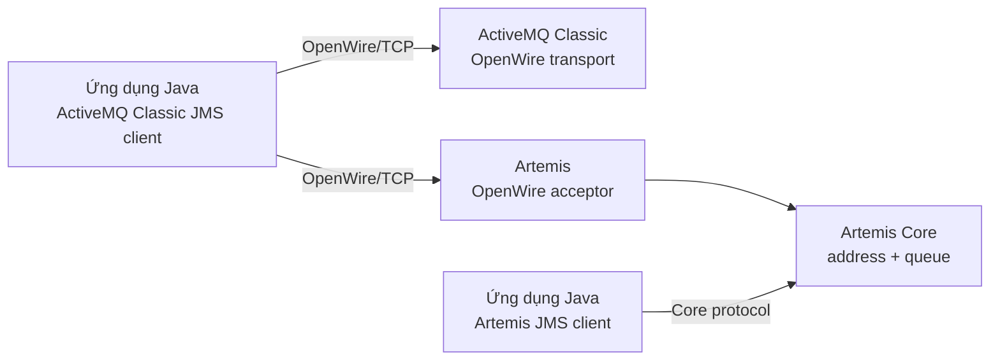
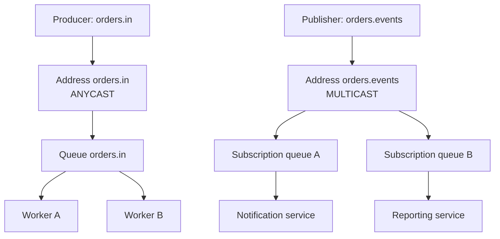

# Phân biệt tương thích OpenWire với tương đương tính năng giữa ActiveMQ Classic và Artemis

> **Chương:** Classic và Artemis  
> **Phạm vi:** Apache ActiveMQ Classic, Apache ActiveMQ Artemis, giao tiếp bất đồng bộ qua queue/topic, OpenWire, JMS và hành vi broker khi vận hành hoặc chuyển đổi.

## 1. Mục tiêu bài học

Sau bài này, bạn có thể:

1. Phân biệt **tương thích giao thức OpenWire** với **tương đương tính năng và hành vi** giữa ActiveMQ Classic và Artemis.
2. Giải thích tại sao ứng dụng Java dùng thư viện JMS của ActiveMQ Classic có thể kết nối tới Artemis mà vẫn cần kiểm tra cách phân phối, xác nhận và xử lý lỗi.
3. Ánh xạ queue/topic kiểu JMS sang mô hình **address – queue – routing type** của Artemis.
4. Cấu hình một OpenWire acceptor, thực hiện smoke test producer/consumer Java và nhận biết những điểm phải kiểm thử khi chuyển broker.
5. Đánh giá tác động của virtual topic, advisory, acknowledgment, transaction, redelivery, DLQ, bảo mật và vận hành.

## 2. Bài toán thực tế: cùng kết nối được, hệ thống có chạy như cũ không?

Giả sử hệ thống thương mại điện tử có ba thành phần:

- `order-service` gửi `OrderCreated` vào queue `orders.in` để xử lý thanh toán bất đồng bộ.
- `notification-service` đăng ký topic `orders.events` để gửi email.
- `analytics-service` dùng virtual topic `VirtualTopic.Orders` để có hàng đợi riêng và không mất sự kiện khi tạm ngừng xử lý.

Hệ thống trước đây chạy **ActiveMQ Classic**. Nhóm vận hành muốn thay broker bằng **ActiveMQ Artemis** nhưng giữ nguyên thư viện Java `org.apache.activemq:activemq-client` và URL `tcp://broker:61616`.

Nếu các ứng dụng kết nối được và một thông điệp thử nghiệm được nhận thành công, ta mới chứng minh được một phần **khả năng giao tiếp qua OpenWire**. Ta chưa chứng minh được rằng:

- bản tin gửi vào topic đến đủ các subscription;
- virtual topic được dịch sang queue đúng cách;
- rollback gây redelivery với số lần và khoảng trễ như trước;
- thông điệp lỗi đi vào đúng dead-letter queue;
- failover, permission, selector và broker monitoring có cùng kết quả.

Đây chính là ranh giới giữa **protocol compatibility** và **feature/behavioral equivalence**.

## 3. Ba lớp khái niệm phải tách biệt

| Lớp | Câu hỏi cần trả lời | Ví dụ |
|---|---|---|
| **API** | Code ứng dụng gọi những interface nào? | `javax.jms.Connection`, `Session`, `MessageProducer`, `MessageConsumer` |
| **Wire protocol** | Client và broker trao đổi dữ liệu trên mạng bằng cách nào? | OpenWire, AMQP 1.0, STOMP, MQTT, Artemis Core |
| **Broker semantics** | Broker lưu, định tuyến, phát lại, giới hạn và quản trị thông điệp như thế nào? | Anycast/multicast, durable subscription, DLQ, policy, HA, paging |

**JMS là API, không phải giao thức truyền trên mạng.** Hai thư viện cùng cung cấp JMS vẫn có thể dùng những wire protocol khác nhau:

- Client `org.apache.activemq.ActiveMQConnectionFactory` của ActiveMQ Classic sử dụng **OpenWire** qua transport như TCP.
- Client `org.apache.activemq.artemis.jms.client.ActiveMQConnectionFactory` của Artemis sử dụng **Artemis Core**.
- Artemis có thể cung cấp cả OpenWire và Core trên các acceptor phù hợp.



Với OpenWire, client và broker trao đổi các cấu trúc lệnh nhị phân, thực hiện handshake và thương lượng một số tùy chọn giao thức. Artemis triển khai bộ xử lý OpenWire để chuyển yêu cầu từ client vào mô hình lõi của Artemis. **Có bộ xử lý cùng giao thức không đồng nghĩa cùng mã nguồn, cùng cấu hình hoặc cùng chiến lược vận hành broker.**

Theo tài liệu *Protocols and Interoperability* của Artemis, ứng dụng sử dụng thư viện OpenWire JMS đi kèm ActiveMQ **5.12.x trở lên** có thể kết nối Artemis. Đây là ngưỡng được tài liệu nêu cho khả năng giao tiếp, không phải lời cam kết rằng mọi extension của mọi bản client sẽ có hành vi giống hệt Classic.

### 3.1. Bốn mức độ tương thích cần đánh giá

| Mức | Tiêu chí đạt | Điều chưa được bảo đảm |
|---|---|---|
| **Kết nối** | Client handshake, xác thực, mở session qua OpenWire | Queue/topic được định tuyến đúng |
| **Trao đổi tin cơ bản** | Gửi/nhận `TextMessage`, header và property, ack/commit thành công | Redelivery, selector và subscription trong mọi trường hợp |
| **Tương đương hành vi nghiệp vụ** | Cùng một ca sử dụng cho ra cùng kết quả, kể cả lỗi và restart | Cùng thông số hiệu năng, quản trị, HA |
| **Tương đương vận hành** | Đạt chỉ tiêu throughput, độ trễ, recovery, security, alerting, backup | File cấu hình hoặc kho dữ liệu cũ dùng lại trực tiếp |

Việc chuyển từ Classic sang Artemis cần được kiểm chứng ở **mức phù hợp với hợp đồng nghiệp vụ** của từng luồng thông điệp, không dừng ở mức kết nối.

## 4. Điểm khác biệt nền tảng: destination so với address model

Trong ActiveMQ Classic, lập trình viên thường nhìn broker qua các **destination** JMS: `Queue` và `Topic`. Trong Artemis, tài nguyên lõi có ba thành phần:

- **Address:** nơi producer gửi thông điệp đến.
- **Queue:** nơi thông điệp được giữ lại và consumer thực sự lấy thông điệp.
- **Routing type:** quy tắc chuyển một thông điệp từ address vào queue; chủ yếu là `ANYCAST` hoặc `MULTICAST`.

| Tác vụ JMS | Cách nhìn ở Classic | Cách biểu diễn cơ bản ở Artemis |
|---|---|---|
| `Queue("orders.in")` | Một queue có nhiều competing consumer | Address `orders.in` với một anycast queue tên `orders.in` |
| `Topic("orders.events")` | Publish/subscribe; mỗi subscription nhận bản tin phù hợp | Address `orders.events` dùng multicast, mỗi subscription có queue riêng |
| Durable topic subscriber | Subscription lưu tin khi subscriber offline | Multicast subscription queue tồn tại qua thời gian ngắt kết nối |
| Một topic không có subscriber | Không có nơi nhận bản tin thông thường | Multicast address không có subscription queue thường không giữ bản tin |



**Chú ý:** Với anycast, một thông điệp được định tuyến tới **một queue** phù hợp; nếu queue đó có nhiều consumer, các consumer cạnh tranh nhận thông điệp. Với multicast, thông điệp được đưa vào **từng queue subscription** phù hợp. Việc triển khai thêm queue, filter hoặc routing type có thể làm thay đổi kết quả, dù tên destination JMS không đổi.

### 4.1. Ví dụ cấu hình Artemis

Đoạn cấu hình minh họa nằm trong các phần tương ứng của `etc/broker.xml` trên **broker Artemis**:

```xml
<addresses>
  <address name="orders.in">
    <anycast>
      <queue name="orders.in"/>
    </anycast>
  </address>

  <address name="orders.events">
    <multicast/>
  </address>
</addresses>
```

Trong trường hợp đơn giản, Artemis có thể **tự tạo** address và queue phục vụ JMS, tùy các thiết lập `auto-create-addresses` và `auto-create-queues`. Với môi trường production, nên xem xét chủ động khai báo những destination quan trọng và kiểm tra routing type thực tế sau khi triển khai.

Artemis còn hỗ trợ cú pháp **Fully Qualified Queue Name (FQQN)**:

```text
<address>::<queue>
orders.events::subscription.reporting
```

FQQN cho phép client chỉ rõ queue nằm dưới một address. Nó hữu ích khi rà soát virtual topic hoặc những subscription queue được cấu hình riêng; không nên giả định mọi tên queue kiểu Classic đều tự động trở thành FQQN có ý nghĩa như cũ.

## 5. Cấu hình OpenWire và xác định đúng loại client

### 5.1. Classic: transport OpenWire

Một connector TCP thông thường của ActiveMQ Classic, đặt trong `activemq.xml`:

```xml
<transportConnectors>
  <transportConnector
      name="openwire"
      uri="tcp://0.0.0.0:61616"/>
</transportConnectors>
```

### 5.2. Artemis: OpenWire acceptor

Một acceptor chỉ nhận OpenWire, đặt trong phần `<acceptors>` của `etc/broker.xml`:

```xml
<acceptor name="openwire">
  tcp://0.0.0.0:61616?protocols=OPENWIRE
</acceptor>
```

Đây là ví dụ cho môi trường thử nghiệm. Nếu Artemis đã có acceptor dùng cổng `61616`, **sửa cấu hình hiện có hoặc chọn cổng khác**, không khai báo thêm một listener trùng cổng. Có thể dùng nhiều giao thức trên cùng acceptor nếu cấu hình `protocols` phù hợp; chẳng hạn Artemis cũng có giao thức Core và AMQP.

| Cách kết nối | Thư viện Java | Broker đích | Giao thức trên mạng |
|---|---|---|---|
| Giữ client cũ | `org.apache.activemq:activemq-client` | Classic | OpenWire |
| Giữ client cũ | `org.apache.activemq:activemq-client` | Artemis với OpenWire acceptor | OpenWire |
| Chuyển sang client Artemis | Thư viện Artemis JMS tương ứng | Artemis với Core acceptor | Artemis Core |

Thay đổi thư viện client là một **quyết định migration riêng**. Cùng triển khai `javax.jms` không làm hai thư viện trở thành cùng protocol. Với ứng dụng sử dụng `jakarta.jms`, cần chọn artifact và phiên bản client phù hợp; không thể chỉ đổi `import javax.jms` thành `jakarta.jms` rồi kỳ vọng binary tương thích.

### 5.3. Java smoke test: giữ cùng một client để đối chiếu hai broker

Ví dụ dưới đây dùng **ActiveMQ Classic JMS client**, phù hợp với mục tiêu kiểm tra OpenWire. Khai báo Maven dependency:

```xml
<dependency>
  <groupId>org.apache.activemq</groupId>
  <artifactId>activemq-client</artifactId>
  <version>5.18.5</version>
</dependency>
```

Phiên bản trên là ví dụ cụ thể của nhánh client 5.x; khi triển khai thật, chọn phiên bản được tổ chức hỗ trợ và kiểm tra ma trận tương thích với broker mục tiêu.

Tạo lớp `OpenWireSmoke.java`:

```java
import javax.jms.Connection;
import javax.jms.DeliveryMode;
import javax.jms.JMSException;
import javax.jms.Message;
import javax.jms.MessageConsumer;
import javax.jms.MessageProducer;
import javax.jms.Queue;
import javax.jms.Session;
import javax.jms.TextMessage;

import org.apache.activemq.ActiveMQConnectionFactory;

public final class OpenWireSmoke {
    public static void main(String[] args) throws JMSException {
        String url = args.length > 0
                ? args[0]
                : "tcp://localhost:61616";

        ActiveMQConnectionFactory factory =
                new ActiveMQConnectionFactory(url);

        String user = System.getenv("BROKER_USER");
        String password = System.getenv("BROKER_PASSWORD");

        Connection connection = (user == null || user.isEmpty())
                ? factory.createConnection()
                : factory.createConnection(user, password);

        try {
            // Hai session độc lập để quan sát rõ hai lần commit.
            Session txProducer = connection.createSession(
                    true, Session.SESSION_TRANSACTED);
            Session txConsumer = connection.createSession(
                    true, Session.SESSION_TRANSACTED);

            try {
                Queue destination = txProducer.createQueue("orders.in");
                MessageProducer producer =
                        txProducer.createProducer(destination);
                producer.setDeliveryMode(DeliveryMode.PERSISTENT);

                TextMessage outgoing =
                        txProducer.createTextMessage("OrderCreated: O-1001");
                outgoing.setStringProperty("eventId", "evt-1001");
                producer.send(outgoing);
                txProducer.commit(); // Xác nhận giao dịch gửi.

                MessageConsumer consumer = txConsumer.createConsumer(
                        txConsumer.createQueue("orders.in"));
                connection.start();

                Message incoming = consumer.receive(10_000L);
                if (!(incoming instanceof TextMessage)) {
                    txConsumer.rollback();
                    throw new IllegalStateException(
                            "Không nhận được TextMessage sau 10 giây");
                }

                TextMessage text = (TextMessage) incoming;
                System.out.printf(
                        "body=%s, eventId=%s, redelivered=%s%n",
                        text.getText(),
                        text.getStringProperty("eventId"),
                        text.getJMSRedelivered());

                txConsumer.commit(); // Xác nhận giao dịch nhận.
                consumer.close();
                producer.close();
            } finally {
                try {
                    txProducer.close();
                } finally {
                    txConsumer.close();
                }
            }
        } finally {
            connection.close();
        }
    }
}
```

**Cách thực hành:**

1. Khởi động Classic với OpenWire connector, tạo hoặc cho phép tạo `orders.in`; chạy `OpenWireSmoke tcp://localhost:61616`.
2. Khởi động Artemis riêng với OpenWire acceptor cùng cấu trúc queue anycast; chạy **chính class và dependency trên** với URL của Artemis.
3. So sánh body, property `eventId`, số tin trong queue, số tin đã được acknowledgment và thông báo lỗi.
4. Đổi sang tài khoản hợp lệ nếu broker yêu cầu xác thực, dùng biến môi trường `BROKER_USER` và `BROKER_PASSWORD` thay cho việc ghi mật khẩu trong source.

Kết quả mong đợi với cả hai: producer commit một bản tin persistent; consumer nhận một `TextMessage`, đọc được `eventId` rồi commit. Test này xác nhận **một ca JMS queue và local transaction cơ bản**. Nó chưa kiểm chứng đầy đủ HA, durable topic, redelivery hay các chính sách broker.

**Lưu ý thí nghiệm:** Chạy trên queue thử nghiệm tách biệt, tránh consumer khác lấy mất message. Mỗi lần chạy thêm một message; sau khi commit nhận thành công, queue không còn message của lần thử đó.

## 6. Bảng đối chiếu tính năng: giống mục tiêu, có thể khác cách làm

Các mục ghi **hỗ trợ** cần được hiểu là broker có khả năng đáp ứng ca sử dụng; không tự suy ra cấu hình và mọi edge case giống nhau.

| Tính năng / tình huống | Classic | Artemis khi client dùng OpenWire | Cần xác minh |
|---|---|---|---|
| JMS queue producer/consumer | Native destination queue | Ánh xạ sang address + anycast queue | Routing, auto-create, tên queue |
| JMS topic/pub-sub | Native topic | Address multicast + subscription queue | Subscriber online/offline, filter |
| Durable subscription | Hỗ trợ | Hỗ trợ qua subscription queue | `clientID`, tên subscription, reconnect |
| Selector, header, message property | Hỗ trợ | Có khả năng xử lý | Phép lọc, kiểu dữ liệu, ký tự đặc biệt |
| Local transaction / ack / rollback | Hỗ trợ | Hỗ trợ qua OpenWire/JMS | Commit, rollback, reconnect khi mất mạng |
| Redelivery / backoff | Classic có client/broker policy | Artemis có `address-settings`; chịu tác động của client OpenWire | Số lần nhận, độ trễ, poison message |
| Dead-letter handling | Thường dùng chiến lược DLQ kiểu Classic | Dùng dead-letter **address** và queue đích | Ngưỡng retry, tên queue, quyền đọc DLQ |
| Virtual Topic kiểu Classic | Convention `VirtualTopic.*` và `Consumer.*.*` | Có cơ chế dịch destination OpenWire qua `virtualTopicConsumerWildcards` | Mapping, queue tồn tại, selector |
| Advisory | Advisory topics / consumer | OpenWire protocol manager có hỗ trợ và tùy chọn advisory | Loại advisory, quyền truy cập, tải bổ sung |
| Composite destination, exclusive consumer, group | Nhiều extension riêng | Có các chức năng tương ứng trong Artemis, tùy cách cấu hình | Từng tùy chọn và quy tắc dispatch |
| Scheduled/delayed message | Có cơ chế scheduling | Artemis có scheduled delivery | Header/properties và thời điểm giao thực tế |
| Broker plugin, JMX, management API | Kiến trúc và object riêng của Classic | Kiến trúc, management và plugin riêng của Artemis | Dashboard, alert, automation |
| Persistence / HA / clustering | Ví dụ KahaDB, network connectors | Ví dụ journal, replication, clustering/federation | Khôi phục, topology, dữ liệu tồn đọng |

**Không nên biến bảng này thành phát biểu “Artemis không hỗ trợ tính năng X” chỉ vì cấu hình Classic không chạy nguyên xi.** Ví dụ, Artemis có hỗ trợ virtual-topic translation và advisories cho OpenWire nhưng cách triển khai, phạm vi cấu hình và kết quả quản trị có khác biệt.

### 6.1. Ví dụ: virtual topic tương thích không tự xảy ra

Trong Classic, một ứng dụng có thể:

- producer publish vào topic `VirtualTopic.Orders`;
- consumer nhóm billing đọc queue `Consumer.Billing.VirtualTopic.Orders`;
- consumer nhóm audit đọc queue `Consumer.Audit.VirtualTopic.Orders`.

Mục đích là mỗi nhóm có backlog và số consumer riêng, nhưng cùng nhận các sự kiện đã publish.

Artemis có tham số OpenWire `virtualTopicConsumerWildcards` để **dịch tên destination consumer kiểu Classic** thành FQQN:

```text
Queue Classic nhìn thấy:
Consumer.Billing.VirtualTopic.Orders

Artemis ánh xạ thành:
VirtualTopic.Orders::Consumer.Billing.VirtualTopic.Orders
```

Ví dụ acceptor:

```xml
<acceptor name="openwire">
  tcp://localhost:61616?protocols=OPENWIRE;virtualTopicConsumerWildcards=Consumer.*.%3E%3B2
</acceptor>
```

Trong đó phần cấu hình giải mã `Consumer.*.>;2` xác định mẫu tên consumer và số thành phần đầu dùng để nhận dạng queue. Ký tự đặc biệt `>` và `;` được percent-encode trong URL. Đoạn này minh họa **mẫu mặc định thường gặp**; nếu tổ chức dùng convention khác, cần đổi mapping tương ứng.

Điểm cần xác minh khi chạy là:

1. Có đúng **multicast address** `VirtualTopic.Orders` và queue subscription tương ứng cho từng nhóm.
2. Mỗi nhóm đọc đủ sự kiện trong khi các consumer nội bộ cùng nhóm cạnh tranh xử lý một queue.
3. Trạng thái queue được duy trì khi consumer ngắt kết nối, phù hợp yêu cầu durability.
4. Nếu có selector trên consumer virtual topic, cấu hình queue filter phù hợp; Artemis hỗ trợ tùy chọn mapping `selectorAware` nhưng phải kiểm tra cách filter được tạo và giữ lại.

**Sai lầm dễ gặp:** mở được kết nối OpenWire rồi publish vào `VirtualTopic.Orders`, nhưng chỉ nhận ở một nhóm hoặc không nhận ở nhóm nào; nguyên nhân có thể là thiếu mapping/routing/queue subscription, không nhất thiết do protocol không tương thích.

### 6.2. Ví dụ: advisory có hỗ trợ, nhưng không phải toàn bộ management tương đương

Client Classic có thể subscribe `ActiveMQ.Advisory.*` để biết kết nối, consumer hay destination thay đổi. Ở Artemis, phần xử lý OpenWire có các tùy chọn:

- `supportAdvisory`: có tạo và cung cấp advisory cho client hay không; mặc định theo tài liệu là `true`.
- `suppressInternalManagementObjects`: có giấu các đối tượng advisory nội bộ khỏi management registry hay không; mặc định `true`.

Ví dụ:

```xml
<acceptor name="openwire">
  tcp://localhost:61616?protocols=OPENWIRE;supportAdvisory=true;suppressInternalManagementObjects=true
</acceptor>
```

Đừng dựa vào advisory cũ để kết luận chắc chắn rằng **mọi JMX MBean, metric và plugin callback** sẽ có cùng tên hoặc cùng thời điểm phát sinh. Khi migration, liệt kê các consumer advisory hiện có và kiểm thử từng loại sự kiện cần dùng.

## 7. Những khác biệt ảnh hưởng trực tiếp đến độ tin cậy

### 7.1. Acknowledgment và transaction

Một số quy tắc JMS quan trọng:

- `AUTO_ACKNOWLEDGE`: xác nhận theo cơ chế tự động của session, phù hợp nhiều tác vụ đơn giản nhưng vẫn phải hiểu thời điểm xử lý nghiệp vụ hoàn tất.
- `CLIENT_ACKNOWLEDGE`: gọi `message.acknowledge()` xác nhận các message đã nhận trong **session** theo semantics JMS, không nên hiểu là chỉ xác nhận riêng message đó.
- `SESSION_TRANSACTED`: `commit()` xác nhận các operation của transaction; `rollback()` làm các message chưa commit có khả năng được giao lại.

Với ví dụ **xử lý đơn hàng rồi cập nhật database**, việc commit JMS và commit database là **hai thao tác khác nhau** nếu chỉ dùng local transaction. Cả Classic lẫn Artemis không tự biến hai thao tác độc lập thành một giao dịch nguyên tử. Ứng dụng nên dùng idempotency theo `eventId` hoặc thiết kế outbox/inbox; nếu chọn XA thì phải kiểm thử cụ thể client, broker và transaction manager.

### 7.2. Redelivery và DLQ: cùng thuật ngữ, khác điểm cấu hình

Classic có những cách cấu hình redelivery ở client và chính sách dead-letter trên broker. Artemis thường cấu hình cơ chế phát lại và dead-letter qua `address-settings` trong `broker.xml`.

Ví dụ cấu hình **trên Artemis** cho `orders.in`:

```xml
<address-settings>
  <address-setting match="orders.in">
    <redelivery-delay>1000</redelivery-delay>
    <redelivery-delay-multiplier>2.0</redelivery-delay-multiplier>
    <max-redelivery-delay>10000</max-redelivery-delay>
    <max-delivery-attempts>5</max-delivery-attempts>
    <dead-letter-address>DLQ</dead-letter-address>
    <auto-create-dead-letter-resources>true</auto-create-dead-letter-resources>
  </address-setting>
</address-settings>
```

Ý nghĩa:

- Lần xử lý thất bại có thể được giao lại sau khoảng trễ, tăng dần theo multiplier và giới hạn trần.
- Sau ngưỡng số lần giao không thành công, broker chuyển message sang dead-letter address `DLQ`.
- Với tùy chọn tự tạo dead-letter resources, Artemis tạo các queue DLQ tương ứng; tên thực tế phụ thuộc prefix/suffix và cấu hình broker, ví dụ `DLQ.orders.in`.

**Đừng mặc định** một message lỗi sẽ xuất hiện ở queue `ActiveMQ.DLQ` như convention quen thuộc của Classic. Kiểm tra cụ thể tên queue trong Artemis và dùng FQQN khi client cần truy cập đúng queue nằm dưới dead-letter address.

Bài kiểm thử nên cố tình rollback một message có `eventId` xác định, ghi lại các trường `JMSRedelivered`, `JMSXDeliveryCount` (nếu được cung cấp), thời gian giữa các lần giao và nơi message cuối cùng được lưu. Dựa vào kết quả quan sát, điều chỉnh policy để đáp ứng SLO và tránh vòng lặp retry vô hạn.

### 7.3. Không nên dựa duy nhất vào cờ `JMSRedelivered` để đảm bảo exactly-once

Các hệ thống message broker thực tế thường phải xử lý **at-least-once delivery**: mất kết nối sau khi nghiệp vụ xử lý xong nhưng trước khi acknowledgment/commit được xác nhận có thể khiến message xuất hiện lần nữa. Ứng dụng nên lưu hoặc kiểm tra `eventId`/business key và thiết kế handler **idempotent**.

Cũng cần kiểm tra tính bền vững của bộ đếm delivery qua các tình huống broker crash. Artemis có tùy chọn `persist-delivery-count-before-delivery` liên quan đến độ chính xác của thông tin redelivery sau crash và chi phí ghi đĩa. Vì vậy, đừng lấy số lần phát lại đã nhìn thấy trong một thử nghiệm ngắn làm bảo đảm cho mọi kịch bản khôi phục.

### 7.4. Cấu hình kết nối và HA không phải “giữ nguyên là đủ”

Ví dụ client Classic có thể dùng:

```text
failover:(tcp://broker-a:61616,tcp://broker-b:61616)?randomize=false
```

Khi hai endpoint là OpenWire acceptor của Artemis, chuỗi URI này **có thể kết nối** nhưng điều đó chưa xác nhận tương đương về topology discovery, nhận diện active node, reconnect, xử lý transaction đang dở hoặc chống duplicate. Kiểm thử bằng cách tắt broker giữa lúc producer gửi và consumer commit; đồng thời quan sát hệ thống giám sát và trạng thái message sau khôi phục.

## 8. Các giới hạn cần nhận diện khi chuyển từ Classic sang Artemis

Một số thứ **không được chuyển chỉ bằng cách đổi URL broker**:

1. **Dữ liệu đang nằm trong broker cũ:** KahaDB/LevelDB hoặc kho lưu trữ đặc thù của Classic không tự biến thành journal của Artemis. Cần chiến lược drain/bridge/export-import được xác minh riêng.
2. **File cấu hình:** `activemq.xml` và `broker.xml` dùng mô hình khác nhau. `destinationPolicy`, `networkConnector`, plugin, security rule và wildcard không thể sao chép nguyên vẹn.
3. **Topology phân tán:** Classic network-of-brokers khác cơ chế cluster/federation/replication trong Artemis. Cùng số node chưa bảo đảm cùng hành vi failover hoặc thứ tự thông điệp.
4. **Bảo mật:** Thử cả xác thực, quyền send/consume/create queue, quyền đọc DLQ, TLS và truststore. Một client kết nối được không đồng nghĩa có quyền truy cập đúng mọi destination.
5. **Quan sát vận hành:** Tên metric, MBean, console, paging, slow-consumer policy và alert cần được đối chiếu với công cụ đang dùng.

## 9. Quy trình kiểm chứng tương đương tính năng

Nên lập **test contract** theo từng luồng nghiệp vụ thay vì chỉ chạy smoke test chung:

| Nhóm kiểm thử | Cách thử | Tiêu chí đạt gợi ý |
|---|---|---|
| Kết nối OpenWire | Dùng cùng JAR client, đổi URI giữa hai broker | Handshake, auth và gửi/nhận thành công |
| Queue cạnh tranh | Gửi 100 message, chạy hai consumer | Mỗi `eventId` được xử lý theo quy tắc mục tiêu, không nhân đôi ngoài kỳ vọng |
| Topic thường | Hai subscriber hoạt động rồi publish | Mỗi subscriber nhận sự kiện phù hợp |
| Durable topic | Subscriber offline, publish, reconnect cùng `clientID` và subscription name | Nhận đủ message thuộc thời gian offline |
| Selector | Gửi bản tin với property `region=HN/HCM` | Mỗi subscription nhận đúng message khớp selector |
| Virtual topic | Một publisher, hai nhóm consumer, ngắt một nhóm | Nhóm còn lại tiếp tục; nhóm ngắt nhận backlog khi quay lại nếu được cấu hình bền vững |
| Transaction / ack | Consume rồi rollback, sau đó commit | Message được phát lại và cuối cùng rời queue sau commit |
| DLQ | Luôn rollback cùng một message | Sau ngưỡng cấu hình, message xuất hiện ở DLQ đúng tên |
| Kết nối lại | Dừng/restart broker trong lúc tải đang chạy | Client khôi phục theo thiết kế; không thất lạc dữ liệu đã commit |
| Độ bền | Gửi persistent message, restart trước khi consume | Message còn và được giao lại |
| Vận hành | Kiểm tra số queue, backlog, alert, quyền truy cập | Dashboard và cảnh báo có thể quan sát đúng |

**Cách đo nên sử dụng:** tỷ lệ message xử lý thành công, trùng lặp theo `eventId`, message bị mất, độ trễ p95/p99, thời gian recovery, lượng message trong DLQ, số kết nối bị từ chối và tốc độ tăng backlog. Chốt tiêu chí chấp nhận theo yêu cầu nghiệp vụ trước khi chạy thử.

### Kịch bản migration an toàn cho một queue thanh toán

1. Ghi nhận tên queue, producer/consumer, message schema, thuộc tính JMS, throughput và chính sách retry trên Classic.
2. Chuẩn bị Artemis với address `orders.in` anycast, OpenWire acceptor, tài khoản/permission và DLQ.
3. Dùng cùng client chạy smoke test Java; tiếp tục kiểm thử rollback, restart, duplicate và tải có kiểm soát.
4. Quyết định cách xử lý backlog trong Classic: drain hết trước cutover hoặc dùng công cụ/quy trình di chuyển tin riêng đã được thử nghiệm.
5. Chuyển traffic có kiểm soát, theo dõi `eventId`, backlog, DLQ và consumer lag; giữ kịch bản khôi phục khi kết quả sai lệch.
6. Sau khi đúng hành vi nghiệp vụ, mới tối ưu performance và đánh giá có cần chuyển ứng dụng sang client Artemis Core.

## 10. Các ngộ nhận thường gặp

**“Cả hai đều hỗ trợ JMS nên dùng chung protocol.”** Không đúng. JMS quy định API; Classic client thường dùng OpenWire, Artemis JMS client thường dùng Core.

**“Client Classic kết nối được Artemis nên chắc chắn feature parity.”** Không đủ. Cần kiểm thử route, subscriber, policy, extension và failure scenario.

**“Artemis không hỗ trợ virtual topic và advisory.”** Khẳng định tuyệt đối như vậy sai. Artemis có hỗ trợ translation virtual topic và các tùy chọn advisory trong lớp OpenWire, nhưng cần cấu hình/kiểm thử theo use case.

**“Cùng tên `orders` thì queue và topic sẽ cư xử giống hệt.”** Không chắc. Artemis phân biệt anycast/multicast và có thể có nhiều queue trên cùng address; phải kiểm tra routing và subscription.

**“Chỉ đổi URI là đã di chuyển dữ liệu tồn kho.”** Không đúng. Giao thức kết nối không chuyển các message còn nằm trong persistence store của broker cũ.

## 11. Câu hỏi tự luyện

1. Một ứng dụng dùng `org.apache.activemq.ActiveMQConnectionFactory` và `javax.jms.Session` kết nối thành công Artemis. Bạn đã chứng minh được tính tương thích ở những lớp nào? Còn những lớp nào cần kiểm tra?
2. Vì sao hai consumer của một JMS queue thường chia sẻ công việc, còn hai subscriber độc lập trên topic lại cùng nhận message? Diễn giải bằng address và queue của Artemis.
3. `Consumer.TeamA.VirtualTopic.Invoice` không nhận sự kiện sau migration. Hãy liệt kê ít nhất ba giả thuyết liên quan đến `virtualTopicConsumerWildcards`, routing type, queue và security.
4. Một message có `eventId=evt-77` cập nhật database thành công nhưng transaction JMS rollback vì mất kết nối. Handler lần sau cần xử lý thế nào?
5. Hãy thiết kế kiểm thử chứng minh queue thanh toán vẫn giữ đúng dữ liệu sau broker restart và vẫn đưa poison message vào DLQ.

## 12. Tài liệu tham khảo chính thức

- [ActiveMQ Classic – OpenWire](https://activemq.apache.org/components/classic/documentation/openwire): bản chất giao thức gốc của Classic.
- [ActiveMQ Classic – Configuring Transports](https://activemq.apache.org/components/classic/documentation/configuring-transports): TCP/OpenWire và URI của client.
- [Artemis – Protocols and Interoperability](https://artemis.apache.org/components/artemis/documentation/latest/protocols-interoperability.html): tích hợp OpenWire client, Core và acceptor.
- [Artemis – OpenWire](https://artemis.apache.org/components/artemis/documentation/latest/openwire.html): advisory, virtual topic translation và cấu hình OpenWire.
- [Artemis – Address Model](https://artemis.apache.org/components/artemis/documentation/latest/address-model.html): anycast, multicast, queue, subscription và FQQN.
- [Artemis – Message Redelivery and Undelivered Messages](https://artemis.apache.org/components/artemis/documentation/latest/undelivered-messages.html): redelivery, DLQ và delivery count.
- [Artemis – Using JMS or Jakarta Messaging](https://artemis.apache.org/components/artemis/documentation/latest/using-jms.html): phân biệt client JMS/Jakarta và connection factory.
- [ActiveMQ – Artemis Roadmap to ActiveMQ Next](https://activemq.apache.org/components/classic/documentation/activemq-artemis-roadmap): danh sách khả năng tương ứng ở mức định hướng; luôn kiểm chứng theo phiên bản sử dụng.

**Kết quả cần nhớ:** OpenWire cho phép **client Classic giao tiếp với broker Artemis**. Tương đương tính năng là một kết luận **phải chứng minh bằng cấu hình và kiểm thử nghiệp vụ**, đặc biệt với routing, virtual topic, redelivery, DLQ, HA và vận hành.
