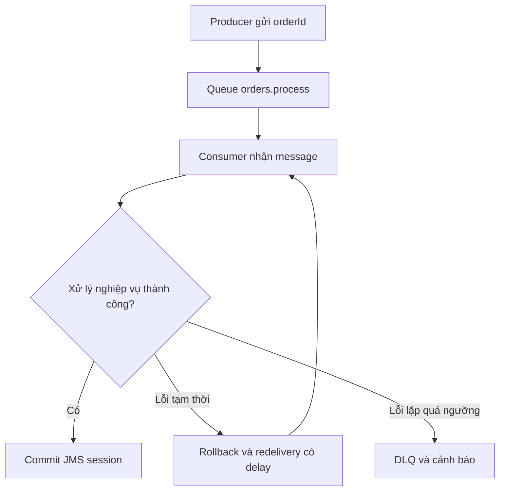

# Tiêu chí chọn broker cho hệ thống mới và hệ thống JMS đang vận hành

> **Chương:** Classic và Artemis  
> **Phạm vi:** Apache ActiveMQ Classic, Apache Artemis, ứng dụng Java dùng JMS/Jakarta Messaging, queue/topic, routing, acknowledgment, transaction, redelivery, dead-letter queue (DLQ), bảo mật và vận hành broker.

## 1. Đặt vấn đề: chọn theo ràng buộc của hệ thống

Giả sử một nền tảng thương mại điện tử có hai yêu cầu:

- Khi khách đặt hàng, dịch vụ `Order` gửi lệnh vào queue `orders.process`; mỗi đơn hàng chỉ cần một worker xử lý tại một thời điểm.
- Sau khi đơn được chấp nhận, dịch vụ `Order` phát sự kiện `orders.created` cho `Inventory`, `Billing` và `Notification`; mỗi nhóm dịch vụ cần nhận bản sao sự kiện riêng.

Cả **ActiveMQ Classic** và **Artemis** đều có thể triển khai giao tiếp bất đồng bộ, JMS queue/topic, message bền vững, xác nhận tiêu thụ và cơ chế xử lý lỗi. Khác biệt quan trọng nằm ở **kiến trúc broker**, **giao thức và hành vi client**, **các tính năng đang phụ thuộc**, cũng như **chi phí triển khai và vận hành**.

Có hai bài toán quyết định khác nhau:

1. **Hệ thống mới:** được quyền thiết kế lại destination, đặt chuẩn message, chọn client và triển khai HA/giám sát từ đầu. Artemis thường là ứng viên phù hợp để thử nghiệm trước nhờ kiến trúc routing dựa trên address, journal và hỗ trợ nhiều giao thức. Tuy nhiên, vẫn phải chứng minh đáp ứng các yêu cầu bằng kiểm thử.
2. **Hệ thống JMS đang vận hành:** đã có ứng dụng, hợp đồng message, thư viện client, chính sách broker và dữ liệu trong queue. Quyết định có thể là **giữ Classic**, **nâng cấp Classic**, **đưa ứng dụng mới sang Artemis**, hoặc **di chuyển từng phần**. Chi phí tương thích và rủi ro chuyển đổi có thể lớn hơn lợi ích kỹ thuật dự kiến.

**Nguyên tắc:** không chọn broker dựa trên nhận định tuyệt đối như “Artemis luôn nhanh hơn” hay “có OpenWire là tương thích hoàn toàn”. Cần xác định **điều kiện bắt buộc**, đo đạc bằng workload thật và kiểm tra đường lui nếu thay đổi thất bại.

## 2. Hiểu đúng ActiveMQ Classic và Artemis

| Khía cạnh | ActiveMQ Classic | Apache Artemis | Điều cần đánh giá |
|---|---|---|---|
| Kiến trúc | Broker lâu đời, mô hình destination JMS trực tiếp; thường sử dụng KahaDB để lưu trữ | Broker dùng **address + queue + routing type**; có journal riêng và cơ chế paging | Cấu hình, công cụ quản trị và hành vi khi backlog tăng sẽ thay đổi |
| JMS | Phù hợp hệ sinh thái JMS 1.1 truyền thống; các nhánh mới có hỗ trợ từng phần cho JMS 2.0/Jakarta Messaging | Có client JMS 2.0 (`javax.jms`) và Jakarta Messaging 3.x (`jakarta.jms`), tùy artifact/version | Kiểm tra API thực dùng và namespace trong ứng dụng |
| Giao thức | OpenWire, AMQP, MQTT, STOMP và các transport tương ứng | Core, OpenWire, AMQP 1.0, MQTT, STOMP | Phải kiểm thử đúng **client + protocol + phiên bản** |
| Queue/topic | Định nghĩa theo destination JMS; có virtual destination, virtual topic, network of brokers | JMS queue thường ánh xạ tới **anycast**; JMS topic tới **multicast** với queue cho subscription | Cần ánh xạ chính xác durable subscription, selector và virtual topic |
| Lưu trữ | KahaDB và các lựa chọn khác theo cấu hình/phiên bản | Journal/paging riêng; có các lựa chọn lưu trữ theo cấu hình | Không thể sao chép trực tiếp thư mục KahaDB sang Artemis |
| HA và liên kết broker | Có các cơ chế master/slave, network of brokers, failover transport theo phiên bản | Có clustering, federation, HA theo mô hình replication/shared store và client failover | Phải thử lỗi node, mạng và storage theo topology thực tế |
| Mở rộng | Có công cụ, plugin và mô hình tích hợp đã quen thuộc ở nhiều hệ thống cũ | Có routing đa giao thức, address settings và cơ chế phân phối/điều phối riêng | Không suy ra throughput/latency chỉ từ tên sản phẩm |
| Di chuyển | Ít thay đổi nhất nếu ứng dụng đang phụ thuộc tính năng Classic | Có OpenWire adapter và hướng dẫn migration nhưng không thay thế mọi tính năng Classic theo kiểu 1:1 | Lập danh sách đầy đủ các phụ thuộc trước khi đổi broker |

**Lưu ý phiên bản:** Apache Artemis đã trở thành dự án Apache độc lập. Với các artifact Artemis từ phiên bản **2.50.0**, Maven `groupId` chuyển sang `org.apache.artemis` (các artifact cũ có cơ chế relocation trong giai đoạn chuyển tiếp). Vì vậy khi đọc ví dụ Maven cũ dùng `org.apache.activemq`, hãy kiểm tra tài liệu **đúng phiên bản** thay vì sao chép nguyên dependency.

### 2.1. JMS API, client library và wire protocol là ba lớp khác nhau

`JMS` là **API/hợp đồng ở phía ứng dụng Java**. Ứng dụng cần một `ConnectionFactory` do nhà cung cấp cung cấp để hiện thực API đó. `OpenWire`, `AMQP` hoặc `Core` lại là **giao thức truyền trên mạng** giữa client và broker.

Ví dụ, cùng một ứng dụng sử dụng các thao tác JMS như `createProducer`, `send`, `receive` và `commit` nhưng:

- Client Classic truyền thống thường kết nối bằng **OpenWire**.
- Client JMS riêng của Artemis thường kết nối bằng **Artemis Core**.
- Một client Classic dùng OpenWire **có thể** kết nối tới acceptor OpenWire của Artemis.

Điểm cuối **không có nghĩa** mọi cấu hình và hành vi đặc thù của Classic sẽ hoạt động y hệt. Đặc biệt cần rà soát `ActiveMQ.*` headers, advisory messages, virtual topics, destination policy, prefetch, scheduled delivery, selectors và các plugin.

Ngoài ra, `javax.jms` và `jakarta.jms` là **hai namespace khác nhau ở thời điểm biên dịch**. Việc broker nói được OpenWire không tự sửa các import hoặc dependency trong ứng dụng. Khi nâng cấp Spring/Jakarta EE, phải chọn artifact client tương ứng, kiểm tra classpath và thử các API JMS 2.0/3.x thực tế đang gọi.

## 3. Tiêu chí quyết định cần kiểm chứng

### 3.1. Tương thích với ứng dụng, protocol và tính năng hiện có

Trước khi đánh giá một broker thay thế, hãy lập **danh mục phụ thuộc** cho từng ứng dụng:

| Câu hỏi khảo sát | Ví dụ cần ghi lại | Nguy cơ nếu bỏ sót |
|---|---|---|
| Dùng client nào? | `activemq-client` 5.x, Artemis JMS client, Spring JMS, Camel, ứng dụng .NET/NMS | Mismatch API/giao thức hoặc các hành vi reconnect khác nhau |
| Namespace JMS nào? | `javax.jms` hay `jakarta.jms` | Lỗi build, `ClassNotFoundException`, `ClassCastException` |
| Destination nào? | Queue, topic, durable/shared subscription, temporary queue, virtual topic | Sai định tuyến, mất bản sao sự kiện, trùng tiêu thụ |
| Tính năng broker riêng? | `VirtualTopic.*`, `Consumer.*.VirtualTopic.*`, advisory, composite destination, plugin | Ứng dụng chạy nhưng xử lý sai nghiệp vụ |
| Cách xác nhận/transaction? | `AUTO_ACKNOWLEDGE`, `CLIENT_ACKNOWLEDGE`, `SESSION_TRANSACTED`, XA | Mất hoặc lặp tác vụ khi exception/crash |
| Thuộc tính message? | `JMSCorrelationID`, `JMSReplyTo`, `JMSPriority`, `JMSExpiration`, custom properties | Mất tương thích request/reply, selector, TTL |
| Thói quen vận hành? | Script JMX, web console, cấu hình broker XML, công cụ redrive DLQ | Runbook không còn dùng được |
| Có dữ liệu tồn đọng? | Queue backlog, durable subscriber đang offline, DLQ và message chờ lịch | Message có thể bị bỏ sót ở thời điểm chuyển đổi |

Phân loại mỗi mục thành:

- **Bắt buộc:** nếu không tương thích thì loại phương án, ví dụ phải giữ được durable message chưa tiêu thụ.
- **Có thể thay thế:** chấp nhận sửa tên destination, cấu hình lại wildcard hoặc điều chỉnh thư viện.
- **Tùy chọn:** cải tiến có thể thực hiện sau cutover.

**Trường hợp đặc biệt — virtual topic:** Classic thường cho producer gửi tới `VirtualTopic.Orders` và consumer đọc `Consumer.Billing.VirtualTopic.Orders`. Artemis có mô hình queue gắn vào multicast address và cung cấp cách ánh xạ theo **FQQN** (`address::queue`) hoặc tùy chọn translation tại OpenWire acceptor. Việc này cần thử với tên queue, selector và subscription thật; không coi là tương thích tự động.

### 3.2. Destination và routing: queue/topic phải giữ nguyên ngữ nghĩa

Trong JMS:

- **Queue (point-to-point):** một message được giao cho một consumer trong các consumer cạnh tranh của queue tại một thời điểm. Nếu xử lý thất bại, message có thể được giao lại.
- **Topic (publish/subscribe):** mỗi subscription phù hợp nhận bản sao riêng. Durable subscription giữ message phù hợp khi subscriber tạm offline theo các điều kiện của hợp đồng subscription.

Trong Artemis, cơ chế tương ứng:

| Mục đích | Kiểu routing Artemis | Hành vi |
|---|---|---|
| Phân phối công việc tới một nhóm worker | `ANYCAST` | Message được định tuyến tới một queue thích hợp; các consumer trên cùng queue cạnh tranh nhận message |
| Phát sự kiện tới nhiều nhóm dịch vụ | `MULTICAST` | Message được định tuyến tới các queue subscription gắn với cùng address |
| Một message có cả xử lý và phát sự kiện | Thiết kế các address/queue/producer hoặc routing rõ ràng | Không giả định cấu hình hỗn hợp sẽ tự giống queue/topic trong Classic |

Một ví dụ trong phần `<addresses>` của `broker.xml` Artemis:

```xml
<addresses>
  <!-- Lệnh xử lý đơn: các worker cạnh tranh trong cùng queue -->
  <address name="orders.process">
    <anycast>
      <queue name="orders.process"/>
    </anycast>
  </address>

  <!-- Sự kiện đơn hàng: các subscription nhận bản sao riêng -->
  <address name="orders.created">
    <multicast/>
  </address>
</addresses>
```

Với `orders.created`, các queue subscription có thể được tạo khi consumer đăng ký; **một topic không có subscription phù hợp không có nghĩa message sẽ được lưu để phát lại về sau**. Cần phân biệt subscriber durable với non-durable và kiểm thử trạng thái offline.

Đối với ứng dụng dùng nhiều giao thức (JMS + AMQP hoặc MQTT), phải kiểm tra quy tắc mapping address, tên destination, loại routing, header/body và quyền truy cập của từng protocol. Không mặc định một topic JMS và một MQTT topic cùng tên có ngữ nghĩa hoàn toàn giống nhau.

### 3.3. Đảm bảo xử lý message: acknowledgment, transaction, redelivery, DLQ

Một message “gửi thành công” chỉ trả lời một phần câu hỏi. Cần xác định rõ **khi nào được xem là đã nhận, đã xử lý và có thể gửi lại**.

| Cơ chế | Điều cần thử trên cả hai broker |
|---|---|
| `PERSISTENT` | Broker xác nhận send trước/sau khi nào; message tồn tại qua restart/crash theo cấu hình đồng bộ lưu trữ nào |
| `AUTO_ACKNOWLEDGE` | Khi listener xử lý lỗi, framework và session có redeliver như mong đợi không |
| `CLIENT_ACKNOWLEDGE` | Phạm vi ack trên session và cách recover khi nhiều message cùng được giao |
| `SESSION_TRANSACTED` | `commit()` xác nhận nhận/gửi message; `rollback()` khiến message đủ điều kiện giao lại |
| XA/JTA | Thời gian commit, xử lý in-doubt transaction, coordinator/recovery sau sự cố |
| Redelivery/backoff | Số lần thử, thời gian chờ, thứ tự message và nguy cơ retry liên tục |
| DLQ | Đích lưu message lỗi, header nguồn, cách điều tra và redrive có kiểm soát |
| TTL/expiry | Message hết hạn đi đâu; có expiration queue và giám sát không |
| Message group/ordering | Trình tự theo `JMSXGroupID`/group key khi nhiều consumer hoặc failover |

Một cách xử lý an toàn cho lệnh xử lý đơn hàng là:



**Không đánh đồng broker transaction với transaction của database.** Nếu consumer đã ghi database thành công nhưng crash trước `session.commit()`, broker có thể giao lại message. Để tránh tạo hai hóa đơn hoặc trừ kho hai lần:

- Gắn `eventId` hoặc `orderId` làm **idempotency key** và ràng buộc unique/đánh dấu đã xử lý trong database.
- Nếu cần phát message khi cập nhật database, cân nhắc **transactional outbox**.
- Chỉ dùng XA nếu hạ tầng, framework, coordinator và quy trình phục hồi hỗ trợ đầy đủ; đánh giá chi phí vận hành.
- Không hứa “exactly-once end-to-end” chỉ vì chọn loại broker hoặc bật `PERSISTENT`.

### 3.4. Độ trễ, throughput và tải tồn đọng

Hãy định lượng ít nhất các đặc trưng sau:

- **Tải:** message/giây trung bình, peak, số producer/consumer, số queue/topic/subscription.
- **Payload:** kích thước P50/P95/P99, message lớn nhất, loại body (text/bytes/object).
- **SLA:** publish-to-consume latency P95/P99, độ trễ xử lý nghiệp vụ, thời gian khôi phục.
- **Backlog:** số giờ có thể không có consumer; tốc độ catch-up khi consumer trở lại.
- **Durability:** persistent hay non-persistent; có transaction, XA hoặc publisher confirm/commit.
- **Topology:** một node, nhiều node, site khác nhau, round-trip network, CPU/RAM/disk.

Một benchmark chỉ có message 200 byte, không persistent, không transaction trên máy local **không đại diện** cho tải thực với message 100 KB, persistent, TLS, 10 durable subscriptions và một database chậm phía consumer.

Artemis có journal/paging và điều tiết producer qua `address-full-policy`; Classic có KahaDB/cursor và chính sách producer flow control riêng. Hãy kiểm tra **disk I/O, dung lượng paging, thời gian drain backlog và cơ chế backpressure**; tránh chỉ so sánh throughput tối đa khi queue rỗng.

### 3.5. HA, failover và bảo toàn dữ liệu

Những câu hỏi bắt buộc:

1. Broker hoặc container bị kill ngay sau khi producer nhận kết quả send thì message còn không?
2. Một node hỏng trong lúc consumer chuẩn bị commit có làm message bị mất, bị lặp hay bị treo không?
3. Khi mất kết nối mạng, client phát hiện lỗi và reconnect trong bao lâu?
4. Có thể xuất hiện hai node cùng nhận vai trò primary khi chia mạng không? Topology tránh tình huống này bằng cơ chế nào?
5. Nếu storage đầy hoặc chậm, broker chặn producer, trả lỗi hay tiếp tục ghi quá ngưỡng?
6. Khi restart cả cụm, dữ liệu và metadata của durable subscription được khôi phục ra sao?

Classic và Artemis đều có các cách triển khai HA/cluster nhưng **không sao chép nguyên cấu hình** giữa chúng. Ví dụ: `network of brokers` Classic không tương đương 1:1 với clustering/federation Artemis; `failover:(...)` OpenWire không có nghĩa mọi loại reconnect/transaction recovery tự động an toàn. Cần diễn tập đúng tổ hợp **broker + client + transaction + topology** dự kiến dùng trong production.

### 3.6. Bảo mật và yêu cầu vận hành

Một lựa chọn chỉ khả thi nếu nhóm vận hành có thể đáp ứng:

- TLS/mTLS cho traffic client-broker; kiểm tra hostname, certificate rotation và protocol/cipher theo chính sách.
- Authentication và phân quyền **send/consume/create/delete** theo queue/address; hạn chế quyền tự tạo destination.
- Tách tài khoản theo ứng dụng, không dùng chung credential quản trị.
- Quản lý secret, bản vá bảo mật, SBOM/dependency, phiên bản Java được hỗ trợ.
- Metrics, audit log, tracing/correlation, backup/restore, kiểm thử khôi phục, runbook xử lý queue kẹt.
- Quyền truy cập console/JMX/management API; lưu ý tên MBean, API và giao diện quản trị giữa Classic/Artemis không giống nhau.

Các chỉ số nên theo dõi: `message-count`/queue depth, tuổi message lâu nhất, enqueue/dequeue rate, consumer count, in-flight/unacknowledged, số lần redelivery, DLQ, expiration, paging, journal/disk usage, blocked/rejected sends, reconnect và độ trễ end-to-end. **Queue depth bằng 0 chưa chứng minh hệ thống khỏe:** có thể không có message vì producer đang lỗi.

## 4. Ma trận lựa chọn có trọng số

Trước tiên loại phương án không đáp ứng điều kiện **bắt buộc** (ví dụ không thể giữ dữ liệu tồn đọng hay không đáp ứng pháp lý). Với các phương án còn lại, cho điểm từng tiêu chí từ **1 đến 5**, trong đó 5 là đáp ứng tốt nhất theo bằng chứng POC. Bảng trọng số dưới đây chỉ là gợi ý để thảo luận, có thể điều chỉnh theo tổ chức:

| Tiêu chí | Trọng số hệ thống mới | Trọng số JMS đang vận hành |
|---|---:|---:|
| Tương thích client, giao thức, tính năng | 15% | 30% |
| Đúng ngữ nghĩa giao nhận và dữ liệu | 20% | 20% |
| HA, thao tác vận hành, chuyển đổi/rủi ro | 20% | 20% |
| Hiệu năng và kế hoạch tăng trưởng | 15% | 10% |
| Bảo mật, tuân thủ và nâng cấp | 15% | 10% |
| Tính phù hợp của kiến trúc dài hạn | 15% | 10% |
| **Tổng** | **100%** | **100%** |

Công thức:

```text
Điểm = tổng (trọng_số_tiêu_chí × điểm_tiêu_chí / 5)
Ví dụ: 15% × 4/5 + 20% × 5/5 + ... = điểm phần trăm.
```

Chỉ chấm điểm khi có bằng chứng như log POC, benchmark có cấu hình đính kèm, kết quả diễn tập failover, danh sách API tương thích và ước lượng chi phí chuyển đổi. Không cho điểm Artemis cao chỉ vì công nghệ mới hơn, cũng không cho điểm Classic cao chỉ vì nhóm đang quen dùng.

### 4.1. Gợi ý quyết định theo tình huống

| Tình huống | Hướng xem xét trước | Điều kiện cần xác nhận |
|---|---|---|
| Dự án mới, Java/JMS, cần queue + topic và nhiều giao thức | Thử **Artemis** làm ứng viên chính | Client/API, routing, security, HA và POC đạt SLA |
| Hệ thống Classic ổn định, phụ thuộc nhiều vào plugin, virtual topics, advisory, script JMX | **Duy trì/nâng cấp Classic** trong ngắn hạn; mở dự án đánh giá chuyển đổi riêng | Phiên bản còn được cập nhật và đáp ứng yêu cầu bảo mật/vận hành |
| Hệ thống Classic bị giới hạn bởi backlog, HA hoặc yêu cầu kiến trúc mới | Làm **POC Artemis** và so sánh tổng chi phí đổi | Chứng minh đúng hành vi và không mất message |
| Nhiều app cũ OpenWire, cần thay broker nhưng muốn giữ mã client | Thử Artemis **OpenWire acceptor** | Từng tính năng Classic-specific và failover behavior phải được thử |
| Đang nâng cấp Spring/Jakarta EE | Đánh giá **namespace JMS/Jakarta** và artifact client trước khi chọn | Không lẫn `javax.jms`/`jakarta.jms`; kiểm tra tính năng JMS 2.0/3.x |
| Đang có queue chứa dữ liệu chưa tiêu thụ | Xây dựng **kế hoạch dữ liệu và rollback** trước cutover | Đối chiếu số lượng message, durable subscription, DLQ và replay |

## 5. Thực hành: viết producer/consumer để kiểm thử tương thích JMS

Mẫu sau dùng API **JMS kiểu `javax.jms`** và các thao tác có mặt trong JMS 1.1, qua đó có thể dùng làm lõi logic thử với client tương thích của Classic và Artemis. Chọn dependency phù hợp với phiên bản broker và namespace; nếu dùng `jakarta.jms` thì đổi import và chọn artifact Jakarta tương ứng.

### 5.1. Tạo `ConnectionFactory` theo provider

Với **client Classic truyền thống**:

```java
import javax.jms.ConnectionFactory;

ConnectionFactory cf =
    new org.apache.activemq.ActiveMQConnectionFactory(
        "tcp://localhost:61616"
    );
```

Với **client Core JMS của Artemis**:

```java
import javax.jms.ConnectionFactory;

ConnectionFactory cf =
    new org.apache.activemq.artemis.jms.client.ActiveMQConnectionFactory(
        "tcp://localhost:61616"
    );
```

Với **client Classic giữ nguyên nhưng kết nối tới Artemis**, `ConnectionFactory` phía ứng dụng vẫn là Classic; broker đích phải bật **OpenWire acceptor**. Điều này hữu ích khi khảo sát đường di chuyển ít sửa code. Port `61616` chỉ là một ví dụ phổ biến; phải kiểm tra cấu hình của broker đang chạy.

Ví dụ dependency Maven cho Artemis phiên bản sử dụng `javax.jms`:

```xml
<dependency>
  <groupId>org.apache.artemis</groupId>
  <artifactId>artemis-jms-client</artifactId>
  <version>2.57.0</version>
</dependency>
```

Với `jakarta.jms`, chọn `artemis-jakarta-client` và đổi import sang `jakarta.jms.*`. **Không trộn các namespace vào cùng một `ConnectionFactory`**. Phiên bản ở trên minh họa cách khai báo hiện đại; trong dự án thực tế cần khóa phiên bản đã được tổ chức kiểm thử và đối chiếu release notes.

### 5.2. Producer: gửi message persistent trong JMS transaction

```java
import javax.jms.Connection;
import javax.jms.ConnectionFactory;
import javax.jms.DeliveryMode;
import javax.jms.JMSException;
import javax.jms.MessageProducer;
import javax.jms.Queue;
import javax.jms.Session;
import javax.jms.TextMessage;

public final class OrderProducer {
    public static void send(ConnectionFactory factory, String orderId)
            throws JMSException {
        Connection connection = factory.createConnection();
        try {
            Session session = connection.createSession(
                    true, Session.SESSION_TRANSACTED);
            try {
                Queue queue = session.createQueue("orders.process");
                MessageProducer producer = session.createProducer(queue);
                try {
                    producer.setDeliveryMode(DeliveryMode.PERSISTENT);
                    TextMessage message =
                            session.createTextMessage("{\"orderId\":\"" + orderId + "\"}");
                    message.setStringProperty("eventId", "order:" + orderId);
                    producer.send(message);
                    session.commit();
                } catch (JMSException | RuntimeException e) {
                    session.rollback();
                    throw e;
                } finally {
                    producer.close();
                }
            } finally {
                session.close();
            }
        } finally {
            connection.close();
        }
    }
}
```

Trong môi trường thật, dùng serializer JSON thay vì ghép chuỗi như ví dụ. `session.commit()` là ranh giới transaction JMS; cần kiểm tra khi send/commit timeout, ứng dụng có biết trạng thái cuối cùng hay không và có cơ chế tránh gửi trùng.

### 5.3. Consumer: commit sau xử lý, rollback khi lỗi

```java
import javax.jms.Connection;
import javax.jms.ConnectionFactory;
import javax.jms.JMSException;
import javax.jms.Message;
import javax.jms.MessageConsumer;
import javax.jms.Queue;
import javax.jms.Session;
import javax.jms.TextMessage;

public final class OrderConsumer {
    public static void consumeOne(ConnectionFactory factory)
            throws JMSException {
        Connection connection = factory.createConnection();
        try {
            Session session = connection.createSession(
                    true, Session.SESSION_TRANSACTED);
            try {
                Queue queue = session.createQueue("orders.process");
                MessageConsumer consumer = session.createConsumer(queue);
                try {
                    connection.start();
                    Message message = consumer.receive(5_000);
                    if (message == null) {
                        return;
                    }
                    try {
                        if (!(message instanceof TextMessage)) {
                            throw new IllegalArgumentException("Unsupported body");
                        }
                        String eventId = message.getStringProperty("eventId");
                        String payload = ((TextMessage) message).getText();

                        // Thực tế: xử lý idempotent theo eventId trong database.
                        System.out.println(eventId + " => " + payload);

                        session.commit();
                    } catch (JMSException | RuntimeException e) {
                        session.rollback(); // broker có thể redeliver
                        throw e;
                    }
                } finally {
                    consumer.close();
                }
            } finally {
                session.close();
            }
        } finally {
            connection.close();
        }
    }
}
```

Thử nghiệm đề xuất:

1. Cho producer gửi 100 message; consumer xử lý hết, đối chiếu đủ **100 `eventId` duy nhất**.
2. Cố tình ném exception với một message, quan sát rollback, delay, `JMSRedelivered`/`JMSXDeliveryCount` và DLQ.
3. Kill consumer sau khi ghi database nhưng trước `session.commit()`, kiểm tra nghiệp vụ không thực hiện hai lần sau redelivery.
4. Khởi động lại broker lúc còn message persistent trong queue; xác minh backlog được giữ.
5. Thử lại cùng bộ kiểm thử với client Classic → Classic, Classic → Artemis/OpenWire và Artemis JMS → Artemis (nếu là phương án trong danh sách).

**Điểm cần chú ý:** trạng thái message tại thời điểm timeout/connection loss có thể không rõ ràng ở phía client. Cần thiết kế retry producer/consumer idempotent thay vì suy luận “không nhận phản hồi nghĩa là broker chưa ghi”.

## 6. Ví dụ chính sách DLQ và backpressure trên Artemis

Đoạn sau là **phần cấu hình minh họa**, được đặt vào các mục tương ứng của `broker.xml` Artemis (không phải toàn bộ file):

```xml
<address-settings>
  <address-setting match="orders.#">
    <dead-letter-address>DLQ</dead-letter-address>
    <redelivery-delay>2000</redelivery-delay>
    <redelivery-delay-multiplier>2.0</redelivery-delay-multiplier>
    <max-redelivery-delay>30000</max-redelivery-delay>
    <max-delivery-attempts>5</max-delivery-attempts>

    <max-size-bytes>104857600</max-size-bytes>
    <address-full-policy>PAGE</address-full-policy>
  </address-setting>
</address-settings>

<addresses>
  <address name="orders.process">
    <anycast>
      <queue name="orders.process"/>
    </anycast>
  </address>

  <address name="DLQ">
    <anycast>
      <queue name="DLQ"/>
    </anycast>
  </address>
</addresses>
```

Ý nghĩa:

- Khi xử lý thất bại, broker có thể redeliver với delay tăng dần, giới hạn tối đa.
- Sau ngưỡng thất bại được cấu hình, message được chuyển đến **dead-letter address** `DLQ` để điều tra.
- Khi dung lượng message trong bộ nhớ cho address đạt giới hạn, chính sách `PAGE` chuyển sang cơ chế paging. Cần dự trù **dung lượng đĩa** và giới hạn backlog; paging không phải dung lượng vô hạn.
- DLQ phải có consumer/runbook điều tra riêng. Chỉ redrive sau khi đã sửa nguyên nhân lỗi, đồng thời giữ `eventId` để tránh tác dụng phụ trùng lặp.

Với Classic, các ý niệm tương đương thường đặt trong **destination policy/redelivery policy/DLQ strategy**, nhưng tên property và nơi cấu hình khác. Không sao chép khối XML Artemis sang Classic.

## 7. Quy trình đánh giá bằng POC có tiêu chuẩn chấp nhận

Một POC tốt không chỉ chạy được “Hello World”. Nó phải dùng **message schema, số subscription, loại transaction, mức persistent, phiên bản client và môi trường hạ tầng** gần production.

### 7.1. Bộ thử tối thiểu

| Nhóm kiểm thử | Cách thực hiện | Tiêu chí chấp nhận minh họa |
|---|---|---|
| Routing | Gửi 1.000 sự kiện tới một topic có 3 durable subscriptions | Mỗi subscription nhận đủ message theo điều kiện của nó; không có bản sao sai nhóm |
| Queue cạnh tranh | 4 consumer đọc chung một queue chứa 1.000 lệnh | Tổng số lệnh xử lý thành công = 1.000; không có tác dụng phụ trùng |
| Backlog | Tắt consumer, tăng backlog trong 30 phút, bật lại | Broker không hết đĩa/RAM; backlog drain trong thời gian mục tiêu |
| Retry/DLQ | Cho một message lỗi cố định | Số lần xử lý theo policy; chuyển DLQ; có thông tin để truy vết |
| Broker restart | Restart/Kill broker khi message persistent đang tồn tại | Message được khôi phục theo SLA durability đã công bố |
| Failover | Kill primary, ngắt network, cho primary quay lại | RTO/RPO đo được; không xảy ra mất message ngoài mức chấp nhận |
| Bảo mật | Thử account producer đọc queue, consumer tạo/xóa queue | Các thao tác không được cấp quyền đều bị từ chối |
| Tương thích | Chạy consumer cũ, durable subscription, selector, virtual topic, request/reply | Pass toàn bộ case bắt buộc của ứng dụng |
| Hiệu năng | Đo throughput và latency P95/P99 ở tải thường, peak và quá tải | Đạt SLO nghiệp vụ, có biên an toàn cho tăng trưởng |

Các mốc như `1.000` message hay `30 phút` chỉ là **dữ liệu thử minh họa**, không phải ngưỡng chuẩn của Apache. Thay bằng số đo hệ thống thực. Đặc biệt: kiểm tra **độ chính xác của kết quả nghiệp vụ** trước, rồi mới so hiệu năng.

### 7.2. Ghi kết quả theo mẫu có thể kiểm toán

```text
Broker / version:
JDK / client artifact / JMS namespace / wire protocol:
Topology (nodes, HA, storage, network):
Workload (rate, payload, persistent, subscribers, transactions):
Metrics (throughput, P95/P99 latency, disk, CPU, RAM, DLQ):
Fault injected:
Observed duplicate / loss / redelivery / reconnect:
Đạt/không đạt:
Bằng chứng (dashboard, log, test output):
```

Với trường hợp JMS cũ, cần thêm **chi phí thay đổi mã và vận hành**: số ứng dụng phải sửa, số destination mapping, công cụ monitoring cần viết lại, thời gian cutover và cách rollback.

## 8. Kế hoạch chuyển đổi từ Classic sang Artemis khi cần thiết

Không nên chuyển broker trong một lần chỉ bằng cách đổi URL kết nối. Thực hiện theo các bước có cổng kiểm soát:

1. **Inventory:** xuất danh sách producer/consumer, queue/topic, durable subscriptions, virtual topics, selectors, DLQ, message tồn đọng, config SSL, plugin, broker network và script vận hành.
2. **Thiết kế mapping:** ánh xạ Classic destination sang Artemis address/queue/routing; kiểm thử `VirtualTopic`, FQQN, subscription durable, temporary reply queue và header đặc thù.
3. **Chọn chiến lược client:** tiếp tục OpenWire cho giai đoạn đầu hoặc thay dần bằng Artemis JMS/Jakarta client. Chốt chính xác artifact/JDK/framework hỗ trợ.
4. **Thiết kế HA và bảo mật:** cấu hình broker instance, journal, paging, replication/shared storage nếu dùng, certificate, role và monitoring; dựng môi trường staging.
5. **Xử lý dữ liệu còn trong broker:** lên kế hoạch drain, export/import hoặc chuyển qua bridge ở mức ứng dụng. **KahaDB của Classic và journal Artemis không thể hoán đổi bằng sao chép thư mục.** Apache có `activemq-cli-tools` hỗ trợ export/import qua định dạng XML cho các trường hợp tương ứng; vẫn phải thử trên bản sao và đối chiếu message.
6. **Cutover có kiểm soát:** giảm/tạm dừng producer theo kế hoạch, chốt watermark message, chuyển subscriber, mở producer trên broker mới; đối chiếu counts, message ID/event ID, DLQ và consumer lag.
7. **Giám sát sau cutover:** so sánh SLA, lỗi reconnect, duplicate, backlog, oldest message age; giữ khả năng xử lý sự cố và rollback theo thời hạn quyết định trước.
8. **Rollback:** cần chỉ rõ dữ liệu phát sinh ở Artemis sẽ được xử lý thế nào nếu quay về Classic. Tránh cho **cả hai broker cùng làm nguồn sự thật** nếu chưa có chiến lược chống trùng và đối soát.

**Các bẫy phổ biến khi chuyển đổi:**

- **OpenWire tương thích giao thức, không đồng nghĩa đầy đủ tính năng Classic.** Tên destination, advisory, virtual topic và property phải thử cụ thể.
- **Durable subscription không thể suy từ tên topic đơn lẻ.** Cần giữ `clientID`, subscription name và nội dung backlog phù hợp.
- **Bridge/song song hai broker có thể tạo bản sao.** Thiết kế idempotency, watermark và đối soát ở mức nghiệp vụ.
- **Failover có thể gây gửi/nhận lại.** Không dùng số lần callback làm bằng chứng message được xử lý chính xác một lần.
- **Thông số prefetch, producer flow control và paging khác nhau.** Nên bắt đầu bằng mục tiêu vận hành, đo lại và tuning.
- **JMS ObjectMessage phụ thuộc Java serialization/classpath.** Ưu tiên hợp đồng dữ liệu tường minh như JSON/Avro/Protobuf khi có thể chuyển đổi.

## 9. Ba tình huống ra quyết định

### Tình huống A — Hệ thống mới xử lý đơn hàng và thông báo

Nền tảng cần một queue xử lý đơn và một topic phát sự kiện cho ba dịch vụ độc lập. Hạ tầng chưa có ràng buộc Classic. Đội ngũ đã sẵn sàng quản lý metrics, DLQ, TLS và failover.

**Đề xuất:** bắt đầu POC Artemis với `orders.process` (anycast) và `orders.created` (multicast), dùng message JSON, `eventId` và consumer idempotent. Chỉ chốt khi đủ bằng chứng về durable subscription, backlog, P95/P99 và failover.

### Tình huống B — Classic đang ổn định với nhiều tích hợp cũ

Hệ thống có nhiều ứng dụng dùng Classic 5.x/OpenWire, `VirtualTopic.*`, consumer phụ thuộc tên `Consumer.*`, monitoring dựa trên JMX Classic và chưa có cửa sổ cutover. SLA hiện tại đạt yêu cầu.

**Đề xuất:** ưu tiên nâng cấp phiên bản Classic được hỗ trợ, quản lý bản vá, tối ưu cấu hình và lập inventory. Thử Artemis trên một luồng ít rủi ro; chỉ chuyển khi có lý do rõ ràng về vận hành, bảo mật, quy mô hoặc lộ trình công nghệ và đã chứng minh tương thích.

### Tình huống C — Hệ thống JMS hiện tại thường nghẽn backlog

Hệ thống có traffic tăng mạnh; broker thường đầy bộ nhớ, một số consumer xử lý chậm và việc retry gây bão message. Chỉ đổi broker có thể **không giải quyết nguyên nhân** nếu consumer hoặc database là nút thắt.

**Đề xuất:** trước hết đo thời gian xử lý consumer, saturation database, queue depth, redelivery và message payload. Đặt test cùng workload trên Classic đã tuning và Artemis; so sánh khả năng backpressure/paging, thời gian drain backlog và chi phí HA. Chọn phương án qua tổng chi phí và kết quả đo.

## 10. Checklist trước khi phê duyệt kiến trúc

- [ ] Đã mô tả rõ queue, topic, durable subscription, routing và hợp đồng message.
- [ ] Đã kiểm tra client, `javax.jms`/`jakarta.jms`, phiên bản Java/framework, wire protocol và dependency.
- [ ] Đã liệt kê và thử các tính năng Classic-specific đang dùng.
- [ ] Đã xác định delivery guarantee, retry, DLQ, idempotency và transaction boundary.
- [ ] Đã có kết quả benchmark **persistent + TLS + backlog + transaction** phản ánh production.
- [ ] Đã diễn tập broker failure, network partition, reconnect, storage full và khôi phục.
- [ ] Đã kiểm chứng security, observability, backup/restore, runbook và quyền quản trị.
- [ ] Với migration, đã có mapping, phương án xử lý backlog, đối soát message và rollback khả thi.
- [ ] Quyết định ghi rõ các giả định, bằng chứng POC, tiêu chí loại trừ, người chịu trách nhiệm và hạn kiểm tra lại.

**Kết luận thực hành:** đối với hệ thống mới, Artemis là một ứng viên đáng ưu tiên thử vì mô hình address/routing và hệ sinh thái giao thức; đối với hệ thống JMS đang vận hành, **rủi ro tương thích và dữ liệu tồn đọng** thường là tiêu chí có trọng số cao nhất. Chọn một broker chỉ khi có bằng chứng rằng nó đáp ứng các ngữ nghĩa giao nhận, SLA và năng lực vận hành của chính hệ thống đó.

## 11. Tài liệu chính thức để tra cứu tiếp

1. [Apache Artemis — Core Architecture](https://artemis.apache.org/components/artemis/documentation/latest/architecture.html): kiến trúc, Core API, JMS/Jakarta Messaging và các protocol.
2. [Apache Artemis — Migration Guide](https://artemis.apache.org/components/artemis/migration-documentation/): khác biệt Classic/Artemis, mapping và kế hoạch di chuyển.
3. [Apache Artemis — Key Differences](https://artemis.apache.org/components/artemis/migration-documentation/key-differences.html): KahaDB, journal/paging và address/routing.
4. [Apache Artemis — OpenWire](https://artemis.apache.org/components/artemis/documentation/latest/openwire.html): client Classic kết nối tới Artemis và virtual topic translation.
5. [Apache Artemis — Virtual Topics Migration](https://artemis.apache.org/components/artemis/migration-documentation/VirtualTopics.html): FQQN và shared subscription.
6. [Apache Artemis — Message Store Migration](https://artemis.apache.org/components/artemis/migration-documentation/message-store.html): export/import dữ liệu KahaDB.
7. [Apache Artemis — Redelivery and DLQ](https://artemis.apache.org/components/artemis/documentation/latest/undelivered-messages.html): delay, số lần thử và dead-letter address.
8. [Apache Artemis — Client Classpath](https://artemis.apache.org/components/artemis/documentation/latest/client-classpath): Maven artifact JMS và Jakarta.
9. [Apache Artemis — Maven groupId Migration](https://artemis.apache.org/artemis-tlp-groupid-migration): thay đổi artifact groupId từ 2.50.0.
10. [ActiveMQ Classic — Features Overview](https://activemq.apache.org/components/classic/documentation/features-overview), [JMS 2.0/Jakarta Support](https://activemq.apache.org/components/classic/documentation/jms2): các khả năng và giới hạn theo phiên bản Classic.

> **Ghi nhớ:** cú pháp cấu hình, client artifact và hành vi mặc định có thể thay đổi theo phiên bản. Mọi ví dụ trong bài cần được kiểm tra trên phiên bản được chọn trước khi áp dụng vào production.
