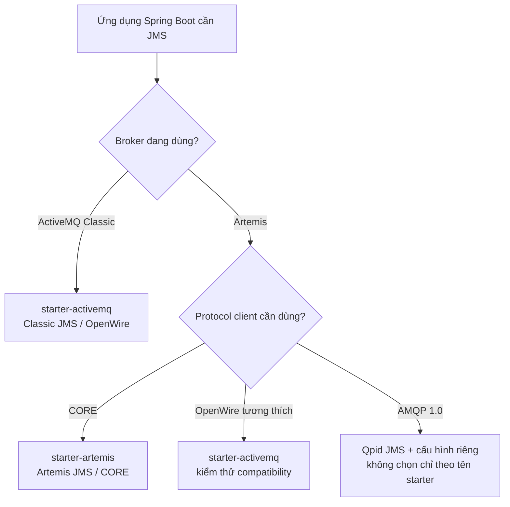

# Chọn spring-boot-starter-activemq hoặc spring-boot-starter-artemis

> **Chương:** Spring Boot  
> **Phạm vi:** Tích hợp Java JMS với Apache ActiveMQ Classic hoặc Apache ActiveMQ Artemis. Bài tập trung vào **quyết định chọn Spring Boot starter, sự tương thích client–protocol–broker và cấu hình tự động của Spring Boot**; không mở rộng sang toàn bộ cơ chế queue/topic, acknowledgment hoặc DLQ.

## 1. Chọn theo **broker và wire protocol**, không theo tên sản phẩm

Hai starter đều cho phép ứng dụng viết code bằng `JmsTemplate`, `@JmsListener` và các interface `jakarta.jms.*` (ở Spring Boot 3.x). Nhưng **JMS là API**, còn giao thức trao đổi giữa client và broker là chuyện khác.

| Trường hợp | Nên chọn | Client/provider thường được đưa vào classpath | Đường kết nối cần có |
| --- | --- | --- | --- |
| Broker là **Apache ActiveMQ Classic**, dùng **OpenWire** | `spring-boot-starter-activemq` | ActiveMQ Classic JMS client tương thích Jakarta trong Boot 3.x | Classic `transportConnector` OpenWire |
| Broker là **Apache ActiveMQ Artemis**, dùng **Artemis CORE** | `spring-boot-starter-artemis` | Artemis Jakarta JMS client / Artemis CORE protocol | Artemis `acceptor` bật `CORE` |
| Broker Artemis có bật **OpenWire**, ứng dụng đã dùng Classic client | Có thể giữ `starter-activemq` nếu đã kiểm thử tương thích | Classic OpenWire client | Artemis acceptor hỗ trợ `OPENWIRE` |
| Broker chỉ mở **AMQP 1.0** cho JMS | Không tự giả định một trong hai starter sẽ nói AMQP | Thường dùng **Qpid JMS** và cấu hình `ConnectionFactory` phù hợp | AMQP acceptor/listener |
| Chưa biết broker/provider | **Xác minh trước**, chưa chọn starter bằng cách thử ngẫu nhiên | Cần xác định broker version, protocol và port | Broker logs/cấu hình listener và client handshake |



**Quy tắc ưu tiên:** nếu triển khai mới với **Artemis và native CORE**, dùng `spring-boot-starter-artemis`. Nếu đang kết nối **Classic bằng OpenWire**, dùng `spring-boot-starter-activemq`. Việc Artemis hỗ trợ OpenWire **không** khiến hai starter tương đương về client, HA, failover, các options URI hay hành vi mở rộng.

### Port `61616` không cho biết provider

Classic và Artemis đều có thể lắng nghe ở `tcp://localhost:61616`. Cùng cổng TCP **không** có nghĩa client dùng đúng giao thức. Kiểm tra loại broker và listener:

- Classic: cấu hình `transportConnector` như `tcp://0.0.0.0:61616`, thường là OpenWire.
- Artemis: `acceptor` có thể cho phép `CORE`, `AMQP`, `OPENWIRE` hoặc nhiều protocol trên cùng một cổng.
- TLS, authentication, mạng container/Kubernetes và advertised connectors phải được kiểm thử riêng.

Nếu client TCP kết nối được nhưng broker báo handshake/protocol lỗi, **đừng chữa bằng cách đổi tùy tiện `spring.activemq.*` sang `spring.artemis.*`**; hãy xác minh đúng jar client, protocol và cổng.

## 2. Ma trận tương thích phiên bản trước khi thêm dependency

Các ví dụ dưới đây nhắm **Spring Boot 3.x, Java 17+**, sử dụng `jakarta.jms.*`. Với Spring Boot 4.x hoặc stack cũ, kiểm tra BOM/auto-configuration của chính version đang chạy trước khi sao chép cấu hình; không trộn API chỉ vì tên interface giống nhau.

| Lớp | Spring Boot 3.x + Classic | Spring Boot 3.x + Artemis |
| --- | --- | --- |
| Spring abstraction | `spring-jms`, `JmsTemplate`, `@JmsListener` | Giống nhau |
| API JMS trong Java code | `jakarta.jms.*` | `jakarta.jms.*` |
| Provider | ActiveMQ Classic Jakarta-compatible client do starter/BOM chọn | Artemis Jakarta JMS client do starter/BOM chọn |
| Factory của provider (khi tự cấu hình) | `org.apache.activemq.ActiveMQConnectionFactory` | `org.apache.activemq.artemis.jms.client.ActiveMQConnectionFactory` |
| Boot configuration namespace | `spring.activemq.*` | `spring.artemis.*` |
| Mục đích tiêu biểu | Classic OpenWire | Artemis native CORE |

**Lỗi migration phổ biến:** ví dụ `javax.jms.Connection` của ActiveMQ Classic 5.x cũ **không thay thế** được `jakarta.jms.Connection` mà Spring Boot 3/Spring Framework 6 mong đợi. Tương tự, đặt tùy tiện `activemq-client` cũ cạnh starter có thể gây `ClassNotFoundException`, lỗi bean type hoặc xung đột classpath.

**Khuyến nghị versioning:** để **Spring Boot BOM/parent** quản lý phiên bản starter và JMS provider; không tự pin một phiên bản `activemq-client(-jakarta)` hoặc `artemis-jakarta-client` khác khi chưa kiểm chứng compatibility. Maven/Gradle có thể cho thấy dependency tree, nhưng một jar có mặt trong tree chưa chứng minh được broker handshake và message flow chạy đúng.

## 3. Maven và Gradle: chọn **một** starter

Giả sử dự án đã dùng Spring Boot parent/BOM 3.x và Java 17+.

### 3.1. Nếu broker là ActiveMQ Classic

Maven `pom.xml`:

```xml
<dependency>
    <groupId>org.springframework.boot</groupId>
    <artifactId>spring-boot-starter-activemq</artifactId>
</dependency>
```

Gradle Kotlin DSL:

```kotlin
dependencies {
    implementation("org.springframework.boot:spring-boot-starter-activemq")
}
```

Starter cung cấp dependency cho Spring JMS và ActiveMQ Classic client tương thích với dòng Spring Boot. **Không** cần khai báo thêm `spring-boot-starter-artemis` hoặc một version provider thứ hai chỉ để gọi `JmsTemplate`.

### 3.2. Nếu broker là Artemis

Maven `pom.xml`:

```xml
<dependency>
    <groupId>org.springframework.boot</groupId>
    <artifactId>spring-boot-starter-artemis</artifactId>
</dependency>
```

Gradle Kotlin DSL:

```kotlin
dependencies {
    implementation("org.springframework.boot:spring-boot-starter-artemis")
}
```

Starter này chọn đường kết nối Artemis native, **không biến ứng dụng thành broker**. Với broker **đặt bên ngoài** ứng dụng, cấu hình `spring.artemis.mode=native` rõ ràng.

> **Không gắn cả hai starter vào cùng một executable jar chỉ để đổi broker bằng profile.** Khi cả hai provider/auto-configuration đều có mặt, việc Spring tạo `ConnectionFactory` nào có thể không như bạn nghĩ, hoặc xuất hiện điều kiện auto-configuration bị vô hiệu hóa. Nếu cần hai broker khác provider, hãy tạo **hai factory được đặt tên, hai `JmsTemplate`/listener factory được cấu hình tường minh**, hoặc tách ứng dụng/module. Đây là bài toán tích hợp đa broker, không phải lựa chọn starter thông thường.

## 4. Cấu hình `application.yml`: hai namespace không thể hoán đổi

### 4.1. Classic: `spring.activemq.*`

Ví dụ file cấu hình của ứng dụng dùng **chỉ `starter-activemq`**:

```yaml
spring:
  activemq:
    broker-url: tcp://localhost:61616
    user: ${BROKER_USER}
    password: ${BROKER_PASSWORD}
  jms:
    pub-sub-domain: false  # JmsTemplate dùng Queue mặc định
```

Giả định broker Classic OpenWire đã chạy; `BROKER_USER`/`BROKER_PASSWORD` được cung cấp từ môi trường. Thực tế production cần bổ sung TLS và quyền trên queue theo chính sách broker; không hardcode mật khẩu thật.

Ở Classic, cấu hình `broker-url` là **URI của Classic client transport**. Chẳng hạn `failover:(tcp://a:61616,tcp://b:61616)?...` là cú pháp của Classic Failover Transport, **không phải cú pháp failover Artemis native**.

### 4.2. Artemis: `spring.artemis.*`

Ví dụ cấu hình tương đương với **chỉ `starter-artemis`**:

```yaml
spring:
  artemis:
    mode: native
    broker-url: tcp://localhost:61616
    user: ${BROKER_USER}
    password: ${BROKER_PASSWORD}
  jms:
    pub-sub-domain: false  # JmsTemplate dùng Queue mặc định
```

`mode: native` nói rõ ứng dụng nối tới **broker bên ngoài**. Artemis embedded là một lựa chọn cho một số môi trường test/dev khi có dependency server nhúng và cấu hình phù hợp; **không** giả định thêm starter tức là production sẽ tự khởi động broker cục bộ.

### 4.3. Thuộc tính nào dùng chung, thuộc tính nào riêng?

| Cấu hình | Phạm vi | Ý nghĩa |
| --- | --- | --- |
| `spring.activemq.broker-url` | **Classic starter** | URI broker/transport của ActiveMQ Classic |
| `spring.activemq.user/password` | **Classic starter** | Credential cho Classic provider |
| `spring.artemis.broker-url` | **Artemis starter** | URI connector của Artemis client |
| `spring.artemis.mode=native` | **Artemis starter** | Yêu cầu kết nối tới broker bên ngoài |
| `spring.artemis.user/password` | **Artemis starter** | Credential cho Artemis client |
| `spring.jms.pub-sub-domain` | **Spring JMS dùng chung** | Default destination domain: `false` = Queue; `true` = Topic |
| `spring.jms.cache.*` | **Spring JMS dùng chung** | Tùy chọn caching JMS connections/sessions nếu Spring Boot cấu hình caching factory |

**Cạm bẫy:** đặt `spring.activemq.broker-url` trong ứng dụng chỉ có `starter-artemis` thường không cấu hình được Artemis ConnectionFactory. Spring Boot có thể dùng giá trị mặc định hoặc không tạo connection như mong đợi. Kiểm tra cả **namespace properties** và **dependency thực tế**, không chỉ nhìn một file YAML.

## 5. Code Java giống nhau sau khi chọn đúng starter

Giá trị của Spring JMS nằm ở chỗ business code phụ thuộc **`JmsTemplate` và `@JmsListener`**, không phụ thuộc package ConnectionFactory của provider. Ví dụ dưới đây chạy được với **một trong hai** starter sau khi có broker đúng protocol và queue `orders.demo`.

File `MessagingDemoApplication.java`:

```java
package example.messaging;

import java.util.UUID;

import org.springframework.boot.ApplicationRunner;
import org.springframework.boot.SpringApplication;
import org.springframework.boot.autoconfigure.SpringBootApplication;
import org.springframework.context.annotation.Bean;
import org.springframework.jms.annotation.EnableJms;
import org.springframework.jms.annotation.JmsListener;
import org.springframework.jms.core.JmsTemplate;
import org.springframework.stereotype.Component;

@SpringBootApplication
@EnableJms
public class MessagingDemoApplication {

    public static void main(String[] args) {
        SpringApplication.run(MessagingDemoApplication.class, args);
    }

    @Bean
    ApplicationRunner sendDemoMessage(JmsTemplate jmsTemplate) {
        return args -> {
            String eventId = UUID.randomUUID().toString();
            String payload = "{\"eventId\":\"" + eventId
                    + "\",\"orderId\":\"O-1001\"}";

            jmsTemplate.convertAndSend(
                    "orders.demo",
                    payload,
                    message -> {
                        message.setStringProperty("eventType", "OrderCreated");
                        message.setStringProperty("eventId", eventId);
                        return message;
                    });

            System.out.println("Submitted eventId=" + eventId);
        };
    }
}

@Component
class OrderCreatedListener {

    @JmsListener(destination = "orders.demo")
    public void onMessage(String jsonBody) {
        System.out.println("Received JSON: " + jsonBody);

        // Production: parse/validate schema và xử lý idempotent.
        // Không coi việc log ra là hoàn thành nghiệp vụ.
    }
}
```

**Các giả định cụ thể:**

- Bài dùng `@EnableJms` để kích hoạt infrastructure cho `@JmsListener` một cách tường minh.
- `JmsTemplate.convertAndSend(..., MessagePostProcessor)` tạo `TextMessage` cho `String` theo converter mặc định và thêm các JMS properties trước khi gửi.
- `@JmsListener` trong ví dụ nhận body dưới dạng `String`. Nếu muốn điều khiển raw JMS message hoặc tùy chỉnh converter, phải cấu hình/định nghĩa kiểu tham số phù hợp.
- Cả sender và listener cùng chạy trong một process chỉ để **kiểm chứng đường gửi–nhận**, không phải kiến trúc bắt buộc.
- Queue `orders.demo` phải tồn tại hoặc broker phải cho phép auto-create phù hợp. Ở production nên chủ động provision destination và kiểm soát quyền thay vì dựa vào việc ứng dụng tự tạo.
- `spring.jms.pub-sub-domain=false` dành cho queue trong ví dụ. Khi cần Topic, phải kiểm tra domain của `JmsTemplate`/**listener container factory**; không phải chỉ đổi tên destination thành `events.topic`.

Không cần import `org.apache.activemq.ActiveMQConnectionFactory` hay `org.apache.activemq.artemis.jms.client.ActiveMQConnectionFactory` trong đoạn nghiệp vụ. Khi thay broker theo hướng migration được kiểm chứng, phần code này có thể giữ nguyên; phần **starter, URI, cấu hình listener, tính năng HA và vận hành broker** vẫn phải điều chỉnh.

## 6. Spring Boot auto-configuration làm gì và khi nào nó dừng hoạt động?

Khi có starter tương ứng, Spring Boot thông thường:

1. Nhìn thấy thư viện Spring JMS và **provider client** trên classpath.
2. Đọc `spring.activemq.*` **hoặc** `spring.artemis.*` để tạo `jakarta.jms.ConnectionFactory`.
3. Tích hợp `ConnectionFactory` vào Spring JMS, có thể dùng `CachingConnectionFactory` nếu được cấu hình.
4. Tạo `JmsTemplate` và hạ tầng listener container factory phù hợp theo các bean/conditions có sẵn.
5. Cho phép code dùng `JmsTemplate` và `@JmsListener` mà không tự tạo raw connection/session cho từng request.

Đây là **conditional auto-configuration**, không phải điều kiện “có tên starter thì chắc chắn đủ mọi bean”. Có ba nguyên nhân phổ biến làm kết quả khác:

- Bạn đã tự tạo một `ConnectionFactory` bean: auto-configuration có thể **back off**, để bean của bạn trở thành nguồn sự thật.
- Bạn có **nhiều ConnectionFactory**/JmsTemplate: injection theo type có thể mơ hồ; cần `@Qualifier` và listener container factory được đặt tên.
- Bạn thêm cả Classic và Artemis provider vào classpath: điều kiện phát hiện provider và thứ tự auto-config có thể khác dự đoán; đừng dùng cả hai chỉ để thử tìm endpoint chạy được.

### Caching khác pooling

Spring `CachingConnectionFactory` thường cache một số session/producer/consumer resources để giảm chi phí tạo lại đối tượng. Một **JMS pool** do thư viện tương ứng cung cấp quản lý nhiều physical connections và giới hạn concurrency theo cách khác. Không bật pooling/caching hai tầng tùy tiện, nhất là khi ứng dụng có nhiều listener đồng thời hoặc dùng durable subscription gắn với client ID.

Đối với bài lựa chọn starter, điều quan trọng trước tiên là chọn **đúng provider**; sau đó mới benchmark sizing connection pool, listener concurrency, prefetch, transaction và redelivery theo workload.

## 7. Chuyển Classic → Artemis: đổi starter có đủ không?

**Không.** Nếu mục tiêu là thay broker Classic bằng Artemis **CORE**, chuyển:

```text
BEFORE                                 AFTER
spring-boot-starter-activemq           spring-boot-starter-artemis
spring.activemq.*                      spring.artemis.*
Classic OpenWire URI                   Artemis CORE URI
Classic broker/transportConnector      Artemis broker/acceptor
javax.jms.* (nếu app rất cũ)          jakarta.jms.* trên Boot 3.x
```

Nhưng còn phải đánh giá:

| Hạng mục | Vì sao cần kiểm chứng |
| --- | --- |
| Queue/topic và naming | Classic và Artemis có mô hình address/queue, auto-create và mapping riêng |
| Durable subscriptions | ClientID, subscription name, shared/unshared và tên destination cần giữ semantics |
| Message properties và selectors | JMS chuẩn tương đối portable, nhưng extension của provider không được bảo đảm |
| Failover/reconnect URI | Classic `failover:(...)` không chuyển nguyên sang Artemis CORE |
| Redelivery và DLQ | Classic có các quy tắc Poison ACK/client policy khác Artemis broker settings |
| Transactions và persistence | Cần kiểm thử kết quả commit, retry, durability và duplicate |
| Message body/serialization | `ObjectMessage` và trusted packages có thể khác; ưu tiên text/bytes có schema |
| Connection pools | Thư viện pool, client ID, caching và số session có thể cần cấu hình lại |

**Hai lộ trình khác nhau:**

- **Giữ Classic client, đổi broker thành Artemis OpenWire:** có thể ít thay đổi code/starter hơn, nhưng vẫn phải bật OpenWire trên Artemis và kiểm thử đầy đủ compatibility, routing, transaction, durable subscription và broker HA. Đây không phải đường Artemis native CORE.
- **Đổi cả broker và provider sang Artemis native:** cập nhật starter/URI/properties, có quyền dùng Artemis client features; cần nghiệm thu behavior của app, không chỉ compile.

Đổi starter **không** tự di chuyển backlog/journal hoặc durable subscriptions từ broker cũ sang broker mới. Việc migration dữ liệu là một kế hoạch riêng.

## 8. Kiểm chứng lựa chọn starter: ba tầng bắt buộc

### 8.1. Dependency/classpath

Trước khi chạy, mở **dependency tree của chính ứng dụng** bằng build tool (đây là lệnh thực hành, không cần chạy trong bài biên soạn):

```bash
# Maven
mvn dependency:tree

# Gradle
./gradlew dependencies --configuration runtimeClasspath
```

Kỳ vọng:

- Với Classic, có `spring-boot-starter-activemq` và client Jakarta tương thích của Classic theo Boot BOM, **không kéo thêm Artemis JMS client** không cần thiết.
- Với Artemis, có `spring-boot-starter-artemis` và Artemis Jakarta client, **không kéo thêm Classic OpenWire client** không cần thiết.
- Không còn hai họ API `javax.jms.*` và `jakarta.jms.*` bị trộn vào cùng đường đi Spring Boot JMS.

Để chứng minh dependency **thực sự** được dùng, quan sát auto-configuration condition report/log startup và loại `ConnectionFactory` được tạo. Spring có thể bọc provider factory trong `CachingConnectionFactory`, nên tên class của bean wrapper **không** tự cho biết provider nằm bên dưới.

### 8.2. Handshake và credentials

Kiểm tra thực tế:

1. Broker **đúng loại** chạy và listen ở URI cấu hình.
2. Port và protocol khớp, TLS/certificate hợp lệ nếu bật bảo mật.
3. Tài khoản có quyền **send** và **consume** trên `orders.demo`.
4. Startup không có lỗi tạo `ConnectionFactory`, handshake, authentication hay listener.
5. ApplicationRunner gửi một message; `@JmsListener` nhận và log cùng `eventId`.

**Thành công của TCP connect hoặc dependency build không chứng minh được JMS end-to-end.** Phải quan sát message đi qua broker bằng client thực tế.

### 8.3. Kết quả mong đợi theo từng lựa chọn

| Starter | Broker test | Kết quả kỳ vọng |
| --- | --- | --- |
| `starter-activemq` | Classic OpenWire đúng URI | App gửi/nhận `orders.demo` qua JMS |
| `starter-artemis` | Artemis CORE đúng URI, `mode=native` | App gửi/nhận `orders.demo` qua JMS |
| `starter-artemis` | Classic chỉ hỗ trợ OpenWire | **Không** mong đợi handshake Artemis CORE thành công |
| `starter-activemq` | Artemis chỉ bật CORE, tắt OpenWire | **Không** mong đợi Classic OpenWire handshake thành công |
| `starter-activemq` | Artemis bật OpenWire | Có thể chạy, nhưng phải test semantics/compatibility |
| Một trong hai starter | Broker chỉ bật AMQP 1.0 | Không mặc nhiên tương thích; cần AMQP JMS provider |

## 9. Chẩn đoán cấu hình sai nhanh

| Triệu chứng | Nguyên nhân nên kiểm tra trước | Cách khắc phục |
| --- | --- | --- |
| `ConnectionFactory` không được tạo | Thiếu starter, đã có custom bean, xung đột auto-config | Kiểm tra BOM, dependency tree và condition report |
| App kết nối sai host dù đã đặt URL | Dùng `spring.activemq.*` cho Artemis hoặc ngược lại | Sửa namespace phù hợp starter |
| `ConnectException: Connection refused` | Broker không listen, sai hostname/port, Docker `localhost` | Kiểm tra listener, DNS/network/port mapping |
| Socket mở nhưng handshake lỗi | Classic OpenWire nối CORE-only hoặc Artemis CORE nối OpenWire-only | Chọn đúng provider và bật đúng protocol |
| `NoSuchMethodError` / `ClassCastException` liên quan JMS | Jar provider tự pin sai hoặc trộn `javax.jms`/`jakarta.jms` | Để Boot BOM quản lý và loại trừ dependency cũ |
| `@JmsListener` không nhận | Thiếu listener infrastructure, queue chưa tồn tại, quyền, selector hoặc destination type sai | Kiểm tra `@EnableJms`, listener factory, queue/topic và broker metrics |
| Producer log “sent” nhưng queue không thấy | Gửi nhầm destination, auto-create, transaction chưa commit hoặc consumer nhận ngay | Kiểm tra destination thực tế và message/consumer metrics |
| Đổi profile nhưng vẫn dùng provider cũ | Cả hai starter vẫn có trong runtime classpath | Tách dependency theo build/module thay vì chỉ đổi YAML |
| Chạy được local, production fail | Local embedded/auto-create khác native broker, TLS/ACL khác | Luôn test với broker ngoài dùng cấu hình giống production |

## 10. Bài thực hành có tiêu chí nghiệm thu

**Môi trường:** Java 17+, Spring Boot 3.x, Maven hoặc Gradle; một broker Classic test và một broker Artemis test ở các cổng rõ ràng. Không dùng chung dữ liệu broker production.

1. **Classic:** chỉ thêm `spring-boot-starter-activemq`; đặt `spring.activemq.broker-url` tới Classic OpenWire. Chạy `MessagingDemoApplication`, kiểm tra `eventId` được gửi và nhận.
2. **Artemis:** ở một build/module riêng hoặc sau khi loại sạch Classic starter, chỉ thêm `spring-boot-starter-artemis`; đặt `spring.artemis.mode=native`, `broker-url` tương ứng. Chạy lại **cùng Java code**, kiểm tra message đi qua Artemis CORE.
3. **Sai namespace:** với Artemis starter, thử đặt nhầm `spring.activemq.broker-url`; quan sát URL cấu hình không được áp dụng như mong muốn. Khôi phục đúng YAML.
4. **Sai protocol:** thử Classic client tới Artemis CORE-only acceptor (và ngược lại) trong lab; phân biệt TCP reachability với JMS handshake.
5. **Kiểm tra classpath:** xác định không còn client JMS cũ `javax.jms` ở đường Spring Boot 3.x; quan sát condition report khi thêm custom `ConnectionFactory`.
6. **Queue vs Topic:** giữ starter không đổi, cấu hình domain và listener factory cho topic đúng cách; không kết luận đổi `pub-sub-domain` trên template tự chuyển mọi listener queue thành topic.
7. **Không dùng auto-create:** cấu hình broker từ chối tạo queue tự động, chạy app trước khi provision `orders.demo`; kiểm tra lỗi và tạo queue đúng policy.
8. **Migration check:** nếu dùng Artemis OpenWire compatibility, thử cùng Java business code trên Classic client rồi đánh giá properties/transaction/durable subscriptions thực tế; ghi rõ đó **không** phải Artemis native client.

**Tiêu chí PASS:** ứng dụng dùng **đúng một starter** cho broker/protocol đã chọn, chỉ có một `ConnectionFactory` được autoconfigure theo ý định, producer và consumer trao đổi được một message có `eventId`, và các test sai protocol/namespace được phân loại đúng.

### Câu hỏi tự kiểm tra

1. **Hai starter đều dùng `JmsTemplate` thì có hoán đổi được không?** — Không; khác provider, giao thức và cấu hình.
2. **Broker Artemis native CORE thì ưu tiên starter nào?** — `spring-boot-starter-artemis`.
3. **Broker Classic OpenWire thì ưu tiên starter nào?** — `spring-boot-starter-activemq`.
4. **Port `61616` có chứng minh đang dùng OpenWire không?** — Không.
5. **Boot 3.x dùng `javax.jms.*` hay `jakarta.jms.*` trong ví dụ hiện đại?** — `jakarta.jms.*`.
6. **Chỉ đổi `spring.profiles.active` khi cả hai starter vẫn nằm trên classpath có đảm bảo chọn đúng provider không?** — Không.
7. **`spring.artemis.mode=native` nhằm làm gì?** — Nối broker Artemis bên ngoài thay vì nhầm với embedded mode.
8. **Đổi starter có tự migration backlog của broker cũ không?** — Không.

## 11. Checklist chọn starter trước production

- [ ] Xác nhận **loại broker, version, wire protocol và listener/port** thực tế.
- [ ] Classic OpenWire → `spring-boot-starter-activemq`; Artemis CORE → `spring-boot-starter-artemis`.
- [ ] Không chọn hai starter trong cùng classpath khi chỉ cần một broker/provider.
- [ ] Spring Boot 3.x dùng `jakarta.jms.*`; không trộn thư viện legacy `javax.jms.*`.
- [ ] Quản lý provider version bằng Spring Boot BOM và kiểm tra dependency tree.
- [ ] Dùng đúng namespace `spring.activemq.*` hoặc `spring.artemis.*`.
- [ ] Với Artemis external broker, cấu hình `spring.artemis.mode=native` rõ ràng.
- [ ] Đã kiểm chứng `JmsTemplate`/`@JmsListener` end-to-end trên broker thật.
- [ ] Đã đánh giá queue/topic provisioning, authentication, TLS và quyền truy cập.
- [ ] Đã kiểm thử những tính năng phụ thuộc provider nếu migration Classic ↔ Artemis.
- [ ] Không nhầm chọn starter với việc tạo embedded broker, bật HA hoặc chuyển dữ liệu.

## Tài liệu tham khảo

- [Spring Boot — Messaging: JMS](https://docs.spring.io/spring-boot/reference/messaging/jms.html): ActiveMQ Classic/Artemis starters, cấu hình và auto-configuration.
- [Spring Boot — Common Application Properties](https://docs.spring.io/spring-boot/appendix/application-properties/index.html): `spring.activemq.*`, `spring.artemis.*` và `spring.jms.*` theo phiên bản Boot.
- [Spring Framework — JMS Integration](https://docs.spring.io/spring-framework/reference/integration/jms.html): `JmsTemplate`, listener containers và cấu hình JMS.
- [Apache ActiveMQ Classic — JMS Client](https://activemq.apache.org/components/classic/documentation/jms-client): client Java và OpenWire.
- [Apache ActiveMQ Artemis — Using JMS](https://artemis.apache.org/components/artemis/documentation/latest/using-jms.html): Artemis JMS provider, CORE và Jakarta JMS.
