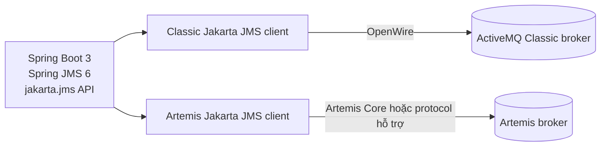

# Quản lý phiên bản phụ thuộc và tránh trộn javax.jms với jakarta.jms

> **Chương:** Spring Boot  
> **Bối cảnh:** Tích hợp Apache ActiveMQ Classic hoặc ActiveMQ Artemis bằng Spring JMS trong ứng dụng Java. Bài chỉ tập trung vào **tương thích API, starter, client library và quản lý dependency**, không lặp lại kiến thức queue/topic, ACK, DLQ hay hướng dẫn cài broker. Ví dụ có mốc cụ thể **Spring Boot 2.7.18** và **3.3.5** để phân tích; chúng **không được mặc định là phiên bản mới nhất, còn hỗ trợ hoặc an toàn cho production tại thời điểm đọc**.

## 1. Lỗi điển hình: ứng dụng build được nhưng không tạo nổi JMS consumer

Một đội nâng ứng dụng từ Spring Boot 2 lên Spring Boot 3. Họ giữ nguyên một thư viện chứa `javax.jms.ConnectionFactory` và thêm dependency `spring-boot-starter-activemq` mới. Build có thể thất bại ngay khi biên dịch, hoặc ứng dụng có thể gặp lỗi lúc khởi tạo bean JMS vì Spring Framework 6 đang tìm `jakarta.jms.ConnectionFactory`.

Hai kiểu `ConnectionFactory` **không phải cùng một kiểu Java**:

```text
javax.jms.ConnectionFactory
jakarta.jms.ConnectionFactory

Tên đơn giản giống nhau: ConnectionFactory.
Fully-qualified class name khác nhau: javax.jms.* != jakarta.jms.*.
JVM không thể tự ép kiểu hay coi chúng là một interface.
```

Nếu hai API JAR cùng có mặt trong classpath, chúng **có thể cùng tồn tại dưới hai package khác nhau** mà không nhất thiết làm Java báo duplicate class. Vấn đề là **provider object, Spring JMS và mã ứng dụng có dùng cùng một namespace hay không**. Một object triển khai interface `javax.jms.ConnectionFactory` không tự triển khai `jakarta.jms.ConnectionFactory`.

### Mục tiêu học tập

Sau bài này, bạn có thể:

- Chọn đúng **dòng API JMS** cho Spring Boot/Spring Framework được dùng.
- Quản lý version bằng **Spring Boot dependency management/BOM**, tránh ghép các phiên bản starter, Spring JMS và ActiveMQ client bằng tay.
- Phân biệt dependency **ActiveMQ Classic** với **Artemis**, và phân biệt **client Java API** với giao thức kết nối broker.
- Kiểm tra cây phụ thuộc Maven/Gradle, phân tích class thực tế trong JAR và nhận diện lỗi `javax`/`jakarta`.
- Chuyển code Boot 2 sang Boot 3 một cách có kiểm chứng bằng compile test và integration test trên broker thật.

## 2. Ma trận quyết định phiên bản: framework trước, client sau

| Dòng ứng dụng | Spring Framework | Namespace JMS mà Spring JMS sử dụng | Java tối thiểu về mặt nền tảng | Client phải chọn |
|---|---|---|---|---|
| **Spring Boot 2.7.x** | Spring Framework 5.3.x | **`javax.jms.*`** | Java 8 cho dòng Boot 2.7, tùy giới hạn các dependency đi kèm | JMS provider/class triển khai **`javax.jms`** |
| **Spring Boot 3.x** | Spring Framework 6.x | **`jakarta.jms.*`** | **Java 17** | JMS provider/class triển khai **`jakarta.jms`** |
| **Spring Boot 4.x và các nhánh mới hơn** | Thay đổi theo release cụ thể | Theo Spring JMS/BOM của release đang dùng; không suy từ ví dụ 3.x | Kiểm tra release notes | Dùng starter/client được BOM và nhà cung cấp xác nhận tương thích |

**Thứ tự quyết định đúng:** chọn phiên bản Spring Boot được tổ chức hỗ trợ → xác nhận Spring Framework/JMS API tương ứng → chọn **starter** Classic hoặc Artemis → để BOM quản lý phiên bản của các thành phần transitive → kiểm tra client kết nối được với phiên bản broker đang vận hành.

Đừng bắt đầu bằng câu hỏi “broker Classic của chúng ta là 5.x, vậy dùng `javax.jms`”. **Broker process** và **JMS namespace trong JVM ứng dụng** nằm ở hai tầng khác nhau.

### 2.1 Vì sao chuyển `javax` sang `jakarta` là thay đổi lớn?

Spring Boot 2 dùng Spring Framework 5, trong đó Spring JMS tương tác với Java EE/JMS namespace cũ. Spring Boot 3 dùng Spring Framework 6 và **Jakarta Messaging** namespace. Những method quen thuộc như `createConnection()`, `createSession()`, `send()`, `receive()` có thể trông tương tự, nhưng chữ ký bytecode của chúng tham chiếu tới **những class khác nhau**.

Ví dụ:

```java
// Dùng với Spring Boot 2 / Spring JMS 5:
import javax.jms.ConnectionFactory;
import javax.jms.Message;
import javax.jms.TextMessage;

// Dùng với Spring Boot 3 / Spring JMS 6:
import jakarta.jms.ConnectionFactory;
import jakarta.jms.Message;
import jakarta.jms.TextMessage;
```

Đây không chỉ là một lỗi import ở IDE. Một thư viện bên thứ ba **đã được compile** với `javax.jms` không tự thay đổi binary signature khi bạn sửa import trong ứng dụng chính.

### 2.2 Bẫy tên Maven artifact: groupId `jakarta.jms` chưa chắc là package `jakarta.jms`

Tên Maven coordinate và package thực tế trong class file **không đồng nghĩa**. Trong giai đoạn chuyển tiếp Jakarta EE 8:

| API artifact (minh họa) | Package class trong JAR | Phù hợp ở đâu? |
|---|---|---|
| `javax.jms:javax.jms-api:2.0.1` | `javax/jms/...` | Dòng JMS cũ |
| `jakarta.jms:jakarta.jms-api:2.0.x` | **`javax/jms/...`** | Jakarta Messaging 2.0 thuộc giai đoạn vẫn dùng namespace `javax` |
| `jakarta.jms:jakarta.jms-api:3.x` | **`jakarta/jms/...`** | Spring JMS 6 / Boot 3 và client Jakarta tương ứng |

Do đó, **không được kết luận “thấy `jakarta.jms-api` trong `mvn dependency:tree` là đã chuyển sang Jakarta namespace”**. Phải xem **version và package thực tế**. Ngược lại, không nên viết rule cấm mọi artifact có groupId `jakarta.jms` trong dự án Boot 2, vì một bản 2.0.x có thể chính là API `javax.jms` mà dependency management cũ chọn.

## 3. Hai sản phẩm ActiveMQ, bốn nhóm dependency dễ lẫn

**ActiveMQ Classic** và **ActiveMQ Artemis** đều có broker, client và API liên quan, nhưng không dùng lẫn starter/client chỉ vì tên sản phẩm đều có chữ ActiveMQ.

| Broker / client mục tiêu | Spring Boot 2.7.x, JMS `javax` | Spring Boot 3.x, JMS `jakarta` |
|---|---|---|
| **ActiveMQ Classic** | `spring-boot-starter-activemq` với Classic JMS client **`activemq-client`** do dependency management tương ứng chọn | `spring-boot-starter-activemq` với Classic client biến thể **`activemq-client-jakarta`** khi Spring Boot release hỗ trợ |
| **ActiveMQ Artemis** | `spring-boot-starter-artemis` với client JMS kiểu **`artemis-jms-client`** | `spring-boot-starter-artemis` với client Jakarta JMS, thường là **`artemis-jakarta-client`** |

Đây là **quan hệ khái niệm để nhận diện client**, không phải yêu cầu tự thêm tất cả các artifact kể trên vào `pom.xml`. Trong một ứng dụng bình thường nên chọn **một starter broker** và để starter/BOM kéo client đúng. Nếu có use case nối nhiều broker cùng lúc, cần thiết kế **nhiều `ConnectionFactory` có tên rõ ràng**, mapping `JmsTemplate`/`JmsListenerContainerFactory` riêng và kiểm chứng routing; đó không phải cấu hình auto-configuration mặc định.

### 3.1 API compatibility không đồng nghĩa wire compatibility



- **`javax.jms` vs `jakarta.jms`**: hợp đồng **class/interface trong JVM ứng dụng**.
- **OpenWire, Artemis Core, AMQP…**: hợp đồng **trên đường truyền**, phụ thuộc client và broker.
- **Phiên bản broker**: quyết định các tính năng, store, transport và khả năng tương thích thực tế.

Một Classic broker có thể giao tiếp với một Classic Jakarta client qua OpenWire nếu **hai bản cụ thể** tương thích. Không bắt buộc thay broker chỉ vì Spring app đổi namespace; nhưng cũng **không thể** dùng client Artemis Jakarta để kết nối một OpenWire-only endpoint của Classic chỉ vì cả hai triển khai `jakarta.jms.ConnectionFactory`.

**Đừng nhầm** artifact `activemq-client-jakarta` của Classic với `artemis-jakarta-client` của Artemis: namespace API trùng nhau **không** làm protocol/connection URL và broker semantics tự tương thích.

## 4. Maven: để Spring Boot quản lý một bộ phiên bản nhất quán

### 4.1 Dự án Spring Boot 3 + ActiveMQ Classic

Ví dụ Maven **minh họa** dùng Boot **3.3.5** và Java **17**. Đây là mốc có API Jakarta rõ ràng, **không phải khuyến nghị dùng nguyên version cũ này cho production**.

`pom.xml`:

```xml
<project xmlns="http://maven.apache.org/POM/4.0.0"
         xmlns:xsi="http://www.w3.org/2001/XMLSchema-instance"
         xsi:schemaLocation="http://maven.apache.org/POM/4.0.0 https://maven.apache.org/xsd/maven-4.0.0.xsd">
    <modelVersion>4.0.0</modelVersion>

    <parent>
        <groupId>org.springframework.boot</groupId>
        <artifactId>spring-boot-starter-parent</artifactId>
        <version>3.3.5</version>
        <relativePath/>
    </parent>

    <groupId>lab</groupId>
    <artifactId>boot-jms-namespace-lab</artifactId>
    <version>0.0.1-SNAPSHOT</version>

    <properties>
        <java.version>17</java.version>
    </properties>

    <dependencies>
        <!-- Spring JMS + ActiveMQ Classic client do Boot quản lý. -->
        <dependency>
            <groupId>org.springframework.boot</groupId>
            <artifactId>spring-boot-starter-activemq</artifactId>
        </dependency>

        <dependency>
            <groupId>org.springframework.boot</groupId>
            <artifactId>spring-boot-starter-test</artifactId>
            <scope>test</scope>
        </dependency>
    </dependencies>

    <build>
        <plugins>
            <plugin>
                <groupId>org.springframework.boot</groupId>
                <artifactId>spring-boot-maven-plugin</artifactId>
            </plugin>
        </plugins>
    </build>
</project>
```

**Vì sao không có version riêng cho `spring-jms`, `jakarta.jms-api` hay Classic client?** `spring-boot-starter-parent` đã dùng dependency management của Spring Boot để đưa các thành phần vào một bộ phiên bản được kiểm soát. Khi cần nâng cấp vì lỗ hổng bảo mật, ưu tiên **nâng cả Spring Boot release/BOM phù hợp** rồi chạy regression test, thay vì ghi đè tùy tiện một client đang bị transitive dependencies ràng buộc.

Nếu doanh nghiệp **không kế thừa** `spring-boot-starter-parent` vì có parent nội bộ, có thể import `spring-boot-dependencies` như một BOM:

```xml
<dependencyManagement>
    <dependencies>
        <dependency>
            <groupId>org.springframework.boot</groupId>
            <artifactId>spring-boot-dependencies</artifactId>
            <version>3.3.5</version>
            <type>pom</type>
            <scope>import</scope>
        </dependency>
    </dependencies>
</dependencyManagement>
```

**Không đồng thời thêm cả parent và BOM chỉ để “chắc chắn hơn”**. Hai cách là lựa chọn quản lý phiên bản tùy cấu trúc build. Khi dùng BOM import, vẫn phải cấu hình Maven plugins (compiler, packaging, tests…) thích hợp vì BOM **không tự cấp mọi plugin management của Boot parent**.

### 4.2 Nếu dùng Artemis thay vì Classic

Trong `dependencies` ở ví dụ Boot 3, thay **một** starter:

```xml
<!-- THAY thế starter-activemq, không thêm song song. -->
<dependency>
    <groupId>org.springframework.boot</groupId>
    <artifactId>spring-boot-starter-artemis</artifactId>
</dependency>
```

Starter Artemis và client Jakarta sẽ đi cùng cấu hình `spring.artemis.*`, **không phải** `spring.activemq.*`. Dùng endpoint Core/acceptor Artemis phù hợp. Nếu broker từ chối kết nối, đừng chữa bằng cách thêm `activemq-client` hoặc thêm cả hai starter; kiểm tra protocol, listener, auth và cây dependency trước.

### 4.3 Dự án Boot 2.7.x không dùng cùng client binary

Một ứng dụng còn ở Boot 2.7.18 cũng có thể khai báo `spring-boot-starter-activemq` **không version riêng**, nhưng dependency management và mã nguồn của nó dùng Spring JMS 5.3.x với **`javax.jms`**:

```xml
<!-- Đây là phần thay đổi trong một POM Boot 2.7.18,
     KHÔNG chép vào POM Boot 3. -->
<parent>
    <groupId>org.springframework.boot</groupId>
    <artifactId>spring-boot-starter-parent</artifactId>
    <version>2.7.18</version>
    <relativePath/>
</parent>
```

Ở dòng này, **`javax.jms.ConnectionFactory` là đúng**. Việc tự ép `jakarta.jms-api:3.x` hoặc `activemq-client-jakarta` vào Boot 2 **không tự nâng Spring JMS 5 lên Jakarta**; nó tạo hai thế giới type không khớp. Boot 2.7 là dòng cũ; khi vận hành thật phải cân nhắc trạng thái hỗ trợ và bảo mật của toàn bộ stack, không giữ nguyên lâu dài chỉ vì ứng dụng còn chạy.

## 5. Gradle: cùng nguyên tắc với dependency management

Ví dụ `build.gradle` cho **Boot 3.3.5 + Classic**:

```groovy
plugins {
    id 'java'
    id 'org.springframework.boot' version '3.3.5'
    id 'io.spring.dependency-management' version '1.1.6'
}

group = 'lab'
version = '0.0.1-SNAPSHOT'

java {
    toolchain {
        languageVersion = JavaLanguageVersion.of(17)
    }
}

repositories {
    mavenCentral()
}

dependencies {
    implementation 'org.springframework.boot:spring-boot-starter-activemq'
    testImplementation 'org.springframework.boot:spring-boot-starter-test'
}

tasks.named('test') {
    useJUnitPlatform()
}
```

Gradle có nhiều cách dùng BOM (dependency-management plugin hoặc native `platform`); ví dụ trên sử dụng **một cách nhất quán**. Nếu dự án đã dùng dependency management của Spring Boot, đừng thêm một BOM khác phiên bản và override các module JMS rời rạc mà không kiểm chứng bằng dependency graph.

Để dùng Artemis trong chính ví dụ này, **thay** dependency:

```groovy
implementation 'org.springframework.boot:spring-boot-starter-artemis'
```

Không pin riêng `org.apache.activemq:activemq-client-jakarta`, `artemis-jakarta-client` hay `jakarta.jms-api` trừ khi có lý do tương thích/bảo mật cụ thể, một phiên bản được xác nhận và integration tests. Bản vá một library có thể cần **override có kiểm soát**, nhưng không nên làm thay đổi ngầm namespace hoặc đưa hai provider cùng implement class trùng tên vào runtime.

## 6. Lab Spring Boot 3: chứng minh type Jakarta và gửi/nhận thật

Lab dùng **Maven POM Boot 3.3.5 + Classic** ở `4.1`, Java 17 và broker **ActiveMQ Classic** lắng nghe OpenWire tại `tcp://127.0.0.1:61616`. Không dùng embedded broker để tránh làm rối bài học bằng dependency broker/server. Tên queue test `lab.boot.namespace.queue`; bảo đảm tài khoản có quyền send/consume.

### 6.1 Cấu hình `application.yml`

`src/main/resources/application.yml`:

```yaml
spring:
  activemq:
    broker-url: tcp://127.0.0.1:61616
  jms:
    pub-sub-domain: false
```

Đây là cấu hình **Classic**, không dùng cho Artemis. Nếu broker yêu cầu login, thêm `spring.activemq.user` và `spring.activemq.password` qua **cấu hình bí mật/biến môi trường phù hợp**, không commit password thật vào source control. Broker hoạt động ở Docker/container khác phải dùng hostname/port theo đúng network topology.

### 6.2 Java code đầy đủ

`src/main/java/lab/bootcompat/BootJmsCompatibilityApp.java`:

```java
package lab.bootcompat;

import jakarta.jms.ConnectionFactory;
import org.springframework.boot.ApplicationRunner;
import org.springframework.boot.SpringApplication;
import org.springframework.boot.autoconfigure.SpringBootApplication;
import org.springframework.context.annotation.Bean;
import org.springframework.jms.annotation.EnableJms;
import org.springframework.jms.annotation.JmsListener;
import org.springframework.jms.core.JmsTemplate;
import org.springframework.stereotype.Component;

@SpringBootApplication
@EnableJms
public class BootJmsCompatibilityApp {
    public static void main(String[] args) {
        SpringApplication.run(BootJmsCompatibilityApp.class, args);
    }

    @Bean
    ApplicationRunner sendOne(
            ConnectionFactory connectionFactory,
            JmsTemplate jmsTemplate) {
        return args -> {
            System.out.println("Expected JMS API: jakarta.jms");
            System.out.println("Provider implementation: "
                    + connectionFactory.getClass().getName());
            jmsTemplate.convertAndSend(
                    "lab.boot.namespace.queue", "message-from-boot-3");
        };
    }
}

@Component
class DemoQueueConsumer {
    @JmsListener(destination = "lab.boot.namespace.queue")
    public void receive(String body) {
        System.out.println("JMS RECEIVED: " + body);
    }
}
```

`JmsTemplate` và `@JmsListener` vẫn nằm trong package `org.springframework.jms`; **chỉ các import JMS API chuyển namespace**. Việc tham số `ConnectionFactory` của bean method được khai báo là `jakarta.jms.ConnectionFactory` là một phép kiểm tra kiểu ngay **lúc compile và wiring**, không chỉ là lời in log.

`@EnableJms` bật cơ chế phát hiện method `@JmsListener`. Với `spring.jms.pub-sub-domain=false`, consumer mặc định làm việc với **queue**; không suy diễn nó là durable topic subscriber. Thực hành chỉ gửi chuỗi văn bản, không dùng `ObjectMessage` hoặc transaction database; hai chủ đề đó nằm ngoài phạm vi minh họa namespace.

Chạy bằng:

```bash
mvn clean package
mvn spring-boot:run
```

Kết quả kỳ vọng trên môi trường đúng dependency và broker hoạt động:

```text
Expected JMS API: jakarta.jms
Provider implementation: ...
JMS RECEIVED: message-from-boot-3
```

Tên provider class chính xác có thể là implementation/pool/wrapper khác nhau; **đừng assert vào một chuỗi class name duy nhất**. Giá trị cần chứng minh là application compile với `jakarta.jms.ConnectionFactory` và listener nhận message từ broker. Nếu broker ngắt kết nối hoặc không có quyền, lỗi lúc chạy là **transport/auth**, không tự chứng minh namespace sai.

### 6.3 Đổi lab sang Artemis một cách có kiểm soát

Giữ **toàn bộ Java code**, vì code dùng API Jakarta chung, nhưng thay starter Maven thành `spring-boot-starter-artemis` (`4.2`) và đổi `application.yml`:

```yaml
spring:
  artemis:
    mode: native
    broker-url: tcp://127.0.0.1:61616
  jms:
    pub-sub-domain: false
```

Cần Artemis broker có **Core acceptor** tại endpoint này, security phù hợp và queue/address routing được hỗ trợ hoặc cấu hình sẵn. `mode: native` nghĩa là dùng **broker ngoài ứng dụng**, không phải embedded Artemis. Dùng cùng port số 61616 **không chứng minh** broker Classic và Artemis nói cùng protocol: client/artifact và broker đích phải khớp.

**Không đưa hai cấu hình `spring.activemq.*` và `spring.artemis.*` vào cùng ứng dụng rồi kỳ vọng Spring tự chọn đúng broker theo URL.** Auto-configuration phụ thuộc classpath/starter/bean conditions; nếu cần nhiều broker, tạo cấu hình tường minh.

## 7. Checklist nâng cấp Boot 2 → Boot 3 không trộn hai API

### 7.1 Trình tự migration

1. **Chốt baseline:** ghi lại phiên bản Boot, Spring Framework, Java, starter, Classic/Artemis client, broker và kết quả smoke test trước nâng cấp.
2. **Nâng JDK phù hợp:** Boot 3 cần **Java 17+**; kiểm tra plugin compiler và CI/container runtime.
3. **Đổi parent/BOM đồng bộ:** chuyển toàn ứng dụng sang Boot 3.x được duyệt; không chỉ tăng version của `spring-jms` riêng lẻ trên Boot 2.
4. **Giữ một starter đúng broker:** Classic → `spring-boot-starter-activemq`, Artemis → `spring-boot-starter-artemis`.
5. **Đổi import JMS:** `javax.jms.*` → `jakarta.jms.*` ở code, DTO JMS adapter, factory config, tests và extension points.
6. **Nâng thư viện tích hợp JMS bên thứ ba:** bất kỳ library/plugin/container factory tự viết nào đã compile với `javax` cần bản **Jakarta-compatible**; nếu không có, thay/đóng gói adapter cách ly.
7. **Rà dependency graph runtime:** loại client/API trùng namespace, kiểm tra actual class trong JAR, không chỉ suy từ artifact name.
8. **Kiểm chứng runtime:** khởi động context, inject Jakarta ConnectionFactory, tạo producer và listener, kiểm tra transaction/selector/durable consumer nếu ứng dụng dùng.
9. **Chạy regression về nghiệp vụ:** redelivery/DLQ, auth, throughput, SSL, reconnect và schema message — dù cú pháp JMS gần giống nhau.
10. **Triển khai có rollback:** theo dõi lỗi `ClassNotFoundException`, `NoSuchBeanDefinitionException`, redelivery, backlog và tốc độ consume sau nâng cấp.

### 7.2 Diff import quan trọng

```diff
-import javax.jms.ConnectionFactory;
-import javax.jms.Message;
-import javax.jms.Session;
-import javax.jms.TextMessage;
+import jakarta.jms.ConnectionFactory;
+import jakarta.jms.Message;
+import jakarta.jms.Session;
+import jakarta.jms.TextMessage;

 import org.springframework.jms.core.JmsTemplate;
 import org.springframework.jms.annotation.JmsListener;
```

**Không đổi** `org.springframework.jms.*` thành `jakarta.springframework.jms.*`: không có cách chuyển namespace như vậy. Các import Javax khác (Servlet, Persistence, Validation, Transaction API…) có kế hoạch migration tương ứng nhưng **không được tự động search-replace mọi chuỗi `javax.`**; mỗi library và namespace phải có mapping chính xác.

### 7.3 Thư viện dùng `javax.jms` không thể chỉ “exclude API JAR”

Giả sử một thư viện legacy công bố:

```java
// Binary signature do thư viện đã compile:
public void register(javax.jms.ConnectionFactory factory);
```

Bạn thêm dependency `jakarta.jms-api:3.1.0` và loại `javax.jms-api` khỏi runtime. Phương thức trong thư viện vẫn yêu cầu **class `javax.jms.ConnectionFactory`** theo bytecode; Java không tự thay đổi signature. Hậu quả có thể là `NoClassDefFoundError`, `ClassNotFoundException`, `NoSuchMethodError` hoặc wiring không tìm thấy bean tương thích.

Giải pháp đúng là **nâng thư viện lên phiên bản Jakarta**, thay thư viện hoặc thiết kế một **cầu nối ở boundary khác** (ví dụ gửi DTO qua AMQP/HTTP/message broker, không cast interface JMS khác namespace). Một “cast” Java, một exclusion ngẫu nhiên hoặc chỉ sửa import ở module application không phải migration binary.

## 8. Kiểm tra cây phụ thuộc trước khi khởi chạy

### 8.1 Maven

Chạy trong dự án ứng dụng (các lệnh dưới đây là hướng dẫn cho người học, không phải kết quả đã được thực thi trong bài):

```bash
mvn dependency:tree
mvn dependency:tree -Dverbose
mvn help:effective-pom
```

Tìm các artifact liên quan:

```text
org.springframework:spring-jms
org.springframework.boot:spring-boot-starter-activemq
org.springframework.boot:spring-boot-starter-artemis
org.apache.activemq:activemq-client
org.apache.activemq:activemq-client-jakarta
org.apache.activemq:artemis-jms-client
org.apache.activemq:artemis-jakarta-client
javax.jms:javax.jms-api
jakarta.jms:jakarta.jms-api
```

**Kỳ vọng Boot 3 + Classic:** `spring-jms` thuộc thế hệ Spring 6, provider Classic biến thể Jakarta và Jakarta Messaging API 3.x phù hợp. **Kỳ vọng Boot 3 + Artemis:** thế hệ Spring 6 và Artemis Jakarta client phù hợp. Sự hiện diện của một JAR cũ phải được điều tra theo **đường dependency mang nó vào** và nội dung class thực, không chỉ xóa mọi artifact có chữ “javax”.

Để xem một API JAR có class nào, dùng lệnh `jar tf` trên **đường dẫn JAR đã xác định**:

```bash
# Thay đường dẫn ví dụ bằng vị trí JAR thực trong Maven/Gradle cache.
jar tf "/path/to/api.jar"
```

Tìm `javax/jms/ConnectionFactory.class` **hoặc** `jakarta/jms/ConnectionFactory.class`. Cách này giải quyết bẫy `jakarta.jms-api:2.0.x` có coordinate Jakarta nhưng package javax.

### 8.2 Gradle

```bash
./gradlew dependencies --configuration runtimeClasspath
./gradlew dependencyInsight --dependency spring-jms --configuration runtimeClasspath
./gradlew dependencyInsight --dependency activemq-client --configuration runtimeClasspath
./gradlew dependencyInsight --dependency jakarta.jms-api --configuration runtimeClasspath
```

Trên Windows thay `./gradlew` bằng `.\gradlew.bat`. `dependencyInsight` cho biết vì sao một module và version được chọn, nhất là khi có transitive dependencies, constraints hoặc dependency management. Kiểm tra **compileClasspath và runtimeClasspath** nếu lỗi chỉ xuất hiện lúc chạy mà không xuất hiện lúc compile.

### 8.3 Một cây dependency hợp lý và một cây đáng ngờ

```text
# Minh họa quan hệ mong muốn, không phải output Maven chính xác.
Boot 3.x
 └─ spring-boot-starter-activemq
      ├─ spring-jms 6.x  → jakarta.jms API
      └─ Classic client Jakarta-compatible

# Cần điều tra khi có cả hai thế giới:
Boot 3.x
 ├─ spring-jms 6.x                  (jakarta.jms)
 ├─ activemq-client-jakarta        (Jakarta client)
 └─ third-party-legacy-jms-library
      └─ activemq-client (javax JMS implementation)
```

Cây thứ hai không chứng minh chắc chắn crash ngay, nhưng có nguy cơ **class trùng tên provider**, wiring nhầm và một library chỉ hiểu `javax.jms`. Dùng dependency tree để loại đúng **nguồn** kéo nhầm dependency, không thêm exclusion rộng trên toàn dự án rồi bỏ qua regression test.

## 9. Lỗi thường gặp và cách khoanh vùng

| Dấu hiệu | Nguyên nhân đáng kiểm tra | Cách xác minh |
|---|---|---|
| `package javax.jms does not exist` khi build Boot 3 | Code vẫn import namespace cũ trong khi chỉ có Jakarta API | Đổi import và library tương thích; kiểm compileClasspath |
| `package jakarta.jms does not exist` trong Boot 2 | Đã dùng import mới nhưng starter/client vẫn theo Spring JMS 5 | Giữ javax khi ở Boot 2 hoặc nâng toàn bộ stack |
| `No qualifying bean of type jakarta.jms.ConnectionFactory` | Provider được tạo cho javax API, starter thiếu/sai hoặc bean condition không match | Kiểm type thật của factory, BOM, starter và auto-config conditions |
| `NoClassDefFoundError: javax/jms/...` trên Boot 3 | Legacy binary còn tham chiếu javax class | Tìm dependency kéo thư viện legacy, nâng thay vì chỉ exclude |
| `ClassCastException` khi ép provider | Object không triển khai interface của namespace được cast | Kiểm `implements` của class, namespace và client version |
| `NoSuchMethodError` sau thay JAR trực tiếp | Binary API hoặc transitive dependency mismatch | Xem resolved versions, loại override thiếu kiểm soát |
| Compile thành công, kết nối broker thất bại | Wrong protocol/port/auth, broker version không tương thích | Xác nhận Classic OpenWire vs Artemis Core, listener và log broker |
| Context có hai `ConnectionFactory` | Hai starter/client/configurations hoặc provider tự tạo bean | Chọn một starter hoặc cấu hình multiple factories và qualifier rõ |
| Listener không nhận dù send đã thành công | Sai destination, queue/topic mode, `@EnableJms`, ACL hoặc transaction | Kiểm message ở broker, factory listener và cấu hình JMS |
| Boot 2→3 chạy nhưng runtime lỗi ở module khác | Third-party starter chưa chuyển Java EE/Jakarta hoặc dependency shadowing | Nâng toàn bộ starter version và kiểm integration regression |

### 9.1 Bốn câu hỏi phải trả lời trước khi thử sửa dependency

1. **Spring JMS đang thuộc phiên bản nào?** Mỗi line Boot/Spring định nghĩa namespace JMS phù hợp.
2. **`ConnectionFactory` runtime triển khai interface nào?** Không suy từ tên bean hay broker.
3. **Ai kéo client/API JAR sai vào classpath?** Dùng `dependency:tree` hoặc `dependencyInsight`.
4. **Kết nối nào thất bại: Java type, Spring wiring hay network?** Ba loại lỗi cần ba cách sửa khác nhau.

## 10. Quản lý version có kỷ luật trong dự án nhiều module

Một ứng dụng gồm `api`, `messaging-adapter`, `worker` và `shared-domain` dễ bị lệch version khi từng module tự định nghĩa Spring/ActiveMQ client. Quy tắc:

- **Một nguồn quản lý version:** parent/BOM chung cho ứng dụng, có lịch nâng và compatibility test. Các module thư viện không tự pin Spring JMS/client khác major.
- **Ranh giới module rõ:** `shared-domain` chỉ chứa DTO thuần Java, không xuất kiểu `javax.jms.Message` hoặc `jakarta.jms.Message` qua public API nếu muốn tái sử dụng giữa nhiều thế hệ ứng dụng.
- **Một client provider đúng môi trường:** Classic và Artemis không hoán đổi library ở runtime chỉ dựa trên tên JMS interface.
- **Khóa dependency có kiểm soát:** dependency locking hoặc công cụ quản lý artifact dùng để tái lập build; muốn cập nhật phải thay đổi tập version có review và test.
- **Không ép version bằng exclusion tùy tiện:** exclusion chỉ đúng khi đã biết dependency nào không cần và có regression test chứng minh.

### 10.1 Enforcement trong CI: chặn nhầm Classic client cũ ở Boot 3

Với ứng dụng **chỉ dùng Boot 3 + Classic JMS**, có thể cấu hình một quy tắc Maven Enforcer **dành riêng cho hệ này** để phát hiện một client cũ vô tình được kéo vào. Ví dụ:

```xml
<plugin>
    <groupId>org.apache.maven.plugins</groupId>
    <artifactId>maven-enforcer-plugin</artifactId>
    <version>3.5.0</version>
    <executions>
        <execution>
            <id>guard-legacy-jms-client</id>
            <goals>
                <goal>enforce</goal>
            </goals>
            <configuration>
                <rules>
                    <bannedDependencies>
                        <excludes>
                            <exclude>org.apache.activemq:activemq-client</exclude>
                            <exclude>org.apache.activemq:artemis-jms-client</exclude>
                        </excludes>
                    </bannedDependencies>
                </rules>
            </configuration>
        </execution>
    </executions>
</plugin>
```

Đặt snippet vào `<build><plugins>…</plugins></build>` của POM **sau khi xác minh** ứng dụng không cần các artifact đó cho chức năng khác. Với ứng dụng Boot 2, quy tắc **phải đảo theo stack cụ thể**, không sao chép nguyên. Enforcer chỉ là **hàng rào build**, không thay thế kiểm tra binary compatibility hoặc integration test; một thư viện javax có thể nằm ở artifact tên khác.

### 10.2 Quy trình review khi có yêu cầu cập nhật bảo mật

1. Xác nhận advisory áp dụng cho **client**, **broker**, **Spring Framework** hay thư viện transitive cụ thể; không nhầm CVE của broker với version Java API.
2. Tìm bản Spring Boot patch/BOM được tổ chức hỗ trợ và xem các thay đổi dependency management.
3. Nếu bắt buộc override tạm thời, đặt version ở **một nơi**, ghi lý do, hạn xóa và chạy test compile/startup/integration trên **đúng broker**.
4. Xem cây phụ thuộc đã resolved và kiểm tra không xuất hiện client cũ khác namespace.
5. Đánh giá cả TLS/auth, failover, listener transaction và redelivery vì thay client có thể đổi behavior dù code Java vẫn compile.

Không dùng `+`, `LATEST` hoặc version range không kiểm soát trong build production để tự động lấy thư viện mới nhất: điều đó làm build không tái lập và có thể âm thầm thay đổi cả provider.

## 11. Ma trận kiểm chứng trước khi phát hành

| Kiểm thử | Spring Boot 2 + javax JMS | Spring Boot 3 + Jakarta JMS |
|---|---|---|
| **T1 — API compile** | `javax.jms.ConnectionFactory` compile | `jakarta.jms.ConnectionFactory` compile |
| **T2 — Dependency graph** | Spring JMS 5.x + client `javax`, không ép API Jakarta 3.x | Spring JMS 6.x + client `jakarta`, không kéo javax client legacy |
| **T3 — Spring context** | `JmsTemplate` và listener factory inject được provider type cũ | `JmsTemplate` và listener factory inject được provider type Jakarta |
| **T4 — Send/receive smoke** | Gửi/nhận với đúng broker và destination lab | Gửi/nhận với đúng broker và destination lab |
| **T5 — Broker compatibility** | Classic/Artemis protocol và client được xác nhận | Classic Jakarta/Artemis Jakarta client tương thích broker thực |
| **T6 — Existing JMS features** | Queue/topic/selector/transaction behavior baseline | Regression tương ứng sau migration |
| **T7 — Startup with extra libraries** | Không bị một thư viện Jakarta mới làm lệch factory | Không bị legacy `javax.jms` làm lệch provider |
| **T8 — Reproducible build** | BOM được khóa, không override rải rác | BOM được khóa, dependencyInsight/tree có giải thích |
| **T9 — Runtime diagnostics** | Log/metrics xác định ConnectionFactory và broker endpoint | Log/metrics xác định ConnectionFactory và broker endpoint |
| **T10 — Failure path** | Broker off, credential sai, reconnect được xử lý | Lỗi network/auth tách biệt khỏi lỗi namespace |

**Phép thử quan trọng nhất:** tạo application context với `ConnectionFactory` **đúng namespace**, gửi một `TextMessage` đến queue test và nhận qua `@JmsListener`. Thành công trên broker Classic không thay cho việc test Artemis; mỗi provider và transport có dependency graph riêng.

## 12. Câu hỏi và tình huống tự đánh giá

1. Vì sao cùng tên `ConnectionFactory` nhưng Spring JMS 6 không thể inject một object chỉ implement `javax.jms.ConnectionFactory`?
2. Một dự án Boot 2.7 có `jakarta.jms:jakarta.jms-api:2.0.x`. Có nên kết luận nó đã dùng `jakarta.jms` và thay tất cả import không? Nêu cách kiểm chứng chính xác.
3. Tại sao thêm `jakarta.jms-api:3.1.x` vào ứng dụng Boot 2 không đủ để nâng cấp Spring JMS?
4. Phân biệt `activemq-client-jakarta` và `artemis-jakarta-client` về broker/protocol dù chúng cùng dùng Jakarta JMS API.
5. Khi chuyển Boot 2 sang Boot 3, những import nào trong code `JmsTemplate`/`@JmsListener` giữ nguyên, những import nào đổi?
6. Vì sao bản build không lỗi nhưng có `NoClassDefFoundError: javax/jms/Message` khi tải một thư viện legacy?
7. Bạn phát hiện `spring-boot-starter-activemq` và `spring-boot-starter-artemis` cùng nằm trong runtimeClasspath. Cần điều tra điều gì trước khi gỡ?
8. Vì sao thay một module Spring JMS/client bằng version riêng để vá lỗi có thể tạo `NoSuchMethodError`? Quy trình version review nào an toàn hơn?
9. Có thể nâng Spring Boot trước nhưng tạm giữ Classic broker cũ không? Điều kiện về client, protocol, features và integration test là gì?
10. CI nên kiểm tra những gì để ngăn dependency JMS cũ quay lại qua transitive dependency một tháng sau migration?

### Checklist ngắn cho code review

- [ ] Đã định danh Spring Boot/Spring Framework và **namespace JMS đúng** của chúng.
- [ ] Dùng **một starter broker phù hợp** (Classic hoặc Artemis) cho auto-config đơn giản.
- [ ] Version Spring/JMS/provider được quản lý qua **Boot parent/BOM**, không ghép thủ công hai major không tương thích.
- [ ] Không nhầm Maven coordinate `jakarta.jms-api:2.0.x` với package `jakarta.jms`.
- [ ] Code public API và các library JMS của ứng dụng dùng **cùng namespace**.
- [ ] Đã kiểm tra Maven dependency tree hoặc Gradle runtimeClasspath/dependencyInsight.
- [ ] `ConnectionFactory` inject đúng type; code `@JmsListener` và `JmsTemplate` chạy được trên broker thực.
- [ ] Kiểm tra Classic OpenWire/Artemis Core protocol đúng client và listener.
- [ ] Các thư viện cũ chưa có Jakarta version được nâng/thay hoặc cô lập, không “chữa” bằng cast/exclude mù.
- [ ] Có regression test và kế hoạch rollback cho nâng cấp Boot, client và broker.

**Kết luận:** Khi tích hợp ActiveMQ trong Spring Boot, vấn đề `javax.jms` và `jakarta.jms` là **đường ranh binary API**, không phải chỉ là đổi tên import hay nâng broker. **Spring Boot 2/Spring JMS 5 dùng namespace javax; Spring Boot 3/Spring JMS 6 dùng namespace jakarta**. Hãy chọn đúng starter Classic/Artemis, để BOM quản lý bộ dependency nhất quán, kiểm tra **package thực trong JAR** thay vì chỉ nhìn groupId, và chứng minh bằng compile + startup + send/receive trên broker thật. Đó là cách tránh lỗi classpath khó phát hiện và nâng cấp tích hợp JMS có kiểm soát.
