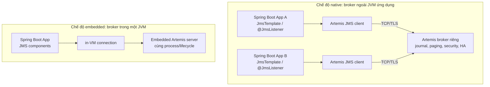

# Chế độ kết nối broker bên ngoài và điều kiện dùng embedded broker

> **Chương:** Spring Boot  
> **Phạm vi:** Ứng dụng Java dùng Spring Boot 3.x, **Jakarta Messaging (`jakarta.jms`)** và Apache ActiveMQ Artemis. Có đối chiếu ngắn với ActiveMQ Classic để tránh nhầm cấu hình.  
> **Mục tiêu:** Chọn đúng giữa **broker chạy bên ngoài ứng dụng** (`spring.artemis.mode=native`) và **Artemis nhúng cùng JVM** (`spring.artemis.mode=embedded`); xác định dependency, lifecycle, connection factory, persistence, bảo mật và loại phép thử nào được phép dùng embedded.

## 1. Hai chế độ dùng cùng `JmsTemplate`, nhưng kiến trúc rất khác

Một ứng dụng Spring Boot có thể viết cùng logic gửi/nhận JMS:

```java
@Service
public class OrderPublisher {
    private final JmsTemplate jmsTemplate;

    public OrderPublisher(JmsTemplate jmsTemplate) {
        this.jmsTemplate = jmsTemplate;
    }

    public void publish(String orderId) {
        jmsTemplate.convertAndSend("orders.tasks", orderId);
    }
}

@Component
public class OrderListener {
    @JmsListener(destination = "orders.tasks")
    public void handle(String orderId) {
        System.out.println("Handling order " + orderId);
    }
}
```

Nhưng broker phía dưới có hai cách triển khai:



**Khác biệt cốt lõi:**

- **Native/external:** ứng dụng chỉ là JMS client, kết nối tới Artemis broker do tiến trình/container/cluster khác vận hành.
- **Embedded:** ứng dụng còn chạy một Artemis **server trong chính JVM của nó**; khi ứng dụng bị dừng, broker nhúng cũng bị dừng.
- **Cùng API JMS:** `JmsTemplate`, `@JmsListener` và `ConnectionFactory` vẫn có thể giữ nguyên, nhưng **không thể suy ra độ bền, mạng, TLS, HA và cách chia sẻ queue là tương đương**.

Trong Spring Boot, từ `native` ở `spring.artemis.mode` nghĩa là **kết nối tới một broker native/ngoài ứng dụng theo cấu hình Boot**, không có nghĩa JVM native image, GraalVM hoặc “tự khởi động một broker trên hệ điều hành”.

## 2. Bảng quyết định: khi nào chọn chế độ nào?

| Câu hỏi | `native` — broker ngoài ứng dụng | `embedded` — broker nhúng |
| --- | --- | --- |
| Broker chạy ở đâu? | Process/VM/container/service khác | **Cùng JVM** Spring Boot |
| Nhiều service độc lập dùng chung queue? | **Phù hợp**: nhiều client cùng trỏ một broker | **Không mặc định**; mỗi app thường tự có broker riêng |
| Broker sống khi app restart? | Có thể tiếp tục hoạt động độc lập | Server nhúng dừng cùng app; durability phụ thuộc cấu hình và disk |
| Security mạng, TLS, firewall? | Kiểm chứng đúng đường kết nối thực | Đường in-VM không đại diện TCP/TLS; chỉ kiểm chứng nếu tự cấu hình transport tương ứng |
| Cluster/HA/failover thực? | Có thể thử trên topology broker thật | Không nên dùng embedded đơn lẻ để khẳng định hành vi HA |
| Integration test JMS logic nhanh? | Được nhưng nặng hơn nếu tạo broker ngoài | **Phù hợp** cho test đơn tiến trình, phạm vi hẹp |
| Thử paging/journal/disk recovery? | **Ưu tiên broker riêng**, có volume và cấu hình giống production | Chỉ phù hợp bài thử có kiểm soát; embedded mặc định thường không persistent |
| Vận hành production nhiều replica? | **Ưu tiên** dùng broker service riêng | Thường **không phù hợp**, dễ tạo các broker độc lập theo từng replica |

**Quy tắc chọn ngắn gọn:** Dùng **native** khi ứng dụng phải nói chuyện với broker dùng chung hoặc muốn kiểm thử đặc tính vận hành thực. Dùng **embedded** cho test/dev khi chỉ cần chứng minh logic JMS trong cùng process và chấp nhận những giới hạn của mô phỏng.

## 3. Spring Boot tự cấu hình Artemis như thế nào?

Với Spring Boot 3.x, starter Artemis mang các thư viện cần thiết để Boot tự tạo **JMS `ConnectionFactory`** và hỗ trợ tích hợp Spring JMS. Các thành phần chính:

```text
application-{profile}.yml
        |
        v
Spring Boot Artemis auto-configuration
        |
        +--> Artemis JMS ConnectionFactory (Jakarta JMS)
        |        |
        |        +--> native: broker URL / credentials
        |        |
        |        +--> embedded: server trong JVM nếu có server libraries
        |
        +--> Spring JMS infrastructure
                 |
                 +--> JmsTemplate
                 +--> @JmsListener container
```

Một số điều kiện thường gây nhầm lẫn:

1. **Client dependency không phải server dependency.** Có `spring-boot-starter-artemis` không có nghĩa bạn đã cố ý nhúng một broker chạy production.
2. Chế độ `embedded` đòi hỏi **Artemis server implementation** phù hợp nằm trên runtime/test classpath. Chỉ đổi một property không tạo ra các class server còn thiếu.
3. Spring Boot có khả năng **phát hiện mode dựa trên classpath/configuration** tùy phiên bản. Với môi trường triển khai, nên **đặt mode tường minh** để tránh tình huống một dependency mới vô tình đổi cách broker được khởi tạo.
4. Boot tự cấu hình connection factory khi điều kiện auto-configuration thỏa; nếu ứng dụng tự khai báo `ConnectionFactory` bean, kết quả phụ thuộc điều kiện “back off” của Boot và bean thực tế. Cần xác minh thay vì giả định properties `spring.artemis.*` vẫn được dùng.
5. Các thông số connection pool, session cache và listener container là **mối quan tâm riêng**, không tự quyết định broker nằm trong hay ngoài JVM.

### 3.1. Dependency cơ bản cho client Spring Boot

Giả sử dự án đã có Spring Boot parent/BOM tương thích:

```xml
<dependencies>
    <dependency>
        <groupId>org.springframework.boot</groupId>
        <artifactId>spring-boot-starter-artemis</artifactId>
    </dependency>

    <dependency>
        <groupId>org.springframework.boot</groupId>
        <artifactId>spring-boot-starter-test</artifactId>
        <scope>test</scope>
    </dependency>
</dependencies>
```

Để Boot BOM quản lý các phiên bản Spring JMS, Artemis client và Jakarta API đồng bộ. **Không** thêm `activemq-client` của ActiveMQ Classic rồi nghĩ đó là Artemis embedded server. Hai nhánh Classic/Artemis có artifact, protocol và properties khác nhau.

Trong ví dụ của bài, code sử dụng **`jakarta.jms`** vì Spring Boot 3.x dựa trên Jakarta EE 9+; không trộn `javax.jms` từ client Classic 5.x vào Spring Boot 3.x.

### 3.2. Đặt mode tường minh thay vì tin hoàn toàn vào auto-detection

Hai cấu hình tối giản:

```yaml
# External / native
spring:
  artemis:
    mode: native
    broker-url: tcp://localhost:61616
```

```yaml
# Embedded / in-JVM — chỉ khi có Artemis server dependency tương thích
spring:
  artemis:
    mode: embedded
    embedded:
      persistent: false
      queues: lab.orders
```

**Không ghép hai cấu hình trên vào cùng một profile rồi kỳ vọng mọi thuộc tính có hiệu lực như nhau.** `broker-url` là địa chỉ của broker bên ngoài; embedded có lifecycle và các tham số riêng.

Trong các bản Spring Boot hỗ trợ Artemis, các khóa như `spring.artemis.mode`, `spring.artemis.broker-url`, `spring.artemis.embedded.*` được dùng cho cấu hình mode. Tuy nhiên tập property/thư viện nhúng có thể thay đổi theo release: luôn đối chiếu **configuration metadata/reference của đúng Spring Boot version** và Artemis do BOM quản lý.

## 4. Chế độ `native`: một ứng dụng là client của broker bên ngoài

### 4.1. Cấu hình `application-production.yml`

```yaml
spring:
  artemis:
    mode: native
    broker-url: ${ARTEMIS_BROKER_URL:tcp://localhost:61616}
    user: ${ARTEMIS_USER}
    password: ${ARTEMIS_PASSWORD}
```

Ví dụ cấu hình thực tế cho môi trường container:

```text
ARTEMIS_BROKER_URL=tcp://artemis-broker:61616
ARTEMIS_USER=orders-consumer
ARTEMIS_PASSWORD=<secret injected at runtime>
SPRING_PROFILES_ACTIVE=production
```

Tên host `artemis-broker` là **DNS service trên network**, không phải tên mặc định có sẵn của Artemis. Trong Kubernetes/Docker, `localhost` trong **app container** trỏ về chính app container, thường **không phải** broker container; đây là lỗi triển khai thường gặp.

**Về bảo mật:** Không đặt mật khẩu cố định vào `application-production.yml` trong Git. Lấy từ secret manager/biến môi trường hoặc cơ chế cấp bí mật của nền tảng. Với broker TLS, phải cấu hình transport URL và truststore/keystore theo Artemis client, kiểm tra hostname verification và quyền broker — việc đổi `mode` sang native **không tự bật TLS**.

### 4.2. Broker có thể nằm ở đâu?

```text
Spring Boot App (container A)
      |
      | TCP/TLS 61616
      v
Artemis Broker (container B / VM / broker service)
      |
      +-- address: orders.tasks
      +-- anycast queue: orders.tasks
      +-- journal / bindings / paging / DLQ / security
```

Với queue công việc, có thể provision trước trong `broker.xml` của **broker bên ngoài**:

```xml
<!-- Fragment đặt bên trong <addresses> của broker Artemis -->
<address name="orders.tasks">
    <anycast>
        <queue name="orders.tasks" durable="true"/>
    </anycast>
</address>
```

Đoạn XML này do người vận hành broker quản lý; **không** đặt bên trong `application.yml` của Spring Boot. `@JmsListener(destination="orders.tasks")` chỉ khai báo đích consumer cần đọc; queue thực có thể phải tồn tại, tùy chính sách auto-create và quyền.

### 4.3. Tách lifecycle application khỏi broker

Trong mode native:

- Start/stop Spring Boot app **không** nên start/stop broker service.
- Broker có thể phục vụ nhiều producer và competing consumers từ các service độc lập.
- Broker persistence/HA được triển khai và giám sát riêng; app cần sẵn sàng xử lý reconnect, redelivery, idempotency.
- Khi network hoặc broker lỗi, `JmsTemplate`/listener có thể báo exception, retry kết nối hoặc không khởi tạo tùy thời điểm. **Đặt `mode=native` không đồng nghĩa ứng dụng chắc chắn fail-fast ngay lúc start**: connection factory có thể chỉ thực sự kết nối khi có lệnh gửi/nhận hoặc listener container khởi động.

Do đó readiness nên dựa trên một **kiểm tra kết nối/chức năng broker phù hợp SLA**, không chỉ `HTTP /actuator/health` mặc định hay trạng thái JVM. Nếu cần readiness gate, xác minh health indicator JMS và listener trạng thái hoạt động theo Spring Boot version; một ping TCP thành công chưa chứng minh đủ quyền `send`/`consume` hoặc đúng destination.

### 4.4. External broker dùng chung cho nhiều replica

Giả sử chạy ba replica của service:

```text
orders-consumer-1 ──┐
orders-consumer-2 ──┼──> Artemis broker ──> orders.tasks
orders-consumer-3 ──┘
```

Nếu ba replica dùng cùng queue ANYCAST, broker có thể phân phối các message giữa các consumer theo mô hình **competing consumers**. Cần kiểm soát concurrency, prefetch/window, transaction, idempotency; các replica không nhất thiết xử lý theo thứ tự gửi toàn cục.

Đây là lý do chính **không thay broker ngoài bằng embedded trên mỗi replica**: ba broker nhúng độc lập sẽ có ba queue `orders.tasks` **khác nhau**, không tự hợp lại thành một queue được chia sẻ.

## 5. Chế độ `embedded`: broker khởi động trong cùng JVM

### 5.1. Thư viện server là điều kiện bắt buộc

Để khởi tạo embedded server, classpath cần **Artemis server artifacts** tương thích với client và Spring Boot version. Đối với Spring Boot 3.x (Jakarta), một dạng dependency test-scope thường gặp là:

```xml
<!-- Ví dụ khi Spring Boot BOM đang quản lý Artemis 2.x
     với Maven groupId org.apache.activemq -->
<dependency>
    <groupId>org.apache.activemq</groupId>
    <artifactId>artemis-jakarta-server</artifactId>
    <scope>test</scope>
</dependency>
```

**Cảnh báo phiên bản:** Maven groupId của Artemis thay đổi từ **Artemis 2.50.0** sang `org.apache.artemis`. Nếu BOM/client version của dự án sử dụng nhánh đó, cần chọn **groupId và dependency management tương ứng** cho server artifact; không máy móc sao chép `org.apache.activemq`. Nếu bạn cố thêm cả server artifact nhóm cũ và client mới không tương thích, ứng dụng có thể gặp lỗi classpath hoặc khởi động server thất bại.

Ví dụ artifact theo nhóm mới, **chỉ dùng nếu BOM/version thực tế hỗ trợ**:

```xml
<dependency>
    <groupId>org.apache.artemis</groupId>
    <artifactId>artemis-jakarta-server</artifactId>
    <scope>test</scope>
</dependency>
```

Hai fragment trên là **hai lựa chọn thay thế**, không khai báo cả hai. Trong một build thực tế, xác nhận các tọa độ đúng với **dependency tree của chính bản Spring Boot/Artemis đã chọn**. Một số tổ hợp cũ dùng server artifact khác; chế độ embedded không được bật chỉ bằng tên artifact nếu thiếu các server classes.

### 5.2. Cấu hình dành riêng cho test profile

```yaml
# src/test/resources/application-test.yml
spring:
  artemis:
    mode: embedded
    embedded:
      persistent: false
      queues: lab.test.orders
```

Điều kiện của profile này:

- Server library được đưa vào **test classpath**, không vô tình đóng gói vào production runtime.
- Embedded broker chạy khi Spring test application context khởi tạo và đóng theo context.
- `persistent: false` giúp đơn giản hóa bài thử **logic JMS**, không phải phép thử dữ liệu sống qua broker restart.
- `queues` ở đây tạo queue **của embedded broker**, không tự tạo queue bên ngoài nào.
- Nếu app có listener thực cho queue nghiệp vụ, dùng **tên queue test khác** để tránh competing consumer làm test không xác định.

**Quan trọng:** Một số phiên bản Boot còn có cấu hình như `spring.artemis.embedded.enabled`, `server-id`, `data-directory` và `topics`. Đừng tự thêm mọi thuộc tính từ ví dụ trên mạng; cần kiểm tra có thật trên release đang dùng và thiết lập đủ dependency server.

### 5.3. Embedded kết nối in-VM khác TCP/TLS

Trong chế độ nhúng điển hình, client trong chính JVM có thể dùng **in-VM transport**, không qua network stack sản xuất:

```text
Test / app JVM
    |
    +-- Spring JMS client
            |
            +-- in-VM connector / server ID
                    |
                    +-- Embedded Artemis server
```

Kết quả test gửi/nhận bằng embedded có thể PASS trong khi production vẫn FAIL do:

- Sai DNS, firewall, broker listener port hoặc TLS trust chain.
- Credential/role gửi–nhận không đúng.
- Broker thực không có address/queue hoặc routing mismatch.
- Protocol/acceptor bên ngoài không hỗ trợ kiểu client.
- Failover/HA/network timeout và mất kết nối.
- Cấu hình journal, paging, DLQ/expiry và security khác lab.

Có thể tùy biến embedded server để bật network acceptor trong một số trường hợp, nhưng khi ấy bạn đang **tự cấu hình một broker trong app**, không còn bài test embedded tối giản. Nó vẫn bị ràng buộc với lifecycle process và không đại diện cho cluster production.

### 5.4. Khi nào embedded có thể persistent?

Embedded không bắt buộc “in-memory và mất dữ liệu” về mặt sản phẩm. Artemis embedded có thể dùng persistence nếu cấu hình server/data directory phù hợp và volume được giữ lại. Tuy nhiên:

- Với `persistent: false` như ví dụ, **không** kỳ vọng message còn sau dừng JVM.
- Nếu bật persistent, kiểm tra **cùng data directory**, version tương thích, khóa store và quyền filesystem.
- Một ứng dụng tự động scale nhiều replica, mỗi replica có local volume riêng sẽ không có một shared durable queue.
- Test persistence/upgrade/crash thực nên chạy trên **broker process/container riêng** để mô phỏng đúng khả năng chết độc lập của broker và app.

**Chọn embedded persistent không biến ứng dụng thành một dịch vụ broker HA**.

## 6. Chia cấu hình theo profile để không vô tình nhúng broker trong production

Một cách tổ chức có thể kiểm soát:

```text
src/
  main/
    resources/
      application.yml
      application-production.yml
  test/
    resources/
      application-test.yml
```

`application.yml` chỉ giữ những cấu hình JMS chung, không nhét cả native và embedded vào cùng file:

```yaml
# src/main/resources/application.yml
spring:
  jms:
    listener:
      auto-startup: true
```

`application-production.yml` chỉ dùng native:

```yaml
spring:
  artemis:
    mode: native
    broker-url: ${ARTEMIS_BROKER_URL}
    user: ${ARTEMIS_USER}
    password: ${ARTEMIS_PASSWORD}
```

`application-test.yml` chỉ dùng embedded và không đặt broker URL bên ngoài:

```yaml
spring:
  artemis:
    mode: embedded
    embedded:
      persistent: false
      queues: lab.test.orders
```

**Đặt production mode tường minh** còn giúp phát hiện cấu hình sai nếu một dependency Artemis server được thêm vào classpath. Trước khi deploy, in ra **active profiles, bean `ConnectionFactory` loại gì, URL/transport (không kèm credential), và kết quả broker connection test**, thay vì chỉ log “JMS initialized”.

### 6.1. Cấu hình bằng biến môi trường trên container

Khi không muốn dùng placeholder trong YAML, Spring Boot relaxed binding cho phép cấu hình bằng biến môi trường:

```text
SPRING_ARTEMIS_MODE=native
SPRING_ARTEMIS_BROKER_URL=tcp://artemis-broker:61616
SPRING_ARTEMIS_USER=orders-app
SPRING_ARTEMIS_PASSWORD=<injected secret>
```

`SPRING_ARTEMIS_BROKER_URL` nên là hostname/port mà **app container có thể truy cập**. Không dùng URL HTTP của Artemis Console làm endpoint JMS Core.

### 6.2. Precedence và rủi ro test profile bị override

Spring Boot kết hợp nhiều property sources, trong đó environment variables, command-line arguments và profile-specific files có thể có độ ưu tiên khác nhau. Ví dụ test đặt `mode=embedded` nhưng CI lại khai báo `SPRING_ARTEMIS_MODE=native`, khiến test kết nối nhầm broker thật.

Biện pháp:

- Test nên **khẳng định mode** đang kỳ vọng; không chỉ dựa vào tên `@ActiveProfiles`.
- CI secrets production không được inject vào job unit/integration test embedded.
- Test native dùng broker riêng và đặt các property kết nối tường minh.
- Không chia sẻ queue hoặc tài khoản production giữa test và triển khai thực.

## 7. Ví dụ ứng dụng Spring Boot có thể đổi mode mà không sửa code

### 7.1. Ứng dụng và listener

```java
package example.messaging;

import org.springframework.boot.SpringApplication;
import org.springframework.boot.autoconfigure.SpringBootApplication;
import org.springframework.jms.annotation.EnableJms;

@SpringBootApplication
@EnableJms
public class MessagingApplication {
    public static void main(String[] args) {
        SpringApplication.run(MessagingApplication.class, args);
    }
}
```

```java
package example.messaging;

import org.springframework.jms.core.JmsTemplate;
import org.springframework.stereotype.Service;

@Service
public class OrderPublisher {
    private final JmsTemplate jmsTemplate;

    public OrderPublisher(JmsTemplate jmsTemplate) {
        this.jmsTemplate = jmsTemplate;
    }

    public void publish(String orderId) {
        jmsTemplate.convertAndSend("orders.tasks", orderId);
    }
}
```

```java
package example.messaging;

import org.springframework.jms.annotation.JmsListener;
import org.springframework.stereotype.Component;

@Component
public class OrderListener {
    @JmsListener(destination = "orders.tasks")
    public void handle(String orderId) {
        // Demo: production phải lưu idempotency key trước khi side effect.
        System.out.println("Order received: " + orderId);
    }
}
```

Spring JMS đảm nhiệm chuyển `String` sang JMS `TextMessage` qua default message converter, với điều kiện configuration mặc định phù hợp. Code nghiệp vụ trên **không hard-code broker URL**, không tự new `ActiveMQConnectionFactory`, và không buộc gọi `Connection.start/stop` thủ công.

**Vấn đề riêng cần giải quyết khi triển khai thật:** annotation `@JmsListener` không tự cho biết bạn đang dùng transaction hay ACK mode nào. Với xử lý có side effect, cần cấu hình listener container transaction/ack và idempotency phù hợp. Đây là yêu cầu vận hành **ở cả native và embedded**; test đơn giản gửi/nhận không chứng minh tính an toàn khi crash.

### 7.2. Một phương thức gửi bằng HTTP hoặc CLI

Có thể thêm một endpoint test đơn giản:

```java
package example.messaging;

import org.springframework.web.bind.annotation.PathVariable;
import org.springframework.web.bind.annotation.PostMapping;
import org.springframework.web.bind.annotation.RestController;

@RestController
public class OrderTestController {
    private final OrderPublisher publisher;

    public OrderTestController(OrderPublisher publisher) {
        this.publisher = publisher;
    }

    @PostMapping("/lab/orders/{orderId}")
    public void send(@PathVariable String orderId) {
        publisher.publish(orderId);
    }
}
```

Nếu thực sự dùng `@RestController`, dự án cần thêm `spring-boot-starter-web`. Endpoint này chỉ dành cho **lab**, không triển khai không có authentication/authorization vào production vì bất kỳ caller nào cũng có thể kích hoạt message.

Cùng một artifact ứng dụng có thể chạy:

- `production` profile → JMS client tới external broker.
- `test` profile → embedded server trong JVM, **nếu** runtime/test dependency có Artemis server classes.

**Lưu ý:** Các class service ví dụ dùng queue `orders.tasks`; profile embedded phần 6 tạo `lab.test.orders` để cô lập test, nên các listener nghiệp vụ không tự xử lý queue test. Khi muốn thử đúng ứng dụng end-to-end, provision `orders.tasks` riêng trong embedded test hoặc tùy biến tên destination qua property nhất quán, tránh test treo vì gửi/nhận ở hai queue khác nhau.

## 8. Integration test embedded: kiểm tra đúng điều nó có thể kiểm tra

Bài test dưới đây chỉ xác nhận: với Spring Boot context và embedded Artemis, `JmsTemplate` gửi được `String` và `@JmsListener` nhận được. Nó **không** kiểm tra DNS, TLS, external authorization hay failover.

### 8.1. Cấu hình test

```yaml
# src/test/resources/application-test.yml
spring:
  artemis:
    mode: embedded
    embedded:
      persistent: false
      queues: lab.test.orders
```

Test server dependency là **test scope** theo đúng groupId mà BOM quản lý (xem phần 5.1). Main app có `@EnableJms` và `spring-boot-starter-artemis`.

### 8.2. Test class

```java
package example.messaging;

import org.junit.jupiter.api.Test;
import org.springframework.beans.factory.annotation.Autowired;
import org.springframework.boot.test.context.SpringBootTest;
import org.springframework.boot.test.context.TestConfiguration;
import org.springframework.context.annotation.Bean;
import org.springframework.context.annotation.Import;
import org.springframework.jms.annotation.JmsListener;
import org.springframework.jms.core.JmsTemplate;
import org.springframework.test.context.ActiveProfiles;

import java.util.concurrent.BlockingQueue;
import java.util.concurrent.LinkedBlockingQueue;
import java.util.concurrent.TimeUnit;

import static org.junit.jupiter.api.Assertions.assertEquals;

@SpringBootTest
@ActiveProfiles("test")
@Import(EmbeddedMessagingIT.ProbeConfiguration.class)
class EmbeddedMessagingIT {

    @Autowired JmsTemplate jmsTemplate;
    @Autowired ProbeListener probeListener;

    @Test
    void stringIsDeliveredToListener() throws Exception {
        jmsTemplate.convertAndSend("lab.test.orders", "event-1001");

        String received = probeListener.events.poll(
                5, TimeUnit.SECONDS);

        assertEquals("event-1001", received);
    }

    @TestConfiguration
    static class ProbeConfiguration {
        @Bean
        ProbeListener probeListener() {
            return new ProbeListener();
        }
    }

    static class ProbeListener {
        final BlockingQueue<String> events =
                new LinkedBlockingQueue<>();

        @JmsListener(destination = "lab.test.orders")
        public void onEvent(String body) {
            events.offer(body);
        }
    }
}
```

**Điều cần kiểm tra sau khi chạy test:**

- Embedded server đã được khởi động, không có lệnh kết nối tới `localhost:61616` của một external broker.
- `@JmsListener` được đăng ký và hoạt động.
- Gửi `event-1001` qua `JmsTemplate`, nhận đúng string trong thời hạn 5 giây.
- Môi trường CI có đủ server implementation trên test classpath và không bị property bên ngoài override sang native.

**Điều test này không chứng minh:** message sống qua broker restart, giao dịch JMS/DB là nguyên tử, bảo mật TLS, cluster HA, exact-once hay performance/paging production. Chỉ nhìn `@SpringBootTest` PASS rồi kết luận “broker ngoài chắc chắn hoạt động” là sai tầng kiểm thử.

**Cách cô lập test:** dùng queue test riêng, tạo/test context riêng khi cần, tránh dùng cùng queue bởi các `@JmsListener` khác. Nếu test phải chạy song song và chia sẻ embedded instance, đặt destination/run ID riêng hoặc tắt chạy song song để tránh cạnh tranh.

## 9. Integration test với broker ngoài: khi nào bắt buộc?

Không nên dùng embedded để kết luận các yêu cầu dưới đây đã đạt:

| Yêu cầu cần nghiệm thu | Vì sao embedded tối giản không đủ? | Phép thử phù hợp |
| --- | --- | --- |
| **Network/DNS/firewall** | In-VM không sử dụng đường TCP thật | Broker/container độc lập, kết nối qua TCP |
| **TLS/truststore/mTLS** | Không thực hiện handshake production | Broker ngoài có TLS acceptor và chứng chỉ tương ứng |
| **Broker authentication/ACL** | Embedded test thường không có role production | Tạo user/role thử nghiệm, kiểm tra send/consume bị cho phép/từ chối |
| **Restart broker mà app vẫn chạy** | Embedded chết cùng process | Restart broker process/container độc lập khi client vẫn tồn tại |
| **Failover/HA/cluster** | Không có topology broker thật | Nhiều broker, cấu hình HA/failover đúng version |
| **Persistent journal/paging/recovery** | Embedded test thường `persistent=false` và không có disk setup như production | Broker ngoài có persistent volume, fault injection |
| **AMQP/OpenWire/STOMP/MQTT** | In-VM JMS không kiểm tra acceptor/network protocol khác | Client thật qua acceptor phù hợp |
| **Nhiều service dùng chung queue** | Các embedded server riêng không tự chia sẻ state | Nhiều app connect một broker chung |

### 9.1. Ví dụ test với broker container

Có thể dùng Testcontainers hoặc một broker do CI tạo sẵn. Nguyên tắc cấu hình Spring context:

```java
// Pseudocode về ý tưởng kết nối broker test ngoài:
// 1. Khởi động Artemis broker test container riêng.
// 2. Lấy host và mapped TCP 61616.
// 3. Đặt spring.artemis.mode=native.
// 4. Đặt spring.artemis.broker-url=tcp://<host>:<mappedPort>.
// 5. Đặt credential test nếu broker yêu cầu.
// 6. Chạy Spring Boot context/producer/consumer qua network.
// 7. Restart container và kiểm tra reconnect/ACK theo tình huống.
```

Đây là **pseudocode kế hoạch test**, không phải source Java biên dịch trực tiếp. Các bản Testcontainers có thể cung cấp module Artemis chuyên dụng; chọn container image, API và startup wait strategy tương thích phiên bản đang dùng. Nên dùng **mapped port**, không hard-code `localhost:61616` nếu broker chạy container trên host khác.

Một test contract tốt có thể:

1. Provision queue ANYCAST `lab.external.orders` ở broker test.
2. Start Spring Boot với profile native/credential test.
3. Gửi message chứa `eventId`, nhận bằng `@JmsListener` hoặc consumer độc lập.
4. Tắt broker đúng **giữa** hai bước ACK/commit đã chọn.
5. Bật broker lại, kiểm tra chính sách reconnect/redelivery, idempotency và trạng thái broker.
6. Kiểm tra cả case **sai password, thiếu quyền, sai TLS**: test phải thất bại như dự kiến, không fallback sang embedded.

## 10. So sánh embedded Artemis với ActiveMQ Classic “embedded”

ActiveMQ Classic và Artemis **không dùng cùng Spring Boot properties**:

| Thành phần | Artemis | ActiveMQ Classic |
| --- | --- | --- |
| Starter thường dùng | `spring-boot-starter-artemis` | `spring-boot-starter-activemq` |
| Namespace config | `spring.artemis.*` | `spring.activemq.*` |
| ConnectionFactory client | Artemis JMS client (thường Core protocol) | Classic JMS client (thường OpenWire) |
| Embedded mechanism | Artemis embedded server + in-VM transport | Classic broker embedded/In-VM theo starter/version |
| Storage | Artemis journal/paging | Classic KahaDB/JDBC theo cấu hình |
| Java namespace với Boot 3.x | `jakarta.jms` | Cần chọn Classic client tương thích Jakarta |

**Không copy `spring.activemq.in-memory=true`/`spring.activemq.broker-url` của Classic sang Artemis.** Tương tự không đưa `spring.artemis.mode=embedded` cho Classic rồi kỳ vọng nó bật broker Classic.

Nếu đang migration Classic → Artemis, hãy tách ba quyết định:

1. **Broker sản phẩm nào**: Classic hay Artemis?
2. **Broker ở đâu**: external hay embedded?
3. **Client/protocol/API nào**: `javax.jms` hay `jakarta.jms`, OpenWire/Core/AMQP?

Việc chuyển thư viện JMS hoặc đổi mode không tự migrate queue/data store. Đặc biệt Artemis không hiểu KahaDB directory của Classic như một dữ liệu store có thể mount trực tiếp.

## 11. Những tình huống khiến cấu hình tưởng đúng nhưng chạy sai

### 11.1. Thêm server dependency vào runtime production

Dự án trước chỉ có client, sau đó thêm Artemis server dependency ở `compile/runtime` để chạy test. Nếu dựa hoàn toàn vào auto-detection, Boot có thể chọn embedded theo classpath/config. Biện pháp:

- Server dependency phục vụ test → **`test` scope**.
- Production → luôn đặt `spring.artemis.mode=native` và broker URL tường minh.
- Startup logging → kiểm tra mode và endpoint thực; không log password.

### 11.2. Docker/Kubernetes dùng `localhost` sai

`tcp://localhost:61616` bên trong app container không thể mặc nhiên đến broker container. Phải dùng DNS/container service name và mạng cho phép. Broker bên ngoài cũng phải có acceptor bind đúng interface, port, TLS/security.

### 11.3. Chạy hai ứng dụng embedded rồi mong chúng chia sẻ queue

Mỗi ứng dụng embedded thường có một Artemis server riêng trong JVM:

```text
App A: embedded broker A -> queue orders.tasks (chỉ A)
App B: embedded broker B -> queue orders.tasks (chỉ B)
```

Đặt tên queue giống nhau **không chia sẻ dữ liệu**. Muốn mô hình competing consumers giữa hai app, dùng broker chung ở chế độ native.

### 11.4. Test PASS nhưng prod gửi message lỗi

Có thể do:

- Embedded test không bật authentication, production bật quyền send/consume.
- Embedded auto-create queue, production tắt auto-create.
- Test không có network/TLS.
- Production có selector, transaction, concurrency hoặc redelivery policy khác.
- Listener test nhận qua in-VM nhưng production acceptor chỉ bật AMQP hoặc OpenWire, không nhận native Core client.
- Container image/volume production khác, broker bị restart khi client gửi.

Cách xử lý: thêm **external broker integration tests** theo các trục còn thiếu. Không sửa business code để che lỗi cấu hình nếu nguyên nhân là broker environment.

### 11.5. Tự tạo `ConnectionFactory` và tưởng Boot properties luôn thắng

Nếu dự án có:

```java
@Bean
jakarta.jms.ConnectionFactory myFactory() {
    // Kết nối tự cấu hình, có thể bỏ qua spring.artemis.mode
    ...
}
```

Boot có thể không tạo bean `ConnectionFactory` của nó do điều kiện auto-configuration. Kiểm tra bean thực tế và quyết định **một nơi quản lý connection factory**, thay vì cho cả auto-config và factory thủ công cạnh tranh.

Đoạn trên là ví dụ **cố tình chưa hoàn chỉnh**, chỉ minh họa nguyên nhân nhầm cấu hình, không phải code cần copy. Trong ứng dụng bình thường, ưu tiên Boot auto-config trừ khi có yêu cầu provider/SSL/failover rất cụ thể.

## 12. Checklist code review và vận hành

- [ ] Xác định broker dùng **Artemis**, không lẫn với Classic starter/properties.
- [ ] Với Spring Boot 3.x, các library/DTO JMS dùng **`jakarta.jms`**, không trộn `javax.jms`.
- [ ] Production có `spring.artemis.mode=native` và `broker-url` từ cấu hình môi trường.
- [ ] Secret lấy từ cơ chế cấp bí mật phù hợp, không commit vào repository.
- [ ] Đã kiểm tra DNS, TCP/TLS, authentication/authorization, acceptor và destination trên broker ngoài.
- [ ] App không tự chạy embedded broker ngoài ý muốn chỉ vì dependency server mới.
- [ ] Server artifact dùng cho embedded test ở **test scope** và tương thích BOM/Artemis version.
- [ ] Embedded test dùng profile/destination riêng, `persistent=false` khi chỉ test logic JMS.
- [ ] Không dùng embedded để xác nhận HA, shared queue giữa nhiều service, network/TLS hoặc persistent storage production.
- [ ] Có external broker integration test cho những yêu cầu vận hành quan trọng.
- [ ] Có probe/metrics cho listener connection, reconnect và error rate; readiness không chỉ phụ thuộc HTTP endpoint.
- [ ] Nếu dùng nhiều replica, chúng phải trỏ tới **một broker service/topology chung** theo thiết kế.
- [ ] Consumer có idempotency và ACK/transaction phù hợp; mode kết nối không tự bảo đảm exactly-once.
- [ ] Nếu broker embedded persistent, có đường dữ liệu nhất quán, test restart và không nhầm với HA.
- [ ] Chọn đúng Maven groupId/server artifact theo Spring Boot BOM và Artemis version, đặc biệt ở mốc Artemis 2.50.0.

## 13. Bài thực hành tự kiểm tra

### Bài A — Chứng minh embedded không cần broker ngoài

1. Chạy Spring Boot test với `@ActiveProfiles("test")`, mode embedded và server dependency test.
2. Đảm bảo không có broker đang listen tại `localhost:61616`.
3. Gửi `event-1001` tới `lab.test.orders` và xác minh listener nhận.
4. Tắt Spring test context: embedded broker cũng ngừng hoạt động.
5. Ghi rõ kết luận: **đường JMS trong process hoạt động**, không phải kiểm tra broker network.

### Bài B — Chứng minh native phụ thuộc broker ngoài

1. Chạy một Artemis broker riêng và provision `lab.external.orders`.
2. Chạy Spring Boot với `mode=native` và broker URL thực.
3. Xác minh consumer nhận message khi broker đang hoạt động.
4. Dừng broker, thử gửi message: quan sát lỗi/retry/reconnect theo cấu hình, **không fallback sang embedded**.
5. Khởi động lại broker, xác minh app kết nối lại theo tính năng client/container và message state còn đúng.

### Bài C — Chứng minh hai embedded server không tự chia sẻ dữ liệu

1. Chạy hai process Spring Boot riêng biệt, mỗi process có embedded server.
2. Đặt cùng tên queue `lab.same.name`.
3. Gửi message tại process A.
4. Quan sát process B **không tự nhận** message của A nếu hai server không có network bridge/cluster được cấu hình riêng.
5. Chuyển cả A/B sang native trỏ một broker chung; kiểm chứng mô hình chia sẻ queue.

### Ma trận nghiệm thu

| ID | Chế độ | Test | Kết quả đúng |
| --- | --- | --- | --- |
| M1 | Embedded | Spring `JmsTemplate` → `@JmsListener` cùng JVM | PASS với server classes có mặt |
| M2 | Native | App → Artemis ngoài qua TCP | PASS khi URL/network/credential đúng |
| M3 | Native | Broker ngoài tắt | Fail/retry có kiểm soát, **không tự khởi chạy embedded** |
| M4 | Native | Sai credential/ACL | Bị từ chối; ghi lỗi an toàn |
| M5 | Native | TLS chain sai | TLS handshake failure, không tự hạ xuống plaintext |
| M6 | Embedded | Hai Spring processes độc lập | Không mặc định chia sẻ queue |
| M7 | Native | Hai Spring processes cùng broker | Có thể cạnh tranh consumer trên cùng ANYCAST queue |
| M8 | Embedded nonpersistent | Restart toàn JVM | Không dựa vào lưu giữ message |
| M9 | Native persistent | Restart broker riêng | Kiểm chứng message đã commit/ACK đúng |
| M10 | Cả hai | Đổi profile khi server artifact thiếu | Startup báo thiếu điều kiện, không lặng lẽ thay semantics |

## 14. Câu hỏi tự kiểm tra

1. `spring.artemis.mode=native` có nghĩa broker chạy cùng JVM nhưng thông qua native transport không?
2. Chỉ thêm `spring-boot-starter-artemis` có đủ để chạy embedded broker trong mọi Spring Boot version không?
3. Vì sao `mode=embedded` với `persistent=false` không đủ để kiểm thử JMS message sống qua restart?
4. App container trỏ `tcp://localhost:61616` trong khi broker nằm ở container khác có thể lỗi gì?
5. Hai replica mỗi replica dùng embedded broker và queue cùng tên có tạo thành competing consumer của một queue chung không?
6. `JmsTemplate` và `@JmsListener` có cần viết lại hoàn toàn khi đổi mode không?
7. Những yêu cầu nào bắt buộc phải dùng broker ngoài: TLS, HA/failover, paging production, hay test conversion từ `String` sang `TextMessage`?
8. Tại sao test embedded PASS không chứng minh producer có quyền gửi trên broker production?
9. Tại sao nên đặt mode production tường minh ngay cả khi Boot có auto-detection?
10. Sự khác nhau giữa `spring.artemis.*` và `spring.activemq.*` là gì?

**Gợi ý:** (1) không, native kết nối broker ngoài; (2) không, còn server implementation và config; (3) broker test nonpersistent; (4) localhost sai network namespace; (5) không; (6) thường không, nếu vẫn dùng Spring JMS API; (7) TLS/HA/paging vận hành cần broker ngoài, conversion cơ bản có thể embedded; (8) ACL khác; (9) tránh classpath/profile đổi mode ngoài ý muốn; (10) hai sản phẩm/bộ auto-configuration khác nhau.

## 15. Tài liệu đối chiếu

- [Spring Boot Reference — JMS Messaging](https://docs.spring.io/spring-boot/reference/messaging/jms.html): Artemis auto-configuration, `spring.artemis.mode`, embedded và kết nối native.
- [Spring Boot Reference — Profiles](https://docs.spring.io/spring-boot/reference/features/profiles.html): profile-specific YAML và lựa chọn cấu hình runtime.
- [Spring Framework — JMS Annotated Endpoints](https://docs.spring.io/spring-framework/reference/integration/jms/annotated.html): `@EnableJms`, `@JmsListener` và listener container.
- [Spring Boot — JMS Artemis Properties](https://docs.spring.io/spring-boot/appendix/application-properties/index.html): tra đúng `spring.artemis.*` và `spring.jms.*` cho version đang dùng.
- [Apache ActiveMQ Artemis — Embedding](https://artemis.apache.org/components/artemis/documentation/latest/embedding-activemq.html): mô hình nhúng server và vòng đời JVM.
- [Apache ActiveMQ Artemis — Using JMS](https://artemis.apache.org/components/artemis/documentation/latest/using-jms.html): tạo JMS client/connection factory và broker.
- [Apache ActiveMQ Artemis — Configuring Transports](https://artemis.apache.org/components/artemis/documentation/latest/configuring-transports.html): TCP, in-VM, SSL/TLS và acceptor/connector.

> **Kết luận:** **Native** kết nối Spring Boot tới **broker Artemis độc lập**, phù hợp chia sẻ queue giữa dịch vụ và kiểm thử mạng/bảo mật/durability/HA thực tế. **Embedded** khởi động broker trong **cùng JVM**, hữu ích cho một lớp test JMS nhanh, nhưng không tự đại diện hệ thống phân tán. Chọn mode **tường minh theo profile**, giữ server dependency embedded ở phạm vi test, dùng `JmsTemplate`/`@JmsListener` độc lập môi trường và dành các bài kiểm thử network, failover, paging, security, persistent restart cho **broker ngoài**.
